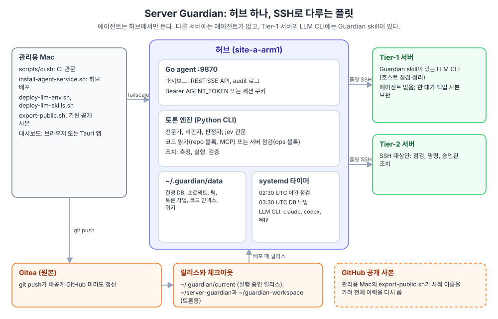
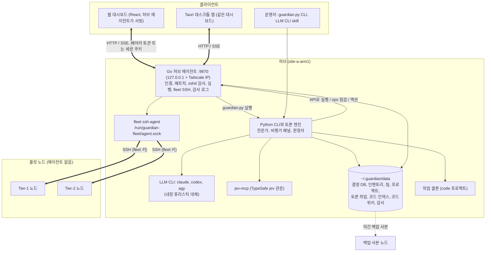
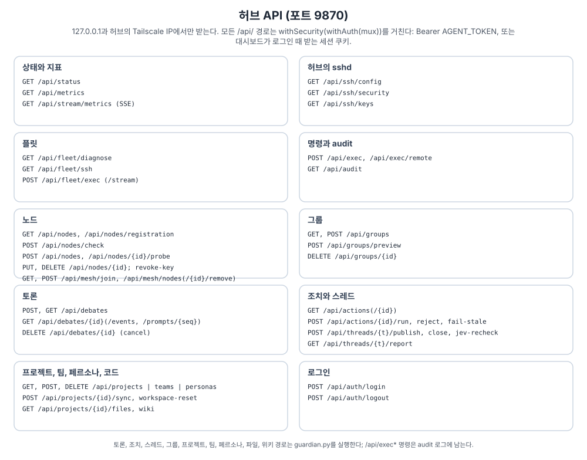
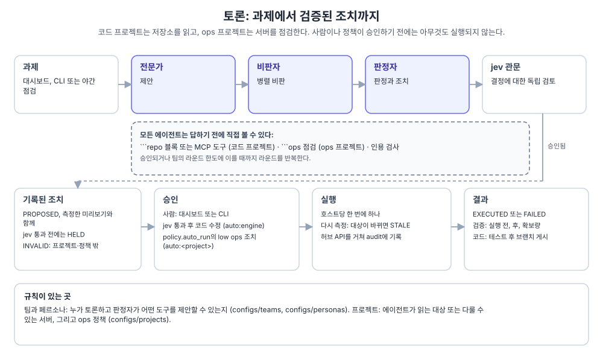
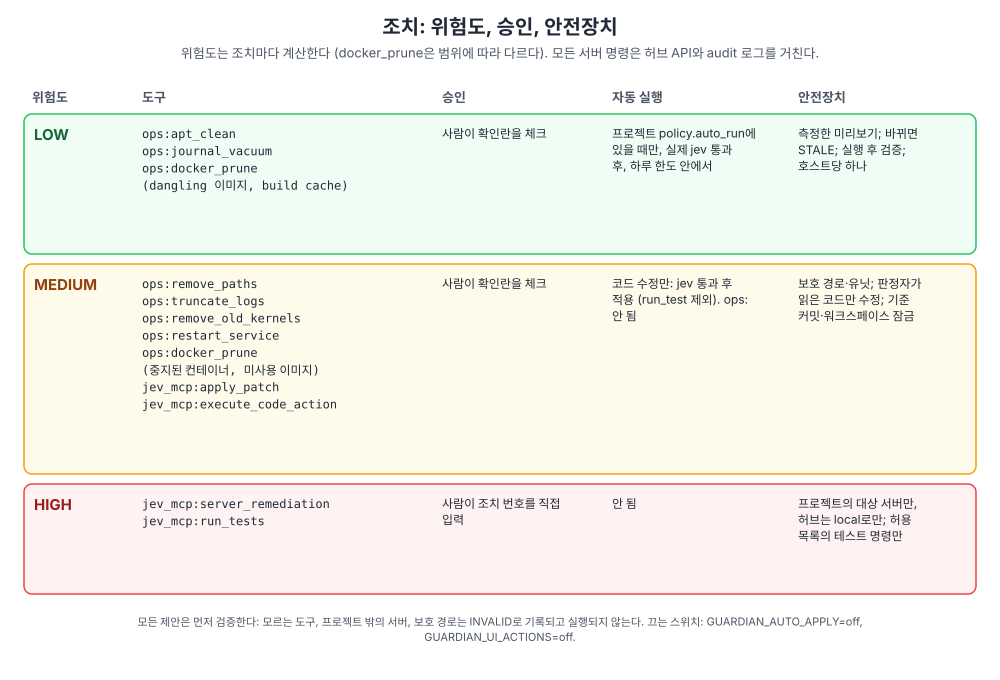

# Server Guardian 시스템 명세서 (agent.md)

[English](agent.md) | 한국어

*허브 한 대에서 운영하는 노드 텔레메트리, sshd 감사, fleet SSH, LLM CLI 멀티 에이전트 토론*

설치, 명령, 일상 운영은 [README](README.ko.md)에 있다. 이 문서는 시스템이 어떻게 만들어져 있는지 설명한다.

---

## 1. 개요

**Server Guardian**은 노드 자원을 지켜보고, 플릿 전체의 sshd 설정을 감사하며, LLM CLI를 멀티 에이전트 토론에 써서
문제를 진단하고 변경을 제안한다. 제안된 변경은 승인을 받은 뒤에만(또는 좁은 자동 실행 정책 아래에서만) 실행된다.
토론은 코드(code 프로젝트, git 저장소)나 노드(운영(ops) 프로젝트, 저장소 없음)를 다룬다.

### 한눈에 보는 시스템



시스템은 상시 가동하는 허브 하나다: 노드 한 대에 허브 에이전트 하나, 개인키는 그 노드에만, 접속은 Tailscale 메시로만.

### 1.1 노드와 역할

| 역할 | 노드 | 실행하는 것 |
|---|---|---|
| **허브** | 인벤토리에서 `"guardian_role": "hub"`인 한 대(`site-a-arm1`; ARM64, 2 OCPU, 12 GB, Gitea도 운영) | Go 허브 에이전트(`:9870`), 대시보드, 토론 엔진과 LLM CLI, 결정 DB, fleet SSH 키, 백업과 ops 점검 타이머 |
| **Tier-1 노드** | 12 GB ARM64 노드(`"tier": "Tier-1"`) | 에이전트 없음. 운영자용 LLM CLI(claude, codex, agy)와 Guardian skill `guardian-host-check`, `guardian-host-cleanup`. 계획(2026-10-22, `docs/design/remote-agents.ko.md`): 허브 대신 토론 역할을 실행하는 선택형 모델 워커이며 능력 프로브 뒤 노드별로 켠다(등급 자체는 아무것도 결정하지 않음) |
| **Tier-2 노드** | 작은 x86_64·ARM 노드(약 1 GB)(`"tier": "Tier-2"`) | 에이전트도 LLM CLI도 없음. 허브가 SSH로 접속한다 |

- 토론 에이전트(Expert, Critic, Judge)는 허브에 있는 엔진의 LLM CLI 하위 프로세스다. Tier-1 노드의 CLI는 운영자용일
  뿐이며, `docs/design/remote-agents.ko.md`의 원격 워커가 만들어지기 전(아직 아님)에는 토론을 실행하지 않고, ops 점검은 SSH로 다른 노드에 닿지만 거기서 LLM을 실행하지 않는다. 실행마다 실행 호스트를
  `debate_started.host`에 기록하며(`GUARDIAN_HOST_LABEL`이 호스트 이름을 덮어쓴다) 대시보드가 보여 준다.
- 에이전트는 허브에서만 실행된다(계획 중인 워커는(등급과 무관하게 능력이 있고 켠 노드 누구나 실행 가능)  에이전트가 아니라 모델 실행기이며 상태도 판단도 없다). `scripts/install-agent-service.sh`는 다른 노드를 거부하며(종료 코드 2), 노드별 설치는
  없다. 예전 설계는 Tier-2 노드에서 Go 에이전트를 실행했지만 그 방식은 더 이상 없다.
- 허브는 자신의 fleet 키(`/etc/guardian/fleet_key`, `guardian-fleet-agent.service`의 ssh-agent가 보관)로 다른 모든
  노드에 접속한다. 노드는 허브의 Tailscale IP에서 온 접속만 받는다(`from="..."`).
- 인벤토리 원본은 허브의 `~/.guardian/data/servers.json`이다. `configs/servers.json`은 git에서 무시되는 로컬
  스냅샷이고, `configs/servers.example.json`이 필드(`id`, `hostname`, `user`, `arch`, `tier`, `role`, `cli_support`,
  `guardian_role`, `tailscale_ip`, `backup_replica` 등)를 보여 준다.
- 이 문서를 쓰는 시점에 인벤토리는 노드 24대다: Tier-1 7대(허브 포함), Tier-2 17대.

---

## 2. 전체 아키텍처 다이어그램



---

## 3. 허브 에이전트 (`apps/agent`)

허브 에이전트는 Go 단일 바이너리(표준 라이브러리만 사용)이며 허브에서 `server-guardian-agent.service`로 실행된다.

### 3.1 모듈
- **텔레메트리 (`metrics.go`)**: CPU 사용률, 부하 지수(1/5/15분), 메모리, 루트 파티션, 상위 5개 프로세스(PID, 사용자,
  CPU%, 메모리%, 명령). Linux와 macOS. `GET /api/stream/metrics`가 SSE로 스트리밍한다.
- **sshd 관리자와 평가기 (`sshd.go`)**: `sshd_config`를 찾아 파싱하고(`Port`, `PermitRootLogin`,
  `PasswordAuthentication`, `PubkeyAuthentication`, `MaxAuthTries` 등), `sshd -t`로 검증하며, `authorized_keys`를
  SHA256 지문과 함께 파싱하고, CIS 스타일 규칙 5개(`SEC-SSH-001` root 로그인, `SEC-SSH-002` 키 인증만 허용,
  `SEC-SSH-003` 공개키 인증, `SEC-SSH-004` `MaxAuthTries` 4 이하, `SEC-SSH-005` 비표준 포트)로 0~100점과 해결 안내를
  만든다.
- **실행기 (`metrics.go`의 `executeRaw`, `main.go`)**: 명령을 별도 프로세스 그룹에서 `sh -c`로 제한 시간(기본 10초)
  안에 실행하고 stdout, stderr, 종료 코드, 소요 시간(ms)을 돌려준다.
- **fleet SSH (`fleet_ssh.go`, `ssh_classify.go`)**: fleet 키로 노드에서 병렬 진단과 명령 실행, 그리고 노드별 SSH 감사:
  고정된 읽기 전용 프로브, 최대 8대 동시, 노드당 20초, 대상 집합별 60초 캐시
  ([fleet-ssh-audit.ko.md](docs/design/fleet-ssh-audit.ko.md)).
- **노드 등록 (`nodes_handler.go`, `nodes_inventory.go`, `ssh_fleet_file.go`)**: 노드 점검, 등록, 수정, 재점검, 삭제.
  인벤토리와 `~/.ssh/guardian_fleet.conf`의 호스트 블록을 쓰고, `~/.ssh/guardian_known_hosts`에 호스트 키를 고정하며,
  노드에서 허브 키를 회수할 수 있다([node-registration.ko.md](docs/design/node-registration.ko.md)).
- **허브 보호 (`hub_guard.go`)**: 허브 sudo가 꺼져 있으면 fleet SSH는 허브를 대상으로 받지 않는다(허브 에이전트 샌드박스
  밖에서 실행되기 때문이다). 허브에서 실행할 명령은 `/api/exec`를 거친다.
- **토론·프로젝트·위키 핸들러 (`debate_handler.go`, `file_handler.go`, `wiki_handler.go`)**: 토론, 액션, 팀, 페르소나,
  프로젝트, 그룹, publish, 코드 위키를 위해 `guardian.py`를 실행한다(`newCmd`). 동시 토론 수를 제한하고
  (`GUARDIAN_MAX_DEBATES`, 기본 2), 작업을 `~/.guardian/data/debate-jobs/<id>/`(`events.jsonl`, 출력, 결과)에 저장한다.
- **감사 로그 (`audit.go`)**: `/api/exec`, `/api/exec/remote`, `/api/fleet/exec`로 보낸 명령(과 프로젝트 파일 읽기)마다
  JSON 한 줄을 `<data dir>/audit/exec.jsonl`에 쓴다. 10 MiB에서 회전하고 옛 파일 5개를 둔다. 엔진은 요청에 라벨을
  붙인다(`source` `ops_check` 또는 `action`, `op`, `project`, `action_id`). 이 로그는 운영용이며 위변조 방지는 없다.
- **대시보드 (`ui.go`)**: 빌드된 대시보드를 `AGENT_UI_DIR`에서 같은 포트로 서빙한다.

### 3.2 보안
- HTTP 체인은 `withSecurity(withAuth(mux))`다(`main.go`). `withSecurity`는 Host 헤더(`AGENT_ALLOWED_HOSTS`)를 확인하고
  CORS preflight에 응답한다. `withAuth`는 모든 `/api/` 경로에 `AGENT_TOKEN`(베어러 헤더, 또는
  `POST /api/auth/login`이 주는 HttpOnly 세션 쿠키)을 요구한다. 허브 에이전트는 토큰 없이 시작하지 않으며, 예외는 loopback
  전용 개발 옵션 `GUARDIAN_INSECURE_NO_AUTH=1`뿐이다. 토론 경로의 `h.guard`는 CLI가 있는지만 확인한다.
- `AGENT_HOST`(설치 시 `127.0.0.1`과 허브의 Tailscale IPv4), 포트 `AGENT_PORT`(9870)에서 대기한다.
- systemd 샌드박스: `NoNewPrivileges`와 키·비밀 파일에 대한 `InaccessiblePaths`. `--hub-sudo`(기본값)면 drop-in
  `hub-sudo.conf`가 일부를 풀어 허브 에이전트, 판정자 액션, 대시보드 터미널이 허브에서 sudo를 쓸 수 있다.

### 3.3 API



현재 경로를 묶으면 다음과 같다.

| 묶음 | 경로 |
|---|---|
| 허브 상태와 sshd | `GET /api/status`, `GET /api/metrics`, `GET /api/stream/metrics`, `GET /api/ssh/config`, `GET /api/ssh/security`, `GET /api/ssh/keys` |
| 실행 | `POST /api/exec`(허브), `POST /api/exec/remote`(노드 한 대), `POST /api/fleet/exec`, `/api/fleet/exec/stream`, `GET /api/audit` |
| 플릿 | `GET /api/fleet/diagnose`, `GET /api/fleet/ssh` |
| 노드 | `GET /api/nodes` (플릿 인벤토리), `GET /api/nodes/registration`, `POST /api/nodes/check`, `POST /api/nodes`, `PUT /api/nodes/{id}`, `DELETE /api/nodes/{id}`, `POST /api/nodes/{id}/probe`, `GET`/`POST /api/nodes/{id}/revoke-key`, `GET`/`POST /api/mesh/join` (headscale 로그인 승인), `GET /api/mesh/nodes`, `POST /api/mesh/nodes/{id}/remove` (tailnet 노드, 등록 해제; [mesh-join.ko.md](./docs/design/mesh-join.ko.md)) |
| 설정 | `GET`/`POST /api/personas`, `/api/teams`, `/api/projects`, `/api/groups`(+ `DELETE .../{id}`), `POST /api/groups/preview`, `POST /api/projects/{id}/sync` |
| 토론 | `POST /api/debates`, `GET /api/debates`, `GET /api/debates/{id}`, `GET /api/debates/{id}/events`, `GET /api/debates/{id}/prompts/{seq}`, `DELETE /api/debates/{id}`(취소), `GET /api/threads/{thread}/report` |
| 액션와 스레드 | `GET /api/actions`, `GET /api/actions/{id}`, `POST /api/actions/{id}/run`, `.../reject`, `.../fail-stale`, `POST /api/threads/{thread}/jev-recheck`, `.../close`, `.../publish`, `GET .../publish-plan`, `GET .../publications`, `GET /api/threads/closed`, `GET`/`POST /api/projects/{id}/workspace-reset` |
| 코드와 위키 | `GET /api/projects/{id}/files`, `.../files/show`, `.../files/lines`, `GET /api/projects/{id}/wiki`, `POST .../wiki/build`, `GET`/`PUT`/`DELETE .../wiki/{page}` |
| 세션 | `POST /api/auth/login`, `POST /api/auth/logout` |

이름 규칙: 통신(wire)과 UI는 *node*를 쓴다(`GET /api/nodes`는 `nodes`를 반환하고, 플릿 리포트는 `total_nodes`를
세며, 실행 스트림은 `node_start`/`node_done`을 보낸다). `servers.json`과 `GUARDIAN_SERVERS_FILE`은 이름을 유지한다:
인벤토리 파일을 가리키는 이름이지 API 명사가 아니기 때문이다.

계약: [debate-teams-api.ko.md](docs/design/debate-teams-api.ko.md), [node-groups.ko.md](docs/design/node-groups.ko.md),
[debate-agent-retrieval.ko.md](docs/design/debate-agent-retrieval.ko.md)(이벤트 계약),
[publish-thread.ko.md](docs/design/publish-thread.ko.md).

---

## 4. LLM 멀티 에이전트 계층 (`cli/llm-agent`)

### 4.1 자연어 질의 (`multi_agent.py`)

`guardian.py "<요청>"`(과 REPL)은 요청을 네 역할로 처리한다.
1. **Supervisor**: 의도를 읽고 어떤 에이전트를 부를지 정하며, 활성 페르소나(`--persona`, 기본 `server_guardian`)로
   결과를 요약한다.
2. **Diagnostic**: 허브(`/api/metrics`), 노드 한 대(`--target`), 플릿(`/api/fleet/diagnose`)의 텔레메트리와 병목.
3. **Security Auditor**: 허브의 `/api/ssh/config`와 `/api/ssh/security`, 또는 노드·그룹·플릿에 대한 fleet SSH 감사.
4. **Remediation**: 위험도가 붙은 구체적인 명령 계획. 계획을 출력할 뿐이며, 운영자 없이는 아무것도 실행되지 않는다.

### 4.2 토론 엔진 (`debate_engine.py`)



- **역할.** 전문가가 제안하고, 비평가 패널(1~4명, 병렬)이 검토하며, 판정자가 결정하고(`VERDICT: APPROVED` 여부) 도구
  액션를 제안할 수 있다. 라운드: 팀의 `max_rounds`, 없으면 3(`--rounds`). 팀과 페르소나:
  [debate-teams.ko.md](docs/design/debate-teams.ko.md).
- **프로젝트.** 모든 토론은 프로젝트에 속한다. code 프로젝트(`kind: "code"`, 기본값)는 저장소와 작업 클론이 있고, ops
  프로젝트(`kind: "ops"`)는 대상 노드와 정책이 있다. 프로젝트가 에이전트가 보는 것과 판정자의 도구를 정한다: 판정자 도구 =
  (팀 ∩ 페르소나) ∩ 프로젝트 종류 ∩ 프로젝트 정책.
- **코드 읽기 (code 프로젝트).** 에이전트는 ```` ```repo ```` 블록이나 읽기 전용 MCP 서버 `repo_mcp.py`로 코드를
  요청한다. 길 찾기는 심볼 인덱스(`code_index.py`), 저장소 지도(`repo_map.py`), Go facts(`go_facts.py`,
  `tools/goindex`), 코드 위키(`code_wiki.py`, `wiki_build.py`)가 돕는다. 지도와 위키는 길 찾기용일 뿐이다: 강한 인용은 그
  줄이 세션에 보여졌을 때만 통과한다(`evidence.py`, 여유 `GUARDIAN_CITATION_SLACK` 3). 예산은 무제한이며 단계당
  256 KiB를 넘으면 `retrieval_warning`이 난다. 설계: [debate-agent-retrieval.ko.md](docs/design/debate-agent-retrieval.ko.md),
  [debate-code-index-wiki.ko.md](docs/design/debate-code-index-wiki.ko.md).
- **노드 점검 (ops 프로젝트).** 에이전트는 ```` ```ops ```` 블록으로 읽기 전용 점검을 요청한다(`ops_checks.py`). 엔진은
  고정된 템플릿을 허브 에이전트를 거쳐 실행하고 출력을 데이터로 돌려준다. 인용 `[#<call> <check> <host>]`은 결과를 돌려준
  점검을 가리켜야 한다.
- **세션.** CLI 세션은 스레드·역할별로 저장되고(`agent_sessions`) 다음 라운드에서 이어진다. `--attach`는 세션을 tmux에서
  연다.
- **이벤트.** 작업마다 대시보드 Agents 모니터를 위한 `events.jsonl`(라운드, retrieval, 점검, 인용, 판정)을 쓴다.

### 4.3 jev 관문 (`jev_gate.py`)
LLM 판정자가 승인한 뒤 토론을 jev-mcp에 ADR로 제출하고 TypeSafe jev가 평가한다. jev 판정이 통과해야만 토론이
`APPROVED`로 남고, 아니면 `DISPUTED`(평가 전에는 `PENDING_JEV`)가 되며 판정자의 액션는 `HELD`가 된다.
`--jev-recheck`는 평가를 다시 실행한다. `GUARDIAN_JEV_GATE=off`로 끌 수 있다(테스트).

### 4.4 LLM CLI 어댑터 (`llm_runner.py`)
- provider를 순서대로 시도해 답하는 것을 쓴다(`GUARDIAN_LLM_PROVIDERS`; 기본 순서 claude, codex, agy, opencode, ollama,
  llm). 토론에서 claude는 `--tools ""`로, codex는 읽기 전용 샌드박스로 실행된다.
- 자격 증명은 `~/.guardian/llm.env`(`GUARDIAN_LLM_ENV`)에서 읽으며 `scripts/deploy-llm-env.sh`로 배포한다.
- 답하는 CLI가 없으면 내장 전문가 휴리스틱 엔진이 답한다. 결과는 `built-in-expert`로, 토론은 `UNVERIFIED`로 표시된다.

---

## 5. 운영(ops) 프로젝트

ops 프로젝트는 저장소 없이 노드를 관리한다: 대상(그룹, 노드, 제외 목록, 선택적으로 허브), 정책(`allowed_actions`,
`deny_paths`, `include_hub`, `auto_run`, `max_auto_runs_per_day`, `watch`), 기본 팀, 자체 결정 이력. 내장 프로젝트는
`fleet`이다(허브를 뺀 모든 노드, 팀 `fleet-ops`).

```
observe (ops checks) -> plan (judge proposal) -> validate and store preview -> approval (or auto_run)
  -> re-measure right before running (drift) -> run -> verify -> record
```

- **정리 액션 카탈로그 (`ops_actions.py`)**: `ops:docker_prune`, `ops:journal_vacuum`, `ops:apt_clean`(low.
  `docker_prune`은 `stopped_containers`와 `unused_images`일 때 medium), `ops:remove_paths`, `ops:truncate_logs`,
  `ops:remove_old_kernels`, `ops:restart_service`(medium). 액션마다 측정(preview), 고정된 명령, 검증이 있다. 제안 이후
  크게 바뀌었으면 액션가 `STALE`이 된다.
- **거부 규칙 (`ops_paths.py`)**: 시스템 디렉터리, 보호 트리, 홈 디렉터리, 보호 이름(`.ssh`, `.claude`, `.guardian`,
  `server-guardian` 등), 비밀처럼 보이는 경로. 설정으로 풀 수 없고 `policy.deny_paths`는 여기에 더한다.
- **노드 잠금**: 노드마다 한 번에 액션 하나(`<data dir>/ops-locks/<host>.lock`).
- **`server_remediation`**: 허브(`local`, `/api/exec` 경유)나 대상 노드에서 실행하는 자유 명령. 고위험이며 항상 사람이
  필요하다.
- **`auto_run`**: 정책에 넣은 low 등급 카탈로그 액션만, 하루 `max_auto_runs_per_day`번까지, jev 판정이 실제로 `PASSED`일
  때만. `decided_by`는 `auto:<project>`.
- **야간 점검 (`ops_watch.py`)**: `server-guardian-ops-watch.timer`(02:30 UTC)가 `policy.watch`가 있는 프로젝트의 디스크,
  inode, journal 임계값을 점검하고 새 발견 사항이 있으면 ops 토론을 하나 시작한다(7일 반복 방지, 상태는
  `<data dir>/ops-watch/<project>.json`).

설계와 구현 메모: [server-ops-project.ko.md](docs/design/server-ops-project.ko.md).

---

## 6. 승인과 위험도



코드가 실제로 적용하는 것은 다음과 같다.

| 도구 | 위험도 | 실행 방식 |
|---|---|---|
| `jev_mcp:apply_patch`, `jev_mcp:execute_code_action` | medium | code 프로젝트. jev 관문을 통과하면 클론에 자동 적용(`auto:engine`). 단, `run_test`를 요청한 쓰기는 제외. push하지 않으며 push는 Publish가 한다. |
| `jev_mcp:run_tests` | high | code 프로젝트. 허용된 테스트 명령만. 사람이 필요하며, 대시보드에서 액션 번호를 직접 입력한다. |
| `ops:*` 카탈로그 | 액션마다 low 또는 medium | ops 프로젝트. 사람이 필요하다. 단 `auto_run`에 있고 low면 예외. preview, drift 검사, verify. |
| `jev_mcp:server_remediation` | high | ops 프로젝트. 사람이 필요하며, 대시보드에서 액션 번호를 직접 입력한다. |

- 모든 액션는 `decision_actions`에 `PROPOSED`(jev 관문을 통과하지 못했으면 `HELD`)로 저장되고 `RUNNING`, `EXECUTED`,
  `FAILED`, `REJECTED`, `INVALID`, `STALE`로 바뀐다. 각 액션는 실행 직전에 다시 검증된다.
- 누가 결정했는지는 `decided_by`에 남는다(`dashboard@<IP>`, CLI 사용자나 `--actor`, `auto:engine`, `auto:<project>`).
- `GUARDIAN_AUTO_APPLY=off`는 자동 실행을 끈다. `GUARDIAN_UI_ACTIONS=off`도 자동 실행을 끄고 대시보드의 모든 액션·스레드
  결정을 막는다. CLI는 그대로 동작한다.

---

## 7. 대시보드와 접속

- 허브 에이전트가 빌드된 대시보드를 `:9870`으로 서빙하며, `127.0.0.1`과 Tailscale 메시(`http://<허브 Tailscale IP>:9870/`)로
  접속한다. 공인 IP에는 열지 않는다. 허브에서 개발 서버를 띄우지 않는다.
- Tauri 2 데스크톱 앱(`apps/web-desktop/src-tauri`)은 같은 대시보드를 불러와 HTTP로 허브에 접속한다. macOS에서는 이를
  위한 ATS 예외가 필요하다(`Info.plist`).
- 화면: 플릿(요약, 노드, SSH 감사, 명령, 그룹), 토론(시작, 실시간 에이전트 활동, 결과, 액션, Publish, 코드 위키), 승인,
  설정(언어를 포함한 허브 연결, 프로젝트, 페르소나, 팀).
- 언어: 기본은 한국어, English 선택 가능, 브라우저마다 저장([dashboard-i18n.ko.md](docs/design/dashboard-i18n.ko.md)).

---

## 8. 개발

```bash
# 허브 에이전트
cd apps/agent && go build -o agent . && AGENT_TOKEN=$(openssl rand -hex 32) ./agent

# CLI (single query, remote target, REPL)
python3 cli/llm-agent/guardian.py "Audit SSH security and plan the fixes"
python3 cli/llm-agent/guardian.py --target site-a-arm1 "Check the remote node's resources"
python3 cli/llm-agent/guardian.py

# Dashboard
cd apps/web-desktop && npm run dev   # http://localhost:5173/

# Checks
scripts/ci.sh
```

배포, 배포 관문, 허브 구성은 [README](README.ko.md)에 있다.
