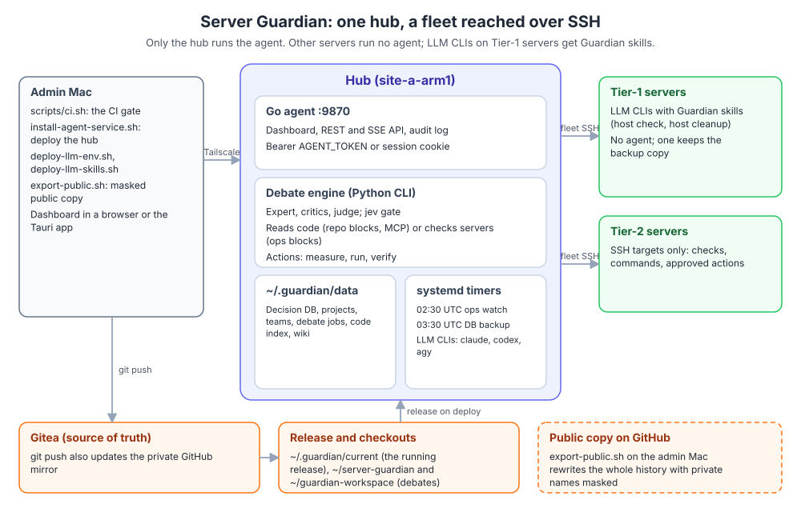
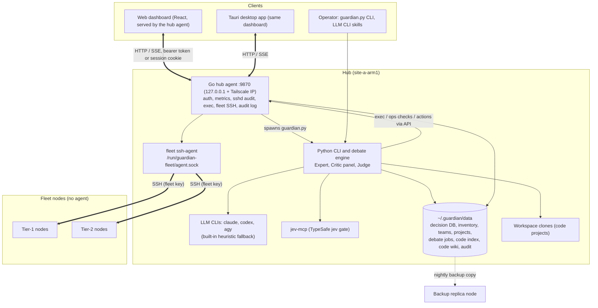
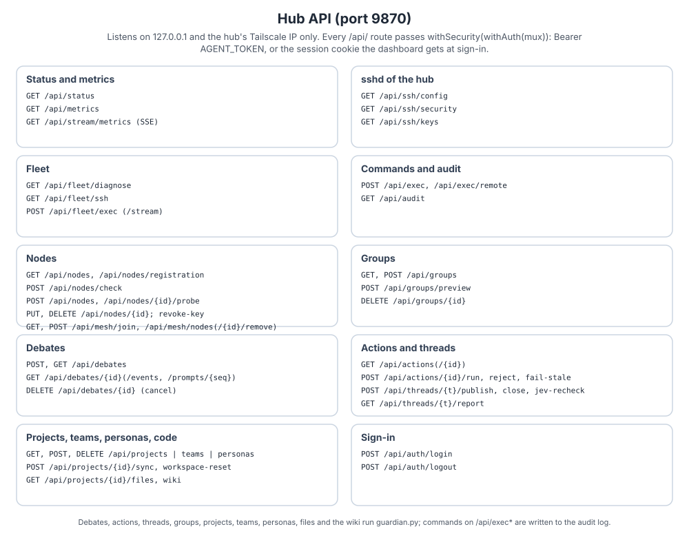
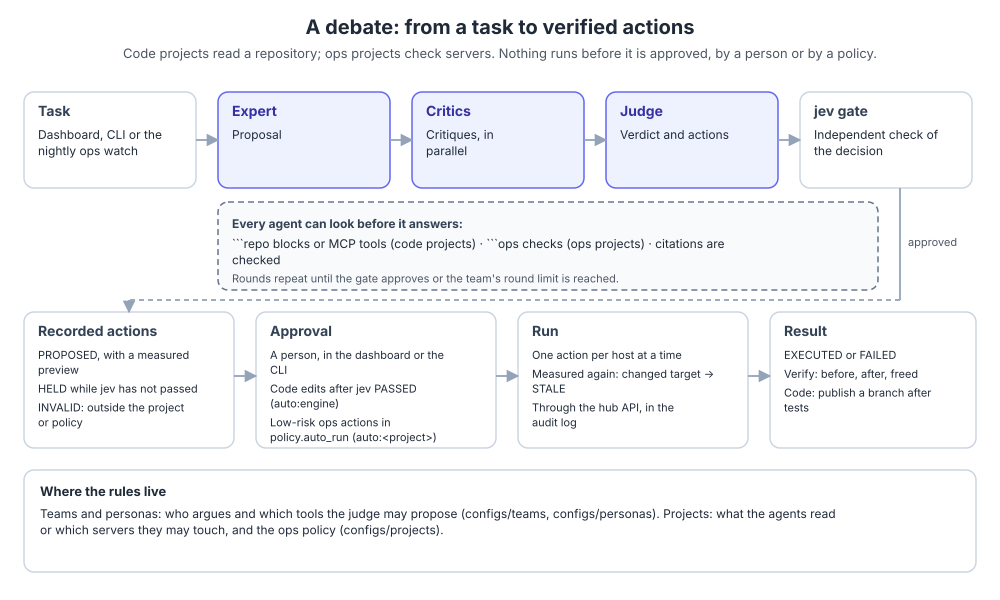
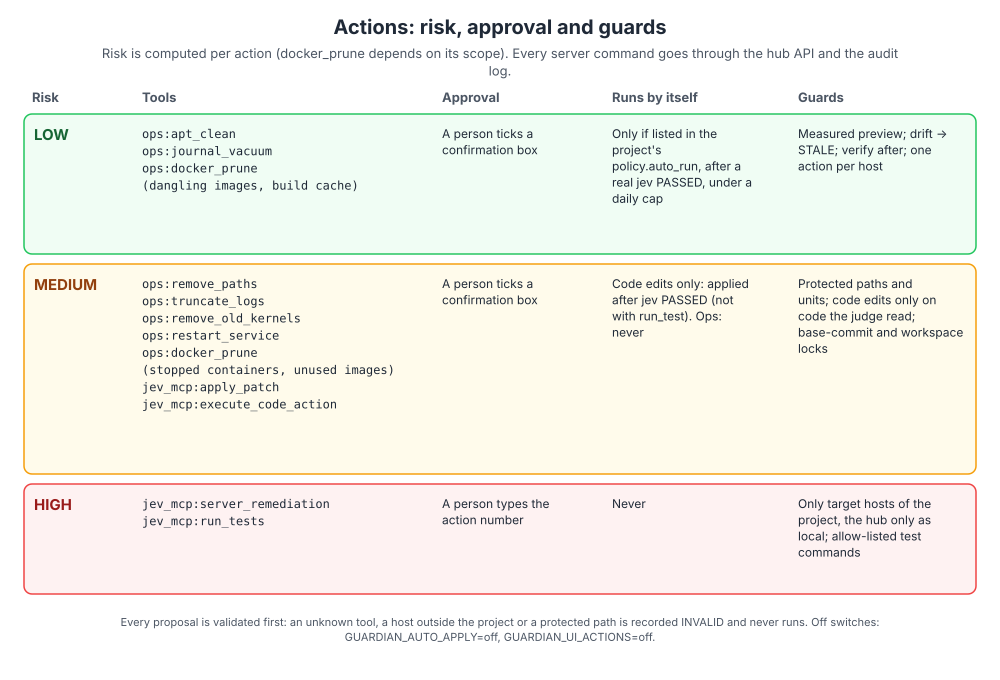

# Server Guardian system specification (agent.md)

English | [한국어](agent.ko.md)

*Node telemetry, sshd audit, fleet SSH and LLM CLI multi-agent debates, run from a single hub*

Setup, commands and day-to-day operation are in the [README](README.md). This document describes how the system is
built.

---

## 1. Overview

**Server Guardian** watches node resources, audits sshd settings across a fleet, and uses LLM CLIs in multi-agent
debates to diagnose problems and propose changes, which then run only after approval (or under a narrow automatic
policy). Debates work on code (code projects, a git repository) or on nodes (ops projects, no repository).

### System at a glance



The system is a single always-on hub: one hub agent on one node, the private key kept on that node, access over the
Tailscale mesh only.

### 1.1 Nodes and roles

| Role | Nodes | Runs |
|---|---|---|
| **Hub** | One node, the inventory entry with `"guardian_role": "hub"` (`site-a-arm1`; ARM64, 2 OCPU, 12 GB, also runs Gitea) | The Go hub agent (`:9870`), the dashboard, the debate engine and LLM CLIs, the decision DB, the fleet SSH key, the backup and ops watch timers |
| **Tier-1 nodes** | ARM64 nodes with 12 GB (`"tier": "Tier-1"`) | No agent. LLM CLIs (claude, codex, agy) for the operator, with the Guardian skills `guardian-host-check` and `guardian-host-cleanup`. Planned (2026-10-22, `docs/design/remote-agents.md`): an opt-in model worker that runs debate roles for the hub, enabled per node after a capability probe (the tier itself decides nothing) |
| **Tier-2 nodes** | Small x86_64 and ARM nodes (about 1 GB) (`"tier": "Tier-2"`) | No agent and no LLM CLI. The hub reaches them over SSH |

- Debate agents (Expert, Critics, Judge) are LLM CLI subprocesses of the engine on the hub. Tier-1 nodes have the CLIs for
  the operator only and run no debate until the remote worker of `docs/design/remote-agents.md` is built (not yet); ops checks reach other nodes over SSH but run no LLM there. Each run records its
  execution host in `debate_started.host` (`GUARDIAN_HOST_LABEL` overrides the hostname) and the dashboard shows it.
- Only the hub runs an agent (the planned worker, which any capable and enabled node may run regardless of tier, is a model runner, not an agent: it holds no state and decides nothing). `scripts/install-agent-service.sh` refuses any other node (exit 2); there is no
  per-node install. Earlier designs ran a Go agent on Tier-2 nodes; that mode no longer exists.
- The hub reaches every other node with its own fleet key (`/etc/guardian/fleet_key`, held by the ssh-agent of
  `guardian-fleet-agent.service`). Nodes accept it only from the hub's Tailscale IP (`from="..."`).
- The inventory source is the hub's `~/.guardian/data/servers.json`. `configs/servers.json` is a git-ignored local
  snapshot; `configs/servers.example.json` shows the fields (`id`, `hostname`, `user`, `arch`, `tier`, `role`,
  `cli_support`, `guardian_role`, `tailscale_ip`, `backup_replica`, ...).
- At the time of writing the inventory has 24 nodes: 7 Tier-1 (including the hub) and 17 Tier-2.

---

## 2. Architecture diagram



---

## 3. Hub agent (`apps/agent`)

The hub agent is a single Go binary (standard library only) that runs as `server-guardian-agent.service` on the hub.

### 3.1 Modules
- **Telemetry (`metrics.go`)**: CPU use, load average (1/5/15 min), memory, root partition, top 5 processes (PID,
  user, CPU%, memory%, command). Linux and macOS. `GET /api/stream/metrics` streams it over SSE.
- **sshd manager and evaluator (`sshd.go`)**: finds and parses `sshd_config` (`Port`, `PermitRootLogin`,
  `PasswordAuthentication`, `PubkeyAuthentication`, `MaxAuthTries`, ...), validates it with `sshd -t`, parses
  `authorized_keys` with SHA256 fingerprints, and scores five CIS-style rules (`SEC-SSH-001` root login,
  `SEC-SSH-002` key-only authentication, `SEC-SSH-003` public key authentication, `SEC-SSH-004` `MaxAuthTries` at most
  4, `SEC-SSH-005` non-standard port) from 0 to 100 with remediation hints.
- **Executor (`metrics.go` `executeRaw`, `main.go`)**: runs a command with `sh -c` in its own process group under a
  timeout (default 10 seconds) and returns stdout, stderr, exit code and duration in ms.
- **Fleet SSH (`fleet_ssh.go`, `ssh_classify.go`)**: parallel diagnosis and command execution on nodes through the
  fleet key, and the per-node SSH audit: a fixed read-only probe, 8 nodes at a time, 20 seconds per node, 60-second
  cache per target set ([fleet-ssh-audit.md](docs/design/fleet-ssh-audit.md)).
- **Node registration (`nodes_handler.go`, `nodes_inventory.go`, `ssh_fleet_file.go`)**: check, register, update,
  probe and delete nodes; writes the inventory and the host block in `~/.ssh/guardian_fleet.conf`, pins host keys in
  `~/.ssh/guardian_known_hosts`, and can revoke the hub key on a node
  ([node-registration.md](docs/design/node-registration.md)).
- **Hub guard (`hub_guard.go`)**: while hub sudo is off, fleet SSH refuses the hub as a target (it would run outside
  the hub agent's sandbox); commands for the hub go through `/api/exec`.
- **Debate, project and wiki handlers (`debate_handler.go`, `file_handler.go`, `wiki_handler.go`)**: start
  `guardian.py` (`newCmd`) for debates, actions, teams, personas, projects, groups, publish and the code wiki; limit
  concurrent debates (`GUARDIAN_MAX_DEBATES`, default 2); store jobs in `~/.guardian/data/debate-jobs/<id>/`
  (`events.jsonl`, output, result).
- **Audit log (`audit.go`)**: one JSON line per command sent through `/api/exec`, `/api/exec/remote` and
  `/api/fleet/exec` (and file reads of projects) in `<data dir>/audit/exec.jsonl`, rotated at 10 MiB, 5 old files.
  The engine labels its requests (`source` `ops_check` or `action`, `op`, `project`, `action_id`). The log is
  operational and not tamper-proof.
- **Dashboard (`ui.go`)**: serves the built dashboard from `AGENT_UI_DIR` on the same port.

### 3.2 Security
- The HTTP chain is `withSecurity(withAuth(mux))` (`main.go`). `withSecurity` checks the Host header
  (`AGENT_ALLOWED_HOSTS`) and answers CORS preflights; `withAuth` requires `AGENT_TOKEN` (bearer header, or the
  HttpOnly session cookie from `POST /api/auth/login`) for every `/api/` route. The hub agent does not start without a
  token, except with the loopback-only development opt-in `GUARDIAN_INSECURE_NO_AUTH=1`. `h.guard` on debate routes only checks that the CLI exists.
- It listens on `AGENT_HOST` (installed as `127.0.0.1` plus the hub's Tailscale IPv4), port `AGENT_PORT` (9870).
- systemd sandbox: `NoNewPrivileges` and `InaccessiblePaths` for the key and secret files. With `--hub-sudo` (the
  default) the drop-in `hub-sudo.conf` relaxes part of it so the hub agent, judge actions and the dashboard terminal can
  use sudo on the hub.

### 3.3 API



The current routes, grouped:

| Group | Routes |
|---|---|
| Hub status and sshd | `GET /api/status`, `GET /api/metrics`, `GET /api/stream/metrics`, `GET /api/ssh/config`, `GET /api/ssh/security`, `GET /api/ssh/keys` |
| Execution | `POST /api/exec` (hub), `POST /api/exec/remote` (one node), `POST /api/fleet/exec`, `/api/fleet/exec/stream`, `GET /api/audit` |
| Fleet | `GET /api/fleet/diagnose`, `GET /api/fleet/ssh` |
| Nodes | `GET /api/nodes` (fleet inventory), `GET /api/nodes/registration`, `POST /api/nodes/check`, `POST /api/nodes`, `PUT /api/nodes/{id}`, `DELETE /api/nodes/{id}`, `POST /api/nodes/{id}/probe`, `GET`/`POST /api/nodes/{id}/revoke-key`, `GET`/`POST /api/mesh/join` (approve a headscale login), `GET /api/mesh/nodes`, `POST /api/mesh/nodes/{id}/remove` (tailnet nodes, removal; [mesh-join.md](./docs/design/mesh-join.md)) |
| Configuration | `GET`/`POST /api/personas`, `/api/teams`, `/api/projects`, `/api/groups` (+ `DELETE .../{id}`), `POST /api/groups/preview`, `POST /api/projects/{id}/sync` |
| Debates | `POST /api/debates`, `GET /api/debates`, `GET /api/debates/{id}`, `GET /api/debates/{id}/events`, `GET /api/debates/{id}/prompts/{seq}`, `DELETE /api/debates/{id}` (cancel), `GET /api/threads/{thread}/report` |
| Actions and threads | `GET /api/actions`, `GET /api/actions/{id}`, `POST /api/actions/{id}/run`, `.../reject`, `.../fail-stale`, `POST /api/threads/{thread}/jev-recheck`, `.../close`, `.../publish`, `GET .../publish-plan`, `GET .../publications`, `GET /api/threads/closed`, `GET`/`POST /api/projects/{id}/workspace-reset` |
| Code and wiki | `GET /api/projects/{id}/files`, `.../files/show`, `.../files/lines`, `GET /api/projects/{id}/wiki`, `POST .../wiki/build`, `GET`/`PUT`/`DELETE .../wiki/{page}` |
| Session | `POST /api/auth/login`, `POST /api/auth/logout` |

Naming: the wire and the UI say *node* (`GET /api/nodes` returns `nodes`, fleet reports count `total_nodes`,
the exec stream sends `node_start`/`node_done`). `servers.json` and `GUARDIAN_SERVERS_FILE` keep their names:
they name the inventory file, not an API noun.

Contracts: [debate-teams-api.md](docs/design/debate-teams-api.md), [node-groups.md](docs/design/node-groups.md),
[debate-agent-retrieval.md](docs/design/debate-agent-retrieval.md) (event contract),
[publish-thread.md](docs/design/publish-thread.md).

---

## 4. LLM multi-agent layer (`cli/llm-agent`)

### 4.1 Natural-language queries (`multi_agent.py`)

`guardian.py "<request>"` (and the REPL) routes a request through four roles:
1. **Supervisor**: reads the intent, decides which agents to call and summarizes their results with the active
   persona (`--persona`, default `server_guardian`).
2. **Diagnostic**: telemetry and bottlenecks of the hub (`/api/metrics`), one node (`--target`) or the fleet
   (`/api/fleet/diagnose`).
3. **Security Auditor**: the hub's `/api/ssh/config` and `/api/ssh/security`, or the fleet SSH audit for a node, a
   group or the fleet.
4. **Remediation**: a concrete command plan with a risk level; it only prints the plan, nothing runs without the
   operator.

### 4.2 Debate engine (`debate_engine.py`)



- **Roles.** Expert proposes, a Critic panel (1 to 4, in parallel) reviews, the Judge decides (`VERDICT: APPROVED` or
  not) and may propose tool actions. Rounds: the team's `max_rounds`, else 3 (`--rounds`). Teams and personas:
  [debate-teams.md](docs/design/debate-teams.md).
- **Projects.** Every debate belongs to a project. Code projects (`kind: "code"`, default) have a repository and a
  workspace clone; ops projects (`kind: "ops"`) have target nodes and a policy. The project decides what agents see
  and which tools the judge has: judge tools = (team ∩ persona) ∩ project kind ∩ project policy.
- **Code retrieval (code projects).** Agents request code with ```` ```repo ```` blocks or through the read-only MCP
  server `repo_mcp.py`. Navigation comes from the symbol index (`code_index.py`), the repository map (`repo_map.py`),
  Go facts (`go_facts.py`, `tools/goindex`) and the code wiki (`code_wiki.py`, `wiki_build.py`). Map and wiki are
  navigation only: a strong citation passes only if those lines were shown to the session (`evidence.py`, slack
  `GUARDIAN_CITATION_SLACK` 3). Budgets are unlimited; `retrieval_warning` fires above 256 KiB per step.
  Design: [debate-agent-retrieval.md](docs/design/debate-agent-retrieval.md),
  [debate-code-index-wiki.md](docs/design/debate-code-index-wiki.md).
- **Node checks (ops projects).** Agents request read-only checks with ```` ```ops ```` blocks (`ops_checks.py`);
  the engine runs fixed templates through the hub agent and returns the output as data. Citations
  `[#<call> <check> <host>]` must name a check that returned.
- **Sessions.** CLI sessions are stored per thread and role (`agent_sessions`) and resumed in the next round;
  `--attach` opens one in tmux.
- **Events.** Each job writes `events.jsonl` (rounds, retrievals, checks, citations, verdicts) for the Agents monitor
  on the dashboard.

### 4.3 jev gate (`jev_gate.py`)
After the LLM judge approves, the debate is filed with jev-mcp as an ADR and judged by TypeSafe jev. Only a jev
verdict that passes keeps the debate `APPROVED`; otherwise it becomes `DISPUTED` (or `PENDING_JEV` until reviewed) and
the judge's actions are `HELD`. `--jev-recheck` re-runs the review. `GUARDIAN_JEV_GATE=off` disables it (tests).

### 4.4 LLM CLI adapter (`llm_runner.py`)
- Providers in order (`GUARDIAN_LLM_PROVIDERS`; default order claude, codex, agy, opencode, ollama, llm); each one is
  tried until one answers. Debates run claude with `--tools ""` and codex in a read-only sandbox.
- Credentials from `~/.guardian/llm.env` (`GUARDIAN_LLM_ENV`), deployed with `scripts/deploy-llm-env.sh`.
- When no CLI answers, the built-in expert heuristic engine answers; the result is marked `built-in-expert` and the
  debate `UNVERIFIED`.

---

## 5. Ops projects

An ops project manages nodes without a repository: targets (groups, nodes, exclusions, optionally the hub), a
policy (`allowed_actions`, `deny_paths`, `include_hub`, `auto_run`, `max_auto_runs_per_day`, `watch`), a default team,
and its own decision history. The built-in project is `fleet` (every node except the hub, team `fleet-ops`).

```
observe (ops checks) -> plan (judge proposal) -> validate and store preview -> approval (or auto_run)
  -> re-measure right before running (drift) -> run -> verify -> record
```

- **Cleanup catalog (`ops_actions.py`)**: `ops:docker_prune`, `ops:journal_vacuum`, `ops:apt_clean` (low;
  `docker_prune` is medium for `stopped_containers` and `unused_images`), `ops:remove_paths`, `ops:truncate_logs`,
  `ops:remove_old_kernels`, `ops:restart_service` (medium). Each action has a measurement (preview), a fixed command
  and a verification. A large change since the proposal makes the action `STALE`.
- **Deny rules (`ops_paths.py`)**: system directories, protected trees, home directories, protected names (`.ssh`,
  `.claude`, `.guardian`, `server-guardian`, ...), secret-looking paths. Not configurable; `policy.deny_paths` adds to
  them.
- **Node lock**: one action per node at a time (`<data dir>/ops-locks/<host>.lock`).
- **`server_remediation`**: a free command on the hub (`local`, through `/api/exec`) or a target node, high risk,
  always needs a person.
- **`auto_run`**: only low-risk catalog actions listed in the policy, at most `max_auto_runs_per_day`, only with a
  real jev `PASSED`; `decided_by` is `auto:<project>`.
- **Nightly watch (`ops_watch.py`)**: `server-guardian-ops-watch.timer` (02:30 UTC) checks disk, inode and journal
  thresholds of projects with `policy.watch` and starts one ops debate for new findings (repeat suppression 7 days,
  state in `<data dir>/ops-watch/<project>.json`).

Design and implementation notes: [server-ops-project.md](docs/design/server-ops-project.md).

---

## 6. Approval and risk



What the code enforces:

| Tool | Risk | How it runs |
|---|---|---|
| `jev_mcp:apply_patch`, `jev_mcp:execute_code_action` | medium | Code projects. Applied automatically to the clone after the jev gate passes (`auto:engine`), unless the write asks for `run_test`. Never pushed; Publish pushes. |
| `jev_mcp:run_tests` | high | Code projects. Allowlisted test commands only; needs a person, who types the action number on the dashboard. |
| `ops:*` catalog | low or medium per action | Ops projects. Needs a person, unless listed in `auto_run` and low. Preview, drift check, verify. |
| `jev_mcp:server_remediation` | high | Ops projects. Needs a person, who types the action number on the dashboard. |

- Every action is stored as `PROPOSED` (or `HELD` when the jev gate did not pass) in `decision_actions` and moves to
  `RUNNING`, `EXECUTED`, `FAILED`, `REJECTED`, `INVALID` or `STALE`. Each action is validated again right before it
  runs.
- Who decided is recorded in `decided_by` (`dashboard@<IP>`, the CLI user or `--actor`, `auto:engine`,
  `auto:<project>`).
- `GUARDIAN_AUTO_APPLY=off` turns automatic runs off. `GUARDIAN_UI_ACTIONS=off` turns them off too and blocks every
  action and thread decision from the dashboard; the CLI still works.

---

## 7. Dashboard and access

- The hub agent serves the built dashboard on `:9870`, reachable on `127.0.0.1` and over the Tailscale mesh
  (`http://<hub Tailscale IP>:9870/`), never on a public IP. No dev server runs on the hub.
- The Tauri 2 desktop app (`apps/web-desktop/src-tauri`) loads the same dashboard and connects to the hub over HTTP;
  macOS needs an ATS exception for that (`Info.plist`).
- Screens: Fleet (summary, nodes, SSH audit, commands, groups), Debates (start, live agent activity, results,
  actions, Publish, code wiki), Approvals, Settings (hub connection with language, projects, personas, teams).
- Language: Korean by default, English selectable; saved per browser
  ([dashboard-i18n.md](docs/design/dashboard-i18n.md)).

---

## 8. Development

```bash
# Hub agent
cd apps/agent && go build -o agent . && AGENT_TOKEN=$(openssl rand -hex 32) ./agent

# CLI (single query, remote target, REPL)
python3 cli/llm-agent/guardian.py "Audit SSH security and plan the fixes"
python3 cli/llm-agent/guardian.py --target site-a-arm1 "Check the remote node's resources"
python3 cli/llm-agent/guardian.py

# Dashboard
cd apps/web-desktop && npm run dev   # http://localhost:5173/

# Checks
scripts/ci.sh
```

Deployment, the deploy gate and the hub configuration are in the [README](README.md).
