# 절차·UI 정합성 검토 보고서 (2026-10-12)

[English](2026-10-12-procedure-review.md) | 한국어

> 2026-10-12 시점의 기록이며, 이후 코드가 바뀌었다.

server-guardian의 개발 방식, 서버 관리 방식, 토론·결정·조치 절차와 대시보드 UI를 도메인별 분석 팀이 나눠 검토했습니다. 절차를 먼저 정리하고, 서로 충돌하는 절차와 모순 패턴을 찾은 뒤 수정했고, 수정 후 같은 기준으로 다시 분석했습니다. 판단이 갈리는 곳은 Jev(`jev-1.13.0`)로 판정했습니다.

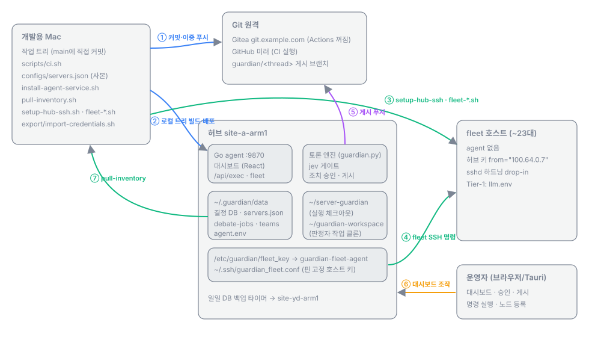

## 요약

| 구분 | 결과 |
|---|---|
| 정리한 절차 | 개발 10, 서버 관리 11, 토론·조치 6 (+상태 기계 5), UI 클릭 경로 13 |
| 1단계 발견 | 80건: High 15, Medium 38, Low 27 (개발 21, 서버 관리 24, 토론·조치 19, UI 16) |
| 도메인 횡단 모순 패턴 | 7가지 (P1~P7) |
| 1차 수정 | Jev가 고른 40건을 수정 팀 4개가 45개 커밋으로 반영(후속 2개 포함), 허브 배포 (`52fbfe2`). 2차 수정 7개 커밋 |
| 3단계 재분석 | 해소 32, 부분 해소 25, 미해결 23, **회귀 0** |
| 수정이 만든 새 문제 | 22건 (Medium 5, Low 17) → 2차 수정 9개 항목으로 Medium 4건과 Low 6건 반영, Medium 1건은 결정 필요 |
| 결정 사항 | 14개를 Jev로 판정: 12개 구현·배포(D2·D9는 사용자 요청 후), 2개 현행 유지 (8장). 추가로 결정 경로 통일 2건 (8.1) |
| 4단계 재분석 | 1단계 80건 중 해소 44, 부분 26, 미해결 9, 회귀 1. 3단계 신규 22건 포함 102건 기준 해소 52 (7.5) |
| 4단계 후속 수정 | 새 문제 21건(Medium 8) + 남은 원래 항목을 Jev로 판정: 19개 항목 구현·배포 (`4c10afd`), 1개 보류 (7.6) |
| 5단계 재분석 | 1단계 80건 중 해소 53, 부분 26, 미해결 1(D14로 유지), **회귀 0**. 전체 123건 기준 해소 81. 새 문제 21건 중 **High 1: `--rotate`는 지금 실행하면 안 됨** (7.7) |

가장 큰 변화는 다음과 같습니다.

- **배포가 운영 설정을 지우지 않습니다.** 재배포가 `agent.env`의 `GUARDIAN_UI_ACTIONS=off` 같은 안전 스위치를 지우던 문제와, README대로 허브를 설치하면 허브 모드가 조용히 꺼지던 문제를 고쳤습니다. 배포는 이제 실패한 검사를 모아 종료 코드 1로 끝나고, Mac·허브·작업 클론·바이너리 버전을 함께 보여 줍니다.
- **조치와 게시가 실제 상태를 따릅니다.** 대시보드가 토론 종료 시점의 스냅샷 대신 실시간 조치 상태를 보고 게시 버튼을 켭니다. 게시 전에는 어떤 파일이 어떤 브랜치로 나가는지 계획을 보여 줍니다. 예외로 끝난 조치는 RUNNING에 갇히지 않고, 재확인은 해당 라운드의 조치만 풀어 줍니다.
- **SSH 경로마다 달랐던 규칙을 맞췄습니다.** 고정한 호스트 키를 명령행 옵션이 덮어쓰지 않습니다. 세 가지였던 도달성 용어를 하나의 분류(`ok`, `auth_failed`, `host_key_changed`, `unreachable`, `command_failed`)로 묶었습니다. 인벤토리 경로가 설정돼 있으면 다른 사본으로 조용히 넘어가지 않습니다.
- **UI 용어와 흐름을 정리했습니다.** Commands·Execute·Approvals·Hub connection으로 이름을 통일했습니다. 모바일에서 닿지 않던 화면을 More 탭으로 열었습니다. 확인 대화상자의 색은 위험도를 따릅니다.

---

## 1. 방법

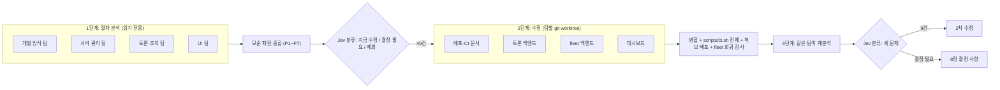

- 1단계 분석 팀은 저장소를 고치지 않고, 모든 주장을 `file:line` 근거로 확인했습니다. 각 팀의 원문은 부록에 있습니다.
- 수정 팀은 서로 다른 파일만 맡았고, 각자 git worktree에서 작업했습니다. 병합은 충돌 없이 끝났습니다.
- 허브 배포 전에 fleet 24대의 도달성 기준선을 저장했습니다. 배포 후 하나라도 끊기면 `agent.prev`로 되돌리는 조건을 걸었는데, 배포 후에도 24대가 모두 `ok`였습니다.

## 2. 개발 방식

### 2.1 절차

**코드 변경 흐름.** 커밋은 Mac에서 main에 바로 하고, `origin`은 Gitea와 GitHub에 동시에 푸시합니다. CI는 GitHub에서만 돕니다.

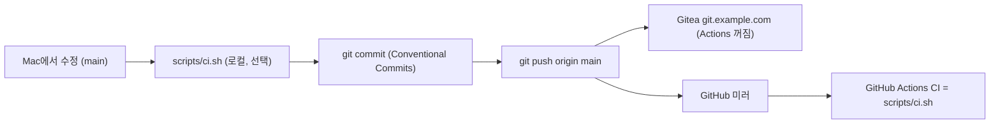

**허브 배포 (수정 후).** 인벤토리의 역할만으로 허브 모드를 정하고, 설치 스크립트가 쓰는 키만 `agent.env`에서 갱신하며, 실패한 검사가 있으면 종료 코드 1로 끝납니다.

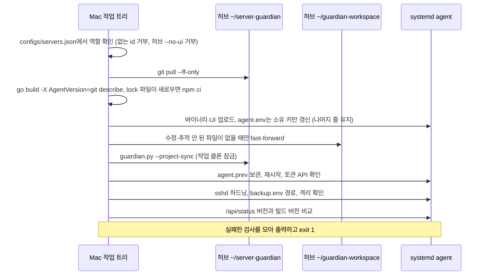

**토론에서 저장소까지 (게시).** 승인된 파일 변경은 운영자가 계획을 확인한 뒤 `guardian/<thread>` 브랜치로 게시합니다.

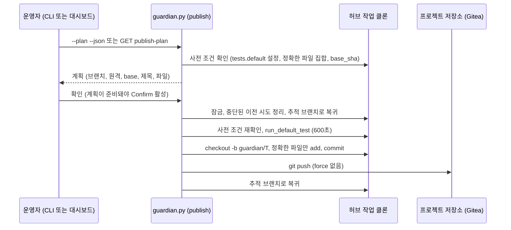

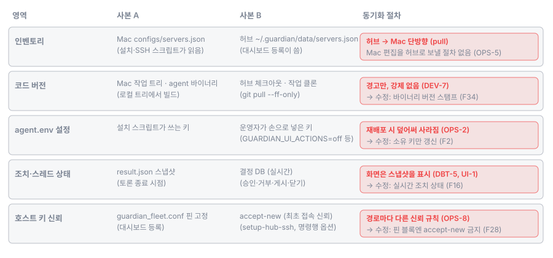

### 2.2 주요 모순과 처리

| ID | 심각도 | 모순 | 처리 |
|---|---|---|---|
| DEV-1 | High | README의 허브 설치 명령(`--with-ui`)이 허브 모드를 조용히 끔 | 해소: 인벤토리 역할만으로 허브 모드 결정 (`d52b2d0`) |
| DEV-2 | High | 재배포가 `agent.env`의 운영 설정(`GUARDIAN_UI_ACTIONS=off` 등)을 지움 | 해소: 소유 키만 갱신 (`430e142`) |
| DEV-3 | High | `git_commit_push`(`git add -A`, 브랜치에 남음)와 게시가 서로를 막음 | 해소: 도구 폐지 (D1, `ccda0f6`), 남은 제안은 INVALID로 정리 (`2eed2fc`) |
| DEV-4 | Medium | 게시 브랜치는 GitHub CI를 거치지 않음 | 부분: 허브 게이트를 unittest + `go vet` + `go test -race`로 확대 (D2, `e6f372d`). web·셸 검사는 Mac과 GitHub CI만 |
| DEV-5 | Medium | 배포·동기화는 추적 안 된 파일을 무시, 게시는 셈 | 해소 (`35fc07c`, `043fa56`) |
| DEV-7 | Medium | Mac·허브·작업 클론·바이너리 버전이 따로 움직이고 확인은 경고뿐 | 부분: 버전 스탬프와 배포 후 비교 (`1e358a5`, `601485b`) |
| DEV-8 | Medium | 대시보드 게시는 계획을 보여 주지 않음 | 해소: 게시 계획 API와 대화상자 (`c3c7f18`, `e466a90`) |
| DEV-10 | Medium | 게시 테스트가 허브에 없는 pytest로 대체됨 | 해소: `tests.default` 필수 (`811a81c`) |
| DEV-13 | Low | CI가 main의 이전 실행을 취소 | 해소: PR에서만 취소 (`7143c6e`) |

표의 상태는 4단계 재분석과 그 뒤 후속 수정까지 반영한 것입니다. 나머지 항목과 근거는 부록의 [1단계](2026-10-12-procedure-review/phase1-dev.ko.md), [3단계](2026-10-12-procedure-review/phase3-dev.ko.md), [4단계](2026-10-12-procedure-review/phase4-dev.ko.md) 개발 보고서에 있습니다.

## 3. 서버 관리 방식

### 3.1 절차

**인벤토리 수명 주기 (D4 이후).** 원천은 허브 사본 하나입니다. Mac 스크립트는 실행할 때 허브 사본을 읽고, Mac의 `configs/servers.json`은 스냅샷입니다.

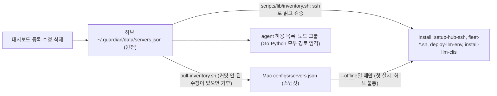

**노드 제거와 키 회수 (D5와 4단계 후속 수정 이후).** 제거 대화상자는 키 회수를 먼저 안내하고, 회수 없이 제거하려면 명시적으로 체크해야 합니다.

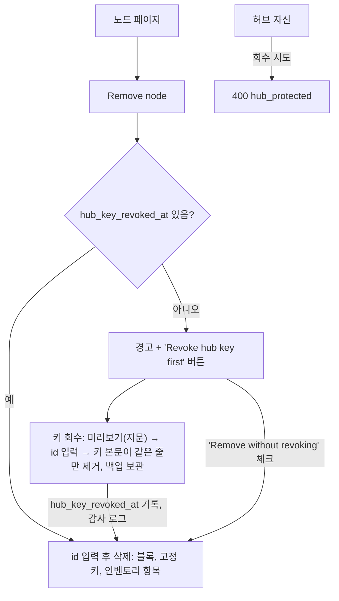

**노드 쓰기 (수정 후).** 대시보드와 스크립트가 같은 잠금을 쓰고, 공유 분류기로 도달성을 판정합니다.

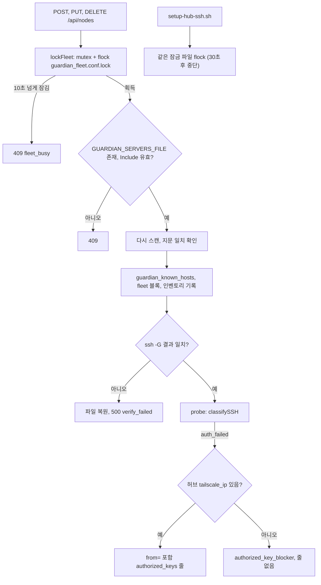

**호스트 키 정책 (수정 후).** 핀 고정된 블록에는 `accept-new`를 덧씌우지 않고, fleet 파일을 읽을 수 없으면 접속하지 않습니다.

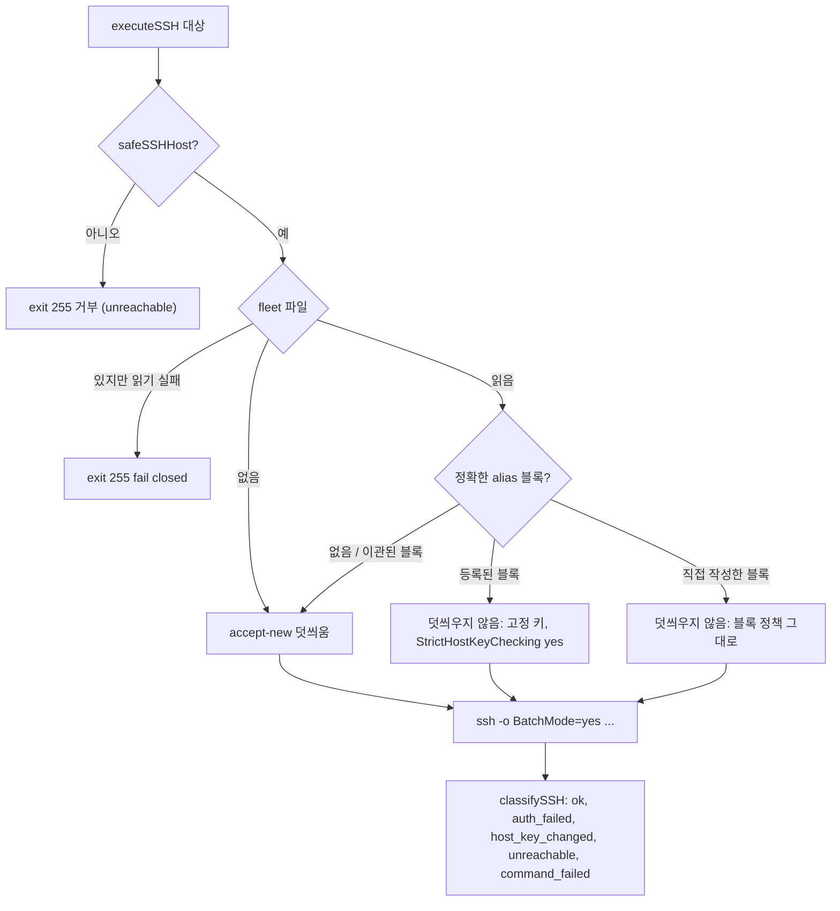

**백업과 복원 (D7과 4단계 후속 수정 이후).** DB와 데이터 디렉터리·fleet 설정을 함께 백업하고, [복원 절차](../operations/backup-restore.ko.md)가 있습니다.

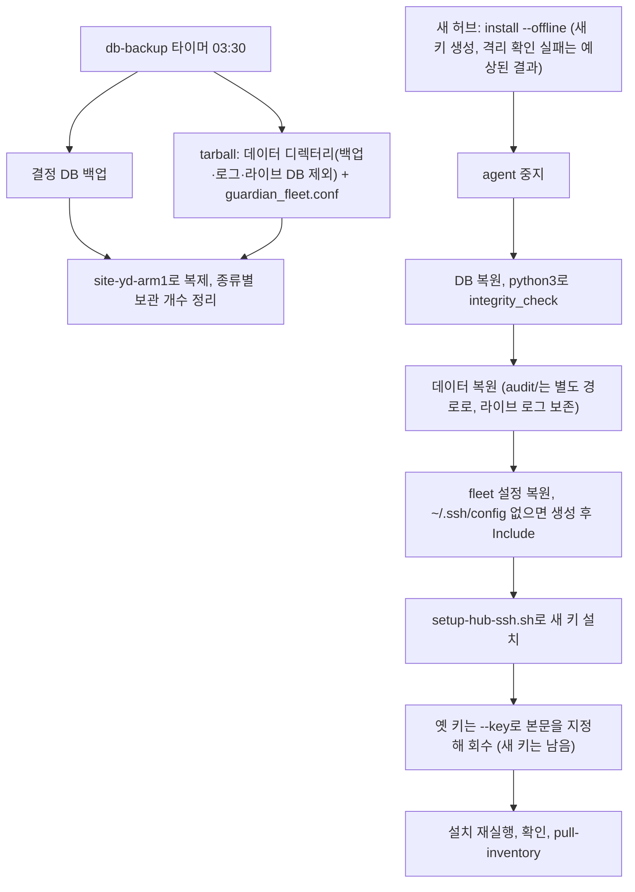

### 3.2 주요 모순과 처리

| ID | 심각도 | 모순 | 처리 |
|---|---|---|---|
| OPS-1 | High | 허브 설치가 조용히 비허브 설치로 바뀜 | 해소 (`d52b2d0`) |
| OPS-2 | High | 재설치가 `agent.env` 운영 설정을 지움 | 해소 (`430e142`) |
| OPS-3 | High | 문서와 설치 스크립트가 아직 노드마다 agent를 두는 구조를 설명 | 해소: 허브 전용 설치 (D3, `c4dc12d`) |
| OPS-5 | High | 인벤토리 사본 두 개, 동기화는 한 방향, 허브 설정은 Mac 사본에서 | 해소: 허브 사본이 원천 (D4, `d0bb95e`) |
| OPS-6 | High | 노드 삭제가 노드의 허브 키를 남기고, 스크립트가 다시 넣을 수 있음 | 해소: 키 회수 동작(D5)과 회수 우선 제거 대화상자, 허브 인벤토리에 없는 id 건너뜀 (`d539560`, `a0f92ef`) |
| OPS-8 | Medium | 호스트 키 신뢰가 경로마다 다름 | 부분: 고정 블록 보호, fail closed (`7b5d0a0`) |
| OPS-10 | Medium | 같은 원격 효과인데 `/api/exec`은 토큰만, 조치는 토론·jev·승인 | 부분: 감사 로그(순환, 노드 쓰기·키 회수·거부 요청 포함, 인증 방식 구분) (D6, `cecabc5`). 변조 방지는 아님 |
| OPS-11 | Medium | 인벤토리 읽기는 조용히 다른 사본으로, 쓰기는 거부 | 해소: Go(`f656349`)와 Python(2차) 모두 엄격 |
| OPS-14 | Medium | 같은 ssh 결과를 세 가지 용어로 표시 | 부분: 공유 분류기 (`dbf20d5`), UI 표시는 2차 |
| OPS-15 | Medium | 백업이 결정 DB만, 복원 절차 없음 | 해소: 데이터 tarball과 복원 문서 (D7, `d19e2b9`, `cddfb2b`) |
| OPS-21 | Low | `guardian_fleet.conf` 쓰는 곳 두 군데가 잠금을 공유하지 않음 | 해소 (`2f8f26e`) |
| OPS-22 | Low | 설치 검사가 실패해도 성공으로 끝남 | 해소 (`601485b`) |
| OPS-9 | Medium | 허브 sudo를 꺼도 허브가 자신에게 ssh해 우회 가능 | 해소: sudo가 꺼지면 허브를 원격 대상에서 거부 (`cecabc5`, `GUARDIAN_HUB_SUDO`) |
| OPS-24 | Low | fleet 키 교체 절차 없음 | 해소: `setup-hub-ssh.sh --rotate` (새 키 확인 실패 시 전체 되돌림). 실제 허브 실행은 아직 안 함 |

## 4. 토론·결정·조치

### 4.1 절차

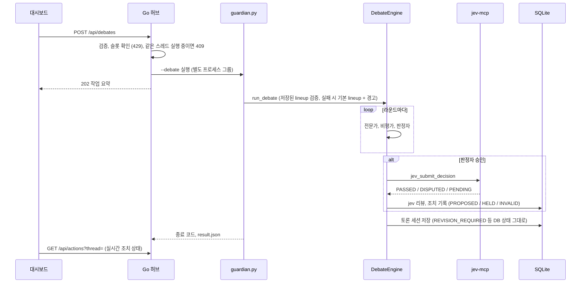

**조치 상태 (현재).** 예외로 끝난 조치는 FAILED가 되고, 재확인은 해당 라운드만 풉니다. 늦게 끝난 실행은 운영자의 FAILED를 덮어쓰지 않습니다. 파일 조치는 쓰기와 테스트 동안 작업 클론 잠금을 잡아 정리·동기화·게시와 섞이지 않습니다.

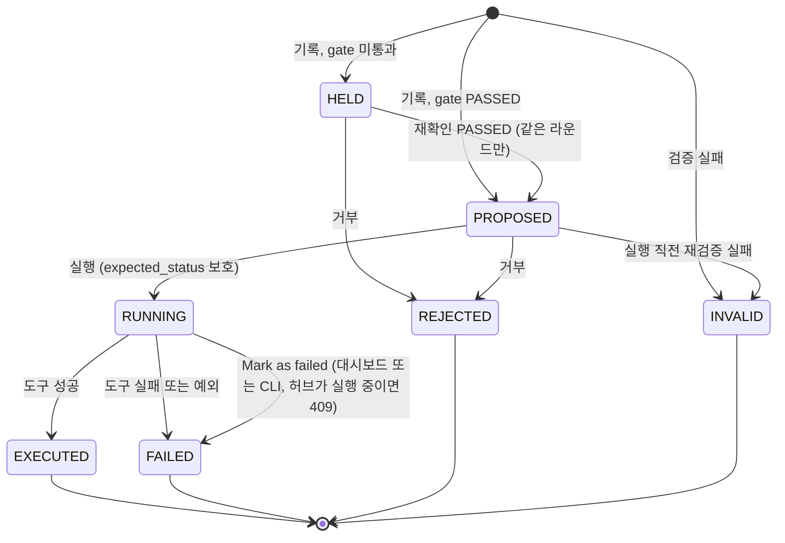

**스레드 상태.** CLOSED는 목록에서 숨기는 것만 뜻합니다(D10). 게시된 스레드는 이어서 토론할 수 없습니다(D11, 4단계 후속 수정).

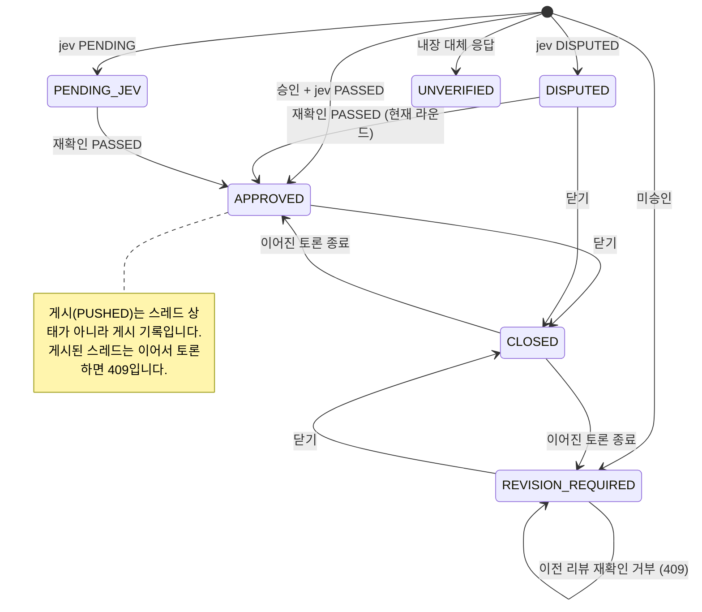

**게시 기록 상태.**

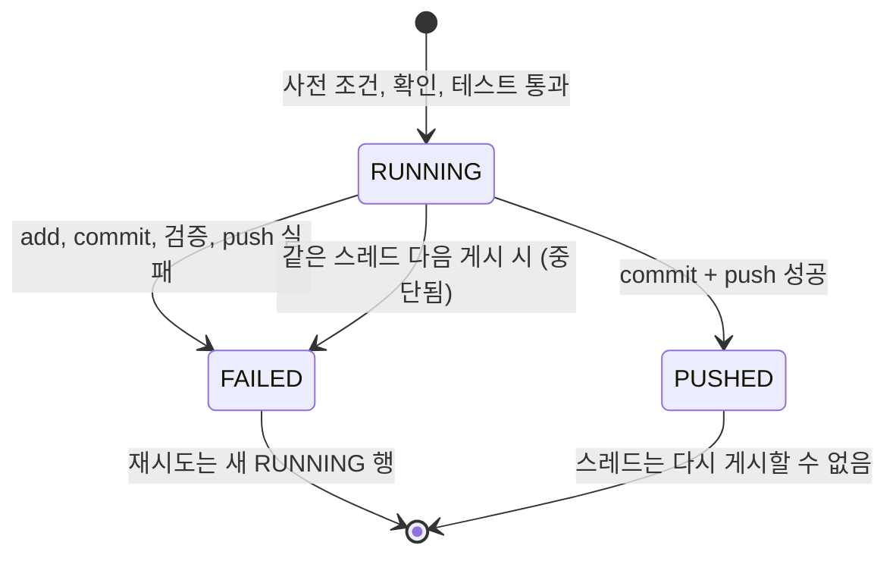

**작업 클론 정리 (D12와 4단계 후속 수정 이후).** 남길 파일은 스레드별로 묶어 보여 주고, 게시하지 않을 스레드는 명시적으로 풀어(release) 정리할 수 있습니다.

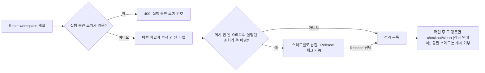

### 4.2 주요 모순과 처리

| ID | 심각도 | 모순 | 처리 |
|---|---|---|---|
| DBT-1 | High | 조치가 RUNNING에 영원히 남을 수 있음 | 해소: 예외는 FAILED, 대시보드·CLI의 Mark as failed, 늦은 결과 보호 (`99f4ea4`, `64a2bff`, `391bcb8`) |
| DBT-2 | High | `git_commit_push`가 스레드를 게시 불가로 만듦 | 해소: 도구 폐지 (D1) |
| DBT-3 | High | 재확인이 다른 라운드 리뷰로 모든 HELD 조치를 풂 | 부분: 라운드 한정, 오래된 리뷰 거부 (`c522367`) |
| DBT-4 | High | 프로젝트 동기화가 추적 안 된 파일 위로 HEAD를 옮김 | 해소 (`043fa56`) |
| DBT-5 | Medium | 대시보드가 result.json 스냅샷으로 판단 | 부분: 조치 표와 게시는 실시간. 판정·닫기 버튼은 스냅샷 |
| DBT-8 | Medium | 같은 "미승인"이 다섯 가지 이름 | 해소: `REVISION_REQUIRED` 하나로 (`fb1af96`, `55c3e7e`) |
| DBT-9 | Medium | 같은 스레드에 토론 두 개가 동시에 돌 수 있음 | 부분: 허브는 409 (`f66326a`), CLI 직접 실행은 미검사 |
| DBT-11 | Medium | "없음"이 400과 404로 섞임 | 부분: 404로 통일 (`09c56c8`), 동기화 git 실패는 400 |
| DBT-13 | Medium | 같은 프로젝트 테스트를 두 경로가 다르게 실행 | 해소 (`811a81c`) |
| DBT-19 | Low | 중단된 게시가 RUNNING 행과 게시 브랜치를 남김 | 해소 (`83551c6`) |

## 5. UI 적절성

### 5.1 화면 지도 (현재: 4개 목적지)

D9와 4단계 후속 수정 이후의 구조입니다. 노드 그룹 정의는 Settings에서 Fleet의 Groups 탭으로 옮겼습니다.

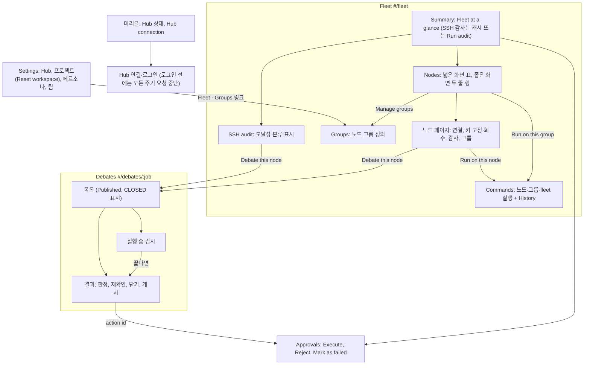

### 5.2 간결성과 직관성 평가

| 관점 | 수정 전 | 수정 후 |
|---|---|---|
| 용어 | "Run"이 세 가지 뜻, Approvals가 세 가지 이름 | Commands / Execute / Approvals / Hub connection으로 통일 |
| 상태 표시 | 조치 표가 토론 종료 시점 값, 승인된 실행이 노란색 | 실시간 조치 상태, 결정 상태 기준 색 |
| 위험 확인 | 확인 방식 5가지, 확인 버튼은 항상 빨간색, 토론 취소는 확인 없음 | `tone` 속성(게시·닫기는 기본색), 취소 확인 추가. 명령 실행 확인 단계는 결정 필요 (D8) |
| 게시 | 조건 없이 버튼 노출, 무엇이 나가는지 모름 | 조건 충족 시에만 활성, 계획(파일·브랜치·base)을 보여 준 뒤 확인 |
| 입력 밀도 | 토론 시작 폼이 핵심 흐름 중 가장 빽빽함 | Task 먼저, 나머지는 Advanced로 접음 |
| 모바일 | Agents·Security·Settings에 닿지 못함 | More 탭 |
| 오류 문구 | 세션 만료가 "Agent offline"으로 보임 | "Sign-in required" |
| 노드 상태 | 키 변경, 인증 실패, 명령 실패가 모두 "offline" | 2차 수정: 도달성 분류별 표시 |

**수정 전에 제안한 내비게이션**은 페이지 4개(Fleet, Debates, Approvals, Settings)로 합치는 안이었습니다. 이 안은 정보 구조를 바꾸므로 이번에는 반영하지 않고 결정 사항(D9)으로 남겼습니다.

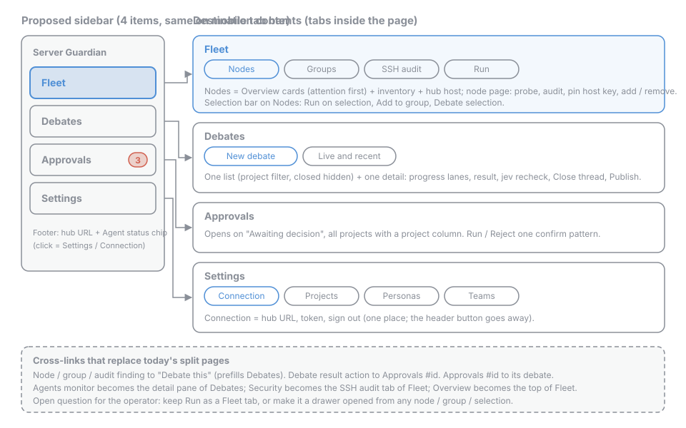

현재 내비게이션:

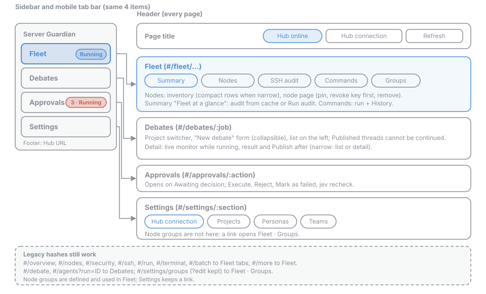

## 6. 도메인 횡단 모순 패턴

네 팀의 패턴을 겹치면 일곱 가지로 모입니다. 원의 숫자는 그 도메인에서 패턴에 해당한 발견 수입니다(한 발견이 여러 패턴에 속할 수 있음).

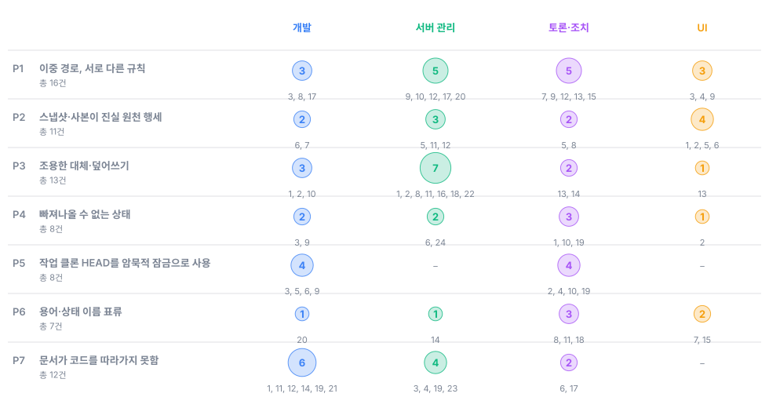

| 패턴 | 뜻 | 대표 사례 | 이번 처리 |
|---|---|---|---|
| P1 이중 경로, 서로 다른 규칙 | 같은 결과를 내는 두 경로가 다른 안전 규칙을 씀 | `git_commit_push` vs 게시, `/api/exec` vs 조치, CLI vs API 닫기 | 게시 계획, 같은 스레드 409, 공유 테스트 헬퍼로 일부 통일 |
| P2 사본이 진실 원천 행세 | 스냅샷·사본을 실시간 상태처럼 사용 | result.json 스냅샷, Mac 인벤토리, 버전 4종 | 실시간 조치 상태, 버전 스탬프 |
| P3 조용한 대체·덮어쓰기 | 실패 대신 다른 값으로 넘어가거나 운영 상태를 지움 | `agent.env` 덮어쓰기, 인벤토리 대체, 설치 검사 무시 | 소유 키만 갱신, 엄격한 인벤토리, 검사 실패 시 exit 1 |
| P4 빠져나올 수 없는 상태 | 전이 중인 상태에 출구가 없음 | 조치 RUNNING, 게시 RUNNING, 노드 키 회수 | 예외→FAILED, `--fail-stale-action`, 게시 복구 |
| P5 작업 클론 HEAD를 암묵적 잠금으로 사용 | 여러 절차가 `HEAD == base_sha`에 기대지만 HEAD를 옮기는 절차가 따로 있음 | 동기화, `git_commit_push`, 배포 | 동기화·게시 공유 잠금, 추적 안 된 파일 존중 |
| P6 용어·상태 이름 표류 | 같은 개념이 계층마다 다른 이름 | 미승인 5종, 도달성 3종, Run 3가지 뜻 | `REVISION_REQUIRED`, `classifySSH`, UI 용어 정리 |
| P7 문서가 코드를 못 따라감 | 리팩터링마다 옛 설명이 남음 | 노드별 agent, pytest 대체, 자동 닫기 주석 | README·설계 문서·주석 정리, 스냅샷 표기 |

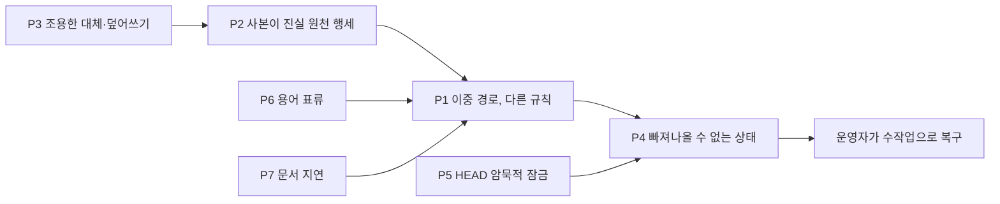

공통 뿌리는 **"같은 사실을 여러 곳이 각자 판단한다"**입니다. 조용한 대체(P3)는 사본(P2)을 만듭니다. 사본은 경로마다 다른 판단(P1)을 낳고, 서로 맞지 않는 판단은 빠져나올 수 없는 상태(P4)로 끝납니다. 이번 수정은 대부분 판단을 한 곳으로 모으는 방향입니다. 공유 분류기, 공유 테스트 헬퍼, 공유 잠금, 소유 키 규칙, 실시간 상태 조회가 그렇습니다.

## 7. 수정 내역

### 7.1 1차 수정 (Jev 분류: 42개 후보 중 40건 반영)

| 팀 | 커밋 | 주요 변경 |
|---|---|---|
| 배포·CI·문서 | 10 | 허브 모드 결정, `agent.env` 병합, 추적 안 된 파일 존중, 검사 실패 시 exit 1과 `agent.prev`, 버전 스탬프, `npm ci` 조건, CI 취소 규칙, 문서 정리 |
| fleet 백엔드 | 6 | 엄격한 `GUARDIAN_SERVERS_FILE`, 호스트 키 덧씌움 제한과 fail closed, fleet 파일 잠금, `classifySSH`, 허브 IP 없을 때 키 줄 차단, 폼 검증 규칙 공개 |
| 토론 백엔드 | 14 | 동기화 잠금, 예외 시 FAILED, 라운드 한정 재확인, 같은 스레드 409, `REVISION_REQUIRED`, 404 통일, actor 검증, 공유 테스트 헬퍼, lineup 대체, 게시 복구, 게시 계획, 판정자에게 테스트 명령 안내 |
| 대시보드 | 13 (+후속 1) | 확인 색, 실시간 조치·게시 계획, 결정 상태 색, Approvals 기본 필터, 용어 통일, SSH audit에서 토론, Sign-in required, Advanced, Agents 필터, 폼 검증, More 탭, Columns, 키 차단 문구 |

보류한 후보: `git_commit_push` 폐지(F3, Jev "결정 필요" 0.91), Overview 재구성(F20, Jev 판정 보류).

### 7.2 검증

- `scripts/ci.sh go python web shell config` 전체가 통과했습니다. Go `-race`, Python 516+16개, web 403개 이상, shellcheck, 설정 검증을 포함합니다.
- 허브 배포 결과 Mac·허브·작업 클론·agent가 모두 `52fbfe2`입니다.
- 배포 후 fleet 진단은 24대 모두 ONLINE, `reachability: ok`로 기준선과 같습니다.
- 게시 계획 API는 조건이 안 맞으면 409, 없는 스레드면 404이고, 스레드 닫기도 없는 스레드면 404입니다.

### 7.3 재분석 결과

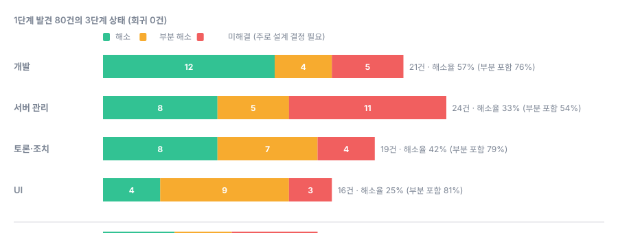

| 도메인 | 해소 | 부분 | 미해결 | 회귀 |
|---|---|---|---|---|
| 개발 (21) | 12 | 4 | 5 | 0 |
| 서버 관리 (24) | 8 | 5 | 11 | 0 |
| 토론·조치 (19) | 8 | 7 | 4 | 0 |
| UI (16) | 4 | 9 | 3 | 0 |
| **합계 (80)** | **32** | **25** | **23** | **0** |

미해결 23건은 대부분 운영 결정이 필요한 설계 항목입니다(8장). 서버 관리의 해소율이 낮은 것은 인벤토리 단일화, 키 회수, 백업 범위처럼 결정이 먼저 필요한 항목이 몰려 있기 때문입니다.

### 7.4 수정이 만든 새 문제와 2차 수정

재분석에서 1차 수정 때문에 생기거나 드러난 문제가 22건(Medium 5, Low 17) 나왔습니다. Jev 분류로 9개 항목을 2차 수정했습니다.

| 항목 | 새 문제 | 심각도 | 2차 수정 | 커밋 |
|---|---|---|---|---|
| R1 | UI-N1: 재확인·닫기 오류에 실행(Execute)용 안내가 붙음 | Medium | `failMessage`에 종류 인자, 안내는 해당 동작에만 | `e857c42` |
| R2 | UI-N2: 새 `reachability`를 UI가 쓰지 않아 원인이 모두 "offline" | Medium | 공유 헬퍼 `lib/reachability.ts`, Nodes·Overview·그룹 집계에 분류별 표시 | `b961266` |
| R3 | DBT-N1: 늦게 끝난 실행이 운영자의 FAILED를 EXECUTED로 덮어씀, `decided_by` 덮어씀 | Medium | 최종 기록은 RUNNING일 때만, 늦은 결과는 `late_result`로 보관 | `391bcb8` |
| R5 | DBT-N6: 읽기 전용 게시 계획이 작업 클론 잠금을 잡아 실제 게시·동기화를 막음 | Low | 계획은 잠금 없이 답하고, 진행 중 게시가 있으면 안내 | `8344131` |
| R6 | OPS-N2: Go는 인벤토리 경로에 엄격, Python은 체크아웃 사본으로 대체 | Medium | Python도 같은 규칙 | `0c47852` |
| R7 | DEV-N1, OPS-N4: README가 아직 pytest 대체를 설명 | Low | `tests.default` 필수로 정정 | `48231af` |
| R8 | DEV-N2: sshd 하드닝 되돌림이 설치 실패로 처리됨 | Low | 경고로 처리, 바이너리 롤백 안내는 agent 실패일 때만 | `48231af` |
| R9 | DEV-N3: 대시보드로 등록한 노드는 Mac 인벤토리에 먼저 받아야 함 | Low | README와 설치 거부 메시지에 `pull-inventory.sh` 안내 | `48231af` |
| R10 | UI-N5: 남은 옛 용어 ("Agent online", "Debate Console" 등) | Low | "Hub online", "Debates", "Hub (local)" | `ffabebd` |

보류한 항목은 DBT-N2(작업 클론의 남은 파일을 버리는 공식 방법이 없음)입니다. 무엇을 버려도 되는지 정하는 운영 결정이 필요해서 D12로 넘겼습니다.

2차 수정 후 `scripts/ci.sh go python web shell config`가 다시 통과했습니다(Python 520개, web 411개).

남은 Low 항목은 다음과 같습니다. 모두 근거와 함께 부록의 3단계 보고서에 있습니다.

- **개발**: DEV-N4. 배포의 작업 클론 갱신이 게시·동기화 잠금을 쓰지 않습니다.
- **서버 관리**
  - OPS-N1: 호스트 키 규칙이 정확한 alias 블록만 인식합니다.
  - OPS-N3: `agent.env` 병합에 경계 사례가 남아 있습니다.
- **토론·조치**
  - DBT-N3: 다른 라운드의 HELD 조치가 방치됩니다.
  - DBT-N4: 한 작업 화면에 스레드 전체의 조치가 표시됩니다.
  - DBT-N5: 판정자 카탈로그에 `tests.default` 필수 조건이 빠져 있습니다.
  - DBT-N7: 같은 파일에 쿼리 파서가 두 개 있습니다.
  - DBT-N8: 게시 복구는 스레드 단위인데 작업 클론은 프로젝트 단위입니다.
- **UI**
  - UI-N3: 접힌 Advanced 영역의 팀 기본 참조 코드가 보이지 않은 채 전송됩니다.
  - UI-N4: 확인 색이 아직 일부 일관되지 않습니다.
  - UI-N6: 수정 과정에서 생긴 작은 동작들이 남아 있습니다.

### 7.5 4단계 재분석

결정 사항을 구현하고 배포한 뒤(`66cf41e`), 같은 네 팀이 다시 분석했습니다. 대상은 1단계 80건, 3단계에서 새로 나온 22건, 그 사이 바뀐 절차입니다.

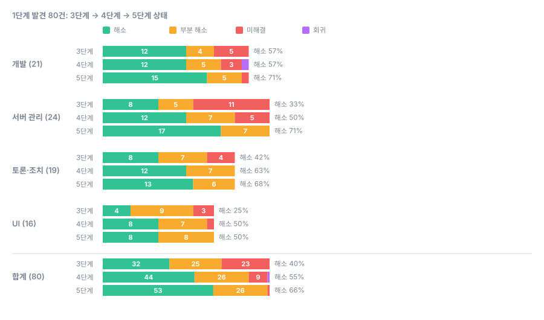

| 도메인 | 해소 | 부분 | 미해결 | 회귀 | 3단계 대비 |
|---|---|---|---|---|---|
| 개발 (21) | 12 | 5 | 3 | 1 | DEV-3 해소, DEV-4·11 부분으로, DEV-14가 README 표 누락으로 회귀(Low) |
| 서버 관리 (24) | 12 | 7 | 5 | 0 | OPS-3·4·5·11 해소, OPS-6·10·15 부분으로 |
| 토론·조치 (19) | 12 | 7 | 0 | 0 | DBT-1·2·7·15 해소, 미해결 0 |
| UI (16) | 8 | 7 | 1 | 0 | UI-1·2·6·7 해소 |
| **합계 (80)** | **44** | **26** | **9** | **1** | 해소율 40% → 55% |

3단계 신규 22건까지 포함한 102건 기준으로는 해소 52, 부분 29, 미해결 20, 회귀 1입니다. 결정 사항을 구현하면서 생긴 새 문제는 21건(Medium 8, Low 13)이었습니다.

| 새 문제 (Medium) | 내용 |
|---|---|
| DBT-P4-1 | 게시된 스레드도 이어서 작업할 수 있고, 게시할 수 없다는 사실을 게시 시점에야 앎 |
| DBT-P4-2 | 조치 실행 중에 작업 클론 정리를 돌리면 방금 쓴 파일이 지워짐 |
| DEV-P4-1 | 작업 클론 정리가 게시하지 않을 스레드의 파일까지 계속 남김 (DBT-P4-3과 같은 원인) |
| OPS-P4-1 | 키 회수 전에 노드를 지우면 허브 키가 노드에 남고 대시보드 회수 경로가 404 |
| OPS-P4-3 | 감사 로그가 무제한으로 커지고, 노드 쓰기·키 회수·거부 요청을 남기지 않으며 인증 방식을 구분하지 못함 |
| OPS-P4-4 | 복원 문서의 옛 키 회수 단계가 새 키까지 지워 fleet 전체 접속을 잃을 수 있음 |
| UI-P4-1 | 좁은 화면에서 Debates 결과가 목록 전체 아래에 붙음 |
| UI-P4-2 | 노드 그룹은 Settings에서 정의하고 Fleet에서 씀 |

팀별 원문은 부록의 4단계 보고서에 있습니다.

### 7.6 4단계 후속 수정 (Jev 판정)

새 문제와 남아 있던 원래 항목을 Jev로 판정했습니다. 19개 항목을 구현해 허브에 배포했고(`4c10afd`), 1개는 보류했습니다.

| 항목 | Jev | 처리 | 커밋 |
|---|---|---|---|
| P1 게시된 스레드는 끝 (DBT-P4-1) | 0.96 | 이어서 토론하면 409, 목록에 Published 표시, Continue 숨김 | `e7851b5`, `1aed5f2` |
| P2 정리와 실행 조치의 경합 (DBT-P4-2) | 0.99 | 실행 중인 조치가 있으면 정리 거부, 파일 조치는 쓰기·테스트 동안 작업 클론 잠금 | `c59b88d` |
| P3 스레드 풀기 (DEV-P4-1) | 0.85 | 정리 계획을 스레드별로 묶고 명시적 Release, 풀린 스레드는 게시 거부 | `549dbd5`, `2090769` |
| P4 회수 우선 제거 (OPS-P4-1) | 0.99 | `hub_key_revoked_at` 기록, 제거 대화상자가 회수를 먼저 안내하고 생략은 명시적 체크 | `cecabc5`, `a0f92ef` |
| P5 감사 로그 (OPS-P4-3) | 0.89 | 10MB 순환 5개, 노드 쓰기·키 회수·거부 요청 기록, `session@`/`token@` 구분. 변조 방지 로그는 아님 | `cecabc5`, `cff945a` |
| P6 복원 문서와 키 회수 일치 (OPS-P4-4, OPS-P4-2) | 0.95 | `--revoke`는 키 본문 일치로만 제거, 복원 순서 정정, 감사 로그 보존, 허브 자신의 키 회수 거부 | `cddfb2b`, `cecabc5` |
| P7 좁은 화면 Debates (UI-P4-1) | 0.76 | 목록 또는 상세 하나만, Back to list | `7ab0e7f` |
| P8 Fleet Groups 탭 (UI-P4-2) | 0.89 | 그룹 정의를 `#/fleet/groups`로 옮기고 Settings에는 링크만 | `5c8c9ac` |
| P9 문서 (DEV-14 회귀, DEV-P4-2·3) | 0.96 | README CI 표, `--offline` 설명 통일, 이 보고서의 상태 표 갱신 | `6735392` |
| P10 UI 다듬기 (UI-P4-3~8, O8) | 0.96 | 배지 동시 표시, Debates 중복 요청 제거, SSH audit 도달성 분류, fleet 전체 실행 확인은 위험 색, 첫 화면은 SSH 감사를 자동 실행하지 않음, 제목 "Fleet at a glance" | `975cdb9`, `7ab0e7f` |
| P11 정리 (DBT-P4-4~6) | 0.88 | `git_commit_push` 잔재, 스레드 id 패턴 통일, 계획 타임아웃 | `2eed2fc`, `87615a4` |
| O1 허브 sudo 우회 (OPS-9) | 0.96 | sudo가 꺼지면 허브를 원격 대상에서 거부 (`GUARDIAN_HUB_SUDO`) | `cecabc5`, `6ab1ec6` |
| O2 대상 이름 규칙 (OPS-12) | 0.97 | `/api/exec/remote`는 노드 id만, 이름이면 올바른 id 안내 | `cecabc5` |
| O3 자격 증명 가져오기 (OPS-18) | 0.97 | 인벤토리 검증·diff·확인 재사용, ssh 설정은 Include 파일로 | `24897f8` |
| O4 LLM 배포 대상 (OPS-23) | 0.95 | 기본은 허브만 | `b7cea9c` |
| O5 키 교체 (OPS-24) | 0.97 | `--rotate`: 새 키 확인 실패 시 전체 되돌림. **5단계에서 High 결함 발견, 고치기 전에는 실행 금지 (7.7)** | `cddfb2b` |
| O6 base 없는 파일 조치 (DEV-9) | 0.96 | 제안 시점의 작업 클론 HEAD를 base로 기록 | `b7bb5cc` |
| O7 Go 버전 (DEV-15) | 0.97 | `go.mod` 한 곳에서 버전, CI에 amd64 빌드 | `53a4e02` |
| P12 설치 스크립트가 CI 통과 확인 | 판정 보류 (0.58) | 현행 유지. 배포 전 `scripts/ci.sh`를 통과시키는 작업 규칙으로 운영 | – |

**검증**
- `scripts/ci.sh go python web shell config` 전체가 통과했습니다(Python 564개, web 516개 포함).
- 이번에는 CI가 통과해야만 푸시와 배포가 이어지도록 명령을 묶었습니다. 그래서 처음 CI에서 Go 단계가 실패했을 때는 배포되지 않았습니다. 원인은 gofmt 하나와 테스트 정리 경합 하나였습니다.
- 배포 후 fleet 24대 모두 `ok`이고, agent 환경에 `GUARDIAN_HUB_SUDO=on`이 있습니다.
- 감사 로그가 `token@…`과 `rejected`를 기록하고, 허브 자신의 키 회수는 400입니다.
- 게시 여부 표시와 작업 클론 정리 계획이 정상입니다. 허브 DB의 조치 상태는 바뀌지 않았습니다.
- `--rotate`의 실제 키 교체 단계와 옵션이 붙은 `authorized_keys` 줄의 지문 매칭은 실제 허브와 노드에서 아직 확인하지 않았습니다.

### 7.7 5단계 재분석

4단계 후속 수정을 배포한 뒤(`7783afa`), 같은 네 팀이 다시 분석했습니다. 대상은 1단계 80건, 3단계 신규 22건, 4단계 신규 21건, 모두 123건입니다.

분석 시점에는 다른 세션이 같은 저장소에서 작업 중이었습니다. 문서 커밋 `b82310c` 하나와, `cli/llm-agent`에 커밋되지 않은 변경이 있었습니다. 분석 팀은 작업 트리를 읽었지만, 위 판정은 `7783afa`까지의 변경을 기준으로 했습니다. 이번 단계에서는 코드를 고치거나 배포하지 않았습니다.

| 도메인 | 해소 | 부분 | 미해결 | 회귀 | 4단계 대비 |
|---|---|---|---|---|---|
| 개발 (21) | 15 | 5 | 1 | 0 | DEV-9·14·15 해소, 회귀 해소. 미해결은 D14로 유지한 DEV-20 |
| 서버 관리 (24) | 17 | 7 | 0 | 0 | OPS-6·12·18·23·24 해소, OPS-9 부분으로 |
| 토론·조치 (19) | 13 | 6 | 0 | 0 | DBT-10 해소 |
| UI (16) | 8 | 8 | 0 | 0 | UI-11 부분으로 |
| **합계 (80)** | **53** | **26** | **1** | **0** | 해소율 55% → 66% |

3·4단계 신규까지 포함한 123건 기준으로는 해소 81, 부분 29, 미해결 13, 회귀 0입니다. 4단계에서 나온 새 문제 21건은 Medium 8건을 포함해 대부분 해소됐습니다.

**5단계에서 새로 나온 문제 (21건: High 1, Medium 7, Low 13)**

| ID | 심각도 | 내용 |
|---|---|---|
| OPS-P5-1 | **High** | `--rotate`가 허브 전체의 fleet 키를 바꾸면서, 새 키는 Tailscale IP가 있는 노드나 지정한 노드에만 설치. 대시보드로 등록한 노드처럼 그 밖의 노드는 교체 직후 접속을 잃음. **아직 실행한 적 없음, 고치기 전에는 실행 금지** |
| OPS-P5-4 | Medium | `--rotate`가 새 비밀 키를 ubuntu 계정 디렉터리에 만들고, 옛 키를 `/etc/guardian/fleet_key.old-*`에 무기한 남김 ("ubuntu는 fleet 키를 읽지 못함" 원칙 위반) |
| OPS-P5-2 | Medium | 허브 sudo 우회를 막는 장치가 fleet 경로만 막음. `/api/exec`나 판정자 조치에서 `ssh <허브> sudo`는 여전히 가능하고, 환경 변수가 실제 sandbox 상태보다 우선 |
| OPS-P5-3 | Medium | `hub_key_revoked_at`가 실제로 지운 줄이 없어도 기록되고 지워지지 않음. 이후 `setup-hub-ssh.sh`가 키를 다시 넣어도 제거 대화상자는 "회수됨"으로 표시 |
| DEV-P5-1 / DBT-P5-1 | Medium | 풀어 준(released) 스레드도 이어서 작업하고 남은 조치를 실행할 수 있지만 게시는 불가. 게시된 스레드에서 막은 함정이 released에 남음 |
| DBT-P5-2 | Medium | 조치 실행이 기준 커밋 확인과 운영자 확인을 잠금 전에 함. CLI 확인을 기다리는 사이 동기화·게시·정리가 HEAD를 옮길 수 있음 |
| UI-P5-1 | Medium | 좁은 화면에서 "Continue this thread"가 숨겨진 폼만 채워 반응이 없는 것처럼 보임 |
| Low 13건 | Low | 실수로 커밋된 빈 파일 `orkspace_ops.py`, 판정자 원격 조치의 대상 이름이 제안 단계에서 검사되지 않음, 감사 로그 actor 구분, 주소로 연 토론에 Published 표시 누락 등 |

**`--rotate`가 노드를 끊는 경로 (OPS-P5-1)**

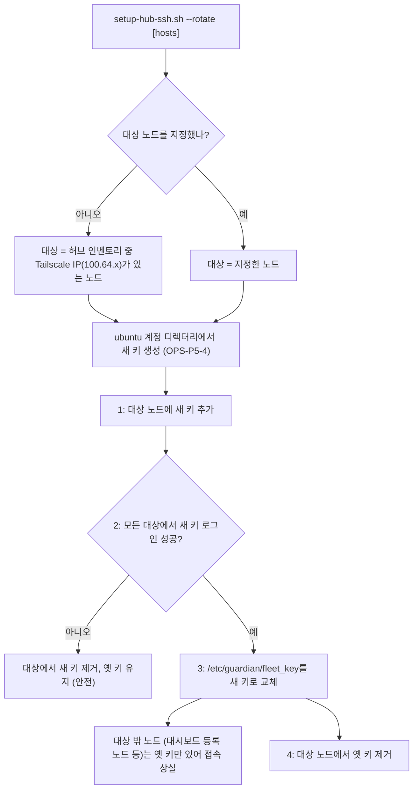

팀별 원문은 부록의 5단계 보고서에 있습니다. 위 항목들을 Jev로 판정해 고치는 일은 이 보고서에 포함하지 않았습니다.

## 8. 결정 사항과 Jev 판정

설계 결정 14개를 Jev로 판정하고, 결론이 난 항목은 바로 구현해 허브에 배포했습니다(`f01c0e1`). 판정이 보류된 항목은 한 번 더 구체적인 선택지로 물었고, 그래도 기준(act 0.8 또는 yes 0.7)에 못 미치면 현행을 유지하거나 보류했습니다.

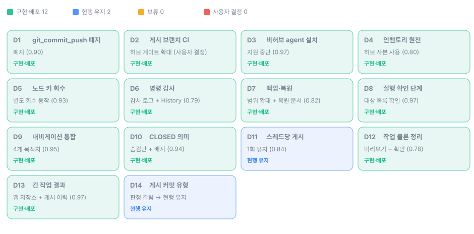

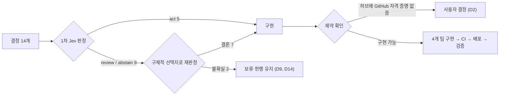

| # | 주제 | Jev 판정 | 처리 | 커밋 |
|---|---|---|---|---|
| D1 | `git_commit_push` | 폐지 (yes 0.90) | 카탈로그·기본 팀·판정자 페르소나에서 제거. 저장된 제안은 실행 시 INVALID("use publish") | `ccda0f6` |
| D2 | 게시 브랜치 CI | 사용자 결정: 허브 게이트 확대. 방식은 Jev (0.99) | `tests.default`가 명령 목록을 받고 `go vet`를 허용. server-guardian 게이트는 unittest → `go vet` → `go test -race` (허브에서 agent PATH로 92.6초 통과). 허용 목록은 그대로(셸·경로 스크립트 금지) | `e6f372d`, `7002432` |
| D3 | 비허브 agent 설치 | 지원 중단 (0.97) | 설치 스크립트는 허브만 허용, README를 단일 허브 기준으로 재작성 | `c4dc12d` |
| D4 | 인벤토리 원천 | 허브 사본 (0.80) | Mac 스크립트가 허브의 `servers.json`을 읽어 씀(`scripts/lib/inventory.sh`, `--offline`은 경고와 함께 로컬 사본). `pull-inventory.sh`는 커밋 안 된 수정이 있으면 거부, `setup-hub-ssh.sh`는 허브 인벤토리에 없는 id를 건너뜀 | `d0bb95e` |
| D5 | 노드 키 회수 | 별도 동작 (0.93) | `GET/POST /api/nodes/{id}/revoke-key`(미리보기, id 입력 확인, 백업 후 해당 키 줄만 제거)와 노드 페이지 버튼 | `d539560`, `947d17f` |
| D6 | 명령 감사 | 감사 로그 (yes 0.79) | 실행 API 4개가 `~/.guardian/data/audit/exec.jsonl`에 기록, `GET /api/audit`, Commands 페이지 History | `d539560`, `947d17f` |
| D7 | 백업·복원 | 확대 (yes 0.82) | 데이터 디렉터리와 fleet SSH 설정 tarball을 DB와 함께 복제, [복원 절차](../operations/backup-restore.ko.md) | `d19e2b9`, `f01c0e1` |
| D8 | 실행 확인 | 대상 목록 확인 (0.97) | 그룹·fleet 실행은 대상 이름과 명령을 보여 주는 확인 하나로 통일 | `947d17f` |
| D9 | 내비게이션 통합 | 사용자 요청 후 재판정: 4개 목적지로 전면 재구성 (0.95), Overview는 Fleet 요약 탭 (분리 유지 0.24), More 탭 제거 (0.82) | Fleet(Summary·Nodes·SSH audit·Commands 탭), Debates(목록 + 실행 중 감시 + 결과), Approvals, Settings. 옛 주소는 모두 새 주소로 연결 | `0fc6e51`, `4571522` |
| D10 | CLOSED 의미 | 숨김만 (0.94) | 문서화, `GET /api/threads/closed`, Approvals에 "Thread closed" 배지 | `ccda0f6`, `c216c01` |
| D11 | 스레드당 게시 | 1회 유지 (0.84) | 설계 문서에 명시 | `ccda0f6` |
| D12 | 작업 클론 정리 | 구현 (yes 0.78) | `--workspace-reset`(계획/실행, 정확한 경로만, 공유 잠금), API, Settings → Projects 버튼 | `ccda0f6`, `947d17f` |
| D13 | 긴 작업 결과 | 앱 저장소 (0.97) | 실행·게시를 앱 수준 저장소로 옮김, nav의 Running 표시, `GET /api/threads/{thread}/publications`와 "Published as branch X" | `ccda0f6`, `c216c01` |
| D14 | 게시 커밋 유형 | 판정 갈림 (0.46 대 0.41) | 현행 `fix:` 유지 | – |

### 8.1 결정 경로 통일 (추가 판정)

Approvals의 결정이 대시보드 밖(허브 CLI)에서도 이뤄진다는 점을 정리하면서 두 가지를 더 판정했습니다.

| 주제 | Jev 판정 | 처리 | 커밋 |
|---|---|---|---|
| 멈춘 RUNNING 조치를 대시보드에서 실패 처리 | 채택 (yes 0.77) | `POST /api/actions/{id}/fail-stale`(확인 id, 허브가 아직 실행 중이면 409)와 Approvals의 "Mark as failed" | `64a2bff`, `c8a5741` |
| `GUARDIAN_UI_ACTIONS=off`의 범위 | 모든 결정 경로 차단 (0.69 → 단독 확인 yes 0.78) | 실행·거부·재확인·닫기·게시·작업 클론 정리·실패 처리를 403으로 막고 같은 일을 하는 CLI 명령을 안내. 조회와 fleet·노드·설정 경로는 그대로 | `64a2bff` |

이제 대시보드에서 모든 결정을 할 수 있습니다. 스위치를 끄면 모든 결정이 일관되게 허브 CLI로 넘어갑니다. 시스템이 사람 없이 바꾸는 상태는 보호 장치뿐입니다. jev 게이트 보류(HELD), 실행 전 재검증 실패(INVALID), 예외로 인한 FAILED, 중단된 게시 정리가 여기에 해당합니다.

### 8.2 남은 작은 점 (추가 판정)

| 주제 | Jev 판정 | 처리 | 커밋 |
|---|---|---|---|
| 로그인 전에도 상태 확인 요청이 계속 나감 | 중단 (yes 0.87) | 401이면 요청 함수에서 모든 주기적 요청을 멈추고, 로그인·허브 변경 시 재개 | `ae12eaa`, `ca4ea2c` |
| 재구성 후 남은 옛 문구 | 정리 (yes 0.79) | Overview 링크와 빈 기록 안내 문구 정리 | `3222c17` |
| Fleet 탭별 페이지 제목 | 판정 갈림 (0.52 대 0.42) | 현행 "Fleet" 유지 | – |
| 좁은 화면의 Nodes 표가 글자 단위로 줄바꿈되고 Uptime이 `uptime` 출력 전체 | 간결한 행 (1.00) | Uptime은 `8d 15h`처럼 기간만, 좁은 화면은 노드당 두 줄(노드·상태 / 호스트·그룹·가동·부하·메모리) | `9d9d828`, `bb2eea6` |

**배포 후 허브 검증**
- 배포 스크립트가 허브 인벤토리를 읽어 설치했습니다. Mac, 허브, 작업 클론, agent가 모두 `f01c0e1`입니다.
- fleet 24대 모두 `reachability: ok`로 기준선과 같습니다.
- `/api/exec` 호출 한 번이 `/api/audit`에 기록되는 것을 확인했습니다.
- 키 회수 미리보기는 노드에 접속하지 않고 허브 키 지문만 보여 줍니다.
- 작업 클론 정리 계획, 게시 이력, 닫힌 스레드 API가 모두 200을 돌려줍니다.
- 백업 서비스를 한 번 실행했습니다. DB 사본과 데이터 tarball이 만들어져 site-yd-arm1에 복제됐습니다. tarball에는 `guardian_fleet.conf`가 들어 있고 비밀 키는 없습니다. `guardian_known_hosts`는 아직 키를 고정한 등록 노드가 없어서 원래 없는 파일입니다.
- 키 회수 실행(POST)과 작업 클론 정리 실행(POST)은 실제 호스트에 돌리지 않았습니다.
- D9 배포 후(`c8a5741`) 로그인 전 대시보드에서 4개 메뉴와 Fleet 탭이 보이는 것을 확인했습니다. 로그인 전에도 상태 확인 요청을 계속 보내는 점(초당 0.4건)은 작은 낭비로 남겨 둡니다.

**주의할 점**
- 감사 로그는 명령 원문을 4096자까지 저장합니다. 명령에 비밀 값을 직접 넣으면 그 값도 기록됩니다.
- 첫 허브 설치처럼 허브에 아직 인벤토리가 없을 때는 `--offline`이 필요합니다.

## 부록

각 팀의 원문(영문, `file:line` 근거 포함)입니다.

| 도메인 | 1단계 절차 분석 | 3단계 재분석 | 4단계 재분석 | 5단계 재분석 |
|---|---|---|---|---|
| 개발 방식 | [phase1-dev.md](2026-10-12-procedure-review/phase1-dev.ko.md) | [phase3-dev.md](2026-10-12-procedure-review/phase3-dev.ko.md) | [phase4-dev.md](2026-10-12-procedure-review/phase4-dev.ko.md) | [phase5-dev.md](2026-10-12-procedure-review/phase5-dev.ko.md) |
| 서버 관리 | [phase1-ops.md](2026-10-12-procedure-review/phase1-ops.ko.md) | [phase3-ops.md](2026-10-12-procedure-review/phase3-ops.ko.md) | [phase4-ops.md](2026-10-12-procedure-review/phase4-ops.ko.md) | [phase5-ops.md](2026-10-12-procedure-review/phase5-ops.ko.md) |
| 토론·조치 | [phase1-debate.md](2026-10-12-procedure-review/phase1-debate.ko.md) | [phase3-debate.md](2026-10-12-procedure-review/phase3-debate.ko.md) | [phase4-debate.md](2026-10-12-procedure-review/phase4-debate.ko.md) | [phase5-debate.md](2026-10-12-procedure-review/phase5-debate.ko.md) |
| UI | [phase1-ui.md](2026-10-12-procedure-review/phase1-ui.ko.md) | [phase3-ui.md](2026-10-12-procedure-review/phase3-ui.ko.md) | [phase4-ui.md](2026-10-12-procedure-review/phase4-ui.ko.md) | [phase5-ui.md](2026-10-12-procedure-review/phase5-ui.ko.md) |
