# Procedure and UI consistency review report (2026-10-12)

English | [한국어](2026-10-12-procedure-review.ko.md)

> Point-in-time record from 2026-10-12; the code has changed since.

Domain analysis teams split the review of server-guardian's development practice, server management practice, debate, decision and action procedures, and the dashboard UI. We first documented the procedures, then found procedures that conflict with each other and contradiction patterns, fixed them, and after the fixes analyzed again against the same criteria. Where judgment was split, Jev (`jev-1.13.0`) gave the verdict.

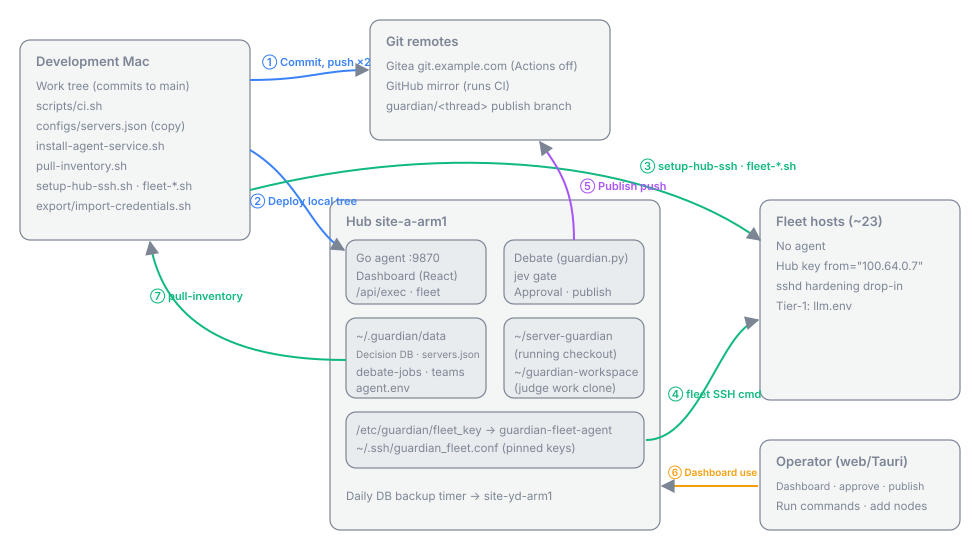

## Summary

| Category | Result |
|---|---|
| Procedures documented | Development 10, server management 11, debate and action 6 (+5 state machines), UI click paths 13 |
| Phase 1 findings | 80: High 15, Medium 38, Low 27 (development 21, server management 24, debate and action 19, UI 16) |
| Cross-domain contradiction patterns | 7 (P1-P7) |
| First fix round | 4 fix teams applied the 40 items Jev picked in 45 commits (including 2 follow-ups), deployed to the hub (`52fbfe2`). Second fix round: 7 commits |
| Phase 3 re-analysis | Resolved 32, partially resolved 25, unresolved 23, **regressions 0** |
| New problems created by the fixes | 22 (Medium 5, Low 17) → second fix round of 9 items covered Medium 4 and Low 6; Medium 1 needs a decision |
| Decisions | 14 given a verdict by Jev: 12 implemented and deployed (D2 and D9 after a user request), 2 kept as is (section 8). Plus 2 decision-path unifications (8.1) |
| Phase 4 re-analysis | Of the 80 phase 1 findings: resolved 44, partial 26, unresolved 9, regression 1. Counting the 22 new phase 3 items, 102 total with 52 resolved (7.5) |
| Phase 4 follow-up fixes | 21 new problems (Medium 8) + remaining original items given a verdict by Jev: 19 items implemented and deployed (`4c10afd`), 1 deferred (7.6) |
| Phase 5 re-analysis | Of the 80 phase 1 findings: resolved 53, partial 26, unresolved 1 (kept by D14), **regressions 0**. Of 123 total, 81 resolved. Of 21 new problems, **High 1: do not run `--rotate` now** (7.7) |

The biggest changes are these.

- **Deploys no longer wipe operational settings.** We fixed the problem where a redeploy erased safety switches in `agent.env` such as `GUARDIAN_UI_ACTIONS=off`, and the problem where installing the hub as the README described silently turned hub mode off. A deploy now collects failed checks and exits with code 1, and it shows the Mac, hub, workspace clone and binary versions together.
- **Actions and publishing follow the real state.** The dashboard enables the publish button from the live action state instead of a snapshot taken when the debate ended. Before publishing it shows a plan of which files go out to which branch. An action that ended in an exception no longer gets stuck in RUNNING, and a recheck releases only that round's actions.
- **SSH paths now share the same rules.** Command-line options no longer override a pinned host key. The three reachability vocabularies are merged into one classification (`ok`, `auth_failed`, `host_key_changed`, `unreachable`, `command_failed`). When an inventory path is configured, the code does not silently fall back to another copy.
- **UI terms and flows are cleaned up.** Names are unified as Commands, Execute, Approvals and Hub connection. Screens that mobile could not reach now open from the More tab. Confirmation dialog colors follow the risk level.

---

## 1. Method

```mermaid
flowchart LR
    subgraph P1["Phase 1: procedure analysis (read-only)"]
        A1["Development practice team"]
        A2["Server management team"]
        A3["Debate and action team"]
        A4["UI team"]
    end
    P1 --> S["Contradiction pattern synthesis (P1-P7)"]
    S --> J1{"Jev classification: fix now / needs decision / excluded"}
    subgraph P2["Phase 2: fixes (git worktree per team)"]
        F1["Deploy, CI, docs"]
        F2["Debate backend"]
        F3["Fleet backend"]
        F4["Dashboard"]
    end
    J1 -->|"40 items"| P2
    P2 --> M["Merge + full scripts/ci.sh + hub deploy + fleet regression check"]
    M --> P3["Phase 3: re-analysis by the same teams"]
    P3 --> J2{"Jev classification: new problems"}
    J2 -->|"9 items"| R2["Second fix round"]
    J2 -->|"Needs decision"| D["Section 8 decisions"]
```

- The phase 1 analysis teams did not change the repository and checked every claim against `file:line` evidence. Each team's original report is in the appendix.
- The fix teams each owned separate files and worked in their own git worktree. The merge finished without conflicts.
- Before the hub deploy we saved a reachability baseline for the 24 fleet hosts. We set a condition to roll back to `agent.prev` if any of them dropped after the deploy; after the deploy all 24 were still `ok`.

## 2. Development practice

### 2.1 Procedures

**Code change flow.** Commits go directly to main on the Mac, and `origin` pushes to Gitea and GitHub at the same time. CI runs only on GitHub.

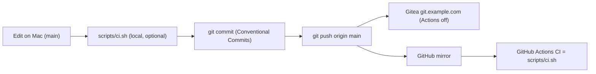

**Hub deploy (after the fixes).** Hub mode is decided only by the role in the inventory, only the keys the install script writes are updated in `agent.env`, and if any check fails the script exits with code 1.

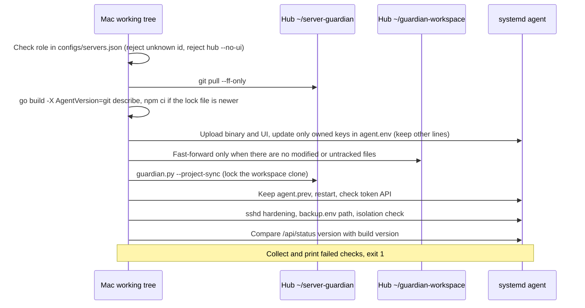

**From debate to repository (publish).** The operator checks the plan, then approved file changes are published to a `guardian/<thread>` branch.

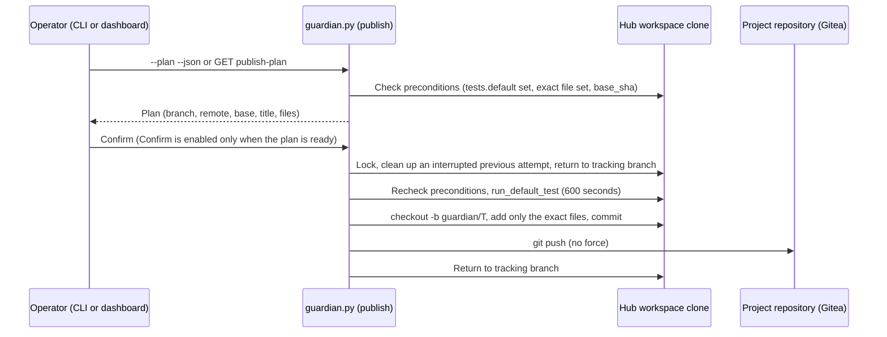

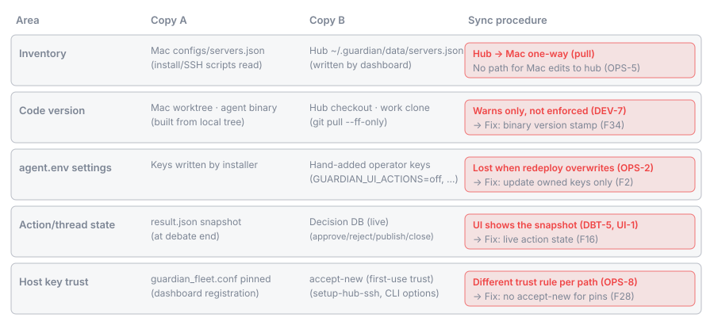

### 2.2 Main contradictions and handling

| ID | Severity | Contradiction | Handling |
|---|---|---|---|
| DEV-1 | High | The README hub install command (`--with-ui`) silently turns hub mode off | Resolved: hub mode decided only by the inventory role (`d52b2d0`) |
| DEV-2 | High | A redeploy erases operational settings in `agent.env` (`GUARDIAN_UI_ACTIONS=off` and others) | Resolved: only owned keys are updated (`430e142`) |
| DEV-3 | High | `git_commit_push` (`git add -A`, stays on the branch) and publishing block each other | Resolved: tool removed (D1, `ccda0f6`), remaining proposals cleaned up as INVALID (`2eed2fc`) |
| DEV-4 | Medium | Publish branches do not go through GitHub CI | Partial: hub gate extended to unittest + `go vet` + `go test -race` (D2, `e6f372d`). Web and shell checks only on the Mac and GitHub CI |
| DEV-5 | Medium | Deploy and sync ignore untracked files, publishing counts them | Resolved (`35fc07c`, `043fa56`) |
| DEV-7 | Medium | Mac, hub, workspace clone and binary versions move separately and the check only warns | Partial: version stamp and post-deploy comparison (`1e358a5`, `601485b`) |
| DEV-8 | Medium | Dashboard publishing does not show the plan | Resolved: publish plan API and dialog (`c3c7f18`, `e466a90`) |
| DEV-10 | Medium | The publish test falls back to pytest, which the hub does not have | Resolved: `tests.default` required (`811a81c`) |
| DEV-13 | Low | CI cancels earlier runs on main | Resolved: cancel only on PRs (`7143c6e`) |

The status in the table reflects the phase 4 re-analysis and the follow-up fixes after it. The remaining items and evidence are in the appendix development reports for [phase 1](2026-10-12-procedure-review/phase1-dev.md), [phase 3](2026-10-12-procedure-review/phase3-dev.md) and [phase 4](2026-10-12-procedure-review/phase4-dev.md).

## 3. Server management practice

### 3.1 Procedures

**Inventory life cycle (after D4).** The source is the single hub copy. Mac scripts read the hub copy when they run, and the Mac's `configs/servers.json` is a snapshot.

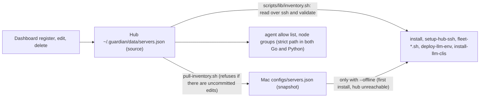

**Node removal and key revocation (after D5 and the phase 4 follow-up fixes).** The remove dialog points to key revocation first, and removing without revocation requires an explicit checkbox.

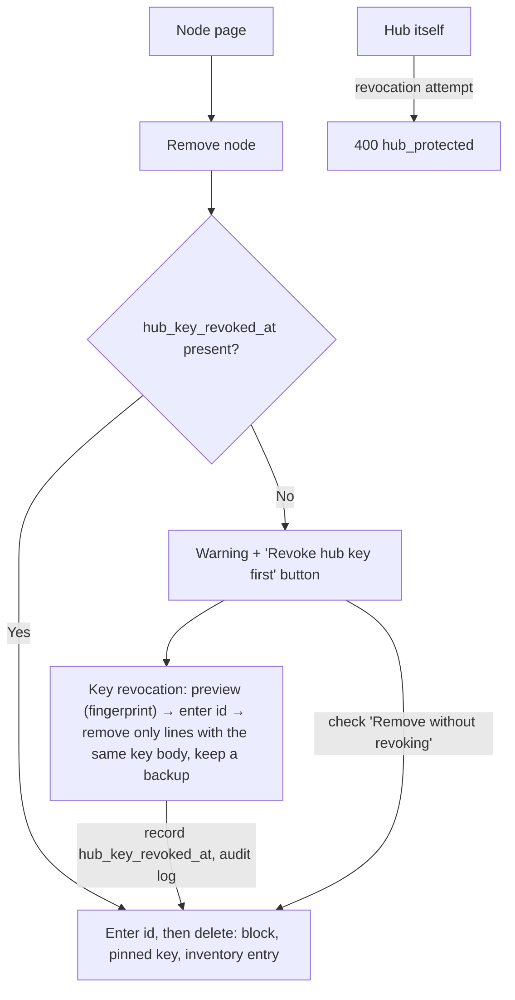

**Node writes (after the fixes).** The dashboard and scripts use the same lock and decide reachability with a shared classifier.

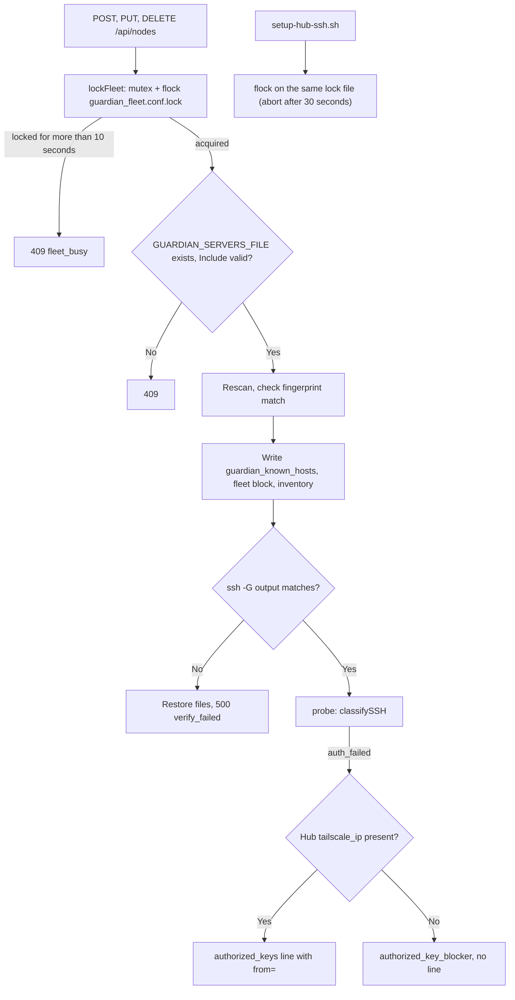

**Host key policy (after the fixes).** `accept-new` is not layered over pinned blocks, and if the fleet file cannot be read the connection is not made.

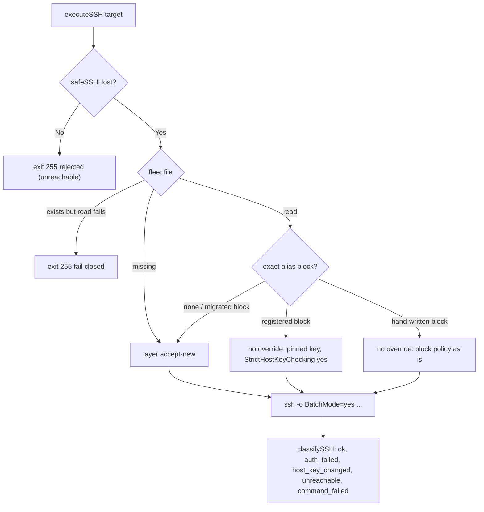

**Backup and restore (after D7 and the phase 4 follow-up fixes).** The DB is backed up together with the data directory and fleet configuration, and there is a [restore procedure](../operations/backup-restore.md).

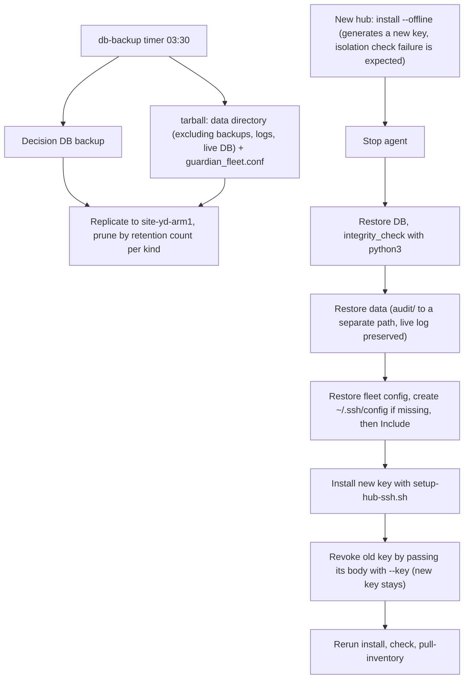

### 3.2 Main contradictions and handling

| ID | Severity | Contradiction | Handling |
|---|---|---|---|
| OPS-1 | High | A hub install silently turns into a non-hub install | Resolved (`d52b2d0`) |
| OPS-2 | High | A reinstall erases operational settings in `agent.env` | Resolved (`430e142`) |
| OPS-3 | High | Docs and install script still describe an agent on every node | Resolved: hub-only install (D3, `c4dc12d`) |
| OPS-5 | High | Two inventory copies, sync in one direction only, hub configuration from the Mac copy | Resolved: hub copy is the source (D4, `d0bb95e`) |
| OPS-6 | High | Node deletion leaves the hub key on the node, and scripts can put it back | Resolved: key revocation action (D5) and a revoke-first remove dialog, ids not in the hub inventory are skipped (`d539560`, `a0f92ef`) |
| OPS-8 | Medium | Host key trust differs by path | Partial: pinned blocks protected, fail closed (`7b5d0a0`) |
| OPS-10 | Medium | Same remote effect, but `/api/exec` needs only a token while actions need debate, jev and approval | Partial: audit log (rotating, includes node writes, key revocations, rejected requests, distinguishes auth method) (D6, `cecabc5`). Not tamper-proof |
| OPS-11 | Medium | Inventory reads silently fall back to another copy, writes are refused | Resolved: strict in both Go (`f656349`) and Python (second round) |
| OPS-14 | Medium | The same ssh result shown with three vocabularies | Partial: shared classifier (`dbf20d5`), UI display in second round |
| OPS-15 | Medium | Backup covers only the decision DB, no restore procedure | Resolved: data tarball and restore document (D7, `d19e2b9`, `cddfb2b`) |
| OPS-21 | Low | The two writers of `guardian_fleet.conf` do not share a lock | Resolved (`2f8f26e`) |
| OPS-22 | Low | Install ends as success even when checks fail | Resolved (`601485b`) |
| OPS-9 | Medium | Even with hub sudo off, the hub can bypass it by ssh to itself | Resolved: when sudo is off, the hub is refused as a remote target (`cecabc5`, `GUARDIAN_HUB_SUDO`) |
| OPS-24 | Low | No fleet key rotation procedure | Resolved: `setup-hub-ssh.sh --rotate` (full rollback if the new key check fails). Not yet run on the real hub |

## 4. Debates, decisions and actions

### 4.1 Procedure

```mermaid
sequenceDiagram
    participant UI as Dashboard
    participant Hub as Go hub
    participant CLI as guardian.py
    participant Eng as DebateEngine
    participant Jev as jev-mcp
    participant DB as SQLite
    UI->>Hub: POST /api/debates
    Hub->>Hub: Validate, check slots (429), 409 if the same thread is running
    Hub->>CLI: Run --debate (separate process group)
    Hub-->>UI: 202 job summary
    CLI->>Eng: run_debate (validate saved lineup; on failure, default lineup + warning)
    loop Each round
        Eng->>Eng: Expert, critics, judge
    end
    alt Judge approves
        Eng->>Jev: jev_submit_decision
        Jev-->>Eng: PASSED / DISPUTED / PENDING
        Eng->>DB: Record jev review and actions (PROPOSED / HELD / INVALID)
    end
    Eng->>DB: Save debate session (DB status as is, e.g. REVISION_REQUIRED)
    CLI-->>Hub: Exit code, result.json
    UI->>Hub: GET /api/actions?thread= (live action status)
```

**Action states (current).** An action that ends in an exception becomes FAILED, and a recheck releases only that round. A run that finishes late does not overwrite an operator's FAILED. File actions hold the workspace clone lock during the write and tests, so they do not interleave with cleanup, sync or publish.

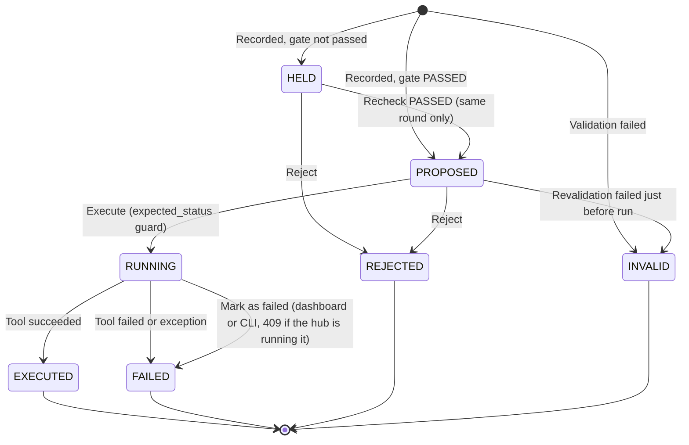

**Thread states.** CLOSED only means hidden from the list (D10). A published thread cannot be continued with another debate (D11, phase 4 follow-up fix).

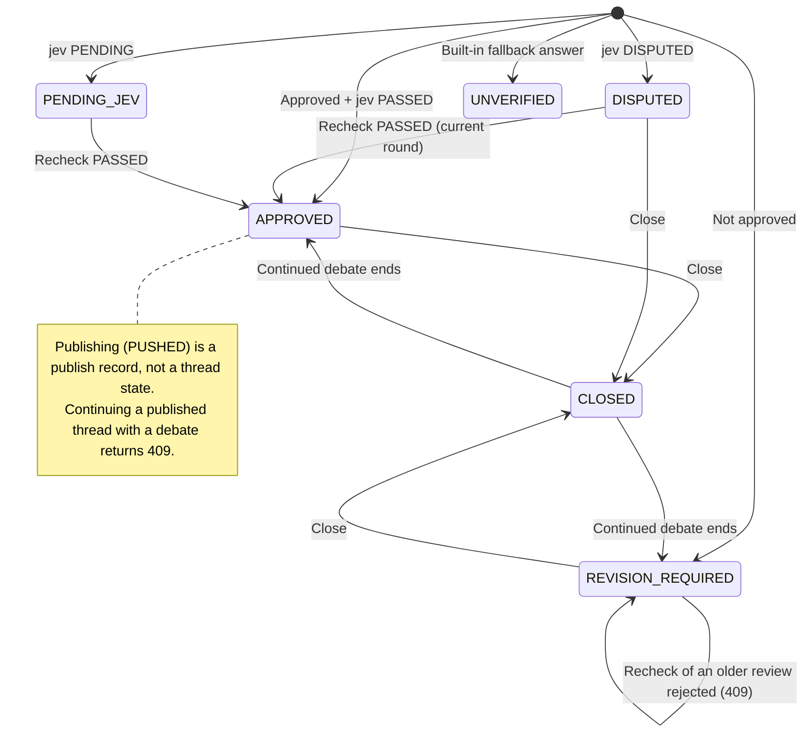

**Publish record states.**

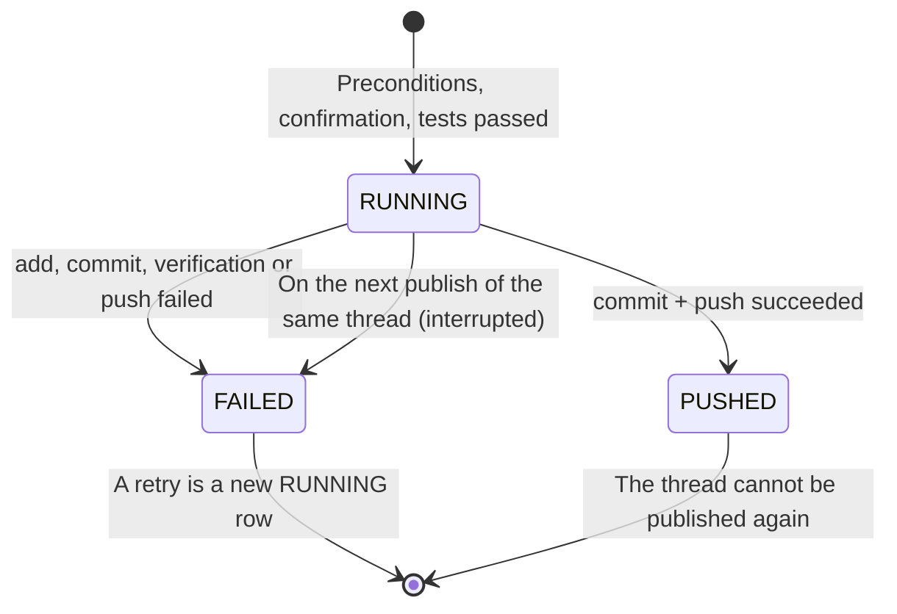

**Workspace clone cleanup (after D12 and the phase 4 follow-up fix).** Files to keep are shown grouped by thread, and a thread that will not be published can be explicitly released and cleaned up.

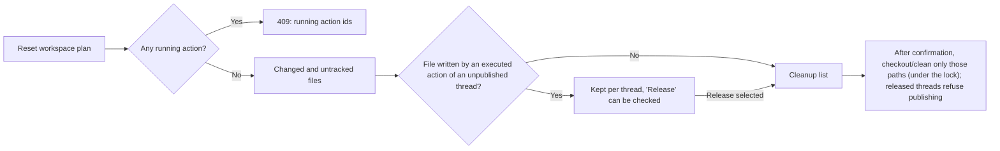

### 4.2 Main contradictions and how they were handled

| ID | Severity | Contradiction | Handling |
|---|---|---|---|
| DBT-1 | High | An action can stay in RUNNING forever | Resolved: exceptions become FAILED, Mark as failed in the dashboard and CLI, late-result guard (`99f4ea4`, `64a2bff`, `391bcb8`) |
| DBT-2 | High | `git_commit_push` makes a thread unpublishable | Resolved: tool removed (D1) |
| DBT-3 | High | Recheck releases every HELD action using a review from another round | Partial: limited to the round, stale reviews rejected (`c522367`) |
| DBT-4 | High | Project sync moves HEAD over untracked files | Resolved (`043fa56`) |
| DBT-5 | Medium | The dashboard decides from the result.json snapshot | Partial: action table and publishing are live. Verdict and close buttons use the snapshot |
| DBT-8 | Medium | The same "not approved" has five names | Resolved: unified as `REVISION_REQUIRED` (`fb1af96`, `55c3e7e`) |
| DBT-9 | Medium | Two debates can run on the same thread at once | Partial: the hub returns 409 (`f66326a`), direct CLI runs are not checked |
| DBT-11 | Medium | "Not found" is a mix of 400 and 404 | Partial: unified as 404 (`09c56c8`), sync git failures are 400 |
| DBT-13 | Medium | Two paths run the same project's tests differently | Resolved (`811a81c`) |
| DBT-19 | Low | An interrupted publish leaves a RUNNING row and a publish branch | Resolved (`83551c6`) |

## 5. UI fitness

### 5.1 Screen map (current: 4 destinations)

This is the structure after D9 and the phase 4 follow-up fix. Node group definitions moved from Settings to the Groups tab in Fleet.

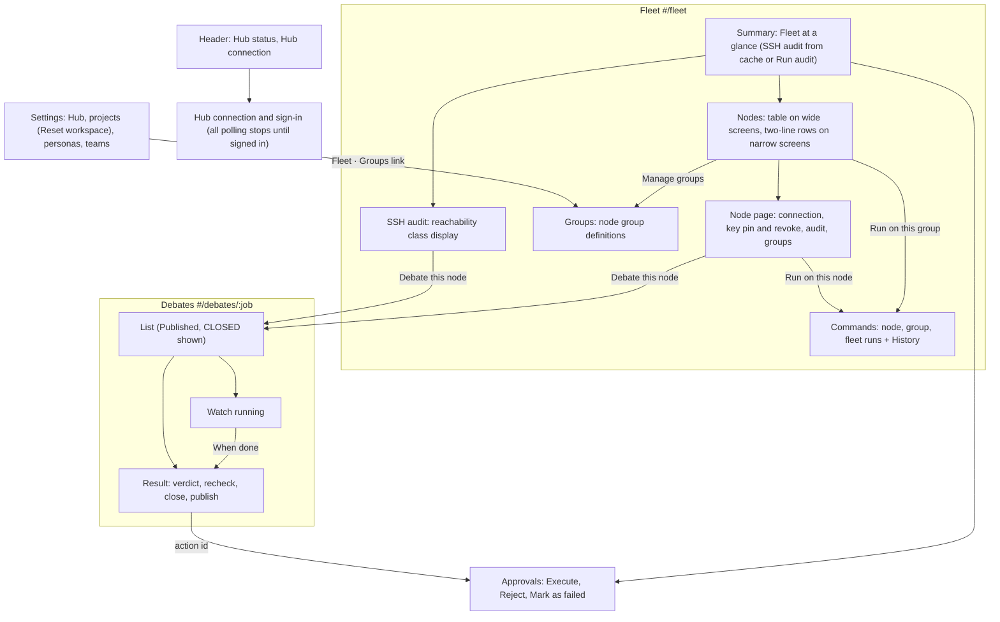

### 5.2 Simplicity and intuitiveness evaluation

| Aspect | Before the fix | After the fix |
|---|---|---|
| Terms | "Run" has three meanings, Approvals has three names | Unified as Commands / Execute / Approvals / Hub connection |
| Status display | Action table shows values from when the debate ended, approved runs are yellow | Live action status, colors based on decision status |
| Risk confirmation | 5 confirmation styles, confirm button always red, debate cancel has no confirmation | `tone` property (publish and close use the default color), cancel confirmation added. Command run confirmation step needs a decision (D8) |
| Publishing | Button shown unconditionally, unclear what goes out | Enabled only when conditions are met, confirm after showing the plan (files, branch, base) |
| Input density | The debate start form is the densest in the core flow | Task first, the rest folded under Advanced |
| Mobile | Agents, Security and Settings unreachable | More tab |
| Error text | An expired session shows as "Agent offline" | "Sign-in required" |
| Node status | Key change, auth failure and command failure all show "offline" | Second fix: display per reachability class |

**The navigation proposed before the fix** merged everything into 4 pages (Fleet, Debates, Approvals, Settings). Because it changes the information architecture, it was not applied this time and was left as a decision item (D9).

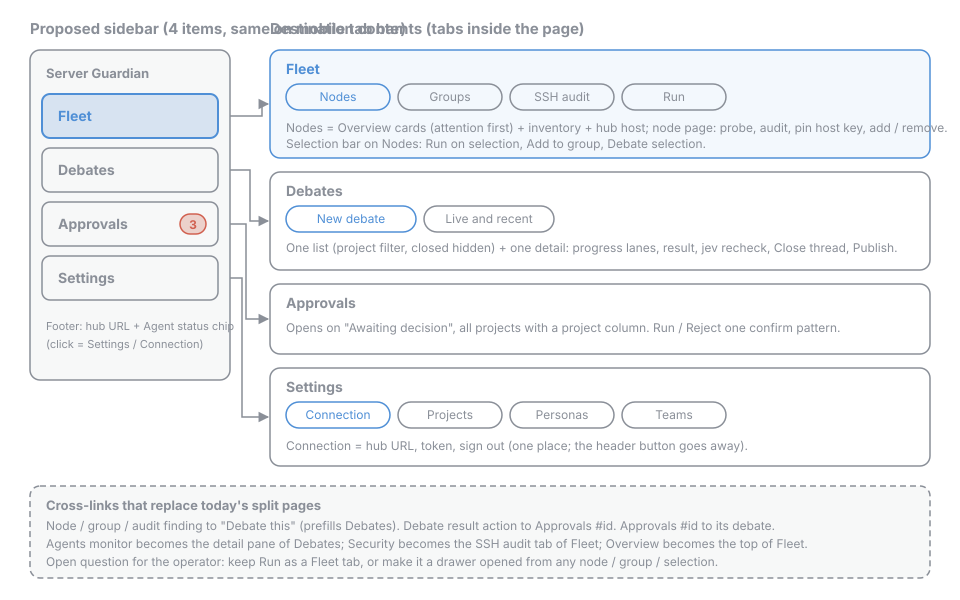

Current navigation:

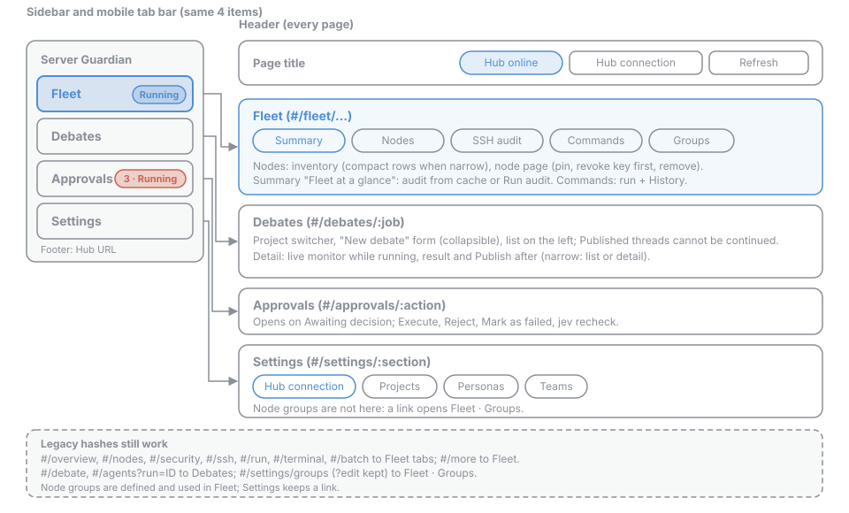

## 6. Cross-domain contradiction patterns

Overlaying the four teams' patterns yields seven. The number in each circle is how many findings in that domain match the pattern (one finding can belong to several patterns).

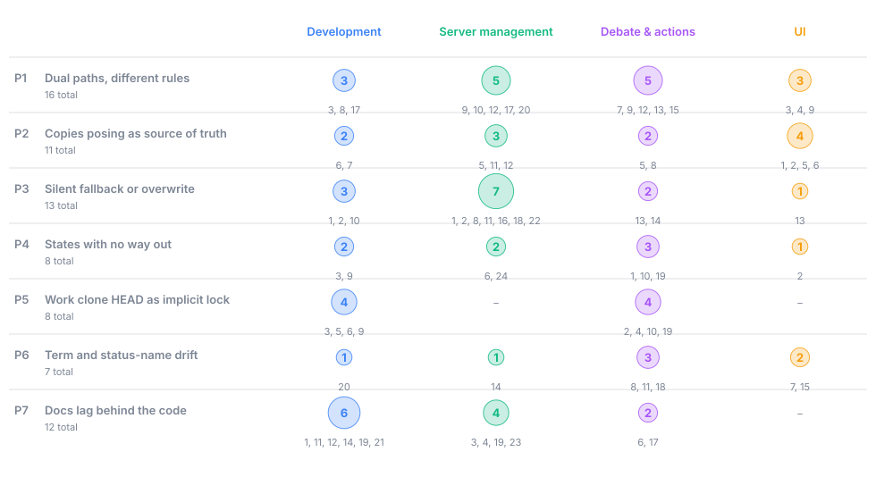

| Pattern | Meaning | Typical cases | Handling this time |
|---|---|---|---|
| P1 Dual paths, different rules | Two paths producing the same result use different safety rules | `git_commit_push` vs publish, `/api/exec` vs actions, CLI vs API close | Partly unified with the publish plan, same-thread 409, shared test helper |
| P2 Copies posing as the source of truth | Snapshots and copies used as if they were live state | result.json snapshot, Mac inventory, 4 kinds of version | Live action status, version stamp |
| P3 Silent fallback and overwrite | Falling back to another value instead of failing, or erasing operational state | `agent.env` overwrite, inventory fallback, ignored install checks | Update only owned keys, strict inventory, exit 1 on check failure |
| P4 States with no way out | A transitional state has no exit | Action RUNNING, publish RUNNING, node key revocation | Exception→FAILED, `--fail-stale-action`, publish recovery |
| P5 Workspace clone HEAD used as an implicit lock | Several procedures rely on `HEAD == base_sha`, but other procedures move HEAD | Sync, `git_commit_push`, deploy | Shared lock for sync and publish, untracked files respected |
| P6 Term and state name drift | The same concept has different names in each layer | 5 kinds of not approved, 3 kinds of reachability, 3 meanings of Run | `REVISION_REQUIRED`, `classifySSH`, UI term cleanup |
| P7 Docs lag behind code | Old descriptions remain after each refactor | Per-node agent, pytest fallback, auto-close comment | README, design doc and comment cleanup, snapshot labeling |

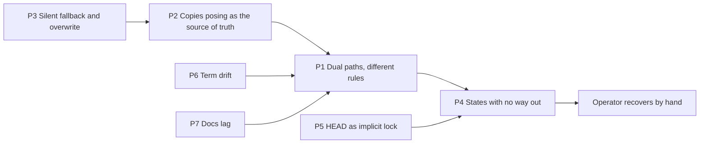

The common root is **"several places each judge the same fact on their own"**. Silent fallback (P3) creates copies (P2). Copies lead to different judgments per path (P1), and judgments that disagree end in states with no way out (P4). Most of the fixes this time move judgment into one place: the shared classifier, the shared test helper, the shared lock, the owned-key rule and live status queries.

## 7. Change history

### 7.1 First round of fixes (Jev classification: 40 of 42 candidates applied)

| Team | Commits | Main changes |
|---|---|---|
| Deploy, CI, docs | 10 | Hub mode decision, `agent.env` merge, respect for untracked files, exit 1 and `agent.prev` on check failure, version stamp, `npm ci` condition, CI cancellation rule, docs cleanup |
| Fleet backend | 6 | Strict `GUARDIAN_SERVERS_FILE`, limits on host key overwrites and fail closed, fleet file lock, `classifySSH`, key lines blocked when there is no hub IP, form validation rules exposed |
| Debate backend | 14 | Sync lock, FAILED on exception, round-scoped recheck, 409 for the same thread, `REVISION_REQUIRED`, uniform 404, actor validation, shared test helper, lineup fallback, publish recovery, publish plan, test command guidance for the judge |
| Dashboard | 13 (+1 follow-up) | Confirmation colors, live action and publish plan, decision status colors, Approvals default filter, unified terminology, debate from SSH audit, Sign-in required, Advanced, Agents filter, form validation, More tab, Columns, key-blocking copy |

Deferred candidates: removing `git_commit_push` (F3, Jev "decision needed" 0.91) and restructuring Overview (F20, Jev withheld its verdict).

### 7.2 Verification

- The full `scripts/ci.sh go python web shell config` passed. It includes Go `-race`, 516+16 Python tests, 403+ web tests, shellcheck and config validation.
- After the hub deploy, the Mac, the hub, the workspace clone and the agent are all at `52fbfe2`.
- The post-deploy fleet diagnosis shows all 24 nodes ONLINE with `reachability: ok`, the same as the baseline.
- The publish plan API returns 409 when its conditions are not met and 404 for a missing thread; closing a thread also returns 404 for a missing thread.

### 7.3 Re-analysis results

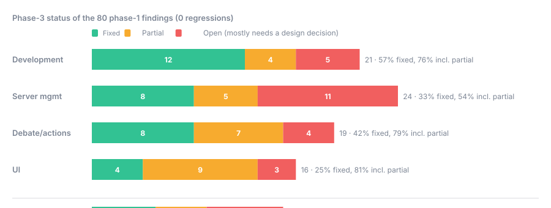

| Domain | Resolved | Partly resolved | Unresolved | Regression |
|---|---|---|---|---|
| Development (21) | 12 | 4 | 5 | 0 |
| Server management (24) | 8 | 5 | 11 | 0 |
| Debate and actions (19) | 8 | 7 | 4 | 0 |
| UI (16) | 4 | 9 | 3 | 0 |
| **Total (80)** | **32** | **25** | **23** | **0** |

Most of the 23 unresolved items are design items that need an operational decision (section 8). Server management has a low resolution rate because it holds the items that need a decision first, such as a single inventory, key revocation and backup scope.

### 7.4 New problems caused by the fixes, and the second round of fixes

The re-analysis found 22 problems (5 Medium, 17 Low) that the first round of fixes caused or exposed. Based on Jev classification, 9 items got a second round of fixes.

| Item | New problem | Severity | Second fix | Commit |
|---|---|---|---|---|
| R1 | UI-N1: recheck and close errors carry the guidance meant for Execute | Medium | `failMessage` takes a kind argument; guidance only for the matching operation | `e857c42` |
| R2 | UI-N2: the UI does not use the new `reachability`, so every cause shows as "offline" | Medium | Shared helper `lib/reachability.ts`; per-class display in Nodes, Overview and group summaries | `b961266` |
| R3 | DBT-N1: a run that finishes late overwrites the operator's FAILED with EXECUTED and overwrites `decided_by` | Medium | The final record is written only while RUNNING; late results are kept as `late_result` | `391bcb8` |
| R5 | DBT-N6: the read-only publish plan takes the workspace clone lock and blocks real publish and sync | Low | The plan answers without the lock and reports a publish in progress | `8344131` |
| R6 | OPS-N2: Go is strict about the inventory path, Python falls back to the checkout copy | Medium | Python follows the same rule | `0c47852` |
| R7 | DEV-N1, OPS-N4: the README still describes the pytest fallback | Low | Corrected to say `tests.default` is required | `48231af` |
| R8 | DEV-N2: rolling back sshd hardening is treated as an install failure | Low | Treated as a warning; binary rollback guidance only when the agent fails | `48231af` |
| R9 | DEV-N3: nodes registered through the dashboard must first be pulled into the Mac inventory | Low | `pull-inventory.sh` guidance in the README and in the install refusal message | `48231af` |
| R10 | UI-N5: leftover old terms ("Agent online", "Debate Console", and so on) | Low | "Hub online", "Debates", "Hub (local)" | `ffabebd` |

The deferred item is DBT-N2 (there is no official way to discard leftover files in the workspace clone). It needs an operational decision on what may be discarded, so it moved to D12.

After the second round of fixes, `scripts/ci.sh go python web shell config` passed again (520 Python tests, 411 web tests).

The remaining Low items are listed below. All of them, with evidence, are in the phase 3 reports in the appendix.

- **Development**: DEV-N4. The deploy's workspace clone update does not use the publish/sync lock.
- **Server management**
  - OPS-N1: The host key rule recognizes only exact alias blocks.
  - OPS-N3: The `agent.env` merge still has edge cases.
- **Debate and actions**
  - DBT-N3: HELD actions from other rounds are left unattended.
  - DBT-N4: One job screen shows the actions of the whole thread.
  - DBT-N5: The judge catalog lacks the `tests.default` requirement.
  - DBT-N7: The same file has two query parsers.
  - DBT-N8: Publish recovery works per thread, but the workspace clone is per project.
- **UI**
  - UI-N3: The team's default reference code in the collapsed Advanced area is sent without being visible.
  - UI-N4: Confirmation colors are still partly inconsistent.
  - UI-N6: Small behaviors introduced during the fixes remain.

### 7.5 Phase 4 re-analysis

After the decisions were implemented and deployed (`66cf41e`), the same four teams analyzed again. The scope was the 80 phase 1 items, the 22 new items from phase 3, and the procedures that changed in between.

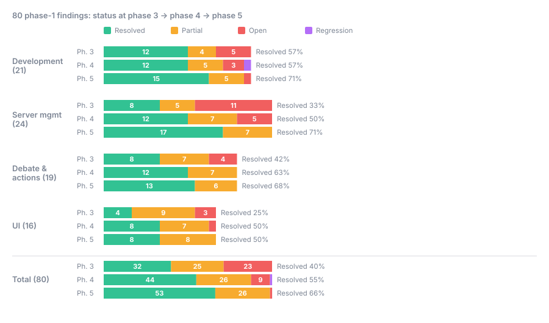

| Domain | Resolved | Partly resolved | Unresolved | Regression | Compared with phase 3 |
|---|---|---|---|---|---|
| Development (21) | 12 | 5 | 3 | 1 | DEV-3 resolved, DEV-4 and DEV-11 to partly resolved, DEV-14 regressed through a missing README table (Low) |
| Server management (24) | 12 | 7 | 5 | 0 | OPS-3, 4, 5, 11 resolved; OPS-6, 10, 15 to partly resolved |
| Debate and actions (19) | 12 | 7 | 0 | 0 | DBT-1, 2, 7, 15 resolved; 0 unresolved |
| UI (16) | 8 | 7 | 1 | 0 | UI-1, 2, 6, 7 resolved |
| **Total (80)** | **44** | **26** | **9** | **1** | Resolution rate 40% → 55% |

Counting the 22 new phase 3 items, out of 102 items there are 52 resolved, 29 partly resolved, 20 unresolved and 1 regression. Implementing the decisions created 21 new problems (8 Medium, 13 Low).

| New problem (Medium) | Description |
|---|---|
| DBT-P4-1 | Work can continue on a published thread, and the fact that it cannot be published is only learned at publish time |
| DBT-P4-2 | Running a workspace clone cleanup while an action executes deletes the files it just wrote |
| DEV-P4-1 | Workspace clone cleanup keeps leaving files of threads that will never be published (same cause as DBT-P4-3) |
| OPS-P4-1 | Deleting a node before key revocation leaves the hub key on the node, and the dashboard revocation path returns 404 |
| OPS-P4-3 | The audit log grows without limit, does not record node writes, key revocations or rejected requests, and cannot tell auth methods apart |
| OPS-P4-4 | The old key revocation step in the restore document also removes the new key and can lose access to the whole fleet |
| UI-P4-1 | On narrow screens the Debates result is attached below the entire list |
| UI-P4-2 | Node groups are defined in Settings and used in Fleet |

The original team reports are in the phase 4 reports in the appendix.

### 7.6 Phase 4 follow-up fixes (Jev verdicts)

The new problems and the remaining original items were judged with Jev. 19 items were implemented and deployed to the hub (`4c10afd`), and 1 was deferred.

| Item | Jev | Handling | Commit |
|---|---|---|---|
| P1 A published thread is finished (DBT-P4-1) | 0.96 | Continuing the debate returns 409, the list shows Published, Continue is hidden | `e7851b5`, `1aed5f2` |
| P2 Race between cleanup and executing actions (DBT-P4-2) | 0.99 | Cleanup is refused while an action executes; file actions lock the workspace clone during writes and tests | `c59b88d` |
| P3 Releasing threads (DEV-P4-1) | 0.85 | Cleanup plan grouped per thread with an explicit Release; released threads are refused for publish | `549dbd5`, `2090769` |
| P4 Revoke before removal (OPS-P4-1) | 0.99 | Records `hub_key_revoked_at`; the removal dialog points to revocation first, and skipping it requires an explicit check | `cecabc5`, `a0f92ef` |
| P5 Audit log (OPS-P4-3) | 0.89 | 5 files rotated at 10MB; records node writes, key revocations and rejected requests; distinguishes `session@`/`token@`. Not a tamper-proof log | `cecabc5`, `cff945a` |
| P6 Align the restore document with key revocation (OPS-P4-4, OPS-P4-2) | 0.95 | `--revoke` removes only on an exact key body match, restore order corrected, audit log preserved, revoking the hub's own key refused | `cddfb2b`, `cecabc5` |
| P7 Narrow-screen Debates (UI-P4-1) | 0.76 | Either the list or the detail, Back to list | `7ab0e7f` |
| P8 Fleet Groups tab (UI-P4-2) | 0.89 | Group definitions moved to `#/fleet/groups`, Settings keeps only a link | `5c8c9ac` |
| P9 Docs (DEV-14 regression, DEV-P4-2, 3) | 0.96 | README CI table, unified `--offline` description, status tables in this report updated | `6735392` |
| P10 UI polish (UI-P4-3 to 8, O8) | 0.96 | Badges shown together, duplicate Debates requests removed, reachability classes in SSH audit, danger color for fleet-wide run confirmation, the first screen does not run the SSH audit automatically, title "Fleet at a glance" | `975cdb9`, `7ab0e7f` |
| P11 Cleanup (DBT-P4-4 to 6) | 0.88 | `git_commit_push` leftovers, unified thread id pattern, plan timeout | `2eed2fc`, `87615a4` |
| O1 Hub sudo bypass (OPS-9) | 0.96 | With sudo off, the hub is refused as a remote target (`GUARDIAN_HUB_SUDO`) | `cecabc5`, `6ab1ec6` |
| O2 Target naming rule (OPS-12) | 0.97 | `/api/exec/remote` takes only node ids; a name gets a hint with the correct id | `cecabc5` |
| O3 Credential import (OPS-18) | 0.97 | Reuses inventory validation, diff and confirmation; ssh config goes into an Include file | `24897f8` |
| O4 LLM deploy targets (OPS-23) | 0.95 | Hub only by default | `b7cea9c` |
| O5 Key rotation (OPS-24) | 0.97 | `--rotate`: full rollback if checking the new key fails. **Phase 5 found a High defect; do not run it until fixed (7.7)** | `cddfb2b` |
| O6 File actions without a base (DEV-9) | 0.96 | Records the workspace clone HEAD at proposal time as the base | `b7bb5cc` |
| O7 Go version (DEV-15) | 0.97 | Version in `go.mod` only, amd64 build in CI | `53a4e02` |
| P12 Install script checks that CI passed | Verdict withheld (0.58) | Kept as is. Run as a working rule: pass `scripts/ci.sh` before deploying | – |

**Verification**
- The full `scripts/ci.sh go python web shell config` passed (including 564 Python tests and 516 web tests).
- This time the commands were chained so that push and deploy run only if CI passes. So when the Go step failed in the first CI run, nothing was deployed. The causes were one gofmt issue and one test cleanup race.
- After the deploy, all 24 fleet nodes are `ok`, and the agent environment has `GUARDIAN_HUB_SUDO=on`.
- The audit log records `token@…` and `rejected`, and revoking the hub's own key returns 400.
- The published-state display and the workspace clone cleanup plan work. Action states in the hub DB did not change.
- The actual key replacement step of `--rotate` and fingerprint matching of `authorized_keys` lines with options have not yet been checked on the real hub and nodes.

### 7.7 Phase 5 re-analysis

After the phase 4 follow-up fixes were deployed (`7783afa`), the same four teams analyzed again. The scope was 123 items in total: 80 from phase 1, 22 new from phase 3 and 21 new from phase 4.

At the time of the analysis, another session was working in the same repository. There was one docs commit, `b82310c`, and uncommitted changes in `cli/llm-agent`. The analysis teams read the working tree, but the verdicts above are based on changes up to `7783afa`. No code was fixed or deployed in this phase.

| Domain | Resolved | Partly resolved | Unresolved | Regression | Compared with phase 4 |
|---|---|---|---|---|---|
| Development (21) | 15 | 5 | 1 | 0 | DEV-9, 14, 15 resolved, regression resolved. The unresolved item is DEV-20, kept as D14 |
| Server management (24) | 17 | 7 | 0 | 0 | OPS-6, 12, 18, 23, 24 resolved; OPS-9 to partly resolved |
| Debate and actions (19) | 13 | 6 | 0 | 0 | DBT-10 resolved |
| UI (16) | 8 | 8 | 0 | 0 | UI-11 to partly resolved |
| **Total (80)** | **53** | **26** | **1** | **0** | Resolution rate 55% → 66% |

Counting the new items from phases 3 and 4, out of 123 items there are 81 resolved, 29 partly resolved, 13 unresolved and 0 regressions. Most of the 21 new problems from phase 4, including the 8 Medium ones, are resolved.

**New problems in phase 5 (21: 1 High, 7 Medium, 13 Low)**

| ID | Severity | Description |
|---|---|---|
| OPS-P5-1 | **High** | `--rotate` replaces the fleet key for the whole hub but installs the new key only on nodes with a Tailscale IP or on the named nodes. Other nodes, such as those registered through the dashboard, lose access right after the rotation. **Never run yet; do not run it until fixed** |
| OPS-P5-4 | Medium | `--rotate` creates the new private key in the ubuntu account directory and leaves the old key in `/etc/guardian/fleet_key.old-*` indefinitely (violates the "ubuntu cannot read the fleet key" principle) |
| OPS-P5-2 | Medium | The guard against the hub sudo bypass only blocks the fleet path. `ssh <hub> sudo` is still possible through `/api/exec` or judge actions, and the environment variable takes precedence over the real sandbox state |
| OPS-P5-3 | Medium | `hub_key_revoked_at` is recorded even when no line was actually removed, and it is never cleared. If `setup-hub-ssh.sh` later adds the key back, the removal dialog still shows "revoked" |
| DEV-P5-1 / DBT-P5-1 | Medium | A released thread can still be continued and its remaining actions executed, but it cannot be published. The trap closed for published threads remains for released ones |
| DBT-P5-2 | Medium | Action execution checks the base commit and the operator confirmation before taking the lock. While it waits for CLI confirmation, sync, publish or cleanup can move HEAD |
| UI-P5-1 | Medium | On narrow screens "Continue this thread" only fills a hidden form, so it looks unresponsive |
| 13 Low items | Low | An accidentally committed empty file `orkspace_ops.py`, target names of judge remote actions not checked at the proposal step, audit log actor distinction, missing Published mark on debates opened by URL, and so on |

**How `--rotate` disconnects nodes (OPS-P5-1)**

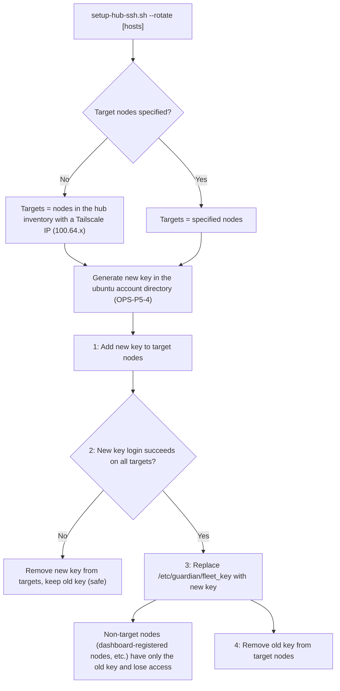

The original team reports are in the phase 5 reports in the appendix. Judging these items with Jev and fixing them is not part of this report.

## 8. Decisions and Jev verdicts

14 design decisions were judged with Jev, and the items with a conclusion were implemented right away and deployed to the hub (`f01c0e1`). Items with a withheld verdict were asked once more with concrete options; if they still fell short of the threshold (act 0.8 or yes 0.7), the current behavior was kept or the item was deferred.

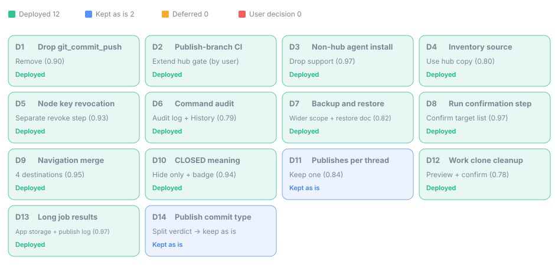

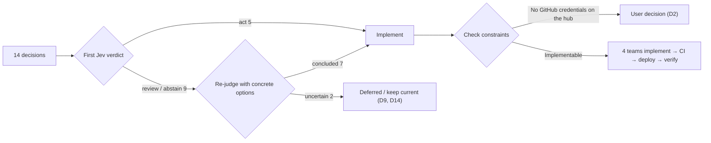

| # | Topic | Jev verdict | Handling | Commit |
|---|---|---|---|---|
| D1 | `git_commit_push` | Remove (yes 0.90) | Removed from the catalog, default teams and judge persona. Stored proposals become INVALID("use publish") at run time | `ccda0f6` |
| D2 | CI for the publish branch | User decision: widen the hub gate. Method by Jev (0.99) | `tests.default` takes a command list and allows `go vet`. The server-guardian gate is unittest → `go vet` → `go test -race` (passed on the hub with the agent PATH in 92.6 seconds). The allowlist is unchanged (no shell or path scripts) | `e6f372d`, `7002432` |
| D3 | Non-hub agent install | Support dropped (0.97) | The install script allows only the hub; README rewritten for a single hub | `c4dc12d` |
| D4 | Inventory source | Hub copy (0.80) | Mac scripts read and use the hub's `servers.json` (`scripts/lib/inventory.sh`; `--offline` uses the local copy with a warning). `pull-inventory.sh` refuses if there are uncommitted edits, and `setup-hub-ssh.sh` skips ids not in the hub inventory | `d0bb95e` |
| D5 | Node key revocation | Separate operation (0.93) | `GET/POST /api/nodes/{id}/revoke-key` (preview, id confirmation, removes only that key line after a backup) and a button on the node page | `d539560`, `947d17f` |
| D6 | Command audit | Audit log (yes 0.79) | The 4 exec APIs write to `~/.guardian/data/audit/exec.jsonl`, `GET /api/audit`, History on the Commands page | `d539560`, `947d17f` |
| D7 | Backup and restore | Widen (yes 0.82) | Data directory and fleet SSH config tarball replicated together with the DB, [restore procedure](../operations/backup-restore.md) | `d19e2b9`, `f01c0e1` |
| D8 | Run confirmation | Confirm the target list (0.97) | Group and fleet runs use one confirmation that shows the target names and the command | `947d17f` |
| D9 | Navigation consolidation | Re-judged at the user's request: full restructure into 4 destinations (0.95), Overview as a Fleet summary tab (keep separate 0.24), remove the More tab (0.82) | Fleet (Summary, Nodes, SSH audit, Commands tabs), Debates (list + running monitor + results), Approvals, Settings. All old URLs redirect to the new ones | `0fc6e51`, `4571522` |
| D10 | Meaning of CLOSED | Hide only (0.94) | Documented, `GET /api/threads/closed`, "Thread closed" badge in Approvals | `ccda0f6`, `c216c01` |
| D11 | Publishes per thread | Keep one (0.84) | Stated in the design document | `ccda0f6` |
| D12 | Workspace clone cleanup | Implement (yes 0.78) | `--workspace-reset` (plan/run, exact paths only, shared lock), API, button in Settings → Projects | `ccda0f6`, `947d17f` |
| D13 | Long-running job results | App-level store (0.97) | Run and publish moved to an app-level store, Running indicator in the nav, `GET /api/threads/{thread}/publications` and "Published as branch X" | `ccda0f6`, `c216c01` |
| D14 | Publish commit type | Split verdict (0.46 vs 0.41) | Keep the current `fix:` | – |

### 8.1 Unifying decision paths (additional verdicts)

While sorting out that Approvals decisions are also made outside the dashboard (via the hub CLI), two more items were judged.

| Topic | Jev verdict | Handling | Commit |
|---|---|---|---|
| Mark stuck RUNNING actions as failed from the dashboard | Adopt (yes 0.77) | `POST /api/actions/{id}/fail-stale` (id confirmation, 409 if the hub is still running it) and "Mark as failed" in Approvals | `64a2bff`, `c8a5741` |
| Scope of `GUARDIAN_UI_ACTIONS=off` | Block all decision paths (0.69 → standalone check yes 0.78) | Execute, reject, recheck, close, publish, workspace clone cleanup and mark-as-failed return 403 with a hint to the equivalent CLI command. Read paths and fleet, node and settings paths are unchanged | `64a2bff` |

All decisions can now be made in the dashboard. With the switch off, all decisions move consistently to the hub CLI. The only state the system changes without a person is the safeguards: jev gate hold (HELD), failed pre-run revalidation (INVALID), FAILED from exceptions, and cleanup of interrupted publishes.

### 8.2 Remaining small points (additional verdicts)

| Topic | Jev verdict | Handling | Commit |
|---|---|---|---|
| Status requests keep going out before sign-in | Stop (yes 0.87) | On 401 the request function stops all periodic requests; they resume on sign-in or hub change | `ae12eaa`, `ca4ea2c` |
| Old copy left after the restructure | Clean up (yes 0.79) | Overview link and empty-history copy cleaned up | `3222c17` |
| Per-tab page titles in Fleet | Split verdict (0.52 vs 0.42) | Keep the current "Fleet" | – |
| On narrow screens the Nodes table wraps per character, and Uptime is the whole `uptime` output | Compact rows (1.00) | Uptime shows only the duration, such as `8d 15h`; narrow screens use two lines per node (node, status / host, group, uptime, load, memory) | `9d9d828`, `bb2eea6` |

**Hub verification after deploy**
- The deploy script read the hub inventory and installed. The Mac, the hub, the workspace clone and the agent are all at `f01c0e1`.
- All 24 fleet nodes show `reachability: ok`, the same as the baseline.
- One `/api/exec` call is confirmed to be recorded in `/api/audit`.
- The key revocation preview shows only the hub key fingerprint without connecting to the node.
- The workspace clone cleanup plan, publish history and closed threads APIs all return 200.
- The backup service was run once. A DB copy and a data tarball were created and replicated to site-yd-arm1. The tarball contains `guardian_fleet.conf` and no private key. `guardian_known_hosts` does not exist yet because no registered node has pinned a key.
- Key revocation runs (POST) and workspace clone cleanup runs (POST) were not executed against real hosts.
- After the D9 deploy (`c8a5741`), the dashboard before sign-in shows the 4 menus and the Fleet tabs. Status requests continuing before sign-in (0.4 per second) are left as a small waste.

**Caveats**
- The audit log stores the command text up to 4096 characters. If a command contains a secret value directly, that value is recorded too.
- When the hub has no inventory yet, as on a first hub install, `--offline` is needed.

## Appendix

The original reports of each team (in English, with `file:line` evidence).

| Domain | Phase 1 procedure analysis | Phase 3 re-analysis | Phase 4 re-analysis | Phase 5 re-analysis |
|---|---|---|---|---|
| Development practice | [phase1-dev.md](2026-10-12-procedure-review/phase1-dev.md) | [phase3-dev.md](2026-10-12-procedure-review/phase3-dev.md) | [phase4-dev.md](2026-10-12-procedure-review/phase4-dev.md) | [phase5-dev.md](2026-10-12-procedure-review/phase5-dev.md) |
| Server management | [phase1-ops.md](2026-10-12-procedure-review/phase1-ops.md) | [phase3-ops.md](2026-10-12-procedure-review/phase3-ops.md) | [phase4-ops.md](2026-10-12-procedure-review/phase4-ops.md) | [phase5-ops.md](2026-10-12-procedure-review/phase5-ops.md) |
| Debate and actions | [phase1-debate.md](2026-10-12-procedure-review/phase1-debate.md) | [phase3-debate.md](2026-10-12-procedure-review/phase3-debate.md) | [phase4-debate.md](2026-10-12-procedure-review/phase4-debate.md) | [phase5-debate.md](2026-10-12-procedure-review/phase5-debate.md) |
| UI | [phase1-ui.md](2026-10-12-procedure-review/phase1-ui.md) | [phase3-ui.md](2026-10-12-procedure-review/phase3-ui.md) | [phase4-ui.md](2026-10-12-procedure-review/phase4-ui.md) | [phase5-ui.md](2026-10-12-procedure-review/phase5-ui.md) |
