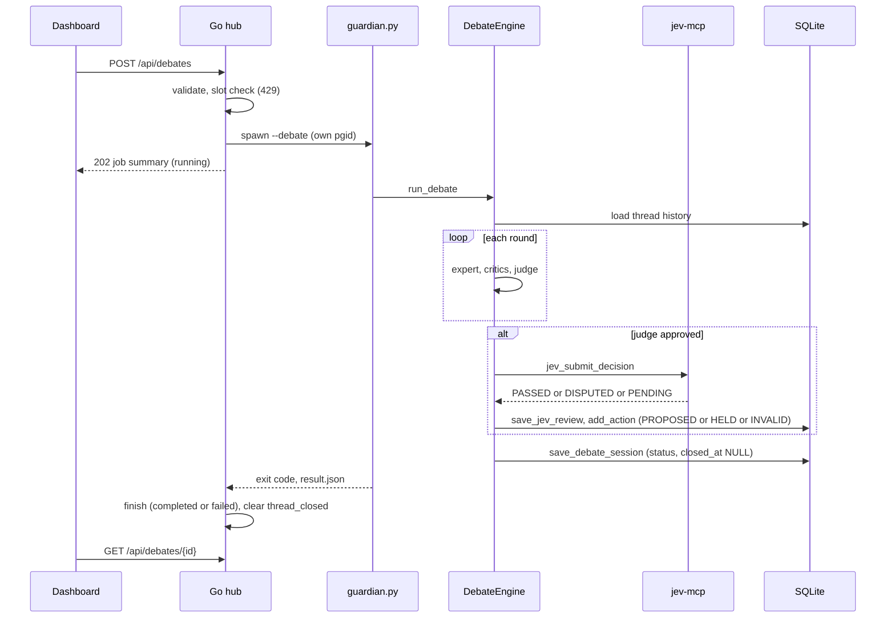
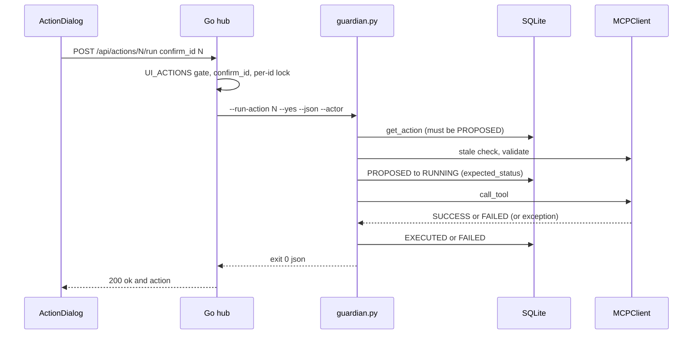
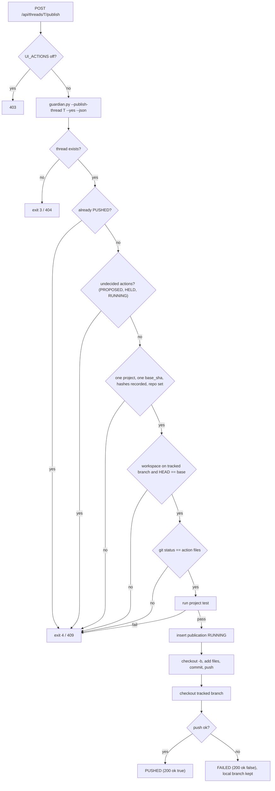
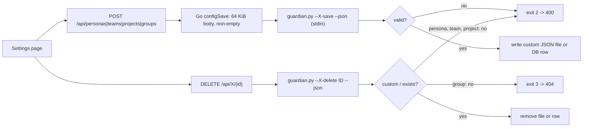
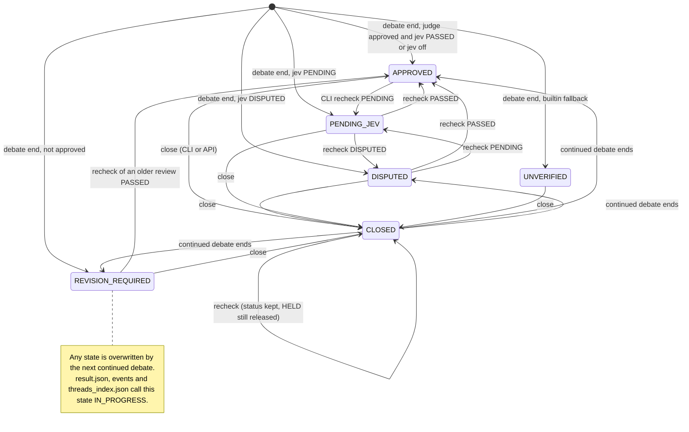
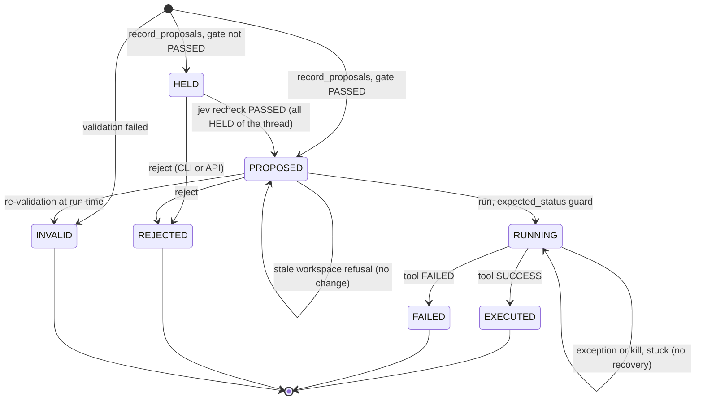
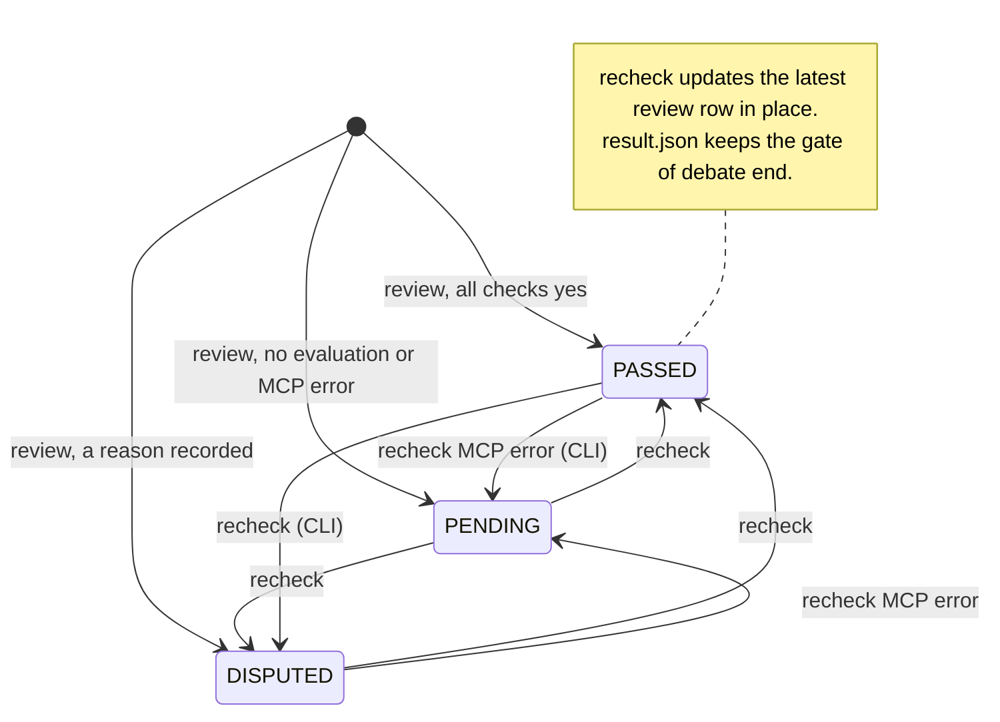
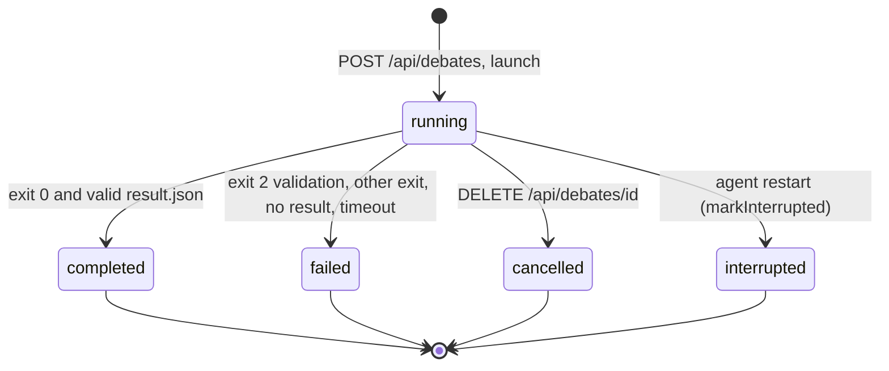
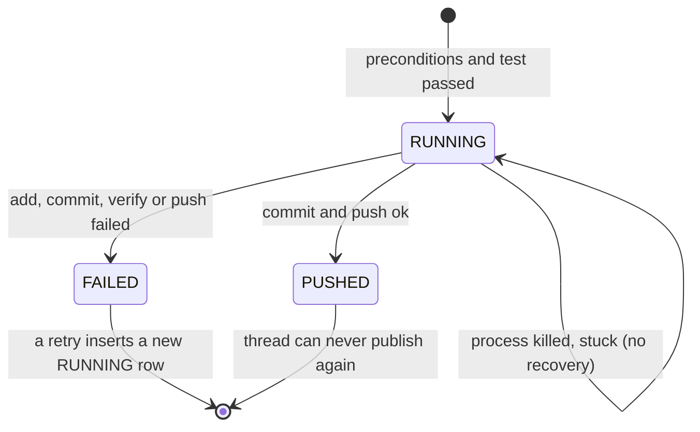

# 1단계 - 토론 / 결정 / 조치 생애주기 검토

[English](phase1-debate.md) | 한국어

> 2026-10-12 시점의 기록이며, 이후 코드가 바뀌었다.

범위: 토론 시작 -> 판정 -> jev 게이트 -> 조치별 승인 -> 실행 -> 닫기 / 다시 열기 -> 게시, 그리고
설정 절차(페르소나, 팀, 프로젝트, 노드 그룹, 코드 컨텍스트, 검색 예산).
저장소: `/Users/owner/working/ci_build/server-guardian`, `5aa8e2e` 시점. 모든 경로는 저장소 기준 상대 경로이며, 모든 주장은
코드와 대조해 확인했다. 약어: **PY** = `cli/llm-agent/*.py`, **GO** = `apps/agent/debate_handler.go`,
**TS** = `apps/web-desktop/src/*`.

---

## 1. 절차 목록

### 1.0 누가 무엇을 전이시킬 수 있는가 (요약)

| 전이 | CLI (사람) | CLI `--json` (허브 형식) | 허브 API 경로 | 대시보드 컨트롤 | 엔진 (자동) |
|---|---|---|---|---|---|
| 토론 시작 / 계속 | `--debate T [--thread]` | 동일 + `--result-file --events-file` | `POST /api/debates` | Console "Start" / "Continue this thread" | - |
| 작업 취소 | Ctrl-C만 가능 | - | `DELETE /api/debates/{id}` | Cancel 버튼 | 타임아웃 -> `failed`; 재시작 -> `interrupted` |
| 조치 PROPOSED/HELD/INVALID 생성 | - | - | - | - | 승인 라운드 끝에 `record_proposals` |
| 조치 실행 | `--run-action N` (프롬프트 또는 `--yes`) | `--run-action N --yes --json --actor` | `POST /api/actions/{id}/run` (`GUARDIAN_UI_ACTIONS`로 게이트) | ActionDialog Run | 재검증 실패 시 PROPOSED->INVALID |
| 조치 거부 | `--reject-action N` | `--reject-action N --json --actor` | `POST /api/actions/{id}/reject` (게이트 없음) | ActionDialog Reject | - |
| jev 재점검 (HELD->PROPOSED, 스레드 상태) | `--jev-recheck T` | 동일 `--json` | `POST /api/threads/{t}/jev-recheck` (게이트 없음) | RecheckPanel / ActionDialog | - |
| 스레드 닫기 | `--close-thread T` | 동일 `--json` | `POST /api/threads/{t}/close` (T에 대한 허브 작업이 실행 중이면 거부) | Close thread 버튼 (스냅샷 라벨 != APPROVED일 때만) | 없음 (DBT-6 참고) |
| 스레드 다시 열기 | `--debate --thread`로 계속 | - | `thread_id`를 담은 `POST /api/debates` | "Reopen with a new debate" | `save_debate_session`이 상태를 덮어씀 |
| 스레드 게시 | `--publish-thread T` (계획 + yes 입력) | `... --yes --json --actor` | `POST /api/threads/{t}/publish` (게이트) | PublishPanel | - |
| 페르소나/팀/프로젝트/그룹 CRUD | `--persona-save` 등 | 동일 `--json` | `/api/personas|teams|projects|groups` | Settings 섹션 | - |
| 프로젝트 워크스페이스 동기화 | `--project-sync ID|all` | 동일 | `POST /api/projects/{id}/sync` | Projects 섹션 | - |
| 검색 예산, jev 켜기/끄기, MCP | 환경 변수만 (`GUARDIAN_RETRIEVAL*`, `GUARDIAN_JEV_GATE`, `GUARDIAN_REPO_MCP`) | - | - | - | 실행마다 읽음 |

근거: 경로 `apps/agent/debate_handler.go:263-290`; CLI 플래그 `cli/llm-agent/guardian.py:607-656`; JSON 디스패치
`guardian.py:98-138`; 사람용 디스패치 `guardian.py:182-291`.

### 1.1 P1 - 토론 시작 또는 계속 (대시보드 경로)

1. TS `startDebate`가 `{task, team?, project?, thread_id?, rounds?, context_paths?, context_ref?}`를 POST한다 (`apps/web-desktop/src/api.ts:482-484`).
2. GO `startDebate`가 16 KiB 제한으로 디코딩하고 검증한다 (task 1-4000자, id/thread/ref 패턴, rounds 1-10, context 경로 <=20개) (`debate_handler.go:466-506, 516-530`).
3. GO가 단일 `--flag=value` 항목으로 argv를 만들고 (`debate_handler.go:544-564`), 슬롯을 예약하거나(`MaxRunning`, 기본값 2) 429로 응답한다 (`:566-574`). 같은 `thread_id`에 대해 다른 작업이 실행 중인지 점검하지 않는다 (DBT-9 참고).
4. GO `launch`가 `<DATA>/debate-jobs/<id>/`를 만들고, `meta.json`(`status: running`)을 쓰고, 자체 프로세스 그룹에서 `guardian.py --result-file ... --events-file=...`를 띄우고, 작업 타임아웃(기본 3600 s)을 건다 (`:591-638`); 202로 응답한다.
5. PY `handle_session_commands` -> `DebateEngine.run_debate` (`guardian.py:517-534`). 팀/컨텍스트/프로젝트 검증 오류는 exit 2로 끝난다 (`:535-543`).
6. PY 엔진: 프로젝트 + 워크스페이스를 로드한다 (`debate_engine.py:364-372`); 새 스레드 id `thread_<ts>_<hex>`를 만들거나 이력을 로드한다; 계속되는 스레드는 자기 프로젝트에 머물러야 한다 (`:374-383`); 라인업을 결정하고(팀 > 저장된 스냅샷 > 기본값, `:655-680`), 컨텍스트 팩(요청 경로 > 저장된 sha에 고정된 저장 경로 > 팀 > 프로젝트, `:682-701`), 검색 설정(`:395`)을 결정한다.
7. 라운드: 전문가 -> 비판자(병렬) -> `lineup_judge_tools`로 필터링한 도구 카탈로그를 가진 판정자 (`:466-558`). 내장 폴백 제공자는 라운드를 UNVERIFIED로 표시하고 멈춘다 (`:560-580`).
8. 승인 시: 결정/점검을 파싱하고 jev에 제출하고(`JevGate.review`), `jev_reviews` 행을 저장하고, `final_decision.approved = gate == PASSED`로 둔다 (`:592-613`).
9. 제안 기록: 검증된 것은 `PROPOSED`(게이트 PASSED) 또는 `HELD`(그 외)가 된다; 검증 실패 -> `INVALID` (`:614-623`, `action_ops.py:29-63`).
10. 저장: `save_debate_session`이 스레드 상태(APPROVED / REVISION_REQUIRED / UNVERIFIED / DISPUTED / PENDING_JEV)를 upsert하고 `closed_at`을 지운다 (`db_manager.py:231-313`); `decision_status()`로 Markdown/JSON 내보내기를 쓴다 (`debate_engine.py:1597-1688`); `debate_finished`를 내보낸다 (`:633-638`); 결과 파일을 원자적으로 쓴다 (`guardian.py:546-551`).
11. GO `finish`: exit 0 + 유효한 결과이면 `completed`, 아니면 `failed`/검증 실패; 완료 시 형제 작업의 `thread_closed`를 지우고 닫힌 스레드 캐시를 무효화한다 (`debate_handler.go:641-691`).

### 1.2 P2 - 조치 검토 및 실행 (또는 거부)

1. TS Approvals 목록 `GET /api/actions?thread=&project=` -> `--actions [T] --project=P --json` (`debate_handler.go:927-951`).
2. 상세 `GET /api/actions/{id}` -> 도구 위험도와 diff를 포함한 `--show-action` (`action_ops.py:323-334`).
3. 실행: TS가 `{confirm_id: id}`를 POST한다 (`api.ts:737-743`); 위험도가 low/medium이 아니면 입력 확인을 요구한다 (`lib/debate.ts:166-169`).
4. GO `runAction`: `GUARDIAN_UI_ACTIONS=off`이면 403, confirm_id는 경로 id와 같아야 하고, 프로세스 내 id별 잠금 후 `GUARDIAN_ACTION_TIMEOUT`(기본 900 s)으로 `--run-action N --yes --json --actor dashboard@<ip>`를 실행한다 (`debate_handler.go:1079-1122`).
5. PY `run_action`: HELD -> 거부; PROPOSED가 아님 -> 거부; 오래된 쓰기 도구(HEAD != base_sha) -> 상태 변경 없이 거부; 재검증 실패 -> `INVALID`; 확인; 원자적 `PROPOSED -> RUNNING`; `call_tool`; 도구 상태가 SUCCESS면 `EXECUTED`, 아니면 `FAILED` (`action_ops.py:211-255`).
6. 종료 코드 매핑: LookupError -> 3/404, RuntimeError -> 4/409 (`action_ops.py:337-348`; `debate_handler.go:355-390`).
7. 거부: `PROPOSED|HELD -> REJECTED` (`action_ops.py:267-272, 351-359`).

### 1.3 P3 - jev 재점검

1. `POST /api/threads/{t}/jev-recheck` -> `--jev-recheck T --json`, 300 s 타임아웃 (`debate_handler.go:971-979`).
2. PY `recheck_thread`: 스레드의 최신 리뷰(라운드 무관), `JevGate.recheck`(큐 처리 + 결정 조회, 또는 재제출), 같은 리뷰 행 갱신 (`action_ops.py:275-296`, `jev_gate.py:177-188`, `db_manager.py:566-590`).
3. PASSED: 스레드의 HELD 조치 **전부**를 PROPOSED로 풀어 준다; CLOSED가 아니면 스레드 -> APPROVED. 그 외에는 CLOSED가 아니면 스레드 -> DISPUTED / PENDING_JEV (`action_ops.py:288-295`).

### 1.4 P4 - 스레드 닫기와 다시 열기

1. 대시보드는 `!thread_closed && label != 'APPROVED'`일 때 "Close thread"를 보여 주며, label은 `result.json`에서 온다 (`lib/debate.ts:202-204`, `ResultView.tsx:268-300`).
2. GO `closeThread`: 이 허브에서 해당 스레드 id의 작업이 `running`이면 409; `--close-thread T --json`을 실행한다; 성공하면 저장된 작업 meta에 `thread_closed`를 설정하고 30 s 캐시를 무효화한다 (`debate_handler.go:983-1006, 1056-1075`).
3. PY `close_thread`: 상태 -> CLOSED, `closed_at` 설정, 멱등; 알 수 없는 스레드 -> exit 2 (`db_manager.py:627-647`, `action_ops.py:367-372`).
4. 목록: `GET /api/debates`가 `--closed-threads --json`(30 s 캐시)을 묻고, 실행 중이 아닌 작업의 `thread_closed`를 덮어쓴다 (`debate_handler.go:218-249, 773-781`).
5. 다시 열기: 새 토론으로 스레드를 계속한다; `save_debate_session`이 상태를 덮어쓰고 `closed_at`을 지운다 (`db_manager.py:264-276`); GO는 완료 시 플래그를 지운다 (`debate_handler.go:678-680`).

### 1.5 P5 - 스레드 게시

1. 대시보드 PublishPanel(결과 스냅샷에 조치가 하나라도 있으면 표시)은 선택적 브랜치를 묻는다 (`ResultView.tsx:196-249, 357-363`).
2. GO `publishThread`: 스레드 패턴, UI 조치가 꺼져 있으면 403, 1 KiB 본문, 브랜치 패턴, `--publish-thread T --json --yes --actor ... [--branch=]`, 1200 s (`debate_handler.go:1013-1052`).
3. PY `publish_thread` 전제 조건(모두 부수 효과 이전): 스레드가 존재; PUSHED 시도가 없음; PROPOSED/HELD/RUNNING 조치가 없음; `file_hashes`를 가진 EXECUTED 파일 조치 >=1개; 프로젝트 하나, base_sha 하나; 프로젝트에 `repo`가 있음; 브랜치가 유효하고 추적/보호 브랜치가 아님; 워크스페이스가 별도 clone이고 최상위이며 추적 브랜치 위에 있고 `HEAD == base`; git status 집합 == 조치 파일, staged 없음, 해시 일치 (`publish_ops.py:222-291`).
4. 확인(CLI 프롬프트는 계획을 보여 줌; 허브는 `--yes`), 프로젝트 테스트 실행(`_run_gate`), 워크트리 재점검 (`:293-302`).
5. `thread_publications` RUNNING 삽입; `checkout -b`, `add -- files`, `commit`, 트리 검증, `push`(force 없음); 항상 추적 브랜치로 돌아간다; PUSHED/FAILED로 표시 (`:304-316, 333-366`).

### 1.6 P6 - 설정 절차

| 객체 | 저장소 | 저장 | 삭제 | 검증 | 근거 |
|---|---|---|---|---|---|
| 페르소나 | 내장 `configs/personas`, 사용자 정의 `<DATA>/personas` (사용자 정의가 우선) | `POST /api/personas` -> `--persona-save` (stdin) | `DELETE /api/personas/{id}` -> 사용자 정의만, 아니면 exit 2 | `validate_persona` | `persona_manager.py:5-9, 115-130`; `config_ops.py:41-55` |
| 팀 | 내장 `configs/teams`, 사용자 정의 `<DATA>/teams` | `--team-save` | 사용자 정의만, exit 2 | `parse_lineup` + `validate_lineup` (페르소나 존재, 알려진 제공자, 비판자 1-4명, 라운드, 도구) | `team_manager.py:181-220, 295-325` |
| 프로젝트 | 내장/사용자 정의 JSON | `--project-save` | 사용자 정의만; clone은 유지 | `parse_project` (https repo, 브랜치, 홈 아래 워크스페이스, 테스트, 컨텍스트) | `project_registry.py:128-185, 268-283` |
| 프로젝트 동기화 | git clone / fetch + ff-only | `POST /api/projects/{id}/sync` (조치 타임아웃) | - | 추적 파일이 수정되었으면 건너뜀 | `project_registry.py:286-318` |
| 노드 그룹 | DB `node_groups` | `--group-save` / `--group-preview` | 알 수 없음 -> exit 3 / 404 | `GROUP_ID_RE`, 멤버는 servers.json에서 결정 | `config_ops.py:171-211`, `group_manager.py:25-27` |
| 코드 컨텍스트 | 요청별 / 스레드 스냅샷 / 팀 / 프로젝트 | `context_paths`, `context_ref` | - | Go 길이/문자 점검, PY `build_pack` (오류 시 exit 2) | `debate_handler.go:488-504`, `debate_engine.py:682-701` |
| 검색 예산 | 환경 변수만, 미설정/0이면 무제한 | `GUARDIAN_RETRIEVAL_STEPS/_REQUESTS/_STEP_BYTES/_TURN_BYTES`, `GUARDIAN_RETRIEVAL=0`, `GUARDIAN_REPO_MCP=1` | - | `_env_limit` | `debate_engine.py:167-183, 822-830` (`_limits` 경유) |

---

## 2. 상태 기계

### 2.1 스레드 상태 (`threads.status`, PY `db_manager.py`)

`save_debate_session`(`db_manager.py:254-276`), 재점검에서의 `set_thread_status`(`action_ops.py:288-295`), `close_thread`(`db_manager.py:627-647`)가 쓴다. `IN_PROGRESS`는 스키마 기본값일 뿐이며(`db_manager.py:71`), 이를 저장하는 코드 경로는 없다.

### 2.2 조치 상태 (`decision_actions.status`)

`ACTION_STATUSES = HELD, PROPOSED, INVALID, REJECTED, RUNNING, EXECUTED, FAILED` (`db_manager.py:445`).

### 2.3 jev 게이트 (`jev_reviews.gate`; `final_decision.jev_gate`)

값은 `PASSED | DISPUTED | PENDING`이다 (`jev_gate.py:23`). 스레드 상태는 `PENDING -> PENDING_JEV`로 매핑한다 (`db_manager.py:257-258`, `debate_engine.py:253-254`). `HELD`는 조치 상태이지 게이트 값이 아니다.

### 2.4 작업 상태 (`meta.json`, GO)

근거: `debate_handler.go:538, 668-688, 700-730, 845-861`; TS 타입 `DebateJobStatus`가 일치한다 (`types.ts:423`). `thread_closed`는 작업 meta에 붙는 독립적인 플래그이다 (`:146-148, 1056-1075`).

### 2.5 게시 상태 (`thread_publications.status`)

근거: `db_manager.py:522-546`, `publish_ops.py:224-228, 304-316`.

---

## 3. 모순과 충돌

심각도: **High** = 상태를 손상시키거나, 작업을 잃거나, 지원되는 복구 수단 없이 멈출 수 있음; **Medium** = 잘못된 UI/결정 또는 우회책이 있는 막힌 절차; **Low** = 명명/문서/일관성.

### DBT-1 (High) - 조치가 영원히 `RUNNING`에 머물 수 있고 복구 경로가 없다
- 근거: `action_ops.py:245-254`는 RUNNING을 설정한 뒤 try/finally 없이 `mcp.call_tool`을 호출한다. `call_tool`은 예외를 밖으로 내보낸다: 원격 `server_remediation` -> `NodeAgentClient._fetch_json`이 `RuntimeError`/`ConnectionError`를 던진다 (`mcp_client.py:316-317`, `agent_client.py:52-60`); `execute_code_action`의 `path.write_text` OSError (`mcp_client.py:273-274`). `run_action_json`은 RuntimeError를 exit 4(409)로 바꾸고 ConnectionError는 잡지 않는다(exit 1 -> 500) (`action_ops.py:341-346`). 허브는 `GUARDIAN_ACTION_TIMEOUT`(기본 900 s, `debate_handler.go:1119-1120`, `:332-340`) 후 또는 에이전트 재시작(systemd control-group kill) 시 CLI를 죽이며, 아무것도 그 행을 되돌리지 않는다. RUNNING에 대한 `update_action`은 `expected_status="PROPOSED"`를 통해서만 허용된다; RUNNING을 다른 상태로 옮기는 CLI/API는 없다.
- 영향: 조치는 영구히 RUNNING이다; `publish_thread`는 영원히 거부한다("actions are still undecided", `publish_ops.py:231-233`); 대시보드는 RUNNING을 "decided" 아래에 분류하고(`lib/debate.ts:120-121`) 운영자에게 "Reload the list"라고 안내한다 (`ActionDialog.tsx:273`).
- 수정: SAFE-FIX - `call_tool`을 `try/except Exception`으로 감싸고 오류와 함께 `FAILED`를 저장한다; DESIGN - 운영자용 전이 `RUNNING -> FAILED`를 추가한다(예: `--fail-stale-action N`, 또는 조치 타임아웃보다 오래된 RUNNING을 시작 시 정리).

### DBT-2 (High) - `git_commit_push`와 게시는 서로 배타적이며, 이 도구는 스레드를 조용히 망가뜨린다
- 근거: `jev_mcp:git_commit_push`는 `git checkout -b <branch>`, `git add -A`, `git commit`을 실행한다 (`mcp_client.py:300-312`); 이는 WRITE_TOOL이지만(`:95`) FILE_TOOL은 아니다 (`action_ops.py:182`). 게시는 워크스페이스가 추적 브랜치 위에 있고 `HEAD == base_sha`이며 조치 파일이 commit되지 않았을 것을 요구하고 (`publish_ops.py:270-277, 291`), 그 안전 규칙은 "never `git add -A`"이다 (`publish_ops.py:9-11`; `docs/design/publish-thread.md` Safety rules). 도구 설명은 여전히 이름에 "push"를 담고 있고 (`mcp_client.py:55-56`), 문서는 이를 "unchanged"라고 부른다 (`publish-thread.md:6`).
- 영향: 운영자가 판정자의 `git_commit_push`를 한 번 실행하면 그 스레드는 결코 게시될 수 없고, 그 프로젝트의 모든 스레드에 남은 PROPOSED 쓰기 조치가 전부 오래된 것이 되며(`stale_reason`, `action_ops.py:166-179`), 이후 토론은 누군가 프로젝트 동기화를 실행할 때까지 판정자 브랜치의 `HEAD`를 읽는다(`debate_engine.py:694-700`은 ref `HEAD`를 사용). `git add -A`는 FAILED 조치가 남긴 무관한 파일까지 commit한다.
- 수정: DESIGN - `git_commit_push`를 카탈로그에서 퇴역시키거나(이제 게시가 파일 단위 점검과 함께 commit+push를 담당한다) "publish"의 no-op 별칭으로 만든다. 그동안의 SAFE-FIX - 팀 `allowed_tools` 기본값에서 빼고 high 위험으로 표시한다.

### DBT-3 (High) - 재점검은 어느 라운드든 최신 리뷰에 작용하고 스레드의 모든 HELD 조치를 풀어 준다
- 근거: `recheck_thread`는 `latest_jev_review(thread)`를 사용하고(`action_ops.py:282`; `db_manager.py:592-597`은 id로만 정렬), `release_held_actions`는 라운드와 무관하게 스레드의 모든 HELD 행을 풀어 준다 (`action_ops.py:258-264`). 승인되지 않고 끝난 계속 토론은 새 리뷰를 쓰지 않으며(`debate_engine.py:595-618`) 이전 HELD 조치를 무효화하지도 않는다.
- 영향: 스레드 상태 REVISION_REQUIRED(최신 토론이 그 접근을 거부함)가 대체된 리뷰의 재점검 후 APPROVED로 되돌아가고, 오래된 라운드의 HELD 조치가 실행 가능해진다. 또한 CLI는 일시적인 MCP 오류로 APPROVED 스레드를 PENDING_JEV로 낮출 수 있는데 그 조치는 PROPOSED로 남으므로 (`action_ops.py:294-295`), 스레드 상태와 조치 실행 가능성이 어긋난다.
- 수정: SAFE-FIX - `round_num == review.round_num`인 조치만 풀어 주고, 스레드의 `final_round`가 리뷰 라운드보다 새로우면 재점검을 거부한다. DESIGN - 계속 토론이 이전 HELD/PROPOSED 조치를 자동 REJECT(또는 대체)해야 하는지 결정한다.

### DBT-4 (High) - 프로젝트 동기화가 추적되지 않는 파일을 무시하고 실행된 조치 아래에서 HEAD를 옮긴다
- 근거: `workspace_status`는 추적된 변경만 센다 (`--untracked-files=no`, `project_registry.py:212`); `sync`는 그 수가 0이면 fast-forward한다 (`:310-318`). `execute_code_action`이나 `old=""`인 `apply_patch`로 생긴 새 파일은 추적되지 않는다. 동기화는 잠금을 잡지 않고 대기 중인 조치나 게시 잠금도 점검하지 않는다 (`publish_ops.py:156-167`은 게시에서만 쓰인다).
- 영향: 동기화 후 `HEAD != base_sha` -> 게시가 영구히 거부되고("workspace moved", `publish_ops.py:276-277`) 모든 PROPOSED 쓰기 조치가 오래된 것이 된다; 실행된 새 파일은 추적되지 않는 잔여 파일로 남아 나중에 다른 스레드의 게시를 막는다("changed in the workspace but not written by the executed actions", `publish_ops.py:129-136`). 게시 중의 동기화는 commit 도중에 추적 브랜치를 checkout할 수도 있다.
- 수정: SAFE-FIX - 동기화의 dirty 점검에 `--untracked-files=all`을 쓰고(또는 프로젝트에 게시되지 않은 EXECUTED 파일 조치가 있으면 동기화를 거부하고) `sync`에서도 같은 `guardian-publish.lock`을 잡는다.

### DBT-5 (Medium) - 대시보드가 오래된 `result.json` 스냅샷으로 판단한다; 스레드 상태나 게시를 노출하는 API가 없다
- 근거: ResultView는 판정, 닫기 버튼 표시 여부, 재점검 패널, 조치별 상태를 `result.final_decision`에서 도출한다 (`ResultView.tsx:268-273, 286, 298, 355`; `lib/debate.ts:186-208`). `threads.status`나 `thread_publications`를 반환하는 경로가 없다 (`debate_handler.go:263-290`); `list_publications`는 내부에서만 쓰이고(`publish_ops.py:224`), `list_project_threads`는 호출자가 없다.
- 영향: 재점검이 통과한 뒤에도 결과는 여전히 DISPUTED를 보여 주고, "Re-run jev check"와 "Close thread"를 계속 표시하며, 조치 표는 이제 PROPOSED/EXECUTED인 조치를 HELD로 보여 준다. 새로 고침 후에는 이미 게시된 스레드(클릭 시 409)와 조치가 모두 INVALID/HELD인 스레드에도 Publish 버튼이 보인다.
- 수정: DESIGN - `--thread-status T --json` CLI 명령을 통해 `GET /api/threads/{thread}`(상태, closed_at, 최신 게이트, 조치 상태별 개수, 게시)를 추가한다; SAFE-FIX - ResultView에서 조치 상태를 `GET /api/actions?thread=`(이미 존재)에서 읽고, Publish를 "PROPOSED/HELD/RUNNING 없음 그리고 EXECUTED 파일 조치 >=1개"로 게이트한다.

### DBT-6 (Medium) - "결론 없는 스레드의 자동 닫기"는 코드 주석에 적혀 있지만 존재하지 않는다
- 근거: `debate_handler.go:191-192`("CLI --close-thread, auto-close of inconclusive threads")와 `db_manager.py:621`("dashboard, CLI or auto-close"). CLOSED를 쓰는 유일한 곳은 `--close-thread`를 통한 `close_thread`이다 (`db_manager.py:627-647`, `guardian.py:120-121, 226-233`). commit `2ccd073`("close threads that ended without a conclusion")은 수동 닫기만 추가한다.
- 영향: 운영자는 REVISION_REQUIRED/UNVERIFIED 스레드가 자동으로 사라질 것이라 기대하지만, 실제로는 쌓인다. 검토자도 30 s 캐시를 추론할 때 이 주석에 기댈 수 있다.
- 수정: SAFE-FIX - 두 주석을 바로잡는다; DESIGN - 자동 닫기를 원한다면 규칙(예: N일보다 오래된 UNVERIFIED 또는 REVISION_REQUIRED)과 행위자를 정의한다.

### DBT-7 (Medium) - 닫기 규칙이 대시보드, API, CLI 사이에서 다르다
- 근거: 대시보드는 라벨이 `APPROVED`이면 Close를 숨긴다 (`lib/debate.ts:202-204`; 문서 `debate-teams-api.md:220`); API와 CLI는 실행되었거나 PROPOSED인 조치가 있는 APPROVED를 포함해 어떤 상태든 닫는다 (`db_manager.py:627-647`). API는 그 스레드에 대한 허브 작업이 실행 중일 때만 거부하고 (`debate_handler.go:989-997`); CLI는 아무것도 점검하지 않는다(허브 작업이 실행 중일 수 있다). 둘 다 RUNNING 조치나 대기 중인 게시를 점검하지 않는다; CLOSED 스레드의 조치는 여전히 실행 가능하고 게시 가능하며 (`action_ops.py:211-255`와 `publish_ops.py:222-233`은 스레드 상태를 읽지 않는다), 재점검은 CLOSED 스레드의 HELD도 풀어 준다 (`action_ops.py:288-291`).
- 영향: "closed"는 "숨김"을 의미할 뿐이다; 숨겨진 스레드에서 작업이 계속되고, 토론 목록은 이를 숨기지만 Approvals 페이지는 여전히 그 조치를 나열한다.
- 수정: DESIGN - CLOSED의 의미를 정의한다: (a) 순전히 표시상의 것(그렇다면 조치가 살아 있음을 문서화하고 Approvals에 CLOSED 배지를 보인다), 또는 (b) 닫기가 HELD/PROPOSED를 거부하고 실행/게시를 막는다. SAFE-FIX - "실행 중인 작업" 점검을 CLI(또는 DB 수준 표식)로 옮겨 두 경로가 일치하게 한다.

### DBT-8 (Medium) - Agents 모니터에 두 상태 어휘가 섞여 있다; 끝난 실행에 `IN_PROGRESS`가 보고된다
- 근거: `debate_finished.status = decision_status(final_decision)` -> `APPROVED|UNVERIFIED|DISPUTED|PENDING_JEV|IN_PROGRESS` (`debate_engine.py:247-257, 633-635`); TS는 이를 실행 상태로 저장하고 (`lib/agentMonitor.ts:512-531`) 타임라인은 이를 작업 상태로 색을 입힌다(`'completed'` ok, `'failed'` crit) (`pages/agents/Timeline.tsx:224`). 그래서 APPROVED가 warn으로 표시되고, 끝났지만 거부된 토론은 "IN_PROGRESS"로 표시된다. DB는 같은 경우에 `REVISION_REQUIRED`를 저장하고 (`db_manager.py:260`), 결과 렌더링은 `NOT APPROVED`라고 하며 (`guardian.py:557-558`, `lib/debate.ts:187, 193`), 판정 체인은 `REVISION REQUIRED`라고 하고 (`ResultView.tsx:41`), Markdown 내보내기는 `REVISION / MAX ROUNDS`라고 하며 `threads_index.json`은 `IN_PROGRESS`를 저장한다 (`debate_engine.py:1630-1636, 1681-1686`).
- 영향: 한 결과에 이름이 다섯 개다; 끝난 스레드에 대한 "IN_PROGRESS"는 모니터와 내보낸 인덱스에서 오해를 부른다.
- 수정: SAFE-FIX - `decision_status`가 `REVISION_REQUIRED`(DB와 동일)를 반환하게 하고, 모니터의 종료 칩을 작업 상태 대신 `decisionStatus` 방식의 매핑으로 색을 입힌다.

### DBT-9 (Medium) - 같은 스레드에서 두 토론이 동시에 실행되는 것이 허용된다
- 근거: `startDebate`는 전역 슬롯 수만 점검한다 (`debate_handler.go:566-574`); `closeThread`는 같은 스레드의 실행 중 작업을 점검하므로 (`:989-997`) 허브는 이 개념을 알고 있다. `save_debate_session`은 스레드의 모든 메시지를 지우고 다시 삽입한다 (`db_manager.py:280-295`).
- 영향: 마지막에 쓴 쪽이 이긴다; 다른 실행의 대화 기록은 DB에서 사라지고, 두 실행이 모두 같은 스레드에 조치를 기록하며, 그 사이의 재점검/게시는 섞인 라운드를 본다.
- 수정: SAFE-FIX - `startDebate`에서 실행 중인 작업이 같은 `ThreadID`를 가지면 409를 반환한다(`closeThread`와 같은 루프).

### DBT-10 (Medium) - 스레드는 한 번만, 그리고 하나의 base commit에서만 게시될 수 있다
- 근거: PUSHED 시도가 하나라도 있으면 이후 게시를 거부한다 (`publish_ops.py:225-228`); 파일 조치는 하나의 `base_sha`를 공유해야 한다 (`:246-247`). 새 `context_paths`로 스레드를 계속하면 새 HEAD에서 새 팩을 만들므로 (`debate_engine.py:693-694`) 이후 라운드의 조치는 다른 base를 갖는다.
- 영향: 게시 후(또는 동기화/병합 후) 계속된 스레드는 실행은 되지만 결코 게시될 수 없는 조치를 만든다; 초기화 경로가 없다.
- 수정: DESIGN - (스레드, 라운드)별 또는 base_sha별로 게시하거나, 게시 후의 계속 토론이 자동으로 새 스레드를 시작하게 한다.

### DBT-11 (Medium) - 같은 개념에 대해 "찾을 수 없음" 종료 코드가 일관되지 않다
- 근거: 알 수 없는 스레드 -> 닫기에서는 exit 2/400(`action_ops.py:369-371`, 문서 `debate-teams-api.md:217`, 테스트 `debate_handler_test.go` TestCloseThread)이지만 jev-recheck(`action_ops.py:375-378`)와 게시(`publish_ops.py:382-383`)에서는 exit 3/404이다. 알 수 없는/내장 페르소나, 팀, 프로젝트 삭제 -> exit 2/400 (`config_ops.py:52-55, 105-108, 145-148`)이지만 알 수 없는 그룹 삭제 -> exit 3/404 (`config_ops.py:204-211`). 프로젝트 동기화 git 실패 -> exit 2/400 "validation" (`config_ops.py:160-166`).
- 영향: 클라이언트가 오류를 일관되게 매핑할 수 없다(`failMessage`는 400을 "Invalid request"로 다룬다, `lib/debate.ts:315`).
- 수정: SAFE-FIX - `close_thread_json`의 알 수 없는 스레드와 삭제의 알 수 없는 사용자 정의 id에 `NOT_FOUND`를 반환한다("builtin cannot be deleted"에는 400 유지); 문서 줄과 Go 테스트를 갱신한다.

### DBT-12 (Medium) - 행위자 검증과 종료 코드가 CLI 사람용 경로와 JSON 경로 사이에서 다르다
- 근거: JSON 경로는 `ACTOR_PATTERN`을 검증한다 (`action_ops.py:339-340, 352-353`; `publish_ops.py:378-379`); 사람용 경로는 `args.actor`를 점검 없이 (`guardian.py:268, 284, 162`) `decided_by` / `thread_publications.actor`로 넘긴다. 사람용 경로는 not-found/conflict에 exit 1을 쓰고 (`guardian.py:262-263, 271-272, 285-287, 164-172, 240-242`) JSON은 2/3/4를 쓴다.
- 영향: 감사 필드 형식이 보장되지 않는다; 스크립트는 `--json` 없이 오류를 구분할 수 없다.
- 수정: SAFE-FIX - `main()`에서 `--actor`를 한 번 검증한다; 사람용 종료 코드를 같은 2/3/4 코드로 매핑한다.

### DBT-13 (Medium) - 같은 프로젝트 테스트가 `execute_code_action`과 게시에서 다르게 실행된다
- 근거: `execute_code_action(run_test)`은 `_go_module_argv` 없이 `_test_argv(default_test)`를 300 s 타임아웃으로 실행한다 (`mcp_client.py:277-281`); 게시는 `_go_module_argv(_test_argv(...))`를 600 s 타임아웃으로 실행한다 (`publish_ops.py:319-330`); `run_tests`는 `_go_module_argv`를 600 s로 사용한다 (`mcp_client.py:295-298`). 문서는 게시가 테스트를 "as in `execute_code_action`" 실행한다고 한다 (`publish-thread.md` Preconditions).
- 영향: go.mod가 없는 루트에서 `go test ./...`는 조치 안에서는 실패하지만 게시에서는 통과한다(또는 300 s에서 느린 테스트 묶음은 그 반대).
- 수정: SAFE-FIX - 같은 cwd 재작성과 타임아웃을 쓰는 하나의 헬퍼 `MCPClient.run_default_test()`를 양쪽이 쓰게 한다; 문서 문장을 고친다.

### DBT-14 (Medium) - 페르소나가 삭제된 스레드를 계속하면 빈 페르소나로 실행된다
- 근거: 저장된 라인업 경로는 `validate_lineup` 없이 `parse_lineup`을 쓴다 (`debate_engine.py:666-668`); 페르소나 조회는 `{}`로 폴백한다 (`:387-389`). 팀 경로는 검증하고 exit 2로 끝난다 (`team_manager.py:295-306`). 페르소나 삭제에는 사용 중 점검이 없다 (`persona_manager.py:125-130`).
- 영향: 계속된 토론이 그 역할에 대해 빈 시스템 프롬프트로 조용히 실행된다.
- 수정: SAFE-FIX - 저장된 라인업에도 `validate_lineup`을 호출한다(경고와 함께 기본 라인업으로 폴백), 또는 팀이나 저장된 스레드가 참조하는 동안 페르소나 삭제를 거부한다(DESIGN).

### DBT-15 (Low) - 거부 / 재점검 / 닫기는 `GUARDIAN_UI_ACTIONS=off`의 적용을 받지 않는다
- 근거: `runAction`과 `publishThread`만 `actionsDisabled()`를 점검한다 (`debate_handler.go:1084-1087, 1019-1022`); 거부, jev-recheck(HELD를 실행 가능한 PROPOSED로 바꿈), 닫기는 점검하지 않는다 (`:962-1006`). 게시의 `@MX:REASON`은 "blocked ... like running actions"라고 한다.
- 영향: 읽기 전용 허브에서도 대시보드가 결정 상태를 바꿀 수 있다.
- 수정: DESIGN - `off`가 "실행 금지"(현재)를 뜻하는지 "읽기 전용 대시보드"를 뜻하는지 결정한다; `debate-teams-api.md`에 문서화한다.

### DBT-16 (Low) - 대시보드 게시 확인은 계획을 보여 주지 않는다; CLI는 base, 파일, 제목을 보여 준다
- 근거: CLI `confirm(plan)`은 브랜치, base, 제목, 파일, 재시도를 출력한다 (`guardian.py:147-159`); 허브는 항상 `--yes`를 넘기고 (`debate_handler.go:1042`) 대시보드 대화 상자는 문장 하나와 브랜치 필드만 보여 준다 (`ResultView.tsx:231-245`). 문서 2단계는 대시보드 확인 대화 상자가 곧 확인이라고 한다 (`publish-thread.md` Flow).
- 영향: 대시보드 운영자는 어떤 파일/commit인지 보지 못한 채 push를 승인한다; diff를 보여 주는 조치 실행과 비대칭이다.
- 수정: DESIGN - dry-run(`--publish-thread T --plan --json`)을 추가하고 대화 상자에 보여 준다.

### DBT-17 (Low) - `debate-teams-api.md`의 문서 어긋남
- 근거: 카탈로그 예시는 `jev_mcp:run_tests`를 `"risk": "low"`로 나열한다 (`debate-teams-api.md:30`) - 코드는 `high`이다 (`mcp_client.py:51-52`); 입력 확인은 `server_remediation`에 대해서만 설명되어 있다 (`:126`) - TS는 `run_tests`를 포함해 low/medium이 아닌 모든 도구에 입력 확인을 요구한다 (`lib/debate.ts:166-169`); POST `/api/debates` 본문은 task/team/thread_id/rounds만 나열하고 (`:64`) 경로 표는 나중에 추가된 project, group, publish-free 경로를 빠뜨린다 (`debate_handler.go:269-278`); `action_ops.py`의 조치 문서 4번째 줄은 HELD를 빠뜨린다.
- 수정: SAFE-FIX - 문서 표와 `action_ops.py` docstring을 갱신한다.

### DBT-18 (Low) - `approved`의 두 가지 의미
- 근거: 이벤트 `verdict.approved`는 jev 이전의 LLM 판정자 판정이다 (`debate_engine.py:562, 573`); `final_decision.approved`는 jev 이후이다 (`:612`). TS는 판정자 판정을 재구성해야 하고 (`ResultView.tsx:35`), 모니터는 게이트가 DISPUTED일 때도 verdict 이벤트로부터 "APPROVED"를 보여 준다 (`pages/agents/RunDetail.tsx:27-31`).
- 수정: SAFE-FIX - `final_decision`에 `judge_approved`를 추가하고 두 뷰에서 사용한다.

### DBT-19 (Low) - kill 후 멈춘 게시 행과 게시 브랜치에 남은 워크스페이스
- 근거: RUNNING 행은 git 작업 전에 삽입된다 (`publish_ops.py:304`); `_return_to`는 `finally`에서 실행되지만 (`:306-309`) 허브의 1200 s 타임아웃에 따른 SIGKILL(`debate_handler.go:52-53, 1050`)이나 재시작 시에는 실행되지 않는다. 그러면 워크스페이스는 `guardian/<thread>`에 있고 다음 게시는 "not the tracked branch"로 거부되며 (`publish_ops.py:273-274`); RUNNING 행은 끝나지 않는다.
- 수정: SAFE-FIX - 게시 시작 시 그 스레드의 이전 RUNNING 행을 FAILED("interrupted")로 표시하고, HEAD가 그런 행에 기록된 브랜치 위에 있으면 전제 조건 점검 전에 추적 브랜치를 checkout한다.

---

## 4. 반복되는 모순 패턴

1. **스냅샷 대 실시간 상태** - 대시보드는 토론 종료 시 쓴 `result.json` / 이벤트 스트림으로 결정을 그리지만, DB는 계속 바뀐다(재점검, 실행, 거부, 닫기, 게시). 사례: DBT-5, DBT-7(스냅샷 라벨에 따른 닫기 버튼), DBT-8, DBT-18, 닫기/재점검으로 갱신되지 않는 Markdown/JSON 내보내기 (`debate_engine.py:1620-1687`).
2. **상태 어휘의 어긋남** - 같은 개념이 계층마다 다른 이름을 갖는다: `PENDING` 대 `PENDING_JEV`, `IN_PROGRESS` 대 `REVISION_REQUIRED` 대 `NOT APPROVED` 대 `REVISION REQUIRED` 대 `REVISION / MAX ROUNDS`, 한 칩 안의 작업 `completed` 대 결정 `APPROVED`, 게이트 상태로 제시되는 `HELD`(조치). 사례: DBT-8, DBT-18, §2.3 메모.
3. **한 진입점에만 구현된 가드** - 점검이 공유 Python 함수가 아니라 Go나 CLI 분기 하나에 있다. 사례: 같은 스레드 실행 중 점검이 `closeThread`에만 있음(DBT-7, DBT-9), `GUARDIAN_UI_ACTIONS`가 두 경로에만 있음(DBT-15), 행위자 검증이 JSON 경로에만 있음(DBT-12), 라인업 검증이 팀 경로에만 있음(DBT-14).
4. **한 번 쓰면 끝 / 복구 불가 상태** - 최종 상태처럼 보이는 과도 상태에서 빠져나갈 운영자 전이가 없다. 사례: 조치 RUNNING(DBT-1), 게시 RUNNING(DBT-19), PUSHED가 이후 모든 게시를 막음(DBT-10), CLOSED는 전체 LLM 토론으로만 다시 열 수 있음(§1.4).
5. **암묵적 잠금으로서의 워크스페이스 HEAD** - 많은 절차가 `HEAD == base_sha`에 기대지만 다른 여러 절차는 조율 없이 HEAD를 옮긴다. 사례: `git_commit_push`(DBT-2), 프로젝트 동기화(DBT-4), 새 컨텍스트로 계속된 토론(DBT-10), kill된 게시(DBT-19).
6. **라운드 범위 데이터에 대한 스레드 전체 연산** - 재점검, 해제, 게시, 닫기가 스레드의 모든 라운드를 하나의 결정으로 다룬다. 사례: DBT-3, DBT-10, DBT-7.
7. **코드보다 앞서거나 뒤처진 주석/문서 주장** - DBT-6(자동 닫기), DBT-13(테스트 "as in execute_code_action"), DBT-17(위험도 표), `git_commit_push` 명명(DBT-2).

---

## 5. 일관되며 유지해야 할 것

- **Python의 단일 검증 권한, Go의 argv 전용 다리**: Go는 형태(id, 스레드, 브랜치, 크기)를 검증하고 값을 셸 없이 단일 `--flag=value` argv 항목으로 넘긴다 (`debate_handler.go:544-564, 1042-1049`; `newCmd` `:312-323`); 종료 코드 계약 0/2/3/4 -> 200/400/404/409는 `respondConfig`가 일관되게 적용하며 (`:355-390`), argparse 폴백도 처리된다.
- **원자적 조치 획득**: `update_action(..., expected_status=...)`가 `PROPOSED -> RUNNING`, `HELD -> PROPOSED`와 거부를 프로세스 간 경쟁 없이 만든다 (`db_manager.py:490-505`, `action_ops.py:245-246, 262, 269-272`). Go의 id별 프로세스 내 잠금과 `confirm_id` 반향이 이를 뒷받침한다 (`debate_handler.go:1100-1117`).
- 쓰기 도구에 대한 **실행 전 재검증과 오래된 base 거부** (`action_ops.py:166-179, 232-239`)와 이에 맞는 대시보드 안내 (`lib/debate.ts:311-312`).
- **게시 설계**: 모든 전제 조건을 첫 부수 효과 전에 점검, 정확한 파일 집합(`git add -A` 없음), 해시 검증, force push 없음, `finally`에서 추적 브랜치로 복귀, 워크스페이스별 flock, 자격 증명 제거 (`publish_ops.py:124-167, 193-196, 222-316`) - `publish-thread.md`와 잘 맞는다.
- **분리된 자식 컨텍스트**: 허브의 CLI 호출은 HTTP 요청과 함께 죽지 않고 (`debate_handler.go:328-332`), 취소/타임아웃 시 프로세스 그룹이 kill되며 (`:611, 312-316`), `markInterrupted`가 이전 에이전트가 실행 중으로 남긴 작업을 표시한다 (`:845-861`).
- **작업 상태 어휘**는 Go와 TS에서 동일하고 (`debate_handler.go:538, 672-687, 711, 856`; `types.ts:423`) 문서화되어 있다 (`debate-teams-api.md:69`).
- **조치 상태 집합**은 PY, TS, 문서에서 동일하다 (`db_manager.py:445`; `types.ts:648`; `debate-teams-api.md:105`).
- 페르소나, 팀, 프로젝트에 대한 **내장/사용자 정의 설정 오버레이** (id로 사용자 정의가 우선, 내장은 삭제 불가, 원자적 tmp+rename 쓰기) (`persona_manager.py:5-9, 115-130`; `team_manager.py:308-325`; `project_registry.py:268-283`).
- **계속 스레드 불변식**: 스레드는 자기 프로젝트에 머물고 (`debate_engine.py:380-383`), 덮어쓰지 않는 한 라인업 스냅샷과 고정된 코드 sha를 유지한다 (`:655-701`).
- **검색 예산**은 2026-10-09 문서 갱신이 말하는 대로 정확히 동작한다(양수 환경 값이 없으면 무제한; `debate_engine.py:167-173`; `debate-agent-retrieval.md` 항목 4).
