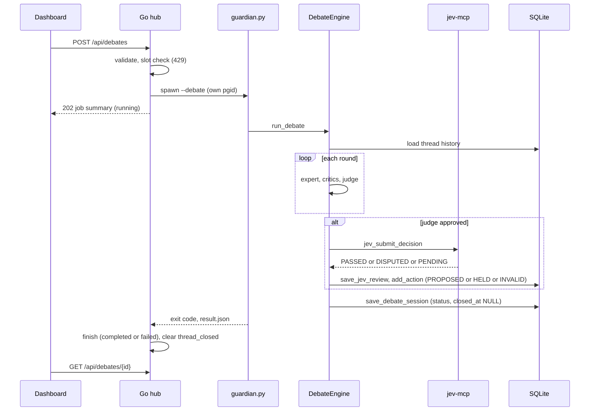
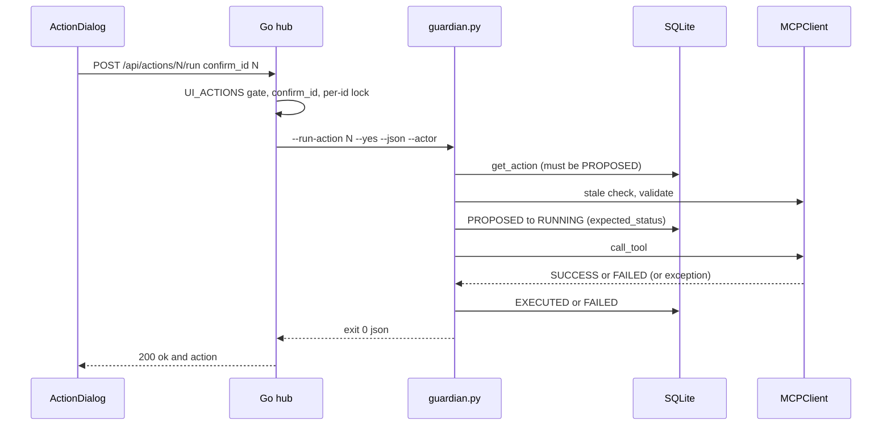
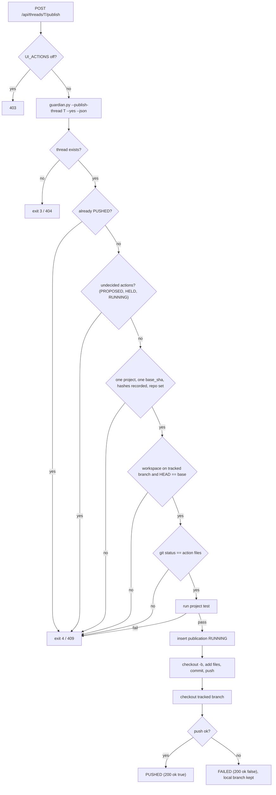
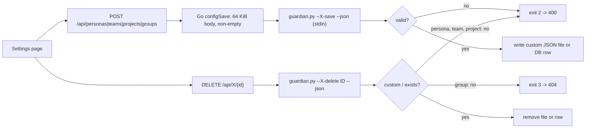
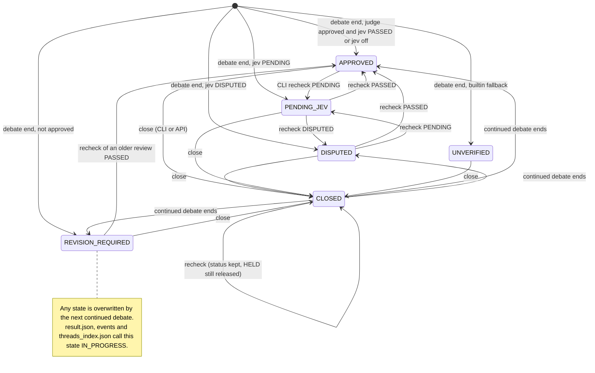
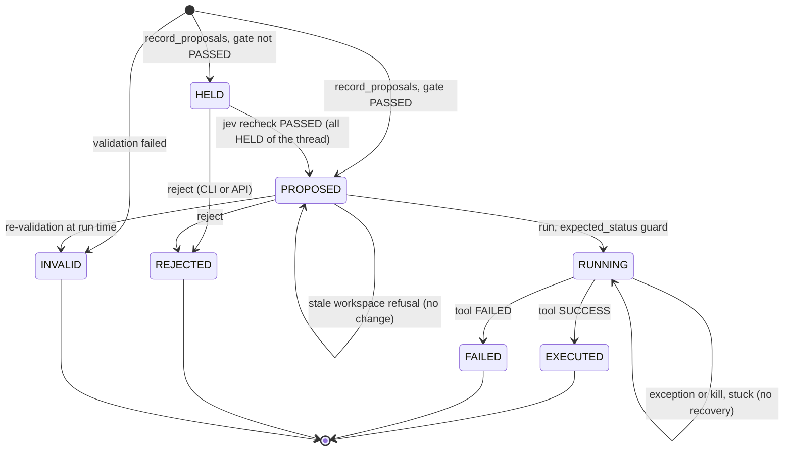
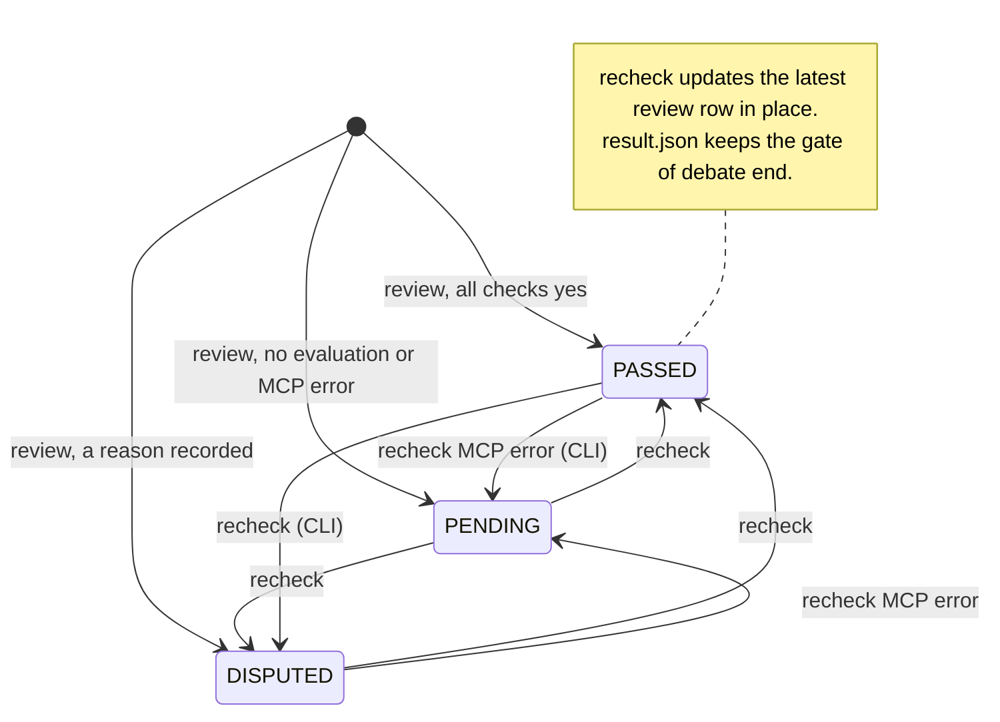
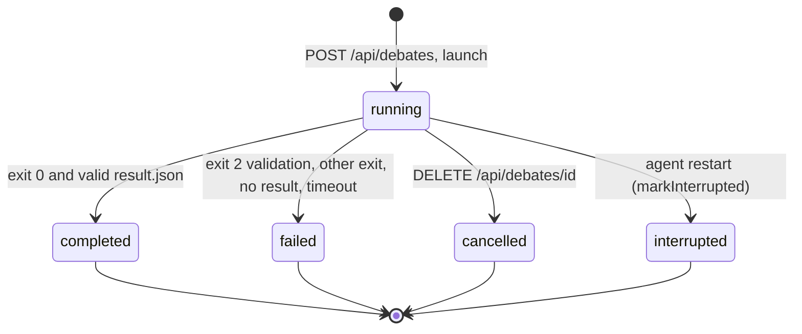
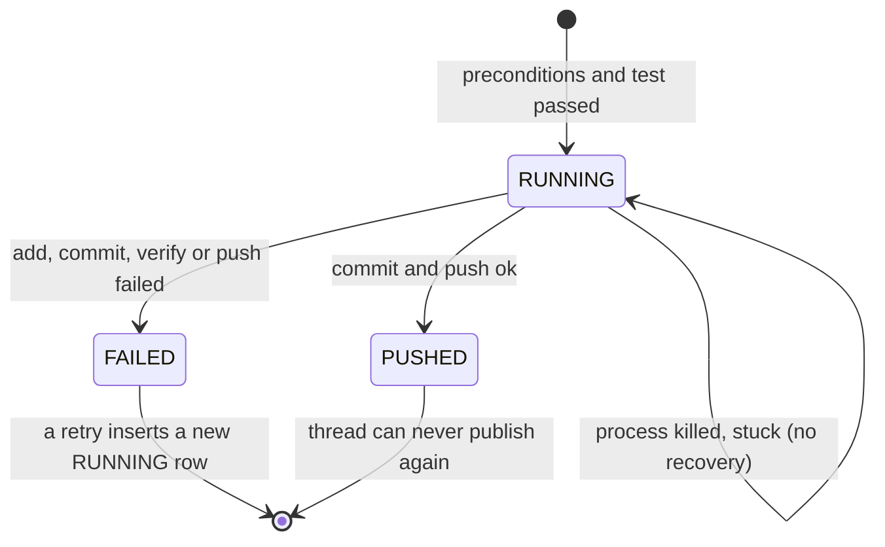

# Phase 1 - Debate / Decision / Action lifecycle review

English | [한국어](phase1-debate.ko.md)

> Point-in-time record from 2026-10-12; the code has changed since.

Scope: start a debate -> verdict -> jev gate -> per-action approval -> execution -> close / reopen -> publish, plus the
configuration procedures (personas, teams, projects, node groups, code context, retrieval budgets).
Repo: `/Users/owner/working/ci_build/server-guardian` at `5aa8e2e`. All paths are repo-relative; every claim was
checked against the code. Abbreviations: **PY** = `cli/llm-agent/*.py`, **GO** = `apps/agent/debate_handler.go`,
**TS** = `apps/web-desktop/src/*`.

---

## 1. Procedure inventory

### 1.0 Who can transition what (summary)

| Transition | CLI (human) | CLI `--json` (hub form) | Hub API route | Dashboard control | Engine (automatic) |
|---|---|---|---|---|---|
| start / continue debate | `--debate T [--thread]` | same + `--result-file --events-file` | `POST /api/debates` | Console "Start" / "Continue this thread" | - |
| cancel job | Ctrl-C only | - | `DELETE /api/debates/{id}` | Cancel button | timeout -> `failed`; restart -> `interrupted` |
| action PROPOSED/HELD/INVALID created | - | - | - | - | `record_proposals` at end of approving round |
| run action | `--run-action N` (prompt or `--yes`) | `--run-action N --yes --json --actor` | `POST /api/actions/{id}/run` (gated by `GUARDIAN_UI_ACTIONS`) | ActionDialog Run | PROPOSED->INVALID on re-validation failure |
| reject action | `--reject-action N` | `--reject-action N --json --actor` | `POST /api/actions/{id}/reject` (NOT gated) | ActionDialog Reject | - |
| jev recheck (HELD->PROPOSED, thread status) | `--jev-recheck T` | same `--json` | `POST /api/threads/{t}/jev-recheck` (NOT gated) | RecheckPanel / ActionDialog | - |
| close thread | `--close-thread T` | same `--json` | `POST /api/threads/{t}/close` (refuses if a hub job on T is running) | Close thread button (only if snapshot label != APPROVED) | none (see DBT-6) |
| reopen thread | continue with `--debate --thread` | - | `POST /api/debates` with `thread_id` | "Reopen with a new debate" | `save_debate_session` overwrites status |
| publish thread | `--publish-thread T` (plan + typed yes) | `... --yes --json --actor` | `POST /api/threads/{t}/publish` (gated) | PublishPanel | - |
| persona/team/project/group CRUD | `--persona-save` etc. | same `--json` | `/api/personas|teams|projects|groups` | Settings sections | - |
| project workspace sync | `--project-sync ID|all` | same | `POST /api/projects/{id}/sync` | Projects section | - |
| retrieval budgets, jev on/off, MCP | env only (`GUARDIAN_RETRIEVAL*`, `GUARDIAN_JEV_GATE`, `GUARDIAN_REPO_MCP`) | - | - | - | read per run |

Evidence: routes `apps/agent/debate_handler.go:263-290`; CLI flags `cli/llm-agent/guardian.py:607-656`; JSON dispatch
`guardian.py:98-138`; human dispatch `guardian.py:182-291`.

### 1.1 P1 - Start or continue a debate (dashboard path)

1. TS `startDebate` posts `{task, team?, project?, thread_id?, rounds?, context_paths?, context_ref?}` (`apps/web-desktop/src/api.ts:482-484`).
2. GO `startDebate` decodes with a 16 KiB limit and validates (task 1-4000 chars, id/thread/ref patterns, rounds 1-10, <=20 context paths) (`debate_handler.go:466-506, 516-530`).
3. GO builds argv with single `--flag=value` entries (`debate_handler.go:544-564`), reserves a slot (`MaxRunning`, default 2) or answers 429 (`:566-574`). No check for another running job on the same `thread_id` (see DBT-9).
4. GO `launch` creates `<DATA>/debate-jobs/<id>/`, writes `meta.json` (`status: running`), spawns `guardian.py --result-file ... --events-file=...` in its own process group, arms the job timeout (default 3600 s) (`:591-638`); responds 202.
5. PY `handle_session_commands` -> `DebateEngine.run_debate` (`guardian.py:517-534`). Team/context/project validation errors exit 2 (`:535-543`).
6. PY engine: load project + workspace (`debate_engine.py:364-372`); new thread id `thread_<ts>_<hex>` or load history; a continued thread must stay in its project (`:374-383`); resolve lineup (team > stored snapshot > default, `:655-680`), context pack (request paths > stored paths pinned to stored sha > team > project, `:682-701`), retrieval setup (`:395`).
7. Rounds: expert -> critics (parallel) -> judge with tool catalog filtered by `lineup_judge_tools` (`:466-558`). A builtin fallback provider marks the round UNVERIFIED and stops (`:560-580`).
8. On approval: parse decision/checks, submit to jev (`JevGate.review`), store `jev_reviews` row, `final_decision.approved = gate == PASSED` (`:592-613`).
9. Record proposals: validated ones become `PROPOSED` (gate PASSED) or `HELD` (otherwise); failed validation -> `INVALID` (`:614-623`, `action_ops.py:29-63`).
10. Persist: `save_debate_session` upserts thread status (APPROVED / REVISION_REQUIRED / UNVERIFIED / DISPUTED / PENDING_JEV) and clears `closed_at` (`db_manager.py:231-313`); writes Markdown/JSON exports with `decision_status()` (`debate_engine.py:1597-1688`); emits `debate_finished` (`:633-638`); writes result file atomically (`guardian.py:546-551`).
11. GO `finish`: `completed` when exit 0 + valid result, else `failed`/validation failed; on completion clears `thread_closed` on sibling jobs and invalidates the closed-thread cache (`debate_handler.go:641-691`).

### 1.2 P2 - Review and run (or reject) an action

1. TS Approvals list `GET /api/actions?thread=&project=` -> `--actions [T] --project=P --json` (`debate_handler.go:927-951`).
2. Detail `GET /api/actions/{id}` -> `--show-action` with tool risk and diff (`action_ops.py:323-334`).
3. Run: TS posts `{confirm_id: id}` (`api.ts:737-743`); typed confirm unless risk is low/medium (`lib/debate.ts:166-169`).
4. GO `runAction`: 403 if `GUARDIAN_UI_ACTIONS=off`, confirm_id must equal path id, in-process per-id lock, then `--run-action N --yes --json --actor dashboard@<ip>` with `GUARDIAN_ACTION_TIMEOUT` (default 900 s) (`debate_handler.go:1079-1122`).
5. PY `run_action`: HELD -> refuse; non-PROPOSED -> refuse; stale write tool (HEAD != base_sha) -> refuse without status change; re-validation failure -> `INVALID`; confirm; atomic `PROPOSED -> RUNNING`; `call_tool`; `EXECUTED` if tool status SUCCESS else `FAILED` (`action_ops.py:211-255`).
6. Exit mapping: LookupError -> 3/404, RuntimeError -> 4/409 (`action_ops.py:337-348`; `debate_handler.go:355-390`).
7. Reject: `PROPOSED|HELD -> REJECTED` (`action_ops.py:267-272, 351-359`).

### 1.3 P3 - jev recheck

1. `POST /api/threads/{t}/jev-recheck` -> `--jev-recheck T --json`, 300 s timeout (`debate_handler.go:971-979`).
2. PY `recheck_thread`: latest review of the thread (any round), `JevGate.recheck` (process queue + get decision, or resubmit), update the same review row (`action_ops.py:275-296`, `jev_gate.py:177-188`, `db_manager.py:566-590`).
3. PASSED: release **all** HELD actions of the thread to PROPOSED; thread -> APPROVED unless CLOSED. Otherwise thread -> DISPUTED / PENDING_JEV unless CLOSED (`action_ops.py:288-295`).

### 1.4 P4 - Close and reopen a thread

1. Dashboard shows "Close thread" when `!thread_closed && label != 'APPROVED'` where label comes from `result.json` (`lib/debate.ts:202-204`, `ResultView.tsx:268-300`).
2. GO `closeThread`: 409 if a job of this hub with that thread id is `running`; runs `--close-thread T --json`; on success sets `thread_closed` on stored job metas and invalidates the 30 s cache (`debate_handler.go:983-1006, 1056-1075`).
3. PY `close_thread`: status -> CLOSED, `closed_at` set, idempotent; unknown thread -> exit 2 (`db_manager.py:627-647`, `action_ops.py:367-372`).
4. Listing: `GET /api/debates` asks `--closed-threads --json` (cached 30 s) and overrides `thread_closed` for non-running jobs (`debate_handler.go:218-249, 773-781`).
5. Reopen: continue the thread with a new debate; `save_debate_session` overwrites status and clears `closed_at` (`db_manager.py:264-276`); GO clears the flag on completion (`debate_handler.go:678-680`).

### 1.5 P5 - Publish a thread

1. Dashboard PublishPanel (shown whenever the result snapshot has any action) asks for an optional branch (`ResultView.tsx:196-249, 357-363`).
2. GO `publishThread`: thread pattern, 403 if UI actions off, 1 KiB body, branch pattern, `--publish-thread T --json --yes --actor ... [--branch=]`, 1200 s (`debate_handler.go:1013-1052`).
3. PY `publish_thread` preconditions (all before any side effect): thread exists; no PUSHED attempt; no PROPOSED/HELD/RUNNING action; >=1 EXECUTED file action with `file_hashes`; one project, one base_sha; project has `repo`; branch valid and not tracked/protected; workspace is a separate clone, top-level, on tracked branch, `HEAD == base`; git status set == action files, nothing staged, hashes match (`publish_ops.py:222-291`).
4. Confirm (CLI prompt shows plan; hub `--yes`), run project test (`_run_gate`), re-check worktree (`:293-302`).
5. Insert `thread_publications` RUNNING; `checkout -b`, `add -- files`, `commit`, verify tree, `push` (no force); always return to tracked branch; mark PUSHED/FAILED (`:304-316, 333-366`).

### 1.6 P6 - Configuration procedures

| Object | Storage | Save | Delete | Validation | Evidence |
|---|---|---|---|---|---|
| Persona | builtin `configs/personas`, custom `<DATA>/personas` (custom overrides) | `POST /api/personas` -> `--persona-save` (stdin) | `DELETE /api/personas/{id}` -> custom only, else exit 2 | `validate_persona` | `persona_manager.py:5-9, 115-130`; `config_ops.py:41-55` |
| Team | builtin `configs/teams`, custom `<DATA>/teams` | `--team-save` | custom only, exit 2 | `parse_lineup` + `validate_lineup` (personas exist, providers known, 1-4 critics, rounds, tools) | `team_manager.py:181-220, 295-325` |
| Project | builtin/custom JSON | `--project-save` | custom only; clone kept | `parse_project` (https repo, branch, workspace under home, tests, context) | `project_registry.py:128-185, 268-283` |
| Project sync | git clone / fetch + ff-only | `POST /api/projects/{id}/sync` (action timeout) | - | skips when tracked files modified | `project_registry.py:286-318` |
| Node group | DB `node_groups` | `--group-save` / `--group-preview` | unknown -> exit 3 / 404 | `GROUP_ID_RE`, members resolved from servers.json | `config_ops.py:171-211`, `group_manager.py:25-27` |
| Code context | per request / thread snapshot / team / project | `context_paths`, `context_ref` | - | Go length/char checks, PY `build_pack` (exit 2 on error) | `debate_handler.go:488-504`, `debate_engine.py:682-701` |
| Retrieval budgets | env only, unlimited when unset/0 | `GUARDIAN_RETRIEVAL_STEPS/_REQUESTS/_STEP_BYTES/_TURN_BYTES`, `GUARDIAN_RETRIEVAL=0`, `GUARDIAN_REPO_MCP=1` | - | `_env_limit` | `debate_engine.py:167-183, 822-830` (via `_limits`) |

---

## 2. State machines

### 2.1 Thread status (`threads.status`, PY `db_manager.py`)

Written by `save_debate_session` (`db_manager.py:254-276`), `set_thread_status` from recheck (`action_ops.py:288-295`), `close_thread` (`db_manager.py:627-647`). `IN_PROGRESS` is only the schema default (`db_manager.py:71`); no code path stores it.

### 2.2 Action status (`decision_actions.status`)

`ACTION_STATUSES = HELD, PROPOSED, INVALID, REJECTED, RUNNING, EXECUTED, FAILED` (`db_manager.py:445`).

### 2.3 jev gate (`jev_reviews.gate`; `final_decision.jev_gate`)

Values `PASSED | DISPUTED | PENDING` (`jev_gate.py:23`). Thread status maps `PENDING -> PENDING_JEV` (`db_manager.py:257-258`, `debate_engine.py:253-254`). `HELD` is an action status, not a gate value.

### 2.4 Job status (`meta.json`, GO)

Evidence: `debate_handler.go:538, 668-688, 700-730, 845-861`; TS type `DebateJobStatus` matches (`types.ts:423`). `thread_closed` is an orthogonal flag on job metas (`:146-148, 1056-1075`).

### 2.5 Publication status (`thread_publications.status`)

Evidence: `db_manager.py:522-546`, `publish_ops.py:224-228, 304-316`.

---

## 3. Contradictions and conflicts

Severity: **High** = can corrupt state, lose work or get stuck without a supported recovery; **Medium** = wrong UI/decision or blocked procedure with a workaround; **Low** = naming/doc/consistency.

### DBT-1 (High) - Actions can stay `RUNNING` forever; no recovery path
- Evidence: `action_ops.py:245-254` sets RUNNING then calls `mcp.call_tool` with no try/finally. `call_tool` lets exceptions out: remote `server_remediation` -> `NodeAgentClient._fetch_json` raises `RuntimeError`/`ConnectionError` (`mcp_client.py:316-317`, `agent_client.py:52-60`); `execute_code_action` `path.write_text` OSError (`mcp_client.py:273-274`). `run_action_json` turns RuntimeError into exit 4 (409) and does not catch ConnectionError (exit 1 -> 500) (`action_ops.py:341-346`). The hub kills the CLI after `GUARDIAN_ACTION_TIMEOUT` (900 s default, `debate_handler.go:1119-1120`, `:332-340`) or on agent restart (systemd control-group kill) and nothing resets the row. `update_action` with RUNNING is only allowed via `expected_status="PROPOSED"`; there is no CLI/API to move RUNNING anywhere.
- Impact: the action is permanently RUNNING; `publish_thread` refuses forever ("actions are still undecided", `publish_ops.py:231-233`); the dashboard files RUNNING under "decided" (`lib/debate.ts:120-121`) and tells the operator to "Reload the list" (`ActionDialog.tsx:273`).
- Fix: SAFE-FIX - wrap `call_tool` in `try/except Exception` and store `FAILED` with the error; DESIGN - add an operator transition `RUNNING -> FAILED` (e.g. `--fail-stale-action N`, or a startup sweep for RUNNING older than the action timeout).

### DBT-2 (High) - `git_commit_push` and publish are mutually exclusive and the tool silently breaks the thread
- Evidence: `jev_mcp:git_commit_push` runs `git checkout -b <branch>`, `git add -A`, `git commit` (`mcp_client.py:300-312`); it is a WRITE_TOOL (`:95`) but not a FILE_TOOL (`action_ops.py:182`). Publish requires the workspace on the tracked branch with `HEAD == base_sha` and the action files uncommitted (`publish_ops.py:270-277, 291`) and its safety rule is "never `git add -A`" (`publish_ops.py:9-11`; `docs/design/publish-thread.md` Safety rules). The tool description still says "push" in its name (`mcp_client.py:55-56`) and the doc calls it "unchanged" (`publish-thread.md:6`).
- Impact: once the operator runs a judge's `git_commit_push`, the thread can never be published, every remaining PROPOSED write action of every thread in that project is stale (`stale_reason`, `action_ops.py:166-179`), and later debates read `HEAD` of the judge branch (`debate_engine.py:694-700` uses ref `HEAD`) until someone runs project sync. `git add -A` also commits unrelated files left by FAILED actions.
- Fix: DESIGN - retire `git_commit_push` from the catalog (publish now covers commit+push with file-exact checks) or make it a no-op alias for "publish". SAFE-FIX meanwhile - drop it from team `allowed_tools` defaults and mark it high risk.

### DBT-3 (High) - Recheck acts on the latest review of any round and releases every HELD action of the thread
- Evidence: `recheck_thread` uses `latest_jev_review(thread)` (`action_ops.py:282`; `db_manager.py:592-597` orders by id only) and `release_held_actions` releases all HELD rows of the thread regardless of round (`action_ops.py:258-264`). A continued debate that ends not approved writes no new review (`debate_engine.py:595-618`) and does not invalidate earlier HELD actions.
- Impact: thread status REVISION_REQUIRED (latest debate rejected the approach) flips back to APPROVED and old-round HELD actions become runnable after a recheck of the superseded review. Also the CLI can downgrade an APPROVED thread to PENDING_JEV on a transient MCP error while its actions stay PROPOSED (`action_ops.py:294-295`), so thread status and action runnability disagree.
- Fix: SAFE-FIX - release only actions with `round_num == review.round_num` and refuse a recheck when the thread's `final_round` is newer than the review round. DESIGN - decide whether a continued debate should auto-REJECT (or supersede) older HELD/PROPOSED actions.

### DBT-4 (High) - Project sync ignores untracked files and moves HEAD under executed actions
- Evidence: `workspace_status` counts only tracked changes (`--untracked-files=no`, `project_registry.py:212`); `sync` fast-forwards when that count is 0 (`:310-318`). New files from `execute_code_action` or `apply_patch` with `old=""` are untracked. Sync takes no lock and does not check pending actions or the publish lock (`publish_ops.py:156-167` is used only by publish).
- Impact: after sync, `HEAD != base_sha` -> publish refuses permanently ("workspace moved", `publish_ops.py:276-277`) and all PROPOSED write actions are stale; the executed new files stay behind as stray untracked files that later block other threads' publishes ("changed in the workspace but not written by the executed actions", `publish_ops.py:129-136`). Sync during a publish can also check out the tracked branch mid-commit.
- Fix: SAFE-FIX - use `--untracked-files=all` in the sync dirty check (or refuse sync while any EXECUTED-unpublished file action exists for the project) and take the same `guardian-publish.lock` in `sync`.

### DBT-5 (Medium) - Dashboard decides on stale `result.json` snapshots; no API exposes thread status or publications
- Evidence: ResultView derives the verdict, close-button visibility, recheck panel and per-action statuses from `result.final_decision` (`ResultView.tsx:268-273, 286, 298, 355`; `lib/debate.ts:186-208`). No route returns `threads.status` or `thread_publications` (`debate_handler.go:263-290`); `list_publications` is only used internally (`publish_ops.py:224`), `list_project_threads` has no caller.
- Impact: after a passing recheck the result still shows DISPUTED, keeps "Re-run jev check" and "Close thread" visible, and the action table shows HELD for actions that are now PROPOSED/EXECUTED. After a reload the Publish button shows for an already published thread (409 on click) and for threads whose actions are all INVALID/HELD.
- Fix: DESIGN - add `GET /api/threads/{thread}` (status, closed_at, latest gate, action status counts, publications) via a `--thread-status T --json` CLI command; SAFE-FIX - in ResultView read action statuses from `GET /api/actions?thread=` (already exists) and gate Publish on "no PROPOSED/HELD/RUNNING and >=1 EXECUTED file action".

### DBT-6 (Medium) - "Auto-close of inconclusive threads" is documented in code but does not exist
- Evidence: `debate_handler.go:191-192` ("CLI --close-thread, auto-close of inconclusive threads") and `db_manager.py:621` ("dashboard, CLI or auto-close"). The only writers of CLOSED are `close_thread` via `--close-thread` (`db_manager.py:627-647`, `guardian.py:120-121, 226-233`). Commit `2ccd073` ("close threads that ended without a conclusion") adds only manual close.
- Impact: operators expect REVISION_REQUIRED/UNVERIFIED threads to disappear automatically; they accumulate. Reviewers may also rely on the comment when reasoning about the 30 s cache.
- Fix: SAFE-FIX - correct the two comments; DESIGN - if auto-close is wanted, define the rule (e.g. UNVERIFIED or REVISION_REQUIRED older than N days) and the actor.

### DBT-7 (Medium) - Close rules differ between dashboard, API and CLI
- Evidence: dashboard hides Close for label `APPROVED` (`lib/debate.ts:202-204`; doc `debate-teams-api.md:220`); API and CLI close any status including APPROVED with executed or PROPOSED actions (`db_manager.py:627-647`). API refuses only while a hub job on that thread runs (`debate_handler.go:989-997`); CLI checks nothing (a hub job may be running). Neither checks RUNNING actions or a pending publish; actions of a CLOSED thread remain runnable and publishable (`action_ops.py:211-255` and `publish_ops.py:222-233` never read thread status), and recheck releases HELD on a CLOSED thread (`action_ops.py:288-291`).
- Impact: "closed" means "hidden" only; work continues on hidden threads and the Approvals page still lists their actions, while the debate list hides them.
- Fix: DESIGN - define CLOSED semantics: either (a) purely cosmetic (then document that actions stay live and show a CLOSED badge in Approvals), or (b) closing rejects HELD/PROPOSED and blocks run/publish. SAFE-FIX - move the "running job" check into the CLI (or a DB-level marker) so both paths agree.

### DBT-8 (Medium) - Two status vocabularies are mixed in the Agents monitor; `IN_PROGRESS` reported for finished runs
- Evidence: `debate_finished.status = decision_status(final_decision)` -> `APPROVED|UNVERIFIED|DISPUTED|PENDING_JEV|IN_PROGRESS` (`debate_engine.py:247-257, 633-635`); TS stores it as the run status (`lib/agentMonitor.ts:512-531`) and the timeline tones it as a job status (`'completed'` ok, `'failed'` crit) (`pages/agents/Timeline.tsx:224`). So APPROVED renders as warn and a finished, rejected debate renders "IN_PROGRESS". The DB stores `REVISION_REQUIRED` for the same case (`db_manager.py:260`), result rendering says `NOT APPROVED` (`guardian.py:557-558`, `lib/debate.ts:187, 193`), the verdict chain says `REVISION REQUIRED` (`ResultView.tsx:41`), the Markdown export says `REVISION / MAX ROUNDS` and `threads_index.json` stores `IN_PROGRESS` (`debate_engine.py:1630-1636, 1681-1686`).
- Impact: one outcome has five names; "IN_PROGRESS" for a finished thread is misleading in the monitor and in exported indexes.
- Fix: SAFE-FIX - make `decision_status` return `REVISION_REQUIRED` (same as DB) and tone the monitor's finished chip with `decisionStatus`-style mapping instead of job statuses.

### DBT-9 (Medium) - Two concurrent debates on the same thread are allowed
- Evidence: `startDebate` checks only the global slot count (`debate_handler.go:566-574`); `closeThread` does check same-thread running jobs (`:989-997`), so the hub knows the concept. `save_debate_session` deletes and re-inserts all messages of the thread (`db_manager.py:280-295`).
- Impact: last writer wins; the transcript of the other run is lost from the DB, both runs record actions against the same thread, and a recheck/publish in between sees mixed rounds.
- Fix: SAFE-FIX - in `startDebate`, return 409 when a running job has the same `ThreadID` (same loop as `closeThread`).

### DBT-10 (Medium) - A thread can be published only once and only from one base commit
- Evidence: any PUSHED attempt refuses further publishes (`publish_ops.py:225-228`); file actions must share one `base_sha` (`:246-247`). Continuing a thread with new `context_paths` builds a new pack at the new HEAD (`debate_engine.py:693-694`) so later-round actions get another base.
- Impact: a thread continued after publish (or after sync/merge) produces actions that can run but can never be published; there is no reset path.
- Fix: DESIGN - publish per (thread, round) or per base_sha, and/or let a continued debate after a publish start a new thread automatically.

### DBT-11 (Medium) - Inconsistent "not found" exit codes for the same concept
- Evidence: unknown thread -> exit 2/400 for close (`action_ops.py:369-371`, documented `debate-teams-api.md:217`, test `debate_handler_test.go` TestCloseThread) but exit 3/404 for jev-recheck (`action_ops.py:375-378`) and publish (`publish_ops.py:382-383`). Unknown/builtin persona, team, project delete -> exit 2/400 (`config_ops.py:52-55, 105-108, 145-148`) but unknown group delete -> exit 3/404 (`config_ops.py:204-211`). Project sync git failures -> exit 2/400 "validation" (`config_ops.py:160-166`).
- Impact: clients cannot map errors uniformly (`failMessage` treats 400 as "Invalid request", `lib/debate.ts:315`).
- Fix: SAFE-FIX - return `NOT_FOUND` for unknown thread in `close_thread_json` and for unknown custom ids in deletes (keep 400 for "builtin cannot be deleted"); update the doc line and Go test.

### DBT-12 (Medium) - Actor validation and exit codes differ between CLI human and JSON paths
- Evidence: JSON paths validate `ACTOR_PATTERN` (`action_ops.py:339-340, 352-353`; `publish_ops.py:378-379`); human paths pass `args.actor` unchecked (`guardian.py:268, 284, 162`) into `decided_by` / `thread_publications.actor`. Human paths exit 1 for not-found/conflict (`guardian.py:262-263, 271-272, 285-287, 164-172, 240-242`) while JSON uses 2/3/4.
- Impact: audit field format is not guaranteed; scripts cannot distinguish errors without `--json`.
- Fix: SAFE-FIX - validate `--actor` once in `main()`; map human exits to the same 2/3/4 codes.

### DBT-13 (Medium) - Same project test runs differently in `execute_code_action` and in publish
- Evidence: `execute_code_action(run_test)` runs `_test_argv(default_test)` without `_go_module_argv`, timeout 300 s (`mcp_client.py:277-281`); publish runs `_go_module_argv(_test_argv(...))`, timeout 600 s (`publish_ops.py:319-330`); `run_tests` uses `_go_module_argv`, 600 s (`mcp_client.py:295-298`). The doc says publish runs the test "as in `execute_code_action`" (`publish-thread.md` Preconditions).
- Impact: `go test ./...` at a root without go.mod fails inside the action but passes at publish (or vice versa for slow suites at 300 s).
- Fix: SAFE-FIX - one helper `MCPClient.run_default_test()` used by both, same cwd rewriting and timeout; fix the doc sentence.

### DBT-14 (Medium) - Continuing a thread whose persona was deleted runs with an empty persona
- Evidence: stored lineup path uses `parse_lineup` without `validate_lineup` (`debate_engine.py:666-668`); persona lookup falls back to `{}` (`:387-389`). The team path validates and exits 2 (`team_manager.py:295-306`). Persona delete has no in-use check (`persona_manager.py:125-130`).
- Impact: a continued debate silently runs with an empty system prompt for that role.
- Fix: SAFE-FIX - call `validate_lineup` on the stored lineup too (fall back to the default lineup with a warning), or refuse persona deletion while a team or stored thread references it (DESIGN).

### DBT-15 (Low) - Reject / recheck / close are not covered by `GUARDIAN_UI_ACTIONS=off`
- Evidence: only `runAction` and `publishThread` check `actionsDisabled()` (`debate_handler.go:1084-1087, 1019-1022`); reject, jev-recheck (which turns HELD into runnable PROPOSED) and close are not (`:962-1006`). The `@MX:REASON` on publish says "blocked ... like running actions".
- Impact: a read-only hub still lets the dashboard change decision state.
- Fix: DESIGN - decide whether `off` means "no execution" (current) or "read-only dashboard"; document it in `debate-teams-api.md`.

### DBT-16 (Low) - Dashboard publish confirm shows no plan; CLI shows base, files, subject
- Evidence: CLI `confirm(plan)` prints branch, base, subject, files, retry (`guardian.py:147-159`); hub always passes `--yes` (`debate_handler.go:1042`) and the dashboard dialog only shows a sentence and a branch field (`ResultView.tsx:231-245`). Doc step 2 says the dashboard confirm dialog is the confirmation (`publish-thread.md` Flow).
- Impact: dashboard operators approve a push without seeing which files/commit; asymmetric with action runs, which show diffs.
- Fix: DESIGN - add a dry-run (`--publish-thread T --plan --json`) and show it in the dialog.

### DBT-17 (Low) - Doc drift in `debate-teams-api.md`
- Evidence: catalog example lists `jev_mcp:run_tests` as `"risk": "low"` (`debate-teams-api.md:30`) - code says `high` (`mcp_client.py:51-52`); typed confirm described only for `server_remediation` (`:126`) - TS requires typed confirm for every non-low/medium tool including `run_tests` (`lib/debate.ts:166-169`); POST `/api/debates` body lists only task/team/thread_id/rounds (`:64`) and the route table omits project, group and publish-free routes added later (`debate_handler.go:269-278`); action doc line 4 of `action_ops.py` omits HELD.
- Fix: SAFE-FIX - update the doc tables and the `action_ops.py` docstring.

### DBT-18 (Low) - Two meanings of `approved`
- Evidence: event `verdict.approved` is the LLM judge before jev (`debate_engine.py:562, 573`); `final_decision.approved` is after jev (`:612`). TS has to reconstruct the judge verdict (`ResultView.tsx:35`), and the monitor shows "APPROVED" from the verdict event even when the gate is DISPUTED (`pages/agents/RunDetail.tsx:27-31`).
- Fix: SAFE-FIX - add `judge_approved` to `final_decision` and use it in both views.

### DBT-19 (Low) - Stuck publication rows and workspace left on the publish branch after a kill
- Evidence: RUNNING row inserted before git work (`publish_ops.py:304`); `_return_to` runs in `finally` (`:306-309`) but not on SIGKILL from the hub's 1200 s timeout (`debate_handler.go:52-53, 1050`) or a restart. Then the workspace is on `guardian/<thread>` and the next publish refuses "not the tracked branch" (`publish_ops.py:273-274`); the RUNNING row never ends.
- Fix: SAFE-FIX - on publish start, mark older RUNNING rows of the thread FAILED ("interrupted") and, if HEAD is on a branch recorded by such a row, check out the tracked branch before the precondition checks.

---

## 4. Recurring contradiction patterns

1. **Snapshot vs live state** - the dashboard renders decisions from `result.json` / event streams written at debate end, while the DB keeps changing (recheck, run, reject, close, publish). Instances: DBT-5, DBT-7 (close button from snapshot label), DBT-8, DBT-18, Markdown/JSON exports never updated by close/recheck (`debate_engine.py:1620-1687`).
2. **Status vocabulary drift** - the same concept carries different names per layer: `PENDING` vs `PENDING_JEV`, `IN_PROGRESS` vs `REVISION_REQUIRED` vs `NOT APPROVED` vs `REVISION REQUIRED` vs `REVISION / MAX ROUNDS`, job `completed` vs decision `APPROVED` in one chip, `HELD` (action) presented as a gate state. Instances: DBT-8, DBT-18, §2.3 note.
3. **Guard implemented in one entry point only** - a check lives in Go or in one CLI branch instead of the shared Python function. Instances: same-thread running check only in `closeThread` (DBT-7, DBT-9), `GUARDIAN_UI_ACTIONS` only on two routes (DBT-15), actor validation only in JSON paths (DBT-12), lineup validation only on the team path (DBT-14).
4. **Write-once / no-recovery states** - a terminal-looking transitional state with no operator transition out. Instances: action RUNNING (DBT-1), publication RUNNING (DBT-19), PUSHED blocks all later publishes (DBT-10), CLOSED reopenable only by a full LLM debate (§1.4).
5. **Workspace HEAD as an implicit lock** - many procedures rely on `HEAD == base_sha` but several others move HEAD without coordination. Instances: `git_commit_push` (DBT-2), project sync (DBT-4), continued debates with new context (DBT-10), killed publish (DBT-19).
6. **Thread-wide operations on round-scoped data** - recheck, release, publish and close treat all rounds of a thread as one decision. Instances: DBT-3, DBT-10, DBT-7.
7. **Comment/doc claims ahead of or behind the code** - DBT-6 (auto-close), DBT-13 (test "as in execute_code_action"), DBT-17 (risk table), `git_commit_push` naming (DBT-2).

---

## 5. What is consistent and should be kept

- **Single validation authority in Python, argv-only bridge in Go**: Go validates shapes (ids, thread, branch, sizes) and passes values as single `--flag=value` argv entries without a shell (`debate_handler.go:544-564, 1042-1049`; `newCmd` `:312-323`); the exit-code contract 0/2/3/4 -> 200/400/404/409 is applied uniformly by `respondConfig` (`:355-390`), with argparse fallbacks handled.
- **Atomic action claim**: `update_action(..., expected_status=...)` makes `PROPOSED -> RUNNING`, `HELD -> PROPOSED` and rejects race-free across processes (`db_manager.py:490-505`, `action_ops.py:245-246, 262, 269-272`), backed by Go's per-id in-process lock and the `confirm_id` echo (`debate_handler.go:1100-1117`).
- **Pre-run revalidation and stale-base refusal** for write tools (`action_ops.py:166-179, 232-239`) and the matching dashboard hint (`lib/debate.ts:311-312`).
- **Publish design**: every precondition before the first side effect, exact file set (no `git add -A`), hash verification, no force push, `finally` return to the tracked branch, flock per workspace, credential scrubbing (`publish_ops.py:124-167, 193-196, 222-316`) - matches `publish-thread.md` closely.
- **Detached child contexts**: hub CLI calls never die with the HTTP request (`debate_handler.go:328-332`), process groups are killed on cancel/timeout (`:611, 312-316`), and `markInterrupted` flags jobs left running by a previous agent (`:845-861`).
- **Job status vocabulary** is identical in Go and TS (`debate_handler.go:538, 672-687, 711, 856`; `types.ts:423`) and documented (`debate-teams-api.md:69`).
- **Action status set** is identical in PY, TS and the doc (`db_manager.py:445`; `types.ts:648`; `debate-teams-api.md:105`).
- **Builtin/custom config overlay** for personas, teams and projects (custom overrides by id, builtin undeletable, atomic tmp+rename writes) (`persona_manager.py:5-9, 115-130`; `team_manager.py:308-325`; `project_registry.py:268-283`).
- **Continued-thread invariants**: a thread stays in its project (`debate_engine.py:380-383`), keeps its lineup snapshot and pinned code sha unless overridden (`:655-701`).
- **Retrieval budgets** behave exactly as the 2026-10-09 doc update says (unlimited unless a positive env value; `debate_engine.py:167-173`; `debate-agent-retrieval.md` item 4).
