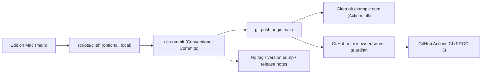
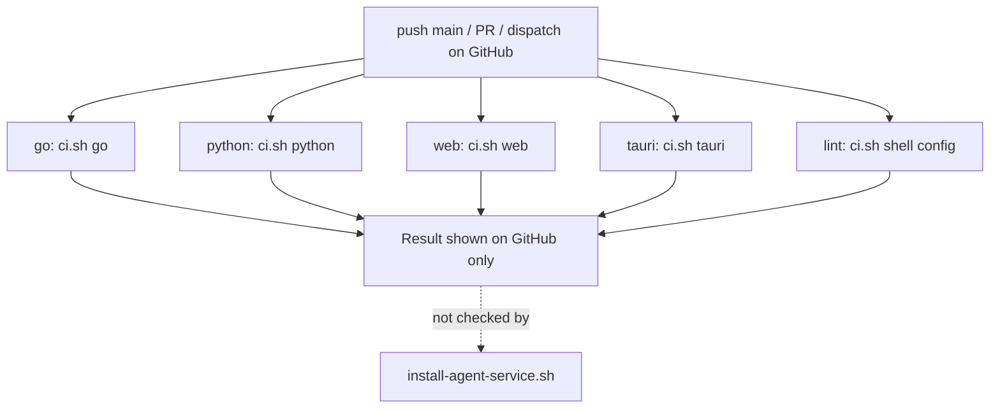
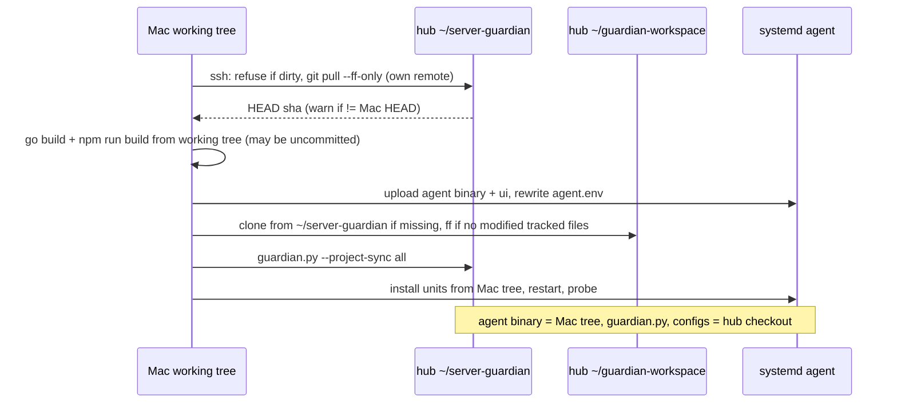
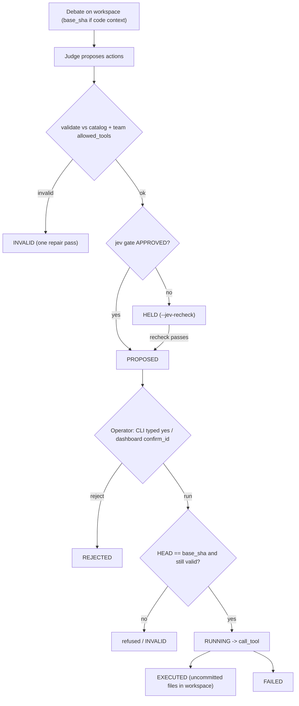
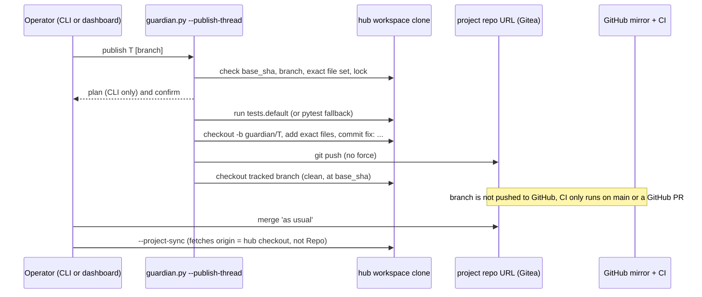
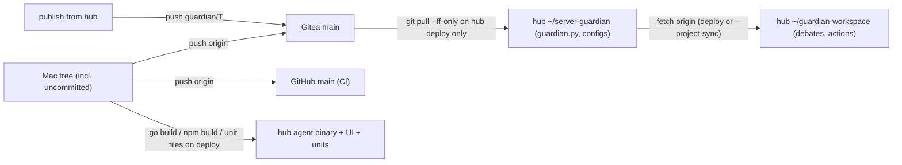

# Phase 1 - 개발 워크플로 검토 (server-guardian)

[English](phase1-dev.md) | 한국어

> 2026-10-12 시점의 기록이며, 이후 코드가 바뀌었다.

범위: 코드를 작성, 테스트, 리뷰, commit, 릴리스, 배포하는 방식. Mac checkout의 `5aa8e2e`(main)에 대한 읽기 전용
검토이다. 허브에서는 아무것도 확인하지 않았다(ssh 없음). 허브 상태에 의존하는 진술에는 "호스트에서 미검증"이라고
표시했다.

경로는 저장소 기준 상대 경로이다. `install` = `scripts/install-agent-service.sh`, `mcp_client` / `publish_ops` /
`action_ops` / `project_registry` / `guardian.py` = `cli/llm-agent/` 안의 파일.

---

## 1. 절차 목록

### PROC-1 로컬 개발과 commit

1. Mac checkout의 `main` 브랜치에서 편집한다(feature 브랜치 없음, `git branch -a`에는 `main`만 보인다).
2. `scripts/ci.sh [sections]`로 로컬에서 점검을 실행한다(PROC-2 참조).
3. Conventional Commits로 commit한다. 156개 commit 모두 `type(scope): subject` 형식에 맞는다(
   `git log --format=%s | grep -vE '^(feat|fix|chore|docs|test|...)(\(..\))?: '` -> 누락 0건으로 확인). 에이전트가 만든 commit에는
   `Co-Authored-By:` trailer가 붙는다(예: `5aa8e2e`, `837cf41`).
4. `git push origin main`: `origin`은 Gitea에서 fetch하고 push URL이 두 개이며, Gitea 다음 GitHub 순이다(`.git/config:8-12`).
   두 번째 remote `github`도 있다(`.git/config:17-19`).
5. 태그, 릴리스 브랜치, changelog가 없다(`git tag`가 비어 있다). 버전은 고정 리터럴이다.
   `AgentVersion = "v0.1.0-alpha"`(`apps/agent/main.go:14`), 두 `package.json`, `tauri.conf.json:4`,
   `src-tauri/Cargo.toml:3`의 `0.1.0`.
6. 저장소 수준의 CLAUDE.md / AGENTS.md / CONTRIBUTING / `.moai`가 없다. 규약은 사용자의 전역 CLAUDE.md와
   auto-memory에만 있다. `.agents/skills/typesafe-ai` + `skills-lock.json`은 추적되고, `.claude/`는 추적되지 않는다.

### PROC-2 로컬 점검: `scripts/ci.sh`

1. 섹션은 `go python web tauri shell config`이다(`scripts/ci.sh:9-15`). 기본 실행 = `go python web shell config`,
   tauri는 제외된다(`scripts/ci.sh:185`).
2. `go`: 레거시 예외 `metrics.go model.go`를 둔 gofmt, `go vet`, `go test -race ./...`, linux/arm64 빌드만
   수행한다(`scripts/ci.sh:50-70`).
3. `python`: `cli/llm-agent`에서 임시 `GUARDIAN_DATA_DIR`와 `GUARDIAN_LLM_PROVIDERS=none`으로
   `unittest discover -p 'test_*.py'`를 실행한 뒤 `scripts/test_*.py`를 실행한다(`scripts/ci.sh:72-88`). Go에 의존하는 patch
   테스트는 Go가 없으면 건너뛴다(`test_patch_ops.py:17,187`).
4. `web`: guardian-ui는 `npm ci`, typecheck, test, build. web-desktop은 `npm ci`, build(prebuild가 디자인 시스템을
   다시 빌드한다, `apps/web-desktop/scripts/build-ui.mjs:23-24`), test(`scripts/ci.sh:90-112`).
5. `tauri`: `npx tauri build --no-bundle` + `cargo test`(`scripts/ci.sh:114-129`).
6. `shell`: `scripts/*.sh deploy/*/*.sh`에 대해 `bash -n` + `shellcheck --severity=warning`(`scripts/ci.sh:131-141`).
7. `config`: `configs/**`의 JSON 문법, 서버 id 중복 없음, 허브가 정확히 하나, 페르소나/팀이
   `guardian.py --personas/--teams`로 검증됨(`scripts/ci.sh:143-182`).
8. 도구가 없을 때: 로컬에서는 경고, `CI=true`이면 실패(`scripts/ci.sh:40-48`).

언어별 테스트 명령(ci.sh 외부): Go `cd apps/agent && go test ./...`, Python은
`cli/llm-agent`에서 `python3 -m unittest discover`(실제 LLM은 `GUARDIAN_LIVE_LLM_TESTS=1`일 때만,
`test_debate_engine.py:11-15`), web은 각 패키지에서 `npm test`(vitest), Tauri는 `src-tauri`에서 `cargo test`.

### PROC-3 GitHub Actions CI

1. 트리거: `main`으로의 push, 모든 `pull_request`, 수동 실행(`.github/workflows/ci.yml:4-8`).
2. ci.sh 섹션마다 job 하나: go, python(+patch 테스트용 Go toolchain), web, tauri, lint=`shell config`
   (`ci.yml:17-99`). Go 버전은 `apps/agent/go.mod`에서 가져온다(`go 1.26.2`).
3. `concurrency: ci-${{ github.ref }}`, `cancel-in-progress: true`(`ci.yml:13-15`).
4. CI는 GitHub 미러에서만 실행되고, Gitea Actions는 꺼져 있다(`README.md:225`). CI 결과를 사용하는 곳이 없다.
   배포 게이트도 없고, 저장소에서 보이는 브랜치 보호도 없다.

### PROC-4 허브 배포 (`install site-a-arm1`)

1. 플래그를 파싱한다. 역할은 Mac의 `configs/servers.json`에서 읽는다. role=hub이면서 UI 플래그가 없을 때만 허브
   모드이다(`install:85-88`).
2. 허브 + pull: `~/server-guardian`에 수정된 추적 파일이 있으면 거부하고, 아니면 허브 checkout 자체의 remote에서
   `git pull --ff-only`를 실행한다(`install:94-104`).
3. 허브 HEAD를 Mac HEAD 및 Mac의 dirty 여부와 비교한다. 경고만 한다(`install:105-113`).
4. Mac 작업 트리에서 에이전트를 크로스 컴파일하고(`install:128-130`), `~/.guardian/agent.upload`로 업로드한다.
5. Mac 트리에서 대시보드를 빌드하며, 기존 `node_modules`를 재사용한다(`install:135-140`).
6. `~/.guardian/agent.env`를 처음부터 다시 쓴다. AGENT_HOST, AGENT_ALLOWED_HOSTS, AGENT_UI_DIR, 허브 전용
   GUARDIAN_WORKSPACE/LLM_TIMEOUT/DEBATE_TIMEOUT, 유지되는 `GUARDIAN_REPO_MCP|GUARDIAN_RETRIEVAL*`, AGENT_TOKEN
   (`install:154-193`).
7. `~/.guardian/data/servers.json`을 한 번 시드하고 GUARDIAN_SERVERS_FILE을 설정한다(`install:195-213`).
8. 워크스페이스 clone `~/guardian-workspace`: 없으면 `git clone ~/server-guardian`(origin = 허브 checkout).
   pull이면 fetch하고, 추적 파일이 수정되었으면 건너뛰며, 허브 checkout의 브랜치를 checkout하고 ff-merge한다
   (`install:215-240`).
9. 허브 checkout에서 `guardian.py --project-sync all`(`install:243-245`).
10. sha256 점검과 함께 Go `1.26.8`을 `~/.local/go`에 설치한다(`install:247-288`).
11. 플릿 키 보호, Mac 트리의 unit 파일, hub-sudo drop-in, 재시작, health probe, sshd 강화,
    백업 타이머, 격리 점검(`install:291-397`).

### PROC-5 허브가 아닌 노드의 에이전트 배포 (`install <node>`)

PROC-4의 4-6단계와 11단계이며, pull, 워크스페이스, Go, 백업은 없다. unit은 항상
`WorkingDirectory=/home/ubuntu/server-guardian`을 설정하지만(`deploy/systemd/server-guardian-agent.service:12`), 설치
스크립트는 그 디렉터리를 만들지 않는다.

### PROC-6 프로젝트 워크스페이스 동기화

1. CLI `guardian.py --project-sync ID|all`(`guardian.py:630`), 대시보드 `POST /api/projects/{id}/sync`
   (`apps/agent/debate_handler.go:272`), 그리고 허브 배포(PROC-4 9단계).
2. `ProjectManager.sync`: 실행 중인 checkout은 거부한다. 없으면 `repo`에서 clone하고, 있으면 `git fetch origin` 후
   추적 파일이 수정되었으면 건너뛰며(`--untracked-files=no`), `project.branch`를 checkout하고 ff-merge한다
   (`project_registry.py:287-320`, 상태는 `:212`).
3. 기본 프로젝트 `server-guardian`: 워크스페이스 = 설정되어 있으면 `GUARDIAN_WORKSPACE`, 아니면 `~/guardian-workspace`
   (`project_registry.py:73-93`, `configs/projects/server-guardian.json:7`).

### PROC-7 토론 -> 판정자 조치 -> 승인 -> 실행

1. 토론은 프로젝트 워크스페이스에서 실행된다. `base_sha`는 코드 컨텍스트가 있을 때만 기록된다
   (`debate_engine.py:617`).
2. 판정자 제안은 도구 카탈로그에 대해 검증되고(`mcp_client.py:145-192`) PROPOSED로 저장되며, jev 게이트가 승인하지
   않으면 HELD로 저장된다(`action_ops.py:53`). 기본 팀은 `run_tests, apply_patch,
   execute_code_action, git_commit_push`를 허용한다(`configs/teams/cross-review.json:11`).
3. 운영자가 실행한다. CLI `--run-action N`에서 `yes`를 입력하거나(`guardian.py:268-282`) 대시보드에서 실행한다
   (`POST /api/actions/{id}/run`, confirm_id echo, `debate_handler.go:286,1078-1085`).
   `GUARDIAN_UI_ACTIONS=off`이면 차단된다.
4. `run_action`: HELD/PROPOSED가 아닌 것은 거부하고, HEAD != `base_sha`이면 쓰기 도구를 거부하며(`action_ops.py:166-179`),
   재검증, 확인, PROPOSED->RUNNING 가드, `call_tool`, EXECUTED/FAILED(`action_ops.py:211-255`).
5. 워크스페이스가 실행 중인 checkout이면 쓰기 도구는 거부된다(`mcp_client.py:167-170`).
6. `run_tests` 허용 목록: `go test`, `pytest`, `python3 -m pytest`, `python3 -m unittest`, `npm run build`,
   `npm test`, 각각 플래그 허용 목록이 있다(`mcp_client.py:68-88`). 여기에 프로젝트의 `tests.commands`가 더해진다
   (`mcp_client.py:123-125`, `project_registry.py:104-125`에서 검증). 자식 프로세스는 `tool_env`를 받는다(
   `GUARDIAN_*` 없음, 토큰 없음, `env_policy.py:39,59-62`, `mcp_client.py:369-376`).
7. `run_test`가 있는 `execute_code_action`은 `tests.default`를, 없으면 `python3 -m pytest -q`를 300 s로 실행한다
   (`mcp_client.py:277-281`).

### PROC-8 레거시 판정자 commit: `jev_mcp:git_commit_push`

1. 브랜치(패턴, `main/master/develop/release`가 아닐 것)와 비어 있지 않은 메시지를 검증한다(`mcp_client.py:185-189,245-251`).
2. `git checkout -b <branch>`, `git add -A`, `git commit -m <message>`를 실행한다. push는 하지 않으며, 워크스페이스를
   새 브랜치에 남겨 둔다(`mcp_client.py:300-312`).

### PROC-9 스레드 게시 (`docs/design/publish-thread.md`)

1. 진입점: `guardian.py --publish-thread T [--branch B]`(대화형 계획 + `yes` 입력, `guardian.py:141-175`),
   `--json --yes` 형식(`guardian.py:124-130`), 허브 라우트 `POST /api/threads/{thread}/publish`
   (`debate_handler.go:290,1013-1050`, `--yes`를 전달), 대시보드 Publish 버튼
   (`apps/web-desktop/src/pages/debate/ResultView.tsx:196-247`).
2. 전제 조건(`publish_ops.py:222-291`): 이미 PUSHED가 아닐 것. PROPOSED/HELD/RUNNING 조치가 없을 것. 파일 해시가 있는
   EXECUTED 파일 조치가 1개 이상일 것. 프로젝트 하나와 비어 있지 않은 `base_sha` 하나. 프로젝트에 `repo`가 있을 것. 브랜치가 유효하고
   추적 브랜치와 다를 것. 워크스페이스가 실행 중인 checkout이 아니고, 저장소 최상위이며, 추적 브랜치에 있고, HEAD == base_sha일 것.
   변경된 경로(untracked 포함) == 조치 파일, staged된 것 없음, 해시 일치. flock.
3. 확인한 다음 `tests.default` 또는 `python3 -m pytest -q`를 600 s로 실행한다(`publish_ops.py:296-302,319-330`).
4. RUNNING을 기록하고, `checkout -b`, `add -- <files>`, `Debate-Thread:` trailer가 붙은 `fix: 
` commit, 파일
   집합 검증, `git push -- <repo> <b>:refs/heads/<b>`(`publish_ops.py:83-96,333-358`).
5. 추적 브랜치로 돌아가 PUSHED/FAILED로 표시한다(`publish_ops.py:306-316,361-366`).
6. 이후: "Merge the pushed branch ... and run `--project-sync`"(`publish-thread.md:75-78`).

### PROC-10 병합 후 허브로의 변경 전파

1. 병합된 변경이 Gitea main에 들어간다(Mac push 또는 Gitea UI를 통해).
2. 허브 checkout `~/server-guardian`은 다음 허브 배포 때만 움직인다(`install:94-104`).
3. 워크스페이스 clone은 허브 checkout에서만 움직인다(origin = `~/server-guardian`, `install:217`,
   `project_registry.py:307`).
4. 에이전트 바이너리/UI/unit은 Mac 트리에서 배포할 때만 바뀐다(`install:130,138,301`).

---

## 2. 모순과 충돌

### DEV-1 (high) README의 허브 명령이 허브 모드를 조용히 끈다
- 근거: `README.md:123`은 운영자에게 `install site-a-arm1 --with-ui`를 실행하라고 하고, `README.md:145`는 플래그 없는
  형식이 허브 구성 요소를 설치한다고 한다. 스크립트는 role=hub이면서 `UI_MODE=keep`일 때만 허브 모드를 설정하는데
  (`install:87`), 도움말에는 허브 모드가 "Implied when configs/servers.json marks the host hub"라고 되어 있다
  (`install:22`). `--with-ui`를 주면 허브 설치가 pull(`install:94`), 워크스페이스와 프로젝트 동기화
  (`install:215`), Go, 플릿 키, sudo drop-in, 백업 타이머를 건너뛰고, `agent.env`를
  `GUARDIAN_WORKSPACE`, `GUARDIAN_LLM_TIMEOUT`, `GUARDIAN_DEBATE_TIMEOUT`, `GUARDIAN_SERVERS_FILE` 없이 다시 쓴다
  (`install:154-193`, `:195`의 servers-file 블록은 허브 전용). `--with-ui --hub-sudo`는 2로 종료한다(`install:89`).
- 이유: README를 따르면 허브의 기본 프로젝트 워크스페이스가 다시 실행 중인 checkout이 되고(쓰기
  조치와 게시가 거부됨, `mcp_client.py:167`, `publish_ops.py:259`), 대시보드에서 등록한 노드가 숨겨지며
  토론 타임아웃이 짧아지는데, 오류는 나지 않는다.
- 수정: SAFE-FIX - `install:87`에서 UI 플래그와 무관하게 role=hub로부터 `HUB=1`을 도출하고(허브에는 `--no-ui` 거부),
  `README.md:123`을 허브가 아닌 호스트로 바꾸거나 `--with-ui`를 뺀다.

### DEV-2 (high) 재배포가 수동으로 설정한 agent.env 값을 지우며, 대시보드 kill switch도 포함된다
- 근거: `agent.env`는 다시 생성되며, `GUARDIAN_REPO_MCP|GUARDIAN_RETRIEVAL*`와 `AGENT_TOKEN`만 유지된다
  (`install:163-193`). `GUARDIAN_UI_ACTIONS=off`는 대시보드 실행과 게시를 막는 문서화된 방법이다
  (`README.md:50`, `publish-thread.md:66-67`, `debate_handler.go:77,1020,1085`). `GUARDIAN_MAX_DEBATES`
  (`README.md:36`), `GUARDIAN_JEV_GATE`, `GUARDIAN_LLM_PROVIDERS`도 env 전용이다.
- 이유: 운영자가 UI 조치 실행과 게시 push를 꺼 둔 뒤에도 일상적인 배포가 이를 조용히 다시 켠다.
- 수정: SAFE-FIX - 설치 스크립트가 쓰지 않는 기존 `GUARDIAN_*` 줄을 모두 유지하고(또는 `GUARDIAN_UI_ACTIONS`를 포함한
  명시적 유지 목록), 유지한 항목을 출력한다. DESIGN 대안: 운영자 설정을 두 번째 `EnvironmentFile`로 로드되는 별도의
  `agent.local.env`로 옮긴다.

### DEV-3 (high) `git_commit_push`와 게시는 서로 배타적이며, 오래된 경로의 안전성이 더 약하다
- 근거: `git_commit_push`는 `git add -A`를 사용하고 새 브랜치에 머문다(`mcp_client.py:300-312`). 게시는
  조치 파일만 add하고, 워크스페이스가 `base_sha`의 추적 브랜치에 있지 않으면 거부하며
  (`publish_ops.py:270-277`), PROPOSED 조치가 있으면 거부한다(`:231-233`). 기본 팀은 둘 다 허용하고
  (`configs/teams/cross-review.json:11`), 판정자 페르소나는 여전히 "execute ... Git commit"이라고 한다
  (`configs/personas/jev_mcp_decision.json:7`). `publish-thread.md:6`과 `debate-patch-tool.md:127`은
  `git_commit_push`를 "unchanged"로 유지한다. `docs/analysis/2026-10-04-system-analysis.md:55`가 이미 `git add -A`를 지적했다.
- 이유: `git_commit_push`가 한 번 실행되면 그 스레드는 결코 게시될 수 없고, 워크스페이스(프로젝트의 이후 모든
  토론이 공유)는 판정자 브랜치에 남으며 다른 스레드의 작업을 포함해 모든 untracked 파일이 commit된다.
  이후 토론은 그 브랜치를 HEAD로 읽는다. 대기 중인 `git_commit_push`도 거부되기 전까지 게시를 막는다.
- 수정: DESIGN - 게시를 위해 `git_commit_push`를 폐기하거나(`cross-review.json`과 페르소나에서 제거),
  게시의 정확한 파일 규칙과 브랜치 복귀 규칙을 공유하는 "push 없는 게시"로 다시 구현한다.

### DEV-4 (medium) 게시된 코드는 사람의 commit을 지키는 CI 없이 main에 도달한다
- 근거: 게시는 프로젝트 `repo`(Gitea)로만 push한다(`publish_ops.py:252,357`). Gitea Actions는 꺼져 있다
  (`README.md:225`). GitHub CI는 `main` push와 GitHub PR에서만 실행된다(`ci.yml:4-8`). 게시 게이트는
  `tests.default`만 실행하는데, 이 저장소에서는 Python 스위트이다(`configs/projects/server-guardian.json:9`). 반면 patch는
  Go/TS/shell을 건드릴 수 있다(`mcp_client.py:37-43`). 병합 단계는 그냥 "merge as usual"이다(`publish-thread.md:77`).
- 이유: LLM이 작성한 브랜치가 go vet/test, web build/test, shellcheck, config
  검증 없이 Gitea에서 병합될 수 있다. CI는 main에 들어간 뒤에야 보고한다(그리고 DEV-13 때문에 그 실행이 취소될 수 있다).
- 수정: DESIGN - 병합 경로를 "Mac에서 fetch, `scripts/ci.sh` 실행, push"로 문서화한다(또는 `guardian/*`를
  GitHub에 push하고 PR을 연다). 선택적으로 `tests.default`를 목록으로 허용하거나 허브에서 `scripts/ci.sh go python`을 실행한다.

### DEV-5 (medium) 배포/동기화는 untracked 파일을 무시하고, 게시는 이를 센다
- 근거: 허브 배포와 `ProjectManager.sync`는 `--untracked-files=no`로 워크스페이스를 깨끗하다고 보고
  (`install:226`, `project_registry.py:212,311`) fast-forward한다(`install:233`, `project_registry.py:317`).
  게시는 untracked 파일을 세고(`publish_ops.py:101`) HEAD == `base_sha`를 요구한다(`:276-277`). 쓰기
  조치에도 같은 HEAD 규칙이 있다(`action_ops.py:166-179`). `execute_code_action`과 `apply_patch`(old="")는
  새 untracked 파일을 만든다.
- 이유: 스레드가 새 파일만 만들었다면 그 사이의 배포나 대시보드 Sync가 HEAD를 옮기므로 그 스레드는
  더 이상 게시하거나 이어갈 수 없고, 새 파일은 떠도는 untracked 파일로 남는다. 이는 명시된 규칙
  "never discard what judge actions left there"(`install:218-219`)와 모순된다.
- 수정: SAFE-FIX - 두 dirty 점검 모두에 untracked 파일을 포함하거나(`--untracked-files=no` 없는
  `git status --porcelain`), 어떤 스레드에 EXECUTED이면서 게시되지 않은 파일 조치가 있으면 ff를 건너뛴다.

### DEV-6 (medium) 설계 문서의 게시 이후 루프가 이 저장소에서는 동작하지 않는다
- 근거: `publish-thread.md:77-78`은 병합한 다음 `--project-sync`가 워크스페이스를 fast-forward한다고 한다.
  server-guardian 워크스페이스는 `~/server-guardian`에서 clone되었고(`install:217`) 동기화는 `origin`을 fetch한다
  (`project_registry.py:307`). 즉 허브 checkout인데, 이는 허브 배포 때만 움직인다(`install:94-104`).
- 이유: 병합 후 `--project-sync`는 변경 없이 "updated"를 보고한다. 누군가 Mac에서 재배포할 때까지
  새 토론은 여전히 병합 이전 코드를 읽는다.
- 수정: SAFE-FIX - "`--project-sync` 전에 허브를 재배포하라(또는 `git -C ~/server-guardian pull --ff-only`)"고
  문서화한다. DESIGN 대안: 워크스페이스의 origin을 프로젝트 `repo`로 지정한다.

### DEV-7 (medium) 버전 출처 네 곳, 강제된 정렬 없음, 버전 스탬프 없음
- 근거: 에이전트 바이너리, 대시보드, unit 파일, 허브 스크립트는 commit되지 않은 변경을 포함해 Mac 작업 트리에서 온다
  (`install:130,138,296-301,361`). `guardian.py`, configs, 팀, 페르소나, db-backup 스크립트는 허브 checkout에서
  온다(`install:92-93`,
  `deploy/systemd/server-guardian-db-backup.service:12-15`). 토론은 워크스페이스 clone을 읽는다. 불일치는 경고만
  한다(`install:108-113`). `--no-pull`이거나 허브가 아닌 호스트에서는 점검이 없다. `AgentVersion`은 상수이다
  (`apps/agent/main.go:14`). 에이전트는 심지어 더 오래된 CLI를 예상한다(`debate_handler.go:380`).
- 이유: push되지 않았거나 dirty한 Mac 트리에서 배포하면 허브의 `guardian.py`와 다른 CLI 계약을 쓰는 바이너리가
  실행되고, 허브에는 어떤 commit이 실행 중인지 기록하는 곳이 없다. 배포는 CI로 게이트되지도 않는다
  (PROC-3 4단계).
- 수정: SAFE-FIX - `-ldflags -X`로 `git describe --dirty`를 에이전트에 주입하고 `/api/status`에 노출한다.
  설치 끝에 허브/Mac/워크스페이스 sha를 출력한다. DESIGN - `--allow-dirty`가 없으면 dirty하거나 push되지 않은
  트리를 허브에 배포하는 것을 거부한다.

### DEV-8 (medium) 대시보드 게시는 보지 않고 확인하고, CLI는 계획을 보고 확인한다
- 근거: CLI는 프로젝트, branch -> remote, base, subject, 파일을 출력한 뒤 `yes` 입력을 요구한다
  (`guardian.py:146-158`). 허브 라우트는 항상 `--yes`를 전달하고(`debate_handler.go:1042`) 대시보드 대화상자는
  일반적인 텍스트와 선택적인 브랜치 필드만 보여 준다(`ResultView.tsx:233-243`). 대시보드에서 조치를 실행하는 것은
  `confirm_id` echo로 보호되지만(`debate_handler.go:1078`), 게시는 그렇지 않다.
- 이유: 코드를 push하는 두 경로의 검토 규칙이 다르다. 대시보드 운영자는 공유 저장소로 push하기 전에 파일이나 push
  URL을 전혀 보지 못한다.
- 수정: SAFE-FIX - dry-run(`--publish-thread T --plan --json`, 확인 없이 점검만)을 추가하고 그 계획을
  대화상자에 보여 준다. POST에 계획 해시/confirm_id를 요구한다.

### DEV-9 (medium) 코드 컨텍스트 없는 조치는 실행할 수는 있지만 게시할 수는 없다
- 근거: `base_sha`는 컨텍스트 스냅샷이 있을 때만 설정된다(`debate_engine.py:617`). 그것이 없으면 stale 점검을
  건너뛴다(`action_ops.py:171-173`). 게시는 공통의 비어 있지 않은 `base_sha`가 없는 파일 조치를 모두 거부한다
  (`publish_ops.py:243-247`).
- 이유: 운영자가 파일 편집을 승인하고 실행할 수 있지만, 그 결과는 공유
  워크스페이스에 영구히 게시할 수 없는 dirty 파일로 남아 다른 모든 스레드의 게시를 막는다(`publish_ops.py:129-136`).
- 수정: SAFE-FIX - `base_sha`가 없으면 제안 시점에 파일 도구를 거부한다(또는 HEAD를 `base_sha`로 기록한다).

### DEV-10 (medium) pytest 폴백은 허브에서 실행될 수 없다
- 근거: `execute_code_action`의 `run_test`와 게시 게이트는 `python3 -m pytest -q`로 폴백한다
  (`mcp_client.py:278-279`, `publish_ops.py:37,322`). 허브에는 pytest가 없고(`debate-patch-tool.md:62`, commit
  `5aa8e2e` 메시지), 설치 스크립트도 이를 설치하지 않는다. README는 `tests.default`를 선택 사항으로 제시한다
  (`README.md:159`).
- 이유: `tests.default`가 없는 다른 프로젝트는 결코 게시할 수 없고, 그곳에서 `run_test: true`는 항상 FAIL한다.
- 수정: SAFE-FIX - 아무것도 설정되지 않았으면 게시가 "set tests.default"로 거부하게 하고, `README.md:159`에
  게시에 필수라고 문서화한다.

### DEV-11 (medium) 최초 설치 부트스트랩이 문서화되어 있지 않다
- 근거: 모든 노드의 unit은 `WorkingDirectory=/home/ubuntu/server-guardian`을 요구하지만
  (`deploy/systemd/server-guardian-agent.service:12`), 설치 스크립트는 이를 만들지 않으며, 최초 허브 설치는
  `set -e` 상태에서 `cd ~/server-guardian`을 한다(`install:96`). README의 빠른 시작(`README.md:118-147`)에는 clone 단계가 없다.
  (노드에 이미 그 디렉터리가 있는지: 호스트에서 미검증.)
- 이유: 새 비허브 노드에서는 systemd가 CHDIR로 실패하고, 새 허브는 pull 단계에서 중단된다.
- 수정: SAFE-FIX - 비허브 노드에는 `WorkingDirectory=-/home/ubuntu/server-guardian` 또는 `~/.guardian`을 사용한다.
  허브의 일회성 `git clone`을 문서화한다.

### DEV-12 (medium) README가 현재의 조치 및 push 모델과 모순된다
- 근거: `README.md:46`은 도구 네 개를 나열하고(`apply_patch` 없음) `git_commit_push`는 push하지 않는다고 한다.
  `README.md:163`은 판정자 조치가 "do not push"라고 한다. README는 프로젝트 저장소로 push하는 `--publish-thread`나 Publish
  버튼을 전혀 언급하지 않는다(`publish-thread.md:8-10`). `docs/design/debate-code-context.md:88`은
  `apply_patch` 없이 쓰기 도구를 나열한다.
- 이유: 사용자용 문서는 어떤 경로도 push하지 않는다고 하지만, 실제로 push하는 경로가 하나 있다.
- 수정: SAFE-FIX - `docs/design/publish-thread.md`에 링크하는 "Publish" 하위 섹션을 추가하고 도구 목록을 갱신한다.

### DEV-13 (low) CI가 대체된 main 실행을 취소한다
- 근거: `ci-${{ github.ref }}`에 대한 `cancel-in-progress: true`(`ci.yml:13-15`)와 main으로의 직접
  commit(PROC-1)이 결합된다.
- 이유: commit이 몰리면 중간의 main commit에는 CI 판정이 남지 않으므로 문제를 일으킨 commit을 특정할 수 없다.
- 수정: SAFE-FIX - `cancel-in-progress: ${{ github.event_name == 'pull_request' }}`.

### DEV-14 (low) ci.sh 헤더와 README가 섹션을 부정확하게 설명한다
- 근거: 헤더는 플래그 없는 `scripts/ci.sh`가 "every section"을 실행한다고 하지만(`scripts/ci.sh:6`) tauri는 제외된다
  (`:185`). `deploy/**/*.sh`라고 하지만(`:14`) glob은 `deploy/*/*.sh`이다(`:134`). `README.md:222`는
  `deploy`를 빠뜨렸고, `README.md:219`는 `scripts/test_*.py` 실행(`ci.sh:85`)을 빠뜨렸다.
- 수정: SAFE-FIX - 주석과 README 표를 바로잡는다.

### DEV-15 (low) CI, Mac, 허브 사이의 toolchain과 타깃 불일치
- 근거: `go.mod`는 `go 1.26.2`라고 한다(CI가 사용, `ci.yml:26`). 허브는 `1.26.8`을 설치한다(`install:56`). Mac에는
  1.26.8이 있다. CI는 linux/arm64만 빌드하지만(`ci.sh:67`) 설치 스크립트는 x86 노드를 위해 amd64도 빌드한다
  (`install:117-120`).
- 수정: SAFE-FIX - `toolchain go1.26.8` 줄을 추가하거나 `HUB_GO_VERSION`을 go.mod에 고정한다. `run_go`에 amd64 빌드를
  추가한다.

### DEV-16 (low) 배포가 오래된 node_modules를 재사용한다
- 근거: `install:138`은 `node_modules`가 없을 때만 `npm ci`를 실행한다. CI는 항상 `npm ci`를 실행한다
  (`ci.sh:97,107`).
- 이유: 오래 쓰는 Mac 트리에서 배포하면 lockfile 변경이 반영되지 않으므로, 배포되는 UI가 CI가 빌드한 것과
  다르다.
- 수정: SAFE-FIX - `package-lock.json`이 `node_modules/.package-lock.json`보다 새로우면 `npm ci`를 실행한다.

### DEV-17 (low) 같은 일에 테스트 타임아웃 두 개와 워크스페이스 갱신기 두 개
- 근거: `run_test`는 300 s를 쓰고(`mcp_client.py:280`), 게시 게이트와 `run_tests`는 600 s를 쓴다
  (`publish_ops.py:31`, `mcp_client.py:297`). 허브 배포는 bash로 워크스페이스를 허브 checkout의
  *현재* 브랜치로 갱신한 뒤(`install:224-233`), `--project-sync`가 `project.branch`를 checkout한다(`project_registry.py:313`).
- 수정: SAFE-FIX - 테스트 타임아웃 상수를 하나로 한다. bash 블록을 없애고 `--project-sync`에 의존한다(agent.env의
  `GUARDIAN_WORKSPACE`로 실행).

### DEV-18 (low) 판정자는 프로젝트의 테스트 명령을 전달받지 못한다
- 근거: `catalog_text`는 내장 설명만 출력하며(`mcp_client.py:47-49,135-143`), 이것이 판정자
  프롬프트에 쓰인다(`debate_engine.py:528`). 프로젝트의 `tests.commands`와 `tests.default`는 전혀 보여 주지 않는다.
- 수정: SAFE-FIX - `run_tests` 설명에 프로젝트의 허용 접두사와 기본 테스트를 덧붙인다.

### DEV-19 (low) 게시 문서의 종료 코드는 `--json`에서만 맞다
- 근거: `publish-thread.md:25-26`은 exit 4/2/3이라고 하지만, 대화형 `handle_publish`는 모든 거부에서 1로 종료한다
  (`guardian.py:160-172`).
- 수정: SAFE-FIX - 문서에 "with --json"이라고 명시하거나, 두 경로에서 같은 코드를 사용한다.

### DEV-20 (low) 게시 commit은 항상 `fix:`이다
- 근거: `publish_ops.py:88`이 `fix: `를 하드코딩한다. 저장소는 `feat/fix/chore/docs/test(scope)`를 사용한다(PROC-1).
- 수정: DESIGN - 판정자의 결정이 type/scope를 제공하게 하거나, `chore(debate):`를 사용한다.

### DEV-21 (low) 오래된 문서와 오래된 추적 산출물
- 근거: `README.md:60`의 "Vanilla TypeScript" 대 React(`docs/design/dashboard-react-migration.md:5`,
  `agent.md:41`). `agent.md:158`은 `llm-runner.js`를 언급한다(파일은 `cli/llm-agent/llm_runner.py`). `agent.md:214,238`은
  Vite :5173을 허브에 두지만 `README.md:127`과 다르다. `agent.md:281-284`는 판정자가 도구를 자율적으로 실행한다고 하지만
  사람의 승인과 다르다(`mcp_client.py:4-6`). `debate-patch-tool.md:62,67`은 허브에 Go가 없다고 하지만 `install:247-288`과 다르다.
  `docs/analysis/2026-10-04-system-analysis.md:59`는 "no CI"라고 한다. `docs/decisions/latest_debate_transcript.md`는
  추적되고 있지만(마지막 수정 `8c2684d`, 2026-10-03) 런타임 내보내기는 이제 데이터 디렉터리로 가며
  (`db_manager.py:30-34`) `.gitignore:49`는 허브 런타임 데이터가 git에 절대 들어가지 않는다고 한다.
- 수정: SAFE-FIX - 분석 문서에 스냅샷으로 날짜를 표시하고, 오래된 줄을 고치고, transcript를 `git rm`한다.

---

## 3. 반복되는 모순 패턴

1. **두 가지 메커니즘, 서로 다른 안전 규칙.** 같은 결과가 서로 다른 규칙을 강제하는 두 경로를 거친다.
   `git_commit_push` 대 게시(DEV-3), CLI 대 대시보드 게시 확인(DEV-8), bash 대 Python
   워크스페이스 갱신(DEV-17), 300 s 대 600 s 테스트 타임아웃(DEV-17).
2. **코드에 뒤처진 문서.** README, agent.md, 설계 노트가 이전 상태를 설명한다. DEV-1(README 허브
   명령), DEV-6, DEV-12, DEV-14, DEV-19, DEV-21.
3. **"무엇이 배포되었는가"에 대한 여러 진실의 출처.** Mac 트리, 허브 checkout, 워크스페이스 clone,
   바이너리가 각자 따로 움직인다. 점검은 경고만 한다. DEV-6, DEV-7, DEV-15, DEV-16.
4. **설치 스크립트가 운영자 상태를 덮어쓴다.** 전체 재작성이나 플래그 상호작용이 설정을 조용히 초기화한다.
   DEV-1, DEV-2.
5. **CI보다 좁은 게이트.** `scripts/ci.sh`를 우회하는 코드 경로. 게시 게이트(DEV-4), CI로 게이트되지 않는
   배포(DEV-7), pytest 폴백(DEV-10), 취소된 main 실행(DEV-13).
6. **untracked 또는 컨텍스트 없는 사각지대.** 한 구성 요소가 다른 구성 요소가 의존하는 상태를 무시한다. untracked 파일
   (DEV-5), 누락된 `base_sha`(DEV-9).

---

## 4. 유지할 일관된 관행

- `scripts/ci.sh`가 CI의 유일한 정의이다. GitHub job은 그 섹션만 호출하고, 도구가 없으면
  `CI=true`에서 실패하며, `checked` 패턴이 `||` 안의 `set -e` 함정을 해결한다(`scripts/ci.sh:30-39`).
- 모든 commit(156/156)이 Conventional Commits를 쓰며, "왜"를 설명하는 본문이 명확하다.
- Python 테스트는 기본적으로 오프라인이고 격리되어 있다(`GUARDIAN_LLM_PROVIDERS=none`, 임시 `GUARDIAN_DATA_DIR`,
  `GUARDIAN_LIVE_LLM_TESTS` opt-in).
- 게시의 설계: 어떤 변경보다 먼저 전제 조건을 점검, 정확한 파일 집합, force 없음, shell 없음, 호출별
  타임아웃, 정리된 stderr, flock, 같은 commit을 재사용하는 재시도, `thread_publications`에 기록되는
  시도.
- 쓰기 도구는 실행 중인 checkout에서 거부되며(`mcp_client.py:167`, `project_registry.py:292`,
  `publish_ops.py:259`), 어떤 쓰기든 그 전에 HEAD가 `base_sha`와 같아야 한다.
- `run_tests` 허용 목록은 명령별 플래그 허용 목록을 사용하고, 프로젝트 접두사에서 인터프리터와 패키지 러너를
  금지하며, `tool_env` 최소 환경으로 실행된다.
- 설치 스크립트는 dirty한 허브 checkout을 pull하지 않으며, 워크스페이스의 수정된 추적 파일을 절대 버리지 않는다.
  Go toolchain 다운로드는 sha256으로 검증된다.
- 모든 조치에 대한 사람의 승인(`yes` 입력 또는 대시보드 `confirm_id`), jev HELD 게이트,
  `GUARDIAN_UI_ACTIONS=off` kill switch. 이 kill switch는 재배포 후에도 유지되어야 한다(DEV-2).
