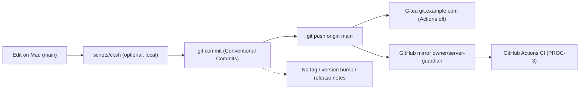
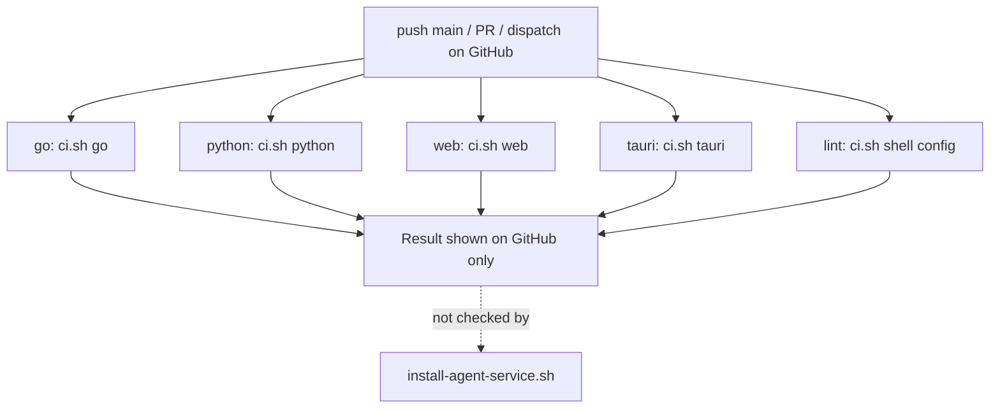
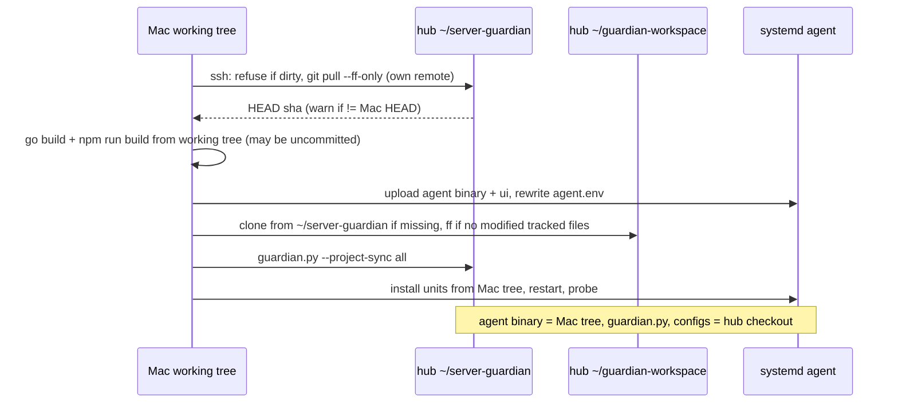
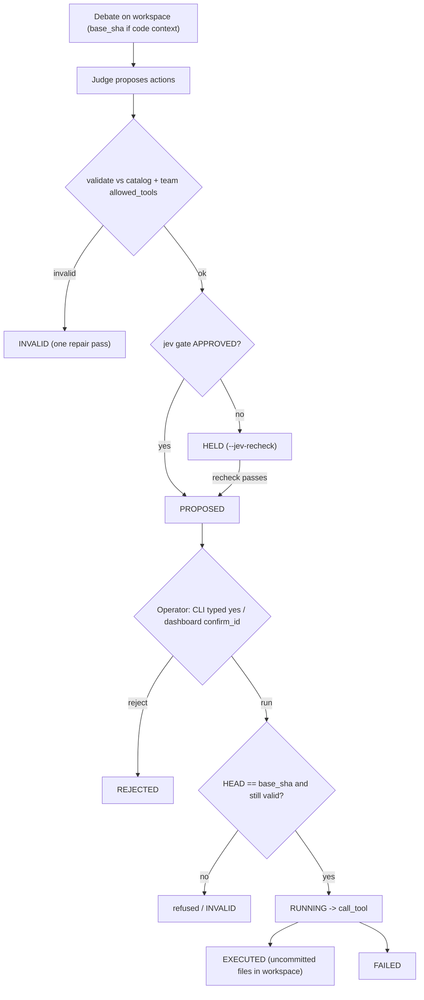
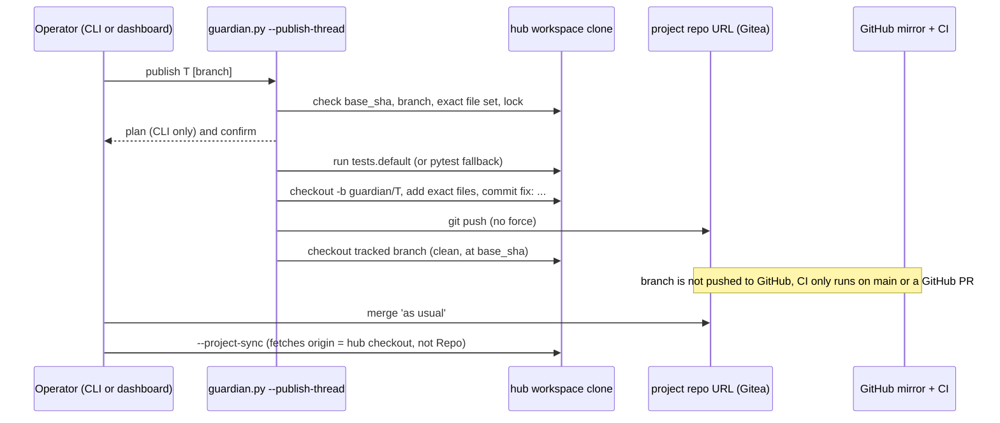
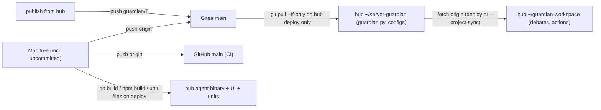

# Phase 1 - Development workflow review (server-guardian)

English | [한국어](phase1-dev.ko.md)

> Point-in-time record from 2026-10-12; the code has changed since.

Scope: how code is written, tested, reviewed, committed, released and deployed. Read-only review of the Mac
checkout at `5aa8e2e` (main). Nothing on the hub was inspected (no ssh); statements about hub state are marked
"unverified on host" where they depend on it.

Paths are repo-relative. `install` = `scripts/install-agent-service.sh`, `mcp_client` / `publish_ops` /
`action_ops` / `project_registry` / `guardian.py` = files in `cli/llm-agent/`.

---

## 1. Procedure inventory

### PROC-1 Local development and commit

1. Edit on the Mac checkout, branch `main` (no feature branches; `git branch -a` shows only `main`).
2. Run checks locally with `scripts/ci.sh [sections]` (see PROC-2).
3. Commit with Conventional Commits: all 156 commits match `type(scope): subject` (verified with
   `git log --format=%s | grep -vE '^(feat|fix|chore|docs|test|...)(\(..\))?: '` -> 0 misses). Agent-made commits add a
   `Co-Authored-By:` trailer (e.g. `5aa8e2e`, `837cf41`).
4. `git push origin main`: `origin` fetches from Gitea and has two push URLs, Gitea then GitHub (`.git/config:8-12`).
   A second remote `github` exists (`.git/config:17-19`).
5. No tags, no release branches, no changelog (`git tag` is empty). Versions are fixed literals:
   `AgentVersion = "v0.1.0-alpha"` (`apps/agent/main.go:14`), `0.1.0` in both `package.json`, `tauri.conf.json:4`,
   `src-tauri/Cargo.toml:3`.
6. No repo-level CLAUDE.md / AGENTS.md / CONTRIBUTING / `.moai`; conventions live in the user's global CLAUDE.md
   and auto-memory only. `.agents/skills/typesafe-ai` + `skills-lock.json` are tracked; `.claude/` is untracked.

### PROC-2 Local checks: `scripts/ci.sh`

1. Sections `go python web tauri shell config` (`scripts/ci.sh:9-15`); default run = `go python web shell config`,
   tauri excluded (`scripts/ci.sh:185`).
2. `go`: gofmt with legacy exceptions `metrics.go model.go`, `go vet`, `go test -race ./...`, linux/arm64 build
   only (`scripts/ci.sh:50-70`).
3. `python`: `unittest discover -p 'test_*.py'` in `cli/llm-agent` with a temp `GUARDIAN_DATA_DIR` and
   `GUARDIAN_LLM_PROVIDERS=none`, then `scripts/test_*.py` (`scripts/ci.sh:72-88`). Go-dependent patch tests skip
   when Go is absent (`test_patch_ops.py:17,187`).
4. `web`: guardian-ui `npm ci`, typecheck, test, build; web-desktop `npm ci`, build (prebuild rebuilds the design
   system, `apps/web-desktop/scripts/build-ui.mjs:23-24`), test (`scripts/ci.sh:90-112`).
5. `tauri`: `npx tauri build --no-bundle` + `cargo test` (`scripts/ci.sh:114-129`).
6. `shell`: `bash -n` + `shellcheck --severity=warning` on `scripts/*.sh deploy/*/*.sh` (`scripts/ci.sh:131-141`).
7. `config`: JSON syntax of `configs/**`, unique server ids, exactly one hub, personas/teams validate via
   `guardian.py --personas/--teams` (`scripts/ci.sh:143-182`).
8. Missing tool: warning locally, failure when `CI=true` (`scripts/ci.sh:40-48`).

Per-language test commands (outside ci.sh): Go `cd apps/agent && go test ./...`; Python
`python3 -m unittest discover` in `cli/llm-agent` (live LLMs only with `GUARDIAN_LIVE_LLM_TESTS=1`,
`test_debate_engine.py:11-15`); web `npm test` (vitest) in each package; Tauri `cargo test` in `src-tauri`.

### PROC-3 GitHub Actions CI

1. Triggers: push to `main`, any `pull_request`, manual (`.github/workflows/ci.yml:4-8`).
2. One job per ci.sh section: go, python (+Go toolchain for patch tests), web, tauri, lint=`shell config`
   (`ci.yml:17-99`). Go version from `apps/agent/go.mod` (`go 1.26.2`).
3. `concurrency: ci-${{ github.ref }}`, `cancel-in-progress: true` (`ci.yml:13-15`).
4. CI runs only on the GitHub mirror; Gitea Actions are off (`README.md:225`). Nothing consumes the CI result:
   no deploy gate, no branch protection is visible in the repo.

### PROC-4 Hub deploy (`install site-a-arm1`)

1. Parse flags; role read from the Mac's `configs/servers.json`; hub mode only if role=hub AND no UI flag
   (`install:85-88`).
2. Hub + pull: refuse if `~/server-guardian` has modified tracked files, else `git pull --ff-only` from the hub
   checkout's own remote (`install:94-104`).
3. Compare hub HEAD with Mac HEAD and Mac dirtiness: warnings only (`install:105-113`).
4. Cross-compile the agent from the Mac working tree (`install:128-130`), upload to `~/.guardian/agent.upload`.
5. Build the dashboard from the Mac tree, reusing existing `node_modules` (`install:135-140`).
6. Rewrite `~/.guardian/agent.env` from scratch: AGENT_HOST, AGENT_ALLOWED_HOSTS, AGENT_UI_DIR, hub-only
   GUARDIAN_WORKSPACE/LLM_TIMEOUT/DEBATE_TIMEOUT, kept `GUARDIAN_REPO_MCP|GUARDIAN_RETRIEVAL*`, AGENT_TOKEN
   (`install:154-193`).
7. Seed `~/.guardian/data/servers.json` once, set GUARDIAN_SERVERS_FILE (`install:195-213`).
8. Workspace clone `~/guardian-workspace`: `git clone ~/server-guardian` if missing (origin = hub checkout);
   if pull: fetch, skip when tracked files modified, checkout the hub checkout's branch, ff-merge
   (`install:215-240`).
9. `guardian.py --project-sync all` from the hub checkout (`install:243-245`).
10. Install Go `1.26.8` to `~/.local/go` with sha256 check (`install:247-288`).
11. Fleet key protection, unit files from the Mac tree, hub-sudo drop-in, restart, health probes, sshd hardening,
    backup timer, isolation checks (`install:291-397`).

### PROC-5 Non-hub agent deploy (`install <node>`)

Steps 4-6 and 11 of PROC-4 without pull, workspace, Go or backup. The unit always sets
`WorkingDirectory=/home/ubuntu/server-guardian` (`deploy/systemd/server-guardian-agent.service:12`); the installer
never creates that directory.

### PROC-6 Project workspace sync

1. CLI `guardian.py --project-sync ID|all` (`guardian.py:630`), dashboard `POST /api/projects/{id}/sync`
   (`apps/agent/debate_handler.go:272`), and the hub deploy (PROC-4 step 9).
2. `ProjectManager.sync`: refuse the running checkout; clone missing from `repo`; otherwise `git fetch origin`,
   skip when tracked files are modified (`--untracked-files=no`), checkout `project.branch`, ff-merge
   (`project_registry.py:287-320`, status at `:212`).
3. Default project `server-guardian`: workspace = `GUARDIAN_WORKSPACE` if set, else `~/guardian-workspace`
   (`project_registry.py:73-93`, `configs/projects/server-guardian.json:7`).

### PROC-7 Debate -> judge action -> approval -> execution

1. Debate runs on the project workspace; `base_sha` recorded only when a code context exists
   (`debate_engine.py:617`).
2. Judge proposals validated against the tool catalog (`mcp_client.py:145-192`) and stored PROPOSED, or HELD
   when the jev gate does not approve (`action_ops.py:53`). The default team allows `run_tests, apply_patch,
   execute_code_action, git_commit_push` (`configs/teams/cross-review.json:11`).
3. Operator runs it: CLI `--run-action N` with a typed `yes` (`guardian.py:268-282`) or the dashboard
   (`POST /api/actions/{id}/run`, confirm_id echo, `debate_handler.go:286,1078-1085`); blocked when
   `GUARDIAN_UI_ACTIONS=off`.
4. `run_action`: refuse HELD/non-PROPOSED, refuse write tools when HEAD != `base_sha` (`action_ops.py:166-179`),
   re-validate, confirm, PROPOSED->RUNNING guard, `call_tool`, EXECUTED/FAILED (`action_ops.py:211-255`).
5. Write tools are refused when the workspace is the running checkout (`mcp_client.py:167-170`).
6. `run_tests` allow-list: `go test`, `pytest`, `python3 -m pytest`, `python3 -m unittest`, `npm run build`,
   `npm test`, each with a flag allow-list (`mcp_client.py:68-88`), plus the project's `tests.commands`
   (`mcp_client.py:123-125`, validated by `project_registry.py:104-125`). Children get `tool_env` (no
   `GUARDIAN_*`, no tokens; `env_policy.py:39,59-62`; `mcp_client.py:369-376`).
7. `execute_code_action` with `run_test` runs `tests.default`, else `python3 -m pytest -q`, 300 s
   (`mcp_client.py:277-281`).

### PROC-8 Legacy judge commit: `jev_mcp:git_commit_push`

1. Validates branch (pattern, not `main/master/develop/release`) and non-empty message (`mcp_client.py:185-189,245-251`).
2. Runs `git checkout -b <branch>`, `git add -A`, `git commit -m <message>`; never pushes; leaves the workspace on
   the new branch (`mcp_client.py:300-312`).

### PROC-9 Publish a thread (`docs/design/publish-thread.md`)

1. Entry: `guardian.py --publish-thread T [--branch B]` (interactive plan + typed `yes`, `guardian.py:141-175`),
   `--json --yes` form (`guardian.py:124-130`), hub route `POST /api/threads/{thread}/publish`
   (`debate_handler.go:290,1013-1050`, passes `--yes`), dashboard Publish button
   (`apps/web-desktop/src/pages/debate/ResultView.tsx:196-247`).
2. Preconditions (`publish_ops.py:222-291`): not already PUSHED; no PROPOSED/HELD/RUNNING action; >=1 EXECUTED
   file action with file hashes; one project and one non-empty `base_sha`; project has `repo`; branch valid and
   != tracked; workspace != running checkout, is repo top, on tracked branch, HEAD == base_sha; changed paths
   (untracked included) == action files, nothing staged, hashes match; flock.
3. Confirm, then run `tests.default` or `python3 -m pytest -q`, 600 s (`publish_ops.py:296-302,319-330`).
4. Record RUNNING, `checkout -b`, `add -- <files>`, commit `fix: 
` + `Debate-Thread:` trailer, verify
   file set, `git push -- <repo> <b>:refs/heads/<b>` (`publish_ops.py:83-96,333-358`).
5. Return to tracked branch, mark PUSHED/FAILED (`publish_ops.py:306-316,361-366`).
6. After: "Merge the pushed branch ... and run `--project-sync`" (`publish-thread.md:75-78`).

### PROC-10 Change propagation back to the hub after a merge

1. Merged change lands on Gitea main (via Mac push or Gitea UI).
2. Hub checkout `~/server-guardian` only moves on the next hub deploy (`install:94-104`).
3. Workspace clone only moves from the hub checkout (origin = `~/server-guardian`, `install:217`;
   `project_registry.py:307`).
4. Agent binary/UI/units only change when deployed from a Mac tree (`install:130,138,301`).

---

## 2. Contradictions and conflicts

### DEV-1 (high) README's hub command silently disables hub mode
- Evidence: `README.md:123` tells the operator to run `install site-a-arm1 --with-ui`; `README.md:145` says the
  plain form installs hub components. The script sets hub mode only when role=hub AND `UI_MODE=keep`
  (`install:87`), while its help says hub mode is "Implied when configs/servers.json marks the host hub"
  (`install:22`). With `--with-ui`, the hub install skips the pull (`install:94`), the workspace and project sync
  (`install:215`), Go, fleet key, sudo drop-in, backup timer, and rewrites `agent.env` without
  `GUARDIAN_WORKSPACE`, `GUARDIAN_LLM_TIMEOUT`, `GUARDIAN_DEBATE_TIMEOUT`, `GUARDIAN_SERVERS_FILE`
  (`install:154-193`; the servers-file block at `:195` is hub-only). `--with-ui --hub-sudo` exits 2 (`install:89`).
- Why: following the README turns the hub's default project workspace back into the running checkout (write
  actions and publish refused, `mcp_client.py:167`, `publish_ops.py:259`), hides dashboard-registered nodes and
  shortens debate timeouts, with no error.
- Fix: SAFE-FIX - in `install:87` derive `HUB=1` from role=hub regardless of UI flags (reject `--no-ui` for a hub),
  and change `README.md:123` to a non-hub host or drop `--with-ui`.

### DEV-2 (high) Redeploy wipes hand-set agent.env settings, including the dashboard kill switch
- Evidence: `agent.env` is regenerated; only `GUARDIAN_REPO_MCP|GUARDIAN_RETRIEVAL*` and `AGENT_TOKEN` are kept
  (`install:163-193`). `GUARDIAN_UI_ACTIONS=off` is the documented way to block dashboard execution and publish
  (`README.md:50`, `publish-thread.md:66-67`, `debate_handler.go:77,1020,1085`); `GUARDIAN_MAX_DEBATES`
  (`README.md:36`), `GUARDIAN_JEV_GATE`, `GUARDIAN_LLM_PROVIDERS` are also env-only.
- Why: a routine deploy silently re-enables UI action execution and publish pushes after an operator turned them
  off.
- Fix: SAFE-FIX - keep every existing `GUARDIAN_*` line not written by the installer (or an explicit keep-list
  including `GUARDIAN_UI_ACTIONS`), and print what was kept. DESIGN alternative: move operator settings to a
  separate `agent.local.env` loaded as a second `EnvironmentFile`.

### DEV-3 (high) `git_commit_push` and publish are mutually exclusive, with weaker safety in the old path
- Evidence: `git_commit_push` uses `git add -A` and stays on the new branch (`mcp_client.py:300-312`); publish
  adds only the action files, refuses unless the workspace is on the tracked branch at `base_sha`
  (`publish_ops.py:270-277`) and refuses PROPOSED actions (`:231-233`). The default team allows both
  (`configs/teams/cross-review.json:11`), the judge persona still says to "execute ... Git commit"
  (`configs/personas/jev_mcp_decision.json:7`). `publish-thread.md:6` and `debate-patch-tool.md:127` keep
  `git_commit_push` "unchanged". `docs/analysis/2026-10-04-system-analysis.md:55` already flagged `git add -A`.
- Why: once a `git_commit_push` executes, the thread can never be published, and the workspace (shared by all later
  debates of the project) is left on a judge branch with every untracked file committed, including another
  thread's work; later debates read that branch as HEAD. A pending `git_commit_push` also blocks publish until
  rejected.
- Fix: DESIGN - retire `git_commit_push` (drop it from `cross-review.json` and the persona) in favour of publish,
  or reimplement it as "publish without push" sharing publish's exact-file and return-to-branch rules.

### DEV-4 (medium) Published code reaches main without the CI that guards human commits
- Evidence: publish pushes only to the project `repo` (Gitea) (`publish_ops.py:252,357`); Gitea Actions are off
  (`README.md:225`); GitHub CI runs on `main` pushes and GitHub PRs only (`ci.yml:4-8`). The publish gate runs only
  `tests.default`, which for this repo is the Python suite (`configs/projects/server-guardian.json:9`), while patches
  may touch Go/TS/shell (`mcp_client.py:37-43`). The merge step is just "merge as usual" (`publish-thread.md:77`).
- Why: an LLM-written branch can be merged on Gitea without go vet/test, web build/test, shellcheck or config
  validation; CI only reports after it is on main (and DEV-13 may cancel that run).
- Fix: DESIGN - document the merge path as "fetch on the Mac, run `scripts/ci.sh`, push" (or push `guardian/*` to
  GitHub and open a PR); optionally let `tests.default` be a list or run `scripts/ci.sh go python` on the hub.

### DEV-5 (medium) Deploy/sync ignore untracked files, publish counts them
- Evidence: hub deploy and `ProjectManager.sync` treat the workspace as clean with `--untracked-files=no`
  (`install:226`, `project_registry.py:212,311`) and then fast-forward it (`install:233`, `project_registry.py:317`).
  Publish counts untracked files (`publish_ops.py:101`) and requires HEAD == `base_sha` (`:276-277`); write
  actions have the same HEAD rule (`action_ops.py:166-179`). `execute_code_action` and `apply_patch` (old="")
  create new, untracked files.
- Why: if a thread only created new files, a deploy or a dashboard Sync in between moves HEAD, so the thread can
  no longer be published or continued, and the new files stay behind as stray untracked files. This contradicts
  the stated rule "never discard what judge actions left there" (`install:218-219`).
- Fix: SAFE-FIX - include untracked files in both dirtiness checks (`git status --porcelain` without
  `--untracked-files=no`), or skip the ff when any thread has EXECUTED, unpublished file actions.

### DEV-6 (medium) Post-publish loop in the design doc does not work for this repo
- Evidence: `publish-thread.md:77-78` says merge, then `--project-sync` fast-forwards the workspace. The
  server-guardian workspace was cloned from `~/server-guardian` (`install:217`) and sync fetches `origin`
  (`project_registry.py:307`), i.e. the hub checkout, which moves only on a hub deploy (`install:94-104`).
- Why: after a merge, `--project-sync` reports "updated" with no change; new debates still read pre-merge code
  until someone redeploys from a Mac.
- Fix: SAFE-FIX - document "redeploy the hub (or `git -C ~/server-guardian pull --ff-only`) before
  `--project-sync`". DESIGN alternative: point the workspace's origin at the project `repo`.

### DEV-7 (medium) Four version sources, no enforced alignment, no version stamp
- Evidence: agent binary, dashboard, unit files and hub scripts come from the Mac working tree, including
  uncommitted changes (`install:130,138,296-301,361`); `guardian.py`, configs, teams, personas and the
  db-backup script come from the hub checkout (`install:92-93`,
  `deploy/systemd/server-guardian-db-backup.service:12-15`); debates read the workspace clone. A mismatch only
  warns (`install:108-113`); with `--no-pull` or on non-hub hosts there is no check. `AgentVersion` is a constant
  (`apps/agent/main.go:14`); the agent even expects older CLIs (`debate_handler.go:380`).
- Why: a deploy from an unpushed or dirty Mac tree runs a binary that speaks a different CLI contract than the
  hub's `guardian.py`, and nothing on the hub records which commit is running. Deploy is not gated on CI either
  (PROC-3 step 4).
- Fix: SAFE-FIX - inject `git describe --dirty` via `-ldflags -X` into the agent and expose it in `/api/status`;
  print hub/Mac/workspace shas at the end of the install. DESIGN - refuse to deploy a dirty or unpushed tree to the
  hub unless `--allow-dirty`.

### DEV-8 (medium) Dashboard publish confirms blind; CLI confirms on the plan
- Evidence: the CLI prints project, branch -> remote, base, subject and files, then asks for a typed `yes`
  (`guardian.py:146-158`). The hub route always passes `--yes` (`debate_handler.go:1042`) and the dashboard dialog
  shows only generic text and an optional branch field (`ResultView.tsx:233-243`). Running an action from the
  dashboard is guarded with a `confirm_id` echo (`debate_handler.go:1078`), publish is not.
- Why: two ways to push code with different review rules; the dashboard operator never sees the files or the push
  URL before a push to the shared repo.
- Fix: SAFE-FIX - add a dry-run (`--publish-thread T --plan --json`, the checks without confirm) and show its plan
  in the dialog; require a plan hash/confirm_id on the POST.

### DEV-9 (medium) Actions without a code context can run but never be published
- Evidence: `base_sha` is set only when a context snapshot exists (`debate_engine.py:617`); the stale check is
  skipped without it (`action_ops.py:171-173`); publish refuses any file action without a common non-empty
  `base_sha` (`publish_ops.py:243-247`).
- Why: the operator can approve and execute file edits that end as permanently unpublishable dirty files in the
  shared workspace, blocking publish for every other thread (`publish_ops.py:129-136`).
- Fix: SAFE-FIX - refuse file tools at proposal time when there is no `base_sha` (or record HEAD as `base_sha`).

### DEV-10 (medium) The pytest fallback cannot run on the hub
- Evidence: `execute_code_action`'s `run_test` and the publish gate fall back to `python3 -m pytest -q`
  (`mcp_client.py:278-279`, `publish_ops.py:37,322`). The hub has no pytest (`debate-patch-tool.md:62`; commit
  `5aa8e2e` message), and the installer does not install it. README presents `tests.default` as optional
  (`README.md:159`).
- Why: any other project without `tests.default` can never publish, and `run_test: true` always FAILs there.
- Fix: SAFE-FIX - make publish refuse with "set tests.default" when none is configured, and document it as
  required for publish in `README.md:159`.

### DEV-11 (medium) First-install bootstrap is undocumented
- Evidence: every node's unit requires `WorkingDirectory=/home/ubuntu/server-guardian`
  (`deploy/systemd/server-guardian-agent.service:12`), but the installer never creates it, and a first hub install
  `cd ~/server-guardian` with `set -e` (`install:96`). README's quick start (`README.md:118-147`) has no clone step.
  (Whether nodes already have the directory: unverified on host.)
- Why: on a fresh non-hub node systemd fails with CHDIR; a fresh hub aborts at the pull step.
- Fix: SAFE-FIX - for non-hub nodes use `WorkingDirectory=-/home/ubuntu/server-guardian` or `~/.guardian`;
  document the one-time `git clone` for the hub.

### DEV-12 (medium) README contradicts the current action and push model
- Evidence: `README.md:46` lists four tools (no `apply_patch`) and says `git_commit_push` never pushes;
  `README.md:163` says judge actions "do not push". README never mentions `--publish-thread` or the Publish
  button, which push to the project repo (`publish-thread.md:8-10`). `docs/design/debate-code-context.md:88`
  lists the write tools without `apply_patch`.
- Why: the user-facing doc says no path pushes, while one does.
- Fix: SAFE-FIX - add a "Publish" subsection that links `docs/design/publish-thread.md`, and update the tool list.

### DEV-13 (low) CI cancels superseded main runs
- Evidence: `cancel-in-progress: true` for `ci-${{ github.ref }}` (`ci.yml:13-15`) combined with direct-to-main
  commits (PROC-1).
- Why: bursts of commits leave intermediate main commits with no CI verdict, so a breaking commit can't be
  pinpointed.
- Fix: SAFE-FIX - `cancel-in-progress: ${{ github.event_name == 'pull_request' }}`.

### DEV-14 (low) ci.sh header and README describe sections inaccurately
- Evidence: the header says plain `scripts/ci.sh` runs "every section" (`scripts/ci.sh:6`) but tauri is excluded
  (`:185`); it says `deploy/**/*.sh` (`:14`) but the glob is `deploy/*/*.sh` (`:134`); `README.md:222` omits
  `deploy`; `README.md:219` omits the `scripts/test_*.py` run (`ci.sh:85`).
- Fix: SAFE-FIX - correct the comments and the README table.

### DEV-15 (low) Toolchain and target drift between CI, Mac and hub
- Evidence: `go.mod` says `go 1.26.2` (used by CI, `ci.yml:26`); the hub installs `1.26.8` (`install:56`); the Mac
  has 1.26.8. CI builds only linux/arm64 (`ci.sh:67`) while the installer also builds amd64 for x86 nodes
  (`install:117-120`).
- Fix: SAFE-FIX - add a `toolchain go1.26.8` line or pin `HUB_GO_VERSION` to go.mod; add an amd64 build to
  `run_go`.

### DEV-16 (low) Deploy reuses stale node_modules
- Evidence: `install:138` runs `npm ci` only when `node_modules` is missing; CI always runs `npm ci`
  (`ci.sh:97,107`).
- Why: a lockfile change is not picked up by deploys from a long-lived Mac tree, so the UI shipped differs from the
  one CI built.
- Fix: SAFE-FIX - run `npm ci` when `package-lock.json` is newer than `node_modules/.package-lock.json`.

### DEV-17 (low) Two test timeouts and two workspace updaters for the same thing
- Evidence: `run_test` uses 300 s (`mcp_client.py:280`), the publish gate and `run_tests` use 600 s
  (`publish_ops.py:31`, `mcp_client.py:297`). Hub deploy updates the workspace in bash to the hub checkout's
  *current* branch (`install:224-233`), then `--project-sync` checks out `project.branch` (`project_registry.py:313`).
- Fix: SAFE-FIX - one test-timeout constant; drop the bash block and rely on `--project-sync` (run with
  `GUARDIAN_WORKSPACE` from agent.env).

### DEV-18 (low) Judge is not told the project's test commands
- Evidence: `catalog_text` prints only the built-in description (`mcp_client.py:47-49,135-143`) used in the judge
  prompt (`debate_engine.py:528`); project `tests.commands` and `tests.default` are never shown.
- Fix: SAFE-FIX - append the project's allowed prefixes and its default test to the `run_tests` description.

### DEV-19 (low) Publish doc exit codes only hold for `--json`
- Evidence: `publish-thread.md:25-26` says exit 4/2/3; interactive `handle_publish` exits 1 for every refusal
  (`guardian.py:160-172`).
- Fix: SAFE-FIX - state "with --json" in the doc, or use the same codes in both paths.

### DEV-20 (low) Publish commits are always `fix:`
- Evidence: `publish_ops.py:88` hard-codes `fix: `; the repo uses `feat/fix/chore/docs/test(scope)` (PROC-1).
- Fix: DESIGN - let the judge's decision supply type/scope, or use `chore(debate):`.

### DEV-21 (low) Stale docs and a stale tracked artifact
- Evidence: `README.md:60` "Vanilla TypeScript" vs React (`docs/design/dashboard-react-migration.md:5`,
  `agent.md:41`); `agent.md:158` names `llm-runner.js` (file is `cli/llm-agent/llm_runner.py`); `agent.md:214,238`
  put Vite :5173 on the hub vs `README.md:127`; `agent.md:281-284` has the judge executing tools autonomously vs
  human approval (`mcp_client.py:4-6`); `debate-patch-tool.md:62,67` says the hub has no Go vs `install:247-288`;
  `docs/analysis/2026-10-04-system-analysis.md:59` says "no CI". `docs/decisions/latest_debate_transcript.md` is
  tracked (last touched `8c2684d`, 2026-10-03) although runtime exports now go to the data dir
  (`db_manager.py:30-34`) and `.gitignore:49` says hub runtime data is never in git.
- Fix: SAFE-FIX - date-stamp analysis docs as snapshots, fix the stale lines, `git rm` the transcript.

---

## 3. Recurring contradiction patterns

1. **Two mechanisms, different safety rules.** The same outcome goes through two paths that enforce different
   rules: `git_commit_push` vs publish (DEV-3), CLI vs dashboard publish confirmation (DEV-8), bash vs Python
   workspace update (DEV-17), 300 s vs 600 s test timeouts (DEV-17).
2. **Docs that lag the code.** README, agent.md and design notes describe an earlier state: DEV-1 (README hub
   command), DEV-6, DEV-12, DEV-14, DEV-19, DEV-21.
3. **Several sources of truth for "what is deployed".** The Mac tree, the hub checkout, the workspace clone and
   the binary each move on their own; checks only warn: DEV-6, DEV-7, DEV-15, DEV-16.
4. **The installer overwrites operator state.** A full rewrite or a flag interaction silently resets settings:
   DEV-1, DEV-2.
5. **Gates narrower than CI.** Code paths that bypass `scripts/ci.sh`: the publish gate (DEV-4), deploy not
   gated on CI (DEV-7), the pytest fallback (DEV-10), cancelled main runs (DEV-13).
6. **Untracked or contextless blind spots.** One component ignores state that another relies on: untracked files
   (DEV-5), a missing `base_sha` (DEV-9).

---

## 4. Consistent practices to keep

- `scripts/ci.sh` is the single definition of CI; GitHub jobs only call its sections, missing tools fail under
  `CI=true`, and the `checked` pattern fixes the `set -e` in `||` trap (`scripts/ci.sh:30-39`).
- Conventional Commits are used by every commit (156/156), with clear "why" bodies.
- Python tests are offline and isolated by default (`GUARDIAN_LLM_PROVIDERS=none`, temp `GUARDIAN_DATA_DIR`,
  `GUARDIAN_LIVE_LLM_TESTS` opt-in).
- Publish's design: preconditions checked before any change, exact file set, no force, no shell, per-call
  timeouts, scrubbed stderr, flock, retry that reuses the same commit, attempts recorded in
  `thread_publications`.
- Write tools are refused in the running checkout (`mcp_client.py:167`, `project_registry.py:292`,
  `publish_ops.py:259`), and HEAD must equal `base_sha` before any write.
- The `run_tests` allow-list uses per-command flag allow-lists, forbids interpreters and package runners in
  project prefixes, and runs with the `tool_env` minimal environment.
- The installer refuses to pull a dirty hub checkout and never discards modified tracked files in the workspace;
  the Go toolchain download is sha256-verified.
- Human approval on every action (typed `yes`, or a dashboard `confirm_id`), the jev HELD gate, and the
  `GUARDIAN_UI_ACTIONS=off` kill switch, which must survive redeploys (DEV-2).
