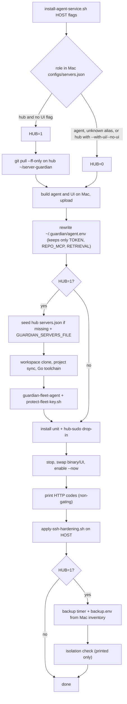
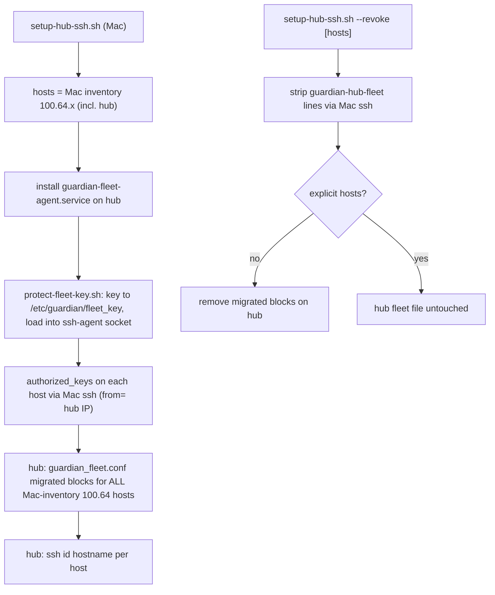
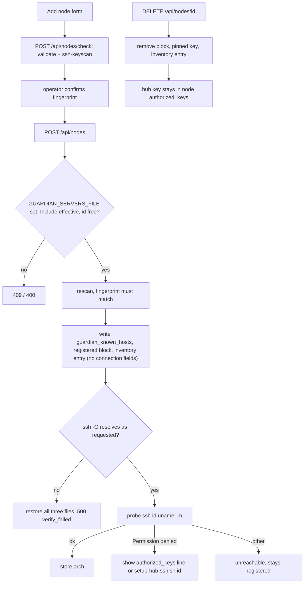
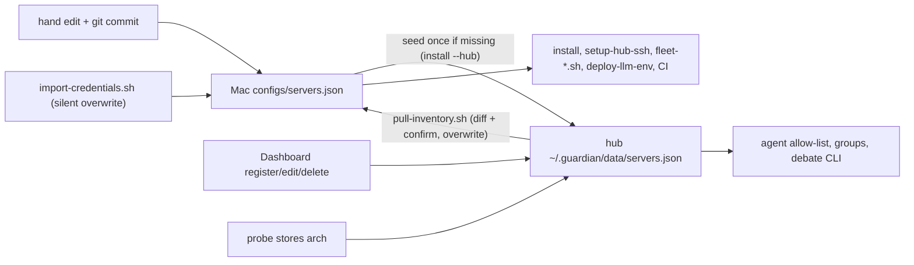
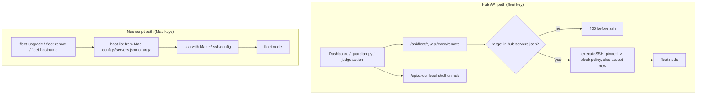
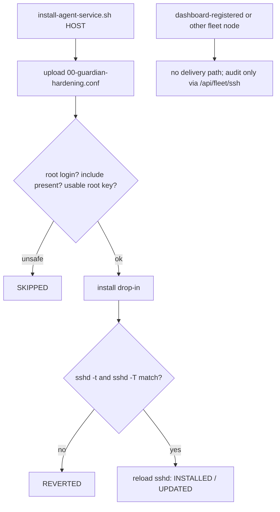
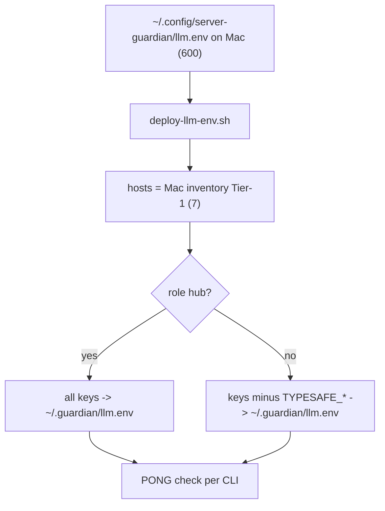
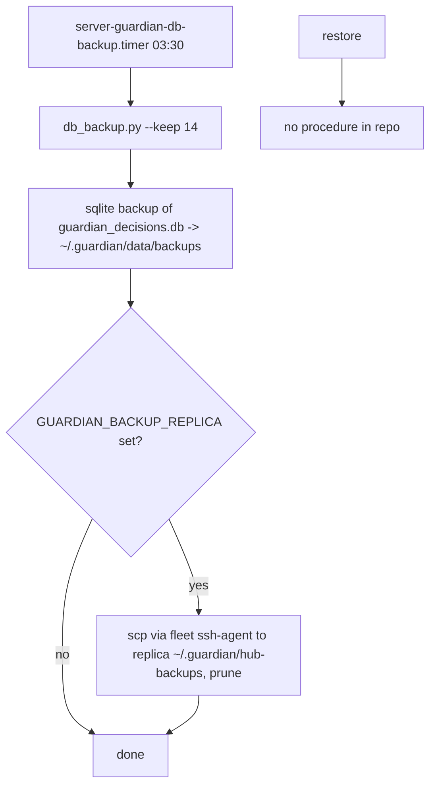
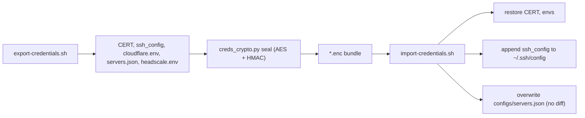

# Phase 1 - 서버 / 플릿 관리 검토 (운영 분석가)

[English](phase1-ops.md) | 한국어

> 2026-10-12 시점의 기록이며, 이후 코드가 바뀌었다.

저장소: `/Users/owner/working/ci_build/server-guardian`, `5aa8e2e` (main) 기준. 읽기 전용 검토이며 어떤 서버에서도 아무것도 실행하지 않았다.
아래의 모든 file:line은 이 checkout에서 읽은 것이다. 허브의 실제 상태(site-a-arm1의
`~/.guardian/data/servers.json`에 실제로 무엇이 들어 있는지)에 의존하는 내용은 "저장소에서 확인할 수 없음"으로 표시했다.

기준으로 삼은 운영 모델(운영자 제공): site-a-arm1이 에이전트를 실행하는 유일한 서버이고,
나머지는 모두 플릿 SSH 키로 접근한다. 허브 인벤토리 = `~/.guardian/data/servers.json`이며, 저장소 사본은
Mac의 사본으로 `scripts/pull-inventory.sh`로 다시 동기화한다.

---

## 1. 절차 목록

범례: "Mac" = 자체 `~/.ssh/config`와 `~/CERT` 키로 스크립트를 실행하는 관리용 Mac, "hub" = site-a-arm1.

### P1. 에이전트 설치 / 업그레이드 (`scripts/install-agent-service.sh <host>`)

1. 플래그 `--listen --hub --with-ui --no-ui --no-pull --hub-sudo --no-hub-sudo --no-ssh-hardening`를 파싱한다 (`scripts/install-agent-service.sh:58-81`).
2. **Mac**의 `configs/servers.json`에서 정확한 id로 서버의 `guardian_role`을 조회한다. 허브 모드는 role이 `hub`**이고 UI 플래그가 주어지지 않았을 때만** 암묵적으로 켜진다 (`:85-88`).
3. 허브 + pull: 허브의 `~/server-guardian`이 dirty이면 거부하고, 아니면 `git pull --ff-only`를 한다. 허브 HEAD != 로컬 HEAD이거나 로컬 트리가 dirty이면 경고한다 (`:94-114`).
4. ssh로 아키텍처를 감지하고, 기본 listen = `127.0.0.1` + Tailscale IPv4 (`:116-126`).
5. Mac에서 `apps/agent`를 크로스 컴파일해 `~/.guardian/agent.upload`로 업로드한다 (`:128-133`).
6. UI 켜짐: `apps/web-desktop`을 로컬에서 빌드해 `~/.guardian/ui.new`로 업로드한다 (`:135-145`).
7. `~/.guardian/agent.env`를 처음부터 다시 쓴다: AGENT_HOST, AGENT_ALLOWED_HOSTS(Mac 인벤토리에서), AGENT_UI_DIR, 허브 전용 GUARDIAN_WORKSPACE/LLM/DEBATE 타임아웃. `AGENT_TOKEN`과 `GUARDIAN_REPO_MCP`/`GUARDIAN_RETRIEVAL*` 줄만 유지한다 (`:151-193`).
8. 허브: `~/.guardian/data/servers.json`이 **없을 때만** Mac 사본으로 초기 생성하고, 이어서 `GUARDIAN_SERVERS_FILE`을 추가한다 (`:195-213`).
9. 허브: `~/guardian-workspace`를 만들거나 갱신하고, 프로젝트 clone을 동기화하고, sha256 검사를 거쳐 Go `${HUB_GO_VERSION}`을 설치한다 (`:215-289`).
10. 허브: `guardian-fleet-agent.service`를 설치하고 `deploy/hub/protect-fleet-key.sh`를 실행한다 (`:293-298`).
11. unit을 설치하고 hub-sudo drop-in을 설정한다 (켜짐은 `hub-sudo.conf` / 꺼짐은 `hub-sudo.off` 마커, "keep" = off 마커가 없으면 켜짐) (`:300-316`).
12. 에이전트를 멈추고, 바이너리와 UI 디렉터리를 교체하고, `daemon-reload`, `enable --now`, `systemctl is-active` (`:317-331`).
13. listen IP별 API/UI HTTP 코드를 출력한다 (게이트 아님) (`:333-342`).
14. `--no-ssh-hardening`이 아니면: `00-guardian-hardening.conf`를 업로드하고 **설치 대상 서버**에서 `apply-ssh-hardening.sh`를 실행한다 (`:344-356`).
15. 허브: DB 백업 service+timer를 설치하고, Mac 인벤토리의 `backup_replica`로 `~/.guardian/backup.env`를 쓴다 (`:358-370`).
16. 허브: 에이전트 네임스페이스 안에서 격리 점검(키 읽기 불가, sudo가 설정과 일치, 플릿 SSH 동작, systemd 점수) - 출력만 한다 (`:375-396`).

Unit: `deploy/systemd/server-guardian-agent.service:7-53` (User ubuntu, `-` 없는 `WorkingDirectory=/home/ubuntu/server-guardian`, NoNewPrivileges, InaccessiblePaths), `deploy/systemd/server-guardian-agent.service.d/hub-sudo.conf:6-18`.

### P2. 플릿 SSH 키 설정, 보호, 폐기 (`scripts/setup-hub-ssh.sh`, `deploy/hub/protect-fleet-key.sh`)

설정 (Mac에서 실행):
1. 허브 id와 허브 IP는 Mac 인벤토리에서 가져온다 (`scripts/setup-hub-ssh.sh:50-51`). 기본 서버 목록 = `tailscale_ip`가 `100.64.`로 시작하는 Mac 인벤토리의 모든 서버이며, 허브 자신도 포함된다 (`:52-56`).
2. 허브에 `guardian-fleet-agent.service`를 설치하고 `protect-fleet-key.sh`를 실행한다 (`:288-291`):
   - `/etc/guardian`을 0700 root로 만들고, `~/.ssh/guardian_fleet`을 옮기거나 `/etc/guardian/fleet_key`에 새 ed25519 키를 생성한다 (`deploy/hub/protect-fleet-key.sh:27-38`);
   - `~/.ssh/guardian_fleet.pub`을 쓰고 (`:40-41`), 레거시 `# BEGIN guardian-hub-fleet` 블록을 수정한다 (`:44-63`);
   - ssh-agent unit을 재시작하고, 소켓에 키가 올라오기를 기다린 뒤 `~/.ssh/guardian_fleet`을 삭제한다 (`:65-80`).
   - Unit: `ExecStartPost=+ssh-add /etc/guardian/fleet_key`, 소켓 `/run/guardian-fleet/agent.sock` (`deploy/systemd/guardian-fleet-agent.service:17-19`).
3. 키 줄 `from="<hub ip>",no-agent-forwarding,no-port-forwarding,no-X11-forwarding <pub>`을 만들고 (`setup-hub-ssh.sh:292`), **Mac의** ssh로 각 서버의 `authorized_keys`에 있는 모든 `guardian-hub-fleet` 줄을 교체한다 (`:263-272`, `:295-299`).
4. 허브에서 Mac 인벤토리의 **모든** 100.64 서버에 대해 - 명령줄에 지정한 서버만이 아니라 - `~/.ssh/guardian_fleet.conf`의 "migrated" 블록(`StrictHostKeyChecking accept-new`)을 쓰고, registered 블록과 손으로 쓴 블록은 유지하고, Include 줄을 보장하고, 레거시 블록을 제거한다 (`:186-221`, `:248-260`, `:301-302`).
5. 허브의 일반 셸에서 허브 -> 서버 `ssh <id> hostname`으로 검증한다 (`:304-314`).

폐기: `--revoke [host...]`는 각 서버에서 `guardian-hub-fleet` 줄을 지운다 (`:274-279`). 서버를 명시하지 않았을 때만 허브의 migrated 블록을 제거한다 (`:280-283`, `:222-237`). 키 파일 `/etc/guardian/fleet_key`는 제거되거나 교체되지 않는다.

### P3. 노드 등록 / 편집 / 호스트 키 고정 / 제거 (대시보드 -> `apps/agent/nodes_*`)

라우트: `apps/agent/nodes_handler.go:73-80`.
1. 사실 정보: `GET /api/nodes/registration` - Include 상태, 쓰기 가능한 인벤토리, 허브 tailscale IP, authorized_keys 줄(허브에 tailscale_ip가 없으면 제한 없는 줄과 안내문) (`nodes_handler.go:357-411`, `:301-321`).
2. 점검: `POST /api/nodes/check`는 id/host/user/port를 검증하고 `ssh-keyscan`을 실행한다 (`:430-465`; 검증 `nodes_validate.go:46-112`).
3. 등록: `POST /api/nodes`는 확인된 fingerprint를 요구한다. `fleetFileMu` 아래에서 쓰기 경로, Include, id 고유성을 점검하고, 다시 스캔해 fingerprint를 대조하고, `guardian_known_hosts`, **registered** 블록(`StrictHostKeyChecking yes`, `HostKeyAlias`), 그리고 `id`, `name`, 메타데이터만 담은(hostname/user/port/tailscale_ip 없음) 인벤토리 항목을 쓴다. `ssh -G`로 검증하고, 불일치하면 롤백한다 (`:478-516`, `:547-624`; `ssh_fleet_file.go:289-300`, `:636-649`).
4. 프로브: `ssh <id> uname -m` -> `ok`는 아키텍처를 저장 / `key_not_installed`는 키 줄을 반환 / `unreachable` (`:194-220`, `:520-543`). UI는 Mac에서 `scripts/setup-hub-ssh.sh <id>`를 실행하라고도 제안한다 (`apps/web-desktop/src/pages/nodes/NodeForms.tsx:469-470`).
5. 편집 / 고정: `PUT /api/nodes/{id}`. hostname/port 변경이나 fingerprint만 보내면 다시 고정한다(registered 형태로 다시 씀). user만 바꾸면 형태를 유지한다. 메타데이터는 인벤토리로 간다. 인벤토리 자체의 `hostname`/`tailscale_ip`는 절대 갱신되지 않는다 (`:667-800`).
6. 제거: `DELETE /api/nodes/{id}`는 허브와 관리되지 않는 블록을 거부하고, 블록 + `guardian_known_hosts` 줄 + 인벤토리 항목을 제거한다. 노드의 `authorized_keys`에는 허브 키가 남는다 (`:820-884`; UI는 `RemoveNodeDialog.tsx:45`에서 이를 알린다).

### P4. 인벤토리 생명주기 (Mac 사본 대 허브 사본)

1. 초기 생성: 허브 인벤토리는 없을 때만 Mac 사본으로 만들어진다 (`install-agent-service.sh:199-208`).
2. 런타임 읽기: Go `serversFile()` = `GUARDIAN_SERVERS_FILE`, 없으면 cwd 기준 `configs/servers.json`, 없으면 `~/.config/agentthread/servers.json` (`apps/agent/servers_handler.go:149-166`). 토론 CLI도 같은 경로를 받는다 (`apps/agent/debate_handler.go:317-320`). Python의 대체 순서도 같다 (`cli/llm-agent/group_manager.py:70-82`).
3. 런타임 쓰기: `GUARDIAN_SERVERS_FILE`이 설정되어 있고 존재해야 하는 `inventoryWritePath()`를 통해서만 한다 (`apps/agent/nodes_inventory.go:125-141`). 쓰는 쪽은 register/update/delete/storeArch이다 (`nodes_handler.go:223-253`, `:609-616`, `:783-791`, `:875-878`).
4. 역동기화: `scripts/pull-inventory.sh`는 허브 파일을 가져와 검증하고(배열, id, 고유성, 허브가 정확히 하나), 추가/제거된 id와 diff를 보여 준 뒤, 확인을 받으면 Mac 사본을 덮어쓴다 (`scripts/pull-inventory.sh:37-90`).
5. Mac 사본을 쓰는 다른 경로: 손 편집 + commit(예: `8f9fd54`, `eb3677a`, 2026-10-08)과 `scripts/import-credentials.sh:110-113`(조용한 덮어쓰기).
6. **Mac** 사본을 사용하는 쪽: install(role, 허용 서버, 백업 replica), setup-hub-ssh, fleet-hostname, fleet-upgrade, deploy-llm-env, install-llm-clis, export-credentials, CI (`scripts/ci.sh:155-163`).
7. 초기 생성 이후 Mac -> 허브로 보내는 경로는 없다.

### P5. 플릿 운영

허브 API 경로 (플릿 키, 허브 인벤토리를 허용 목록으로 사용):
1. `GET /api/fleet/diagnose?targets=` -> 고정된 Linux 프로브(`uname`, `uptime`, `free -m`, `df`), exit 0일 때만 ONLINE (`apps/agent/main.go:140-147`, `servers_handler.go:278-355`).
2. `POST /api/fleet/exec`와 `POST /api/fleet/exec/stream` -> 모든 대상에 같은 명령. 대상은 id 또는 name과 일치해야 하며, 모르는 대상은 ssh 전에 400 (`main.go:150-173`, `servers_handler.go:208-218`, `:358-408`, `:441-484`, `:503-533`).
3. `GET /api/fleet/ssh` -> 고정된 읽기 전용 sshd 프로브, 60초 캐시 (`apps/agent/fleet_ssh.go:34-68`, `:504-523`).
4. `POST /api/exec/remote` -> id, name **또는 hostname**으로 일치하는 대상 하나 (`main.go:179-214`, `servers_handler.go:37-47`).
5. `POST /api/exec` -> 허브의 로컬 셸 (`main.go:101-124`, `metrics.go:444-455`).
6. 모든 ssh는 `executeSSH`를 거친다: 대상의 블록이 registered 형태가 아니면 `-o StrictHostKeyChecking=accept-new` (`servers_handler.go:58-111`).
7. 판정자 도구 `jev_mcp:server_remediation`: 토론이 제안하고, jev가 APPROVED가 아니면 보류되며, 사람의 승인 후에만 실행된다. `local`/`localhost` -> 허브에서 `bash -c`, 그 외에는 60초로 `/api/exec/remote` (`cli/llm-agent/mcp_client.py:60-65`, `:189-191`, `:314-321`; README `README.md:44-53`).

Mac 스크립트 경로 (Mac ssh 설정과 키, Mac 인벤토리):
8. `scripts/fleet-upgrade.sh` 기본값 = **모든** id(허브와 macOS `edge-mini` 포함), 일시적인 `systemd-run` apt 작업, 결과 파일 폴링 (`scripts/fleet-upgrade.sh:37-41`, `:45-61`, `:70-93`).
9. `scripts/fleet-reboot.sh` 명시한 서버만, 배치 단위, boot-id 점검, 첫 실패에서 중단 (`scripts/fleet-reboot.sh:34`, `:42-94`).
10. `scripts/fleet-hostname.sh` 기본값 = 100.64 서버, hostname을 id로 설정 (`scripts/fleet-hostname.sh:31-36`, `:38-64`).

### P6. sshd 강화

1. 기준 파일 `deploy/ssh/00-guardian-hardening.conf:1-5` (`MaxAuthTries 4`, `PermitRootLogin no`).
2. `install-agent-service.sh` 14단계에서 설치 대상 서버에만 적용된다 (`install-agent-service.sh:346-356`).
3. `apply-ssh-hardening.sh`: root 로그인 상태 / `sshd_config.d` include 없음 / root에 forced command 없는 키가 있으면 건너뛴다. 설치, `sshd -t`, `sshd -T` 비교, reload, 어떤 실패든 되돌린다 (`deploy/ssh/apply-ssh-hardening.sh:31-70`).
4. 기존 23개 노드는 이 파일이 아니라 `POST /api/fleet/exec`와 인라인 스크립트로 임시로 강화되었다 (`docs/operations/2026-10-05-fleet-sshd-hardening.md:7-9`, `:41-91`).
5. 이탈 감지 = 플릿 SSH 감사 (`fleet_ssh.go`; README `README.md:192-205`).

### P7. LLM 자격 증명과 CLI 설치

1. 로컬 원본 `~/.config/server-guardian/llm.env`는 600/400이어야 하며, 토큰 길이를 기본 점검한다 (`scripts/deploy-llm-env.sh:29`, `:53-73`).
2. 기본 서버 = Mac 인벤토리의 `tier == "Tier-1"` (허브 포함 7대) (`:46-51`).
3. 허브는 모든 키를 받고, 나머지는 ssh stdin으로 `TYPESAFE_*`를 뺀 파일을 받는다(role은 Mac 인벤토리에서) (`:75-80`, `:116-130`).
4. 선택적으로 `--retire-stale-creds`, 그다음 claude/codex/agy의 PONG 점검 (`:82-104`, `:131-136`).
5. CLI: `scripts/install-llm-clis.sh`가 Tier-1 서버에 codex(npm)와 agy(curl 설치 스크립트)를 설치한다. 로그인은 서버마다 대화형으로 한다 (`scripts/install-llm-clis.sh:35-86`).
6. 사용하는 쪽: `cli/llm-agent/llm_runner.py:67` (`GUARDIAN_LLM_ENV`, 기본값 `~/.guardian/llm.env`).

### P8. 결정 DB 백업 / 복원

1. Timer는 매일 03:30 UTC + 15분 지터, persistent (`deploy/systemd/server-guardian-db-backup.timer:4-7`).
2. Service는 `backup.env`와 함께 ubuntu로 `db_backup.py --keep 14`를 실행한다. `agent.env`/`llm.env`는 접근할 수 없다 (`deploy/systemd/server-guardian-db-backup.service:9-28`).
3. `guardian_decisions.db`만 SQLite 온라인 백업하고, 14개로 정리한다 (`cli/llm-agent/db_backup.py:28-48`, `db_manager.py:17-27`).
4. `GUARDIAN_BACKUP_REPLICA`(install이 Mac 인벤토리의 `backup_replica` = `site-yd-arm1`로 씀)가 있으면 -> 플릿 키로 `ssh`/`scp`해 `~/.guardian/hub-backups`에 보내고 그곳에서 정리한다 (`db_backup.py:53-68`, `:71-95`; `install-agent-service.sh:363-366`).
5. 복원: 스크립트도 문서화된 절차도 찾지 못했다 (스크립트, 문서, CLI 전체에서 `restore|복원`을 검색).

### P9. 관리자 자격 증명 내보내기 / 가져오기

1. 내보내기: `~/.ssh/*`, Mac `~/.ssh/config`, Cloudflare env, **저장소 `configs/servers.json`**, Headscale env를 복사하고 tar로 묶은 뒤, `creds_crypto.py`(AES-256-CBC + HMAC, passphrase는 pipe로)로 봉인해 저장소 루트에 둔다 (`scripts/export-credentials.sh:23-114`; `*.enc`는 gitignore `.gitignore:34`).
2. 가져오기: 검증+복호화, `~/CERT`(600/700), Cloudflare/Headscale env 복원, 실행할 때마다 기존 `~/.ssh/config`에 번들의 ssh_config를 **덧붙이고**, diff나 검증 없이 `configs/servers.json`을 **덮어쓴다** (`scripts/import-credentials.sh:37-113`).

### P10. 노드 그룹

1. 정의는 허브 결정 DB에 있다. 구성원 = include + 규칙 일치 - exclude이며, 현재 servers.json 기준으로 다시 계산한다 (`cli/llm-agent/group_manager.py:245-262`; `docs/design/node-groups.md:43`, `:101`).
2. 레거시 `group` 필드로부터 한 번 초기 생성한다 (`group_manager.py:284-300`; `node-groups.md:106-111`).
3. API는 CLI로 프록시한다: `GET/POST /api/groups`, `POST /api/groups/preview`, `DELETE /api/groups/{id}` (`apps/agent/debate_handler.go:275-278`).
4. 그룹은 명시적 id로 풀리며, Go 쪽이 id를 servers.json과 대조한다 (`servers_handler.go:499-533`; `guardian.py:674-676`).

### P11. 모니터링 / 상태

1. 허브만: `GET /api/status` (디스크 >= 90 %, 메모리 >= 95 %일 때 `healthy`/`degraded`), `/api/metrics`, `/api/stream/metrics` (`main.go:47-68`, `:217-242`; `metrics.go:478-496`).
2. 플릿 노드: 에이전트 없음. 생존 여부는 `/api/fleet/diagnose`(ONLINE/OFFLINE), SSH 상태는 `/api/fleet/ssh`로 본다.
3. 로그: systemd가 `~/.guardian/agent.log`에 덧붙이며 rotation이 없다 (`server-guardian-agent.service:23-24`). 백업 unit에는 `OnFailure`가 없다 (`server-guardian-db-backup.service:1-28`). 둘 다 `docs/analysis/2026-10-04-system-analysis.md:62`에 미해결로 적혀 있다.

---

## 2. 모순과 충돌

심각도: High = 허브를 조용히 망가뜨리거나 접근을 넓힐 수 있음, Medium = 일반적인 사용에서 잘못된 결과나 안전하지 않은 절차, Low = 이탈, 겉모습, 경계 사례.

### OPS-1 (High) - 허브 설치가 조용히 비허브 설치로 격하된다
- 근거: 허브 모드는 `role == hub` **이고** `UI_MODE == keep`일 때만 암묵적으로 켜진다 (`scripts/install-agent-service.sh:87-88`). README의 허브 예시 자체가 `--with-ui`를 넘긴다 (`README.md:123`). role 조회는 정확한 id로 하므로 `100.64.0.7` 같은 별칭은 `agent`가 된다 (`install-agent-service.sh:85-86`). 비허브 경로도 `agent.env`를 처음부터 다시 쓰며 (`:154-193`), `GUARDIAN_SERVERS_FILE`을 다시 추가하는 블록은 건너뛴다 (`:195-213`).
- 영향: `install-agent-service.sh site-a-arm1 --with-ui`(또는 `--no-ui`)를 실행하면 `GUARDIAN_SERVERS_FILE`, `GUARDIAN_WORKSPACE`, 허브 타임아웃이 사라진다. 그러면 에이전트는 git checkout의 `configs/servers.json`을 읽고(OPS-11), 대시보드 등록이 허용 목록에서 사라지고, `POST/PUT/DELETE /api/nodes`는 409 `inventory_not_configured`를 반환하고, 판정자 조치는 워크스페이스 clone을 잃고, 플릿 키 보호와 백업 timer 단계는 건너뛴다. 이를 실패로 보고하는 것은 없다.
- 수정: SAFE-FIX - `role == hub`이면 항상 `HUB=1`로 설정하고(UI 플래그는 `UI_MODE`만 바꿈), 인벤토리에 없는 서버는 거부하고, README 예시를 고친다.

### OPS-2 (High) - 재설치가 `agent.env`의 운영자 설정을, 안전 스위치까지 지운다
- 근거: 다시 쓸 때 `AGENT_TOKEN`과 `GUARDIAN_REPO_MCP|GUARDIAN_RETRIEVAL*`만 유지한다 (`install-agent-service.sh:164-167`, `:190-192`). `agent.env`에 운영자가 설정한다고 문서화된 설정이 사라진다: `GUARDIAN_UI_ACTIONS=off` (README `README.md:50`, `apps/agent/debate_handler.go:102`에서 읽고 `:1020`, `:1085`에서 강제), `AGENT_CORS_ORIGINS` (`apps/agent/security.go:86`), `GUARDIAN_LLM_PROVIDERS` (`README.md:24`), `GUARDIAN_MAX_DEBATES` (`README.md:36`), `GUARDIAN_JEV_GATE` (`cli/llm-agent/debate_engine.py:282`), `GUARDIAN_DATA_DIR`/`GUARDIAN_DB_PATH` (`README.md:136`).
- 영향: 업그레이드하면 운영자가 꺼 둔 대시보드 조치 실행과 publish가 다시 켜지고, provider 순서가 초기화되고, DB 경로가 기본값으로 돌아갈 수 있다.
- 수정: SAFE-FIX - 규칙을 뒤집는다: 스크립트가 소유한 키(AGENT_HOST, AGENT_ALLOWED_HOSTS, AGENT_UI_DIR, GUARDIAN_WORKSPACE, 두 타임아웃, GUARDIAN_SERVERS_FILE)만 다시 쓰고 나머지 줄은 모두 유지한다.

### OPS-3 (High) - 문서와 설치 스크립트가 여전히 모든 노드에 에이전트가 있다고 설명한다
- 근거: README는 `apps/agent`를 대상 노드 에이전트로 소개하고 (`README.md:9-14`), 기본 배포를 "API only, most servers"로 두며 (`README.md:120-121`), "the rest are `agent` role"이라고 한다 (`README.md:135`). 허브가 아닌 모든 인벤토리 항목은 `guardian_role: "agent"`이고 (configs/servers.json), 등록의 기본값도 `agent`이다 (`nodes_handler.go:589-591`). 설치 스크립트는 비허브 서버를 지원하지만, unit은 `/home/ubuntu/server-guardian`을 요구하고 (`server-guardian-agent.service:12`, `-` 접두사가 없어서 checkout이 없으면 systemd가 CHDIR로 실패한다) `ubuntu`를 하드코딩하는데 (`:9-10`, `install-agent-service.sh:48-50`), `edge-mini`는 `owner`를 쓴다.
- 영향: README를 따라 노드에 설치하면 그 노드의 Tailscale IP에 `/api/exec`(임의 셸)가 노출되거나, 시작할 수 없는 unit이 만들어진다. 이는 단일 허브 모델과 모순되며, `guardian_role: agent`는 에이전트를 실행하지 않는 서버에 붙은 이름이 된다.
- 수정: DESIGN - 비허브 설치를 지원할지 결정한다. 지원하지 않으면 스크립트가 비허브 서버를 거부하게 하고, 비허브 role의 이름을 바꾸고(예: `node`), README 1, 4, 5절을 다시 쓴다.

### OPS-4 (Medium) - 에이전트가 없는 노드에는 sshd 기준의 배포 경로가 없다
- 근거: 유일한 자동 배포는 에이전트 설치 스크립트의 14단계이다 (`install-agent-service.sh:344-356`). 운영 기록은 "install-agent-service.sh installs the same file"이므로 새 노드도 적용된다고 하고 (`docs/operations/2026-10-05-fleet-sshd-hardening.md:115-117`), drop-in은 "the next install overwrites this file"이라고 주장한다 (`deploy/ssh/00-guardian-hardening.conf:1-2`). 대시보드 등록은 sshd에 대해 아무것도 하지 않는다 (`nodes_handler.go:547-624`).
- 영향: 대시보드에서 등록한 노드(또는 단일 허브 모델의 모든 비허브 노드)는 기준을 전혀 받지 못한다. 감사가 이를 표시하지만, 수정은 다시 `apply-ssh-hardening.sh`와 다른 임시 `/api/fleet/exec` 스크립트가 된다(운영 문서의 `:45-56`과 `:75-87` 인라인 스크립트는 이 스크립트와 다르다: root 키 점검이 없고, `EXISTS`이면 갱신하지 않고 중단한다).
- 수정: DESIGN - 허브 주도의 강화 절차를 추가한다(예: `scripts/fleet-ssh-hardening.sh`, 또는 플릿 키로 `apply-ssh-hardening.sh`를 파이프하는 고정 `/api/fleet/ssh/harden`). SAFE-FIX - drop-in의 주석과 운영 기록을 바로잡는다.

### OPS-5 (High) - 인벤토리를 쓰는 쪽이 둘이고, 동기화는 단방향이며, 허브 동작이 Mac 사본으로 설정된다
- 근거: 초기 생성은 허브 파일이 없을 때만 실행된다 (`install-agent-service.sh:202-208`). 그 이후에도 Mac 사본은 손 편집을 받는다: edge-mini의 IP는 초기 생성이 `738fad8`(2026-10-07)로 배포된 뒤인 `eb3677a`와 `8f9fd54`(2026-10-08)에서 Mac에서 바뀌었다. 보내는 경로는 없다. `pull-inventory.sh`는 Mac 사본을 통째로 덮어쓰고 (`scripts/pull-inventory.sh:89`), `import-credentials.sh`는 오래된 번들로 덮어쓴다 (`scripts/import-credentials.sh:110-113`). 허브에 영향을 주는 단계는 Mac 사본을 읽는다: 허브 role과 `AGENT_ALLOWED_HOSTS` (`install-agent-service.sh:85`, `:151`), `backup_replica` (`:363-365`), 키의 `from=`에 쓰는 허브 IP와 플릿 파일의 서버 집합 (`setup-hub-ssh.sh:50-55`, `:250-255`).
- 영향: Mac 편집은 런타임 허용 목록에 도달하지 않는다. 나중의 `pull-inventory.sh`가 이를 조용히 되돌릴 수 있다(diff는 보이지만 선택지는 덮어쓰기 아니면 아무것도 안 하기뿐이다). 허브 설정이 허브가 쓰지 않는 파일에서 온다. 허브 사본에 2026-10-08의 edge-mini 변경이 있는지는 저장소에서 확인할 수 없다.
- 수정: DESIGN - 허브 파일을 단일 진실 원천으로 선언한다. `push-inventory.sh`(diff, 검증, 마지막으로 가져온 사본 기준 3-way merge)를 추가하거나, Mac 스크립트가 실행 전에 허브 사본을 가져오게 한다. SAFE-FIX - 로컬 파일에 commit되지 않은 변경이 있으면 `pull-inventory.sh`가 거부하게 한다.

### OPS-6 (High) - 노드 제거가 접근을 그대로 남기고, 스크립트 경로가 이를 다시 만들 수 있다
- 근거: `DELETE /api/nodes/{id}`는 허브 파일만 고친다 (`nodes_handler.go:820-884`). UI는 키가 노드의 `authorized_keys`에 남는다고 말한다 (`RemoveNodeDialog.tsx:45`). `setup-hub-ssh.sh`(apply)는 허브 인벤토리와 무관하게 Mac 사본의 모든 100.64 서버에 migrated `accept-new` 블록을 다시 추가하고 (`setup-hub-ssh.sh:186-205`, `:250-255`), 나열된 모든 서버에 키를 다시 설치한다 (`:295-299`). 서버 없이 실행한 `--revoke`는 Mac 인벤토리의 100.64 서버만 대상으로 한다 (`:52-56`). 100.64가 아닌 주소의 대시보드 노드는 그 목록에 절대 들어가지 않는다.
- 영향: 제거한 노드에 여전히 허브 키로 접근할 수 있다. Mac 사본이 오래되었으면, 다음 `setup-hub-ssh.sh` 실행이 제거한 노드를 다시 인가하고 그 노드에 대한 남겨진 플릿 블록을 쓴다. 공인 주소나 DNS 주소의 대시보드 노드는 어떤 스크립트로도 폐기할 수 없다.
- 수정: DESIGN - DELETE에 선택적 "키 폐기" 단계를 추가하거나(블록을 제거하기 전에 플릿 키로 `REMOTE_AUTH` 제거 실행), 허브 인벤토리와 플릿 파일을 쓰는 허브 쪽 `revoke`를 추가한다. SAFE-FIX - `setup-hub-ssh.sh` apply가 명시한 서버를 따르고, 허브 인벤토리에 없는 id는 건너뛰게 한다(먼저 가져온다).

### OPS-7 (Medium) - 권장되는 `scripts/setup-hub-ssh.sh <id>`가 대시보드 노드에 맞지 않는다
- 근거: UI와 설계 문서는 `key_not_installed` 이후 운영자에게 이를 안내한다 (`NodeForms.tsx:469-470`; `docs/design/node-registration.md:108`). 스크립트는 Mac 자신의 ssh로 `<id>`에 접근하지만 (`setup-hub-ssh.sh:58`, `:296-298`), 대시보드 노드는 어떤 인벤토리에도 연결 필드가 없고 (`nodes_handler.go:582-598`) 보통 Mac 별칭도 없다. 허브 단계는 `<id>`만이 아니라 Mac 인벤토리 전체에 대해 플릿 파일을 다시 쓰고 (`:250-255`, `:302`), `guardian-fleet-agent`를 재시작한다 (`:288-290`; `protect-fleet-key.sh:67`). 서버를 명시한 revoke는 플릿 정리를 건너뛰므로 (`:280`), apply와 revoke가 다르게 동작한다.
- 영향: 대부분의 대시보드 노드에서 이 안내는 실패하며("ssh 실패"), 플릿 전체에 부작용이 있고 ssh-agent가 잠시 재시작된다.
- 수정: SAFE-FIX - UI에서 스크립트 안내를 빼거나, `setup-hub-ssh.sh --key-only <user@host[:port]>`를 추가하고, 서버가 주어지면 `hub_fleet apply`를 `HOSTS`로 제한한다.

### OPS-8 (Medium) - 호스트 키 신뢰가 경로마다 다르다
- 근거: registered 블록은 고정된 키와 함께 `StrictHostKeyChecking yes`를 쓰고 (`ssh_fleet_file.go:242-243`, `:293-296`), migrated 블록은 `accept-new`를 쓴다 (`setup-hub-ssh.sh:144-156`). `executeSSH`는 registered 형태가 아닌 모든 것에 `-o StrictHostKeyChecking=accept-new`를 붙이는데, 명령줄 옵션이 우선하므로 `yes`를 요구하는 손으로 쓴 블록도 포함된다 (`servers_handler.go:58-64`, `:66-75`; `node-registration.md:353-358`에 문서화). Mac 스크립트는 Mac의 `~/.ssh/known_hosts`와 설정을 쓴다 (`install-agent-service.sh:83`, `fleet-*.sh`, `setup-hub-ssh.sh:58`). 플릿 파일을 읽을 수 없으면 노드는 고정되지 않은 것으로 취급된다 (`servers_handler.go:67-71`).
- 영향: `setup-hub-ssh.sh`로 설정한 모든 노드(원래 플릿 전체)는 대시보드에서 다시 고정하기 전까지 trust-on-first-use이다. 손으로 쓴 엄격한 블록이 조용히 약해진다. 플릿 파일 읽기 오류는 고정된 노드를 accept-new로 격하한다(고정된 블록에는 여전히 `StrictHostKeyChecking yes`가 있지만 `-o`가 이를 덮어쓴다).
- 수정: SAFE-FIX - 별칭에 블록이 없거나 migrated 블록일 때만 `accept-new`를 넘기고, 플릿 파일 읽기 오류에서는 안전하게 실패한다(덮어쓰기 없음). DESIGN - 이미 있는 허브의 `~/.ssh/known_hosts` 항목을 써서 "migrated 노드 전체 고정"을 일괄로 제공한다.

### OPS-9 (Medium) - `--no-hub-sudo`를 허브 자신의 플릿 항목으로 우회할 수 있다
- 근거: 허브는 기본 서버 목록(100.64.0.7)에 있고, 자신의 `authorized_keys`에 플릿 키를 받는다 (`setup-hub-ssh.sh:52-56`, `:295-299`). `/api/exec/remote`와 `server_remediation`은 허브 id를 대상으로 받아들인다 (`servers_handler.go:37-47`; `mcp_client.py:314-319`). README는 이 우회를 인정하지만 (`README.md:142`), `hub-sudo.conf:1-5`와 `README.md:140`은 샌드박스를 보장으로 제시한다.
- 영향: "full sandbox" 옵션은 토큰 보유자나 승인된 판정자 조치에 대해 유지되지 않는다. 자기 자신으로의 ssh는 sudo가 있는 일반 ubuntu 로그인을 준다.
- 수정: DESIGN - 허브 sudo가 꺼져 있으면 키 설치에서 허브를 제외하거나, `/api/exec/remote`와 플릿 라우트에서 `target_host == hub`를 거부한다.

### OPS-10 (Medium) - 같은 원격 효과에 전혀 다른 게이트가 있다
- 근거: `server_remediation`은 토론의 APPROVED 판정, jev의 APPROVED 검토, 사람의 승인, `GUARDIAN_UI_ACTIONS`를 요구한다 (`README.md:44-53`; `debate_handler.go:1085`). 같은 명령을 `/api/exec/remote`, `/api/fleet/exec`, `/api/fleet/exec/stream`으로 보내면 bearer 토큰만 필요하고, `GUARDIAN_UI_ACTIONS`를 무시하며, 결정 기록을 남기지 않는다 (`main.go:101-214`). 플릿 전체의 sshd 변경이 그렇게 "bypassing the decision DB"로 이루어졌다 (`docs/operations/2026-10-05-fleet-sshd-hardening.md:7-9`).
- 영향: README 2절의 human-in-the-loop 설명은 실제 제어 표면을 설명하지 않는다. 플릿 전체의 root 권한 변경이 허브에 감사 흔적을 남기지 않는다.
- 수정: DESIGN - 최소한 exec 라우트의 append-only 감사 로그(누가, 대상, 명령 해시, exit 코드)를 결정 DB에 남긴다. 선택적으로 명령 라우트에 `exec off` 스위치를 적용한다.

### OPS-11 (Medium) - 읽기는 조용히 대체 경로로 가고 쓰기는 거부한다
- 근거: `serversFile()`은 `GUARDIAN_SERVERS_FILE`이 존재할 때만 쓰고, 그 다음 cwd(허브 checkout)의 `configs/servers.json`과 `~/.config/agentthread/servers.json`으로 대체한다 (`servers_handler.go:149-166`). Python도 같다 (`group_manager.py:70-82`). `inventoryWritePath()`는 같은 상황에서 거부한다 (`nodes_inventory.go:125-141`). unit 주석은 여전히 에이전트가 작업 디렉터리의 `configs/servers.json`을 읽는다고 말한다 (`server-guardian-agent.service:11`).
- 영향: OPS-1이 일어나거나 허브 파일이 삭제 또는 이름 변경되면, 대시보드는 쓰기 오류를 보여 주는 동안 명령 허용 목록과 그룹 구성원이 조용히 오래된 git 사본으로 바뀐다.
- 수정: SAFE-FIX - `GUARDIAN_SERVERS_FILE`이 설정되어 있으면 그것을 쓰거나 실패한다(경로와 함께 500). 대체 경로는 개발용으로만 유지한다.

### OPS-12 (Medium) - 연결 데이터가 두 곳에 있고 일치 규칙이 다르다
- 근거: 대시보드 항목에는 `hostname`/`user`/`port`/`tailscale_ip`가 없다 (`nodes_handler.go:582-598`; `node-registration.md:346-349`). `PUT`은 플릿 블록을 바꾸지만 인벤토리의 `hostname`/`tailscale_ip`는 그대로 둔다 (`nodes_handler.go:757`, `:769-792`). `/api/exec/remote`는 인벤토리의 원래 `hostname`과 대조하므로 (`servers_handler.go:42`) 옛 hostname이 여전히 풀린다. `/api/fleet/*`는 id와 name만 대조한다 (`servers_handler.go:516`, `:528`). 설계 문서는 둘 다 "ids, names and hostnames"와 대조한다고 말한다 (`node-registration.md:350-352`). Mac 스크립트는 `tailscale_ip`로 서버를 고르므로 (`setup-hub-ssh.sh:54`, `fleet-hostname.sh:33`) 대시보드 노드는 보이지 않는다.
- 영향: 주소를 바꾼 뒤 UI는 플릿 파일의 주소를 보여 주지만 `target_host=<old FQDN>`이 여전히 풀린다. 스크립트와 대시보드가 어떤 노드가 있는지에 대해 다르게 판단한다.
- 수정: SAFE-FIX - `selectServers`에서도 hostname을 대조하거나(또는 어디서도 하지 않거나) 문서를 바로잡는다. DESIGN - 마이그레이션 3단계(`node-registration.md:131`)를 수행한다: 스크립트가 연결 데이터를 플릿 파일(또는 `/api/servers`)에서 읽고, 인벤토리는 더 이상 이를 저장하지 않는다.

### OPS-13 (Medium) - 플릿 스크립트마다 기본 서버 집합이 다르고 Linux를 가정한다
- 근거: `fleet-upgrade.sh`는 모든 id가 기본값이고 (`:37-41`), `fleet-hostname.sh`와 `setup-hub-ssh.sh`는 100.64 서버 (`:31-36`; `:52-56`), `fleet-reboot.sh`는 명시한 서버만 (`:34`), `deploy-llm-env.sh`와 `install-llm-clis.sh`는 Tier-1 (`:46-51`; `:35-40`), 대시보드는 허브 인벤토리를 쓴다. `edge-mini`는 macOS Mac mini이며 (`configs/servers.json`, `description`) 이 기본값들에 포함된다. diagnose 프로브는 Linux 전용 `free -m`을 `&&`로 연결해 쓰므로 (`servers_handler.go:288`), 접근 가능한 경우에도 항상 OFFLINE으로 보고된다. `fleet-upgrade`는 그곳에서 apt/systemd-run을 실행하고, `fleet-hostname`은 그곳에서 `hostnamectl`을 실행하고 `/etc/hosts`를 고친다 (`fleet-hostname.sh:41-56`).
- 영향: 시끄러운 실패, 거짓 OFFLINE, Mac의 부분 변경(`hostnamectl`이 실패하기 전에 `/etc/hosts` 백업이 쓰임). `fleet-upgrade`에서 허브를 제외하는 것은 없다.
- 수정: SAFE-FIX - `os`(또는 `managed_by`) 필드를 추가해 모든 스크립트에서 이를 기준으로 거르고, diagnose 프로브가 `free`가 없어도 견디게 하고, `fleet-upgrade`는 이름을 지정하지 않으면 허브를 기본적으로 제외한다. DESIGN - 공유 서버 선택 헬퍼 하나.

### OPS-14 (Medium) - 같은 ssh 호출에 대한 세 가지 도달성 어휘
- 근거: diagnose는 exit 0일 때만 ONLINE, 아니면 OFFLINE으로 보고한다 (`servers_handler.go:303-321`). SSH 감사는 exit 255나 -1일 때만 `unreachable`, 아니면 `error`로 보고한다 (`fleet_ssh.go:243-260`). 등록 프로브는 stderr에서 `Permission denied`를 찾고, 아니면 `unreachable`이다 (`nodes_handler.go:203-220`). 허브만 `healthy`/`degraded` 임계값을 받고 (`metrics.go:478-496`), 플릿 노드는 임계값 없는 원시 문자열을 받는다.
- 영향: 한 노드가 세 화면에서 동시에 OFFLINE, `error`, `ok`일 수 있다. 플릿 수준의 디스크나 메모리 상태가 없다.
- 수정: SAFE-FIX - 셋 모두가 쓰는 공유 `classifySSH(exit, stderr)` (ok / auth_failed / host_key_changed / unreachable / command_failed)와, diagnose 결과에 같은 임계값을 적용한다.

### OPS-15 (Medium) - "DB 백업"은 결정 DB만 다루며, 복원 절차가 없다
- 근거: `db_backup.py`는 `guardian_decisions.db`만 복사한다 (`cli/llm-agent/db_backup.py:1-10`, `:83`). 다루지 않는 것: 허브 인벤토리(대시보드 등록), `~/.ssh/guardian_fleet.conf`, `guardian_known_hosts`, `~/.guardian/data/{teams,personas,projects}` (`README.md:35`, `:153`), jev ADR DB `~/.guardian/data/jev/` (`README.md:55`). 이 파일들은 `.bak` 하나만 유지한다 (`ssh_fleet_file.go:429-436`). 복원 스크립트나 문서가 없다. 실패해도 알리지 않는다 (`server-guardian-db-backup.service`에 `OnFailure`가 없음; `docs/analysis/2026-10-04-system-analysis.md:62`).
- 영향: 허브 디스크를 잃으면 노드 등록과 고정된 호스트 키(누군가 `pull-inventory.sh`를 실행했을 때만 복구 가능)와 대시보드에서 작성한 팀, 페르소나, 프로젝트를 모두 잃는다.
- 수정: DESIGN - 백업을 `~/.guardian/data`(backups 제외)와 `guardian_fleet.conf`, `guardian_known_hosts`의 tarball로 확장하고 같은 방식으로 복제한다. 복원 훈련을 문서화한다. SAFE-FIX - 알림 unit으로 `OnFailure=`를 추가하거나, 최소한 대시보드가 보여 주는 상태 파일을 쓴다.

### OPS-16 (Low) - 백업 unit이 에이전트가 쓰는 DB 위치를 볼 수 없다
- 근거: `GUARDIAN_DATA_DIR`/`GUARDIAN_DB_PATH`는 허브용으로 문서화되어 있고 (`README.md:136`) `db_manager.py:17-27`이 읽는다. 백업 unit은 `backup.env`만 읽고 `agent.env`는 접근 불가로 만든다 (`server-guardian-db-backup.service:14`, `:20`). `backup.env`에는 replica만 있다 (`install-agent-service.sh:365`).
- 영향: 기본값이 아닌 DB 경로에서는 timer가 엉뚱한 파일을 백업하거나 "source missing"으로 실패한다.
- 수정: SAFE-FIX - install이 `agent.env`와 같은 원천에서 data와 DB 경로를 `backup.env`에 쓰게 한다.

### OPS-17 (Low) - `from=` 제한 정책이 스크립트와 대시보드에서 다르다
- 근거: 스크립트는 항상 키를 제한하고 허브 IP가 없으면 중단한다 (`setup-hub-ssh.sh:51`, `:292`). 대시보드는 허브 항목에 `tailscale_ip`가 없으면 제한 없는 줄과 안내문을 반환한다 (`nodes_handler.go:314-319`). 대시보드는 허브 IP를 허브 인벤토리에서 읽고, 스크립트는 Mac 사본에서 읽는다.
- 영향: 운영자가 제한 없는 플릿 키 줄(어떤 출발 주소에서든 사용 가능)을 노드에 붙여 넣을 수 있다.
- 수정: SAFE-FIX - 허브 IP를 모르면 줄을 반환하지 않는다(차단 사유와 함께).

### OPS-18 (Low) - `import-credentials.sh`가 인벤토리를 덮어쓰고 ssh 설정을 중복시킨다
- 근거: 스크립트는 검증이나 diff 없이 `configs/servers.json`을 덮어쓴다 (`scripts/import-credentials.sh:110-113`). `pull-inventory.sh:47-87`과 비교된다. 주석은 "Check if already present"라고 하지만, 실행할 때마다 번들의 ssh_config를 덧붙인다 (`:95-98`).
- 영향: 오래된 번들을 복원하면 인벤토리 변경이 되돌아간다. 다시 가져올 때마다 중복 Host 블록이 쌓이고, 첫 일치가 우선하므로 오래된 항목이 새 항목을 가릴 수 있다.
- 수정: SAFE-FIX - pull-inventory의 검증과 diff를 확인과 함께 재사용한다. ssh_config는 `~/.ssh/guardian_admin.conf`에 쓰고 Include 줄을 멱등적으로 추가한다.

### OPS-19 (Low) - 허브, 플릿 파일, 토큰 리팩터링 이후의 문서 이탈
- `README.md:126`은 `/api/exec`가 인증 없이 명령을 실행한다고 말한다. 토큰은 필수이다 (`apps/agent/security.go:107-112`, `main.go:37-39`).
- `README.md:73-79` 빠른 시작(`./agent`)은 이제 "AGENT_TOKEN is not set"으로 종료된다 (`security.go:112`).
- `README.md:139`, `deploy/systemd/guardian-fleet-agent.service:6-7`, `deploy/hub/protect-fleet-key.sh:12-13`은 "managed `~/.ssh/config` block"을 설명한다. 플릿 서버는 이제 Include를 통해 `~/.ssh/guardian_fleet.conf`에 있다 (`setup-hub-ssh.sh:11-16`).
- `deploy/systemd/server-guardian-agent.service:11`은 에이전트가 작업 디렉터리의 `configs/servers.json`을 읽는다고 말한다. 허브는 `GUARDIAN_SERVERS_FILE`을 쓴다.
- `README.md:89-96`, `:228-235`는 서버 21대라고 한다. 인벤토리에는 24대가 있고 (`configs/servers.json`), 운영 기록은 23대에 edge-mini를 더한다고 한다.
- `docs/design/node-groups.md:145`는 `servers_file`을 checkout 경로로 보여 준다. 허브에서는 `~/.guardian/data/servers.json`이다.
- `docs/analysis/2026-10-04-system-analysis.md:109`는 에이전트 트리에서 sudo가 막혀 있다고 말한다. 이제 허브 sudo는 기본으로 켜져 있다 (`install-agent-service.sh:306-307`, `README.md:141`).
- `scripts/install-llm-clis.sh:6`은 `npm install --prefix ~/.local @openai/codex`를 문서화하지만, 코드는 `-g`를 쓴다 (`:48`). "requires node >= 16"은 점검하지 않는다 (`:47`).
- `deploy/ssh/apply-ssh-hardening.sh:18`은 exit 3이 건너뜀을 뜻한다고 하지만, 원본이 없으면 `SKIPPED`를 출력하고 exit 2로 끝난다 (`:33`).
- 수정: SAFE-FIX (텍스트만).

### OPS-20 (Low) - 대시보드 폼 검증이 서버 경계와 다르다
- 근거: UI `TIER_RE = /^[A-Za-z0-9 ._:-]{1,32}$/`, `TAG_RE = /^tag:[a-z0-9-]+$/`, `IPV4_RE`는 0-999 옥텟을 허용한다 (`apps/web-desktop/src/lib/nodeForm.ts:12-16`). 서버: tier는 영숫자로 시작해야 하고, tag 길이는 1-63이며 `-`로 시작하면 안 되고, 정규 IPv4여야 한다 (`apps/agent/nodes_validate.go:21-24`, `:58-74`).
- 영향: 폼이 서버가 400으로 거부하는 값을 받아들인다. 서버가 여전히 권위를 가지므로 UX 문제일 뿐이다.
- 수정: SAFE-FIX - 서버 정규식을 `nodeForm.ts`에 복사하거나, 한 원천에서 생성한다.

### OPS-21 (Low) - `guardian_fleet.conf`를 쓰는 두 쪽이 잠금을 공유하지 않는다
- 근거: 에이전트는 프로세스 내부 `sync.Mutex`로 직렬화한다 (`ssh_fleet_file.go:409-411`). `setup-hub-ssh.sh`는 별도의 Python 프로세스에서 잠금 없이 같은 파일을 읽고, 고치고, 교체한다 (`setup-hub-ssh.sh:182`, `:217-219`). 둘 다 같은 단일 `.bak`을 쓴다 (`ssh_fleet_file.go:433`; `setup-hub-ssh.sh:94-95`).
- 영향: 스크립트가 실행되는 동안 한 등록은 사라질 수 있다(마지막에 쓴 쪽이 이김). 그러면 노드는 인벤토리 항목과 고정된 키는 유지하지만 블록이 없어서 accept-new로 동작한다.
- 수정: SAFE-FIX - 두 쓰는 쪽 모두에서 `guardian_fleet.conf.lock`에 advisory `flock`을 건다.

### OPS-22 (Low) - 설치가 자체 점검이 실패해도 성공을 보고한다
- 근거: HTTP 점검은 "실패"를 출력하고 계속한다 (`install-agent-service.sh:334-340`). 격리 점검은 X 표시를 출력하지만 exit 0이다 (`:384-394`). 강화 실패는 경고이다 (`:349-353`). 롤백 공백은 이전에 지적되었다 (`docs/analysis/2026-10-04-system-analysis.md:61`).
- 영향: 플릿 SSH가 깨졌거나 키를 읽을 수 있는 허브도 "성공적으로" 끝난다. 교체한 바이너리의 자동 롤백이 없다.
- 수정: SAFE-FIX - 실패를 모아 마지막에 0이 아닌 값으로 종료한다. 수동 롤백을 위해 `~/.guardian/agent.prev`를 유지한다.

### OPS-23 (Low) - 단일 허브 모델에서 작업 부하가 없는 여섯 서버로 LLM 토큰이 간다
- 근거: 기본 대상은 모든 Tier-1 서버(허브 포함 7대)이다 (`scripts/deploy-llm-env.sh:19`, `:46-51`). CLI 설치도 같은 집합을 대상으로 한다 (`scripts/install-llm-clis.sh:14`, `:35-40`). 토론 엔진과 판정자는 허브에서만 실행된다 (README `README.md:135`, 운영자 맥락).
- 영향: 수명이 긴 `CLAUDE_CODE_OAUTH_TOKEN`과 서버별 codex/agy 로그인이 이를 전혀 쓰지 않는 서버에 놓여 있어, 피해 범위가 넓어진다.
- 수정: DESIGN - 기본값을 허브로 하고(role 기반 선택), 다른 서버는 명시적으로 지정하게 한다. 추가 Tier-1 서버가 LLM 대체용이라면 이를 문서화한다.

### OPS-24 (Low) - 폐기가 키 자체를 다루지 않으며, 교체 절차가 없다
- 근거: `protect-fleet-key.sh`는 기존 `/etc/guardian/fleet_key`를 재사용한다 (`:28-37`). `--revoke`는 `authorized_keys` 줄과 migrated 블록만 지운다 (`setup-hub-ssh.sh:274-285`). 교체를 다루는 문서가 없다.
- 영향: 허브 침해가 의심된 뒤 설정을 다시 실행하면 같은 키가 다시 설치된다.
- 수정: SAFE-FIX - `setup-hub-ssh.sh --rotate`(옛 키를 옆으로 옮기고, 생성하고, 다시 설치하고, 옛 fingerprint를 폐기)를 추가하고 `--revoke` 옆에 문서화한다.

이미 알려진 항목이라 다시 올리지 않음: `executeSSH` 타임아웃 후에도 원격 명령이 계속 실행된다 (`servers_handler.go:92-96`). 이미 `docs/analysis/2026-10-12-non-working-api.md:26`에 미해결로 있으며, `server_remediation`에도 영향을 준다 (60초, `mcp_client.py:317`).

---

## 3. 반복되는 모순 패턴

1. **Mac 사본이 허브를 설정한다.** 허브는 자체 사본으로 동작하는데 허브 동작은 Mac의 `configs/servers.json`으로 설정된다. 사례: OPS-1(role과 별칭), OPS-5(허용 서버, 백업 replica, 허브 IP), OPS-6/OPS-7(Mac 목록의 플릿 블록), OPS-13(스크립트 서버 집합), OPS-17(허브 IP 원천), OPS-18.
2. **한 번 초기 생성하고, 그다음 통째로 덮어쓴다.** 파일은 초기 생성 후 다시 맞춰지지 않거나, 통째로 다시 쓰인다: `agent.env` (OPS-2), 허브 인벤토리 초기 생성 대 pull 덮어쓰기 (OPS-5), import 덮어쓰기와 덧붙이기 (OPS-18), `backup.env` (OPS-16).
3. **같은 효과, 다른 게이트나 검증.** exec 라우트 대 `server_remediation` (OPS-10). 허브 sudo 꺼짐 대 자기 자신으로의 ssh (OPS-9). exec/remote 대 fleet의 hostname 대조 (OPS-12). `from=` 정책 (OPS-17). UI 대 서버 정규식 (OPS-20). 임시 강화 스크립트 대 `apply-ssh-hardening.sh` (OPS-4).
4. **호스트 키 신뢰가 블록을 만든 경로에 달려 있다.** 고정(대시보드) 대 accept-new(setup-hub-ssh) 대 손으로 쓴 블록의 명령줄 덮어쓰기 대 Mac known_hosts (OPS-8, OPS-6, OPS-21).
5. **단일 허브 시스템에 남은 노드별 에이전트의 흔적.** README, `guardian_role: agent` 이름, 비허브 설치, 에이전트 설치 스크립트로 배포되는 강화, Tier-1 노드의 LLM 토큰 (OPS-3, OPS-4, OPS-23).
6. **실패 대신 조용한 대체.** 인벤토리 읽기 대체 (OPS-11), 허브 감지가 비허브로 대체 (OPS-1), 플릿 파일 읽기 오류를 "고정되지 않음"으로 취급 (OPS-8), 절대 실패하지 않는 설치 점검 (OPS-22).
7. **추가는 완전하고, 제거는 부분적이다.** 등록은 블록, 고정된 키, 인벤토리 항목을 설치하지만, 접근 제거와 키 교체는 자동화되어 있지 않다 (OPS-6, OPS-24). 삭제는 migrated 노드의 `~/.ssh/known_hosts` 항목을 남긴다(`guardian_known_hosts`만 정리됨, `nodes_handler.go:870`).
8. **상태 어휘가 갈라진다.** ONLINE/OFFLINE 대 unreachable/error 대 key_not_installed, 그리고 허브에만 있는 상태 임계값 (OPS-14, OPS-13).
9. **문서가 리팩터링을 뒤따라가지 못한다.** 각 리팩터링(토큰 필수, 플릿 파일, 단일 허브, 허브 sudo 기본값)이 옛 서술을 남겼다 (OPS-19, OPS-3, OPS-4).

---

## 4. 일관되고 유지할 가치가 있는 것

- **플릿 파일 안전성.** 고정된 블록 형태 하나를 Go(`ssh_fleet_file.go:224-226`, `:289-300`)와 Python(`setup-hub-ssh.sh:76-78`, `:154-156`)이 바이트 단위로 동일하게 쓴다. 관리되지 않는 블록은 바이트 단위로 보존되고 409로 거부된다 (`nodes_handler.go:626-630`). 쓰기는 `.bak`과 함께 원자적이며, 이어서 `ssh -G` 검증과 전체 롤백이 따른다 (`nodes_handler.go:604-622`, `ssh_fleet_file.go:424-439`, `:636-649`).
- **입력 경계.** 모든 ssh나 ssh-keyscan 전의 엄격한 허용 목록 (`nodes_validate.go:16-112`), 모든 별칭 앞의 `--` (`servers_handler.go:63`), `safeSSHHost` (`:22-32`), UI와 공유하는 예약 id 목록 (`nodes_validate.go:44`, `nodeForm.ts:24`), 단일 본문 크기 제한 `decodeCommandBody` (`servers_handler.go:410-429`), 그리고 ssh 전에 거부되는 모르는 대상 (`:208-218`, `:456-464`).
- **고정된 SSH 감사 프로브.** 보간이 없는 상수, 따옴표가 없음을 유지하는 테스트, 제한된 fan-out과 출력 크기 (`fleet_ssh.go:17-68`, `:394-420`).
- **등록에서의 허브 보호.** 허브는 삭제하거나 role을 바꿀 수 없다 (`nodes_handler.go:846-848`, `nodes_validate.go:256-261`). 쓰기에는 명시적인 `GUARDIAN_SERVERS_FILE`이 필요하다 (`nodes_inventory.go:125-141`).
- **플릿 키 처리.** ssh-agent 소켓 뒤의 root 전용 키이며, 에이전트가 키를 가진 뒤에만 옮긴다 (`protect-fleet-key.sh:65-78`). authorized_keys 표식 주석이 스크립트와 대시보드에서 같으므로, `--revoke`는 대시보드가 설치한 줄도 제거한다 (`setup-hub-ssh.sh:268`, `nodes_handler.go:310-313`).
- **명시적 상태로서의 허브 sudo.** on/off drop-in 마커가 플래그 없는 재설치에서도 유지되며 (`install-agent-service.sh:302-316`), 이어서 네임스페이스 내 격리 점검이 따른다 (`:375-396`).
- **안전한 허브 checkout 갱신.** `--ff-only`, dirty 트리에서의 거부, 판정자 결과를 버리지 않는 워크스페이스 clone (`install-agent-service.sh:94-114`, `:221-240`). Go 툴체인은 go.dev의 sha256으로 점검한다 (`:248-288`).
- **`apply-ssh-hardening.sh` 점검.** root 잠김 방지, include 점검, `sshd -t`와 `sshd -T` 검증, 되돌리기, 단일 상태 줄 (`deploy/ssh/apply-ssh-hardening.sh:31-70`). 감사 임계값이 기준과 일치한다 (SEC-SSH-004가 4).
- **`pull-inventory.sh` 점검.** 검증(배열, id, 고유성, 허브 하나), 추가/제거 요약, diff, 확인, 비 tty 거부 (`scripts/pull-inventory.sh:47-87`). 같은 허브 하나 규칙이 CI에서도 실행된다 (`scripts/ci.sh:155-163`).
- **스크립트의 비밀 처리.** 토큰은 ssh stdin으로만 전달되고, 권한과 길이 점검이 먼저 실행되며, 허브 전용 키는 다른 서버에서 걸러진다 (`deploy-llm-env.sh:53-80`, `:116-120`). 자격 증명 번들은 HMAC 후 복호화를 쓰며 passphrase는 pipe로 전달된다 (`export-credentials.sh:94-114`, `import-credentials.sh:39-50`).
- **플릿 스크립트 동작 방식.** `fleet-upgrade.sh`는 needrestart를 견디는 일시적 unit으로 실행되고, `fleet-reboot.sh`는 배치 단위로 boot-id 변경을 기다리고 첫 실패에서 멈춘다 (`fleet-upgrade.sh:43-61`, `fleet-reboot.sh:42-94`).
- **백업 동작 방식.** SQLite 온라인 백업, 플릿 소켓을 통한 허브 밖 replica, 대칭적인 정리, `agent.env`/`llm.env`로부터 샌드박스된 백업 unit (`db_backup.py:28-68`, `server-guardian-db-backup.service:17-28`).
- **에이전트와 CLI의 인벤토리 경로 하나.** 에이전트가 servers.json 경로를 토론 CLI에 넘기므로, 그룹과 허용 목록이 같은 파일을 읽는다 (`debate_handler.go:317-320`).

---

## 집계

모순 24건 (High 5: OPS-1, 2, 3, 5, 6; Medium 10: OPS-4, 7-15; Low 9: OPS-16-24). 수정: SAFE-FIX만 13건, DESIGN만 4건 (OPS-3, 9, 10, 23), 둘 다 7건 (OPS-4, 5, 6, 8, 12, 13, 15). 절차 11개 정리, Mermaid 다이어그램 9개. 반복 패턴 9개.
