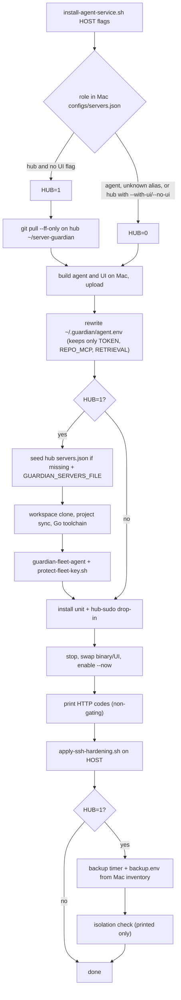
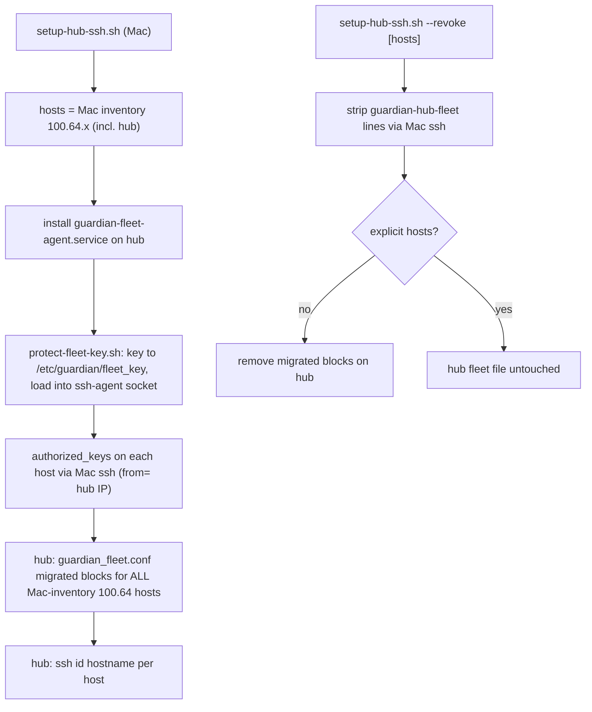
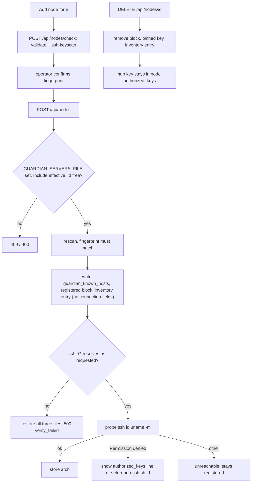
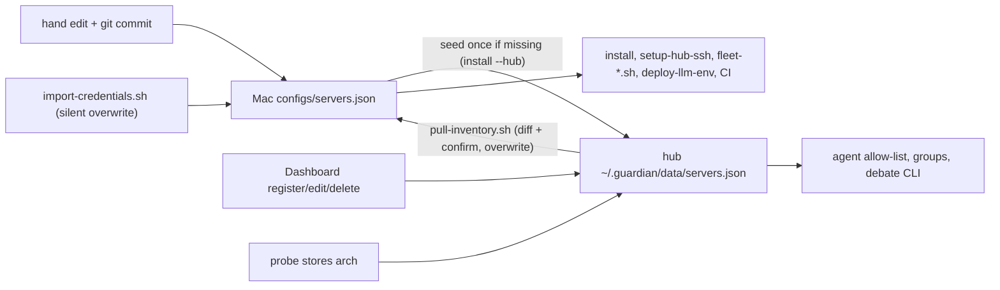
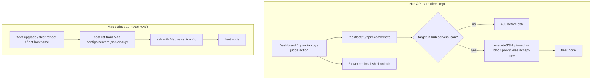
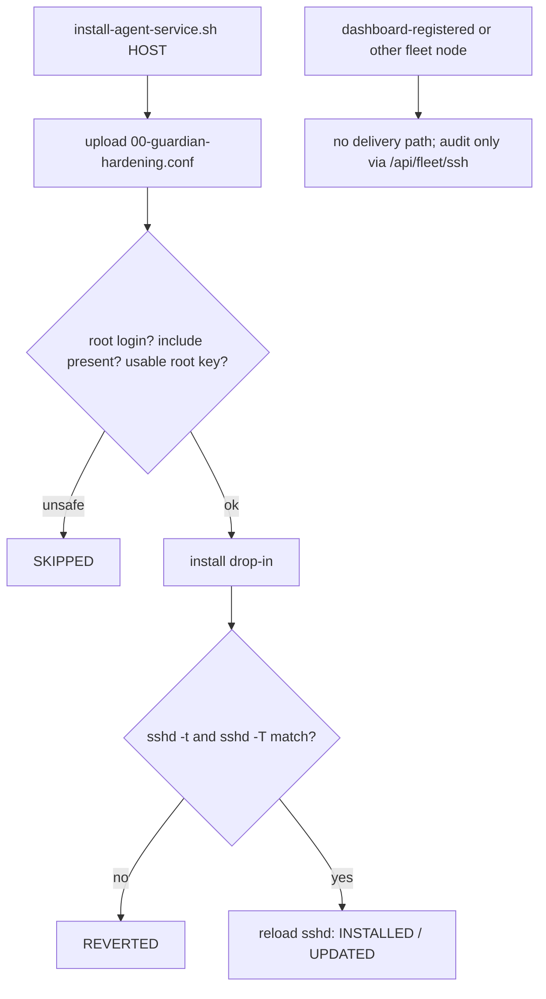
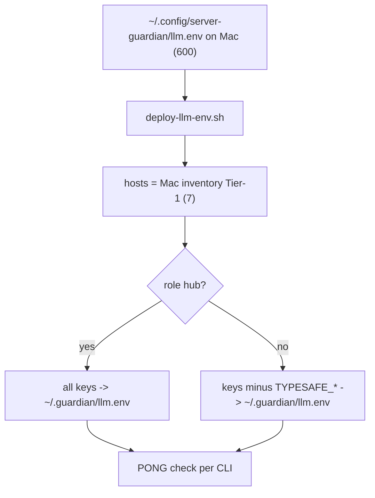
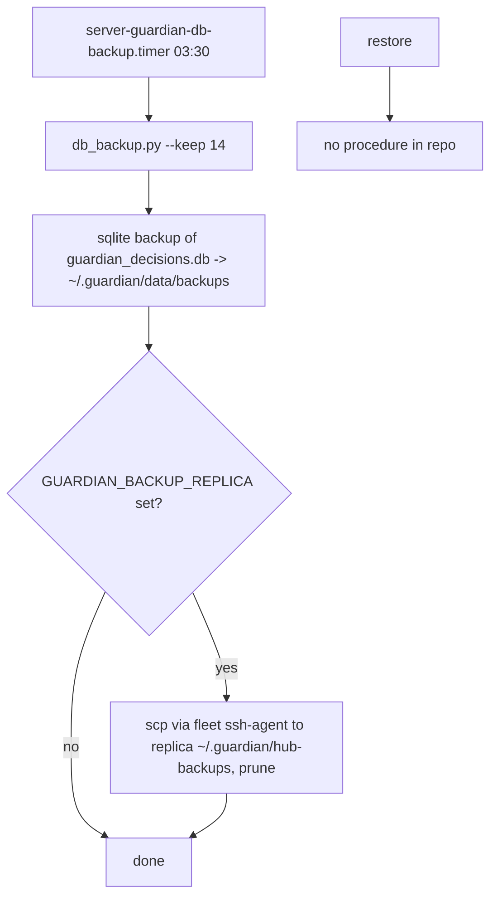
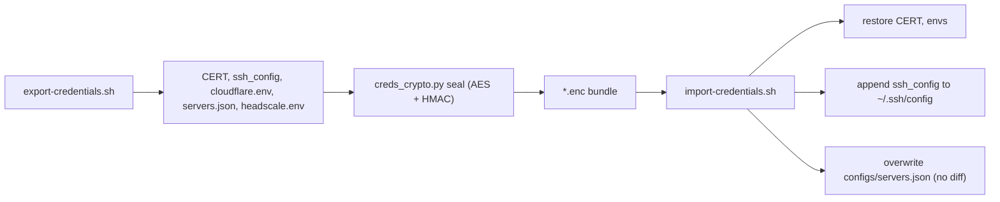

# Phase 1 - Server / fleet management review (ops analyst)

English | [한국어](phase1-ops.ko.md)

> Point-in-time record from 2026-10-12; the code has changed since.

Repo: `/Users/owner/working/ci_build/server-guardian` at `5aa8e2e` (main). Read-only review; nothing was run on any host.
Every file:line below was read in this checkout. Things that depend on live hub state (what is actually in
`~/.guardian/data/servers.json` on site-a-arm1) are marked "not verifiable from the repo".

Operating model used as the reference (from the operator): site-a-arm1 is the only host running the agent;
everything else is reached over the fleet SSH key; hub inventory = `~/.guardian/data/servers.json`; the repo copy
is the Mac's copy synced back with `scripts/pull-inventory.sh`.

---

## 1. Procedure inventory

Legend: "Mac" = admin Mac running the script with its own `~/.ssh/config` and `~/CERT` keys; "hub" = site-a-arm1.

### P1. Agent install / upgrade (`scripts/install-agent-service.sh <host>`)

1. Parse flags `--listen --hub --with-ui --no-ui --no-pull --hub-sudo --no-hub-sudo --no-ssh-hardening` (`scripts/install-agent-service.sh:58-81`).
2. Look up the host's `guardian_role` in the **Mac** `configs/servers.json` by exact id; hub mode is implied only when role is `hub` **and no UI flag was given** (`:85-88`).
3. Hub + pull: refuse if `~/server-guardian` on the hub is dirty, else `git pull --ff-only`; warn when hub HEAD != local HEAD or local tree is dirty (`:94-114`).
4. Detect arch over ssh, default listen = `127.0.0.1` + Tailscale IPv4 (`:116-126`).
5. Cross-compile `apps/agent` on the Mac and upload to `~/.guardian/agent.upload` (`:128-133`).
6. UI on: build `apps/web-desktop` locally and upload to `~/.guardian/ui.new` (`:135-145`).
7. Rewrite `~/.guardian/agent.env` from scratch: AGENT_HOST, AGENT_ALLOWED_HOSTS (from Mac inventory), AGENT_UI_DIR, hub-only GUARDIAN_WORKSPACE/LLM/DEBATE timeouts; keep only `AGENT_TOKEN` and `GUARDIAN_REPO_MCP`/`GUARDIAN_RETRIEVAL*` lines (`:151-193`).
8. Hub: seed `~/.guardian/data/servers.json` from the Mac copy **only if missing**, then append `GUARDIAN_SERVERS_FILE` (`:195-213`).
9. Hub: create/update `~/guardian-workspace`, sync project clones, install Go `${HUB_GO_VERSION}` with sha256 check (`:215-289`).
10. Hub: install `guardian-fleet-agent.service` and run `deploy/hub/protect-fleet-key.sh` (`:293-298`).
11. Install unit, set hub-sudo drop-in (`hub-sudo.conf` on / `hub-sudo.off` marker; "keep" = on unless off marker) (`:300-316`).
12. Stop agent, swap binary and UI dirs, `daemon-reload`, `enable --now`, `systemctl is-active` (`:317-331`).
13. Print API/UI HTTP codes per listen IP (not gating) (`:333-342`).
14. Unless `--no-ssh-hardening`: upload `00-guardian-hardening.conf` and run `apply-ssh-hardening.sh` on the **installed host** (`:344-356`).
15. Hub: install DB backup service+timer, write `~/.guardian/backup.env` from the Mac inventory's `backup_replica` (`:358-370`).
16. Hub: isolation check inside the agent's namespace (key unreadable, sudo matches setting, fleet SSH works, systemd score) - printed only (`:375-396`).

Units: `deploy/systemd/server-guardian-agent.service:7-53` (User ubuntu, `WorkingDirectory=/home/ubuntu/server-guardian` without `-`, NoNewPrivileges, InaccessiblePaths), `deploy/systemd/server-guardian-agent.service.d/hub-sudo.conf:6-18`.

### P2. Fleet SSH key setup, protection and revocation (`scripts/setup-hub-ssh.sh`, `deploy/hub/protect-fleet-key.sh`)

Setup (run on the Mac):
1. Hub id and hub IP from the Mac inventory (`scripts/setup-hub-ssh.sh:50-51`); default host list = every Mac-inventory host whose `tailscale_ip` starts with `100.64.` - this includes the hub itself (`:52-56`).
2. Install `guardian-fleet-agent.service` on the hub and run `protect-fleet-key.sh` (`:288-291`):
   - create `/etc/guardian` 0700 root; migrate `~/.ssh/guardian_fleet` or generate a new ed25519 key in `/etc/guardian/fleet_key` (`deploy/hub/protect-fleet-key.sh:27-38`);
   - write `~/.ssh/guardian_fleet.pub` (`:40-41`); patch legacy `# BEGIN guardian-hub-fleet` block (`:44-63`);
   - restart the ssh-agent unit, wait for the key in the socket, then delete `~/.ssh/guardian_fleet` (`:65-80`).
   - Unit: `ExecStartPost=+ssh-add /etc/guardian/fleet_key`, socket `/run/guardian-fleet/agent.sock` (`deploy/systemd/guardian-fleet-agent.service:17-19`).
3. Build key line `from="<hub ip>",no-agent-forwarding,no-port-forwarding,no-X11-forwarding <pub>` (`setup-hub-ssh.sh:292`) and replace every `guardian-hub-fleet` line in each host's `authorized_keys` over the **Mac's** ssh (`:263-272`, `:295-299`).
4. On the hub, write `~/.ssh/guardian_fleet.conf` "migrated" blocks (`StrictHostKeyChecking accept-new`) for **every** 100.64 host of the Mac inventory - not just the hosts named on the command line - keep registered/hand-written blocks, ensure the Include line, drop the legacy block (`:186-221`, `:248-260`, `:301-302`).
5. Verify hub -> host `ssh <id> hostname` from the hub's normal shell (`:304-314`).

Revoke: `--revoke [host...]` strips `guardian-hub-fleet` lines on each host (`:274-279`); only without explicit hosts does it remove migrated blocks on the hub (`:280-283`, `:222-237`). The key file `/etc/guardian/fleet_key` is never removed or rotated.

### P3. Node register / edit / pin host key / remove (dashboard -> `apps/agent/nodes_*`)

Routes: `apps/agent/nodes_handler.go:73-80`.
1. Facts: `GET /api/nodes/registration` - Include status, writable inventory, hub tailscale IP, authorized_keys line (unrestricted with a note when the hub has no tailscale_ip) (`nodes_handler.go:357-411`, `:301-321`).
2. Check: `POST /api/nodes/check` validates id/host/user/port and runs `ssh-keyscan` (`:430-465`; validation `nodes_validate.go:46-112`).
3. Register: `POST /api/nodes` requires a confirmed fingerprint; under `fleetFileMu` checks write path, Include, id uniqueness, rescans and matches the fingerprint, writes `guardian_known_hosts`, a **registered** block (`StrictHostKeyChecking yes`, `HostKeyAlias`) and an inventory entry with `id`, `name`, metadata only (no hostname/user/port/tailscale_ip); verifies with `ssh -G`, rolls back on mismatch (`:478-516`, `:547-624`; `ssh_fleet_file.go:289-300`, `:636-649`).
4. Probe: `ssh <id> uname -m` -> `ok` stores arch / `key_not_installed` returns the key line / `unreachable` (`:194-220`, `:520-543`). The UI also suggests `scripts/setup-hub-ssh.sh <id>` from the Mac (`apps/web-desktop/src/pages/nodes/NodeForms.tsx:469-470`).
5. Edit / pin: `PUT /api/nodes/{id}`; a hostname/port change or a bare fingerprint re-pins (rewrites to registered shape); a user-only change keeps the shape; metadata goes to the inventory; the inventory's own `hostname`/`tailscale_ip` are never updated (`:667-800`).
6. Remove: `DELETE /api/nodes/{id}` refuses the hub and unmanaged blocks, removes block + `guardian_known_hosts` lines + inventory entry; the node's `authorized_keys` keeps the hub key (`:820-884`; UI states this at `RemoveNodeDialog.tsx:45`).

### P4. Inventory lifecycle (Mac copy vs hub copy)

1. Seed: hub inventory created from the Mac copy only when missing (`install-agent-service.sh:199-208`).
2. Runtime reads: Go `serversFile()` = `GUARDIAN_SERVERS_FILE`, else `configs/servers.json` relative to cwd, else `~/.config/agentthread/servers.json` (`apps/agent/servers_handler.go:149-166`); debate CLI gets the same path (`apps/agent/debate_handler.go:317-320`); Python fallback order matches (`cli/llm-agent/group_manager.py:70-82`).
3. Runtime writes: only via `inventoryWritePath()` which requires `GUARDIAN_SERVERS_FILE` to be set and existing (`apps/agent/nodes_inventory.go:125-141`); writers are register/update/delete/storeArch (`nodes_handler.go:223-253`, `:609-616`, `:783-791`, `:875-878`).
4. Sync back: `scripts/pull-inventory.sh` fetches the hub file, validates (array, ids, unique, exactly one hub), shows added/removed ids and a diff, overwrites the Mac copy after confirmation (`scripts/pull-inventory.sh:37-90`).
5. Other writers of the Mac copy: hand edits + commits (e.g. `8f9fd54`, `eb3677a`, 2026-10-08) and `scripts/import-credentials.sh:110-113` (silent overwrite).
6. Consumers of the **Mac** copy: install (role, allowed hosts, backup replica), setup-hub-ssh, fleet-hostname, fleet-upgrade, deploy-llm-env, install-llm-clis, export-credentials, CI (`scripts/ci.sh:155-163`).
7. There is no Mac -> hub push path after the seed.

### P5. Fleet operations

Hub API path (fleet key, hub inventory as allow-list):
1. `GET /api/fleet/diagnose?targets=` -> fixed Linux probe (`uname`, `uptime`, `free -m`, `df`), ONLINE iff exit 0 (`apps/agent/main.go:140-147`, `servers_handler.go:278-355`).
2. `POST /api/fleet/exec` and `POST /api/fleet/exec/stream` -> same command on every target; targets must match id or name, unknown -> 400 before ssh (`main.go:150-173`, `servers_handler.go:208-218`, `:358-408`, `:441-484`, `:503-533`).
3. `GET /api/fleet/ssh` -> constant read-only sshd probe, 60 s cache (`apps/agent/fleet_ssh.go:34-68`, `:504-523`).
4. `POST /api/exec/remote` -> one target matched by id, name **or hostname** (`main.go:179-214`, `servers_handler.go:37-47`).
5. `POST /api/exec` -> local shell on the hub (`main.go:101-124`, `metrics.go:444-455`).
6. Every ssh goes through `executeSSH`: `-o StrictHostKeyChecking=accept-new` unless the target's block is in the registered shape (`servers_handler.go:58-111`).
7. Judge tool `jev_mcp:server_remediation`: proposed by a debate, held unless jev APPROVED, run only after human approval; `local`/`localhost` -> `bash -c` on the hub, else `/api/exec/remote` with 60 s (`cli/llm-agent/mcp_client.py:60-65`, `:189-191`, `:314-321`; README `README.md:44-53`).

Mac script path (Mac ssh config and keys, Mac inventory):
8. `scripts/fleet-upgrade.sh` default = **every** id (incl. hub and macOS `edge-mini`), transient `systemd-run` apt job, poll result file (`scripts/fleet-upgrade.sh:37-41`, `:45-61`, `:70-93`).
9. `scripts/fleet-reboot.sh` explicit hosts only, batches, boot-id check, stop on first failure (`scripts/fleet-reboot.sh:34`, `:42-94`).
10. `scripts/fleet-hostname.sh` default = 100.64 hosts, sets hostname to id (`scripts/fleet-hostname.sh:31-36`, `:38-64`).

### P6. sshd hardening

1. Baseline file `deploy/ssh/00-guardian-hardening.conf:1-5` (`MaxAuthTries 4`, `PermitRootLogin no`).
2. Applied only by `install-agent-service.sh` step 14 to the host being installed (`install-agent-service.sh:346-356`).
3. `apply-ssh-hardening.sh`: skip if root login / no `sshd_config.d` include / root has a key without forced command; install, `sshd -t`, compare `sshd -T`, reload, revert on any failure (`deploy/ssh/apply-ssh-hardening.sh:31-70`).
4. The existing 23 nodes were hardened ad hoc through `POST /api/fleet/exec` with inline scripts, not through this file (`docs/operations/2026-10-05-fleet-sshd-hardening.md:7-9`, `:41-91`).
5. Drift detection = fleet SSH audit (`fleet_ssh.go`; README `README.md:192-205`).

### P7. LLM credentials and CLI install

1. Local source `~/.config/server-guardian/llm.env` must be 600/400; token length sanity check (`scripts/deploy-llm-env.sh:29`, `:53-73`).
2. Default hosts = Mac-inventory `tier == "Tier-1"` (7 hosts incl. hub) (`:46-51`).
3. Hub gets all keys; others get the file minus `TYPESAFE_*` (role from Mac inventory) via ssh stdin (`:75-80`, `:116-130`).
4. Optional `--retire-stale-creds`, then PONG check of claude/codex/agy (`:82-104`, `:131-136`).
5. CLIs: `scripts/install-llm-clis.sh` installs codex (npm) and agy (curl installer) on Tier-1 hosts; login is per host and interactive (`scripts/install-llm-clis.sh:35-86`).
6. Consumers: `cli/llm-agent/llm_runner.py:67` (`GUARDIAN_LLM_ENV`, default `~/.guardian/llm.env`).

### P8. Decision DB backup / restore

1. Timer daily 03:30 UTC +15 min jitter, persistent (`deploy/systemd/server-guardian-db-backup.timer:4-7`).
2. Service runs `db_backup.py --keep 14` as ubuntu with `backup.env`; `agent.env`/`llm.env` inaccessible (`deploy/systemd/server-guardian-db-backup.service:9-28`).
3. SQLite online backup of `guardian_decisions.db` only, prune to 14 (`cli/llm-agent/db_backup.py:28-48`, `db_manager.py:17-27`).
4. If `GUARDIAN_BACKUP_REPLICA` (written by install from the Mac inventory's `backup_replica` = `site-yd-arm1`) -> `ssh`/`scp` via the fleet key to `~/.guardian/hub-backups`, prune there (`db_backup.py:53-68`, `:71-95`; `install-agent-service.sh:363-366`).
5. Restore: no script or documented procedure found (searched `restore|복원` across scripts, docs, CLI).

### P9. Admin credentials export / import

1. Export: copy `~/.ssh/*`, Mac `~/.ssh/config`, Cloudflare env, **repo `configs/servers.json`**, Headscale env; tar; seal with `creds_crypto.py` (AES-256-CBC + HMAC, passphrase via pipe) into the repo root (`scripts/export-credentials.sh:23-114`; `*.enc` gitignored `.gitignore:34`).
2. Import: verify+decrypt, restore `~/CERT` (600/700), Cloudflare/Headscale envs, **append** the bundled ssh_config to an existing `~/.ssh/config` every run, **overwrite** `configs/servers.json` without diff or validation (`scripts/import-credentials.sh:37-113`).

### P10. Node groups

1. Definitions in the hub decision DB; members = include + rule matches - exclude, recomputed against the current servers.json (`cli/llm-agent/group_manager.py:245-262`; `docs/design/node-groups.md:43`, `:101`).
2. One-time seed from the legacy `group` field (`group_manager.py:284-300`; `node-groups.md:106-111`).
3. API proxies to the CLI: `GET/POST /api/groups`, `POST /api/groups/preview`, `DELETE /api/groups/{id}` (`apps/agent/debate_handler.go:275-278`).
4. Groups resolve to explicit ids; the Go side checks ids against servers.json (`servers_handler.go:499-533`; `guardian.py:674-676`).

### P11. Monitoring / health

1. Hub only: `GET /api/status` (`healthy`/`degraded` with disk >= 90 %, memory >= 95 %), `/api/metrics`, `/api/stream/metrics` (`main.go:47-68`, `:217-242`; `metrics.go:478-496`).
2. Fleet nodes: no agent; liveness via `/api/fleet/diagnose` (ONLINE/OFFLINE), SSH posture via `/api/fleet/ssh`.
3. Logs: `~/.guardian/agent.log` appended by systemd, no rotation (`server-guardian-agent.service:23-24`); backup unit has no `OnFailure` (`server-guardian-db-backup.service:1-28`); both noted open in `docs/analysis/2026-10-04-system-analysis.md:62`.

---

## 2. Contradictions and conflicts

Severity: High = can silently break the hub or widen access; Medium = wrong results or unsafe procedure under normal use; Low = drift, cosmetics, edge cases.

### OPS-1 (High) - Hub install silently degrades to a non-hub install
- Evidence: hub mode is implied only when `role == hub` **and** `UI_MODE == keep` (`scripts/install-agent-service.sh:87-88`). The README's own hub example passes `--with-ui` (`README.md:123`). The role lookup is by exact id, so an alias such as `100.64.0.7` yields `agent` (`install-agent-service.sh:85-86`). The non-hub path still rewrites `agent.env` from scratch (`:154-193`) and skips the block that re-adds `GUARDIAN_SERVERS_FILE` (`:195-213`).
- Impact: running `install-agent-service.sh site-a-arm1 --with-ui` (or `--no-ui`) drops `GUARDIAN_SERVERS_FILE`, `GUARDIAN_WORKSPACE` and the hub timeouts. The agent then reads the git checkout's `configs/servers.json` (OPS-11), dashboard registrations vanish from the allow-list, `POST/PUT/DELETE /api/nodes` return 409 `inventory_not_configured`, judge actions lose their workspace clone, and the fleet key protection and backup timer steps are skipped. Nothing reports this as a failure.
- Fix: SAFE-FIX - make `role == hub` always set `HUB=1` (UI flags only change `UI_MODE`), refuse a host that is not in the inventory, and fix the README example.

### OPS-2 (High) - Reinstall wipes operator settings in `agent.env`, including safety switches
- Evidence: the rewrite keeps only `AGENT_TOKEN` and `GUARDIAN_REPO_MCP|GUARDIAN_RETRIEVAL*` (`install-agent-service.sh:164-167`, `:190-192`). Settings documented as operator-set in `agent.env` are lost: `GUARDIAN_UI_ACTIONS=off` (README `README.md:50`, read at `apps/agent/debate_handler.go:102`, enforced at `:1020`, `:1085`), `AGENT_CORS_ORIGINS` (`apps/agent/security.go:86`), `GUARDIAN_LLM_PROVIDERS` (`README.md:24`), `GUARDIAN_MAX_DEBATES` (`README.md:36`), `GUARDIAN_JEV_GATE` (`cli/llm-agent/debate_engine.py:282`), `GUARDIAN_DATA_DIR`/`GUARDIAN_DB_PATH` (`README.md:136`).
- Impact: an upgrade re-enables dashboard action execution and publishing that the operator had turned off, resets provider order, and can move the DB path back to the default.
- Fix: SAFE-FIX - invert the rule: rewrite only the keys the script owns (AGENT_HOST, AGENT_ALLOWED_HOSTS, AGENT_UI_DIR, GUARDIAN_WORKSPACE, the two timeouts, GUARDIAN_SERVERS_FILE) and keep every other line.

### OPS-3 (High) - Docs and the installer still describe an agent on every node
- Evidence: README presents `apps/agent` as the target-node agent (`README.md:9-14`), the default deployment is "API only, most servers" (`README.md:120-121`), and "the rest are `agent` role" (`README.md:135`). Every non-hub inventory entry has `guardian_role: "agent"` (configs/servers.json) and registration defaults to `agent` (`nodes_handler.go:589-591`). The installer supports non-hub hosts, but the unit needs `/home/ubuntu/server-guardian` (`server-guardian-agent.service:12`, no `-` prefix, so systemd fails with CHDIR when the checkout is missing) and hard-codes `ubuntu` (`:9-10`, `install-agent-service.sh:48-50`) while `edge-mini` uses `owner`.
- Impact: following the README on a node exposes `/api/exec` (arbitrary shell) on that node's Tailscale IP, or produces a unit that cannot start. This contradicts the single-hub model, and `guardian_role: agent` labels hosts that run no agent.
- Fix: DESIGN - decide whether non-hub installs are supported. If not, make the script refuse non-hub hosts, rename the non-hub role (e.g. `node`), and rewrite README sections 1, 4 and 5.

### OPS-4 (Medium) - sshd baseline has no delivery path for nodes without an agent
- Evidence: the only automated delivery is step 14 of the agent installer (`install-agent-service.sh:344-356`). The ops record says new nodes are covered because "install-agent-service.sh installs the same file" (`docs/operations/2026-10-05-fleet-sshd-hardening.md:115-117`), and the drop-in claims "the next install overwrites this file" (`deploy/ssh/00-guardian-hardening.conf:1-2`). Dashboard registration does nothing about sshd (`nodes_handler.go:547-624`).
- Impact: a node registered from the dashboard (or any non-hub node under the single-hub model) never gets the baseline. The audit will flag it, but the fix is again an ad hoc `/api/fleet/exec` script that differs from `apply-ssh-hardening.sh` (the ops doc's inline scripts at `:45-56` and `:75-87` differ from the script: no root-key check, `EXISTS` aborts instead of updating).
- Fix: DESIGN - add a hub-driven hardening procedure (e.g. `scripts/fleet-ssh-hardening.sh`, or a fixed `/api/fleet/ssh/harden` that pipes `apply-ssh-hardening.sh` over the fleet key). SAFE-FIX - correct the comment in the drop-in and the ops record.

### OPS-5 (High) - Two inventory writers, one-way sync, and hub actions configured from the Mac copy
- Evidence: the seed runs only when the hub file is missing (`install-agent-service.sh:202-208`). After that, the Mac copy still receives hand edits: edge-mini's IP was changed on the Mac in `eb3677a` and `8f9fd54` (2026-10-08), after seeding shipped in `738fad8` (2026-10-07). There is no push path. `pull-inventory.sh` overwrites the Mac copy wholesale (`scripts/pull-inventory.sh:89`), and `import-credentials.sh` overwrites it from an old bundle (`scripts/import-credentials.sh:110-113`). Hub-affecting steps read the Mac copy: hub role and `AGENT_ALLOWED_HOSTS` (`install-agent-service.sh:85`, `:151`), `backup_replica` (`:363-365`), the hub IP for the key's `from=` and the fleet-file host set (`setup-hub-ssh.sh:50-55`, `:250-255`).
- Impact: Mac edits never reach the runtime allow-list. A later `pull-inventory.sh` can silently revert them (the diff is shown, but the only choice is overwrite or nothing). Hub settings come from a file the hub does not use. Whether the hub copy has the 2026-10-08 edge-mini change cannot be verified from the repo.
- Fix: DESIGN - declare the hub file the single source of truth. Add `push-inventory.sh` (diff, validate, 3-way merge against the last pulled copy), or make the Mac scripts fetch the hub copy before they run. SAFE-FIX - have `pull-inventory.sh` refuse when the local file has uncommitted changes.

### OPS-6 (High) - Node removal leaves access in place, and the script path can re-create it
- Evidence: `DELETE /api/nodes/{id}` only edits hub files (`nodes_handler.go:820-884`). The UI says the key stays in the node's `authorized_keys` (`RemoveNodeDialog.tsx:45`). `setup-hub-ssh.sh` (apply) re-adds a migrated `accept-new` block for every 100.64 host in the Mac copy, whatever the hub inventory says (`setup-hub-ssh.sh:186-205`, `:250-255`), and re-installs the key on every listed host (`:295-299`). `--revoke` with no hosts only targets Mac-inventory 100.64 hosts (`:52-56`). Dashboard nodes with a non-100.64 address are never in that list.
- Impact: a removed node stays reachable with the hub key. If the Mac copy is stale, the next `setup-hub-ssh.sh` run re-authorises the removed node and writes a dangling fleet block for it. Dashboard nodes on public or DNS addresses cannot be revoked by any script.
- Fix: DESIGN - add an optional "revoke key" step to DELETE (run the `REMOTE_AUTH` strip over the fleet key before removing the block), or a hub-side `revoke` that uses the hub inventory plus the fleet file. SAFE-FIX - make `setup-hub-ssh.sh` apply honour explicit hosts and skip ids missing from the hub inventory (fetch it first).

### OPS-7 (Medium) - The recommended `scripts/setup-hub-ssh.sh <id>` does not fit dashboard nodes
- Evidence: the UI and the design doc point operators to it after `key_not_installed` (`NodeForms.tsx:469-470`; `docs/design/node-registration.md:108`). The script reaches `<id>` through the Mac's own ssh (`setup-hub-ssh.sh:58`, `:296-298`), but a dashboard node has no connection fields in any inventory (`nodes_handler.go:582-598`) and usually no Mac alias. Its hub step rewrites the fleet file for the whole Mac inventory, not just `<id>` (`:250-255`, `:302`), and restarts `guardian-fleet-agent` (`:288-290`; `protect-fleet-key.sh:67`). Revoke with explicit hosts skips the fleet cleanup (`:280`), so apply and revoke behave differently.
- Impact: the hint fails for most dashboard nodes ("ssh 실패"), with fleet-wide side effects and a brief ssh-agent restart.
- Fix: SAFE-FIX - drop the script hint from the UI, or add `setup-hub-ssh.sh --key-only <user@host[:port]>`, and limit `hub_fleet apply` to `HOSTS` when hosts are given.

### OPS-8 (Medium) - Host-key trust differs by path
- Evidence: registered blocks use `StrictHostKeyChecking yes` with a pinned key (`ssh_fleet_file.go:242-243`, `:293-296`); migrated blocks use `accept-new` (`setup-hub-ssh.sh:144-156`). `executeSSH` adds `-o StrictHostKeyChecking=accept-new` for everything that is not registered-shape, including hand-written blocks that ask for `yes`, because command-line options win (`servers_handler.go:58-64`, `:66-75`; documented at `node-registration.md:353-358`). Mac scripts use the Mac's `~/.ssh/known_hosts` and config (`install-agent-service.sh:83`, `fleet-*.sh`, `setup-hub-ssh.sh:58`). If the fleet file cannot be read, nodes count as not pinned (`servers_handler.go:67-71`).
- Impact: every node set up by `setup-hub-ssh.sh` (the whole original fleet) is trust-on-first-use until re-pinned from the dashboard. A hand-written strict block is silently weakened. A fleet-file read error downgrades pinned nodes to accept-new (pinned blocks still carry `StrictHostKeyChecking yes`, but `-o` overrides it).
- Fix: SAFE-FIX - pass `accept-new` only when the alias has no block or a migrated block, and fail closed (no override) on fleet-file read errors. DESIGN - offer a bulk "pin all migrated nodes" using the hub's `~/.ssh/known_hosts` entries that already exist.

### OPS-9 (Medium) - `--no-hub-sudo` can be bypassed through the hub's own fleet entry
- Evidence: the hub is in the default host list (100.64.0.7) and gets the fleet key in its own `authorized_keys` (`setup-hub-ssh.sh:52-56`, `:295-299`). `/api/exec/remote` and `server_remediation` accept the hub id as a target (`servers_handler.go:37-47`; `mcp_client.py:314-319`). The README admits the bypass (`README.md:142`), while `hub-sudo.conf:1-5` and `README.md:140` present the sandbox as the guarantee.
- Impact: the "full sandbox" option does not hold against any token holder or approved judge action. ssh to self gives an ordinary ubuntu login with sudo.
- Fix: DESIGN - when hub sudo is off, exclude the hub from key installation, or refuse `target_host == hub` in `/api/exec/remote` and the fleet routes.

### OPS-10 (Medium) - The same remote effect has very different gates
- Evidence: `server_remediation` needs a debate APPROVED verdict, a jev APPROVED review, human approval and `GUARDIAN_UI_ACTIONS` (`README.md:44-53`; `debate_handler.go:1085`). The same command through `/api/exec/remote`, `/api/fleet/exec` or `/api/fleet/exec/stream` needs only the bearer token, ignores `GUARDIAN_UI_ACTIONS`, and leaves no decision record (`main.go:101-214`). The fleet-wide sshd change was made that way, "bypassing the decision DB" (`docs/operations/2026-10-05-fleet-sshd-hardening.md:7-9`).
- Impact: the human-in-the-loop story in README section 2 does not describe the actual control surface. Fleet-wide root-capable changes leave no audit trail on the hub.
- Fix: DESIGN - at minimum, append-only audit logging of exec routes (who, targets, command hash, exit codes) to the decision DB. Optionally honour an `exec off` switch for the command routes.

### OPS-11 (Medium) - Reads fall back silently while writes refuse
- Evidence: `serversFile()` uses `GUARDIAN_SERVERS_FILE` only if it exists, then falls back to `configs/servers.json` in the cwd (the hub checkout) and `~/.config/agentthread/servers.json` (`servers_handler.go:149-166`). Python does the same (`group_manager.py:70-82`). `inventoryWritePath()` refuses in the same situation (`nodes_inventory.go:125-141`). The unit comment still says the agent reads `configs/servers.json` from its working directory (`server-guardian-agent.service:11`).
- Impact: with OPS-1, or a deleted or renamed hub file, the command allow-list and group membership quietly switch to the stale git copy while the dashboard shows write errors.
- Fix: SAFE-FIX - when `GUARDIAN_SERVERS_FILE` is set, use it or fail (500 with the path). Keep the fallbacks for dev only.

### OPS-12 (Medium) - Connection data lives in two places with different matching rules
- Evidence: dashboard entries have no `hostname`/`user`/`port`/`tailscale_ip` (`nodes_handler.go:582-598`; `node-registration.md:346-349`). `PUT` changes the fleet block but leaves the inventory `hostname`/`tailscale_ip` alone (`nodes_handler.go:757`, `:769-792`). `/api/exec/remote` matches the raw inventory `hostname` (`servers_handler.go:42`), so an old hostname still resolves. `/api/fleet/*` matches only id and name (`servers_handler.go:516`, `:528`). The design doc says both are checked against "ids, names and hostnames" (`node-registration.md:350-352`). Mac scripts select hosts by `tailscale_ip` (`setup-hub-ssh.sh:54`, `fleet-hostname.sh:33`), so dashboard nodes are invisible to them.
- Impact: after an address change, the UI shows the fleet-file address while `target_host=<old FQDN>` still resolves. Scripts and the dashboard disagree on which nodes exist.
- Fix: SAFE-FIX - match hostname in `selectServers` too (or nowhere) and correct the doc. DESIGN - carry out migration step 3 (`node-registration.md:131`): scripts read connection data from the fleet file (or from `/api/servers`), and the inventory stops storing it.

### OPS-13 (Medium) - Fleet scripts use different default host sets and assume Linux
- Evidence: `fleet-upgrade.sh` defaults to every id (`:37-41`); `fleet-hostname.sh` and `setup-hub-ssh.sh` to 100.64 hosts (`:31-36`; `:52-56`); `fleet-reboot.sh` to explicit hosts only (`:34`); `deploy-llm-env.sh` and `install-llm-clis.sh` to Tier-1 (`:46-51`; `:35-40`); the dashboard uses the hub inventory. `edge-mini` is a macOS Mac mini (`configs/servers.json`, `description`) included in those defaults. Its diagnose probe uses Linux-only `free -m` chained with `&&` (`servers_handler.go:288`), so it is always reported OFFLINE, even when it is reachable. `fleet-upgrade` runs apt/systemd-run there, and `fleet-hostname` runs `hostnamectl` and edits `/etc/hosts` there (`fleet-hostname.sh:41-56`).
- Impact: noisy failures, a false OFFLINE, and partial changes on the Mac (`/etc/hosts` backup written before `hostnamectl` fails). Nothing excludes the hub from `fleet-upgrade`.
- Fix: SAFE-FIX - add an `os` (or `managed_by`) field and filter on it in every script, make the diagnose probe tolerate a missing `free`, and default `fleet-upgrade` to exclude the hub unless named. DESIGN - one shared host-selection helper.

### OPS-14 (Medium) - Three reachability vocabularies for the same ssh call
- Evidence: diagnose reports ONLINE only on exit 0, otherwise OFFLINE (`servers_handler.go:303-321`). The SSH audit reports `unreachable` only for exit 255 or -1, otherwise `error` (`fleet_ssh.go:243-260`). The registration probe matches stderr for `Permission denied`, otherwise `unreachable` (`nodes_handler.go:203-220`). The hub alone gets `healthy`/`degraded` thresholds (`metrics.go:478-496`); fleet nodes get raw strings with no thresholds.
- Impact: one node can be OFFLINE, `error` and `ok` on three screens at once. There is no fleet-level disk or memory health.
- Fix: SAFE-FIX - a shared `classifySSH(exit, stderr)` (ok / auth_failed / host_key_changed / unreachable / command_failed) used by all three, and the same thresholds applied to diagnose results.

### OPS-15 (Medium) - "DB backup" covers only the decision DB; there is no restore procedure
- Evidence: `db_backup.py` copies only `guardian_decisions.db` (`cli/llm-agent/db_backup.py:1-10`, `:83`). Not covered: the hub inventory (dashboard registrations), `~/.ssh/guardian_fleet.conf`, `guardian_known_hosts`, `~/.guardian/data/{teams,personas,projects}` (`README.md:35`, `:153`), the jev ADR DB `~/.guardian/data/jev/` (`README.md:55`). These files keep only a single `.bak` (`ssh_fleet_file.go:429-436`). No restore script or doc exists. Failures do not alert (`server-guardian-db-backup.service` has no `OnFailure`; `docs/analysis/2026-10-04-system-analysis.md:62`).
- Impact: losing the hub disk loses node registrations and pinned host keys (only recoverable if someone ran `pull-inventory.sh`) and all dashboard-authored teams, personas and projects.
- Fix: DESIGN - extend the backup to a tarball of `~/.guardian/data` (excluding backups), plus `guardian_fleet.conf` and `guardian_known_hosts`, replicated the same way. Document a restore drill. SAFE-FIX - add `OnFailure=` to a notifier unit, or at least write a status file the dashboard shows.

### OPS-16 (Low) - The backup unit cannot see the DB location the agent uses
- Evidence: `GUARDIAN_DATA_DIR`/`GUARDIAN_DB_PATH` are documented for the hub (`README.md:136`) and read by `db_manager.py:17-27`. The backup unit only loads `backup.env` and makes `agent.env` inaccessible (`server-guardian-db-backup.service:14`, `:20`). `backup.env` holds only the replica (`install-agent-service.sh:365`).
- Impact: with a non-default DB path the timer backs up the wrong file, or fails with "source missing".
- Fix: SAFE-FIX - have install write the data and DB path into `backup.env` from the same source as `agent.env`.

### OPS-17 (Low) - `from=` restriction policy differs between script and dashboard
- Evidence: the script always restricts the key and aborts without a hub IP (`setup-hub-ssh.sh:51`, `:292`). The dashboard returns an unrestricted line plus a note when the hub entry lacks `tailscale_ip` (`nodes_handler.go:314-319`). It reads the hub IP from the hub inventory, while the script reads the Mac copy.
- Impact: an operator can paste an unrestricted fleet key line (usable from any source address) into a node.
- Fix: SAFE-FIX - return no line (and a blocker) when the hub IP is unknown.

### OPS-18 (Low) - `import-credentials.sh` overwrites the inventory and duplicates the ssh config
- Evidence: the script overwrites `configs/servers.json` with no validation or diff (`scripts/import-credentials.sh:110-113`). Compare `pull-inventory.sh:47-87`. It appends the bundled ssh_config on every run, although the comment says "Check if already present" (`:95-98`).
- Impact: restoring an older bundle reverts inventory changes. Re-imports pile up duplicate Host blocks, and the first match wins, so stale entries can shadow new ones.
- Fix: SAFE-FIX - reuse pull-inventory's validation and diff with a confirm. Write ssh_config to `~/.ssh/guardian_admin.conf` plus an Include line, idempotently.

### OPS-19 (Low) - Documentation drift after the hub, fleet-file and token refactors
- `README.md:126` says `/api/exec` runs commands without auth. The token is mandatory (`apps/agent/security.go:107-112`, `main.go:37-39`).
- `README.md:73-79` quick start (`./agent`) now exits with "AGENT_TOKEN is not set" (`security.go:112`).
- `README.md:139`, `deploy/systemd/guardian-fleet-agent.service:6-7`, `deploy/hub/protect-fleet-key.sh:12-13` describe the "managed `~/.ssh/config` block". Fleet hosts now live in `~/.ssh/guardian_fleet.conf` through an Include (`setup-hub-ssh.sh:11-16`).
- `deploy/systemd/server-guardian-agent.service:11` says the agent reads `configs/servers.json` from its working directory. The hub uses `GUARDIAN_SERVERS_FILE`.
- `README.md:89-96`, `:228-235` say 21 servers. The inventory has 24 (`configs/servers.json`), and the ops record says 23 plus edge-mini.
- `docs/design/node-groups.md:145` shows `servers_file` as the checkout path. On the hub it is `~/.guardian/data/servers.json`.
- `docs/analysis/2026-10-04-system-analysis.md:109` says sudo is blocked in the agent tree. Hub sudo is now on by default (`install-agent-service.sh:306-307`, `README.md:141`).
- `scripts/install-llm-clis.sh:6` documents `npm install --prefix ~/.local @openai/codex`, but the code uses `-g` (`:48`). "requires node >= 16" is never checked (`:47`).
- `deploy/ssh/apply-ssh-hardening.sh:18` says exit 3 means skipped, but a missing source prints `SKIPPED` and exits 2 (`:33`).
- Fix: SAFE-FIX (text only).

### OPS-20 (Low) - Dashboard form validation differs from the server boundary
- Evidence: UI `TIER_RE = /^[A-Za-z0-9 ._:-]{1,32}$/`, `TAG_RE = /^tag:[a-z0-9-]+$/`, `IPV4_RE` allows 0-999 octets (`apps/web-desktop/src/lib/nodeForm.ts:12-16`). Server: tier must start alphanumeric, tag length 1-63 and must not start with `-`, canonical IPv4 (`apps/agent/nodes_validate.go:21-24`, `:58-74`).
- Impact: the form accepts values the server rejects with 400. The server stays authoritative, so this is UX only.
- Fix: SAFE-FIX - copy the server regexes into `nodeForm.ts`, or generate them from one source.

### OPS-21 (Low) - Two writers of `guardian_fleet.conf` share no lock
- Evidence: the agent serialises with an in-process `sync.Mutex` (`ssh_fleet_file.go:409-411`). `setup-hub-ssh.sh` reads, modifies and replaces the same file from a separate Python process with no lock (`setup-hub-ssh.sh:182`, `:217-219`). Both write the same single `.bak` (`ssh_fleet_file.go:433`; `setup-hub-ssh.sh:94-95`).
- Impact: a registration made while the script runs can be lost (last writer wins). The node then keeps its inventory entry and pinned key but has no block, which means accept-new behaviour.
- Fix: SAFE-FIX - an advisory `flock` on `guardian_fleet.conf.lock` in both writers.

### OPS-22 (Low) - Install reports success when its own checks fail
- Evidence: HTTP checks print "실패" and continue (`install-agent-service.sh:334-340`). The isolation check prints a cross mark but exits 0 (`:384-394`). Hardening failures are warnings (`:349-353`). The rollback gap was noted earlier (`docs/analysis/2026-10-04-system-analysis.md:61`).
- Impact: a hub with broken fleet SSH or a readable key finishes "successfully". There is no automatic rollback of the swapped binary.
- Fix: SAFE-FIX - collect failures and exit non-zero at the end. Keep `~/.guardian/agent.prev` for manual rollback.

### OPS-23 (Low) - LLM tokens go to six hosts that run no workload under the single-hub model
- Evidence: the default target is every Tier-1 host (7, including the hub) (`scripts/deploy-llm-env.sh:19`, `:46-51`). CLI installs target the same set (`scripts/install-llm-clis.sh:14`, `:35-40`). Only the hub runs the debate engine and judge (README `README.md:135`, operator context).
- Impact: a long-lived `CLAUDE_CODE_OAUTH_TOKEN` and per-host codex/agy logins sit on hosts that never use them, which widens the blast radius.
- Fix: DESIGN - default to the hub (role-based selection) and require explicit hosts for others. If extra Tier-1 hosts are meant as LLM fallbacks, document that.

### OPS-24 (Low) - Revocation does not cover the key itself, and no rotation procedure exists
- Evidence: `protect-fleet-key.sh` reuses an existing `/etc/guardian/fleet_key` (`:28-37`). `--revoke` only strips `authorized_keys` lines and migrated blocks (`setup-hub-ssh.sh:274-285`). No doc covers rotation.
- Impact: after a suspected hub compromise, re-running setup re-installs the same key.
- Fix: SAFE-FIX - add `setup-hub-ssh.sh --rotate` (move the old key aside, generate, re-install, revoke the old fingerprint) and document it next to `--revoke`.

Known item, not re-filed: a remote command keeps running after an `executeSSH` timeout (`servers_handler.go:92-96`). It is already listed open in `docs/analysis/2026-10-12-non-working-api.md:26`, and it also affects `server_remediation` (60 s, `mcp_client.py:317`).

---

## 3. Recurring contradiction patterns

1. **Mac copy configures the hub.** Hub behaviour is set from `configs/servers.json` on the Mac while the hub runs on its own copy. Instances: OPS-1 (role and alias), OPS-5 (allowed hosts, backup replica, hub IP), OPS-6/OPS-7 (fleet blocks from the Mac list), OPS-13 (script host sets), OPS-17 (hub IP source), OPS-18.
2. **Seed once, then overwrite all.** Files are either seeded and never reconciled, or rewritten wholesale: `agent.env` (OPS-2), hub inventory seed versus pull overwrite (OPS-5), import overwrite and append (OPS-18), `backup.env` (OPS-16).
3. **Same effect, different gate or validation.** Exec routes versus `server_remediation` (OPS-10). Hub-sudo off versus ssh to self (OPS-9). Hostname matching in exec/remote versus fleet (OPS-12). `from=` policy (OPS-17). UI versus server regexes (OPS-20). Ad hoc hardening scripts versus `apply-ssh-hardening.sh` (OPS-4).
4. **Host-key trust depends on which path created the block.** Pinned (dashboard) versus accept-new (setup-hub-ssh) versus a command-line override of hand-written blocks versus Mac known_hosts (OPS-8, OPS-6, OPS-21).
5. **Per-node-agent leftovers in a single-hub system.** README, the `guardian_role: agent` label, non-hub install, hardening delivered by the agent installer, LLM tokens on Tier-1 nodes (OPS-3, OPS-4, OPS-23).
6. **Silent fallback instead of failure.** Inventory read fallback (OPS-11), hub detection fallback to non-hub (OPS-1), a fleet-file read error treated as "not pinned" (OPS-8), install checks that never fail (OPS-22).
7. **Add is complete, remove is partial.** Register installs a block, pinned key and inventory entry, while access removal and key rotation are not automated (OPS-6, OPS-24). Delete leaves `~/.ssh/known_hosts` entries for migrated nodes (only `guardian_known_hosts` is cleaned, `nodes_handler.go:870`).
8. **Status vocabularies diverge.** ONLINE/OFFLINE versus unreachable/error versus key_not_installed, and health thresholds for the hub only (OPS-14, OPS-13).
9. **Docs trail refactors.** Each refactor (token mandatory, fleet file, single hub, hub sudo default) left older statements behind (OPS-19, OPS-3, OPS-4).

---

## 4. Consistent and worth keeping

- **Fleet-file safety.** One fixed block shape, written byte-identically by Go (`ssh_fleet_file.go:224-226`, `:289-300`) and Python (`setup-hub-ssh.sh:76-78`, `:154-156`). Unmanaged blocks are preserved byte for byte and refused with 409 (`nodes_handler.go:626-630`). Writes are atomic with `.bak`, followed by `ssh -G` verification and full rollback (`nodes_handler.go:604-622`, `ssh_fleet_file.go:424-439`, `:636-649`).
- **Input boundary.** Strict whitelists before any ssh or ssh-keyscan (`nodes_validate.go:16-112`), `--` before every alias (`servers_handler.go:63`), `safeSSHHost` (`:22-32`), a reserved-ids list shared with the UI (`nodes_validate.go:44`, `nodeForm.ts:24`), the single body limit `decodeCommandBody` (`servers_handler.go:410-429`), and unknown targets rejected before any ssh (`:208-218`, `:456-464`).
- **Fixed SSH audit probe.** A constant with no interpolation, a test that it stays quote-free, a bounded fan-out and output size (`fleet_ssh.go:17-68`, `:394-420`).
- **Hub protections in registration.** The hub cannot be deleted or have its role changed (`nodes_handler.go:846-848`, `nodes_validate.go:256-261`). Writes require an explicit `GUARDIAN_SERVERS_FILE` (`nodes_inventory.go:125-141`).
- **Fleet key handling.** A root-only key behind an ssh-agent socket, migrated only after the agent has the key (`protect-fleet-key.sh:65-78`). The authorized_keys marker comment is the same in the script and the dashboard, so `--revoke` also removes dashboard-installed lines (`setup-hub-ssh.sh:268`, `nodes_handler.go:310-313`).
- **Hub sudo as explicit state.** An on/off drop-in marker survives reinstall without flags (`install-agent-service.sh:302-316`), followed by an in-namespace isolation check (`:375-396`).
- **Safe hub checkout updates.** `--ff-only`, refusal on a dirty tree, and a workspace clone that never discards judge results (`install-agent-service.sh:94-114`, `:221-240`). The Go toolchain is checked against go.dev's sha256 (`:248-288`).
- **`apply-ssh-hardening.sh` checks.** Root-lockout guard, include check, `sshd -t` plus `sshd -T` verification, revert, and a single status line (`deploy/ssh/apply-ssh-hardening.sh:31-70`). The audit thresholds match the baseline (SEC-SSH-004 at 4).
- **`pull-inventory.sh` checks.** Validation (array, ids, uniqueness, one hub), an added/removed summary, a diff, a confirm and non-tty refusal (`scripts/pull-inventory.sh:47-87`). The same one-hub rule runs in CI (`scripts/ci.sh:155-163`).
- **Secret handling in scripts.** Tokens travel over ssh stdin only, permission and length checks run first, and hub-only keys are filtered out for other hosts (`deploy-llm-env.sh:53-80`, `:116-120`). Credential bundles use HMAC-then-decrypt with the passphrase passed through a pipe (`export-credentials.sh:94-114`, `import-credentials.sh:39-50`).
- **Fleet script mechanics.** `fleet-upgrade.sh` runs as a transient unit that survives needrestart, and `fleet-reboot.sh` waits on a boot-id change in batches and stops at the first failure (`fleet-upgrade.sh:43-61`, `fleet-reboot.sh:42-94`).
- **Backup mechanics.** SQLite online backup, an off-hub replica through the fleet socket, symmetric pruning, and a backup unit sandboxed away from `agent.env`/`llm.env` (`db_backup.py:28-68`, `server-guardian-db-backup.service:17-28`).
- **One inventory path for agent and CLI.** The agent passes its servers.json path to the debate CLI, so groups and the allow-list read the same file (`debate_handler.go:317-320`).

---

## Counts

24 contradictions (High 5: OPS-1, 2, 3, 5, 6; Medium 10: OPS-4, 7-15; Low 9: OPS-16-24). Fixes: 13 SAFE-FIX only, 4 DESIGN only (OPS-3, 9, 10, 23), 7 both (OPS-4, 5, 6, 8, 12, 13, 15). 11 procedures inventoried, 9 Mermaid diagrams. 9 recurring patterns.
