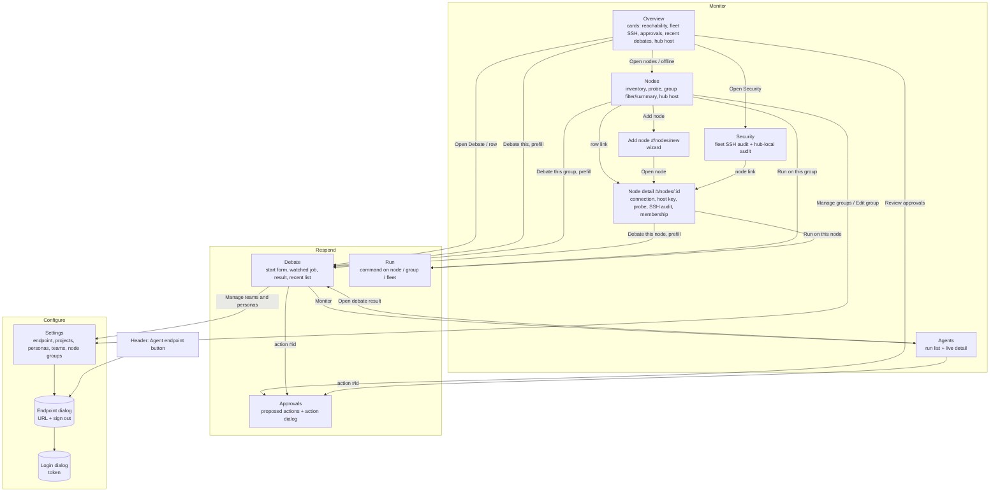

# UI 검토: apps/web-desktop (1단계, 읽기 전용)

[English](phase1-ui.md) | 한국어

> 2026-10-12 시점의 기록이며, 이후 코드가 바뀌었다.

범위: 내비게이션, 절차, 간결성, 그리고 Go 핸들러(apps/agent) 및 이를 뒷받침하는 Python CLI(cli/llm-agent)와의 정합성. 접두어가 없는 모든 경로는 `apps/web-desktop/` 기준이다. 아래의 모든 주장은 코드에서 읽어 확인한 것이며, 아무것도 실행하지 않았다.

검토 전체를 규정하는 사실:

- 브리프의 10개 페이지가 아니라 라우트는 8개다: `overview, nodes, agents, security, debate, approvals, run, settings` (`src/router.ts:25-34`). NodeDetail(`#/nodes/:id`)과 NodeRegister(`#/nodes/new`)는 `nodes` 아래에 붙어 있다(`src/App.tsx:38-39`). "Ssh"는 `security` 라우트다(`src/App.tsx:41`). `ssh`, `fleet`, `assistant`, `batch`, `terminal`은 레거시 별칭이다(`src/router.ts:38-45`).
- 사이드바 그룹: Monitor (Overview, Nodes, Agents, Security), Respond (Debate, Approvals, Run), Configure (Settings) (`src/router.ts:26,33`). 760 px 미만에서는 사이드바가 숨겨지고(`packages/guardian-ui/src/styles/components.css:1147-1148`) 하단 탭 바에는 5개 라우트만 표시된다(`mobile: true`: overview, nodes, debate, approvals, run).
- 프로젝트 범위는 앱 수준이지만(`src/state/projectStore.tsx`), 전환기는 Debate와 Approvals에서만 렌더링된다(`src/pages/DebatePage.tsx:31`, `src/pages/ApprovalsPage.tsx:30`).

## 1. UI 지도

### 절차별 클릭 경로

**P1 플릿 모니터링**
1. Overview는 공유 플릿 진단, 허브 메트릭, 그리고 (자동으로) 플릿 SSH 감사를 불러온다(`src/pages/OverviewPage.tsx:269-277`).
2. 오프라인 노드는 노드 페이지로 가는 링크다(`OverviewPage.tsx:32-43`). "Open offline nodes"는 `#/nodes?status=offline`로 이동한다(`OverviewPage.tsx:81`).
3. Nodes: "Run fleet diagnosis"가 다시 프로브한다(`src/pages/NodesPage.tsx:325`). 표는 노드별 uptime/load/memory/disk를 보여 준다(`NodesPage.tsx:104-108`).
4. 노드 이름은 상세 페이지를 연다(`NodesPage.tsx:72`). 그곳에 "Re-run fleet diagnosis"가 있다(`src/pages/NodeDetailPage.tsx:134`).

**P2 명령 실행**
1. Run 내비 항목, 또는 "Run on this node"(`NodeDetailPage.tsx:186`), 또는 "Run on this group"(`src/pages/nodes/GroupSummary.tsx:50`). 둘 다 `?target=`을 넘긴다.
2. 대상 선택: Local agent node / server / Group / All servers (`src/pages/RunPage.tsx:103-112`).
3. Terminal에 명령을 입력하거나 프리셋을 클릭한다(`RunPage.tsx:28,148-152`).
4. 단일 대상: 확인 없이 즉시 실행된다(`RunPage.tsx:85-89`). 그룹 또는 플릿: 명령을 담은 `ConfirmDialog risk="MEDIUM"`(`RunPage.tsx:218-237`) 후 서버별 표가 스트리밍된다(`RunPage.tsx:212-216`).

**P3 노드 등록과 host-key 고정(pinning)**
1. Nodes, "Add node"(`NodesPage.tsx:317`)는 `NodeRegisterPage`를 연다(host-key 스캔과 fingerprint 확인이 있는 연결 단계, 그다음 검토, `src/pages/NodeRegisterPage.tsx:255-323`).
2. 나중에 고정하거나 재확인: Nodes, 노드 이름, Connection 패널, "Pin host key" / "Re-confirm host key"(`NodeDetailPage.tsx:65-67`), 스캔, fingerprint 확인, "Pin host key" / "Replace pinned key"(`src/pages/nodes/PinHostKeyDialog.tsx:126-128`).
3. "Edit node"도 주소가 바뀌면 fingerprint를 받는다(`src/pages/nodes/EditNodeDialog.tsx:81-84`). 따라서 host key를 쓰는 진입점이 두 개다.
4. 제거: Connection 패널, "Remove node", id 입력(`RemoveNodeDialog.tsx:52-66`).

**P4 SSH 감사**
1. Security 내비: 열면 플릿 감사가 자동 실행되고(`src/pages/ssh/FleetSshAudit.tsx:262-267`), 히트맵, 노드 선택, 상세 순이다. "Refresh audit"는 재프로브를 강제한다(`FleetSshAudit.tsx:272`).
2. 허브 로컬 보기는 Disclosure 뒤에 있다(`src/pages/SshPage.tsx:137`).
3. 같은 감사 데이터가 Overview(Fleet SSH 카드, `OverviewPage.tsx:131`), 노드별(`NodeDetailPage.tsx:214`), 그룹별(`GroupSummary.tsx:88`)로도 나타난다.

**P5 노드 그룹**
1. 생성: Nodes에서 행을 체크하고 "Create group from selection"(`NodesPage.tsx:247`), 또는 Settings, Node groups(`src/pages/SettingsPage.tsx:99`).
2. 노드 하나 추가/제거: 노드 페이지의 "Group membership"(`src/pages/nodes/NodeMembership.tsx:82,71`), 또는 Nodes 선택 후 "Add to group…"(`NodesPage.tsx:250`).
3. 정의 편집/삭제: Nodes `?group=`의 "Edit group"(`GroupSummary.tsx:51`) 또는 Nodes 하단 링크 "Manage groups"(`NodesPage.tsx:369`). 둘 다 Settings로 간다.
4. 그룹에 대해 조치: "Run on this group" / "Debate this group"(`GroupSummary.tsx:50,52`).

**P6 토론 시작과 추적**
1. Debate 내비, 또는 Overview/노드/그룹에서 "Debate this"(미리 채움, `src/state/debatePrefill.ts`).
2. Team, Rounds, Continue thread, Reference code, Ref, Task(6개 필드, `src/pages/debate/ConsoleSection.tsx:325-382`)를 채우고 "Start debate"(`ConsoleSection.tsx:384`). URL이 `#/debate/:id`가 된다(`ConsoleSection.tsx:297`).
3. 추적: JobCard 로그가 3초마다 갱신된다(`ConsoleSection.tsx:106`). 더 풍부한 실시간 보기는 "Monitor"를 통해 `#/agents?run=:id`로 간다(`ConsoleSection.tsx:91,179`).

**P7 조치 승인 또는 거부**
1. Approvals 내비(배지 = PROPOSED 개수, `src/App.tsx:136`), 또는 토론 결과의 조치 `#id` 버튼(`src/pages/debate/ResultView.tsx:280`), 또는 Agents의 `#id` 링크(`src/pages/agents/RunDetail.tsx:50`).
2. 목록 행의 `#id`가 대화상자를 연다(`ApprovalsPage.tsx:33-34`, `src/pages/debate/ActionDialog.tsx:206-283`).
3. "Run"(`ActionDialog.tsx:252`) 다음에는 id를 입력하는 ConfirmDialog(HIGH 또는 알 수 없는 위험, `ActionDialog.tsx:285-299`) 또는 체크박스 "I reviewed the arguments"가 있는 두 번째 Modal(`ActionDialog.tsx:301-321`) 중 하나가 뜬다. "Reject"는 ConfirmModal을 연다(`ActionDialog.tsx:323-331`).

**P8 jev 재점검**
1. 토론 결과에서 gate가 PENDING/DISPUTED일 때: "Re-run jev check"(`ResultView.tsx:355`, 패널은 `119-142`).
2. HELD 조치의 조치 대화상자에서: "Re-run jev check for thread X"(`ActionDialog.tsx:261-271`).

**P9 스레드 닫기**
1. Debate, 작업 열기, Result 패널, "Close thread"(`ResultView.tsx:298-299`), 확인(`ResultView.tsx:170-179`). 닫히지 않았고 레이블이 APPROVED가 아닐 때만 제공된다(`src/lib/debate.ts:202-204`).
2. 다시 열기: "Reopen with a new debate"가 스레드 id를 채우고 폼에 포커스를 준다(`ResultView.tsx:301-303`, `ConsoleSection.tsx:313-318`).

**P10 스레드를 브랜치로 게시**
1. Debate, 작업 열기, "Proposed actions" 카드, "Publish"(`ResultView.tsx:357-363`, `PublishPanel` `196-249`).
2. 브랜치를 선택적으로 받는 ConfirmModal(`ResultView.tsx:231-246`). 허브는 프로젝트 테스트를 실행한 뒤 push한다(최대 1200 s, `apps/agent/debate_handler.go:52-53`).
3. 결과 Notice가 버튼 아래에 나타난다(`ResultView.tsx:225-230`).

**P11 페르소나 / 팀 / 프로젝트 구성**
1. Settings, 세그먼트 컨트롤: Projects / Personas / Teams(`SettingsPage.tsx:14-20,96-98`). Debate에서는 텍스트 링크 "Manage teams & personas"만 있다(`DebatePage.tsx:32`).

**P12 Agents 실행 모니터**
1. Agents 내비(데스크톱 전용), 또는 작업의 "Monitor"(`ConsoleSection.tsx:91,179`). 왼쪽은 목록, 오른쪽은 lane/결과/타임라인이다(`src/pages/AgentsPage.tsx:26-47`).

**P13 허브 URL / 토큰**
1. 모든 페이지의 헤더 "Agent endpoint" 버튼(`App.tsx:224`) 또는 Settings, Agent endpoint, "Change endpoint or sign out"(`SettingsPage.tsx:34`). 둘 다 같은 `SettingsDialog`를 연다(`src/components/SettingsDialog.tsx:40`). 로그아웃은 그 대화상자 안에 있다(`SettingsDialog.tsx:53`). 토큰 입력은 401로 띄워지는 `LoginDialog`다(`src/components/LoginDialog.tsx:44`).

## 2. 발견 사항

심각도: High = 운영자를 오도할 수 있는 잘못된 데이터 또는 안전상의 공백, Medium = 실제 마찰 또는 비일관성, Low = 다듬기.

### UI-1 (High) 결과 보기가 조치 상태의 오래된 스냅샷을 보여 주고, Publish는 아무 조건에도 묶여 있지 않다
근거: `ResultView.tsx:273`은 `result.json`에서 `fd?.actions`를 읽는다. Go 상세 핸들러는 그 파일을 그대로 반환하고(`apps/agent/debate_handler.go:745-746`), 엔진은 제안 시점의 상태를 기록한다(`cli/llm-agent/debate_engine.py:615`). Approvals에서 Run 또는 Reject를 한 뒤에도 토론 결과의 "Proposed actions" 표는 여전히 PROPOSED/HELD라고 표시한다. 그런데 `PublishPanel`은 `actions.length > 0`이면 언제나 렌더링된다(`ResultView.tsx:362`). 파일 조치가 EXECUTED인지, 스레드가 닫혔는지, 이미 게시되었는지와 무관하다. 허브는 모든 조치가 확정되지 않으면 거부하고(`cli/llm-agent/publish_ops.py:36,231-233`) 두 번째 게시도 거부하며(`publish_ops.py:225-228`), 그때에야 409 텍스트를 반환한다.
문제점: 운영자는 "PROPOSED" 옆에 "Publish" 버튼을 보지만 Publish가 동작할지 알 수 없다. 새로 고침 후에는 스레드가 이미 게시되었다는 표시가 전혀 없다(성공 Notice는 컴포넌트 상태다, `ResultView.tsx:209,225`).
수정:
- SAFE-FIX: 도움말 줄(`ResultView.tsx:223`)을 전제 조건을 밝히도록 바꾼다("needs every action decided and at least one executed file change; the project test runs first and can take minutes").
- SAFE-FIX: 표의 상태 출처를 `listActions(thread)`(이미 api에 있음, `src/api.ts:722`)로 바꿔 상태를 실시간으로 만들고, 모두 확정되고 하나가 EXECUTED 파일 도구일 때만 Publish를 활성화한다.
- DESIGN: 게시 내역(DB에 `list_publications`가 있다, `publish_ops.py:224`)을 작업 또는 스레드 상세에 노출해 "Published as branch X"가 내비게이션 후에도 남게 한다.

### UI-2 (High) 오래 걸리는 Run 조치와 Publish가 결과를 컴포넌트 상태에만 보관한다
근거: `ActionDialog.tsx:77-83,121-143`은 `alive`로 보호하며 대화상자가 언마운트되면 결과를 버린다. `PublishPanel` 상태는 로컬이다(`ResultView.tsx:197-209`). 허브 호출은 최대 약 15분(`src/api.ts:736`) 또는 1200 s(publish) 동안 블록된다. 모달이 "잠기는" 동안에도 내비는 사용 가능하므로(`ActionDialog.tsx:206`), 다른 곳으로 이동하면 결과가 조용히 사라진다. Run 페이지는 반대로 실행 상태를 store에 두고 내비 배지를 단다(`src/App.tsx:134`).
문제점: 10분짜리 조치를 시작하고 Overview를 클릭한 운영자는 확인 결과를 잃고 다시 실행할 수 있다. 성공 후 다시 시도한 Publish는 "already published"(409)를 반환한다.
수정: DESIGN. 진행 중인 조치 실행과 게시를 `runStore` 같은 앱 수준 store로 옮기고 Approvals에 "Running" 배지를 단다. 또는 SAFE-FIX: `busy !== null`인 동안 해시 내비게이션을 막는다(`beforeunload` 방식의 알림).

### UI-3 (High) 플릿 및 단일 노드 셸 실행의 확인이 그와 닮은 조치보다 약하다
근거: 단일 대상: 확인이 전혀 없고 프리셋은 클릭 즉시 실행된다(`RunPage.tsx:82-89,148-152`). 그룹/플릿: `ConfirmDialog risk="MEDIUM"`이며 입력을 요구하지 않는다(`RunPage.tsx:219-221`, `packages/guardian-ui/src/components/ConfirmDialog.tsx:52`는 HIGH일 때만 입력을 받는다). 이와 달리 같은 효과를 가진 판정자 조치는 위험이 높거나 알 수 없을 때 id 입력이 필요하고(`src/lib/debate.ts:166-169`), 노드 제거도 id 입력이 필요하다(`RemoveNodeDialog.tsx:52-66`). 백엔드는 어떤 명령이든 실행한다: `/api/exec`는 `req.Command`를 곧바로 `executeRaw`로 넘긴다(`apps/agent/main.go:101-116`).
문제점: 플릿 전체에 대한 임의 명령은 UI에서 가장 파괴적인 컨트롤인데도 두 번째로 가벼운 확인만 거친다.
수정: DESIGN. 위험 단계를 정한다: 플릿과 그룹 = HIGH(대상 이름 또는 개수 입력), 단일 원격 노드 = 프리셋 목록에 없는 명령에 대해 확인, 로컬 = 현행 유지. 프리셋은 원클릭으로 남겨도 된다.

### UI-4 (Medium) 파괴적이거나 되돌릴 수 없는 조치에 다섯 가지 서로 다른 확인 패턴이 있다
근거:
- id 입력: `ActionDialog.tsx:285`(디자인 시스템 ConfirmDialog HIGH), `RemoveNodeDialog.tsx:52`.
- 체크박스와 조치 모달 위에 쌓이는 두 번째 모달: `ActionDialog.tsx:301-321`.
- 일반 ConfirmModal: 거부(`ActionDialog.tsx:323`), 스레드 닫기(`ResultView.tsx:171`), 게시(`ResultView.tsx:232`), 팀/그룹/프로젝트/페르소나 삭제(`TeamsSection.tsx:146`, `GroupDialog.tsx:326`, `ProjectDialog.tsx:175`, `PersonaDialog.tsx`), 그룹에서 제거(`NodeMembership.tsx:113`).
- MEDIUM ConfirmDialog: `RunPage.tsx:219`.
- 없음: 토론 Cancel(`ConsoleSection.tsx:95`, `agents/RunDetail.tsx:125`), 단일 대상 명령 실행, 프로젝트 Sync/Clone(`ProjectsSection.tsx:80-88`; clone은 허브 디스크에 쓴다).
또한 `ConfirmModal`은 확인 버튼에 `variant="danger"`를 하드코딩하므로(`components/ConfirmModal.tsx:36`) "Publish"와 "Close thread"가 "Delete group"만큼 위험해 보이고, 저/중위험 "Run action" 모달도 위험 빨강을 쓰는 반면(`ActionDialog.tsx:312`) 실제 HIGH 조치는 다른 컴포넌트를 거친다.
문제점: 컨트롤에서 심각도를 읽을 수 없다. 운영자는 그냥 클릭해 넘기는 습관이 든다.
수정: 색상은 SAFE-FIX: `ConfirmModal`에 `tone` prop을 준다(기본 danger, Publish와 Close thread는 "primary"). 단계는 DESIGN(하나의 표: 되돌릴 수 있음 = 확인 없음 또는 단일 확인, 허브에서 되돌릴 수 없음 = 입력). 토론 Cancel은 비용이 작지만 되돌릴 수 없다: SAFE-FIX 공유 `cancel` 핸들러에 ConfirmModal을 추가한다(`hooks/useDebateJob.ts:103`, `RunDetail.tsx:79`).

### UI-5 (Medium) Approvals에는 도달할 수 있지만 목록이 "All"로 열리고 배지는 다른 프로젝트를 숨긴다
근거: `ActionsPanel.tsx:74`는 필터 기본값을 `'all'`로 둔다. 내비 배지, Overview 카드, 목록은 모두 선택된 프로젝트만 사용한다(`src/state/approvalsStore.tsx:40-46`). 프로젝트 전환기는 Debate와 Approvals에만 있으므로(`ProjectSwitcher` 사용처 grep), Overview의 "Approvals waiting"과 "Recent debates"는 프로젝트 레이블 없이 조용히 프로젝트 범위로 제한된다(`OverviewPage.tsx:184,218`). Agents는 모든 프로젝트를 나열하는 반면(`AgentsPage.tsx:19`는 인자 없이 `fetchDebates()`를 호출한다) Debate는 선택된 프로젝트만 나열한다(`src/state/debateStore.tsx:26`).
문제점: 배지의 "0 waiting"이 다른 프로젝트의 제안을 숨길 수 있다. 같은 토론이 Agents에는 보이지만 Debate의 Recent 목록에는 없다.
수정: SAFE-FIX 대기 중인 항목이 있으면 필터 기본값을 "Awaiting decision"으로 두고 Overview 카드 제목에 프로젝트 이름을 표시한다. DESIGN: 헤더에 전역 프로젝트 칩을 두거나 "All projects" 옵션을 둔다.

### UI-6 (Medium) 같은 작업 집합이 네 곳에서 네 가지 필터와 이름으로 나열된다
근거: Overview "Recent debates"(5개, 닫힌 것 숨김, `OverviewPage.tsx:218-221`), Debate "Recent debates"("Show closed"가 아니면 닫힌 것 숨김, `ConsoleSection.tsx:412-426`), Agents "Runs (n)"(모든 프로젝트와 닫힌 스레드 포함, `AgentsPage.tsx:30`, `agents/RunList.tsx:71`), 그리고 관찰 중인 JobCard. 같은 조치에 대한 링크 텍스트와 aria 레이블이 다르다: "Monitor debate N"(`ConsoleSection.tsx:91,180`) 대 "Monitor run N"(`RunList.tsx:19`) 대 "Open debate result"(`RunDetail.tsx:144`). Cancel은 JobCard와 RunDetail에 있으며 오류 처리가 다르다(`ConsoleSection.tsx:95` 대 `RunDetail.tsx:76-92`).
문제점: thread/debate/job/run은 하나의 대상인데 세 가지 이름으로 불린다. Close 대화상자는 "hidden from the debate lists"를 약속하지만(`ResultView.tsx:173`) 닫힌 스레드가 Agents에 다시 나타난다.
수정: DESIGN Agents를 Debates에 합친다(왼쪽 목록, 오른쪽 실시간 상세, SVG 참고). 그동안 SAFE-FIX: `AgentsPage`에 `visibleJobs`와 프로젝트 필터를 적용하고("Show closed" 토글 포함) 레이블을 하나("Live view")로 쓴다.

### UI-7 (Medium) "Run"이 세 가지 다른 것을 뜻하고, "Approvals"는 이름이 세 개다
근거: 내비 "Run" = 셸 명령 페이지(`router.ts:32`). Agents "Runs (n)" = 토론(`AgentsPage.tsx:30`). Approvals 대화상자 "Run" = 판정자 조치 실행(`ActionDialog.tsx:253`)이며 최종 상태는 "EXECUTED"다(`types.ts:648`). 내비 항목은 "Approvals"인데 패널은 "Proposed actions"(`ActionsPanel.tsx:88`), 필터는 "Awaiting decision"(`ActionsPanel.tsx:59`), 카드는 "Approvals waiting"(`OverviewPage.tsx:184`)이다. 헤더는 "Agent online", 하단은 "Hub"라고 한다(`App.tsx:199,162`). 대화상자 제목 "Agent endpoint", 레이블 "Target agent base URL", 버튼 "Agent login", 토큰 "AGENT_TOKEN"(`SettingsDialog.tsx:40-43`, `LoginDialog.tsx:44,56`). 운영자 자신의 표현은 "hub URL/token"이다.
수정: SAFE-FIX 문구 정리: 내비 "Run"을 "Commands"로, Agents "Runs"를 "Debates"로, 조치 버튼 "Run"을 "Execute"로(EXECUTED와 일치), 패널 제목 "Proposed actions"를 "Approvals"로 바꾼다. URL/토큰에는 어디서나 "Hub"를 쓴다("Hub connection").

### UI-8 (Medium) 모바일 내비게이션에 Agents, Security, Settings가 빠져 있다
근거: 해당 라우트에 `mobile: false`(`router.ts:28,29,33`)이고 사이드바는 760 px 미만에서 `display:none`이다(`components.css:1147-1148`). 주석은 "Security and Settings"만 빠진다고 하지만(`router.ts:17`) Agents도 빠져 있다. Settings는 페르소나, 팀, 프로젝트, 그룹 정의를 다루는 유일한 곳이고, 헤더 "Agent endpoint" 버튼이 로그아웃으로 가는 유일한 다른 경로다.
수정: DESIGN: 탭 바에 모두 들어가는 4개 목적지(SVG 참고). SAFE-FIX: 주석을 바로잡고 "More" 탭을 추가한다.

### UI-9 (Medium) 그룹 소속과 host-key 쓰기에 진입점이 여러 개다
근거: 그룹은 Nodes 선택(`NodesPage.tsx:247-252`), 노드 페이지(`NodeMembership.tsx:82`), Settings(`SettingsPage.tsx:99`)에서 생성/편집된다. Nodes 하단은 "create, edit and delete node groups in Settings"라고 설명하지만(`NodesPage.tsx:370`) 생성은 같은 페이지에서도 가능하다. Host key: "Pin host key"(`NodeDetailPage.tsx:65`), fingerprint를 받는 "Edit node"(`EditNodeDialog.tsx:81`), 등록 마법사(`NodeRegisterPage.tsx:186`). 행 칩은 수정 방법을 `title` 툴팁으로만 설명하며(`NodesPage.tsx:76,81`) 키보드나 터치로 닿을 수 없고 링크도 아니다.
수정: SAFE-FIX: `accept-new` 칩을 노드 페이지 링크로 만들고 하단 문장을 고친다. DESIGN: 그룹 정의의 거처를 하나로 정하고(Nodes, Settings 탭 제거) Edit 대화상자에서는 Pin host key를 유일한 경로로 만든다.

### UI-10 (Medium) Nodes 화면은 빽빽하고 선택에 대해 그룹 만들기 외의 조치를 제공하지 않는다
근거: 12개 열(`NodesPage.tsx:60-108`), 필터 select 3개(`NodesPage.tsx:186-199`), 진단 패널, 그룹 요약, 인벤토리, 허브 호스트가 한 페이지에 있다. 허브 호스트는 Overview에도 있고(`OverviewPage.tsx:97-117`) 자체 패널도 있다(`NodesPage.tsx:362-366`). 선택 바는 "Create group"과 "Add to group"만 제공한다(`NodesPage.tsx:247-256`). 일부 노드에 명령을 실행하려면 운영자가 먼저 그룹을 만든 뒤 Run 대상 목록을 써야 한다(`RunPage.tsx:103-112`).
수정: SAFE-FIX: Arch/Mesh IP/Probe 열을 "columns" 토글 뒤로 숨기고 허브 호스트는 한 번만 보여 준다. DESIGN: "Run on selection"과 "Debate selection"을 추가한다(Run은 이미 `runMulti({ids})`로 id 목록을 지원한다, `RunPage.tsx:95-101`).

### UI-11 (Medium) Overview는 내용을 설명하지 못하는 제목으로 열리고 플릿 전체 SSH 감사를 실행한다
근거: 첫 패널 제목은 "Needs attention"이지만 정상 여부와 관계없이 항상 다섯 카드를 고정 순서로 모두 보여 준다(`OverviewPage.tsx:294-312`). 열 때와 전역 Refresh마다 플릿 SSH 감사를 실행하며, 이 감사는 모든 노드에 SSH로 접속한다(`OverviewPage.tsx:274-277`). 노드 상세와 그룹 요약도 각자의 노드 집합에 같은 일을 한다(`NodeDetailPage.tsx:167-169`, `GroupSummary.tsx:27-29`). 허브가 60 s 동안 캐시하므로 빠른 이동은 괜찮지만, 대상 집합이 다르면 각각 별도의 프로브가 된다.
수정: SAFE-FIX: 제목을 "Fleet at a glance"로 바꾸고 카드를 tone 순(crit, warn, ok)으로 정렬한다. DESIGN: 감사를 지연 실행하거나(카드의 버튼) diagnosis처럼 store에서 캐시된 보고서를 재사용한다.

### UI-12 (Medium) Security 페이지에는 다음 조치로 가는 길이 없다
근거: `FleetSshAudit.tsx`는 노드 페이지로만 링크한다(`:38,:85`). "Debate this"는 Overview, 노드, 그룹 페이지에 있지만(`setDebatePrefill` 호출처: OverviewPage, NodeDetailPage, GroupSummary) Security에는 없고, 조치를 위한 "Run" 링크도 없다. 내비 레이블은 "Security"인데 패널은 "Fleet SSH audit"(`FleetSshAudit.tsx:269`), 별칭은 `ssh`, Overview 카드는 "Fleet SSH"에 링크 "Open Security"다(`OverviewPage.tsx:168`).
수정: SAFE-FIX: 히트맵 노드 상세에 "Debate this"를 추가하고(`buildNodeDebateTask` 재사용) 내비 항목 이름을 "SSH audit"로 바꾼다.

### UI-13 (Low-Medium) 실제 문제는 세션인데 헤더 상태 칩은 "Agent offline"이라고 한다
근거: `checkAgentHealth`는 `AuthRequiredError`(401에서 `authFetch`가 던짐, `api.ts:159-170`)를 잡아 이유 없이 `offline`을 반환한다(`api.ts:222-224`). 토큰이 만료되면 로그인 대화상자 아래 칩이 빨간 "Agent offline"을 표시한다. `degraded`의 이유는 `title`과 시각적으로 숨겨진 span에만 있다(`App.tsx:154-161`).
수정: SAFE-FIX: `signed-out` 상태를 반환하고 중립 tone으로 "Sign-in required"를 보여 준다. degraded 이유는 hover와 focus 시 보이는 텍스트로 표시한다.

### UI-14 (Low) 죽었거나 낡은 항목
- `executeFleet`은 `src/`에 호출처가 없다(`api.ts:294`뿐). 플릿 실행은 스트리밍만 사용한다(`runStore.tsx`). SAFE-FIX 제거.
- 앱에서 쓰이지 않는 디자인 시스템 컴포넌트: ActionCard, CommandPalette, NodeRow, Sparkline(`src` 대상 grep). DESIGN(라이브러리로 유지하거나 정리).
- 낡은 문구: 주석 "Hand-off from the Assistant"(`ConsoleSection.tsx:231`), 제목이 "consumes the Assistant prefill"인 테스트(`tests/debate.page.test.tsx:205`), 별칭 `assistant`(`router.ts:40`). `DebatePage.tsx:17` 주석은 괜찮지만, 페이지 제목 "Debate" 아래의 Panel 제목 "Debate Console"(`ConsoleSection.tsx:322`)은 중복이다.
- Overview 라우트 아이콘은 `search`이고 Settings는 `lock`을 쓴다(`router.ts:25,33`).
- `ActionsPanel` 제출 버튼은 "Reload"라고 쓰여 있지만 스레드 필터를 적용한다(`ActionsPanel.tsx:100-102`). SAFE-FIX "Apply filter".

### UI-15 (Low) 백엔드와의 타입 및 메시지 불일치
- `DebateJob.finished_at: string`(`types.ts:436`)이지만 허브는 `omitempty` 없이 `*time.Time`을 보내므로 실행 중에는 `null`이다(`debate_handler.go:140`). `parseTime`이 falsy를 받아들이기 때문에만 지금 안전하다(`lib/debate.ts:230-231`). SAFE-FIX 타입을 `string | null`로.
- publish 403 힌트는 리터럴 `guardian.py --publish-thread THREAD`를 출력한다(`ResultView.tsx:188`). `publishFailMessage`에 스레드 인자가 없기 때문이며, Run 힌트도 `--run-action N`이라고 한다(`lib/debate.ts:310`). SAFE-FIX 실제 id를 삽입한다.
- Publish `branch`는 자유 텍스트다. 허브는 `^[A-Za-z0-9][A-Za-z0-9._/-]{0,99}$`로 검증하며(`debate_handler.go:65`) 확인 후에야 400을 반환한다. SAFE-FIX 대화상자에서 검증한다.
- 결정이 NOT APPROVED/UNVERIFIED일 때도 작업 칩은 초록 COMPLETED다(`lib/debate.ts:89-98` 대 `decisionStatus` `:186-195`). Overview의 최근 토론 행은 작업 칩만 보여 준다(`OverviewPage.tsx:232`). DESIGN: 목록 행에 판정 레이블을 표시한다.
- 점검했고 백엔드와 일치하는 다른 상태 매핑: 조치 상태 `HELD/PROPOSED/INVALID/REJECTED/RUNNING/EXECUTED/FAILED`(`cli/llm-agent/db_manager.py:445` 대 `types.ts:648`), `interrupted`를 포함한 작업 상태(`debate_handler.go:856`), 게시 상태 `PUSHED/FAILED`(`publish_ops.py:315`; `confirm`이 전달되지 않으므로 API를 통해서는 `SKIPPED`가 발생할 수 없다), ServerNode 필드(`servers_handler.go:111-137` 대 `types.ts:1-23`).

### UI-16 (Low) 토론 시작 폼은 핵심 흐름에서 가장 빽빽한 화면이다
근거: Team, Rounds, Continue thread, 90자 레이블이 붙은 3행 glob textarea, Ref, Task, 그리고 Start(`ConsoleSection.tsx:325-387`). 유일한 필수 필드인 Task가 마지막에, 선택 필드 네 개 아래에 있다. Project는 위쪽의 별도 Card에서 고른다(`DebatePage.tsx:29-34`).
수정: SAFE-FIX: Task를 맨 앞으로 옮기고, Rounds, Continue thread, Reference code, Ref를 접힌 "Advanced" Disclosure에 넣으며(컴포넌트가 있다, `components/Disclosure.tsx`), 레이블을 "Reference code (globs)"로 줄이고 문법은 힌트에 둔다.

## 3. 와이어프레임

[ui-nav-proposal.svg](../../images/procedure-review/ui-nav-proposal.svg) (xmllint로 검증함). 네 개의 목적지: Fleet(Overview + Nodes + Groups + SSH audit + Run을 탭으로), Debates(Debate + Agents를 목록/상세로), Approvals, Settings(Connection, Projects, Personas, Teams). 운영자에게 남은 열린 문제: Run을 Fleet 탭으로 둘지, 노드·그룹·선택에서 여는 drawer로 둘지.

## 4. 반복되는 패턴

좋은 점:
- 하나의 데이터 상태 래퍼(`DataGate`, `ErrorNotice`, `LoadingNote`)가 거의 모든 곳에서 쓰여, 로딩, 재시도가 있는 오류, 빈 상태가 Overview, Nodes, Security, Settings 섹션, Agents에 갖춰져 있다.
- 공유 앱 수준 store(`hubStore`, `runStore`, `debateStore`, `approvalsStore`) 덕분에 라우트를 바꿔도 다시 가져오거나 플릿 실행이 멈추지 않는다. 실행 중인 플릿 명령과 대기 중인 승인에 내비 배지가 있다(`App.tsx:134-136`).
- 상태로서의 URL: `?status=`, `?group=`, `?target=`, `?run=`, `/debate/:id`, `/approvals/:id`가 딥 링크를 제공한다. 레거시 별칭도 유지된다(`router.ts:38-45`).
- 정직한 프로빙: 도달 가능성은 추측 대신 "not checked / not probed"를 표시한다(`NodesPage.tsx:43-48`). "Run on this node/group"과 "Debate this ..." 인계가 Overview, 노드, 그룹 페이지에서 일관된다.
- 허브 측 가드가 운영자에게 설명된다(409 workspace moved, 403 UI actions off, `lib/debate.ts:306-318`). 실행 흐름은 409/404 후 조치를 다시 읽는다.
- host key와 노드 제거에 대한 강한 안전 장치(fingerprint 확인, id 입력).

나쁜 점:
- 확인 패턴이 제각각이다(UI-4). 확인 버튼 색상이 위험도를 따르지 않는다.
- 같은 대상이 여러 이름과 목록에 나온다(UI-6, UI-7). 같은 데이터가 여러 페이지에 있다(허브 호스트 x2, SSH 감사 x4, 토론 x4).
- 보이는 연결 없이 쪼개진 절차: 그룹 정의(Nodes 대 Settings), 토론 추적(Debate 대 Agents), SSH 발견 사항에서 조치로(Security에는 다음으로 가는 링크가 없다).
- 긴 작업의 상태를 대화상자나 패널이 소유한다(UI-2).
- 툴팁으로만 전달되는 의미(`NodesPage.tsx:76,81`, `App.tsx:156`).
- Debate와 Approvals 밖에서는 프로젝트 범위가 숨겨져 있다(UI-5).

## 5. 테스트 커버리지 메모

기존 vitest 파일이 위 흐름 대부분을 다룬다(close, recheck, publish 대화상자는 `tests/debate.page.test.tsx` 269-415행; `tests/approvals.test.tsx`; `tests/run.test.tsx`; `tests/app.test.tsx:93`은 그룹화된 사이드바와 제한된 모바일 탭 바를 검증한다). 실행된 조치가 없을 때 Publish가 숨겨지거나 비활성화되는지, 결과 표가 실시간 상태를 반영하는지(UI-1), Agents가 닫힌 스레드를 숨기는지(UI-6)를 검증하는 테스트는 없다. 해당 SAFE-FIX와 함께 가장 먼저 추가할 테스트들이다.
