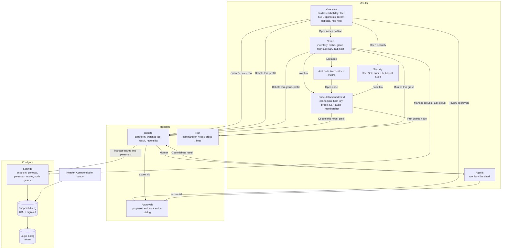

# UI review: apps/web-desktop (phase 1, read-only)

English | [한국어](phase1-ui.ko.md)

> Point-in-time record from 2026-10-12; the code has changed since.

Scope: navigation, procedures, concision, correctness against the Go handlers (apps/agent) and the Python CLI that backs them (cli/llm-agent). All paths are relative to `apps/web-desktop/` unless prefixed. Every claim below was read in code; nothing was run.

Facts that shape the whole review:

- There are 8 routes, not the 10 pages in the brief: `overview, nodes, agents, security, debate, approvals, run, settings` (`src/router.ts:25-34`). NodeDetail (`#/nodes/:id`) and NodeRegister (`#/nodes/new`) hang off `nodes` (`src/App.tsx:38-39`). "Ssh" is the route `security` (`src/App.tsx:41`); `ssh`, `fleet`, `assistant`, `batch`, `terminal` are legacy aliases (`src/router.ts:38-45`).
- Sidebar groups: Monitor (Overview, Nodes, Agents, Security), Respond (Debate, Approvals, Run), Configure (Settings) (`src/router.ts:26,33`). Under 760 px the sidebar is hidden (`packages/guardian-ui/src/styles/components.css:1147-1148`) and the bottom tab bar shows only 5 routes (`mobile: true`: overview, nodes, debate, approvals, run).
- Project scoping is app-level (`src/state/projectStore.tsx`), but the switcher is rendered only on Debate and Approvals (`src/pages/DebatePage.tsx:31`, `src/pages/ApprovalsPage.tsx:30`).

## 1. UI map

### Procedure click paths

**P1 Fleet monitoring**
1. Overview loads the shared fleet diagnosis, the hub metrics and (automatically) a fleet SSH audit (`src/pages/OverviewPage.tsx:269-277`).
2. Offline nodes are links to the node page (`OverviewPage.tsx:32-43`); "Open offline nodes" goes to `#/nodes?status=offline` (`OverviewPage.tsx:81`).
3. Nodes: "Run fleet diagnosis" re-probes (`src/pages/NodesPage.tsx:325`); table shows uptime/load/memory/disk per node (`NodesPage.tsx:104-108`).
4. Node name opens the detail page (`NodesPage.tsx:72`); "Re-run fleet diagnosis" there (`src/pages/NodeDetailPage.tsx:134`).

**P2 Command execution**
1. Run nav item, or "Run on this node" (`NodeDetailPage.tsx:186`), or "Run on this group" (`src/pages/nodes/GroupSummary.tsx:50`); both pass `?target=`.
2. Target select: Local agent node / server / Group / All servers (`src/pages/RunPage.tsx:103-112`).
3. Type a command in the Terminal, or click a preset (`RunPage.tsx:28,148-152`).
4. Single target: runs at once, no confirm (`RunPage.tsx:85-89`). Group or fleet: `ConfirmDialog risk="MEDIUM"` with the command (`RunPage.tsx:218-237`), then streamed per-server table (`RunPage.tsx:212-216`).

**P3 Node registration and host-key pinning**
1. Nodes, "Add node" (`NodesPage.tsx:317`), which opens `NodeRegisterPage` (connection step with host-key scan and fingerprint confirm, then review, `src/pages/NodeRegisterPage.tsx:255-323`).
2. Pin or re-confirm later: Nodes, node name, Connection panel, "Pin host key" / "Re-confirm host key" (`NodeDetailPage.tsx:65-67`), scan, confirm fingerprint, "Pin host key" / "Replace pinned key" (`src/pages/nodes/PinHostKeyDialog.tsx:126-128`).
3. "Edit node" also takes a fingerprint when the address changes (`src/pages/nodes/EditNodeDialog.tsx:81-84`), so there are two entry points that write a host key.
4. Remove: Connection panel, "Remove node", type the id (`RemoveNodeDialog.tsx:52-66`).

**P4 SSH audit**
1. Security nav: fleet audit auto-runs on open (`src/pages/ssh/FleetSshAudit.tsx:262-267`), heatmap, pick a node, details; "Refresh audit" forces a re-probe (`FleetSshAudit.tsx:272`).
2. Hub-local view is behind a Disclosure (`src/pages/SshPage.tsx:137`).
3. Same audit data also appears on Overview (Fleet SSH card, `OverviewPage.tsx:131`), per node (`NodeDetailPage.tsx:214`) and per group (`GroupSummary.tsx:88`).

**P5 Node groups**
1. Create: Nodes, tick rows, "Create group from selection" (`NodesPage.tsx:247`), or Settings, Node groups (`src/pages/SettingsPage.tsx:99`).
2. Add/remove one node: node page, "Group membership" (`src/pages/nodes/NodeMembership.tsx:82,71`), or Nodes selection, "Add to group…" (`NodesPage.tsx:250`).
3. Edit/delete definition: Nodes `?group=`, "Edit group" (`GroupSummary.tsx:51`) or Nodes footer link "Manage groups" (`NodesPage.tsx:369`), both land in Settings.
4. Act on a group: "Run on this group" / "Debate this group" (`GroupSummary.tsx:50,52`).

**P6 Start and follow a debate**
1. Debate nav, or "Debate this" from Overview/node/group (prefill, `src/state/debatePrefill.ts`).
2. Fill Team, Rounds, Continue thread, Reference code, Ref, Task (6 fields, `src/pages/debate/ConsoleSection.tsx:325-382`), "Start debate" (`ConsoleSection.tsx:384`); URL becomes `#/debate/:id` (`ConsoleSection.tsx:297`).
3. Follow: JobCard log refreshes every 3 s (`ConsoleSection.tsx:106`); richer live view via "Monitor" to `#/agents?run=:id` (`ConsoleSection.tsx:91,179`).

**P7 Approve or reject an action**
1. Approvals nav (badge = PROPOSED count, `src/App.tsx:136`), or action `#id` button in a debate result (`src/pages/debate/ResultView.tsx:280`), or `#id` link in Agents (`src/pages/agents/RunDetail.tsx:50`).
2. List row `#id` opens the dialog (`ApprovalsPage.tsx:33-34`, `src/pages/debate/ActionDialog.tsx:206-283`).
3. "Run" (`ActionDialog.tsx:252`) then either typed-id ConfirmDialog (HIGH or unknown risk, `ActionDialog.tsx:285-299`) or second Modal with checkbox "I reviewed the arguments" (`ActionDialog.tsx:301-321`); "Reject" opens ConfirmModal (`ActionDialog.tsx:323-331`).

**P8 jev recheck**
1. In the debate result, when gate is PENDING/DISPUTED: "Re-run jev check" (`ResultView.tsx:355`, panel at `119-142`).
2. In the action dialog for a HELD action: "Re-run jev check for thread X" (`ActionDialog.tsx:261-271`).

**P9 Close a thread**
1. Debate, open the job, Result panel, "Close thread" (`ResultView.tsx:298-299`), confirm (`ResultView.tsx:170-179`). Offered only when not closed and label is not APPROVED (`src/lib/debate.ts:202-204`).
2. Reopen: "Reopen with a new debate" fills the thread id and focuses the form (`ResultView.tsx:301-303`, `ConsoleSection.tsx:313-318`).

**P10 Publish a thread as a branch**
1. Debate, open job, "Proposed actions" card, "Publish" (`ResultView.tsx:357-363`, `PublishPanel` `196-249`).
2. ConfirmModal with optional branch (`ResultView.tsx:231-246`); the hub runs the project test then pushes (up to 1200 s, `apps/agent/debate_handler.go:52-53`).
3. Result Notice appears under the button (`ResultView.tsx:225-230`).

**P11 Persona / team / project configuration**
1. Settings, segmented control: Projects / Personas / Teams (`SettingsPage.tsx:14-20,96-98`). From Debate only a text link "Manage teams & personas" (`DebatePage.tsx:32`).

**P12 Agents run monitor**
1. Agents nav (desktop only), or "Monitor" on a job (`ConsoleSection.tsx:91,179`). Left list, right lanes/outcome/timeline (`src/pages/AgentsPage.tsx:26-47`).

**P13 Hub URL / token**
1. Header "Agent endpoint" button on every page (`App.tsx:224`) or Settings, Agent endpoint, "Change endpoint or sign out" (`SettingsPage.tsx:34`); both open the same `SettingsDialog` (`src/components/SettingsDialog.tsx:40`). Sign out is inside that dialog (`SettingsDialog.tsx:53`). Token entry is the 401-driven `LoginDialog` (`src/components/LoginDialog.tsx:44`).

## 2. Findings

Severity: High = wrong data or a safety gap that can mislead an operator; Medium = real friction or inconsistency; Low = polish.

### UI-1 (High) Result view shows a stale snapshot of action statuses, and Publish is gated by nothing
Evidence: `ResultView.tsx:273` reads `fd?.actions` from `result.json`; the Go detail handler returns that file verbatim (`apps/agent/debate_handler.go:745-746`) and the engine writes the statuses at proposal time (`cli/llm-agent/debate_engine.py:615`). After Run or Reject in Approvals, the "Proposed actions" table in the debate result still says PROPOSED/HELD. `PublishPanel` is then rendered whenever `actions.length > 0` (`ResultView.tsx:362`), whether or not any file action is EXECUTED, the thread is closed, or it was already published. The hub refuses unless every action is settled (`cli/llm-agent/publish_ops.py:36,231-233`) and refuses a second publish (`publish_ops.py:225-228`), and only then returns a 409 text.
Why it hurts: the operator sees "PROPOSED" next to a "Publish" button and cannot tell whether Publish will work; after a reload nothing says the thread was already published (the success Notice is component state, `ResultView.tsx:209,225`).
Fix:
- SAFE-FIX: change the helper line (`ResultView.tsx:223`) to state prerequisites ("needs every action decided and at least one executed file change; the project test runs first and can take minutes").
- SAFE-FIX: replace the table's status source by `listActions(thread)` (already in api, `src/api.ts:722`) so the statuses are live, and enable Publish only if all are settled and one is an EXECUTED file tool.
- DESIGN: expose publications (the DB has `list_publications`, `publish_ops.py:224`) on the job or thread detail so "Published as branch X" survives navigation.

### UI-2 (High) Long-running Run action and Publish keep their result only in component state
Evidence: `ActionDialog.tsx:77-83,121-143` guards with `alive` and discards the result if the dialog unmounted; `PublishPanel` state is local (`ResultView.tsx:197-209`). The hub call blocks up to ~15 min (`src/api.ts:736`) or 1200 s (publish). The nav stays usable while the modal "locks" (`ActionDialog.tsx:206`), so navigating away silently drops the outcome. The Run page does the opposite and keeps run state in a store with a nav badge (`src/App.tsx:134`).
Why it hurts: an operator who starts a 10-minute action and clicks Overview loses the confirmation and may re-run; Publish retried after a success returns "already published" (409).
Fix: DESIGN. Move in-flight action runs and publishes into an app-level store like `runStore`, with a "Running" badge on Approvals; or SAFE-FIX: block hash navigation (a `beforeunload`-style notice) while `busy !== null`.

### UI-3 (High) Fleet and single-node shell execution has weaker confirmation than the actions it resembles
Evidence: Single target: no confirmation at all, and presets run on click (`RunPage.tsx:82-89,148-152`). Group/fleet: `ConfirmDialog risk="MEDIUM"`, which does not require typing (`RunPage.tsx:219-221`, `packages/guardian-ui/src/components/ConfirmDialog.tsx:52` types only for HIGH). By contrast a judge action with the same effect needs the typed id when risk is high or unknown (`src/lib/debate.ts:166-169`), and removing a node needs the id typed (`RemoveNodeDialog.tsx:52-66`). The backend executes any command: `/api/exec` takes `req.Command` straight to `executeRaw` (`apps/agent/main.go:101-116`).
Why it hurts: a fleet-wide arbitrary command is the most destructive control in the UI yet is the second lightest confirmation.
Fix: DESIGN. Decide a risk ladder: fleet and group = HIGH (type the target name or count), single remote node = confirm on commands not in the preset list, local = as is. Presets can stay one-click.

### UI-4 (Medium) Five different confirmation patterns for destructive or irreversible actions
Evidence:
- Typed id: `ActionDialog.tsx:285` (design-system ConfirmDialog HIGH), `RemoveNodeDialog.tsx:52`.
- Checkbox plus second modal stacked on top of the action modal: `ActionDialog.tsx:301-321`.
- Plain ConfirmModal: reject (`ActionDialog.tsx:323`), close thread (`ResultView.tsx:171`), publish (`ResultView.tsx:232`), delete team/group/project/persona (`TeamsSection.tsx:146`, `GroupDialog.tsx:326`, `ProjectDialog.tsx:175`, `PersonaDialog.tsx`), remove from group (`NodeMembership.tsx:113`).
- MEDIUM ConfirmDialog: `RunPage.tsx:219`.
- None: debate Cancel (`ConsoleSection.tsx:95`, `agents/RunDetail.tsx:125`), single-target command run, project Sync/Clone (`ProjectsSection.tsx:80-88`; clone writes to the hub disk).
Also `ConfirmModal` hard-codes `variant="danger"` for the confirm button (`components/ConfirmModal.tsx:36`), so "Publish" and "Close thread" look as dangerous as "Delete group", and the low/medium-risk "Run action" modal also uses danger red (`ActionDialog.tsx:312`) while an actual HIGH one goes through the other component.
Why it hurts: severity is not readable from the control; operators learn to click through.
Fix: SAFE-FIX for the colour: give `ConfirmModal` a `tone` prop (default danger; "primary" for Publish and Close thread). DESIGN for the ladder (one table: reversible = no confirm or single confirm, irreversible on the hub = typed). Debate Cancel is cheap but not undoable: SAFE-FIX add a ConfirmModal in the shared `cancel` handlers (`hooks/useDebateJob.ts:103`, `RunDetail.tsx:79`).

### UI-5 (Medium) Approvals is reachable but the list opens on "All" and the badge hides other projects
Evidence: `ActionsPanel.tsx:74` defaults the filter to `'all'`; the nav badge, Overview card and list all use the selected project only (`src/state/approvalsStore.tsx:40-46`). The project switcher exists only on Debate and Approvals (grep of `ProjectSwitcher` usage), so Overview's "Approvals waiting" and "Recent debates" are silently project-scoped with no project label (`OverviewPage.tsx:184,218`). Agents lists every project (`AgentsPage.tsx:19` calls `fetchDebates()` with no argument) while Debate lists only the selected one (`src/state/debateStore.tsx:26`).
Why it hurts: "0 waiting" on the badge can hide proposals in another project; the same debate is visible on Agents but absent from Debate's Recent list.
Fix: SAFE-FIX default the filter to "Awaiting decision" when any exist and print the project name in the Overview card titles. DESIGN: either a global project chip in the header, or an "All projects" option.

### UI-6 (Medium) The same job set is listed in four places with four filters and names
Evidence: Overview "Recent debates" (5, closed hidden, `OverviewPage.tsx:218-221`), Debate "Recent debates" (closed hidden unless "Show closed", `ConsoleSection.tsx:412-426`), Agents "Runs (n)" (all projects and closed threads included, `AgentsPage.tsx:30`, `agents/RunList.tsx:71`), and the watched JobCard. Link text and aria labels differ for one action: "Monitor debate N" (`ConsoleSection.tsx:91,180`) vs "Monitor run N" (`RunList.tsx:19`) vs "Open debate result" (`RunDetail.tsx:144`). Cancel exists in JobCard and RunDetail with different error handling (`ConsoleSection.tsx:95` vs `RunDetail.tsx:76-92`).
Why it hurts: thread/debate/job/run are one thing under three names; closed threads reappear on Agents although the Close dialog promises "hidden from the debate lists" (`ResultView.tsx:173`).
Fix: DESIGN merge Agents into Debates (list left, live detail right, see SVG). SAFE-FIX meanwhile: apply `visibleJobs` and the project filter in `AgentsPage` (with a "Show closed" toggle) and use one label ("Live view").

### UI-7 (Medium) "Run" means three different things; "Approvals" has three names
Evidence: nav "Run" = shell command page (`router.ts:32`); Agents "Runs (n)" = debates (`AgentsPage.tsx:30`); Approvals dialog "Run" = execute a judge action (`ActionDialog.tsx:253`), whose terminal status is "EXECUTED" (`types.ts:648`); the nav item is "Approvals" but the panel is "Proposed actions" (`ActionsPanel.tsx:88`), the filter "Awaiting decision" (`ActionsPanel.tsx:59`) and the card "Approvals waiting" (`OverviewPage.tsx:184`). Header says "Agent online" and the footer says "Hub" (`App.tsx:199,162`); the dialog title "Agent endpoint", label "Target agent base URL", button "Agent login", token "AGENT_TOKEN" (`SettingsDialog.tsx:40-43`, `LoginDialog.tsx:44,56`); the operator's own wording is "hub URL/token".
Fix: SAFE-FIX wording pass: rename nav "Run" to "Commands", Agents "Runs" to "Debates", action button "Run" to "Execute" (matches EXECUTED), panel title "Proposed actions" to "Approvals"; pick "Hub" for the URL/token everywhere ("Hub connection").

### UI-8 (Medium) Mobile navigation omits Agents, Security and Settings
Evidence: `mobile: false` on those routes (`router.ts:28,29,33`) and the sidebar is `display:none` under 760 px (`components.css:1147-1148`). The comment says only "Security and Settings" are omitted (`router.ts:17`), Agents is missing too. Settings is the only place for personas, teams, projects and group definitions; the header "Agent endpoint" button is the only other route to sign-out.
Fix: DESIGN: 4 destinations that all fit a tab bar (see SVG). SAFE-FIX: correct the comment, add a "More" tab.

### UI-9 (Medium) Group membership and host-key writes have several entry points
Evidence: groups are created/edited in Nodes selection (`NodesPage.tsx:247-252`), the node page (`NodeMembership.tsx:82`), and Settings (`SettingsPage.tsx:99`); Nodes footer explains "create, edit and delete node groups in Settings" (`NodesPage.tsx:370`) although creation is also on the same page. Host key: "Pin host key" (`NodeDetailPage.tsx:65`), "Edit node" with fingerprint (`EditNodeDialog.tsx:81`), registration wizard (`NodeRegisterPage.tsx:186`). The row chips explain the fix only in a `title` tooltip (`NodesPage.tsx:76,81`), unreachable by keyboard or touch, and are not links.
Fix: SAFE-FIX: make the `accept-new` chip a link to the node page; fix the footer sentence. DESIGN: pick one home for group definition (Nodes, with Settings tab removed) and make Pin host key the only path from the Edit dialog.

### UI-10 (Medium) Nodes screen is dense and offers no action on a selection except grouping
Evidence: 12 columns (`NodesPage.tsx:60-108`), three filter selects (`NodesPage.tsx:186-199`), a diagnosis panel, group summary, inventory and hub host on one page; the hub host is also on Overview (`OverviewPage.tsx:97-117`) and has its own panel (`NodesPage.tsx:362-366`). The selection bar offers only "Create group" and "Add to group" (`NodesPage.tsx:247-256`); to run a command on a subset the operator must create a group first, then use the Run target list (`RunPage.tsx:103-112`).
Fix: SAFE-FIX: hide Arch/Mesh IP/Probe columns behind a "columns" toggle; show hub host once. DESIGN: add "Run on selection" and "Debate selection" (Run already supports an id list through `runMulti({ids})`, `RunPage.tsx:95-101`).

### UI-11 (Medium) Overview opens with a heading that does not describe it and fires a fleet-wide SSH audit
Evidence: the first panel is titled "Needs attention" but always shows all five cards in fixed order, healthy or not (`OverviewPage.tsx:294-312`). On open and on every global Refresh it runs the fleet SSH audit, which SSHes into every node (`OverviewPage.tsx:274-277`); node detail and group summary do the same for their node sets (`NodeDetailPage.tsx:167-169`, `GroupSummary.tsx:27-29`). The hub caches 60 s, so rapid navigation is OK, but each distinct target set is a separate probe.
Fix: SAFE-FIX: retitle to "Fleet at a glance", sort cards by tone (crit, warn, ok). DESIGN: lazy-run the audit (button on the card) or reuse the cached report from a store like diagnosis.

### UI-12 (Medium) Security page has no onward action
Evidence: `FleetSshAudit.tsx` links only to node pages (`:38,:85`); "Debate this" exists on Overview, node and group pages (`setDebatePrefill` callers: OverviewPage, NodeDetailPage, GroupSummary) but not on Security, and no "Run" link for remediation. The nav label is "Security" but the panel is "Fleet SSH audit" (`FleetSshAudit.tsx:269`), the alias is `ssh`, the Overview card says "Fleet SSH" with link "Open Security" (`OverviewPage.tsx:168`).
Fix: SAFE-FIX: add "Debate this" to the heatmap node details (reuse `buildNodeDebateTask`), and rename the nav item "SSH audit".

### UI-13 (Low-Medium) Header status chip says "Agent offline" when the real problem is the session
Evidence: `checkAgentHealth` catches `AuthRequiredError` (thrown by `authFetch` on 401, `api.ts:159-170`) and returns `offline` with no reasons (`api.ts:222-224`). With an expired token the chip shows red "Agent offline" under the login dialog. `degraded` has its reasons only in a `title` and a visually hidden span (`App.tsx:154-161`).
Fix: SAFE-FIX: return a `signed-out` state and show "Sign-in required" in a neutral tone; show degraded reasons as visible text on hover and focus.

### UI-14 (Low) Dead or stale items
- `executeFleet` has no caller in `src/` (only `api.ts:294`); fleet runs use streaming only (`runStore.tsx`). SAFE-FIX remove.
- Design-system components with no use in the app: ActionCard, CommandPalette, NodeRow, Sparkline (grep over `src`). DESIGN (keep as library or prune).
- Stale wording: comment "Hand-off from the Assistant" (`ConsoleSection.tsx:231`), test titled "consumes the Assistant prefill" (`tests/debate.page.test.tsx:205`), alias `assistant` (`router.ts:40`); `DebatePage.tsx:17` comment fine, but Panel title "Debate Console" under the page title "Debate" (`ConsoleSection.tsx:322`) duplicates.
- The Overview route icon is `search` and Settings uses `lock` (`router.ts:25,33`).
- `ActionsPanel` submit button reads "Reload" but applies the thread filter (`ActionsPanel.tsx:100-102`). SAFE-FIX "Apply filter".

### UI-15 (Low) Type and message mismatches with the backend
- `DebateJob.finished_at: string` (`types.ts:436`) but the hub sends `*time.Time` without `omitempty`, i.e. `null` while running (`debate_handler.go:140`). Safe today only because `parseTime` accepts falsy (`lib/debate.ts:230-231`). SAFE-FIX type as `string | null`.
- The publish 403 hint prints the literal `guardian.py --publish-thread THREAD` (`ResultView.tsx:188`) because `publishFailMessage` has no thread argument, while the Run hint also says `--run-action N` (`lib/debate.ts:310`). SAFE-FIX interpolate the real id.
- Publish `branch` is free text; the hub validates `^[A-Za-z0-9][A-Za-z0-9._/-]{0,99}$` (`debate_handler.go:65`) and returns 400 only after the confirm. SAFE-FIX validate in the dialog.
- Job chip is green COMPLETED even when the decision is NOT APPROVED/UNVERIFIED (`lib/debate.ts:89-98` vs `decisionStatus` `:186-195`); Overview's recent-debates rows show only the job chip (`OverviewPage.tsx:232`). DESIGN: show the verdict label on list rows.
- Other status mappings checked and consistent with the backend: action statuses `HELD/PROPOSED/INVALID/REJECTED/RUNNING/EXECUTED/FAILED` (`cli/llm-agent/db_manager.py:445` vs `types.ts:648`), job statuses including `interrupted` (`debate_handler.go:856`), publish status `PUSHED/FAILED` (`publish_ops.py:315`; `SKIPPED` cannot occur via the API because `confirm` is not passed), ServerNode fields (`servers_handler.go:111-137` vs `types.ts:1-23`).

### UI-16 (Low) Debate start form is the densest screen of the core flow
Evidence: Team, Rounds, Continue thread, a 3-row glob textarea with a 90-character label, Ref, Task, then Start (`ConsoleSection.tsx:325-387`). Task, the one required field, is last and below four optional ones. Project is chosen in a separate Card above (`DebatePage.tsx:29-34`).
Fix: SAFE-FIX: move Task first, put Rounds, Continue thread, Reference code and Ref in a collapsed "Advanced" Disclosure (the component exists, `components/Disclosure.tsx`), shorten the label to "Reference code (globs)" with the syntax in the hint.

## 3. Wireframe

[ui-nav-proposal.svg](../../images/procedure-review/ui-nav-proposal.svg) (validated with xmllint). Four destinations: Fleet (Overview + Nodes + Groups + SSH audit + Run as tabs), Debates (Debate + Agents as list/detail), Approvals, Settings (Connection, Projects, Personas, Teams). Open point for the operator: Run as a Fleet tab or as a drawer opened from a node, group or selection.

## 4. Recurring patterns

Good:
- One data-state wrapper (`DataGate`, `ErrorNotice`, `LoadingNote`) used nearly everywhere, so loading, error-with-retry and empty states are present on Overview, Nodes, Security, Settings sections and Agents.
- Shared app-level stores (`hubStore`, `runStore`, `debateStore`, `approvalsStore`) so route changes do not refetch or stop a fleet run; nav badges for a running fleet command and for waiting approvals (`App.tsx:134-136`).
- URL as state: `?status=`, `?group=`, `?target=`, `?run=`, `/debate/:id`, `/approvals/:id` give deep links; legacy aliases kept (`router.ts:38-45`).
- Honest probing: reachability shows "not checked / not probed" rather than guessing (`NodesPage.tsx:43-48`); the "Run on this node/group" and "Debate this ..." hand-offs are consistent across Overview, node and group pages.
- Hub-side guards are explained to the operator (409 workspace moved, 403 UI actions off, `lib/debate.ts:306-318`), and the run flow re-reads the action after 409/404.
- Strong safety on host keys and node removal (fingerprint confirm, typed id).

Bad:
- Confirmation patterns diverge (UI-4); colour of confirm buttons does not follow risk.
- Same entity under several names and lists (UI-6, UI-7); the same data on several pages (hub host x2, SSH audit x4, debates x4).
- Procedures split without a visible link: group definition (Nodes vs Settings), debate follow (Debate vs Agents), SSH finding to action (Security has no onward link).
- State owned by a dialog or panel for long operations (UI-2).
- Meaning carried only by tooltips (`NodesPage.tsx:76,81`, `App.tsx:156`).
- Project scope is hidden outside Debate and Approvals (UI-5).

## 5. Test coverage notes

Existing vitest files cover most of the flows above (`tests/debate.page.test.tsx` for close, recheck and publish dialogs at lines 269-415; `tests/approvals.test.tsx`; `tests/run.test.tsx`; `tests/app.test.tsx:93` asserts the grouped sidebar and the limited mobile tab bar). No test asserts that Publish is hidden or disabled when no action is executed, that the result table reflects live statuses (UI-1), or that Agents hides closed threads (UI-6); those would be the first tests to add with the matching SAFE-FIX.
