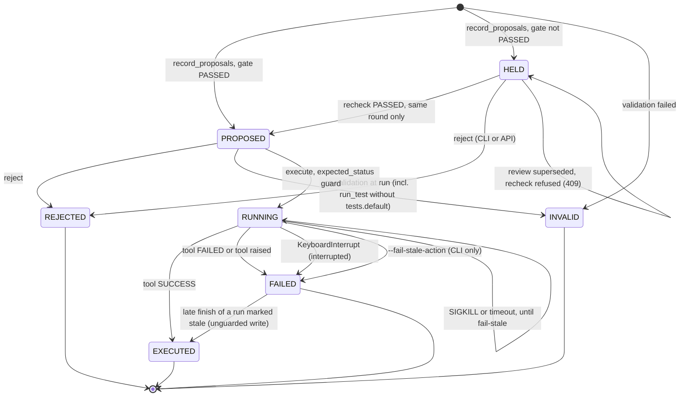
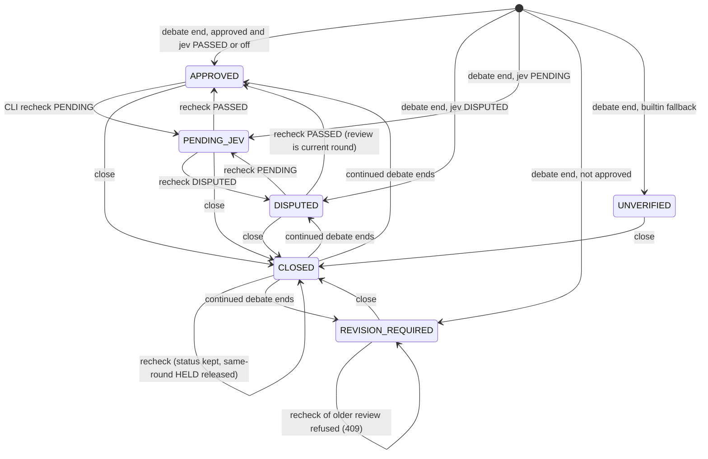
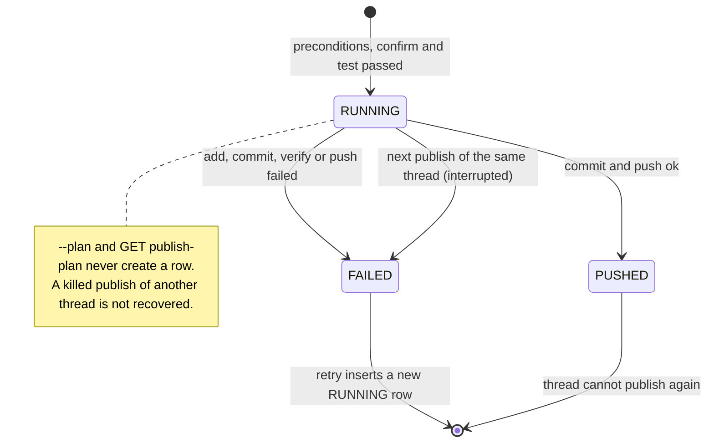

# Phase 3 - 토론 / 결정 / 조치 재검토

[English](phase3-debate.md) | 한국어

> 2026-10-12 시점의 기록이며, 이후 코드가 바뀌었다.

기준 `5aa8e2e` -> 검토 대상 `52fbfe2`(작업 트리의 HEAD, 읽기 전용). 확인한 토론 관련 commit:
`99f4ea4`(도구 예외 -> FAILED), `c522367`(라운드 범위 재점검), `f66326a`(같은 스레드 409), `fb1af96`
(REVISION_REQUIRED), `09c56c8`(NOT_FOUND 코드), `811a81c`(run_default_test), `d6bbe58`(lineup 폴백),
`83551c6`(게시 복구), `c3c7f18`(게시 계획), `e466a90`(실시간 상태로 게이트되는 Publish), `043fa56`(sync
untracked + lock), `352b85c`(actor + 종료 코드), `dae7bd0`(auto-close 주석), `55c3e7e`/`4e469bc`(모니터
색조), `47da4c8`, `52fbfe2`(문서). 경로는 저장소 기준 상대 경로이며, 줄 번호는 `52fbfe2` 기준이다.

## 요약

| id | 심각도 (phase 1) | phase 1 -> phase 3 | 한 줄 요약 |
|---|---|---|---|
| DBT-1 | High | OPEN -> **PARTIAL** | 예외를 던지는 도구는 이제 FAILED로 끝난다. SIGKILL/타임아웃은 여전히 RUNNING을 남기며, 복구는 CLI 전용이고 보호되지 않는다(DBT-N1 참조) |
| DBT-2 | High | OPEN -> **OPEN** | `git_commit_push`는 그대로이고(`git add -A`), 여전히 내장 팀/페르소나에 있다. 문서화만 되었다 |
| DBT-3 | High | OPEN -> **PARTIAL** | 재점검은 라운드 범위로 제한되고 대체된 리뷰를 거부한다. 오래된 HELD는 HELD로 남고, CLI는 여전히 APPROVED를 낮출 수 있다 |
| DBT-4 | High | OPEN -> **RESOLVED** | sync가 untracked 파일을 세고 게시 flock을 잡는다 |
| DBT-5 | Medium | OPEN -> **PARTIAL** | 조치 표와 Publish는 실시간 상태를 쓴다. 판정, Close, Recheck는 여전히 `result.json`에서 온다. 스레드 상태 API가 없다 |
| DBT-6 | Medium | OPEN -> **RESOLVED** | 두 "auto-close" 주석이 모두 수정되었다 |
| DBT-7 | Medium | OPEN -> **OPEN** | CLOSED는 여전히 "숨김"만 뜻한다. UI/API/CLI의 close 규칙은 그대로이다 |
| DBT-8 | Medium | OPEN -> **RESOLVED** | `IN_PROGRESS`가 사라졌다. DB, result, events, index가 `REVISION_REQUIRED`로 일치한다. 모니터는 결정에 따라 색조를 정한다 |
| DBT-9 | Medium | OPEN -> **PARTIAL** | 허브는 같은 스레드의 두 번째 허브 작업을 거부한다. 직접 실행한 CLI `--debate --thread`는 여전히 점검되지 않는다 |
| DBT-10 | Medium | OPEN -> **OPEN** | 여전히 스레드당 게시 하나, base_sha 하나 |
| DBT-11 | Medium | OPEN -> **PARTIAL** | 알 수 없는 스레드/id는 이제 3/404, 사용 중인 sync는 4/409. sync git 실패는 여전히 2/400으로 종료한다 |
| DBT-12 | Medium | OPEN -> **RESOLVED** | `--actor`는 `main()`에서 한 번 검증된다. 일반 형식은 2/3/4를 쓴다 |
| DBT-13 | Medium | OPEN -> **RESOLVED** | 하나의 `run_default_test` helper, 같은 cwd와 600 s |
| DBT-14 | Medium | OPEN -> **RESOLVED** | 저장된 lineup을 검증한다. 기본 lineup + 경고 |
| DBT-15 | Low | OPEN -> **OPEN** | reject / recheck / close는 여전히 `GUARDIAN_UI_ACTIONS`로 게이트되지 않는다(plan 라우트는 의도적으로 게이트 없음) |
| DBT-16 | Low | OPEN -> **RESOLVED** | `--plan` dry run + `GET /publish-plan`, 확인 전에 표시된다 |
| DBT-17 | Low | OPEN -> **PARTIAL** | close/delete/publish 문서는 수정되었다. `run_tests "risk": "low"`, 입력 확인 줄, POST body 필드는 여전히 오래되었다 |
| DBT-18 | Low | OPEN -> **PARTIAL** | 모니터 실행 카드는 결정 단어를 쓴다. Outcome chip은 여전히 jev 이전 판정이다. `judge_approved` 필드가 없다 |
| DBT-19 | Low | OPEN -> **RESOLVED** | 다음 게시가 중단된 RUNNING 행을 실패 처리하고 추적 브랜치로 돌아간다(스레드 범위, DBT-N8 참조) |

집계: **RESOLVED 8** (4, 6, 8, 12, 13, 14, 16, 19) · **PARTIAL 7** (1, 3, 5, 9, 11, 17, 18) · **OPEN 4** (2, 7, 10, 15) · **REGRESSED 0**.

새 발견 사항: **DBT-N1 Medium**, **DBT-N2 Medium**, DBT-N3..N8 Low.

---

## 1. DBT-1 .. DBT-19의 상태

**DBT-1 - PARTIAL.** `run_action`은 이제 `call_tool`을 감싼다. `except Exception` -> 결과 FAILED, `except BaseException` -> FAILED "interrupted" 후 다시 raise(`cli/llm-agent/action_ops.py:247-263`). 새로운 `--fail-stale-action N`은 RUNNING -> FAILED로 옮긴다(`action_ops.py:266-273`, `395-403`, 플래그 `guardian.py:683-684`, dispatch `guardian.py:118-119, 288-297`). 근거: 주된 종료 경로는 SIGKILL인데(Go `cmd.Cancel`이 SIGKILL로 그룹을 종료한다, `apps/agent/debate_handler.go:312-316`, 조치 타임아웃 `:1119-1120`, systemd control-group 정지), 어떤 Python 핸들러도 이를 보지 못하며 `guardian.py`에는 SIGTERM 시그널 핸들러가 없다. 복구에는 허브 라우트가 없으므로(`debate_handler.go:263-291`에 없다) 대시보드는 여전히 "Reload the list"라고만 한다(`apps/web-desktop/src/pages/debate/ActionDialog.tsx:273`). 보호되지 않는 덮어쓰기는 DBT-N1을 참조한다.

**DBT-2 - OPEN.** `git_commit_push`는 여전히 `git checkout -b`, `git add -A`, `git commit`을 실행하고(`cli/llm-agent/mcp_client.py:316-320`), 여전히 WRITE_TOOL이며(`mcp_client.py:97`), 여전히 `configs/teams/cross-review.json:11`과 `configs/personas/jev_mcp_decision.json:11`에서 허용된다. 이제 `docs/design/publish-thread.md:6-8`만이 이것이 스레드를 게시 불가능하게 만든다고 명시한다. 근거: 문서화되었을 뿐 방지되지 않는다.

**DBT-3 - PARTIAL.** 재점검은 `threads.final_round > review.round_num`일 때 `RecheckConflict`를 던지고(`action_ops.py:276-277, 312-317`, `db_manager.py:620-624`) -> exit 4 / 409(`action_ops.py:419-424`, `guardian.py:255-260`), 검토된 라운드만 해제한다(`action_ops.py:281-293, 324`). 근거: High 위험(대체된 작업의 재승인)은 해소되었다. 남은 문제: 대체된 라운드의 HELD 조치는 결코 해제될 수 없고 하나씩 거부될 때까지 게시를 막는다(DBT-N3). 그리고 현재 APPROVED 리뷰를 CLI로 재점검해 PENDING이 반환되면 여전히 PENDING_JEV가 설정되지만 그 조치는 PROPOSED로 남는다(`action_ops.py:325-329`).

**DBT-4 - RESOLVED.** `_update`는 untracked를 포함해 `git status --porcelain`을 세고(`cli/llm-agent/project_registry.py:341-346`), 게시와 공유하는 `workspace_lock` 아래에서 실행된다(`project_registry.py:210-225, 331`, `publish_ops.py:155-161`). lock이 사용 중이면 exit 4이다(`config_ops.py:166-179`). 근거: 실행되었지만 게시되지 않은 파일 아래에서 HEAD가 더 이상 움직이지 않는다. (새 부작용은 DBT-N2.)

**DBT-5 - PARTIAL.** ResultView는 `listActions(threadId)`를 로드해 실시간 상태를 보여 준다. Publish는 `publishReadiness`로만 활성화되며(`apps/web-desktop/src/pages/debate/ResultView.tsx:358-376`, `lib/debate.ts:372-380`), plan 409는 이미 게시된 스레드에 대해 확인을 비활성화한다(`ResultView.tsx:325`). 근거: 판정 chip, `canCloseThread(status.label, …)`, `gateNeedsRecheck(fd)`는 여전히 `result.json` 스냅샷을 읽고(`ResultView.tsx:401, 458`), 스레드 상태나 게시 이력에 대한 라우트는 여전히 없다(`debate_handler.go:263-291`).

**DBT-6 - RESOLVED.** `debate_handler.go:191-193`과 `db_manager.py:627-628`은 이제 `close_thread`만 CLOSED를 쓴다고 말한다.

**DBT-7 - OPEN.** 스냅샷 label이 APPROVED이면 Close는 여전히 숨겨지고(`lib/debate.ts:239-241`, `ResultView.tsx:401`), API/CLI는 여전히 어떤 상태든 close하며(`db_manager.py` `close_thread`), run/publish/recheck는 여전히 CLOSED를 무시한다(`action_ops.py:213-263`, `publish_ops.py:222-260`, `:320-329`). CLOSED의 의미에 대한 운영자 결정이 필요하다.

**DBT-8 - RESOLVED.** `decision_status`는 `REVISION_REQUIRED`를 반환하며(`cli/llm-agent/debate_engine.py:248-259`), 이 값은 `debate_finished`와 `threads_index.json`에도 들어간다. CLI는 이에 대해 "NOT APPROVED"를 출력한다(`guardian.py:593-595`). Timeline과 RunDetail은 완료된 행의 색조를 `decisionWordStatus`로 정한다(`pages/agents/Timeline.tsx:223-229`, `pages/agents/RunDetail.tsx:96-106`, `lib/debate.ts:197-231`). 남은 표시용 동의어(UI의 "NOT APPROVED", 판정 체인의 "REVISION REQUIRED", Markdown의 "REVISION / MAX ROUNDS")는 저장된 하나의 값에 대한 label이지 충돌하는 상태가 아니다.

**DBT-9 - PARTIAL.** `startDebate`는 실행 중인 허브 작업이 같은 `ThreadID`를 가지면 slot lock 안에서 409를 반환한다(`debate_handler.go:568-579`). 근거: 허브 셸에서 시작한 `guardian.py --debate --thread T`는 이 점검과 `closeThread` 모두에 보이지 않는다. 가드는 Go에만 있다(패턴 P3).

**DBT-10 - OPEN.** `publish_ops.py:225-228`(스레드당 PUSHED 하나)과 `:246-247`(base_sha 하나)은 그대로이다. DESIGN.

**DBT-11 - PARTIAL.** `close_thread_json`의 알 수 없는 스레드 -> NOT_FOUND(`action_ops.py:415`). 알 수 없는 id의 삭제 -> 3, 내장 항목 -> 2(`config_ops.py:55-60, 62-118, 155-158`). sync 사용 중 -> 4(`config_ops.py:176-178`). 근거: `git clone/fetch failed`는 여전히 `ProjectValidationError` -> exit 2 -> HTTP 400 "invalid request"이다(`config_ops.py:179`, `project_registry.py` `sync`).

**DBT-12 - RESOLVED.** `--actor`는 dispatch 전에 `ACTOR_PATTERN`에 대해 한 번 점검된다(`guardian.py:700-710`). 일반 형식은 NOT_FOUND / CONFLICT / INVALID_INPUT을 사용한다(`guardian.py:171-181, 253-263, 281-327`). 기본값 `getpass.getuser()`는 일반 형식에서 패턴 점검되지 않는다(허용 가능: OS 사용자 이름).

**DBT-13 - RESOLVED.** `MCPClient.run_default_test` / `default_test_argv`를 `execute_code_action(run_test)`와 `_run_gate`가 `TEST_TIMEOUT = 600`으로 사용한다(`mcp_client.py:93-94, 291-296, 340-357`, `publish_ops.py:343-363`). (동작 변경은 DBT-N5.)

**DBT-14 - RESOLVED.** 저장된 lineup은 `validate_lineup`으로 검증된다. 오류가 나면 기본 lineup을 사용하고 경고를 출력하며, 경고는 `debate_started`에 담겨 나가고 결과에도 반환된다(`debate_engine.py:390-392, 424-425, 451, 662, 677-684`).

**DBT-15 - OPEN.** `publishThread`와 `runAction`만 `actionsDisabled()`를 점검한다(`debate_handler.go:1031, 1118`). 새 `publishPlan`은 의도적으로 게이트되지 않는다(`:1066-1069`). `off`가 무엇을 뜻하는지에 대한 결정이 필요하다.

**DBT-16 - RESOLVED.** `publish_thread(plan_only=True)`는 확인/테스트/쓰기 전에 `PLAN`을 반환하고(`publish_ops.py:318-319`), `publish_plan_json`(`:423-438`), 라우트 `GET /api/threads/{thread}/publish-plan`(`debate_handler.go:291, 1066-1086`), 대화상자는 branch/base/remote/subject/files를 보여 주고 계획이 준비될 때까지 확인을 비활성화한다(`ResultView.tsx:198-326`).

**DBT-17 - PARTIAL.** 수정됨: close 404, delete 코드, 같은 스레드 409, plan 라우트(`docs/design/debate-teams-api.md` diff), 게시 전제 조건(`publish-thread.md`). 여전히 오래됨: `run_tests`의 `"risk": "low"`(`debate-teams-api.md:33`, 코드는 `high`), 입력 확인 "only `server_remediation`"(`:133`, TS는 low/medium이 아닌 모든 도구에 이를 요구한다), POST `/api/debates` body가 여전히 task/team/thread_id/rounds만 나열한다(`:64`).

**DBT-18 - PARTIAL.** 완료된 실행 카드와 Timeline은 이제 결정 단어를 쓴다(DBT-8 참조). Outcome chip은 여전히 게이트 없이 `decisionStatus(run.verdict)`를 렌더링하므로(`pages/agents/RunDetail.tsx:28-29`), jev 이전 LLM 판정이 DISPUTED 게이트 옆에 APPROVED로 표시된다. `final_decision`에는 여전히 `judge_approved`가 없다.

**DBT-19 - RESOLVED.** workspace lock 아래에서 스레드의 RUNNING 행은 FAILED "interrupted"가 되고, 그런 행의 브랜치에 있는 깨끗한 워크스페이스는 전제 조건 점검 전에 추적 브랜치로 다시 checkout된다(`publish_ops.py:274-296`). plan 모드는 쓰지 않고 복구된 상태를 보고한다(`:280-283`). 스레드 간에 남은 문제: DBT-N8.

---

## 2. 다시 그린 상태 기계

### 2.1 조치 상태 (변경: 예외 경로, fail-stale, 라운드 범위 해제)

### 2.2 스레드 상태 (변경: 재점검 충돌, 모든 곳에서 REVISION_REQUIRED)

### 2.3 게시 상태 (변경: 중단 복구, plan은 상태 없음)

작업 상태(`meta.json`)는 그대로이지만, 이제 `POST /api/debates`가 작업이 생기기 전에 409로 응답할 수 있다.

---

## 3. 수정으로 새로 생긴 모순

### DBT-N1 (Medium) - `--fail-stale-action`에는 생존 점검이 없고, 실행의 최종 쓰기는 이를 무시한다
- 근거: `fail_stale_action`은 RUNNING -> FAILED로 옮기고 `decided_by`를 운영자로 덮어쓴다(`action_ops.py:266-273`, `update_action`은 `COALESCE(?, decided_by)`를 사용한다, `db_manager.py:497`). docstring은 운영자에게 살아 있는 실행이 없는지 확인하라고 요청할 뿐이다. 실행 자체의 최종 쓰기에는 `expected_status`가 없으므로(`action_ops.py:262`), 아직 살아 있던 실행(예: 10분짜리 `run_tests`)이 나중에 운영자의 FAILED를 EXECUTED/FAILED로 덮어쓴다. 허브의 프로세스 내부 `actionRuns` lock(`debate_handler.go:1105-1117`)은 CLI에 보이지 않는다.
- 영향: 감사 기록에서 원래 승인자가 사라진다. 조치가 FAILED -> EXECUTED로 갈 수 있다. 운영자가 결정한 뒤에 게시가 조치의 상태가 뒤집히는 것을 볼 수 있다. 이 명령은 CLI 전용이기도 해서, 대시보드 사용자는 흔한 SIGKILL 경우에서 여전히 복구할 수 없다(DBT-1).
- 수정: SAFE-FIX - 최종 쓰기를 `expected_status="RUNNING"`으로 하고(패배하면 로그를 남긴다), `decided_by`는 유지하며 운영자는 `result.marked_failed_by`에 저장한다. `updated_at`이 `GUARDIAN_ACTION_TIMEOUT`보다 최근이면 fail-stale을 거부한다. DESIGN - `POST /api/actions/{id}/fail-stale`(게이트됨)을 노출하거나 허브에서 시작 시 정리(startup sweep)를 한다.

### DBT-N2 (Medium) - 더 엄격해진 sync는 잔여물이 있는 워크스페이스를 결코 fast-forward할 수 없고, 지원되는 폐기 방법이 없다
- 근거: untracked 또는 수정된 경로가 하나라도 있으면 sync는 `skipped`(exit 0)를 반환한다(`project_registry.py:341-346`). 잔여물은 FAILED/REJECTED 파일 조치, 버려진 스레드, 결코 게시되지 않을 스레드의 실행된 조치(DBT-10: 이미 게시됨, 혼합된 base)에서 생긴다. 스레드의 워크스페이스 변경을 폐기하는 명령이 없다. `publish-thread.md`의 "After publishing"은 운영자에게 `--project-sync`를 실행하라고 한다.
- 영향: 허브 워크스페이스가 무기한 origin보다 뒤처진다. 모든 새 토론이 오래된 코드를 읽고 새 쓰기 조치가 오래된 base에 대해 제안되는데, 대시보드는 "skipped"만 보여 준다.
- 수정: DESIGN - `--discard-thread-changes T` 같은 운영자 명령을 추가하고(스레드의 정착된, 게시되지 않은 파일 조치의 파일만 정확히 복원하고 그 밖의 것은 거부한다), Projects 섹션에서 `skipped`를 경고로 표시한다.

### DBT-N3 (Low) - 대체된 HELD 조치는 방치되며 여전히 재점검 대상으로 제시된다
- 근거: 해제는 `latest["round_num"]`로 제한되고 오래된 리뷰는 거부된다(`action_ops.py:312-324`). HELD는 게시를 막는다(`publish_ops.py` `SETTLED_STATUSES`). RecheckPanel은 여전히 오래된 결과의 `jev_gate`로부터 표시되며(`ResultView.tsx:458`) 이제 409를 반환한다.
- 수정: SAFE-FIX - 이어진 토론이 더 나중의 `final_round`를 저장하면 스레드의 오래된 HELD 조치를 REJECT(또는 INVALID "superseded"로 표시)한다. 작업이 스레드의 최신이 아니면 RecheckPanel을 숨긴다.

### DBT-N4 (Low) - 결과 화면이 스레드 전체의 실시간 조치를 한 작업 아래에 보여 준다
- 근거: `listActions(threadId)`는 스레드의 모든 라운드를 반환하며(`ResultView.tsx:360-372`), "Actions from this debate"로 렌더링된다.
- 영향: 이어진 스레드의 오래된 작업을 열면 이후 라운드의 조치가 그 작업에서 나온 것처럼 보인다. 게시 준비 상태가 스레드 전체 기준인 것은 맞지만, label은 맞지 않다.
- 수정: SAFE-FIX - 표는 작업의 라운드 안에서 `round_num`으로 필터링하고, 준비 상태는 스레드 전체 기준으로 유지한다.

### DBT-N5 (Low) - `tests.default`가 판정자 카탈로그 갱신 없이 필수가 되었다
- 근거: `run_test`가 있는 `execute_code_action`은 기본 테스트 없이는 유효하지 않고(`mcp_client.py:185-186`), 게시도 그것이 없으면 거부한다(`publish_ops.py:255, 343-349`). `describe()`는 `run_tests`만 보강하므로(`mcp_client.py:147-155`), 판정자는 `execute_code_action`에 대해 여전히 "optionally running the test suite afterwards"를 본다. 이미 PROPOSED인 `run_test` 조치는 실행 시점에 INVALID가 된다.
- 수정: SAFE-FIX - `default_test`가 설정되지 않았을 때 `execute_code_action`의 설명에 이 요구 사항을 언급한다.

### DBT-N6 (Low) - 읽기 전용 plan이 배타적 workspace lock을 잡는다
- 근거: plan 모드는 `_publish_lock` 안에서 실행되는데(`publish_ops.py:274-319`), 이는 배타적 non-blocking flock이다(`project_registry.py:221-223`). 대시보드는 대화상자를 열 때와 브랜치를 편집할 때마다 plan을 가져온다(`ResultView.tsx:236-262`). 라우트 타임아웃은 `jevRecheckTimeout`을 재사용한다(`debate_handler.go:1084`).
- 영향: 대화상자가 plan을 계산하고 있다는 이유로 운영자의 Publish나 Sync가 "another publish or project sync is running"으로 거부될 수 있다.
- 수정: SAFE-FIX - plan을 lock 없이(아무것도 쓰지 않는다) 또는 공유 lock으로 실행한다. 자체 타임아웃 상수를 준다.

### DBT-N7 (Low) - 같은 핸들러 파일에 query-string 파서가 두 개
- 근거: `listActions`는 `;` 쌍을 거부하기 위해 의도적으로 `url.ParseQuery`를 사용한다(`debate_handler.go:939-944`). 새 `publishPlan`은 `r.URL.Query()`를 사용하는데(`:1077`), 이는 그런 쌍을 조용히 버린다.
- 수정: SAFE-FIX - `publishPlan`에서 `url.ParseQuery`를 사용한다.

### DBT-N8 (Low) - 중단된 게시 복구는 스레드 단위이고, 워크스페이스는 프로젝트 단위이다
- 근거: 복구는 게시하는 스레드의 RUNNING 행만 본다(`publish_ops.py:276-296`). 스레드 A의 게시가 워크스페이스가 `guardian/A`에 있는 상태로 종료되었다면, 스레드 B의 게시는 "the workspace is on 'guardian/A'"로 거부되고(`:297-300`), A의 행은 A가 다시 게시되거나 sync가 추적 브랜치를 checkout할 때까지 RUNNING으로 남는다.
- 수정: SAFE-FIX - 워크스페이스가 올라가 있는 브랜치의 모든 스레드에 대해 RUNNING 행을 복구한다(스레드가 아니라 프로젝트로 조회).

---

## 4. 수정 이후의 패턴

- **스냅샷 대 실시간 상태**(P1)는 줄었다. 조치와 게시 준비 상태는 실시간이다. 판정, Close, Recheck는 여전히 스냅샷 기반이다(DBT-5, DBT-N3, DBT-N4).
- **한 진입점에만 있는 가드**(P3)는 지속된다. 같은 스레드 점검은 Go에만(DBT-9), fail-stale은 CLI에만(DBT-N1), UI_ACTIONS는 두 라우트에만(DBT-15) 있다.
- **복구 없는 상태**(P4)는 이동했다. 조치 RUNNING과 게시 RUNNING에는 이제 복구가 있지만 둘 다 부분적이다(CLI 전용, 스레드 범위). dirty 워크스페이스에 대해 새로운 것이 하나 생겼다(DBT-N2).
- **암묵적 lock으로서의 워크스페이스 HEAD**(P5)는 이제 sync와 게시가 공유하는 명시적 flock이다(좋음). `git_commit_push`는 그 바깥에 남아 있다(DBT-2).
- **상태 어휘 불일치**(P2)는 대부분 수정되었다(DBT-8). 남은 것은 jev 이전의 `approved`이다(DBT-18).
