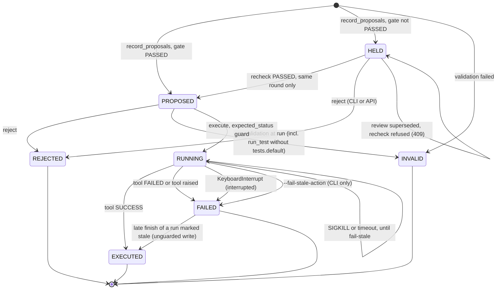
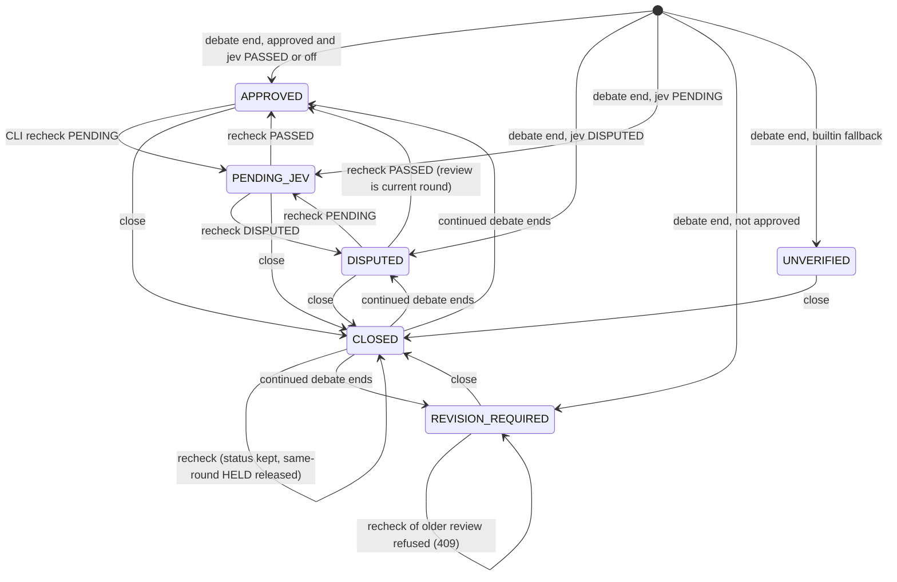
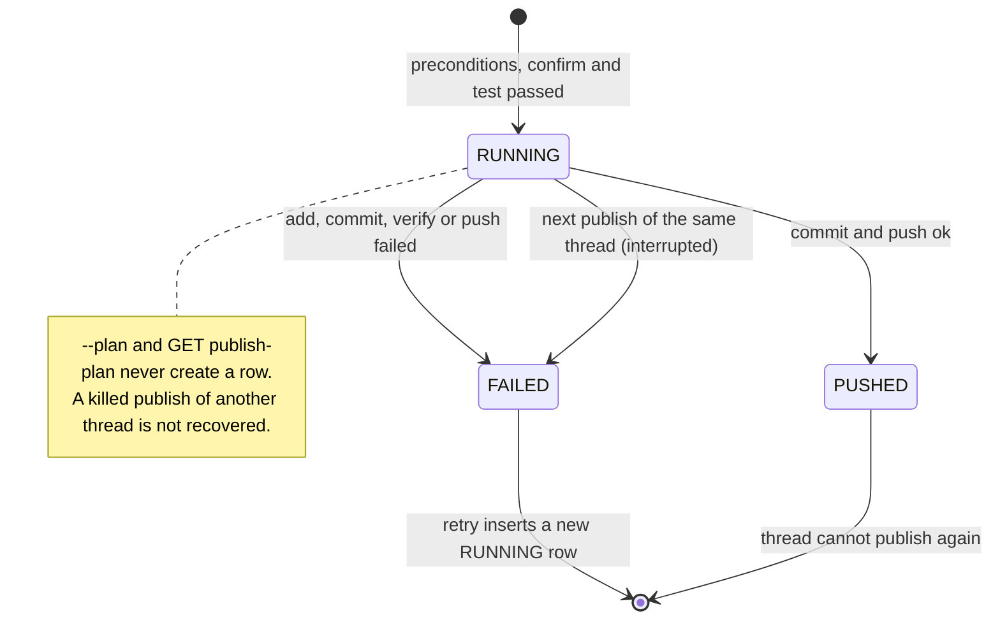

# Phase 3 - Debate / Decision / Action re-review

English | [한국어](phase3-debate.ko.md)

> Point-in-time record from 2026-10-12; the code has changed since.

Baseline `5aa8e2e` -> reviewed `52fbfe2` (HEAD of the working tree, read-only). Debate-related commits checked:
`99f4ea4` (tool raise -> FAILED), `c522367` (round-scoped recheck), `f66326a` (same-thread 409), `fb1af96`
(REVISION_REQUIRED), `09c56c8` (NOT_FOUND codes), `811a81c` (run_default_test), `d6bbe58` (lineup fallback),
`83551c6` (publish recovery), `c3c7f18` (publish plan), `e466a90` (Publish gated on live statuses), `043fa56` (sync
untracked + lock), `352b85c` (actor + exit codes), `dae7bd0` (auto-close comments), `55c3e7e`/`4e469bc` (monitor
tones), `47da4c8`, `52fbfe2` (docs). Paths are repo-relative; line numbers are at `52fbfe2`.

## Summary

| id | severity (phase 1) | phase 1 -> phase 3 | one line |
|---|---|---|---|
| DBT-1 | High | OPEN -> **PARTIAL** | raising tools now end FAILED; SIGKILL/timeout still leaves RUNNING, recovery is CLI-only and unguarded (see DBT-N1) |
| DBT-2 | High | OPEN -> **OPEN** | `git_commit_push` unchanged (`git add -A`), still in builtin team/persona; only documented |
| DBT-3 | High | OPEN -> **PARTIAL** | recheck is round-scoped and refuses superseded reviews; old HELD stay HELD, CLI can still downgrade APPROVED |
| DBT-4 | High | OPEN -> **RESOLVED** | sync counts untracked files and takes the publish flock |
| DBT-5 | Medium | OPEN -> **PARTIAL** | action table and Publish use live statuses; verdict, Close and Recheck still from `result.json`; no thread-status API |
| DBT-6 | Medium | OPEN -> **RESOLVED** | both "auto-close" comments corrected |
| DBT-7 | Medium | OPEN -> **OPEN** | CLOSED still means "hidden" only; UI/API/CLI close rules unchanged |
| DBT-8 | Medium | OPEN -> **RESOLVED** | `IN_PROGRESS` gone; DB, result, events, index agree on `REVISION_REQUIRED`; monitor toned by decision |
| DBT-9 | Medium | OPEN -> **PARTIAL** | hub refuses a second hub job on the thread; direct CLI `--debate --thread` still unchecked |
| DBT-10 | Medium | OPEN -> **OPEN** | still one publish per thread and one base_sha |
| DBT-11 | Medium | OPEN -> **PARTIAL** | unknown thread/ids now 3/404, busy sync 4/409; sync git failures still exit 2/400 |
| DBT-12 | Medium | OPEN -> **RESOLVED** | `--actor` validated once in `main()`; plain forms use 2/3/4 |
| DBT-13 | Medium | OPEN -> **RESOLVED** | one `run_default_test` helper, same cwd and 600 s |
| DBT-14 | Medium | OPEN -> **RESOLVED** | stored lineup validated; default lineup + warning |
| DBT-15 | Low | OPEN -> **OPEN** | reject / recheck / close still not gated by `GUARDIAN_UI_ACTIONS` (plan route deliberately ungated) |
| DBT-16 | Low | OPEN -> **RESOLVED** | `--plan` dry run + `GET /publish-plan`, shown before confirm |
| DBT-17 | Low | OPEN -> **PARTIAL** | close/delete/publish docs fixed; `run_tests "risk": "low"`, typed-confirm line, POST body fields still stale |
| DBT-18 | Low | OPEN -> **PARTIAL** | monitor run card uses decision word; Outcome chip still the pre-jev verdict; no `judge_approved` field |
| DBT-19 | Low | OPEN -> **RESOLVED** | next publish fails interrupted RUNNING rows and returns to the tracked branch (thread-scoped, see DBT-N8) |

Counts: **RESOLVED 8** (4, 6, 8, 12, 13, 14, 16, 19) · **PARTIAL 7** (1, 3, 5, 9, 11, 17, 18) · **OPEN 4** (2, 7, 10, 15) · **REGRESSED 0**.

New findings: **DBT-N1 Medium**, **DBT-N2 Medium**, DBT-N3..N8 Low.

---

## 1. Status of DBT-1 .. DBT-19

**DBT-1 - PARTIAL.** `run_action` now wraps `call_tool`: `except Exception` -> result FAILED, `except BaseException` -> FAILED "interrupted" and re-raise (`cli/llm-agent/action_ops.py:247-263`). New `--fail-stale-action N` moves RUNNING -> FAILED (`action_ops.py:266-273`, `395-403`; flag `guardian.py:683-684`, dispatch `guardian.py:118-119, 288-297`). Reasoning: the dominant kill paths are SIGKILL (Go `cmd.Cancel` kills the group with SIGKILL, `apps/agent/debate_handler.go:312-316`, action timeout `:1119-1120`; systemd control-group stop), which no Python handler sees, and there is no signal handler for SIGTERM in `guardian.py`; recovery has no hub route (`debate_handler.go:263-291` has none), so the dashboard still only says "Reload the list" (`apps/web-desktop/src/pages/debate/ActionDialog.tsx:273`). See DBT-N1 for the unguarded overwrite.

**DBT-2 - OPEN.** `git_commit_push` still runs `git checkout -b`, `git add -A`, `git commit` (`cli/llm-agent/mcp_client.py:316-320`), is still a WRITE_TOOL (`mcp_client.py:97`), still allowed by `configs/teams/cross-review.json:11` and `configs/personas/jev_mcp_decision.json:11`. Only `docs/design/publish-thread.md:6-8` now states that it makes the thread unpublishable. Reasoning: documented, not prevented.

**DBT-3 - PARTIAL.** Recheck raises `RecheckConflict` when `threads.final_round > review.round_num` (`action_ops.py:276-277, 312-317`; `db_manager.py:620-624`) -> exit 4 / 409 (`action_ops.py:419-424`, `guardian.py:255-260`) and releases only the reviewed round (`action_ops.py:281-293, 324`). Reasoning: the High risk (re-approving superseded work) is closed; residuals: HELD actions of superseded rounds can never be released and block publish until rejected one by one (DBT-N3), and a CLI recheck of a current APPROVED review that returns PENDING still sets PENDING_JEV while its actions stay PROPOSED (`action_ops.py:325-329`).

**DBT-4 - RESOLVED.** `_update` counts `git status --porcelain` including untracked (`cli/llm-agent/project_registry.py:341-346`) and runs under `workspace_lock` shared with publish (`project_registry.py:210-225, 331`; `publish_ops.py:155-161`); a busy lock is exit 4 (`config_ops.py:166-179`). Reasoning: HEAD no longer moves under executed-but-unpublished files. (New side effect in DBT-N2.)

**DBT-5 - PARTIAL.** ResultView loads `listActions(threadId)` and shows live statuses; Publish is enabled only by `publishReadiness` (`apps/web-desktop/src/pages/debate/ResultView.tsx:358-376`; `lib/debate.ts:372-380`) and the plan 409 disables confirm for already published threads (`ResultView.tsx:325`). Reasoning: verdict chip, `canCloseThread(status.label, …)` and `gateNeedsRecheck(fd)` still read the `result.json` snapshot (`ResultView.tsx:401, 458`), and there is still no route for thread status or publication history (`debate_handler.go:263-291`).

**DBT-6 - RESOLVED.** `debate_handler.go:191-193` and `db_manager.py:627-628` now say only `close_thread` writes CLOSED.

**DBT-7 - OPEN.** Close still hidden for snapshot label APPROVED (`lib/debate.ts:239-241`, `ResultView.tsx:401`), API/CLI still close any status (`db_manager.py` `close_thread`), run/publish/recheck still ignore CLOSED (`action_ops.py:213-263`, `publish_ops.py:222-260`, `:320-329`). Needs the operator decision on CLOSED semantics.

**DBT-8 - RESOLVED.** `decision_status` returns `REVISION_REQUIRED` (`cli/llm-agent/debate_engine.py:248-259`), which also feeds `debate_finished` and `threads_index.json`; CLI prints "NOT APPROVED" for it (`guardian.py:593-595`); Timeline and RunDetail tone the finished row by `decisionWordStatus` (`pages/agents/Timeline.tsx:223-229`, `pages/agents/RunDetail.tsx:96-106`; `lib/debate.ts:197-231`). Residual display synonyms ("NOT APPROVED" in UI, "REVISION REQUIRED" in the verdict chain, "REVISION / MAX ROUNDS" in Markdown) are labels of one stored value, not conflicting states.

**DBT-9 - PARTIAL.** `startDebate` returns 409 when a running hub job has the same `ThreadID`, inside the slot lock (`debate_handler.go:568-579`). Reasoning: a `guardian.py --debate --thread T` started on the hub shell is invisible to both this check and `closeThread`; the guard lives only in Go (pattern P3).

**DBT-10 - OPEN.** `publish_ops.py:225-228` (one PUSHED per thread) and `:246-247` (one base_sha) unchanged. DESIGN.

**DBT-11 - PARTIAL.** `close_thread_json` unknown thread -> NOT_FOUND (`action_ops.py:415`); deletes of unknown ids -> 3, builtin -> 2 (`config_ops.py:55-60, 62-118, 155-158`); sync busy -> 4 (`config_ops.py:176-178`). Reasoning: `git clone/fetch failed` is still a `ProjectValidationError` -> exit 2 -> HTTP 400 "invalid request" (`config_ops.py:179`, `project_registry.py` `sync`).

**DBT-12 - RESOLVED.** `--actor` checked once against `ACTOR_PATTERN` before dispatch (`guardian.py:700-710`); plain forms use NOT_FOUND / CONFLICT / INVALID_INPUT (`guardian.py:171-181, 253-263, 281-327`). Default `getpass.getuser()` is not pattern-checked in the plain form (acceptable: OS user names).

**DBT-13 - RESOLVED.** `MCPClient.run_default_test` / `default_test_argv` used by `execute_code_action(run_test)` and `_run_gate` with `TEST_TIMEOUT = 600` (`mcp_client.py:93-94, 291-296, 340-357`; `publish_ops.py:343-363`). (Behaviour change in DBT-N5.)

**DBT-14 - RESOLVED.** Stored lineup is `validate_lineup`-ed; on error the default lineup is used and a warning printed, emitted in `debate_started` and returned in the result (`debate_engine.py:390-392, 424-425, 451, 662, 677-684`).

**DBT-15 - OPEN.** Only `publishThread` and `runAction` check `actionsDisabled()` (`debate_handler.go:1031, 1118`); the new `publishPlan` is ungated on purpose (`:1066-1069`). Needs a decision on what `off` means.

**DBT-16 - RESOLVED.** `publish_thread(plan_only=True)` returns `PLAN` before confirm/test/writes (`publish_ops.py:318-319`), `publish_plan_json` (`:423-438`), route `GET /api/threads/{thread}/publish-plan` (`debate_handler.go:291, 1066-1086`), dialog shows branch/base/remote/subject/files and disables confirm until the plan is ready (`ResultView.tsx:198-326`).

**DBT-17 - PARTIAL.** Fixed: close 404, delete codes, same-thread 409, plan route (`docs/design/debate-teams-api.md` diff), publish preconditions (`publish-thread.md`). Still stale: `"risk": "low"` for `run_tests` (`debate-teams-api.md:33`; code `high`), typed confirm "only `server_remediation`" (`:133`; TS requires it for every non-low/medium tool), POST `/api/debates` body still lists only task/team/thread_id/rounds (`:64`).

**DBT-18 - PARTIAL.** Finished-run card and Timeline now use the decision word (see DBT-8). The Outcome chip still renders `decisionStatus(run.verdict)` without the gate (`pages/agents/RunDetail.tsx:28-29`), so the pre-jev LLM verdict shows APPROVED beside a DISPUTED gate; `final_decision` still has no `judge_approved`.

**DBT-19 - RESOLVED.** Under the workspace lock, the thread's RUNNING rows become FAILED "interrupted" and a clean workspace on such a row's branch is checked out back to the tracked branch before the precondition checks (`publish_ops.py:274-296`); plan mode reports the recovered view without writing (`:280-283`). Residual across threads: DBT-N8.

---

## 2. Re-drawn state machines

### 2.1 Action status (changed: exception path, fail-stale, round-scoped release)

### 2.2 Thread status (changed: recheck conflict, REVISION_REQUIRED everywhere)

### 2.3 Publication status (changed: interrupted recovery; plan is stateless)

Job status (`meta.json`) is unchanged except that `POST /api/debates` can now answer 409 before a job exists.

---

## 3. New contradictions introduced by the fixes

### DBT-N1 (Medium) - `--fail-stale-action` has no liveness check and the run's final write ignores it
- Evidence: `fail_stale_action` moves RUNNING -> FAILED and overwrites `decided_by` with the operator (`action_ops.py:266-273`; `update_action` uses `COALESCE(?, decided_by)`, `db_manager.py:497`). Its docstring only asks the operator to make sure no run is alive. The run's own final write has no `expected_status` (`action_ops.py:262`), so a run that was still alive (e.g. a 10-minute `run_tests`) later overwrites the operator's FAILED with EXECUTED/FAILED. The hub's in-process `actionRuns` lock (`debate_handler.go:1105-1117`) is invisible to the CLI.
- Impact: audit trail loses the original approver; an action can go FAILED -> EXECUTED; publish can see an action flip after the operator decided. The command is also CLI-only, so dashboard users still cannot recover from the common SIGKILL case (DBT-1).
- Fix: SAFE-FIX - final write with `expected_status="RUNNING"` (log when it loses), keep `decided_by` and store the operator in `result.marked_failed_by`; refuse fail-stale while `updated_at` is younger than `GUARDIAN_ACTION_TIMEOUT`. DESIGN - expose `POST /api/actions/{id}/fail-stale` (gated) or a startup sweep in the hub.

### DBT-N2 (Medium) - Stricter sync can never fast-forward a workspace with leftovers, and there is no supported discard
- Evidence: any untracked or modified path makes sync return `skipped` (exit 0) (`project_registry.py:341-346`). Leftovers come from FAILED/REJECTED file actions, abandoned threads, or executed actions of a thread that will never be published (DBT-10: already published, mixed base). No command discards a thread's workspace changes; `publish-thread.md` "After publishing" tells the operator to run `--project-sync`.
- Impact: the hub workspace stays behind origin indefinitely; every new debate reads old code and new write actions are proposed against the old base, while the dashboard shows only "skipped".
- Fix: DESIGN - add an operator command such as `--discard-thread-changes T` (restore exactly the files of the thread's settled, unpublished file actions, refuse anything else) and surface `skipped` as a warning in the Projects section.

### DBT-N3 (Low) - Superseded HELD actions are stranded and still offered for recheck
- Evidence: release is limited to `latest["round_num"]` and older reviews are refused (`action_ops.py:312-324`); HELD blocks publish (`publish_ops.py` `SETTLED_STATUSES`); RecheckPanel is still shown from the old result's `jev_gate` (`ResultView.tsx:458`) and now returns 409.
- Fix: SAFE-FIX - when a continued debate saves a later `final_round`, REJECT (or mark INVALID "superseded") the thread's older HELD actions; hide RecheckPanel when the job is not the thread's latest.

### DBT-N4 (Low) - Result view shows thread-wide live actions under one job
- Evidence: `listActions(threadId)` returns every round of the thread (`ResultView.tsx:360-372`), rendered as "Actions from this debate".
- Impact: opening an older job of a continued thread shows later rounds' actions as if they came from that job. Publish readiness being thread-wide is correct; the label is not.
- Fix: SAFE-FIX - filter by `round_num` within the job's rounds for the table, keep thread-wide readiness.

### DBT-N5 (Low) - `tests.default` became mandatory without updating the judge's catalog
- Evidence: `execute_code_action` with `run_test` is invalid without a default test (`mcp_client.py:185-186`) and publish refuses without one (`publish_ops.py:255, 343-349`); `describe()` augments only `run_tests` (`mcp_client.py:147-155`), so the judge still sees "optionally running the test suite afterwards" for `execute_code_action`. Already-PROPOSED `run_test` actions become INVALID at execute time.
- Fix: SAFE-FIX - mention the requirement in `execute_code_action`'s description when `default_test` is unset.

### DBT-N6 (Low) - The read-only plan takes the exclusive workspace lock
- Evidence: plan mode runs inside `_publish_lock` (`publish_ops.py:274-319`), an exclusive non-blocking flock (`project_registry.py:221-223`); the dashboard fetches a plan on dialog open and after each branch edit (`ResultView.tsx:236-262`); route timeout reuses `jevRecheckTimeout` (`debate_handler.go:1084`).
- Impact: an operator's Publish or Sync can be refused "another publish or project sync is running" because a dialog is computing a plan.
- Fix: SAFE-FIX - run the plan without the lock (it writes nothing) or with a shared lock; give it its own timeout constant.

### DBT-N7 (Low) - Two query-string parsers in the same handler file
- Evidence: `listActions` deliberately uses `url.ParseQuery` to reject `;` pairs (`debate_handler.go:939-944`); the new `publishPlan` uses `r.URL.Query()` (`:1077`), which silently drops them.
- Fix: SAFE-FIX - use `url.ParseQuery` in `publishPlan`.

### DBT-N8 (Low) - Interrupted-publish recovery is per thread, the workspace is per project
- Evidence: recovery looks only at the publishing thread's RUNNING rows (`publish_ops.py:276-296`). If thread A's publish was killed with the workspace on `guardian/A`, thread B's publish refuses "the workspace is on 'guardian/A'" (`:297-300`) and A's row stays RUNNING until A is published again or a sync checks out the tracked branch.
- Fix: SAFE-FIX - recover RUNNING rows of every thread whose branch the workspace is on (query by project, not by thread).

---

## 4. Patterns after the fixes

- **Snapshot vs live state** (P1) is reduced: actions and publish readiness are live; verdict, Close and Recheck remain snapshot-based (DBT-5, DBT-N3, DBT-N4).
- **Guard in one entry point** (P3) persists: same-thread check in Go only (DBT-9), fail-stale in CLI only (DBT-N1), UI_ACTIONS on two routes (DBT-15).
- **No-recovery states** (P4) moved: action RUNNING and publication RUNNING now have recoveries, but both are partial (CLI-only, thread-scoped); a new one appeared for dirty workspaces (DBT-N2).
- **Workspace HEAD as implicit lock** (P5) is now an explicit flock shared by sync and publish (good); `git_commit_push` remains outside it (DBT-2).
- **Status vocabulary drift** (P2) largely fixed (DBT-8); remaining is the pre-jev `approved` (DBT-18).
