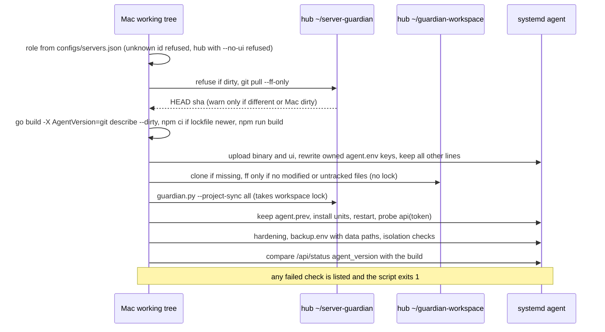
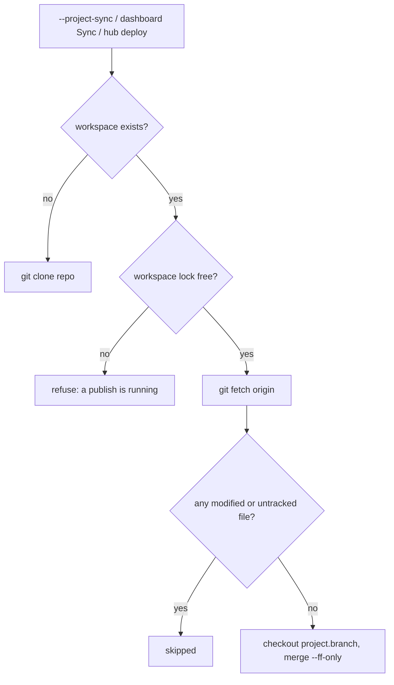
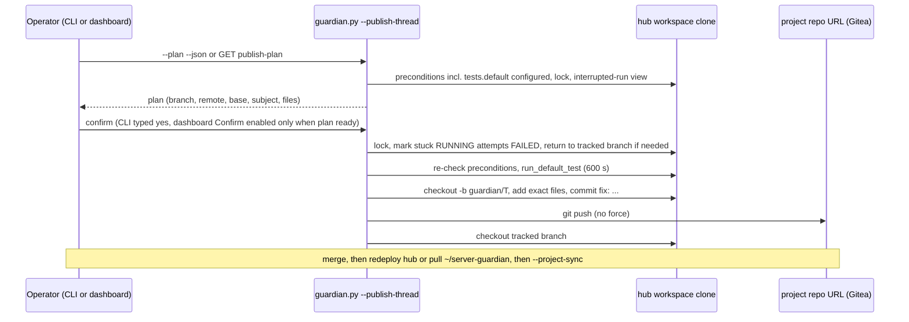

# Phase 3 - 개발 워크플로 재검토 (5aa8e2e..52fbfe2)

[English](phase3-dev.md) | 한국어

> 2026-10-12 시점의 기록이며, 이후 코드가 바뀌었다.

`52fbfe2`(수정 commit 47개) 기준 Mac checkout의 읽기 전용 검토이다. 허브 자체는 살펴보지 않았다. 아래
집계는 코드와 대조해 확인했다. 경로는 저장소 기준 상대 경로이다. `install` = `scripts/install-agent-service.sh`.

## 요약 표

| id | 심각도 | phase-1 -> phase-3 |
|---|---|---|
| DEV-1 README의 허브 명령이 허브 모드를 끈다 | high | OPEN -> **RESOLVED** |
| DEV-2 재배포가 운영자의 agent.env 설정을 지운다 | high | OPEN -> **RESOLVED** |
| DEV-3 git_commit_push 대 publish | high | OPEN -> **PARTIAL** |
| DEV-4 publish된 코드가 CI를 우회한다 | medium | OPEN -> **OPEN** |
| DEV-5 배포/동기화가 untracked 파일을 무시한다 | medium | OPEN -> **RESOLVED** |
| DEV-6 publish 후 `--project-sync` 루프 | medium | OPEN -> **RESOLVED** |
| DEV-7 버전 원천 / 스탬프 없음 | medium | OPEN -> **PARTIAL** |
| DEV-8 대시보드 publish가 내용을 보지 않고 확인한다 | medium | OPEN -> **RESOLVED** |
| DEV-9 base_sha 없는 조치는 publish할 수 없다 | medium | OPEN -> **OPEN** |
| DEV-10 pytest 대체 | medium | OPEN -> **RESOLVED** |
| DEV-11 첫 설치 부트스트랩 | medium | OPEN -> **OPEN** |
| DEV-12 README가 push 모델과 모순된다 | medium | OPEN -> **RESOLVED** |
| DEV-13 CI가 main 실행을 취소한다 | low | OPEN -> **RESOLVED** |
| DEV-14 ci.sh 머리말 / README 절 | low | OPEN -> **RESOLVED** |
| DEV-15 툴체인 / 타깃 이탈 | low | OPEN -> **OPEN** |
| DEV-16 배포가 오래된 node_modules를 재사용한다 | low | OPEN -> **RESOLVED** |
| DEV-17 두 타임아웃 / 두 워크스페이스 갱신기 | low | OPEN -> **PARTIAL** |
| DEV-18 판정자가 프로젝트 테스트를 안내받지 못한다 | low | OPEN -> **RESOLVED** |
| DEV-19 publish exit 코드 | low | OPEN -> **RESOLVED** |
| DEV-20 publish commit이 항상 `fix:` | low | OPEN -> **OPEN** |
| DEV-21 오래된 문서 / 추적되는 transcript | low | OPEN -> **PARTIAL** |
| DEV-N1 README가 여전히 pytest 대체를 언급한다 | low | new |
| DEV-N2 강화 되돌림이 이제 설치를 실패시키는데, 문서는 아니라고 한다 | low | new |
| DEV-N3 설치 스크립트가 대시보드 등록 노드를 거부하며, pull 단계가 문서화되지 않았다 | low | new |
| DEV-N4 설치 스크립트의 워크스페이스 갱신이 publish/sync 잠금을 우회한다 | low | new |

집계: RESOLVED 12, PARTIAL 4, OPEN 5, REGRESSED 0. 신규: 4 (모두 low).

---

## 발견 사항별 상태

- **DEV-1 RESOLVED.** 허브 모드는 이제 인벤토리 role로만 정해진다. `--no-ui`를 붙인 허브는 거부되며,
  인벤토리에 없는 서버도 거부된다 (`install:107-116`). README는 이제 평범한 허브 명령을 보여 주고 UI 플래그가
  허브에 영향을 주지 않는다고 말한다 (`README.md:124-126`).
- **DEV-2 RESOLVED.** 설치 스크립트는 고정된 키 목록을 소유하고 (`install:203`), 그 밖의 모든 `KEY=value` 줄은
  유지되며 (`install:204`) 설치 후 나열된다. `GUARDIAN_UI_ACTIONS`는 주석에 명시되어 있다
  (`install:200-202`).
- **DEV-3 PARTIAL.** 문서는 이제 publish를 쓰도록 안내한다 (`README.md:49`, `docs/design/publish-thread.md:5-8`).
  코드와 설정은 그대로이다: `git add -A`가 여전히 있고 (`cli/llm-agent/mcp_client.py:318`), 기본 팀과 판정자
  페르소나는 여전히 `git_commit_push`를 허용한다 (`configs/teams/cross-review.json:11`,
  `configs/personas/jev_mcp_decision.json:11`). 판정자 제안 하나로 여전히 스레드를 publish할 수 없게 만들 수 있다.
- **DEV-4 OPEN (DESIGN).** publish는 여전히 프로젝트 `repo`에만 push한다. `publish-thread.md:96-99`와
  `README.md:183`의 merge 단계는 CI나 `scripts/ci.sh` 실행을 언급하지 않으며, `ci.yml` 트리거는
  바뀌지 않았다.
- **DEV-5 RESOLVED.** 허브 배포는 untracked 파일을 센다 (`install:263-269`). `ProjectManager._update`도
  그렇게 하며 (`cli/llm-agent/project_registry.py:341-346`) 워크스페이스 잠금 아래에서 실행된다 (`:331`).
- **DEV-6 RESOLVED (문서 수정).** `publish-thread.md:96-99`와 `README.md:183`은 이제 `--project-sync` 전에 허브를
  재배포하거나 `~/server-guardian`을 pull하라고 말한다. 설계 대안(워크스페이스 origin = `repo`)은 채택되지
  않았다 (`install:255`).
- **DEV-7 PARTIAL.** 에이전트에 `git describe --dirty`로 스탬프가 찍힌다 (`install:159-161`,
  `apps/agent/main.go:14-19`, CI에도 `scripts/ci.sh:67-69`). 설치는 Mac, 허브, 워크스페이스의 HEAD를 출력하고,
  배포된 버전이 빌드와 다르면 실패한다 (`install:455-470`). `agent.prev`를 유지하고 점검이 실패하면 exit
  1로 끝난다 (`install:472-479`). 아직 남은 것: dirty이거나 push되지 않은 Mac 트리는 경고만 받고
  (`install:137-142`), 배포가 CI로 게이트되지 않는다.
- **DEV-8 RESOLVED.** dry-run 계획이 있다 (`cli/llm-agent/publish_ops.py:318-319,423-438`,
  `apps/agent/debate_handler.go:292,1066-1076`의 `GET /api/threads/{thread}/publish-plan`). 대시보드는
  이를 보여 주고 계획이 준비될 때까지 Confirm을 비활성 상태로 둔다 (`apps/web-desktop/src/pages/debate/ResultView.tsx:225-229,325`).
  잔여: POST는 여전히 보여 준 계획에 묶이지 않고 `--yes`를 보낸다 (`debate_handler.go:1054`).
  publish는 모든 전제 조건을 다시 점검하므로, 이는 계획과 클릭 사이에 브랜치 이름이나 워크스페이스가 바뀔 때만
  문제가 된다.
- **DEV-9 OPEN.** 코드 맥락이 없으면 `base_sha`는 여전히 `None`이고 (`cli/llm-agent/debate_engine.py:626`),
  오래됨 점검은 여전히 이를 건너뛰며 (`cli/llm-agent/action_ops.py:171-175`), 제안 시점의 거부는 추가되지 않았다.
- **DEV-10 RESOLVED.** 대체 테스트는 더 이상 없다: `tests.default` 없는 `run_test`는 검증 단계에서 거부되고
  (`cli/llm-agent/mcp_client.py:184-186`, `:343-358`), publish는 아무것도 건드리기 전에 거부한다
  (`publish_ops.py:255,343-348`). README `:164`가 이를 문서화하지만, DEV-N1을 보라.
- **DEV-11 OPEN.** `WorkingDirectory=/home/ubuntu/server-guardian`은 여전히 모든 노드에서 필요하고
  (`deploy/systemd/server-guardian-agent.service:13`), clone 단계는 여전히 문서화되지 않았다. 주석만
  바뀌었다.
- **DEV-12 RESOLVED.** README는 `apply_patch`를 나열하고, publish를 유일한 push 경로로 설명하며, Publish
  절이 있다 (`README.md:46-49,168,179-184`).
- **DEV-13 RESOLVED.** push는 sha별 concurrency 그룹을 받고, PR 실행만 취소된다
  (`.github/workflows/ci.yml:13-17`).
- **DEV-14 RESOLVED.** `ci.sh` 머리말과 README 표가 코드와 일치한다 (`scripts/ci.sh:6,12,14`,
  `README.md:224,231,234`).
- **DEV-15 OPEN.** `go.mod`는 toolchain 줄 없이 여전히 `go 1.26.2`이고, 허브는 `1.26.8`을 설치한다
  (`install:62`). CI는 여전히 arm64만 빌드한다 (`scripts/ci.sh:69`).
- **DEV-16 RESOLVED.** `ensure_node_deps`는 lockfile이 더 새로우면 두 패키지 모두에 대해 `npm ci`를 다시
  실행한다 (`install:96-104,170-171`).
- **DEV-17 PARTIAL.** 이제 `run_tests`, `run_test`, publish 게이트에 하나의 `TEST_TIMEOUT = 600`이 있다
  (`mcp_client.py:94`, `publish_ops.py:26`). 워크스페이스 갱신기는 여전히 둘이다: bash 블록은 허브 checkout의
  현재 브랜치를 따르고 (`install:256-276`, `:262`의 `base=`), Python sync는 `project.branch`를
  따른다. DEV-N4도 보라.
- **DEV-18 RESOLVED.** `MCPClient.describe`가 프로젝트의 접두사와 기본 테스트를 `run_tests`에 추가한다
  (`mcp_client.py:147-155`).
- **DEV-19 RESOLVED.** 대화형 publish는 exit 3과 2/4를 쓰고, push 실패일 때만 exit 1로 끝난다
  (`cli/llm-agent/guardian.py:145-190`). 문서가 일치한다 (`publish-thread.md:27-29`, `guardian.py:145-190`).
- **DEV-20 OPEN (DESIGN).** 제목은 여전히 하드코딩된 `fix:`이다 (`publish_ops.py:82-86`).
- **DEV-21 PARTIAL.** transcript가 제거되었고 (`8e59311`; `git ls-files docs/decisions`가 비어 있음), README는
  React라고 말하며 (`README.md:61`), `agent.md:158`은 고쳐졌고, 분석 문서에는 스냅샷 표시가 붙었고,
  `debate-patch-tool.md`는 바로잡혔다. 아직 오래된 것: `agent.md:238-239`(`:5173`의 대시보드, `:5173` 접근
  URL), `agent.md:230`의 `MOBILE ... 100.64.0.x:5173` 연결선, `agent.md:281`(판정자가 코드
  변경을 "실행한다").

---

## 신규 발견 사항

### DEV-N1 (low) README가 여전히 pytest 대체를 설명한다
- 근거: `README.md:182`는 publish가 `tests.default`를 실행하고, "else `python3 -m pytest -q`"라고 말한다. 그러나 `README.md:164`는
  `tests.default`가 없으면 run_test와 publish가 거부된다고 말한다. 코드에는 대체가 없다
  (`mcp_client.py:343-352`, `publish_ops.py:343-348`, `publish-thread.md:44-45`).
- 수정: SAFE-FIX - `README.md:182`의 괄호를 삭제한다.

### DEV-N2 (low) 되돌려진 sshd 강화가 이제 설치를 실패시키지만, README와 스크립트 주석은 그렇지 않다고 말한다
- 근거: `install:401-402`는 `REVERTED:`(`deploy/ssh/apply-ssh-hardening.sh:52`가 출력)와 그 밖의
  SKIPPED가 아닌 모든 결과를 `fail`로 취급하므로, 설치가 exit 1로 끝난다 (`install:472-479`).
  `install:393-394`의 주석("never aborts the install")과 `README.md:136`("skipped or reverted, the agent install
  still finishes")은 반대로 말한다.
- 이유: 에이전트는 실제로 설치되었는데, 스크립트는 실패를 보고하고 바이너리를 롤백하라고 제안한다.
  운영자가 정상 배포를 롤백하거나, exit 1을 무시하는 습관이 들 수 있다.
- 수정: SAFE-FIX - 한 가지 동작을 고른다. `REVERTED`를 `SKIPPED`처럼 경고로 취급하거나, 실패로 유지하되
  주석과 README(및 롤백 안내)를 에이전트는 정상이라고 말하도록 고친다.

### DEV-N3 (low) 설치 스크립트가 이제 인벤토리를 pull하기 전까지 대시보드 등록 노드를 거부한다
- 근거: role과 서버는 Mac의 `configs/servers.json`에서만 조회되며, 모르는 id는 거부된다
  (`install:107-111`, `README.md:130`). 대시보드에서 등록한 노드는 허브의
  `~/.guardian/data/servers.json`에 있고 (`docs/design/node-registration.md:23-30`), `scripts/pull-inventory.sh`와
  commit을 거쳐서만 Mac에 도달한다 (`node-registration.md:128`). README는
  `pull-inventory.sh`를 전혀 언급하지 않는다 (grep 결과 일치 없음).
- 수정: SAFE-FIX - `README.md:130`과 거부 메시지에 "대시보드에서 추가한 노드는 먼저 `scripts/pull-inventory.sh`를 실행한다"를
  추가한다.

### DEV-N4 (low) 설치 스크립트의 워크스페이스 갱신이 새 publish/sync 잠금을 우회한다
- 근거: publish와 `ProjectManager.sync`는 이제 `<git dir>/guardian-publish.lock`의 flock을 공유한다
  (`project_registry.py:211-225,331`, `publish_ops.py:154-161` (`_publish_lock`)). `publish-thread.md`는 (`publish-thread.md:66`) "Project sync takes the
  same lock"이라고 말한다. `install:256-276`의 bash 블록은 잠금 없이 fetch, checkout, fast-forward를 한다. 그다음
  `systemctl stop` (`install:356`)이 에이전트가 시작한 publish 자식 프로세스를 죽인다.
- 이유: publish 도중의 배포는 그 아래에서 워크스페이스 브랜치를 바꾸거나, push 도중에 이를 죽일 수 있다. 중단된
  publish 복구(`publish_ops.py:276-290`)가 이를 복구 가능하게 하지만, 명시된 "워크스페이스당 쓰는 쪽은 하나"
  규칙과 모순된다.
- 수정: SAFE-FIX - bash 블록을 없애고 `guardian.py --project-sync all`(잠금을 잡음)에 의존한다. bash
  블록을 유지한다면 `flock -n "$(git rev-parse --absolute-git-dir)/guardian-publish.lock"`으로 감싼다.

---

## 갱신된 절차 다이어그램

### PROC-4 허브 배포 (변경됨)

### PROC-6 프로젝트 워크스페이스 동기화 (변경됨)

### PROC-9 Publish (변경됨)

나머지 절차(PROC-1, 2, 3, 5, 7, 8, 10)는 위에 적은 세부 사항을 빼면 바뀌지 않았다: PROC-3의 CI
concurrency 규칙, PROC-2의 go build에 들어간 버전 스탬프, 그리고 PROC-7에서 한 라운드로 제한되고 예외 발생 시
FAILED가 되는 HELD 해제.
