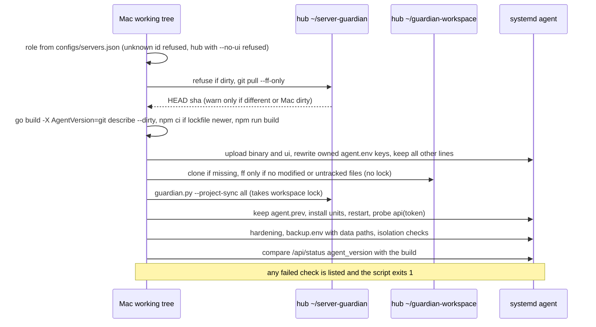
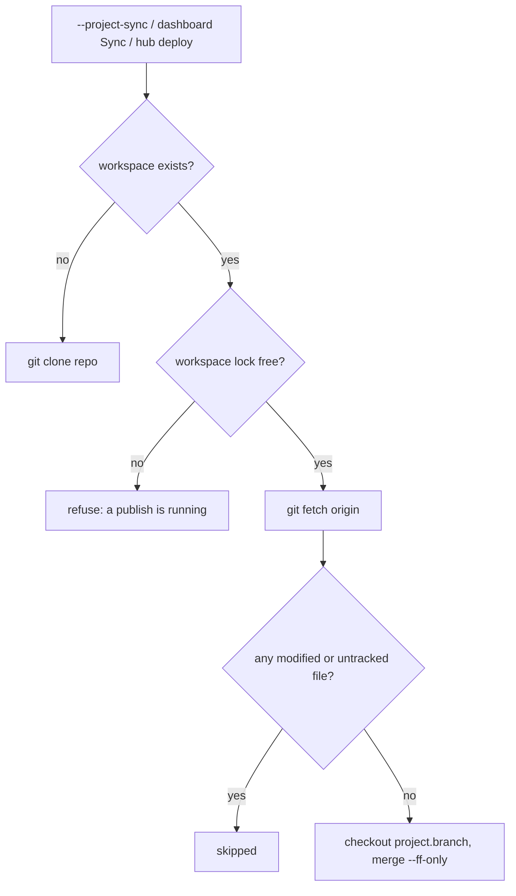
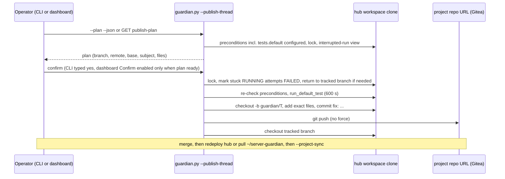

# Phase 3 - Development workflow re-review (5aa8e2e..52fbfe2)

English | [한국어](phase3-dev.ko.md)

> Point-in-time record from 2026-10-12; the code has changed since.

Read-only review of the Mac checkout at `52fbfe2` (47 fix commits). The hub itself was not inspected. The
counts below are verified against the code. Paths are repo-relative. `install` = `scripts/install-agent-service.sh`.

## Summary table

| id | severity | phase-1 -> phase-3 |
|---|---|---|
| DEV-1 README hub command disables hub mode | high | OPEN -> **RESOLVED** |
| DEV-2 redeploy wipes operator agent.env settings | high | OPEN -> **RESOLVED** |
| DEV-3 git_commit_push vs publish | high | OPEN -> **PARTIAL** |
| DEV-4 published code bypasses CI | medium | OPEN -> **OPEN** |
| DEV-5 deploy/sync ignore untracked files | medium | OPEN -> **RESOLVED** |
| DEV-6 post-publish `--project-sync` loop | medium | OPEN -> **RESOLVED** |
| DEV-7 version sources / no stamp | medium | OPEN -> **PARTIAL** |
| DEV-8 dashboard publish confirms blind | medium | OPEN -> **RESOLVED** |
| DEV-9 actions without base_sha unpublishable | medium | OPEN -> **OPEN** |
| DEV-10 pytest fallback | medium | OPEN -> **RESOLVED** |
| DEV-11 first-install bootstrap | medium | OPEN -> **OPEN** |
| DEV-12 README contradicts push model | medium | OPEN -> **RESOLVED** |
| DEV-13 CI cancels main runs | low | OPEN -> **RESOLVED** |
| DEV-14 ci.sh header / README sections | low | OPEN -> **RESOLVED** |
| DEV-15 toolchain / target drift | low | OPEN -> **OPEN** |
| DEV-16 deploy reuses stale node_modules | low | OPEN -> **RESOLVED** |
| DEV-17 two timeouts / two workspace updaters | low | OPEN -> **PARTIAL** |
| DEV-18 judge not told project tests | low | OPEN -> **RESOLVED** |
| DEV-19 publish exit codes | low | OPEN -> **RESOLVED** |
| DEV-20 publish commits always `fix:` | low | OPEN -> **OPEN** |
| DEV-21 stale docs / tracked transcript | low | OPEN -> **PARTIAL** |
| DEV-N1 README still names a pytest fallback | low | new |
| DEV-N2 hardening revert now fails the install, docs say it does not | low | new |
| DEV-N3 installer refuses dashboard-registered nodes, pull step undocumented | low | new |
| DEV-N4 installer's workspace update bypasses the publish/sync lock | low | new |

Counts: RESOLVED 12, PARTIAL 4, OPEN 5, REGRESSED 0. New: 4 (all low).

---

## Per-finding status

- **DEV-1 RESOLVED.** Hub mode now comes from the inventory role alone. A hub with `--no-ui` is refused, and so
  is a host that is not in the inventory (`install:107-116`). README now shows the plain hub command and says the
  UI flags do not affect the hub (`README.md:124-126`).
- **DEV-2 RESOLVED.** The installer owns a fixed key list (`install:203`), and every other `KEY=value` line is
  kept (`install:204`) and listed after the install. `GUARDIAN_UI_ACTIONS` is named in the comment
  (`install:200-202`).
- **DEV-3 PARTIAL.** Docs now steer you to publish (`README.md:49`, `docs/design/publish-thread.md:5-8`). The
  code and config are unchanged: `git add -A` is still there (`cli/llm-agent/mcp_client.py:318`), and the default
  team and judge persona still grant `git_commit_push` (`configs/teams/cross-review.json:11`,
  `configs/personas/jev_mcp_decision.json:11`). One judge proposal can still make a thread unpublishable.
- **DEV-4 OPEN (DESIGN).** Publish still pushes only to the project `repo`. The merge step in
  `publish-thread.md:96-99` and `README.md:183` names no CI or `scripts/ci.sh` run, and `ci.yml` triggers are
  unchanged.
- **DEV-5 RESOLVED.** The hub deploy counts untracked files (`install:263-269`). `ProjectManager._update` does
  too (`cli/llm-agent/project_registry.py:341-346`) and runs under the workspace lock (`:331`).
- **DEV-6 RESOLVED (doc fix).** `publish-thread.md:96-99` and `README.md:183` now say to redeploy the hub, or
  pull `~/server-guardian`, before `--project-sync`. The design alternative (workspace origin = `repo`) was not
  taken (`install:255`).
- **DEV-7 PARTIAL.** The agent is stamped with `git describe --dirty` (`install:159-161`,
  `apps/agent/main.go:14-19`, also in CI `scripts/ci.sh:67-69`). The install prints Mac, hub and workspace HEADs
  and fails when the deployed version differs from the build (`install:455-470`). It keeps `agent.prev` and exits
  1 on failed checks (`install:472-479`). Still open: a dirty or unpushed Mac tree is only warned about
  (`install:137-142`), and deploy is not gated on CI.
- **DEV-8 RESOLVED.** There is a dry-run plan (`cli/llm-agent/publish_ops.py:318-319,423-438`,
  `GET /api/threads/{thread}/publish-plan` at `apps/agent/debate_handler.go:292,1066-1076`). The dashboard
  shows it and keeps Confirm disabled until the plan is ready (`apps/web-desktop/src/pages/debate/ResultView.tsx:225-229,325`).
  Residual: the POST still sends `--yes` (`debate_handler.go:1054`) without binding to the plan that was shown.
  Publish re-checks every precondition, so this only matters if the branch name or workspace changes between
  plan and click.
- **DEV-9 OPEN.** `base_sha` is still `None` without a code context (`cli/llm-agent/debate_engine.py:626`), the
  stale check still skips it (`cli/llm-agent/action_ops.py:171-175`), and no proposal-time refusal was added.
- **DEV-10 RESOLVED.** There is no fallback test any more: `run_test` without `tests.default` is refused at
  validation (`cli/llm-agent/mcp_client.py:184-186`, `:343-358`), and publish refuses before touching anything
  (`publish_ops.py:255,343-348`). README `:164` documents it, but see DEV-N1.
- **DEV-11 OPEN.** `WorkingDirectory=/home/ubuntu/server-guardian` is still required on every node
  (`deploy/systemd/server-guardian-agent.service:13`), and the clone step is still undocumented. Only the comment
  changed.
- **DEV-12 RESOLVED.** README lists `apply_patch`, explains publish as the only push path, and has a Publish
  section (`README.md:46-49,168,179-184`).
- **DEV-13 RESOLVED.** Pushes get a concurrency group per sha, and only PR runs are cancelled
  (`.github/workflows/ci.yml:13-17`).
- **DEV-14 RESOLVED.** The `ci.sh` header and the README table match the code (`scripts/ci.sh:6,12,14`,
  `README.md:224,231,234`).
- **DEV-15 OPEN.** `go.mod` still says `go 1.26.2` with no toolchain line, while the hub installs `1.26.8`
  (`install:62`). CI still builds only arm64 (`scripts/ci.sh:69`).
- **DEV-16 RESOLVED.** `ensure_node_deps` reruns `npm ci` when the lockfile is newer, for both packages
  (`install:96-104,170-171`).
- **DEV-17 PARTIAL.** There is now one `TEST_TIMEOUT = 600` for `run_tests`, `run_test` and the publish gate
  (`mcp_client.py:94`, `publish_ops.py:26`). There are still two workspace updaters: the bash block follows the
  hub checkout's current branch (`install:256-276`, `base=` at `:262`), while the Python sync follows
  `project.branch`. See also DEV-N4.
- **DEV-18 RESOLVED.** `MCPClient.describe` adds the project's prefixes and default test to `run_tests`
  (`mcp_client.py:147-155`).
- **DEV-19 RESOLVED.** The interactive publish uses exits 3 and 2/4, and exits 1 only on push failure
  (`cli/llm-agent/guardian.py:145-190`). The doc matches (`publish-thread.md:27-29`, `guardian.py:145-190`).
- **DEV-20 OPEN (DESIGN).** The subject is still a hard-coded `fix:` (`publish_ops.py:82-86`).
- **DEV-21 PARTIAL.** The transcript is removed (`8e59311`; `git ls-files docs/decisions` is empty), README says
  React (`README.md:61`), `agent.md:158` is fixed, the analysis doc is stamped as a snapshot, and
  `debate-patch-tool.md` is corrected. Still stale: `agent.md:238-239` (dashboard on `:5173`, the `:5173` access
  URL), the `MOBILE ... 100.64.0.x:5173` edge in `agent.md:230`, and `agent.md:281` (the judge "executes" code
  changes).

---

## New findings

### DEV-N1 (low) README still describes a pytest fallback
- Evidence: `README.md:182` says publish runs `tests.default`, "else `python3 -m pytest -q`". But `README.md:164`
  says that without `tests.default`, run_test and publish are refused. The code has no fallback
  (`mcp_client.py:343-352`, `publish_ops.py:343-348`, `publish-thread.md:44-45`).
- Fix: SAFE-FIX - delete the parenthesis in `README.md:182`.

### DEV-N2 (low) A reverted sshd hardening now fails the install, but README and the script comment say it does not
- Evidence: `install:401-402` treats `REVERTED:` (emitted by `deploy/ssh/apply-ssh-hardening.sh:52`) and any
  other non-SKIPPED result as `fail`, so the install exits 1 (`install:472-479`). The comment at
  `install:393-394` ("never aborts the install") and `README.md:136` ("skipped or reverted, the agent install
  still finishes") say the opposite.
- Why: the agent really is installed, yet the script reports failure and suggests rolling back the binary.
  Operators may roll back a good deploy, or learn to ignore exit 1.
- Fix: SAFE-FIX - pick one behaviour. Either treat `REVERTED` as a warning like `SKIPPED`, or keep it as a
  failure and reword the comment and README (and the rollback hint) to say the agent is fine.

### DEV-N3 (low) The installer now refuses dashboard-registered nodes until the inventory is pulled
- Evidence: the role and host are looked up only in the Mac's `configs/servers.json`, and unknown ids are refused
  (`install:107-111`, `README.md:130`). Nodes registered from the dashboard live in the hub's
  `~/.guardian/data/servers.json` (`docs/design/node-registration.md:23-30`) and reach the Mac only through
  `scripts/pull-inventory.sh` plus a commit (`node-registration.md:128`). README never mentions
  `pull-inventory.sh` (grep finds no match).
- Fix: SAFE-FIX - add "run `scripts/pull-inventory.sh` first for nodes added from the dashboard" to
  `README.md:130` and to the refusal message.

### DEV-N4 (low) The installer's workspace update bypasses the new publish/sync lock
- Evidence: publish and `ProjectManager.sync` now share a flock on `<git dir>/guardian-publish.lock`
  (`project_registry.py:211-225,331`, `publish_ops.py:154-161` (`_publish_lock`)). `publish-thread.md` says (`publish-thread.md:66`) "Project sync takes the
  same lock". The bash block in `install:256-276` fetches, checks out and fast-forwards without it. Then
  `systemctl stop` (`install:356`) kills any publish child the agent started.
- Why: a deploy during a publish can switch the workspace branch under it, or kill it mid-push. The interrupted-
  publish recovery (`publish_ops.py:276-290`) makes this recoverable, but it contradicts the stated "one writer per
  workspace" rule.
- Fix: SAFE-FIX - drop the bash block and rely on `guardian.py --project-sync all` (which takes the lock). If the
  bash block stays, wrap it in `flock -n "$(git rev-parse --absolute-git-dir)/guardian-publish.lock"`.

---

## Updated procedure diagrams

### PROC-4 Hub deploy (changed)

### PROC-6 Project workspace sync (changed)

### PROC-9 Publish (changed)

The other procedures (PROC-1, 2, 3, 5, 7, 8, 10) are unchanged apart from the details noted above: the CI
concurrency rule in PROC-3, the version stamp in PROC-2's go build, and the HELD release limited to one round and
FAILED on a raised exception in PROC-7.
