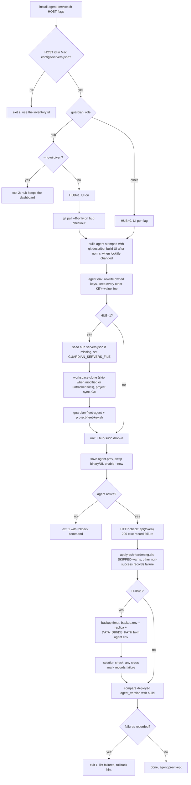
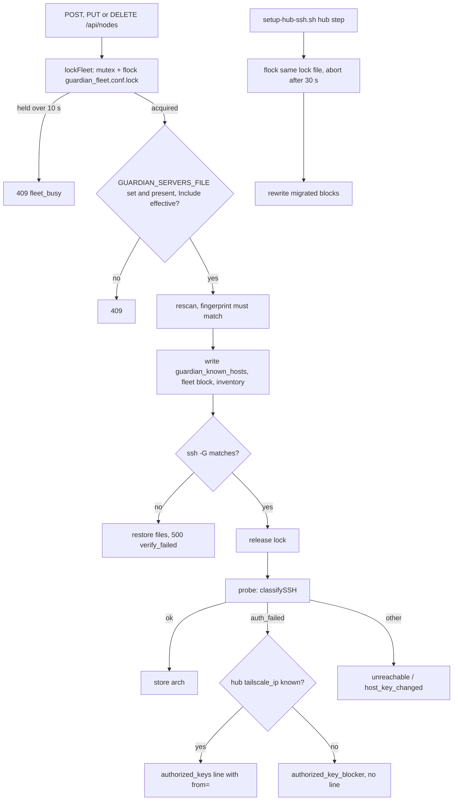
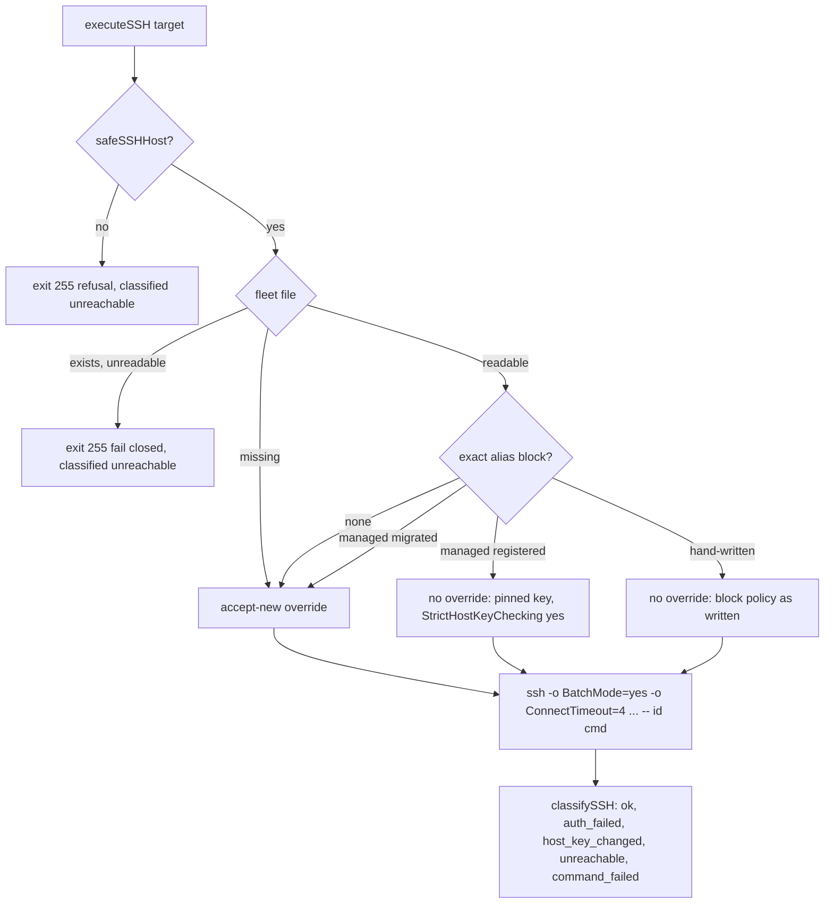

# 3단계 - 서버 / 플릿 관리 재검토 (운영 분석가)

[English](phase3-ops.md) | 한국어

> 2026-10-12 시점의 기록이며, 이후 코드가 바뀌었다.

검토 범위: `5aa8e2e..52fbfe2`(작업 트리는 `52fbfe2`에 있다). 읽기 전용이며 호스트에 접속하지 않았다. 모든
file:line은 `52fbfe2`를 가리킨다. 1단계 보고서: `../phase1/ops.md`.

## 요약 표

| id | 심각도 | 1단계 -> 3단계 | 한 줄 요약 |
|---|---|---|---|
| OPS-1 | High | OPEN -> **RESOLVED** | 인벤토리 role만으로 허브 모드가 결정된다. 알 수 없는 호스트와 별칭은 거부된다. |
| OPS-2 | High | OPEN -> **RESOLVED** | `agent.env`는 스크립트가 소유한 키만 다시 쓰고 나머지 `KEY=value` 줄은 모두 유지한다(경계 사례는 OPS-N3). |
| OPS-3 | High | OPEN -> **OPEN** | README는 여전히 허브가 아닌 에이전트 설치를 권장하고, 유닛은 여전히 체크아웃을 필요로 한다. |
| OPS-4 | Medium | OPEN -> **PARTIAL** | 주석과 운영 기록이 이제 사실대로 말한다. 허브 주도의 하드닝 경로는 여전히 없다. |
| OPS-5 | High | OPEN -> **OPEN** | 여전히 push 경로가 없다. 설치, setup-hub-ssh, 백업 replica는 여전히 Mac 사본을 읽는다. |
| OPS-6 | High | OPEN -> **OPEN** | 삭제해도 여전히 키가 노드에 남는다. `setup-hub-ssh.sh` apply는 여전히 제거된 노드를 다시 추가할 수 있다. |
| OPS-7 | Medium | OPEN -> **OPEN** | UI는 여전히 `setup-hub-ssh.sh <id>`를 제안하고, apply는 여전히 Mac 인벤토리 전체를 건드린다. |
| OPS-8 | Medium | OPEN -> **PARTIAL** | 손으로 쓴 플릿 블록이 존중되고 읽을 수 없는 파일은 fail closed된다. 마이그레이션된 노드는 여전히 trust-on-first-use다. OPS-N1 참고. |
| OPS-9 | Medium | OPEN -> **OPEN** | 허브가 여전히 자신의 플릿 목록에 있으므로 `--no-hub-sudo`는 여전히 우회할 수 있다. |
| OPS-10 | Medium | OPEN -> **OPEN** | exec 라우트에는 여전히 토큰 외의 관문과 감사 기록이 없다. |
| OPS-11 | Medium | OPEN -> **PARTIAL** | Go는 이제 엄격하다. Python CLI는 여전히 대체 경로로 넘어간다(OPS-N2). |
| OPS-12 | Medium | OPEN -> **OPEN** | exec/remote는 여전히 hostname과 일치시키고 플릿 대상은 그렇지 않으며, 설계 문서는 바뀌지 않았다. |
| OPS-13 | Medium | OPEN -> **PARTIAL** | macOS에서 실패한 프로브는 이제 `command_failed`로 읽힌다. 스크립트별 호스트 집합과 Linux 전용 프로브는 그대로다. |
| OPS-14 | Medium | OPEN -> **PARTIAL** | 공유 `classifySSH`가 모든 보기에 추가되었다. 레거시 status 필드와 허브 전용 health 임계값은 남아 있다. |
| OPS-15 | Medium | OPEN -> **OPEN** | 백업은 여전히 decision DB만 다룬다. 복원 절차도, 실패 알림도 없다. |
| OPS-16 | Low | OPEN -> **RESOLVED** | 설치가 `GUARDIAN_DATA_DIR`/`GUARDIAN_DB_PATH`를 `backup.env`에 복사한다. |
| OPS-17 | Low | OPEN -> **RESOLVED** | 허브 IP 없이는 키 줄을 반환하지 않고, 대신 blocker를 반환한다. |
| OPS-18 | Low | OPEN -> **OPEN** | `import-credentials.sh`는 바뀌지 않았다. |
| OPS-19 | Low | OPEN -> **RESOLVED** | 1단계에서 나열한 모든 drift 항목이 수정되었다. 새 drift는 OPS-N4로 등록했다. |
| OPS-20 | Low | OPEN -> **RESOLVED** | UI 정규식이 이제 서버의 것과 같고, 허브가 자신의 규칙을 게시한다. |
| OPS-21 | Low | OPEN -> **RESOLVED** | 에이전트와 스크립트가 `guardian_fleet.conf.lock`에 대한 `flock`을 공유한다. |
| OPS-22 | Low | OPEN -> **RESOLVED** | 점검 실패를 모아 exit 1로 끝낸다. `agent.prev`를 보존하고 버전을 확인한다. |
| OPS-23 | Low | OPEN -> **OPEN** | `deploy-llm-env.sh`와 `install-llm-clis.sh`는 여전히 기본값으로 모든 Tier-1 호스트를 대상으로 한다. |
| OPS-24 | Low | OPEN -> **OPEN** | 여전히 키 교체 절차가 없다. |

집계: **RESOLVED 8**, **PARTIAL 5**, **OPEN 11**, **REGRESSED 0**.
수정이 들어간 두 High 발견 사항(OPS-1, OPS-2)은 모두 해결되었다. 나머지 세 High 발견 사항(OPS-3, OPS-5, OPS-6)은 DESIGN 항목이며 열린 상태로 남아 있다.

수정에서 비롯된 새 발견 사항:

| id | 심각도 | 한 줄 요약 |
|---|---|---|
| OPS-N1 | Low | host-key override 규칙은 플릿 파일의 정확한 별칭 블록만 인식한다. 약한 손작성 블록이 이제 그대로 존중되고, fail-closed 거부는 `unreachable`로 보고된다. |
| OPS-N2 | **Medium** | Go의 엄격한 `GUARDIAN_SERVERS_FILE`과 관대한 Python 로더가 어긋난다: 토론 CLI와 그룹은 체크아웃 사본으로 대체하는 반면 플릿 라우트는 500을 반환한다. |
| OPS-N3 | Low | `agent.env` 병합의 경계 사례: `export`/들여쓴 줄은 버려지고, 소유 키는 조용히 초기화되며, 폐기된 키는 계속 남는다. |
| OPS-N4 | Low | README가 게시 테스트 대체 동작(pytest 대 "refused")에 대해 자기모순이다. |

---

## 1. 발견 사항별 상태와 근거

### OPS-1 RESOLVED (d52b2d0)
- 근거: role 조회는 알 수 없는 id에 대해 `""`를 반환하고 스크립트는 exit 2로 끝난다(`scripts/install-agent-service.sh:107-112`). `role == hub`이면 어떤 UI 플래그가 주어지든 `HUB=1`이 설정되고, 허브에서 `--no-ui`는 거부된다(`:113-116`). README는 이제 `--with-ui` 없이 허브 설치를 보여 준다(`README.md:122-127`).
- 이유: README 명령과 별칭 사례가 더 이상 허브 설치를 비허브 설치로 바꿀 수 없다.

### OPS-2 RESOLVED (430e142)
- 근거: `owned` 키 목록이 있고, 그 밖의 모든 `KEY=value` 줄은 유지된다(`install-agent-service.sh:203-204`, `:227`). 유지된 키는 보고된다(`:231`).
- 이유: `GUARDIAN_UI_ACTIONS`, `AGENT_CORS_ORIGINS`, `GUARDIAN_JEV_GATE`, `GUARDIAN_LLM_PROVIDERS`, `GUARDIAN_DATA_DIR`이 이제 재설치 후에도 남는다. 남은 경계 사례는 OPS-N3에 있다.

### OPS-3 OPEN (DESIGN)
- 근거: README는 여전히 "API만 제공 (허브가 아닌 서버)"과 비허브 `--with-ui` 설치를 나열한다(`README.md:122`, `:126`). README는 여전히 `apps/agent`를 대상 노드 에이전트라고 부르고(`README.md:9`) 나머지는 `agent` role이라고 한다(`README.md:140`). 유닛에는 여전히 `-` 없는 `WorkingDirectory=/home/ubuntu/server-guardian`이 있다(`deploy/systemd/server-guardian-agent.service:13`).
- 이유: 노드별 설치가 여전히 문서화되고 지원되며, 이는 단일 허브 모델과 충돌한다.

### OPS-4 PARTIAL
- 근거: drop-in은 이제 에이전트를 받는 호스트에만 전달되며 다른 노드는 `apply-ssh-hardening.sh`를 손으로 실행해야 한다고 말한다(`deploy/ssh/00-guardian-hardening.conf:1-4`). 운영 기록도 같은 내용을 말한다(`docs/operations/2026-10-05-fleet-sshd-hardening.md`, "제외 및 남은 항목"의 새 항목).
- 이유: 문서상의 모순은 사라졌다. 플릿 키를 사용하는 허브 측 절차는 여전히 없으므로, "손으로 실행"은 Mac 또는 임시 `/api/fleet/exec`를 뜻한다.

### OPS-5 OPEN (DESIGN)
- 근거: `scripts/pull-inventory.sh`와 `scripts/import-credentials.sh`는 이 범위에서 바뀌지 않았다. 설치는 여전히 role, 허용 호스트, `backup_replica`를 Mac 사본에서 읽는다(`install-agent-service.sh:107`, `:189-190`, `:414-415`). `setup-hub-ssh.sh`는 Mac 사본에서 호스트 목록을 만든다(`:50-56`, `hub_fleet`은 `:274`).
- 이유: Mac -> 허브 경로가 여전히 없다. 새로운 "id must be in the Mac copy" 규칙(`:108-111`)은 설치에서 Mac 사본의 권위를 더 키운다.

### OPS-6 OPEN (DESIGN)
- 근거: `deleteNode`는 여전히 허브 파일만 건드린다(`apps/agent/nodes_handler.go:834-900`). `hub_fleet apply`는 여전히 Mac 사본의 모든 100.64 호스트에 대해 마이그레이션 블록을 추가한다(`scripts/setup-hub-ssh.sh:274`, `:328`).
- 이유: 변경 없음.

### OPS-7 OPEN
- 근거: UI 힌트는 바뀌지 않았다(`apps/web-desktop/src/pages/nodes/NodeForms.tsx:473`). apply는 여전히 플릿 파일에 대해 명시적 `HOSTS`를 무시하고(`setup-hub-ssh.sh:274`, `:328`), 명시적 호스트로 revoke할 때는 여전히 이를 건너뛴다(`:301-308`).
- 이유: 변경 없음.

### OPS-8 PARTIAL (7b5d0a0)
- 근거: `hostKeyOverride`는 플릿 블록이 없거나 관리되는 마이그레이션 블록일 때만 accept-new를 준다. 손작성 블록과 등록된 블록은 override를 받지 않고, 읽을 수 없는 플릿 파일은 fail closed된다(`apps/agent/servers_handler.go:66-92`, `:111-114`). 설계 문서가 갱신되었다(`docs/design/node-registration.md:353-360`).
- 이유: override와 조용한 하향(silent-downgrade) 부분은 수정되었다. 마이그레이션된 모든 노드는 여전히 trust-on-first-use이고(일괄 고정 없음), Mac 스크립트는 여전히 Mac `known_hosts`를 쓴다. 새 경계 사례는 OPS-N1에 있다.

### OPS-9 OPEN (DESIGN)
- 근거: 허브는 여전히 100.64 기본 목록에 있다(`setup-hub-ssh.sh:52-56`). README는 여전히 우회 방법을 문서화한다(`README.md:147`).
- 이유: 변경 없음.

### OPS-10 OPEN (DESIGN)
- 근거: `/api/exec`, `/api/exec/remote`, `/api/fleet/exec` 핸들러에는 새 관문이나 감사 기록이 없다(`apps/agent/main.go`, 이 범위에서는 `AgentVersion`만 바뀌었다).
- 이유: 변경 없음.

### OPS-11 PARTIAL (f656349)
- 근거: Go `serversFile()`은 `GUARDIAN_SERVERS_FILE`이 설정되어 있으면 그것만 쓰고, 파일이 없거나 디렉터리이면 오류를 낸다(`apps/agent/servers_handler.go:181-196`). 유닛 주석이 수정되었다(`server-guardian-agent.service:11-12`). Python `group_manager.servers_file()`은 여전히 체크아웃 사본으로 대체한다(`cli/llm-agent/group_manager.py:70-82`).
- 이유: 에이전트 쪽 절반은 수정되었다. CLI 쪽 절반이 이제 그와 모순된다(OPS-N2).

### OPS-12 OPEN
- 근거: `resolveTargetHost`는 여전히 `Hostname`과 일치시킨다(`servers_handler.go:35-45`). `selectServers`는 여전히 id와 name만 일치시킨다. 문서는 여전히 "ids, names and hostnames"라고 한다(`docs/design/node-registration.md:352`). `updateNode`는 여전히 인벤토리 `hostname`을 그대로 둔다.
- 이유: 변경 없음.

### OPS-13 PARTIAL (dbf20d5)
- 근거: diagnose 프로브는 여전히 Linux `free -m`을 연결해 실행한다(`servers_handler.go:336`). 결과에는 이제 `Reachability`가 담기고, 필드 주석이 macOS 사례를 명시한다: `command_failed`와 함께 OFFLINE(`servers_handler.go:276-281`, `:377`). `fleet-upgrade.sh`, `fleet-hostname.sh`, `fleet-reboot.sh`는 바뀌지 않았다.
- 이유: 잘못된 OFFLINE이 이제 설명되지만 제거되지는 않았다. 스크립트별 호스트 집합은 여전히 다르고, OS 필터도 여전히 없다. 코디네이터의 "24/24 ONLINE"은 이번 실행에서 edge-mini가 프로브에 응답했다는 뜻이다(예를 들어 `free` 바이너리가 있는 경우). 저장소만으로는 이를 확인할 수 없다.

### OPS-14 PARTIAL (dbf20d5)
- 근거: 단일 `classifySSH`(`apps/agent/ssh_classify.go:26-43`)가 diagnose, exec, stream(`servers_handler.go:377`, `:435`, `:644`), SSH 감사(`apps/agent/fleet_ssh.go:246-251`), 등록 프로브(`nodes_handler.go:208`, `:215`)에 공급된다.
- 이유: 이제 공유 필드가 하나 있다. 예전 `status` 어휘(ONLINE/OFFLINE, ok/partial/unreachable/error, ok/key_not_installed/unreachable)가 나란히 유지되고, 플릿 노드는 여전히 디스크나 메모리 임계값을 받지 않는다(`metrics.go:478-496`은 여전히 허브 전용이다).

### OPS-15 OPEN (DESIGN)
- 근거: `cli/llm-agent/db_backup.py`와 `deploy/systemd/server-guardian-db-backup.service`는 이 범위에서 바뀌지 않았다.
- 이유: 변경 없음.

### OPS-16 RESOLVED (601485b)
- 근거: `backup.env` = replica + `agent.env`에서 복사한 `GUARDIAN_DATA_DIR`/`GUARDIAN_DB_PATH` 줄(`install-agent-service.sh:414-420`).
- 이유: 백업이 이제 에이전트와 같은 DB 위치를 본다. 주의: 이후 `agent.env`를 손으로 고치면 다음 설치 때에야 `backup.env`에 반영된다.

### OPS-17 RESOLVED (c022ce9)
- 근거: 허브 IP가 IPv4가 아니면 `authorizedKeyLine`은 `""`와 blocker를 반환한다(`nodes_handler.go:302-324`). blocker는 노출되고(`:391-395`, `:541-546`) UI에 표시된다(`NodeForms.tsx` `keyBlocker`). 문서가 갱신되었다(`node-registration.md:198-200`).
- 이유: 제한 없는 플릿 키 줄을 더 이상 만들 수 없다.

### OPS-18 OPEN
- 근거: `scripts/import-credentials.sh`는 diff에 없다.
- 이유: 변경 없음.

### OPS-19 RESOLVED (e8c0879, ca8bdc3)
- 근거: README 토큰 문구와 빠른 시작(`README.md:78-79`, `:128-130`), 플릿 파일 문구(`README.md:144`; `guardian-fleet-agent.service:6-7`; `protect-fleet-key.sh:12-13`), 유닛 주석(`server-guardian-agent.service:11-12`), 서버 수(`README.md` 인벤토리 섹션), `node-groups.md:145`, 두 분석 문서의 스냅샷 배너, `install-llm-clis.sh:6` 헤더와 `apply-ssh-hardening.sh:18-19`.
- 이유: 1단계의 모든 항목이 바로잡혔다. 새 drift는 OPS-N4다. `README.md:145`는 여전히 단서 없이 에이전트 트리에서 sudo가 불가능하다고 말한다. 다음 줄들이 단서를 단다.

### OPS-20 RESOLVED (3c225ae, 2b78cc7)
- 근거: `TIER_RE`와 `TAG_RE`가 서버의 패턴과 같고, IPv4 옥텟은 앞자리 0 없이 255로 상한이 걸린다(`apps/web-desktop/src/lib/nodeForm.ts:13-17`, `:32-38`). 서버는 `nodeFormRules()`를 게시한다(`apps/agent/nodes_validate.go:266-294`, `nodes_handler.go:391`에서 제공).
- 이유: 클라이언트가 이제 서버가 거부하는 것을 정확히 거부한다.

### OPS-21 RESOLVED (2f8f26e)
- 근거: `lockFleet()` = 프로세스 내 mutex + 10 s 대기의 `flock(guardian_fleet.conf.lock)`, 그 후 409 `fleet_busy`(`apps/agent/ssh_fleet_lock.go:26-63`). 등록, 수정, 삭제에서 사용된다(`nodes_handler.go:556`, `:679`, `:835`). 스크립트는 읽기 전에 같은 잠금을 잡고 30 s 후 중단한다(`scripts/setup-hub-ssh.sh:74-97`).
- 이유: lost-update 경쟁 상태가 닫혔다. `storeArch`는 mutex만 유지하는데, 인벤토리만 쓰고 그 파일을 쓰는 스크립트가 없으므로 괜찮다.

### OPS-22 RESOLVED (601485b)
- 근거: `FAILURES`와 `fail()`(`install-agent-service.sh:93-94`). HTTP 점검, skip이 아닌 하드닝 실패, 격리 cross 표시, 버전 불일치가 각각 `fail`을 호출한다(`:383-388`, `:399-403`, `:431`, `:452`, `:470`). 실패가 하나라도 있으면 exit 1로 끝난다(`:472-478`). `agent.prev`가 저장되고(`:358`), 시작 실패 시 롤백 안내와 함께 중단한다(`:370-375`).
- 이유: 깨진 허브 설치가 더 이상 성공으로 끝나지 않는다.

### OPS-23 OPEN (DESIGN)
- 근거: `scripts/deploy-llm-env.sh`는 바뀌지 않았다. `install-llm-clis.sh`는 헤더만 바뀌었다.
- 이유: 변경 없음.

### OPS-24 OPEN
- 근거: `--rotate` 플래그가 없다. `protect-fleet-key.sh`는 주석만 바뀌었다.
- 이유: 변경 없음.

---

## 2. 수정으로 새로 생긴 모순

### OPS-N1 (Low) - host-key override 규칙에 빈틈이 있다
- 근거: `hostKeyOverride`는 대상을 플릿 파일에서만, `find`를 통해 찾는데, 이는 정확한 패턴 또는 `!alias`와 일치시킨다(`apps/agent/servers_handler.go:79-92`; `apps/agent/ssh_fleet_file.go:254-263`).
  - (a) 플릿 파일의 손작성 와일드카드 블록(`Host site-*`)이나 `~/.ssh/config` 자체의 모든 블록은 "블록 없음"으로 취급된다. 그런 호스트는 여전히 `-o StrictHostKeyChecking=accept-new`를 받고, 이는 그곳의 `yes`를 덮어쓴다. 주석과 문서는 손작성 블록 자체의 정책을 존중한다고 약속한다(`servers_handler.go:72-74`; `node-registration.md:356-357`).
  - (b) `StrictHostKeyChecking no`(또는 `UserKnownHostsFile /dev/null`)를 가진 정확한 별칭의 손작성 블록은 예전에는 override로 accept-new까지 올라갔다. 이제는 host-key 점검 없이 실행된다.
  - (c) fail-closed 거부는 "fleet ssh file unreadable"과 함께 exit 255를 반환하고, `classifySSH`는 이를 `unreachable`로 보고한다(`servers_handler.go:111-114`, `ssh_classify.go:35-43`). `safeSSHHost` 거부도 마찬가지다(`servers_handler.go:108-110`). 그러면 로컬 구성 오류인데도 모든 노드가 네트워크 장애처럼 보인다.
- 영향: (a)와 (b)는 경계 사례다. 현재 허브 블록은 관리되는 것으로 예상되기 때문이다. `GET /api/nodes/registration`이 점검용으로 `unmanaged_hosts`를 나열한다. (c)는 허브 측 결함을 플릿 장애처럼 보이게 한다.
- 수정: SAFE-FIX - (a) 유효한 `stricthostkeychecking`을 `ssh -G`(검증에 이미 사용 중)로 평가하고 `ask`이거나 설정되지 않았을 때만 override한다. (b) 관리되지 않는 블록이 host-key 점검을 끄면 거부하거나 `/api/nodes/registration`에서 경고한다. (c) ssh 시작 전에 이루어진 거부에 대해 별도의 exit code나 reachability 값(`local_error`)을 반환한다.

### OPS-N2 (Medium) - 엄격한 Go 인벤토리 경로 대 관대한 Python 로더
- 근거: Go는 이제 `GUARDIAN_SERVERS_FILE`이 없으면 오류를 낸다(`servers_handler.go:181-196`). 토론 CLI는 `os.Environ()`으로 시작되는데, 여기에는 이미 `agent.env`에서 온 `GUARDIAN_SERVERS_FILE`이 들어 있다. override는 `serversFile()`이 성공할 때만 추가된다(`apps/agent/debate_handler.go:319-323`). Python `servers_file()`은 없는 설정 경로를 건너뛰고 저장소의 `configs/servers.json`으로 대체한다(`cli/llm-agent/group_manager.py:70-82`).
- 영향: 허브 인벤토리가 없어지면 `/api/servers`와 `/api/fleet/*`는 500을 반환하는 반면, `/api/groups`, 그룹 미리보기, CLI 대상 해석은 낡은 체크아웃 사본에서 멤버를 계산한다. 그러면 그룹 기반 실행이 등록된 노드에 대해 "unknown target"으로 실패하고 원인은 가려진다. 이는 OPS-11이 없애려던 비일관성이며, 이제 두 언어 사이로 갈라졌다.
- 수정: SAFE-FIX - `group_manager.servers_file()`에 Go 규칙을 그대로 적용한다: 변수가 설정되어 있으면 그것을 반환하거나 `"GUARDIAN_SERVERS_FILE <path> is not usable"`을 보고한다. Go `serversFile` 테스트 옆에 테스트를 추가한다.

### OPS-N3 (Low) - `agent.env` 병합의 경계 사례
- 근거: 유지되는 줄은 `^[A-Za-z_][A-Za-z0-9_]*=`와 일치해야 한다(`install-agent-service.sh:204`). 소유 목록에는 `GUARDIAN_WORKSPACE`, `GUARDIAN_LLM_TIMEOUT`, `GUARDIAN_DEBATE_TIMEOUT`이 포함된다(`:203`).
  - `export FOO=...`, 들여쓴 줄, `KEY = value` 줄은 조용히 버려진다. systemd의 `EnvironmentFile`은 `export` 줄을 받아들이므로, 설치 전에는 이런 줄이 동작하고 있었을 수 있다.
  - 소유된 timeout이나 workspace를 손으로 바꾼 것은 목록에 나오지 않은 채 스크립트 값으로 초기화되거나 비허브 호스트에서는 제거된다. 유지된 키만 출력된다(`:231`).
  - 유지된 줄은 결코 정리되지 않는다. 폐기되었거나 테스트 전용인 키, 예를 들어 `GUARDIAN_INSECURE_NO_AUTH=1`은 모든 재설치에서 살아남는다. `AGENT_TOKEN`이 설정되어 있는 동안에는 효과가 없지만(`security.go:107-112`), 보이지 않는 drift다.
- 수정: SAFE-FIX - `export KEY=` 줄도 유지하고(`export` 제거), 이전 값이 달랐던 소유 키를 출력하며, 알려진 위험 키(`GUARDIAN_INSECURE_NO_AUTH`, `GUARDIAN_JEV_GATE=off`, `GUARDIAN_UI_ACTIONS` 미설정 대 off)에 대해 경고한다.

### OPS-N4 (Low) - README가 게시 테스트 대체 동작에 대해 자기모순이다
- 근거: `README.md:182`는 publish가 `tests.default`를 실행한다고 말한다("(없으면 `python3 -m pytest -q` ...)"). 프로젝트 필드 설명은 `tests.default`가 없으면 run_test와 publish가 거부된다고 말한다(`README.md`, 6절의 `tests.default` 항목). 코드에는 "deliberately no fallback test"가 있다(`cli/llm-agent/mcp_client.py`, `default_test_argv`, 811a81c에서 추가).
- 영향: 운영자가 허브에서 pytest가 실행될 것으로 기대할 수 있다. 운영 영역 밖이며, 개발 분석가에게 넘기도록 표시했다.
- 수정: SAFE-FIX - `README.md:182`의 pytest 구절을 삭제한다.

---

## 3. 갱신된 절차 다이어그램

### P1 (변경). 에이전트 설치 / 업그레이드

### P3 (변경). 공유 잠금을 사용한 노드 등록 / 수정 / 제거

### P5 (변경). ssh 호출별 host-key 정책

---

## 4. 메모

- 수정은 1단계의 "일관되고 유지할 가치가 있는" 속성을 지켰다: 롤백이 있는 원자적 쓰기, 검증, 고정된 프로브, 키 보호, `pull-inventory.sh` 검증이 온전하다.
- 여전히 OPEN인 모든 발견 사항은 DESIGN 항목(OPS-3, 5, 6, 9, 10, 15, 23)이거나 이번 라운드에서 시도하지 않은 SAFE-FIX(OPS-7, 12, 18, 24)다. 남은 것 중 가장 저렴한 성과는 OPS-N2(Python 로더), OPS-7(UI 힌트와 명시적 호스트를 존중하는 `hub_fleet`), OPS-12(하나의 일치 규칙), OPS-18이다.
