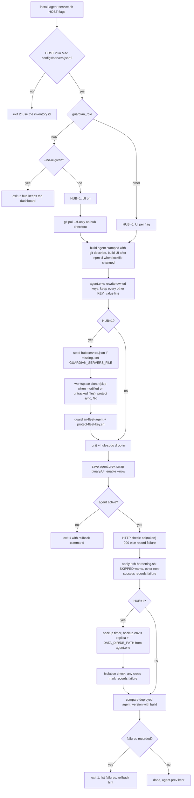
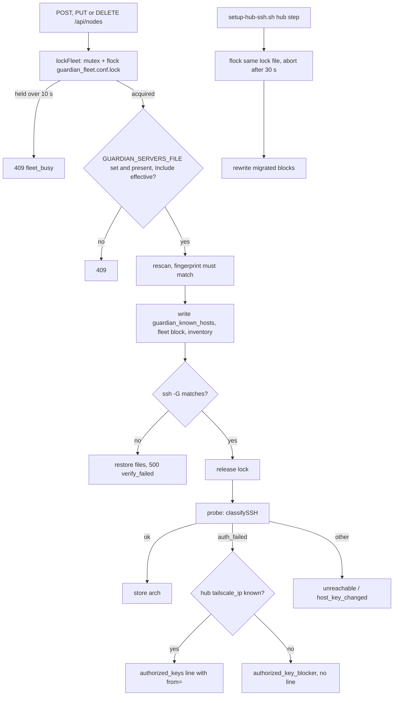
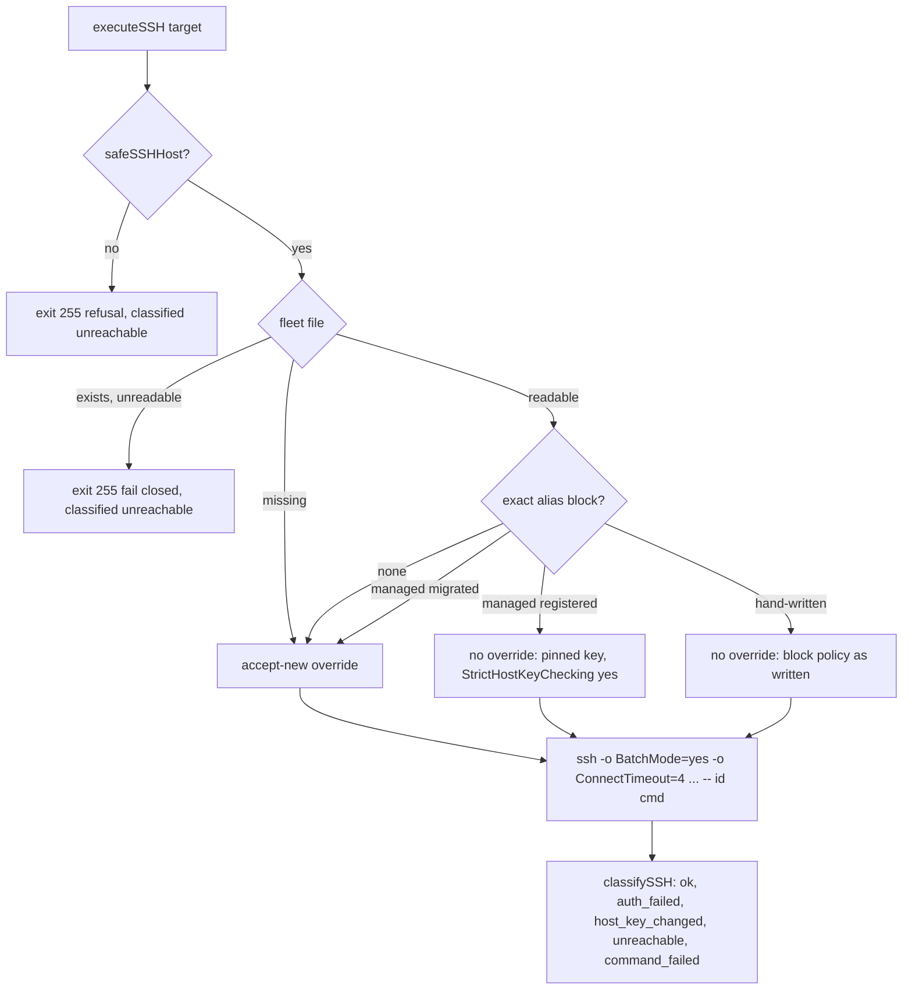

# Phase 3 - Server / fleet management re-review (ops analyst)

English | [한국어](phase3-ops.ko.md)

> Point-in-time record from 2026-10-12; the code has changed since.

Range reviewed: `5aa8e2e..52fbfe2` (working tree is at `52fbfe2`). Read-only, no host contact. Every
file:line refers to `52fbfe2`. Phase-1 report: `../phase1/ops.md`.

## Summary table

| id | severity | phase 1 -> phase 3 | one line |
|---|---|---|---|
| OPS-1 | High | OPEN -> **RESOLVED** | The inventory role alone decides hub mode. Unknown hosts and aliases are refused. |
| OPS-2 | High | OPEN -> **RESOLVED** | `agent.env` rewrites only the keys the script owns and keeps every other `KEY=value` line (edge cases in OPS-N3). |
| OPS-3 | High | OPEN -> **OPEN** | The README still recommends non-hub agent installs, and the unit still needs the checkout. |
| OPS-4 | Medium | OPEN -> **PARTIAL** | Comments and the ops record now say the truth. There is still no hub-driven hardening path. |
| OPS-5 | High | OPEN -> **OPEN** | Still no push path. Install, setup-hub-ssh and backup replica still read the Mac copy. |
| OPS-6 | High | OPEN -> **OPEN** | Delete still leaves the key on the node. `setup-hub-ssh.sh` apply can still re-add removed nodes. |
| OPS-7 | Medium | OPEN -> **OPEN** | The UI still suggests `setup-hub-ssh.sh <id>`, and apply still touches the whole Mac inventory. |
| OPS-8 | Medium | OPEN -> **PARTIAL** | Hand-written fleet blocks are honoured and unreadable files fail closed. Migrated nodes are still trust-on-first-use; see OPS-N1. |
| OPS-9 | Medium | OPEN -> **OPEN** | The hub is still in its own fleet list, so `--no-hub-sudo` is still bypassable. |
| OPS-10 | Medium | OPEN -> **OPEN** | Exec routes still have no gate beyond the token and no audit record. |
| OPS-11 | Medium | OPEN -> **PARTIAL** | Go is strict now; the Python CLI still falls back (OPS-N2). |
| OPS-12 | Medium | OPEN -> **OPEN** | exec/remote still matches hostname, fleet targets do not, and the design doc is unchanged. |
| OPS-13 | Medium | OPEN -> **PARTIAL** | A failed probe on macOS now reads `command_failed`. Script host sets and the Linux-only probe are unchanged. |
| OPS-14 | Medium | OPEN -> **PARTIAL** | Shared `classifySSH` added to every view. The legacy status fields and the hub-only health thresholds remain. |
| OPS-15 | Medium | OPEN -> **OPEN** | The backup still covers only the decision DB. No restore procedure, no failure alert. |
| OPS-16 | Low | OPEN -> **RESOLVED** | Install copies `GUARDIAN_DATA_DIR`/`GUARDIAN_DB_PATH` into `backup.env`. |
| OPS-17 | Low | OPEN -> **RESOLVED** | No key line is returned without the hub IP; a blocker is returned instead. |
| OPS-18 | Low | OPEN -> **OPEN** | `import-credentials.sh` is unchanged. |
| OPS-19 | Low | OPEN -> **RESOLVED** | Every drift item listed in phase 1 is fixed. New drift is filed as OPS-N4. |
| OPS-20 | Low | OPEN -> **RESOLVED** | UI regexes now equal the server's, and the hub publishes its rules. |
| OPS-21 | Low | OPEN -> **RESOLVED** | Agent and script share an `flock` on `guardian_fleet.conf.lock`. |
| OPS-22 | Low | OPEN -> **RESOLVED** | Check failures are collected and exit 1; `agent.prev` is kept; versions are verified. |
| OPS-23 | Low | OPEN -> **OPEN** | `deploy-llm-env.sh` and `install-llm-clis.sh` still default to every Tier-1 host. |
| OPS-24 | Low | OPEN -> **OPEN** | Still no key rotation procedure. |

Counts: **RESOLVED 8**, **PARTIAL 5**, **OPEN 11**, **REGRESSED 0**.
Both High findings that got fixes (OPS-1, OPS-2) are resolved. The other three High findings (OPS-3, OPS-5, OPS-6) are DESIGN items and remain open.

New findings from the fixes:

| id | severity | one line |
|---|---|---|
| OPS-N1 | Low | The host-key override rule recognises only exact-alias blocks in the fleet file. A weak hand-written block is now honoured, and a fail-closed refusal is reported as `unreachable`. |
| OPS-N2 | **Medium** | The strict `GUARDIAN_SERVERS_FILE` in Go and the lenient Python loader disagree: the debate CLI and groups fall back to the checkout copy while the fleet routes return 500. |
| OPS-N3 | Low | `agent.env` merge edge cases: `export`/indented lines are dropped, owned keys are reset silently, and obsolete keys persist. |
| OPS-N4 | Low | README contradicts itself on the publish test fallback (pytest versus "refused"). |

---

## 1. Per-finding status with evidence

### OPS-1 RESOLVED (d52b2d0)
- Evidence: role lookup returns `""` for unknown ids and the script exits 2 (`scripts/install-agent-service.sh:107-112`). `role == hub` sets `HUB=1` whatever UI flag is given, and `--no-ui` on the hub is refused (`:113-116`). README now shows the hub install without `--with-ui` (`README.md:122-127`).
- Why: the README command and the alias case can no longer turn a hub install into a non-hub install.

### OPS-2 RESOLVED (430e142)
- Evidence: an `owned` key list, and every other `KEY=value` line is kept (`install-agent-service.sh:203-204`, `:227`). The kept keys are reported (`:231`).
- Why: `GUARDIAN_UI_ACTIONS`, `AGENT_CORS_ORIGINS`, `GUARDIAN_JEV_GATE`, `GUARDIAN_LLM_PROVIDERS` and `GUARDIAN_DATA_DIR` now survive reinstall. Remaining edge cases are in OPS-N3.

### OPS-3 OPEN (DESIGN)
- Evidence: README still lists "API만 제공 (허브가 아닌 서버)" and a non-hub `--with-ui` install (`README.md:122`, `:126`). README still calls `apps/agent` the target-node agent (`README.md:9`) and says the rest are `agent` role (`README.md:140`). The unit still has `WorkingDirectory=/home/ubuntu/server-guardian` without `-` (`deploy/systemd/server-guardian-agent.service:13`).
- Why: per-node installs are still documented and supported, which conflicts with the single-hub model.

### OPS-4 PARTIAL
- Evidence: the drop-in now says it is delivered only to hosts that get an agent and that other nodes need `apply-ssh-hardening.sh` run by hand (`deploy/ssh/00-guardian-hardening.conf:1-4`). The ops record says the same (`docs/operations/2026-10-05-fleet-sshd-hardening.md`, new bullet in "제외 및 남은 항목").
- Why: the documentation contradiction is gone. There is still no hub-side procedure that uses the fleet key, so "run by hand" means the Mac or an ad hoc `/api/fleet/exec`.

### OPS-5 OPEN (DESIGN)
- Evidence: `scripts/pull-inventory.sh` and `scripts/import-credentials.sh` are unchanged in the range. Install still reads role, allowed hosts and `backup_replica` from the Mac copy (`install-agent-service.sh:107`, `:189-190`, `:414-415`). `setup-hub-ssh.sh` builds its host list from the Mac copy (`:50-56`, `hub_fleet` at `:274`).
- Why: there is still no Mac -> hub path. The new "id must be in the Mac copy" rule (`:108-111`) makes the Mac copy even more authoritative for installs.

### OPS-6 OPEN (DESIGN)
- Evidence: `deleteNode` still touches only hub files (`apps/agent/nodes_handler.go:834-900`). `hub_fleet apply` still adds migrated blocks for every 100.64 host in the Mac copy (`scripts/setup-hub-ssh.sh:274`, `:328`).
- Why: unchanged.

### OPS-7 OPEN
- Evidence: the UI hint is unchanged (`apps/web-desktop/src/pages/nodes/NodeForms.tsx:473`). Apply still ignores explicit `HOSTS` for the fleet file (`setup-hub-ssh.sh:274`, `:328`), and revoke with explicit hosts still skips it (`:301-308`).
- Why: unchanged.

### OPS-8 PARTIAL (7b5d0a0)
- Evidence: `hostKeyOverride` gives accept-new only when there is no fleet block or a managed migrated block. Hand-written and registered blocks get no override, and an unreadable fleet file fails closed (`apps/agent/servers_handler.go:66-92`, `:111-114`). The design doc is updated (`docs/design/node-registration.md:353-360`).
- Why: the override and silent-downgrade parts are fixed. Every migrated node is still trust-on-first-use (no bulk pin), and the Mac scripts still use Mac `known_hosts`. New edge cases are in OPS-N1.

### OPS-9 OPEN (DESIGN)
- Evidence: the hub is still in the 100.64 default list (`setup-hub-ssh.sh:52-56`). README still documents the bypass (`README.md:147`).
- Why: unchanged.

### OPS-10 OPEN (DESIGN)
- Evidence: the `/api/exec`, `/api/exec/remote` and `/api/fleet/exec` handlers have no new gate or audit record (`apps/agent/main.go`, where the range only changed `AgentVersion`).
- Why: unchanged.

### OPS-11 PARTIAL (f656349)
- Evidence: Go `serversFile()` uses only `GUARDIAN_SERVERS_FILE` when it is set, and errors when it is missing or a directory (`apps/agent/servers_handler.go:181-196`). The unit comment is fixed (`server-guardian-agent.service:11-12`). Python `group_manager.servers_file()` still falls back to the checkout copy (`cli/llm-agent/group_manager.py:70-82`).
- Why: the agent half is fixed. The CLI half now contradicts it (OPS-N2).

### OPS-12 OPEN
- Evidence: `resolveTargetHost` still matches `Hostname` (`servers_handler.go:35-45`). `selectServers` still matches only id and name. The doc still says "ids, names and hostnames" (`docs/design/node-registration.md:352`). `updateNode` still leaves the inventory `hostname` alone.
- Why: unchanged.

### OPS-13 PARTIAL (dbf20d5)
- Evidence: the diagnose probe still chains Linux `free -m` (`servers_handler.go:336`). The result now carries `Reachability`, and the field comment names the macOS case: OFFLINE with `command_failed` (`servers_handler.go:276-281`, `:377`). `fleet-upgrade.sh`, `fleet-hostname.sh` and `fleet-reboot.sh` are unchanged.
- Why: the false OFFLINE is now explained but not removed. Script host sets still differ, and there is still no OS filter. The coordinator's "24/24 ONLINE" means edge-mini answered the probe on this run (for example a `free` binary is present). The repo cannot confirm that.

### OPS-14 PARTIAL (dbf20d5)
- Evidence: a single `classifySSH` (`apps/agent/ssh_classify.go:26-43`) feeds diagnose, exec, stream (`servers_handler.go:377`, `:435`, `:644`), the SSH audit (`apps/agent/fleet_ssh.go:246-251`) and the registration probe (`nodes_handler.go:208`, `:215`).
- Why: there is one shared field now. The old `status` vocabularies (ONLINE/OFFLINE, ok/partial/unreachable/error, ok/key_not_installed/unreachable) are kept side by side, and fleet nodes still get no disk or memory thresholds (`metrics.go:478-496` is still hub-only).

### OPS-15 OPEN (DESIGN)
- Evidence: `cli/llm-agent/db_backup.py` and `deploy/systemd/server-guardian-db-backup.service` are unchanged in the range.
- Why: unchanged.

### OPS-16 RESOLVED (601485b)
- Evidence: `backup.env` = replica + `GUARDIAN_DATA_DIR`/`GUARDIAN_DB_PATH` lines copied from `agent.env` (`install-agent-service.sh:414-420`).
- Why: the backup now sees the same DB location as the agent. Caveat: a later hand edit of `agent.env` reaches `backup.env` only on the next install.

### OPS-17 RESOLVED (c022ce9)
- Evidence: `authorizedKeyLine` returns `""` plus a blocker when the hub IP is not IPv4 (`nodes_handler.go:302-324`). The blocker is exposed (`:391-395`, `:541-546`) and shown in the UI (`NodeForms.tsx` `keyBlocker`). The doc is updated (`node-registration.md:198-200`).
- Why: an unrestricted fleet key line can no longer be produced.

### OPS-18 OPEN
- Evidence: `scripts/import-credentials.sh` is not in the diff.
- Why: unchanged.

### OPS-19 RESOLVED (e8c0879, ca8bdc3)
- Evidence: README token text and quick start (`README.md:78-79`, `:128-130`), the fleet-file wording (`README.md:144`; `guardian-fleet-agent.service:6-7`; `protect-fleet-key.sh:12-13`), the unit comment (`server-guardian-agent.service:11-12`), the server counts (`README.md` inventory section), `node-groups.md:145`, the snapshot banners on both analysis docs, the `install-llm-clis.sh:6` header and `apply-ssh-hardening.sh:18-19`.
- Why: every phase-1 item is corrected. New drift is OPS-N4. `README.md:145` still says sudo is impossible in the agent tree without qualification; the next lines qualify it.

### OPS-20 RESOLVED (3c225ae, 2b78cc7)
- Evidence: `TIER_RE` and `TAG_RE` equal the server's patterns, and IPv4 octets are capped at 255 with no leading zeros (`apps/web-desktop/src/lib/nodeForm.ts:13-17`, `:32-38`). The server publishes `nodeFormRules()` (`apps/agent/nodes_validate.go:266-294`, served at `nodes_handler.go:391`).
- Why: the client now rejects exactly what the server rejects.

### OPS-21 RESOLVED (2f8f26e)
- Evidence: `lockFleet()` = in-process mutex + `flock(guardian_fleet.conf.lock)` with a 10 s wait, then 409 `fleet_busy` (`apps/agent/ssh_fleet_lock.go:26-63`). It is used by register, update and delete (`nodes_handler.go:556`, `:679`, `:835`). The script takes the same lock before reading and aborts after 30 s (`scripts/setup-hub-ssh.sh:74-97`).
- Why: the lost-update race is closed. `storeArch` keeps the mutex only, which is fine because it writes only the inventory and no script writes that file.

### OPS-22 RESOLVED (601485b)
- Evidence: `FAILURES` plus `fail()` (`install-agent-service.sh:93-94`). The HTTP check, a hardening failure that is not a skip, the isolation cross marks and the version mismatch each call `fail` (`:383-388`, `:399-403`, `:431`, `:452`, `:470`). Any failure exits 1 (`:472-478`). `agent.prev` is saved (`:358`), and a failed start aborts with rollback instructions (`:370-375`).
- Why: a broken hub install no longer ends in success.

### OPS-23 OPEN (DESIGN)
- Evidence: `scripts/deploy-llm-env.sh` is unchanged. `install-llm-clis.sh` only had its header changed.
- Why: unchanged.

### OPS-24 OPEN
- Evidence: no `--rotate` flag; `protect-fleet-key.sh` only had comments changed.
- Why: unchanged.

---

## 2. New contradictions introduced by the fixes

### OPS-N1 (Low) - The host-key override rule has gaps
- Evidence: `hostKeyOverride` looks up the target only in the fleet file, through `find`, which matches an exact pattern or `!alias` (`apps/agent/servers_handler.go:79-92`; `apps/agent/ssh_fleet_file.go:254-263`).
  - (a) A hand-written wildcard block (`Host site-*`) in the fleet file, or any block in `~/.ssh/config` itself, is "no block". Such a host still gets `-o StrictHostKeyChecking=accept-new`, which overrides a `yes` there. The comment and the doc promise that a hand-written block's own policy is honoured (`servers_handler.go:72-74`; `node-registration.md:356-357`).
  - (b) An exact-alias hand-written block with `StrictHostKeyChecking no` (or `UserKnownHostsFile /dev/null`) used to be raised to accept-new by the override. Now it runs with no host-key check at all.
  - (c) The fail-closed refusal returns exit 255 with "fleet ssh file unreadable", and `classifySSH` reports that as `unreachable` (`servers_handler.go:111-114`, `ssh_classify.go:35-43`). The same happens to the `safeSSHHost` refusal (`servers_handler.go:108-110`). Every node then looks network-down, although it is a local configuration error.
- Impact: (a) and (b) are edge cases, since current hub blocks are expected to be managed. `GET /api/nodes/registration` lists `unmanaged_hosts` for checking. (c) makes a hub-side fault look like a fleet outage.
- Fix: SAFE-FIX - (a) evaluate the effective `stricthostkeychecking` with `ssh -G` (already used for verification) and override only when it is `ask` or unset; (b) refuse, or warn in `/api/nodes/registration`, when an unmanaged block disables host-key checking; (c) return a distinct exit code or reachability value (`local_error`) for refusals made before ssh starts.

### OPS-N2 (Medium) - Strict Go inventory path versus lenient Python loader
- Evidence: Go now errors when `GUARDIAN_SERVERS_FILE` is missing (`servers_handler.go:181-196`). The debate CLI is started with `os.Environ()`, which already contains `GUARDIAN_SERVERS_FILE` from `agent.env`. The override is added only when `serversFile()` succeeds (`apps/agent/debate_handler.go:319-323`). Python `servers_file()` skips a missing configured path and falls back to the repository's `configs/servers.json` (`cli/llm-agent/group_manager.py:70-82`).
- Impact: if the hub inventory goes missing, `/api/servers` and `/api/fleet/*` return 500, while `/api/groups`, group previews and CLI target resolution compute members from the stale checkout copy. Group-based runs then fail with "unknown target" for registered nodes, and the cause is hidden. This is the inconsistency OPS-11 was meant to remove, now split between two languages.
- Fix: SAFE-FIX - mirror the Go rule in `group_manager.servers_file()`: when the variable is set, return it or report `"GUARDIAN_SERVERS_FILE <path> is not usable"`. Add a test next to the Go `serversFile` test.

### OPS-N3 (Low) - `agent.env` merge edge cases
- Evidence: kept lines must match `^[A-Za-z_][A-Za-z0-9_]*=` (`install-agent-service.sh:204`). The owned list includes `GUARDIAN_WORKSPACE`, `GUARDIAN_LLM_TIMEOUT` and `GUARDIAN_DEBATE_TIMEOUT` (`:203`).
  - `export FOO=...`, indented or `KEY = value` lines are silently dropped. systemd's `EnvironmentFile` accepts `export` lines, so they could have been working before the install.
  - A hand change to the owned timeouts or workspace is reset to the script's values, or removed on a non-hub host, without being listed. Only kept keys are printed (`:231`).
  - Kept lines are never pruned. An obsolete or test-only key, for example `GUARDIAN_INSECURE_NO_AUTH=1`, survives every reinstall. It has no effect while `AGENT_TOKEN` is set (`security.go:107-112`), but it is invisible drift.
- Fix: SAFE-FIX - also keep `export KEY=` lines (strip `export`), print owned keys whose old value differed, and warn on known dangerous keys (`GUARDIAN_INSECURE_NO_AUTH`, `GUARDIAN_JEV_GATE=off`, `GUARDIAN_UI_ACTIONS` unset versus off).

### OPS-N4 (Low) - README contradicts itself on the publish test fallback
- Evidence: `README.md:182` says publish runs `tests.default` "(없으면 `python3 -m pytest -q` ...)". The project field description says that without `tests.default`, run_test and publish are refused (`README.md`, `tests.default` bullet in section 6). The code has "deliberately no fallback test" (`cli/llm-agent/mcp_client.py`, `default_test_argv`, added in 811a81c).
- Impact: operators may expect pytest to run on the hub. Outside the ops domain; flagged for the dev analyst.
- Fix: SAFE-FIX - drop the pytest clause at `README.md:182`.

---

## 3. Updated procedure diagrams

### P1 (changed). Agent install / upgrade

### P3 (changed). Node register / edit / remove with the shared lock

### P5 (changed). Host-key policy per ssh call

---

## 4. Notes

- The fixes kept the phase-1 "consistent and worth keeping" properties: atomic writes with rollback, validation, the fixed probe, key protection and `pull-inventory.sh` validation are intact.
- Every finding still OPEN is a DESIGN item (OPS-3, 5, 6, 9, 10, 15, 23) or a SAFE-FIX not attempted in this round (OPS-7, 12, 18, 24). The cheapest remaining wins are OPS-N2 (Python loader), OPS-7 (UI hint plus `hub_fleet` honouring explicit hosts), OPS-12 (one matching rule) and OPS-18.
