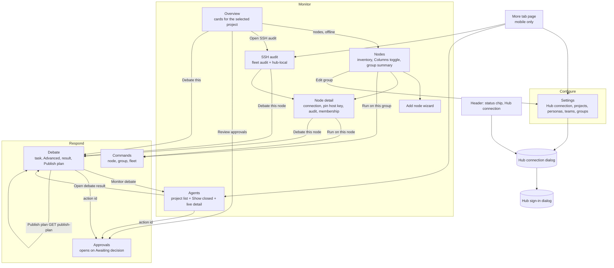

# UI 재검토, 3단계 (apps/web-desktop, 52fbfe2 시점, 읽기 전용)

[English](phase3-ui.md) | 한국어

> 2026-10-12 시점의 기록이며, 이후 코드가 바뀌었다.

방법: 현재 소스와 `apps/web-desktop`, `apps/agent`, `cli/llm-agent`에 대한 `git diff 5aa8e2e..52fbfe2`를 읽고, 1단계 발견 사항과 비교했다. 아무것도 실행하지 않았고 vitest도 실행하지 않았다. 접두어가 없는 경로는 `apps/web-desktop/` 기준이다.

## 요약 표

| Id | Sev | 상태 | 한 줄 사유 |
|---|---|---|---|
| UI-1 | High | PARTIAL | 실시간 상태와 Publish 게이트는 들어갔다; 이동 후에는 여전히 "이미 게시됨"이 표시되지 않는다. |
| UI-2 | High | OPEN | Execute와 Publish 결과가 여전히 대화 상자와 패널 상태에만 있다. |
| UI-3 | High | OPEN | `RunPage.tsx`가 그대로다: 단일 대상에는 확인이 없고, 그룹과 플릿은 MEDIUM이다. |
| UI-4 | Med | PARTIAL | Tone prop과 Cancel 확인이 들어갔다; 겹쳐진 체크박스 모달, Sync/Clone, 단일 대상 실행은 여전히 다르다. |
| UI-5 | Med | PARTIAL | Approvals 필터 기본값과 프로젝트 이름은 고쳐졌다; 배지와 Overview는 여전히 단일 프로젝트이다. |
| UI-6 | Med | PARTIAL | Agents가 프로젝트 범위가 되고 Show closed가 생겼으며 라벨이 일치한다; 목록 네 개와 취소 진입점 두 개가 남아 있다. |
| UI-7 | Med | PARTIAL | 주요 문구 정리는 끝났다; 남은 것은 UI-N5에 나열했다. |
| UI-8 | Med | RESOLVED | More 탭과 More 페이지에서 Agents, SSH audit, Settings로 갈 수 있다. |
| UI-9 | Med | PARTIAL | accept-new 칩이 노드로 연결되고 하단 문장이 맞다; 진입점은 그대로다. |
| UI-10 | Med | PARTIAL | Columns 토글이 추가되었다; 허브 호스트는 여전히 중복되고, 선택 항목에 대한 조치는 그룹 지정뿐이다. |
| UI-11 | Med | OPEN | "Needs attention" 제목과 자동 플릿 SSH 감사가 그대로다. |
| UI-12 | Med | RESOLVED | SSH audit 페이지에 "Debate this node"가 있다; 내비게이션과 링크가 이제 "SSH audit"이라고 한다. |
| UI-13 | Low-Med | RESOLVED | "Sign-in required" 칩과 보이는 degraded 툴팁. |
| UI-14 | Low | PARTIAL | `executeFleet`, "Reload" 라벨, Assistant 주석은 고쳐졌다; 쓰이지 않는 디자인 시스템 부품, "Debate Console", 테스트 제목이 남아 있다. |
| UI-15 | Low | PARTIAL | 타입, CLI 안내, 브랜치 검증은 고쳐졌다; 목록 행은 여전히 작업 칩만 보여 준다. |
| UI-16 | Low | RESOLVED | Task가 먼저, Advanced 펼침(단 UI-N3 참고). |

집계: RESOLVED 4, PARTIAL 9, OPEN 3, REGRESSED 0.

새 발견 사항: UI-N1 (Medium), UI-N2 (Medium), UI-N3 (Low), UI-N4 (Low), UI-N5 (Low), UI-N6 (Low).

## 다시 점검한 발견 사항

### UI-1 PARTIAL
- 해결: 결과 표가 실시간 목록을 쓴다, `ResultView.tsx:360-376` (`listActions(threadId)`, 스냅샷은 폴백으로 유지). Publish는 `publishReadiness`를 통해 사유와 함께 비활성화된다 (`lib/debate.ts:375-381`, 버튼 `ResultView.tsx:280-296`). 확인 단계는 허브의 dry run을 보여 주고 (`PublishPanel` effect `ResultView.tsx:237-264`, `getPublishPlan` `api.ts:766-771`, 백엔드 `GET /api/threads/{thread}/publish-plan`, `apps/agent/debate_handler.go:292,1066-1086`), 계획이 준비될 때까지 Confirm은 비활성화된다 (`ResultView.tsx:325`).
- 아직 열림: 게시된 스레드가 기억되지 않는다. 성공 Notice는 `useHubAction` 상태이고 (`ResultView.tsx:276-300`) Publish 버튼은 그 후에도 활성 상태로 남는다(`ready`는 조치 상태에만 의존한다); 두 번째 시도는 대화 상자 안에서 계획의 409 텍스트로 끝난다. DB에는 게시 기록이 있지만 이를 노출하는 API가 없다. 남은 DESIGN 항목이다.

### UI-2 OPEN
`ActionDialog.tsx`는 구조가 그대로다(`alive` 가드, 로컬 `busy`); `PublishPanel` 상태도 여전히 로컬이다. store나 내비게이션 가드가 추가되지 않았다.

### UI-3 OPEN
`pages/RunPage.tsx`는 diff에 없다. 단일 대상은 여전히 확인 없이 실행되고 (`RunPage.tsx:82-89`), 그룹과 플릿은 `ConfirmDialog risk="MEDIUM"`을 쓴다 (`RunPage.tsx:219-221`). 여전히 운영자의 결정이 필요하다.

### UI-4 PARTIAL
- 해결: `ConfirmModal`에 `tone`과 `cancelLabel`이 생겼다 (`components/ConfirmModal.tsx:13-40`); Close thread와 Publish는 `tone="primary"`를 쓴다 (`ResultView.tsx:178,307`); 두 Cancel 버튼은 확인이 있는 `CancelDebateButton`을 공유한다 (`components/CancelDebateButton.tsx`, `ConsoleSection.tsx`와 `agents/RunDetail.tsx`에서 사용).
- 여전히 다름: low/medium 위험 Execute 모달이 조치 모달 위에 겹쳐 뜨고 빨간 버튼을 쓴다 (`ActionDialog.tsx:301-321`, 버튼은 `:312`); 프로젝트 Sync/Clone에는 확인이 없다 (`ProjectsSection.tsx:80-88`); 단일 대상 명령에도 없다(UI-3). tone은 아직 일관되지 않다, UI-N4 참고.

### UI-5 PARTIAL
- 해결: `waiting > 0`이면 Approvals가 "Awaiting decision"으로 열린다 (`ActionsPanel.tsx:77-78`); Overview는 Approvals와 Debates 카드에 `Project: <name>`을 보여 준다 (`OverviewPage.tsx:28-32,193,228`); Agents는 선택된 프로젝트만 나열한다 (`AgentsPage.tsx:25-37`).
- 아직 열림: 내비게이션 배지와 Overview는 선택된 프로젝트만 센다; "모든 프로젝트" 보기가 없다.

### UI-6 PARTIAL
- 해결: Agents는 "Show closed" 토글과 프로젝트 전환기로 닫힌 스레드를 숨긴다 (`AgentsPage.tsx:39-64`); 목록 제목은 "Debates"이다 (`:51`); 링크 라벨은 두 곳 모두 "Monitor debate"이다 (`agents/RunList.tsx:19`, `ConsoleSection.tsx:93,179`); Cancel은 하나의 컴포넌트이다.
- 아직 열림: 같은 작업 집합이 네 곳(Overview, Debate 목록, Agents 목록, 지켜보는 작업)에서 렌더링되며, 서로 독립된 "Show closed" 토글이 두 개 있다.

### UI-7 PARTIAL
완료: 내비게이션 "Commands"와 "SSH audit" (`router.ts:30-35`), "Execute" (`ActionDialog.tsx` 버튼과 대화 상자 제목), Approvals 패널과 표 라벨 (`ActionsPanel.tsx`), "Hub connection"과 "Hub URL" (`SettingsDialog.tsx`, `LoginDialog.tsx`, `App.tsx:268`, `SettingsPage.tsx`). 남은 것은 UI-N5에 있다.

### UI-8 RESOLVED
`MORE_ROUTE`와 `MORE_DESTINATIONS` (`router.ts:38-47`), 자기 탭이 없는 모든 페이지에서 활성화되는 여섯 번째 탭 (`App.tsx:145-148`), 그리고 Agents, SSH audit, Settings를 설명과 함께 나열하는 `pages/MorePage.tsx`. `router.ts` 주석은 바로잡혔다.

### UI-9 PARTIAL
accept-new 칩은 이제 노드 페이지로 가는 링크이고 (`NodesPage.tsx:100-104`), 하단 문구는 "edit and delete node groups in Settings; create one from the selected rows above"이다 (`NodesPage.tsx:406`). 그룹 멤버십에는 여전히 진입점이 네 개 있고, 호스트 키 쓰기에는 여전히 세 개(Pin, Edit node, 마법사)가 있다. DESIGN, 변경 없음.

### UI-10 PARTIAL
Arch, Mesh IP, Probe는 기억되는 "Columns" 체크박스 뒤에 있다 (`NodesPage.tsx:26-45,109-135,226-236`). 허브 호스트는 여전히 Overview(`OverviewPage.tsx:108`)와 Nodes(`NodesPage.tsx:398`)에 모두 있다; 선택 바는 여전히 그룹 조치만 제공한다.

### UI-11 OPEN
패널 제목은 여전히 "Needs attention"이고 (`OverviewPage.tsx:305`) 플릿 SSH 감사는 여전히 열 때 시작된다 (`OverviewPage.tsx:284-287`); 노드와 그룹 페이지도 마찬가지다.

### UI-12 RESOLVED
`NodeDetails`가 `onDebate`를 받아 "Debate this node"를 렌더링한다 (`pages/ssh/FleetSshAudit.tsx`, 출처 `ssh-audit`로 토론에 넘김); 내비게이션 라벨, 페이지 제목, Overview 링크가 모두 "SSH audit"이라고 한다 (`router.ts:33`, `OverviewPage.tsx` "Open SSH audit"). 선택에 따라 추가하지 않은 것: 감사 화면에서 Commands로 가는 링크.

### UI-13 RESOLVED
`checkAgentHealth`는 `AuthRequiredError`에서 `signed-out`을 반환한다 (`api.ts:205-224`); 헤더는 중립적인 "Sign-in required" 칩을 보여 준다 (`App.tsx:203`); degraded 사유는 hover와 focus 시 보이는 텍스트이다 (`DegradedChip`, `App.tsx:158-195`).

### UI-14 PARTIAL
수정됨: `executeFleet` 제거 (`api.ts`), 필터 버튼 "Apply filter" (`ActionsPanel.tsx:105`), "Assistant" 주석이 `src/`에서 사라짐. 남은 것: 테스트 제목 "consumes the Assistant prefill" (`tests/debate.page.test.tsx:211`), 페이지 "Debate" 아래의 패널 "Debate Console" (`ConsoleSection.tsx:329`), 쓰이지 않는 디자인 시스템 부품(ActionCard, CommandPalette, NodeRow, Sparkline), 경로 아이콘 변경 없음.

### UI-15 PARTIAL
수정됨: `finished_at: string | null` (`types.ts`), CLI 안내가 실제 스레드 또는 조치 id를 끼워 넣음 (`ResultView.tsx:189-193`, `lib/debate.ts:343-348`), 허브의 패턴으로 클라이언트 측 브랜치 검증 (`BRANCH_RE`, `lib/debate.ts:361`, `ResultView.tsx:235,316`), Agents 실행 카드, 결과, 타임라인이 이제 결정 단어로 색을 입힘 (`agents/RunDetail.tsx`, `Timeline.tsx`, `decisionWordStatus` `lib/debate.ts:203`, `runDecision` `:226`; `REVISION_REQUIRED`는 NOT APPROVED로 매핑되어 `debate_engine.py` `decision_status`와 일치). 수정되지 않음: 목록 행(Overview `OverviewPage.tsx:242`, Debate `ConsoleSection.tsx:167`, Agents `agents/RunList.tsx:40`)은 여전히 판정 없이 초록색 COMPLETED 칩을 보여 준다.

### UI-16 RESOLVED
Task가 먼저, 그다음 Team, 그다음 접힌 "Advanced: rounds, continue a thread, reference code" (`ConsoleSection.tsx:330-395`); 검증 오류와 Continue가 이를 연다 (`:275,321`). 주의 사항은 UI-N3에 있다.

## 새 발견 사항

### UI-N1 (Medium) Execute용으로 쓴 409와 403 안내가 jev 재점검과 Close thread 오류에도 덧붙는다
근거: `failMessage`는 모든 409를 "The action is no longer runnable (state changed, another run claimed it, or re-validation failed)"로, 모든 403을 "Run the action from the CLI: guardian.py --run-action ID"로 바꾼다 (`lib/debate.ts:343-356`). 이는 jev 재점검(`ResultView.tsx:130`, `ActionDialog.tsx:175`)과 Close thread(`ResultView.tsx:158`)에도 쓰인다. 백엔드 변경으로 이런 409가 더 자주 생긴다: 재점검은 이제 이후 라운드가 있으면 409로 거부하고("debate again instead of rechecking the old decision", `cli/llm-agent/action_ops.py` `RecheckConflict` -> `CONFLICT`), 닫기는 토론이 실행 중일 때 이미 409를 반환했다 (`debate_handler.go` `closeThread`).
왜 문제인가: 운영자는 실제 사유가 대체된 리뷰인 재점검 아래에서 "the action is no longer runnable"을 읽게 된다.
수정: SAFE-FIX. `failMessage`에 `kind`(`execute | recheck | close`)를 주고 execute 안내는 `execute`에만 덧붙인다; 나머지는 허브 텍스트만으로 충분하다. 재점검 409에 대한 테스트를 추가한다.

### UI-N2 (Medium) 새 `reachability` 분류가 사용되지도 타입화되지도 않아서 "offline"이 원인을 가린다
근거: 허브는 이제 플릿 진단 행, 플릿 SSH 감사 노드, 노드 probe에 `reachability`(ok, auth_failed, host_key_changed, unreachable, command_failed)를 보낸다 (`apps/agent/servers_handler.go`, `fleet_ssh.go` `FleetSSHNode.Reachability`, `nodes_handler.go` `probeResult.Reachability`; `ssh_classify.go`). `types.ts`에는 그런 필드가 없고(`FleetNodeResult`, `FleetSSHNode`, `NodeProbe` 그대로) `NodesPage.tsx:62-68`은 `status`만 online/offline으로 매핑한다. 백엔드 주석은 ssh는 되지만 probe 명령이 실패하는 노드가 `command_failed`와 함께 OFFLINE으로 읽힌다고 한다.
왜 문제인가: Overview "Servers online x / y", 오프라인 목록, Nodes 표가 바뀐 호스트 키(변조 가능성), 없는 키, 도달 불가 호스트, 명령 하나가 없는 정상 호스트를 모두 빨간 "offline"으로 보여 주는데, 이들의 해결책은 서로 다르다.
수정: SAFE-FIX. 세 타입에 `reachability?`를 추가하고, 이를 상태 칩 텍스트로 보여 주며(예: crit의 "host key changed", warn의 "command failed"), host_key_changed와 auth_failed를 노드의 Pin / Test connection에 연결한다. 이 값을 `buildDebateTask` 입력에 추가한다.

### UI-N3 (Low) 팀 기본값에서 물려받은 참조 코드가 접힌 섹션에서 전송된다
근거: `shown = ctx ?? teamDefaults`가 요청에 `context_paths`와 `context_ref`를 공급하지만 (`ConsoleSection.tsx` `onStart`), `advancedOpen`은 false로 시작하고 검증 오류나 Continue 때에만 열린다 (`:227,275,321`). "team default" 안내는 접힌 블록 안에 있다.
왜 문제인가: 팀을 고르면 Start 근처에 아무것도 보이지 않는 채 코드 컨텍스트(와 그 검색 비용)가 조용히 붙는다.
수정: SAFE-FIX. `teamDefaults`가 적용되면 펼침을 열거나, 펼침 요약에 한 줄 요약("Reference code: team default, N paths")을 추가한다.

### UI-N4 (Low) 되돌릴 수 있는 단계와 되돌릴 수 없는 단계의 확인 tone이 여전히 일관되지 않다
근거: "Remove from group"은 되돌릴 수 있는 편집인데도 기본 danger tone을 쓰고 (`pages/nodes/NodeMembership.tsx:113-128`), Close thread와 Publish는 primary이다 (`ResultView.tsx:178,307`); Reject, Cancel debate, 모든 삭제는 danger(기본값)이다; low 위험 Execute 버튼은 danger이다 (`ActionDialog.tsx:312`); Publish는 원격에 push하는데(되돌리기 어려움) primary이다.
수정: 규칙이 정해지면 SAFE-FIX: danger = 삭제, 거부, 취소, 플릿 전체 실행; primary = 되돌릴 수 있는 편집. Remove-from-group을 primary로, low 위험 Execute를 primary로 옮긴다.

### UI-N5 (Low) 문구 정리 후 남은 옛 문구
근거: Commands 페이지의 패널 "Run a command"와 대상 "Local agent node" (`RunPage.tsx:137,104`); 내비게이션 항목은 "Agents"인데 그 패널은 "Debates"이다 (`router.ts:32`, `AgentsPage.tsx:51`); "Hub connection" 옆의 헤더 칩 "Agent online / offline / degraded" (`App.tsx:203-204`); Approvals 페이지 제목과 그 패널이 모두 "Approvals"이다 (`ActionsPanel.tsx`); "Debate" 아래의 "Debate Console".
수정: SAFE-FIX. "Run a command"를 "Commands"로 바꿀 필요는 없지만(동사여도 괜찮다), "Local agent node"는 "Hub (local)"로, 칩은 "Hub online / degraded / offline"로 바꾸고, 중복된 패널 제목은 빼거나 "Actions to decide"를 쓴다.

### UI-N6 (Low) 수정으로 생긴 작은 동작들
- Approvals 기본 필터는 공유 `waiting` 개수에서 도출된다: 로드되는 동안 페이지는 All을 보여 주다가 Awaiting으로 바뀐다; 마지막 제안이 결정되면 운영자가 고르지 않았는데도 All로 되돌아간다 (`ActionsPanel.tsx:77-78`). 처음 계산된 값을 state에 유지한다.
- `NodeRegisterPage`는 `fleet_public_key_note`와 `fleet_public_key_blocker`를 둘 다 보여 준다; 허브가 둘을 같은 텍스트로 설정하므로 경고가 두 번 나타난다 (`NodeRegisterPage.tsx:263-264`; `nodes_handler.go`가 둘 다 설정).
- 허브는 이제 `GET /api/nodes/registration`에서 `validation: nodeFormRules()`를 보낸다; UI는 `lib/nodeForm.ts`에 손으로 복사한 사본("keep the two in step")을 유지하고 payload를 무시한다. 응답에서 규칙을 읽거나, 주석과 테스트를 어긋남 방지 장치로 유지한다.
- 페르소나, 팀, 프로젝트의 알 수 없는 id 삭제는 이제 404를 반환한다 (`config_ops.py` `_not_deleted`); 대화 상자는 텍스트를 보여 주지만 목록을 다시 불러오지 않아서 오래된 항목이 계속 보인다. 삭제에서 404가 오면 목록을 다시 불러온다.
- UI에서 실제로 동작하는 백엔드 동작: 동기화 `skipped`는 사유와 함께 warn 배너를 보여 준다 (`ProjectsSection.tsx:37`); 이미 실행 중인 스레드에 대한 토론 시작 409는 폼에 허브 텍스트를 보여 준다 (`ConsoleSection.tsx` `startError`); `REVISION_REQUIRED`는 `decisionWordStatus`가 이해한다; authorized_keys 줄에 대한 blocker가 표시된다 (`NodeForms.tsx`, `NodeRegisterPage.tsx`).

## 갱신된 지도

1단계 이후 바뀐 절차 경로:
- P2 Commands: Commands 내비게이션 (`router.ts:35`); 동작은 그대로 (`RunPage.tsx:82-89,218-237`).
- P3 등록: Nodes, "Add node"; Node detail "Pin host key"; probe 후 키 줄 또는 그 blocker가 표시된다 (`NodeForms.tsx`).
- P4 SSH 감사: SSH audit 내비게이션, 히트맵에서 노드 선택, "Debate this node" (`FleetSshAudit.tsx`).
- P7 Approvals: Approvals 내비게이션이 Awaiting decision으로 열린다 (`ActionsPanel.tsx:77-78`); "Execute" 다음 id 입력 또는 체크박스 모달 (`ActionDialog.tsx:285-321`).
- P10 게시: Debate, 결과, "Proposed actions" 카드, Publish (준비될 때까지 비활성화, `ResultView.tsx:280-296`), 대화 상자가 계획을 보여 준 뒤 "Publish" (`:304-330`).
- P12 Agents: 데스크톱에서는 Agents 내비게이션, 모바일에서는 More 탭 (`App.tsx:145-148`).
- P13 허브: 헤더 "Hub connection" (`App.tsx:268`) 또는 Settings, Hub connection.

현재 내비게이션의 SVG: [ui-nav-current.svg](../../images/procedure-review/ui-nav-current.svg) (xmllint로 검증).
