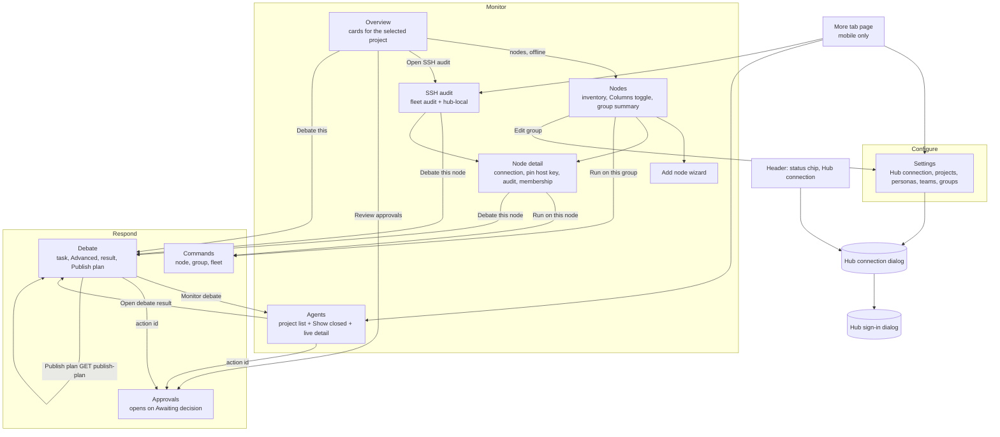

# UI re-review, phase 3 (apps/web-desktop at 52fbfe2, read-only)

English | [한국어](phase3-ui.ko.md)

> Point-in-time record from 2026-10-12; the code has changed since.

Method: read the current sources plus `git diff 5aa8e2e..52fbfe2` for `apps/web-desktop`, `apps/agent` and `cli/llm-agent`; compared with the phase 1 findings. Nothing was run; vitest was not executed. Paths are relative to `apps/web-desktop/` unless prefixed.

## Summary table

| Id | Sev | Status | One-line reason |
|---|---|---|---|
| UI-1 | High | PARTIAL | Live statuses and Publish gating are in; "already published" is still not shown after navigation. |
| UI-2 | High | OPEN | Execute and Publish outcomes still live in dialog and panel state. |
| UI-3 | High | OPEN | `RunPage.tsx` is unchanged: no confirm on single targets, MEDIUM on group and fleet. |
| UI-4 | Med | PARTIAL | Tone prop and Cancel confirm landed; stacked checkbox modal, Sync/Clone and single-target runs still differ. |
| UI-5 | Med | PARTIAL | Approvals filter defaults and project names are fixed; badge and Overview stay single-project. |
| UI-6 | Med | PARTIAL | Agents is project-scoped with Show closed and labels agree; four lists and two cancel entry points remain. |
| UI-7 | Med | PARTIAL | Main wording pass done; leftovers listed under UI-N5. |
| UI-8 | Med | RESOLVED | More tab and More page reach Agents, SSH audit and Settings. |
| UI-9 | Med | PARTIAL | accept-new chip links to the node and the footer sentence is correct; entry points are unchanged. |
| UI-10 | Med | PARTIAL | Columns toggle added; hub host still duplicated, no action on a selection except grouping. |
| UI-11 | Med | OPEN | "Needs attention" title and the automatic fleet SSH audit are unchanged. |
| UI-12 | Med | RESOLVED | "Debate this node" on the SSH audit page; nav and links now say "SSH audit". |
| UI-13 | Low-Med | RESOLVED | "Sign-in required" chip and a visible degraded tooltip. |
| UI-14 | Low | PARTIAL | `executeFleet`, "Reload" label and the Assistant comment fixed; unused design-system parts, "Debate Console" and a test title remain. |
| UI-15 | Low | PARTIAL | Type, CLI hint and branch validation fixed; list rows still show only the job chip. |
| UI-16 | Low | RESOLVED | Task first, Advanced disclosure (but see UI-N3). |

Counts: RESOLVED 4, PARTIAL 9, OPEN 3, REGRESSED 0.

New findings: UI-N1 (Medium), UI-N2 (Medium), UI-N3 (Low), UI-N4 (Low), UI-N5 (Low), UI-N6 (Low).

## Findings re-checked

### UI-1 PARTIAL
- Resolved: the result table uses the live list, `ResultView.tsx:360-376` (`listActions(threadId)`, snapshot kept as fallback). Publish is disabled with a reason through `publishReadiness` (`lib/debate.ts:375-381`, button `ResultView.tsx:280-296`). The confirm step shows the hub's dry run (`PublishPanel` effect `ResultView.tsx:237-264`, `getPublishPlan` `api.ts:766-771`, backend `GET /api/threads/{thread}/publish-plan`, `apps/agent/debate_handler.go:292,1066-1086`), and Confirm stays disabled until the plan is ready (`ResultView.tsx:325`).
- Still open: a published thread is not remembered. The success Notice is `useHubAction` state (`ResultView.tsx:276-300`) and the Publish button stays enabled afterwards (`ready` depends only on action statuses); a second try ends in the plan's 409 text inside the dialog. The DB has publications but no API exposes them. Remaining DESIGN item.

### UI-2 OPEN
`ActionDialog.tsx` is unchanged in structure (`alive` guard, local `busy`); `PublishPanel` state is still local. No store or navigation guard was added.

### UI-3 OPEN
`pages/RunPage.tsx` is not in the diff. Single targets still run without confirm (`RunPage.tsx:82-89`), group and fleet use `ConfirmDialog risk="MEDIUM"` (`RunPage.tsx:219-221`). Decision still needed from the operator.

### UI-4 PARTIAL
- Resolved: `ConfirmModal` has `tone` and `cancelLabel` (`components/ConfirmModal.tsx:13-40`); Close thread and Publish use `tone="primary"` (`ResultView.tsx:178,307`); both Cancel buttons share `CancelDebateButton` with a confirm (`components/CancelDebateButton.tsx`, used in `ConsoleSection.tsx` and `agents/RunDetail.tsx`).
- Still different: the low/medium-risk Execute modal is stacked on the action modal and uses a red button (`ActionDialog.tsx:301-321`, button at `:312`); project Sync/Clone has no confirm (`ProjectsSection.tsx:80-88`); single-target commands have none (UI-3). Tones are not yet consistent, see UI-N4.

### UI-5 PARTIAL
- Resolved: Approvals opens on "Awaiting decision" when `waiting > 0` (`ActionsPanel.tsx:77-78`); Overview shows `Project: <name>` on the Approvals and Debates cards (`OverviewPage.tsx:28-32,193,228`); Agents lists only the selected project (`AgentsPage.tsx:25-37`).
- Still open: the nav badge and Overview count only the selected project; there is no "all projects" view.

### UI-6 PARTIAL
- Resolved: Agents hides closed threads with a "Show closed" toggle and a project switcher (`AgentsPage.tsx:39-64`); the list heading is "Debates" (`:51`); link labels are "Monitor debate" in both places (`agents/RunList.tsx:19`, `ConsoleSection.tsx:93,179`); Cancel is one component.
- Still open: the same job set is rendered in four places (Overview, Debate list, Agents list, watched job), with two independent "Show closed" toggles.

### UI-7 PARTIAL
Done: nav "Commands" and "SSH audit" (`router.ts:30-35`), "Execute" (`ActionDialog.tsx` buttons and dialog titles), Approvals panel and table label (`ActionsPanel.tsx`), "Hub connection" and "Hub URL" (`SettingsDialog.tsx`, `LoginDialog.tsx`, `App.tsx:268`, `SettingsPage.tsx`). Leftovers are in UI-N5.

### UI-8 RESOLVED
`MORE_ROUTE` and `MORE_DESTINATIONS` (`router.ts:38-47`), a sixth tab that is active on every page without its own tab (`App.tsx:145-148`), and `pages/MorePage.tsx` listing Agents, SSH audit and Settings with descriptions. The `router.ts` comment is corrected.

### UI-9 PARTIAL
The accept-new chip is now a link to the node page (`NodesPage.tsx:100-104`), and the footer reads "edit and delete node groups in Settings; create one from the selected rows above" (`NodesPage.tsx:406`). Group membership still has four entry points and host-key writes still have three (Pin, Edit node, wizard). DESIGN, unchanged.

### UI-10 PARTIAL
Arch, Mesh IP and Probe sit behind a remembered "Columns" checkbox (`NodesPage.tsx:26-45,109-135,226-236`). The hub host is still on Overview (`OverviewPage.tsx:108`) and on Nodes (`NodesPage.tsx:398`); the selection bar still offers only group actions.

### UI-11 OPEN
Panel title is still "Needs attention" (`OverviewPage.tsx:305`) and the fleet SSH audit still starts on open (`OverviewPage.tsx:284-287`); node and group pages likewise.

### UI-12 RESOLVED
`NodeDetails` takes `onDebate` and renders "Debate this node" (`pages/ssh/FleetSshAudit.tsx`, debate hand-off with source `ssh-audit`); nav label, page title and the Overview link all say "SSH audit" (`router.ts:33`, `OverviewPage.tsx` "Open SSH audit"). Not added, by choice: a Commands link from the audit.

### UI-13 RESOLVED
`checkAgentHealth` returns `signed-out` on `AuthRequiredError` (`api.ts:205-224`); the header shows a neutral "Sign-in required" chip (`App.tsx:203`); degraded reasons are visible text on hover and focus (`DegradedChip`, `App.tsx:158-195`).

### UI-14 PARTIAL
Fixed: `executeFleet` removed (`api.ts`), filter button "Apply filter" (`ActionsPanel.tsx:105`), "Assistant" comment gone from `src/`. Remaining: test title "consumes the Assistant prefill" (`tests/debate.page.test.tsx:211`), Panel "Debate Console" under page "Debate" (`ConsoleSection.tsx:329`), unused design-system parts (ActionCard, CommandPalette, NodeRow, Sparkline), route icons unchanged.

### UI-15 PARTIAL
Fixed: `finished_at: string | null` (`types.ts`), CLI hints interpolate the real thread or action id (`ResultView.tsx:189-193`, `lib/debate.ts:343-348`), branch validated client-side with the hub's pattern (`BRANCH_RE`, `lib/debate.ts:361`, `ResultView.tsx:235,316`), Agents run card, outcome and timeline now tone by decision word (`agents/RunDetail.tsx`, `Timeline.tsx`, `decisionWordStatus` `lib/debate.ts:203`, `runDecision` `:226`; `REVISION_REQUIRED` maps to NOT APPROVED, matching `debate_engine.py` `decision_status`). Not fixed: list rows (Overview `OverviewPage.tsx:242`, Debate `ConsoleSection.tsx:167`, Agents `agents/RunList.tsx:40`) still show a green COMPLETED chip without the verdict.

### UI-16 RESOLVED
Task is first, Team next, then a collapsed "Advanced: rounds, continue a thread, reference code" (`ConsoleSection.tsx:330-395`); validation errors and Continue open it (`:275,321`). Caveat in UI-N3.

## New findings

### UI-N1 (Medium) 409 and 403 hints written for Execute are appended to jev recheck and Close thread errors
Evidence: `failMessage` turns every 409 into "The action is no longer runnable (state changed, another run claimed it, or re-validation failed)" and every 403 into "Run the action from the CLI: guardian.py --run-action ID" (`lib/debate.ts:343-356`). It is also used for the jev recheck (`ResultView.tsx:130`, `ActionDialog.tsx:175`) and Close thread (`ResultView.tsx:158`). Backend changes made these 409s more likely: recheck now refuses with 409 when a later round exists ("debate again instead of rechecking the old decision", `cli/llm-agent/action_ops.py` `RecheckConflict` -> `CONFLICT`), and close already returned 409 while a debate runs (`debate_handler.go` `closeThread`).
Why it hurts: the operator reads "the action is no longer runnable" under a recheck whose real reason is a superseded review.
Fix: SAFE-FIX. Give `failMessage` a `kind` (`execute | recheck | close`) and append the execute hints only for `execute`; the hub text alone is enough for the others. Add a test for the recheck 409.

### UI-N2 (Medium) The new `reachability` classification is not used or typed, so "offline" hides the cause
Evidence: the hub now sends `reachability` (ok, auth_failed, host_key_changed, unreachable, command_failed) on fleet diagnosis rows, fleet SSH audit nodes and node probes (`apps/agent/servers_handler.go`, `fleet_ssh.go` `FleetSSHNode.Reachability`, `nodes_handler.go` `probeResult.Reachability`; `ssh_classify.go`). `types.ts` has no such field (`FleetNodeResult`, `FleetSSHNode`, `NodeProbe` unchanged) and `NodesPage.tsx:62-68` maps only `status` to online/offline. The backend comment says a node whose ssh works but whose probe command fails reads OFFLINE with `command_failed`.
Why it hurts: Overview "Servers online x / y", the offline list and the Nodes table show a red "offline" for a changed host key (possible tampering), a missing key, an unreachable host and a healthy host that lacks a command, with different remedies.
Fix: SAFE-FIX. Add `reachability?` to the three types, show it as the status chip text (for example "host key changed" in crit, "command failed" in warn), and link host_key_changed and auth_failed to the node's Pin / Test connection. Add the value to `buildDebateTask` input.

### UI-N3 (Low) Reference code inherited from a team default is sent from a collapsed section
Evidence: `shown = ctx ?? teamDefaults` supplies `context_paths` and `context_ref` to the request (`ConsoleSection.tsx` `onStart`), but `advancedOpen` starts false and opens only on a validation error or Continue (`:227,275,321`). The "team default" hint lives inside the collapsed block.
Why it hurts: choosing a team silently attaches code context (and its retrieval cost) with nothing visible near Start.
Fix: SAFE-FIX. Open the disclosure when `teamDefaults` applies, or add a one-line summary ("Reference code: team default, N paths") to the disclosure summary.

### UI-N4 (Low) Confirm tones are still inconsistent for reversible and irreversible steps
Evidence: "Remove from group" uses the default danger tone (`pages/nodes/NodeMembership.tsx:113-128`) although it is a reversible edit, while Close thread and Publish are primary (`ResultView.tsx:178,307`); Reject, Cancel debate and all deletes are danger (default); the low-risk Execute button is danger (`ActionDialog.tsx:312`); Publish pushes to a remote (hard to undo) yet is primary.
Fix: SAFE-FIX once a rule is chosen: danger = deletes, reject, cancel, fleet-wide execution; primary = reversible edits. Move Remove-from-group to primary; Execute low risk to primary.

### UI-N5 (Low) Leftover old wording after the wording pass
Evidence: Panel "Run a command" and target "Local agent node" on the Commands page (`RunPage.tsx:137,104`); the nav item is "Agents" while its panel is "Debates" (`router.ts:32`, `AgentsPage.tsx:51`); header chip "Agent online / offline / degraded" next to "Hub connection" (`App.tsx:203-204`); Approvals page title and its panel are both "Approvals" (`ActionsPanel.tsx`); "Debate Console" under "Debate".
Fix: SAFE-FIX. "Run a command" to "Commands" is not needed (verb is fine), but rename "Local agent node" to "Hub (local)", the chip to "Hub online / degraded / offline", and either drop the duplicate panel title or use "Actions to decide".

### UI-N6 (Low) Small behaviours introduced by the fixes
- Approvals default filter is derived from the shared `waiting` count: while it loads the page shows All, then flips to Awaiting; after the last proposal is decided it flips back to All without the operator choosing (`ActionsPanel.tsx:77-78`). Persist the first computed value in state.
- `NodeRegisterPage` shows both `fleet_public_key_note` and `fleet_public_key_blocker`; the hub sets both to the same text, so the warning appears twice (`NodeRegisterPage.tsx:263-264`; `nodes_handler.go` sets both).
- The hub now sends `validation: nodeFormRules()` in `GET /api/nodes/registration`; the UI keeps a hand-copied mirror in `lib/nodeForm.ts` ("keep the two in step") and ignores the payload. Read the rules from the response, or keep the comment and the test as the drift guard.
- Unknown-id deletes of personas, teams and projects now return 404 (`config_ops.py` `_not_deleted`); the dialogs show the text but do not reload the list, so a stale entry stays visible. Reload the list on a 404 from delete.
- Backend behaviours that do work in the UI: sync `skipped` shows a warn banner with the reason (`ProjectsSection.tsx:37`); start-debate 409 for a thread already running shows the hub text in the form (`ConsoleSection.tsx` `startError`); `REVISION_REQUIRED` is understood by `decisionWordStatus`; blockers for the authorized_keys line are shown (`NodeForms.tsx`, `NodeRegisterPage.tsx`).

## Updated map

Procedure paths changed since phase 1:
- P2 Commands: Commands nav (`router.ts:35`); unchanged behaviour (`RunPage.tsx:82-89,218-237`).
- P3 Registration: Nodes, "Add node"; Node detail "Pin host key"; the key line or its blocker is shown after probe (`NodeForms.tsx`).
- P4 SSH audit: SSH audit nav, select node in the heatmap, "Debate this node" (`FleetSshAudit.tsx`).
- P7 Approvals: Approvals nav opens on Awaiting decision (`ActionsPanel.tsx:77-78`); "Execute" then typed id or checkbox modal (`ActionDialog.tsx:285-321`).
- P10 Publish: Debate, result, "Proposed actions" card, Publish (disabled until ready, `ResultView.tsx:280-296`), dialog shows the plan then "Publish" (`:304-330`).
- P12 Agents: Agents nav on desktop, More tab on mobile (`App.tsx:145-148`).
- P13 Hub: header "Hub connection" (`App.tsx:268`) or Settings, Hub connection.

SVG of the current navigation: [ui-nav-current.svg](../../images/procedure-review/ui-nav-current.svg) (validated with xmllint).
