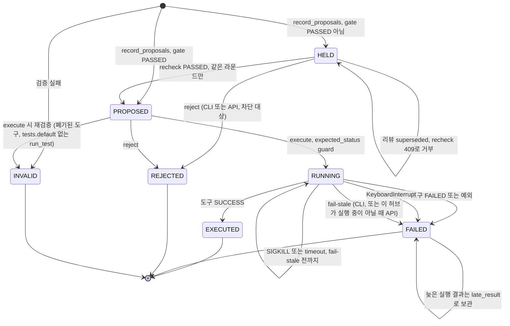
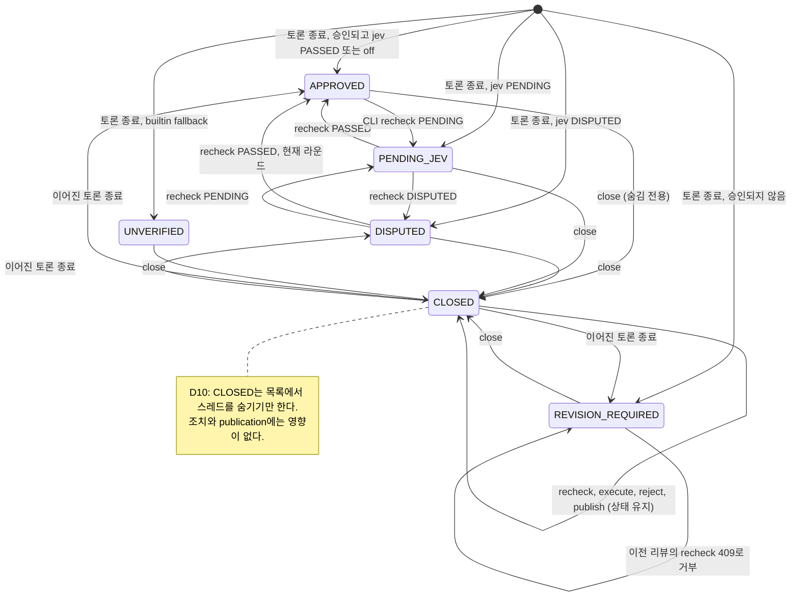
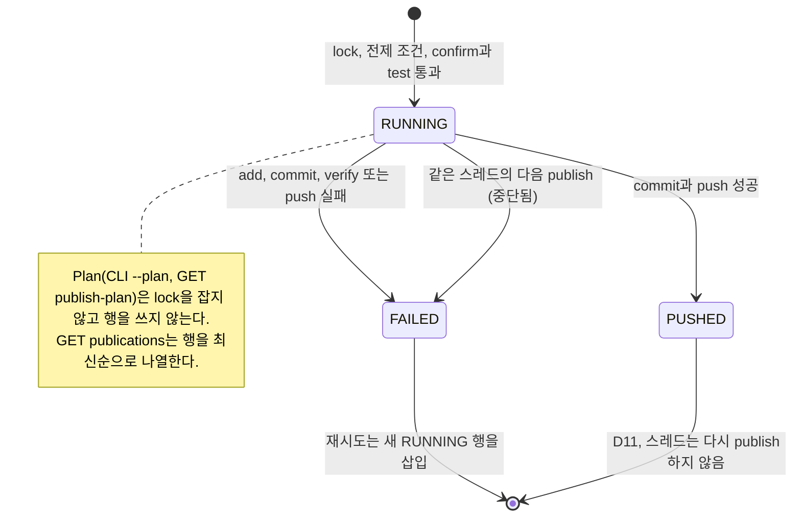

# Phase 4 - 토론 / 결정 / 조치 재검토

[English](phase4-debate.md) | 한국어

> 2026-10-12 시점의 기록이며, 이후 코드가 바뀌었다.

`66cf41e`를 phase 3(`52fbfe2`)과 비교해 검토했다(읽기 전용). 관련 commit: `391bcb8`(늦게 도착한 결과가 운영자가
실패 처리한 조치를 덮어쓰지 않음), `8344131`(lock 없는 plan), `ccda0f6`(D1 `git_commit_push` 폐기, D10, D11,
D12 워크스페이스 reset, D13 publications, 닫힌 스레드 목록), `e6f372d`(`tests.default` 목록), `64a2bff`(fail-stale
route, 모든 결정 route에 `GUARDIAN_UI_ACTIONS=off`), `c8a5741`(Approvals에서 fail-stale). 줄 번호는
`66cf41e` 기준이다.

## 요약

| id | sev (P1) | P1 | P3 | P4 | P3 이후 변경 |
|---|---|---|---|---|---|
| DBT-1 | High | OPEN | PARTIAL | **RESOLVED** | 허브 route `POST /api/actions/{id}/fail-stale` + Approvals 버튼; 늦은 쓰기 차단 |
| DBT-2 | High | OPEN | OPEN | **RESOLVED** | 도구를 카탈로그, 팀, 페르소나에서 폐기; 저장된 행은 INVALID로 거부 |
| DBT-3 | High | OPEN | PARTIAL | **PARTIAL** | 변경 없음(superseded HELD 고립, CLI APPROVED->PENDING_JEV) |
| DBT-4 | High | OPEN | RESOLVED | **RESOLVED** | - |
| DBT-5 | Medium | OPEN | PARTIAL | **PARTIAL** | publications + 닫힌 목록 노출; verdict/Close/Recheck는 여전히 snapshot 기반, 스레드 상태 API 없음 |
| DBT-6 | Medium | OPEN | RESOLVED | **RESOLVED** | - |
| DBT-7 | Medium | OPEN | OPEN | **RESOLVED** | D10: CLOSED = 숨김 전용, 문서화됨; 동작 일치 |
| DBT-8 | Medium | OPEN | RESOLVED | **RESOLVED** | - |
| DBT-9 | Medium | OPEN | PARTIAL | **PARTIAL** | 변경 없음(CLI 직접 토론은 점검되지 않음) |
| DBT-10 | Medium | OPEN | OPEN | **PARTIAL** | D11 결정 및 문서화, continue/execute 시점에는 강제되지 않음(DBT-P4-1) |
| DBT-11 | Medium | OPEN | PARTIAL | **PARTIAL** | 변경 없음(sync git 실패 -> 400) |
| DBT-12 | Medium | OPEN | RESOLVED | **RESOLVED** | - |
| DBT-13 | Medium | OPEN | RESOLVED | **RESOLVED** | 이제 하나의 공유 예산을 쓰는 단계 목록 |
| DBT-14 | Medium | OPEN | RESOLVED | **RESOLVED** | - |
| DBT-15 | Low | OPEN | OPEN | **RESOLVED** | reject, recheck, close, fail-stale, reset 모두 CLI 안내와 함께 차단 |
| DBT-16 | Low | OPEN | RESOLVED | **RESOLVED** | - |
| DBT-17 | Low | OPEN | PARTIAL | **PARTIAL** | 같은 세 줄의 오래된 문서 |
| DBT-18 | Low | OPEN | PARTIAL | **PARTIAL** | 변경 없음 |
| DBT-19 | Low | OPEN | RESOLVED | **RESOLVED** | - |
| DBT-N1 | Medium | - | new | **RESOLVED** | 최종 쓰기 보호, `decided_by` 유지, 허브 liveness 점검 |
| DBT-N2 | Medium | - | new | **PARTIAL** | `--workspace-reset` 존재; publish할 수 없는 실행된 조치의 파일은 영원히 유지됨 |
| DBT-N3 | Low | - | new | **OPEN** | 변경 없음 |
| DBT-N4 | Low | - | new | **OPEN** | 변경 없음 |
| DBT-N5 | Low | - | new | **OPEN** | 변경 없음 |
| DBT-N6 | Low | - | new | **RESOLVED** | plan이 lock 없이 실행됨 |
| DBT-N7 | Low | - | new | **OPEN** | 변경 없음 |
| DBT-N8 | Low | - | new | **OPEN** | 변경 없음 |

집계(발견 사항 27개): **RESOLVED 14** · **PARTIAL 8** · **OPEN 5** · **REGRESSED 0**.
DBT-1..19: RESOLVED 12, PARTIAL 7, OPEN 0. DBT-N1..N8: RESOLVED 2, PARTIAL 1, OPEN 5.

phase 3 이후 새 항목: **DBT-P4-1 Medium**, **DBT-P4-2 Medium**, DBT-P4-3..P4-6 Low.

---

## 1. 근거와 함께 본 상태

**DBT-1 RESOLVED.** 도구 예외 -> FAILED; interrupt -> `expected_status="RUNNING"`과 함께 FAILED(`cli/llm-agent/action_ops.py:256-261`). SIGKILL은 RUNNING을 남기지만 이제 대시보드가 이를 복구할 수 있다: `POST /api/actions/{id}/fail-stale`(confirm_id echo, 이 허브의 `actionRuns`가 그 id를 갖고 있는 동안 409, 차단 대상)(`apps/agent/debate_handler.go:1252-1285`, route `:289`), UI는 `apps/web-desktop/src/pages/debate/ActionDialog.tsx`(commit `c8a5741`).

**DBT-2 RESOLVED.** `git_commit_push`가 `TOOLS`와 `WRITE_TOOLS`에서 제거되었고(`cli/llm-agent/mcp_client.py:95`), 검증은 이를 폐기된 도구로 명시한다(`:97, 168-169`); `configs/teams/cross-review.json`과 `configs/personas/jev_mcp_decision.json`에서도 제거되었다. 남은 부분은 DBT-P4-4.

**DBT-3 PARTIAL.** P3 이후 변경 없음: 라운드 범위 release와 `RecheckConflict`(`action_ops.py` `recheck_thread`)는 있지만, superseded HELD는 계속 고립되고(DBT-N3) 현재 리뷰를 CLI로 recheck하면 여전히 PROPOSED 조치가 있는 APPROVED를 PENDING_JEV로 강등할 수 있다.

**DBT-4 RESOLVED.** 변경 없음(sync가 untracked를 셈, 공유 lock, `project_registry.py` `_update`).

**DBT-5 PARTIAL.** 새 읽기 API: `GET /api/threads/{t}/publications`(`debate_handler.go:1113-1123`, `workspace_ops.py:175-182`)와 `GET /api/threads/closed`(`debate_handler.go:1125-1139`). 여전히 snapshot 기반이다: `canCloseThread(status.label, …)`와 `gateNeedsRecheck(fd)`(`apps/web-desktop/src/pages/debate/ResultView.tsx:408, 465`); `threads.status`를 반환하는 route는 없다.

**DBT-6 RESOLVED.** 변경 없음.

**DBT-7 RESOLVED(결정 D10에 따라).** `debate-teams-api.md:230`은 CLOSED가 숨기기만 하고 execute/reject/publish를 막지 않는다고 명시한다; 코드도 그렇게 동작한다(`run_action`/`publish_thread`에 CLOSED 점검 없음); `GET /api/threads/closed`가 추가되었다. 대시보드의 "APPROVED에는 Close 없음" 규칙은 문서화되어 있다(`debate-teams-api.md:229`).

**DBT-8 RESOLVED.** 변경 없음.

**DBT-9 PARTIAL.** 변경 없음: 409는 허브 작업에만 적용되고(`debate_handler.go` `startDebate`), CLI `--debate --thread`는 점검되지 않는다.

**DBT-10 PARTIAL.** D11이 문서화되었고(`docs/design/publish-thread.md:10-12`: "Further changes need a new thread") publish 시점에 강제된다(`publish_ops.py:228-231`). 그 이전 단계에서는 강제되지 않는다: DBT-P4-1 참고.

**DBT-11 PARTIAL.** 변경 없음: `config_ops.py` `sync_projects`는 여전히 git clone/fetch 실패를 exit 2 / 400으로 매핑한다.

**DBT-12, 13, 14, 16, 19 RESOLVED.** 변경 없음; DBT-13은 확장되었다: `run_default_test`가 모든 `tests.default` 단계를 하나의 예산 안에서 순서대로 실행하고(`mcp_client.py:334-376`), `_run_gate`가 단계를 보고한다(`publish_ops.py` `_run_gate`).

**DBT-15 RESOLVED.** `uiActionsBlocked`(`debate_handler.go:981-988`)가 이제 reject, jev-recheck, close, publish, fail-stale, 워크스페이스 reset과 run을 각각 동등한 CLI 명령 안내와 함께 막는다; 읽기 전용 plan route는 설계상 열려 있다(`debate-teams-api.md:245`).

**DBT-17 PARTIAL.** `docs/design/debate-teams-api.md`에 여전히 오래된 내용이 있다: `run_tests` `"risk": "low"`(`:33`, 코드는 `high`), `project`/`context_paths`/`context_ref`가 없는 POST `/api/debates` body(`:64`), typed confirm "only `server_remediation`"(`:134`).

**DBT-18 PARTIAL.** `RunDetail` Outcome은 여전히 gate 없이 `decisionStatus(run.verdict)`이다(`apps/web-desktop/src/pages/agents/RunDetail.tsx:29`).

**DBT-N1 RESOLVED.** 최종 쓰기는 `expected_status="RUNNING"`으로 보호된다; 늦은 결과는 상태를 바꾸지 않고 `result.late_result`로 저장된다(`action_ops.py:262-270`, `db_manager.py:507-512`); fail-stale은 `decided_by`를 유지하고 `marked_failed_by/at`을 기록한다(`action_ops.py:274-284`); 허브는 자신이 그 조치를 실행 중인 동안 거부한다(`debate_handler.go:1276-1281`). 남은 부분(문서화됨): 허브 셸 CLI에서 시작한 실행은 그 점검에서 보이지 않지만, 더 이상 결정을 덮어쓸 수 없다.

**DBT-N2 PARTIAL.** `--workspace-reset`(plan / `--yes`, 정확한 경로, 공유 lock, tracked branch 전용)과 GET/POST `/api/projects/{id}/workspace-reset`이 있다(`cli/llm-agent/workspace_ops.py:121-170`; `debate_handler.go:1141-1180`). 이는 아직 push되지 않은 모든 스레드의 EXECUTED 파일 조치의 파일을 전부 유지한다(`workspace_ops.py:61-79`). 여기에는 결코 publish될 수 없는 스레드(base_sha 혼재, superseded 라운드, 버려진 작업)도 포함되므로, 그런 워크스페이스는 결코 clean이 될 수 없고 sync는 계속 `skipped`로 응답한다.

**DBT-N3 OPEN.** 변경 없음: superseded 라운드의 HELD 조치는 HELD로 남아 publish를 막는다; RecheckPanel은 여전히 이전 결과에서 제공된다(`ResultView.tsx:465`).

**DBT-N4 OPEN.** ResultView는 여전히 "Actions from this debate" 아래에 스레드의 모든 라운드를 나열한다(`ResultView.tsx:367, 479`).

**DBT-N5 OPEN.** `execute_code_action` 설명은 여전히 "optionally running the test suite afterwards"라고만 하고 `run_test`에 `tests.default`가 필요하다는 언급이 없다(`mcp_client.py:31-35`).

**DBT-N6 RESOLVED.** plan은 `nullcontext()` 아래에서 실행되고(`publish_ops.py:275`) RUNNING 시도가 있으면 메모를 추가한다(`:321-323`).

**DBT-N7 OPEN.** `publishPlan`은 여전히 `r.URL.Query()`로 파싱한다(`debate_handler.go:1100`).

**DBT-N8 OPEN.** 복구는 여전히 publish 중인 스레드의 RUNNING 행만 본다(`publish_ops.py:278`).

---

## 2. 현재의 상태 기계

### 2.1 조치 상태

### 2.2 스레드 상태

### 2.3 Publication 상태

---

## 3. phase 3 이후 새로 생긴 모순

### DBT-P4-1 (Medium) - D11 "further changes need a new thread"가 작업 전에 강제되지 않는다
- 근거: 규칙은 `docs/design/publish-thread.md:10-12`에 있고, publish 안에서만 강제된다(`publish_ops.py:228-231`). publish된 스레드를 이어가는 것은 여전히 허용되고(`thread_id`가 있는 `POST /api/debates`; ResultView "Continue this thread"), `run_action`에는 publication 점검이 없다(`action_ops.py:213-270`). 워크스페이스 reset은 push된 스레드의 파일을 유지하지 않으므로(`workspace_ops.py:61-79`) 다음 reset에서 버려진다.
- 영향: 운영자가 publish된 스레드에서 토론을 더 하고, 파일 조치를 승인하고 실행한 다음, publish 시점에야 그것을 결코 내보낼 수 없다는 것을 알게 된다; 그 파일은 다음 reset에서 제거된다. 작업이 사라지고 다시 해야 한다.
- 수정: SAFE-FIX - T에 PUSHED publication이 있으면 `--debate --thread T`(와 허브 시작)를 "start a new thread"와 함께 거부한다; 또는 publish된 스레드에 대해 파일 도구의 `run_action`을 거부한다. `GET /publications`로 "Published" 배지를 보여 주고 "Continue this thread"를 "New thread from this one"으로 바꾼다.

### DBT-P4-2 (Medium) - 워크스페이스 reset이 실행 중인 조치와 조율하지 않는다
- 근거: reset은 워크스페이스 flock을 잡지만(`workspace_ops.py:146`), `run_action`은 이를 잡지 않는다(`action_ops.py:213-270`); RUNNING 조치의 파일은 `_kept`에 없다(EXECUTED만, `workspace_ops.py:63`). `run_test`가 있는 `execute_code_action`은 먼저 파일을 쓰고 최대 600 s의 테스트 순서를 실행한다(`mcp_client.py` `call_tool`, `run_default_test`).
- 영향: 그 구간에 reset이 일어나면 방금 쓴 파일이 버려진다; 조치는 더 이상 존재하지 않는 파일의 `file_hashes`로 EXECUTED를 기록하고, publish는 거부한다("written by the executed actions but not changed in the workspace"). 다시 토론하는 것 외에는 되돌릴 방법이 없다.
- 수정: SAFE-FIX - 프로젝트에 RUNNING 조치가 있는 동안 reset(plan과 apply)을 거부하거나, RUNNING 파일 조치의 경로를 `keep`으로 취급한다; 이상적으로는 파일 도구의 `run_action`이 같은 워크스페이스 lock을 잡는다.

### DBT-P4-3 (Low) - 버려진 실행 변경은 publish도 reset도 할 수 없다
- 근거: `_kept`는 PUSHED 행이 없는 모든 스레드의 EXECUTED 파일 조치를 유지하고(`workspace_ops.py:61-79`), `publish_thread`는 base 혼재와 superseded/HELD 잔여물을 거부한다(`publish_ops.py:233-250`). 스레드의 실행된 변경을 포기하는 명령은 없다.
- 영향: 워크스페이스가 dirty로 남고 `--project-sync`가 계속 `skipped`이다(DBT-N2가 PARTIAL에 그치는 이유).
- 수정: DESIGN - 자체 confirm을 갖춘 명시적인 "abandon thread changes"(스레드의 EXECUTED 파일 조치를 abandoned로 표시해 reset이 이를 버리게 함).

### DBT-P4-4 (Low) - `git_commit_push` 폐기의 잔여물
- 근거: 이를 지정한 저장된 PROPOSED/HELD 행은 누군가 실행하거나 reject하려 할 때까지 PROPOSED/HELD로 남으므로(`validate`만 이를 거부한다, `mcp_client.py:168-169`) 해당 스레드의 publish를 계속 막는다; `allowed_tools`에 아직 이를 나열한 사용자 정의 팀은 이제 `validate_lineup`("unknown tool")에서 실패하고, 저장된 lineup은 기본 lineup으로 fallback한다; 대시보드는 여전히 이를 `changesWorkspace`에 나열한다(`apps/web-desktop/src/lib/debate.ts:329`).
- 수정: SAFE-FIX - 그런 PROPOSED/HELD 행을 INVALID("retired")로 표시하는 일회성 마이그레이션, `allowed_tools`의 폐기된 이름은 경고와 함께 받아들이고 버리기, `changesWorkspace`에서 제거.

### DBT-P4-5 (Low) - 같은 route 계열에 대한 두 개의 thread-id 패턴
- 근거: Go는 `^thread_[A-Za-z0-9_]{1,80}$`로 검증한다(`debate_handler.go:59`); `publications_json`은 `^[A-Za-z0-9_.:-]{1,128}$`를 쓴다(`workspace_ops.py:172`). Go가 더 엄격하므로 지금은 무해하지만, CLI 호출자는 다른 계약을 보게 된다.
- 수정: SAFE-FIX - Go와 일치하는 Python 공유 패턴 상수 하나.

### DBT-P4-6 (Low) - lock 주석과 timeout 재사용
- 근거: `publish_ops.py:278`은 여전히 "no publish can be live: we hold the lock"이라고 하는데, `8344131` 이후 plan 모드에서는 거짓이다(`:275`); reset plan route는 publish plan처럼 `jevRecheckTimeout`을 재사용한다(`debate_handler.go:1147`).
- 수정: SAFE-FIX - 주석을 고쳐 쓰고; `planTimeout` 상수를 추가한다.

---

## 4. 패턴 메모

- **한 진입점에서의 guard**(P3): 개선됨(모든 결정 route에 UI_ACTIONS, CLI와 허브 모두에 fail-stale) 그러나 D11과 reset 안전성은 여전히 각각 한 함수에만 있다(DBT-P4-1, DBT-P4-2).
- **공유 자원으로서의 워크스페이스**(P5): sync, publish, reset은 flock을 공유한다; 조치 실행이 그 밖에 있는 유일한 writer이다(DBT-P4-2).
- **복구 불가 상태**(P4): 조치 RUNNING과 publication RUNNING은 이제 복구 가능하다; 남은 막다른 길은 실행되었지만 publish할 수 없는 작업이다(DBT-P4-1, DBT-P4-3, DBT-N2).
- **Snapshot 대 live**(P1): 남은 부분 변경 없음(DBT-5, DBT-N3, DBT-N4, DBT-18).
