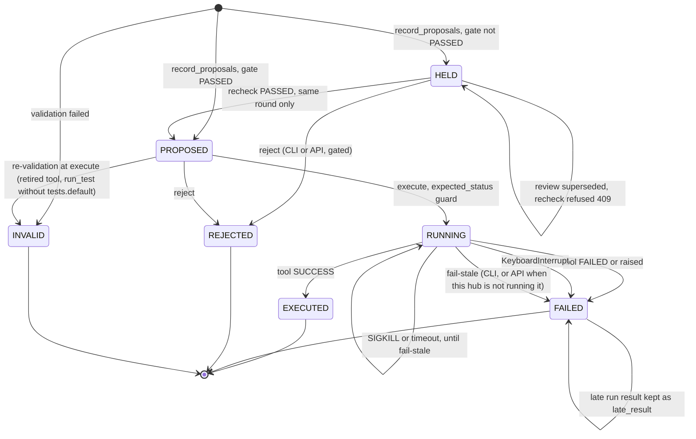
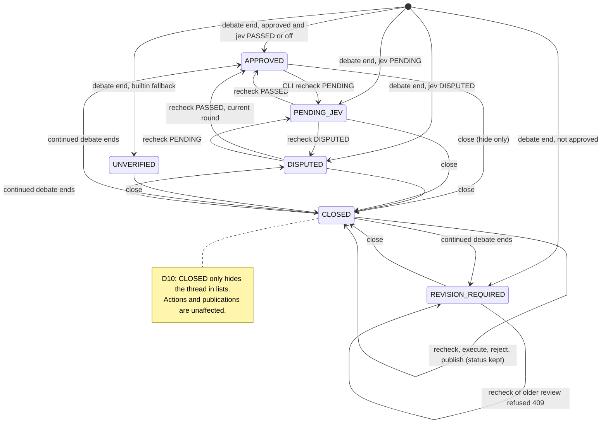
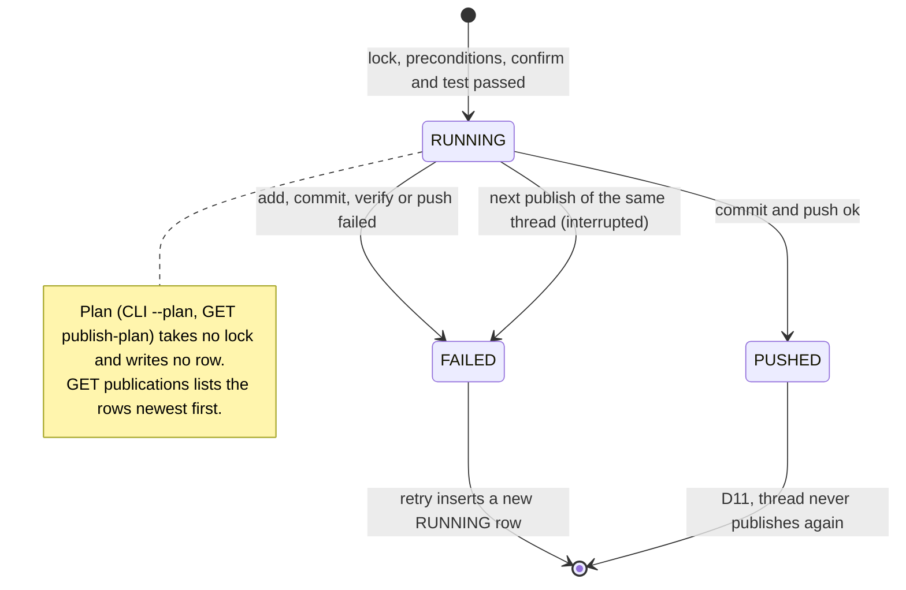

# Phase 4 - Debate / Decision / Action re-review

English | [한국어](phase4-debate.ko.md)

> Point-in-time record from 2026-10-12; the code has changed since.

Reviewed `66cf41e` (read-only) against phase 3 (`52fbfe2`). Relevant commits: `391bcb8` (late results never
overwrite an operator-failed action), `8344131` (plan without lock), `ccda0f6` (D1 retire `git_commit_push`, D10, D11,
D12 workspace reset, D13 publications, closed-thread list), `e6f372d` (`tests.default` list), `64a2bff` (fail-stale
route, `GUARDIAN_UI_ACTIONS=off` on every decision route), `c8a5741` (fail-stale from Approvals). Line numbers are at
`66cf41e`.

## Summary

| id | sev (P1) | P1 | P3 | P4 | change since P3 |
|---|---|---|---|---|---|
| DBT-1 | High | OPEN | PARTIAL | **RESOLVED** | hub route `POST /api/actions/{id}/fail-stale` + Approvals button; late writes guarded |
| DBT-2 | High | OPEN | OPEN | **RESOLVED** | tool retired from catalog, team and persona; stored rows refused as INVALID |
| DBT-3 | High | OPEN | PARTIAL | **PARTIAL** | unchanged (stranded superseded HELD, CLI APPROVED->PENDING_JEV) |
| DBT-4 | High | OPEN | RESOLVED | **RESOLVED** | - |
| DBT-5 | Medium | OPEN | PARTIAL | **PARTIAL** | publications + closed list now exposed; verdict/Close/Recheck still from snapshot, no thread-status API |
| DBT-6 | Medium | OPEN | RESOLVED | **RESOLVED** | - |
| DBT-7 | Medium | OPEN | OPEN | **RESOLVED** | D10: CLOSED = hide only, documented; behaviour matches |
| DBT-8 | Medium | OPEN | RESOLVED | **RESOLVED** | - |
| DBT-9 | Medium | OPEN | PARTIAL | **PARTIAL** | unchanged (direct CLI debate unchecked) |
| DBT-10 | Medium | OPEN | OPEN | **PARTIAL** | D11 decided and documented, not enforced at continue/execute time (DBT-P4-1) |
| DBT-11 | Medium | OPEN | PARTIAL | **PARTIAL** | unchanged (sync git failure -> 400) |
| DBT-12 | Medium | OPEN | RESOLVED | **RESOLVED** | - |
| DBT-13 | Medium | OPEN | RESOLVED | **RESOLVED** | now a step list with one shared budget |
| DBT-14 | Medium | OPEN | RESOLVED | **RESOLVED** | - |
| DBT-15 | Low | OPEN | OPEN | **RESOLVED** | reject, recheck, close, fail-stale, reset all gated with a CLI hint |
| DBT-16 | Low | OPEN | RESOLVED | **RESOLVED** | - |
| DBT-17 | Low | OPEN | PARTIAL | **PARTIAL** | same three stale doc lines |
| DBT-18 | Low | OPEN | PARTIAL | **PARTIAL** | unchanged |
| DBT-19 | Low | OPEN | RESOLVED | **RESOLVED** | - |
| DBT-N1 | Medium | - | new | **RESOLVED** | guarded final write, `decided_by` kept, hub liveness check |
| DBT-N2 | Medium | - | new | **PARTIAL** | `--workspace-reset` exists; files of unpublishable executed actions are kept forever |
| DBT-N3 | Low | - | new | **OPEN** | unchanged |
| DBT-N4 | Low | - | new | **OPEN** | unchanged |
| DBT-N5 | Low | - | new | **OPEN** | unchanged |
| DBT-N6 | Low | - | new | **RESOLVED** | plan runs without the lock |
| DBT-N7 | Low | - | new | **OPEN** | unchanged |
| DBT-N8 | Low | - | new | **OPEN** | unchanged |

Counts (27 findings): **RESOLVED 14** · **PARTIAL 8** · **OPEN 5** · **REGRESSED 0**.
DBT-1..19: RESOLVED 12, PARTIAL 7, OPEN 0. DBT-N1..N8: RESOLVED 2, PARTIAL 1, OPEN 5.

New since phase 3: **DBT-P4-1 Medium**, **DBT-P4-2 Medium**, DBT-P4-3..P4-6 Low.

---

## 1. Status with evidence

**DBT-1 RESOLVED.** Tool exceptions -> FAILED; interrupt -> FAILED with `expected_status="RUNNING"` (`cli/llm-agent/action_ops.py:256-261`). SIGKILL leaves RUNNING, but the dashboard can now recover it: `POST /api/actions/{id}/fail-stale` (confirm_id echo, 409 while this hub's `actionRuns` holds the id, gated) (`apps/agent/debate_handler.go:1252-1285`, route `:289`), UI in `apps/web-desktop/src/pages/debate/ActionDialog.tsx` (commit `c8a5741`).

**DBT-2 RESOLVED.** `git_commit_push` removed from `TOOLS` and `WRITE_TOOLS` (`cli/llm-agent/mcp_client.py:95`), validation names it retired (`:97, 168-169`); removed from `configs/teams/cross-review.json` and `configs/personas/jev_mcp_decision.json`. Residuals in DBT-P4-4.

**DBT-3 PARTIAL.** Unchanged since P3: round-scoped release and `RecheckConflict` (`action_ops.py` `recheck_thread`), but superseded HELD stay stranded (DBT-N3) and a CLI recheck of a current review can still demote APPROVED to PENDING_JEV with PROPOSED actions.

**DBT-4 RESOLVED.** Unchanged (sync counts untracked, shared lock, `project_registry.py` `_update`).

**DBT-5 PARTIAL.** New read APIs: `GET /api/threads/{t}/publications` (`debate_handler.go:1113-1123`, `workspace_ops.py:175-182`) and `GET /api/threads/closed` (`debate_handler.go:1125-1139`). Still snapshot-driven: `canCloseThread(status.label, …)` and `gateNeedsRecheck(fd)` (`apps/web-desktop/src/pages/debate/ResultView.tsx:408, 465`); no route returns `threads.status`.

**DBT-6 RESOLVED.** Unchanged.

**DBT-7 RESOLVED (by decision D10).** `debate-teams-api.md:230` states CLOSED only hides and never blocks execute/reject/publish; code behaves so (no CLOSED check in `run_action`/`publish_thread`); `GET /api/threads/closed` added. The dashboard's "no Close for APPROVED" rule is documented (`debate-teams-api.md:229`).

**DBT-8 RESOLVED.** Unchanged.

**DBT-9 PARTIAL.** Unchanged: 409 only for hub jobs (`debate_handler.go` `startDebate`), a CLI `--debate --thread` is not checked.

**DBT-10 PARTIAL.** D11 documented (`docs/design/publish-thread.md:10-12`: "Further changes need a new thread") and enforced at publish (`publish_ops.py:228-231`). Not enforced earlier: see DBT-P4-1.

**DBT-11 PARTIAL.** Unchanged: `config_ops.py` `sync_projects` still maps a git clone/fetch failure to exit 2 / 400.

**DBT-12, 13, 14, 16, 19 RESOLVED.** Unchanged; DBT-13 extended: `run_default_test` runs every `tests.default` step in order within one budget (`mcp_client.py:334-376`), `_run_gate` reports steps (`publish_ops.py` `_run_gate`).

**DBT-15 RESOLVED.** `uiActionsBlocked` (`debate_handler.go:981-988`) now guards reject, jev-recheck, close, publish, fail-stale, workspace reset and run, each with the equivalent CLI command; read-only plan routes stay open by design (`debate-teams-api.md:245`).

**DBT-17 PARTIAL.** Still stale in `docs/design/debate-teams-api.md`: `run_tests` `"risk": "low"` (`:33`, code `high`), POST `/api/debates` body without `project`/`context_paths`/`context_ref` (`:64`), typed confirm "only `server_remediation`" (`:134`).

**DBT-18 PARTIAL.** `RunDetail` Outcome still `decisionStatus(run.verdict)` without the gate (`apps/web-desktop/src/pages/agents/RunDetail.tsx:29`).

**DBT-N1 RESOLVED.** Final write guarded by `expected_status="RUNNING"`; a late result is stored as `result.late_result` without changing the status (`action_ops.py:262-270`, `db_manager.py:507-512`); fail-stale keeps `decided_by` and records `marked_failed_by/at` (`action_ops.py:274-284`); hub refuses while it runs the action (`debate_handler.go:1276-1281`). Residual (documented): a run started from the hub shell CLI is invisible to that check, but cannot overwrite the decision any more.

**DBT-N2 PARTIAL.** `--workspace-reset` (plan / `--yes`, exact paths, shared lock, tracked-branch only) and GET/POST `/api/projects/{id}/workspace-reset` exist (`cli/llm-agent/workspace_ops.py:121-170`; `debate_handler.go:1141-1180`). It keeps every file of an EXECUTED file action of any not-yet-pushed thread (`workspace_ops.py:61-79`), including threads that can never publish (mixed base_sha, superseded rounds, abandoned work), so such a workspace can never become clean and sync keeps answering `skipped`.

**DBT-N3 OPEN.** No change: superseded-round HELD actions remain HELD and block publish; RecheckPanel still offered from the old result (`ResultView.tsx:465`).

**DBT-N4 OPEN.** ResultView still lists every round of the thread under "Actions from this debate" (`ResultView.tsx:367, 479`).

**DBT-N5 OPEN.** `execute_code_action` description still says "optionally running the test suite afterwards" with no mention that `run_test` needs `tests.default` (`mcp_client.py:31-35`).

**DBT-N6 RESOLVED.** Plan runs under `nullcontext()` (`publish_ops.py:275`) and adds a note when a RUNNING attempt exists (`:321-323`).

**DBT-N7 OPEN.** `publishPlan` still parses with `r.URL.Query()` (`debate_handler.go:1100`).

**DBT-N8 OPEN.** Recovery still looks only at the publishing thread's RUNNING rows (`publish_ops.py:278`).

---

## 2. State machines now

### 2.1 Action status

### 2.2 Thread status

### 2.3 Publication status

---

## 3. New contradictions since phase 3

### DBT-P4-1 (Medium) - D11 "further changes need a new thread" is not enforced before work is done
- Evidence: rule in `docs/design/publish-thread.md:10-12`, enforced only inside publish (`publish_ops.py:228-231`). Continuing a published thread is still allowed (`POST /api/debates` with `thread_id`; ResultView "Continue this thread"), and `run_action` has no publication check (`action_ops.py:213-270`). Workspace reset does not keep files of pushed threads (`workspace_ops.py:61-79`), so they are discarded on the next reset.
- Impact: an operator can debate further on a published thread, approve and execute file actions, and only learn at publish time that they can never ship; the files are then removed by the next reset. The work is lost and has to be done again.
- Fix: SAFE-FIX - refuse `--debate --thread T` (and the hub start) when T has a PUSHED publication, with "start a new thread"; or refuse `run_action` of file tools for a published thread. Show a "Published" badge from `GET /publications` and replace "Continue this thread" with "New thread from this one".

### DBT-P4-2 (Medium) - Workspace reset does not coordinate with running actions
- Evidence: reset takes the workspace flock (`workspace_ops.py:146`), but `run_action` never takes it (`action_ops.py:213-270`); a RUNNING action's files are not in `_kept` (only EXECUTED, `workspace_ops.py:63`). `execute_code_action` with `run_test` writes the file first and then runs a test sequence of up to 600 s (`mcp_client.py` `call_tool`, `run_default_test`).
- Impact: a reset during that window discards the file just written; the action then records EXECUTED with `file_hashes` of a file that no longer exists, and publish refuses ("written by the executed actions but not changed in the workspace"). There is no way back short of re-debating.
- Fix: SAFE-FIX - refuse reset (plan and apply) while the project has RUNNING actions, or treat RUNNING file actions' paths as `keep`; ideally `run_action` for file tools takes the same workspace lock.

### DBT-P4-3 (Low) - Abandoned executed changes can neither publish nor be reset
- Evidence: `_kept` keeps every EXECUTED file action of any thread without a PUSHED row (`workspace_ops.py:61-79`), while `publish_thread` refuses mixed bases and superseded/HELD leftovers (`publish_ops.py:233-250`). No command abandons a thread's executed changes.
- Impact: the workspace stays dirty and `--project-sync` stays `skipped` (this is why DBT-N2 is only PARTIAL).
- Fix: DESIGN - an explicit "abandon thread changes" (mark the thread's EXECUTED file actions as abandoned so reset discards them) with its own confirm.

### DBT-P4-4 (Low) - Leftovers of the `git_commit_push` retirement
- Evidence: stored PROPOSED/HELD rows naming it stay PROPOSED/HELD until someone tries to execute or reject them (only `validate` refuses it, `mcp_client.py:168-169`), so they keep blocking publish of their thread; a custom team whose `allowed_tools` still lists it now fails `validate_lineup` ("unknown tool") and its stored lineups fall back to the default lineup; the dashboard still lists it in `changesWorkspace` (`apps/web-desktop/src/lib/debate.ts:329`).
- Fix: SAFE-FIX - a one-time migration that marks such PROPOSED/HELD rows INVALID ("retired"), accept-and-drop the retired name in `allowed_tools` with a warning, remove it from `changesWorkspace`.

### DBT-P4-5 (Low) - Two thread-id patterns for the same route family
- Evidence: Go validates `^thread_[A-Za-z0-9_]{1,80}$` (`debate_handler.go:59`); `publications_json` uses `^[A-Za-z0-9_.:-]{1,128}$` (`workspace_ops.py:172`). Harmless today because Go is stricter, but CLI callers see a different contract.
- Fix: SAFE-FIX - one shared pattern constant in Python matching Go.

### DBT-P4-6 (Low) - Lock comment and timeout reuse
- Evidence: `publish_ops.py:278` still says "no publish can be live: we hold the lock", false in plan mode since `8344131` (`:275`); the reset plan route reuses `jevRecheckTimeout` (`debate_handler.go:1147`) like the publish plan.
- Fix: SAFE-FIX - reword the comment; add a `planTimeout` constant.

---

## 4. Pattern notes

- **Guard in one entry point** (P3): improved (UI_ACTIONS on every decision route, fail-stale on both CLI and hub) but D11 and reset safety still live in one function each (DBT-P4-1, DBT-P4-2).
- **Workspace as shared resource** (P5): sync, publish and reset share the flock; action execution is the one writer outside it (DBT-P4-2).
- **No-recovery states** (P4): action RUNNING and publication RUNNING now recoverable; remaining dead end is executed-but-unpublishable work (DBT-P4-1, DBT-P4-3, DBT-N2).
- **Snapshot vs live** (P1): unchanged residue (DBT-5, DBT-N3, DBT-N4, DBT-18).
