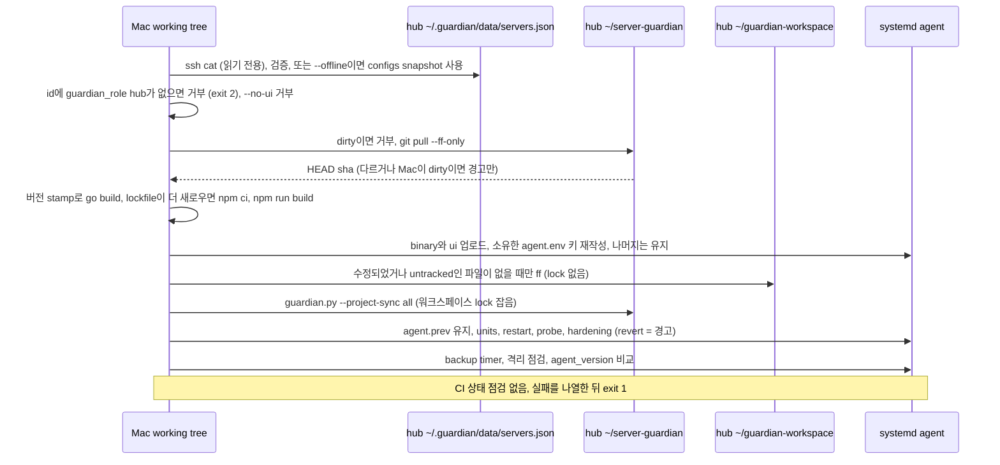
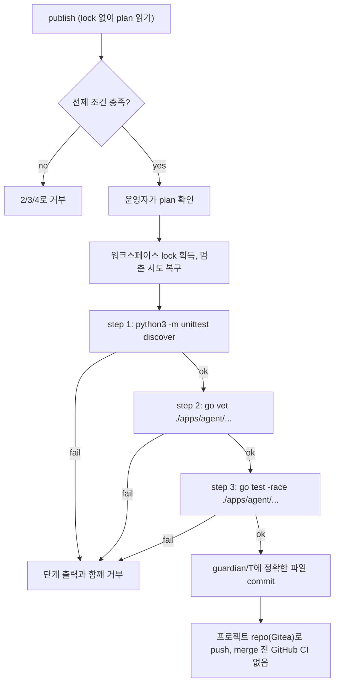
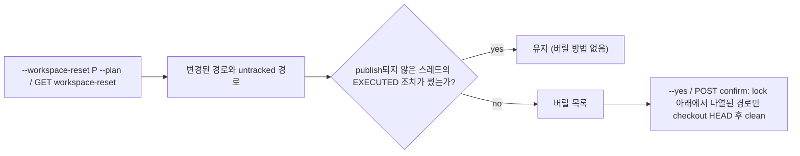

# Phase 4 - 개발 workflow 재검토 (52fbfe2..66cf41e)

[English](phase4-dev.md) | 한국어

> 2026-10-12 시점의 기록이며, 이후 코드가 바뀌었다.

`66cf41e`(phase 3 이후 commit 31개)의 Mac checkout을 읽기 전용으로 검토했다. 허브 자체는 살펴보지 않았다.
아래 집계는 코드와 대조해 확인했다. 경로는 repo 기준 상대 경로이다. `install` =
`scripts/install-agent-service.sh`. 운영자 결정 D1-D14는
`docs/analysis/2026-10-12-procedure-review.md` §8에 있다.

조정자를 위한 메모: repo에서 배포에 대한 CI gate를 찾지 못했다. `install`은 GitHub Actions를 조회하지 않고
(`install:1-470`에 `gh`/CI 점검 없음), §8에도 이에 대한 결정이 없다. 따라서 DEV-7은 PARTIAL로 남는다.

## 요약 표

| id | severity | phase-3 -> phase-4 |
|---|---|---|
| DEV-1 인벤토리에서 정한 허브 모드 | high | RESOLVED -> RESOLVED |
| DEV-2 agent.env 운영자 설정 유지 | high | RESOLVED -> RESOLVED |
| DEV-3 git_commit_push 대 publish | high | PARTIAL -> **RESOLVED** |
| DEV-4 publish된 코드가 CI를 우회 | medium | OPEN -> **PARTIAL** |
| DEV-5 deploy/sync 시 untracked 파일 | medium | RESOLVED -> RESOLVED |
| DEV-6 publish 이후 sync 루프 | medium | RESOLVED -> RESOLVED |
| DEV-7 버전 정렬 / 배포 gate | medium | PARTIAL -> PARTIAL |
| DEV-8 대시보드 publish plan | medium | RESOLVED -> RESOLVED |
| DEV-9 base_sha 없는 조치 | medium | OPEN -> OPEN (조합 시 악화, DEV-P4-1 참고) |
| DEV-10 pytest fallback 없음 | medium | RESOLVED -> RESOLVED |
| DEV-11 최초 설치 bootstrap | medium | OPEN -> **PARTIAL** |
| DEV-12 README push 모델 | medium | RESOLVED -> RESOLVED |
| DEV-13 CI 취소 규칙 | low | RESOLVED -> RESOLVED |
| DEV-14 ci.sh / README 섹션 문구 | low | RESOLVED -> **REGRESSED** |
| DEV-15 Go toolchain / arch 차이 | low | OPEN -> OPEN |
| DEV-16 lockfile 변경 시 npm ci | low | RESOLVED -> RESOLVED |
| DEV-17 두 개의 워크스페이스 updater | low | PARTIAL -> PARTIAL |
| DEV-18 판정자가 프로젝트 테스트를 봄 | low | RESOLVED -> RESOLVED |
| DEV-19 publish exit code | low | RESOLVED -> RESOLVED |
| DEV-20 publish 제목이 항상 `fix:` | low | OPEN -> OPEN (D14로 유지) |
| DEV-21 오래된 문서 | low | PARTIAL -> PARTIAL |
| DEV-N1 README pytest fallback | low | OPEN -> **RESOLVED** |
| DEV-N2 hardening revert가 설치를 실패시킴 | low | OPEN -> **RESOLVED** |
| DEV-N3 대시보드 노드에 pull-inventory 필요 | low | OPEN -> **RESOLVED** |
| DEV-N4 installer 워크스페이스 갱신이 lock을 건너뜀 | low | OPEN -> OPEN |
| DEV-P4-1 reset이 publish할 수 없는 파일을 영원히 유지 | medium | new |
| DEV-P4-2 `--offline`이 두 가지로 설명됨 | low | new |
| DEV-P4-3 리뷰 문서의 상태 행이 §8과 모순 | low | new |

집계(이어진 발견 사항 25개): RESOLVED 15, PARTIAL 5, OPEN 4, REGRESSED 1. 새 항목: 3개(medium 1, low 2).

---

## 발견 사항별 상태

- **DEV-1 RESOLVED.** installer는 이제 허브 전용이다(D3). 역할은 허브 인벤토리에서 오고
  (`install:112`, `scripts/lib/inventory.sh:77-96`), 허브가 아닌 호스트는 exit 2로 끝나며(`install:113-124`), `--no-ui`는
  거부되고(`install:79`), `--with-ui`는 무시된다.
- **DEV-2 RESOLVED.** 소유 키 목록과 유지되는 줄은 변경 없다(`install:200-201`).
- **DEV-3 RESOLVED(변경됨).** `git_commit_push`는 카탈로그와 `WRITE_TOOLS`에서 사라졌다. 저장된 행은
  "use publish"와 함께 거부된다(`cli/llm-agent/mcp_client.py:97,168-169`). `configs/teams/cross-review.json:11`과
  판정자 페르소나에서도 제거되었다(grep 결과 일치 없음). 문서도 일치한다
  (`README.md:50`, `docs/design/publish-thread.md:6-8`, `docs/design/debate-patch-tool.md:127`).
- **DEV-4 PARTIAL(변경됨).** D2가 허브 gate를 넓혔다: `tests.default`는 이제 목록이고, 이 repo에서는
  unittest, 그 다음 `go vet`, 그 다음 `go test -race`이다(`configs/projects/server-guardian.json:8-13`,
  `mcp_client.py:349-376`, `project_registry.py` 목록 파싱). 아직 열린 부분: publish된 브랜치는 프로젝트
  `repo`(Gitea)로만 가고, web, shell, config 점검은 `scripts/ci.sh`와 GitHub CI에서만 실행되는데, GitHub CI는
  `main` push와 PR에서만 실행된다(`.github/workflows/ci.yml:4-8`). `README.md:174`("web and shell checks are covered
  by ci.sh and GitHub CI")는 merge 이후에만 참이다.
- **DEV-5 RESOLVED.** 변경 없음(`install:260`, `project_registry.py` `_update`).
- **DEV-6 RESOLVED.** 변경 없음(`publish-thread.md` "After publishing").
- **DEV-7 PARTIAL.** 버전 stamp와 배포 후 비교는 그대로 있다(`install:164-166,446-456`).
  dirty이거나 push되지 않은 Mac tree는 여전히 경고일 뿐이고(`install:142-147`), CI gate는 없다(맨 위 메모
  참고).
- **DEV-8 RESOLVED.** plan은 더 이상 lock을 잡지 않고(`publish_ops.py:275`) 멈춘 RUNNING 시도를 메모로
  보고한다.
- **DEV-9 OPEN.** 코드 컨텍스트가 없으면 `base_sha`는 여전히 `None`이고(`cli/llm-agent/debate_engine.py:626`),
  stale 점검은 이를 건너뛴다(`cli/llm-agent/action_ops.py:168-176`). 새 결과는 DEV-P4-1 참고.
- **DEV-10 RESOLVED.** 각 단계는 공유 600 s 예산으로 점검되고 실행된다(`mcp_client.py:349-376`).
- **DEV-11 PARTIAL(변경됨).** 허브가 아닌 경우가 사라졌으므로(D3) 플릿에는 더 이상
  `/home/ubuntu/server-guardian`이 필요 없다. 허브의 경우 최초 설치 `git clone`은 여전히 문서화되지 않았다: README는
  최초 설치에 대해 `--offline`만 제시하는데(`README.md:124-126`), installer는 `~/server-guardian`으로 `cd`하고
  (`install:130`) 두 unit 모두 이를 요구한다(`deploy/systemd/server-guardian-agent.service:13`,
  `server-guardian-db-backup.service:12`).
- **DEV-12 RESOLVED.** README가 단일 허브 중심으로 다시 쓰였다(`README.md:121-149`).
- **DEV-13 RESOLVED.** 변경 없음(`ci.yml:13-17`).
- **DEV-14 REGRESSED (low).** `scripts/ci.sh:14`는 이제 `scripts/lib/*.sh`도 lint하지만(`shellcheck -x`로),
  README CI 표는 여전히 `scripts/*.sh`와 `deploy/*/*.sh`라고 한다(`README.md:244`). 수정: SAFE-FIX - 표에
  `scripts/lib/*.sh`를 추가한다.
- **DEV-15 OPEN.** `go.mod`는 여전히 toolchain 줄 없이 `go 1.26.2`이고, 허브는 `1.26.8`을 쓰며(`install:62`),
  CI는 arm64만 build한다(`scripts/ci.sh:69`). 허브가 아닌 설치가 사라졌으므로 amd64 쪽은 허브가 x86이 되는
  경우에만 의미가 있다(`install:150-155`).
- **DEV-16 RESOLVED.** 변경 없음(`install:173-174`).
- **DEV-17 PARTIAL.** updater가 여전히 둘이다: bash 블록이 허브 checkout의 브랜치를 따르고
  (`install:256-268`), 그 다음 `--project-sync all`이 실행된다(`install:276`).
- **DEV-18 RESOLVED.** 판정자 문구가 이제 모든 gate 단계를 순서대로 나열한다(`mcp_client.py` `describe`).
- **DEV-19 RESOLVED.** 변경 없음.
- **DEV-20 OPEN(수용됨).** 운영자 결정 D14가 `fix:`를 유지한다(`publish_ops.py:86`; §8 D14).
- **DEV-21 PARTIAL.** 여전히 오래된 내용:
  - `agent.md:232,240-241`: `:5173`의 대시보드와 `100.64.0.x:5173` URL.
  - `agent.md:283`: 판정자가 코드 변경을 "executes"한다.
  - `docs/design/debate-patch-tool.md:67`: `.go` 행은 여전히 허브에 Go가 없다고 한다.
- **DEV-N1 RESOLVED.** `README.md:192`는 이제 fallback 명령이 없다고 한다.
- **DEV-N2 RESOLVED.** `REVERTED`는 경고이다(`install:390`). 알 수 없는 결과만 hardening 실패로 간주되고,
  rollback 안내는 에이전트 자체가 실패했을 때만 출력된다(`install:458-469`). README
  (`README.md:136`)와 주석(`install:383`)이 일치한다.
- **DEV-N3 RESOLVED(대체됨).** Mac 스크립트는 `scripts/lib/inventory.sh`를 통해 허브 인벤토리를 읽으므로
  (D4), 대시보드에 등록된 노드는 `pull-inventory.sh` 없이도 보인다(`README.md:139-147`).
- **DEV-N4 OPEN.** installer의 bash 워크스페이스 갱신(`install:250-275`)은 여전히 lock을 잡지 않는 반면,
  publish, sync, 새 워크스페이스 reset은 모두 `guardian-publish.lock`을 쓴다(`cli/llm-agent/workspace_ops.py:16`,
  `project_registry.workspace_lock`).

---

## 새 발견 사항

### DEV-P4-1 (medium) 워크스페이스 reset이 publish되지 않을 스레드의 파일을 결코 지울 수 없다
- 근거: reset은 PUSHED publication이 없는 모든 스레드의 EXECUTED 파일 조치가 쓴 모든 경로를 유지한다
  (`cli/llm-agent/workspace_ops.py:61-78`, `:4-6`의 module docstring). 스레드를 abandoned로 표시하는 것은 없다:
  close는 숨김 전용이고(D10), 조치에 `base_sha`가 없는 스레드는 결코 publish될 수 없다(DEV-9,
  `publish_ops.py` base 점검). 한편 허브 배포와 `--project-sync`는 변경되었거나 untracked인 파일이 하나라도 있는
  워크스페이스의 fast-forward를 거부한다(`install:260`, `project_registry.py` `_update`). publish는 다른 스레드의
  추가 경로를 거부한다(`publish_ops.py` `_check_worktree`).
- 이유: 승인되었지만 publish되지 않은 스레드 하나(버려졌거나, 닫혔거나, 컨텍스트 없는)가 공유 워크스페이스를
  고정시킨다. 이후의 모든 배포와 sync가 이를 건너뛰므로 토론은 계속 오래된 코드를 읽는다. 다른 모든 스레드의
  publish는 외부 파일 때문에 거부된다. 지원되는 유일한 정리 도구인 reset은 그 파일을 일부러 남기므로, 운영자는
  허브에서 수동 git으로 돌아가야 한다. 이는 D12의 목적과 모순된다.
- 수정: DESIGN - 명시적인 운영자 선택 후 reset이 지정된 스레드의 파일을 버리도록 하거나(예: `--drop-thread
  T`, DB에 기록), 스레드를 닫으면 그 파일을 해제하도록 한다. DEV-9 부분에 대한 SAFE-FIX: `base_sha`가 없으면
  제안 시점에 파일 도구를 거부한다.

### DEV-P4-2 (low) README가 `--offline`을 두 가지로 설명한다
- 근거: `README.md:125-126`은 `--offline`이 허브 최초 설치 전용(아직 인벤토리 사본 없음)이라고 한다.
  `README.md:145`는 허브에 연결할 수 없을 때 쓰는 것이라고 한다. `install:18-20`은 "first install"이라고 한다.
  installer는 또한 로드된 파일로 `~/.guardian/data/servers.json`을 초기화하지만(`install:246`), 기존 파일은
  덮어쓰지 않는다.
- 수정: SAFE-FIX - 두 곳에 같은 문장을 쓴다: "first install, or when the hub cannot be reached; the
  hub's copy is never overwritten".

### DEV-P4-3 (low) 리뷰 문서의 상태 표가 자신의 §8과 모순된다
- 근거: `docs/analysis/2026-10-12-procedure-review.md:121`은 DEV-3이 partial(도구 폐기 대기)이라고 하고,
  `:122`는 DEV-4가 미해결(merge 경로 결정 필요, D2)이라고 한다. §8(`:489-490`)은 D1(폐기됨,
  `ccda0f6`)과 D2(gate 확장, `e6f372d`, `7002432`)를 기록한다.
- 수정: SAFE-FIX - 두 행을 갱신하거나, 표에 "status at phase 3" 라벨을 붙인다.

---

## 갱신된 절차 다이어그램

### PROC-4 허브 배포 (변경: 허브 전용, 허브 인벤토리, hardening revert는 경고)

### PROC-9 Publish gate (변경: 다단계 기본 테스트)

### PROC-11 워크스페이스 reset (신규, D12)

PROC-1, 2, 3, 5(이제 제거됨: 허브가 아닌 설치는 없다), 6, 7, 10은 다음을 제외하면 변경 없다:
- `git_commit_push`가 PROC-7에서 사라졌다.
- PROC-8은 폐기되었다.
- `scripts/ci.sh`는 `scripts/lib/*.sh`도 lint한다.
- Mac 플릿 스크립트는 `scripts/lib/inventory.sh`를 통해 허브 인벤토리를 읽는다.
