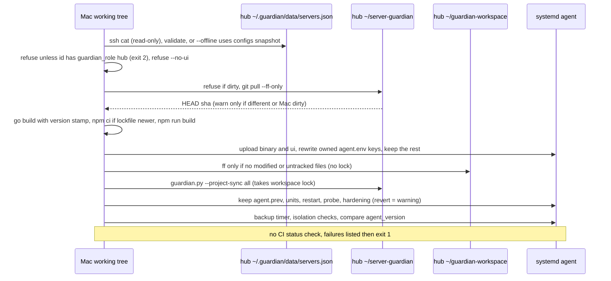
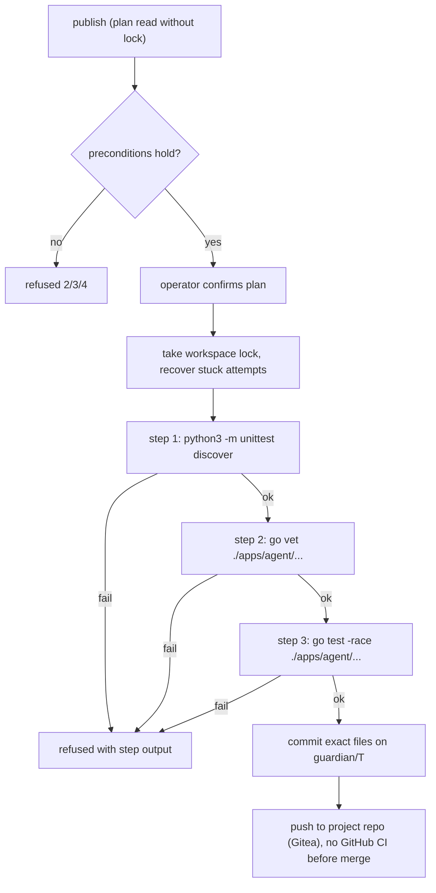
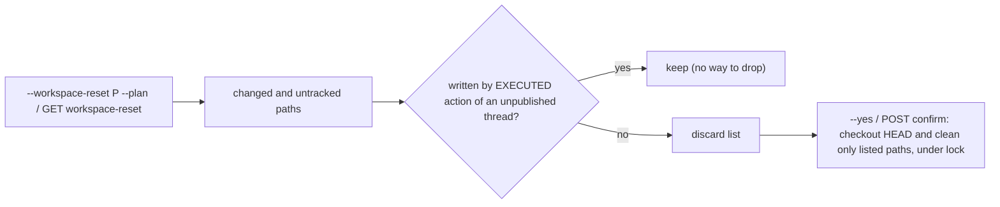

# Phase 4 - Development workflow re-review (52fbfe2..66cf41e)

English | [한국어](phase4-dev.ko.md)

> Point-in-time record from 2026-10-12; the code has changed since.

Read-only review of the Mac checkout at `66cf41e` (31 commits after phase 3). The hub itself was not inspected.
The counts below are verified against the code. Paths are repo-relative. `install` =
`scripts/install-agent-service.sh`. Operator decisions D1-D14 are in
`docs/analysis/2026-10-12-procedure-review.md` §8.

Note for the coordinator: I found no CI gate on deploys in the repo. `install` never queries GitHub Actions
(no `gh`/CI check in `install:1-470`), and §8 lists no decision for one. DEV-7 therefore stays PARTIAL.

## Summary table

| id | severity | phase-3 -> phase-4 |
|---|---|---|
| DEV-1 hub mode from the inventory | high | RESOLVED -> RESOLVED |
| DEV-2 agent.env operator settings kept | high | RESOLVED -> RESOLVED |
| DEV-3 git_commit_push vs publish | high | PARTIAL -> **RESOLVED** |
| DEV-4 published code bypasses CI | medium | OPEN -> **PARTIAL** |
| DEV-5 untracked files on deploy/sync | medium | RESOLVED -> RESOLVED |
| DEV-6 post-publish sync loop | medium | RESOLVED -> RESOLVED |
| DEV-7 version alignment / deploy gate | medium | PARTIAL -> PARTIAL |
| DEV-8 dashboard publish plan | medium | RESOLVED -> RESOLVED |
| DEV-9 actions without base_sha | medium | OPEN -> OPEN (worse in combination, see DEV-P4-1) |
| DEV-10 no pytest fallback | medium | RESOLVED -> RESOLVED |
| DEV-11 first-install bootstrap | medium | OPEN -> **PARTIAL** |
| DEV-12 README push model | medium | RESOLVED -> RESOLVED |
| DEV-13 CI cancel rule | low | RESOLVED -> RESOLVED |
| DEV-14 ci.sh / README section text | low | RESOLVED -> **REGRESSED** |
| DEV-15 Go toolchain / arch drift | low | OPEN -> OPEN |
| DEV-16 npm ci on lockfile change | low | RESOLVED -> RESOLVED |
| DEV-17 two workspace updaters | low | PARTIAL -> PARTIAL |
| DEV-18 judge sees project tests | low | RESOLVED -> RESOLVED |
| DEV-19 publish exit codes | low | RESOLVED -> RESOLVED |
| DEV-20 publish subject always `fix:` | low | OPEN -> OPEN (kept by D14) |
| DEV-21 stale docs | low | PARTIAL -> PARTIAL |
| DEV-N1 README pytest fallback | low | OPEN -> **RESOLVED** |
| DEV-N2 hardening revert fails install | low | OPEN -> **RESOLVED** |
| DEV-N3 dashboard nodes need pull-inventory | low | OPEN -> **RESOLVED** |
| DEV-N4 installer workspace update skips lock | low | OPEN -> OPEN |
| DEV-P4-1 reset keeps unpublishable files forever | medium | new |
| DEV-P4-2 `--offline` described two ways | low | new |
| DEV-P4-3 review doc status rows contradict §8 | low | new |

Counts (25 findings carried over): RESOLVED 15, PARTIAL 5, OPEN 4, REGRESSED 1. New: 3 (1 medium, 2 low).

---

## Per-finding status

- **DEV-1 RESOLVED.** The installer is hub-only now (D3). The role comes from the hub inventory
  (`install:112`, `scripts/lib/inventory.sh:77-96`), a non-hub host exits 2 (`install:113-124`), `--no-ui` is
  refused (`install:79`), and `--with-ui` is ignored.
- **DEV-2 RESOLVED.** The owned-keys list and the kept lines are unchanged (`install:200-201`).
- **DEV-3 RESOLVED (changed).** `git_commit_push` is gone from the catalog and `WRITE_TOOLS`. Stored rows are
  refused with "use publish" (`cli/llm-agent/mcp_client.py:97,168-169`). It is also removed from
  `configs/teams/cross-review.json:11` and the judge persona (grep finds no match). Docs agree
  (`README.md:50`, `docs/design/publish-thread.md:6-8`, `docs/design/debate-patch-tool.md:127`).
- **DEV-4 PARTIAL (changed).** D2 broadened the hub gate: `tests.default` is now a list, and for this repo it is
  unittest, then `go vet`, then `go test -race` (`configs/projects/server-guardian.json:8-13`,
  `mcp_client.py:349-376`, `project_registry.py` list parsing). Still open: published branches go only to the
  project `repo` (Gitea), and web, shell and config checks run only in `scripts/ci.sh` and GitHub CI, which fires on
  `main` pushes and PRs only (`.github/workflows/ci.yml:4-8`). `README.md:174` ("web and shell checks are covered
  by ci.sh and GitHub CI") is true only after the merge.
- **DEV-5 RESOLVED.** Unchanged (`install:260`, `project_registry.py` `_update`).
- **DEV-6 RESOLVED.** Unchanged (`publish-thread.md` "After publishing").
- **DEV-7 PARTIAL.** The version stamp and the post-deploy comparison are still in place (`install:164-166,446-456`).
  A dirty or unpushed Mac tree is still only a warning (`install:142-147`), and there is no CI gate (see the note
  at the top).
- **DEV-8 RESOLVED.** The plan no longer takes the lock (`publish_ops.py:275`) and reports a stuck RUNNING attempt
  as a note.
- **DEV-9 OPEN.** `base_sha` is still `None` without a code context (`cli/llm-agent/debate_engine.py:626`), and the
  stale check skips it (`cli/llm-agent/action_ops.py:168-176`). See DEV-P4-1 for the new consequence.
- **DEV-10 RESOLVED.** Each step is checked and run with a shared 600 s budget (`mcp_client.py:349-376`).
- **DEV-11 PARTIAL (changed).** The non-hub case is gone (D3), so the fleet no longer needs
  `/home/ubuntu/server-guardian`. For the hub, the first-install `git clone` is still undocumented: README gives
  only `--offline` for a first install (`README.md:124-126`), while the installer `cd`s into `~/server-guardian`
  (`install:130`) and both units require it (`deploy/systemd/server-guardian-agent.service:13`,
  `server-guardian-db-backup.service:12`).
- **DEV-12 RESOLVED.** README is rewritten around the single hub (`README.md:121-149`).
- **DEV-13 RESOLVED.** Unchanged (`ci.yml:13-17`).
- **DEV-14 REGRESSED (low).** `scripts/ci.sh:14` now lints `scripts/lib/*.sh` (with `shellcheck -x`), but the
  README CI table still says `scripts/*.sh` and `deploy/*/*.sh` (`README.md:244`). Fix: SAFE-FIX - add
  `scripts/lib/*.sh` to the table.
- **DEV-15 OPEN.** `go.mod` still says `go 1.26.2` with no toolchain line, the hub uses `1.26.8` (`install:62`), and
  CI builds arm64 only (`scripts/ci.sh:69`). With non-hub installs gone, the amd64 half matters only if the hub is
  ever x86 (`install:150-155`).
- **DEV-16 RESOLVED.** Unchanged (`install:173-174`).
- **DEV-17 PARTIAL.** There are still two updaters: the bash block follows the hub checkout's branch
  (`install:256-268`), then `--project-sync all` runs (`install:276`).
- **DEV-18 RESOLVED.** The judge text now lists every gate step in order (`mcp_client.py` `describe`).
- **DEV-19 RESOLVED.** Unchanged.
- **DEV-20 OPEN (accepted).** Operator decision D14 keeps `fix:` (`publish_ops.py:86`; §8 D14).
- **DEV-21 PARTIAL.** Still stale:
  - `agent.md:232,240-241`: the dashboard on `:5173` and the `100.64.0.x:5173` URL.
  - `agent.md:283`: the judge "executes" code changes.
  - `docs/design/debate-patch-tool.md:67`: the `.go` row still says the hub has no Go.
- **DEV-N1 RESOLVED.** `README.md:192` now says there is no fallback command.
- **DEV-N2 RESOLVED.** `REVERTED` is a warning (`install:390`). Only an unknown result counts as a hardening
  failure, and the rollback hint is printed only when the agent itself failed (`install:458-469`). README
  (`README.md:136`) and the comment (`install:383`) agree.
- **DEV-N3 RESOLVED (superseded).** Mac scripts read the hub inventory through `scripts/lib/inventory.sh`
  (D4), so dashboard-registered nodes are visible without `pull-inventory.sh` (`README.md:139-147`).
- **DEV-N4 OPEN.** The installer's bash workspace update (`install:250-275`) still takes no lock, while publish,
  sync and the new workspace reset all use `guardian-publish.lock` (`cli/llm-agent/workspace_ops.py:16`,
  `project_registry.workspace_lock`).

---

## New findings

### DEV-P4-1 (medium) Workspace reset can never clear files of threads that will not be published
- Evidence: reset keeps every path written by an EXECUTED file action of any thread with no PUSHED publication
  (`cli/llm-agent/workspace_ops.py:61-78`, the module docstring at `:4-6`). Nothing marks a thread as abandoned:
  closing is hide-only (D10), and threads whose actions have no `base_sha` can never be published (DEV-9,
  `publish_ops.py` base check). Meanwhile hub deploy and `--project-sync` refuse to fast-forward a workspace with
  any changed or untracked file (`install:260`, `project_registry.py` `_update`). Publish refuses extra paths from
  other threads (`publish_ops.py` `_check_worktree`).
- Why: one approved but unpublished thread (abandoned, closed, or contextless) pins the shared workspace. Every
  later deploy and sync skips it, so debates keep reading stale code. Every other thread's publish is refused
  because of the foreign files. The only supported clean-up tool, reset, deliberately leaves those files, so the
  operator has to fall back to manual git on the hub. That contradicts D12's purpose.
- Fix: DESIGN - let reset discard the files of a named thread after an explicit operator choice (e.g. `--drop-thread
  T`, recorded in the DB), or make closing a thread release its files. SAFE-FIX for the DEV-9 part: refuse file
  tools at proposal time when `base_sha` is missing.

### DEV-P4-2 (low) README describes `--offline` two ways
- Evidence: `README.md:125-126` says `--offline` is only for the first hub install (no inventory copy yet).
  `README.md:145` says it is for when the hub is unreachable. `install:18-20` says "first install". The installer
  also seeds `~/.guardian/data/servers.json` from whichever file was loaded (`install:246`), but never overwrites an
  existing one.
- Fix: SAFE-FIX - use one sentence in both places: "first install, or when the hub cannot be reached; the
  hub's copy is never overwritten".

### DEV-P4-3 (low) The review document's status table contradicts its own §8
- Evidence: `docs/analysis/2026-10-12-procedure-review.md:121` says DEV-3 is partial (tool retirement pending),
  and `:122` says DEV-4 is unresolved (merge path decision needed, D2). §8 (`:489-490`) records D1 (retired,
  `ccda0f6`) and D2 (gate broadened, `e6f372d`, `7002432`).
- Fix: SAFE-FIX - update the two rows, or label the table "status at phase 3".

---

## Updated procedure diagrams

### PROC-4 Hub deploy (changed: hub-only, hub inventory, hardening revert is a warning)

### PROC-9 Publish gate (changed: multi-step default test)

### PROC-11 Workspace reset (new, D12)

PROC-1, 2, 3, 5 (now removed: there is no non-hub install), 6, 7 and 10 are unchanged apart from these points:
- `git_commit_push` is gone from PROC-7.
- PROC-8 is retired.
- `scripts/ci.sh` also lints `scripts/lib/*.sh`.
- Mac fleet scripts read the hub inventory through `scripts/lib/inventory.sh`.
