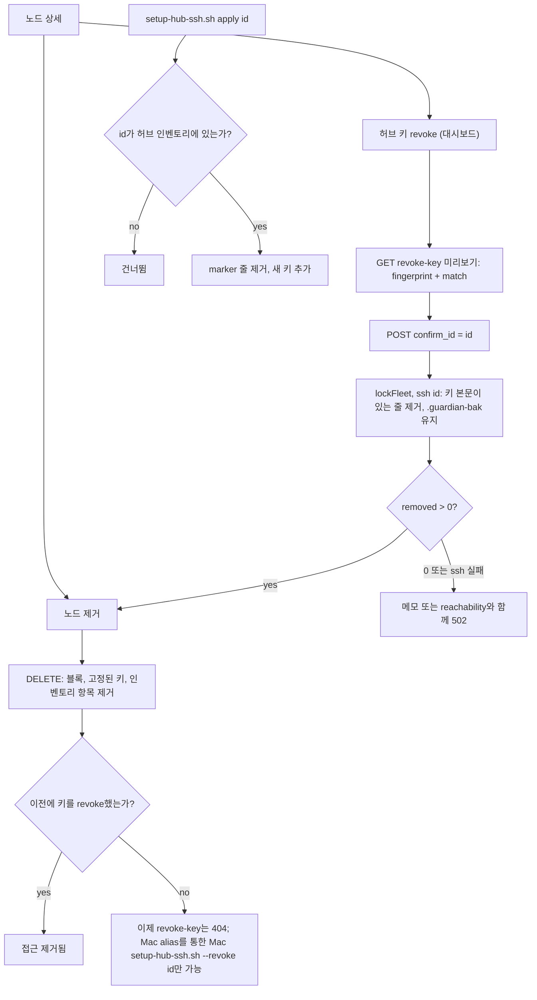
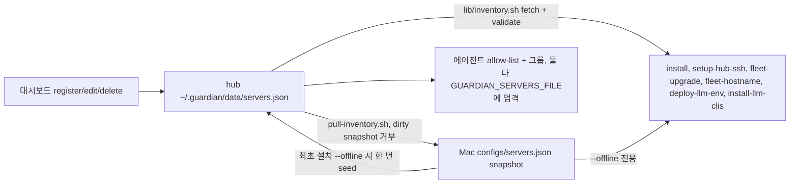
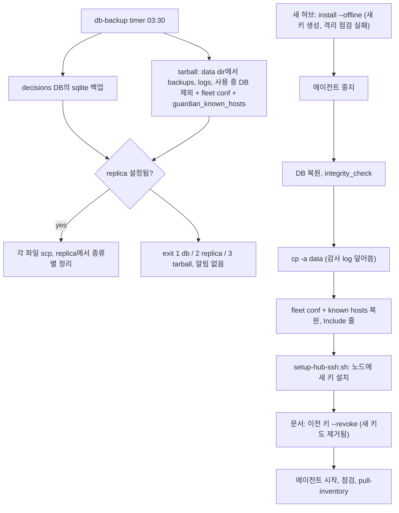

# Phase 4 - 서버 / 플릿 관리 재검토 (ops 분석가)

[English](phase4-ops.md) | 한국어

> 2026-10-12 시점의 기록이며, 이후 코드가 바뀌었다.

범위: `52fbfe2..66cf41e`(commit 31개). 호스트에 접속하지 않은 읽기 전용 검토이며, 모든 file:line은 `66cf41e` 기준이다.
이전 보고서: `../phase1/ops.md`, `../phase3/ops.md`.

## 요약 표

| id | sev | p1 | p3 | p4 | phase 3 이후 변경 |
|---|---|---|---|---|---|
| OPS-1 | High | OPEN | RESOLVED | **RESOLVED** | 여전히 유효하며, installer는 이제 허브 전용이다(D3). |
| OPS-2 | High | OPEN | RESOLVED | **RESOLVED** | 변경 없음. |
| OPS-3 | High | OPEN | OPEN | **RESOLVED** | D3: installer는 허브가 아닌 호스트를 거부하고 README는 단일 허브를 설명한다. |
| OPS-4 | Med | OPEN | PARTIAL | **RESOLVED** | 허브 측 수동 hardening 절차가 문서화되었고, installer, README, drop-in이 일치한다. |
| OPS-5 | High | OPEN | OPEN | **RESOLVED** | D4: Mac 스크립트는 허브 인벤토리를 읽고, pull-inventory는 dirty snapshot을 거부한다. |
| OPS-6 | High | OPEN | OPEN | **PARTIAL** | D5가 대시보드 revoke-key를 추가했고 setup-hub-ssh는 삭제된 id를 건너뛴다. delete는 여전히 revoke하지 않는다(OPS-P4-1). |
| OPS-7 | Med | OPEN | OPEN | **PARTIAL** | 부작용이 이제 허브 인벤토리로 제한된다. UI 안내는 여전히 Mac ssh alias가 필요하다. |
| OPS-8 | Med | OPEN | PARTIAL | **PARTIAL** | 변경 없음. |
| OPS-9 | Med | OPEN | OPEN | **OPEN** | 변경 없음. |
| OPS-10 | Med | OPEN | OPEN | **PARTIAL** | D6이 exec 감사 log를 추가했다. 여전히 gate가 없고, log는 약하다(OPS-P4-3). |
| OPS-11 | Med | OPEN | PARTIAL | **RESOLVED** | Python도 이제 엄격하다(OPS-N2 수정). |
| OPS-12 | Med | OPEN | OPEN | **OPEN** | 변경 없음. |
| OPS-13 | Med | OPEN | PARTIAL | **PARTIAL** | 모든 스크립트가 이제 하나의 인벤토리 소스를 공유한다. 필터, macOS 노드, Linux 전용 probe는 변경 없다. |
| OPS-14 | Med | OPEN | PARTIAL | **PARTIAL** | UI가 이제 reachability를 보여 준다. 레거시 status 필드와 허브 전용 임계값은 남아 있다. |
| OPS-15 | Med | OPEN | OPEN | **PARTIAL** | D7이 data tarball, 플릿 파일, 복원 문서를 추가했다. 여전히 실패 알림이 없고, 문서에 빈틈이 있다(OPS-P4-4). |
| OPS-16 | Low | OPEN | RESOLVED | **RESOLVED** | 변경 없음. |
| OPS-17 | Low | OPEN | RESOLVED | **RESOLVED** | 변경 없음. |
| OPS-18 | Low | OPEN | OPEN | **OPEN** | `import-credentials.sh`는 변경 없다. Mac 사본이 snapshot일 뿐이므로 영향은 이제 더 낮다. |
| OPS-19 | Low | OPEN | RESOLVED | **RESOLVED** | 변경 없음. 새 drift는 OPS-P4-4에 기록했다. |
| OPS-20 | Low | OPEN | RESOLVED | **RESOLVED** | 변경 없음. |
| OPS-21 | Low | OPEN | RESOLVED | **RESOLVED** | lock이 이제 revoke-key도 다룬다. |
| OPS-22 | Low | OPEN | RESOLVED | **RESOLVED** | REVERTED hardening은 이제 경고이며 더 이상 설치를 실패시키지 않는다(의도적). |
| OPS-23 | Low | OPEN | OPEN | **OPEN** | Tier-1 기본값이 이제 허브 인벤토리에서 오지만, 여전히 모든 Tier-1 호스트를 대상으로 한다. |
| OPS-24 | Low | OPEN | OPEN | **OPEN** | 여전히 교체(rotation) 절차가 없다. 복원 문서가 임시방편으로 이를 암시한다(OPS-P4-4). |
| OPS-N1 | Low | - | OPEN | **OPEN** | `hostKeyOverride`는 변경 없다. |
| OPS-N2 | Med | - | OPEN | **RESOLVED** | `group_manager.servers_file()`은 설정된 경로를 그대로 반환한다. |
| OPS-N3 | Low | - | OPEN | **OPEN** | `agent.env` merge 규칙은 변경 없다. |
| OPS-N4 | Low | - | OPEN | **RESOLVED** | README는 더 이상 pytest fallback을 주장하지 않는다. |

**집계(발견 사항 28개): RESOLVED 14, PARTIAL 7, OPEN 7, REGRESSED 0.**

이번 라운드의 새 발견 사항:

| id | sev | 한 줄 요약 |
|---|---|---|
| OPS-P4-1 | **Medium** | 키를 revoke하기 전에 노드를 제거하면 대시보드 revoke 경로를 잃고, Remove 대화상자는 Revoke를 안내하지 않는다. |
| OPS-P4-2 | Low | 세 가지 revoke 경로가 서로 다르게 매칭한다(키 본문 대 marker 주석). 허브 항목에 대한 revoke는 보호되지 않고, revoke-key는 감사되지 않는다. |
| OPS-P4-3 | **Medium** | exec 감사 log는 그것이 감사하는 프로세스가 다시 쓸 수 있다. 보존 한도가 없고, 복원이 이를 덮어쓰며, 커버리지가 부분적이고, 행위자는 IP뿐이다. |
| OPS-P4-4 | **Medium** | 복원 문서가 도구와 맞지 않는다. `setup-hub-ssh.sh` 이후 "revoke the old key" 단계를 따르면 새 키도 제거된다. 최초 설치 키 생성과 예상되는 설치 실패가 언급되지 않는다. 더 작은 drift 두 개. |

---

## 1. 근거와 함께 본 상태

변경되지 않은 phase 3 근거는 반복하지 않는다.

- **OPS-1 RESOLVED.** 역할은 가져온 인벤토리에서 온다(`scripts/install-agent-service.sh:112-114`). 허브가 아닌 호스트는 exit 2, `--no-ui`는 exit 2, `--with-ui`는 무시된다(header `:1-50`).
- **OPS-2 RESOLVED.** `owned` merge는 변경 없다.
- **OPS-3 RESOLVED (c4dc12d).** installer header는 허브 위의 단일 에이전트를 설명하고 다른 호스트는 모두 거부한다(`install-agent-service.sh:1-50`, `:114` 이후의 역할 점검). README는 이제 에이전트가 허브에만 설치되고 노드에서는 아무것도 실행하지 않는다고 한다(`README.md:9-10`, `:121-135`, `:150`). 남은 부분: 인벤토리 항목 23개가 여전히 `"guardian_role": "agent"`를 갖고 있고(`configs/servers.json`), 등록은 여전히 기본값이 `agent`이다(`apps/agent/nodes_handler.go` registerNode). 이제는 오해를 부르는 라벨일 뿐이다.
- **OPS-4 RESOLVED(문서 수준).** installer는 허브의 sshd만 건드린다. 노드는 문서화된 허브 측 수동 절차를 따른다(`docs/operations/2026-10-05-fleet-sshd-hardening.md`, "새 노드와 대시보드로 등록한 노드" 항목; `README.md:131-134`). 결정에 따라 여전히 자동화는 없다.
- **OPS-5 RESOLVED (d0bb95e).** `scripts/lib/inventory.sh:58-96`이 허브 사본을 가져와 검증하며, `--offline`이 유일한 snapshot 경로이다. 이는 install(`install-agent-service.sh:112`), setup-hub-ssh(`:57`), fleet-upgrade(`:42`), fleet-hostname(`:37`), deploy-llm-env(`:54`), install-llm-clis(`:41`)가 사용한다. `pull-inventory.sh`는 dirty `configs/servers.json`을 거부한다(diff `+65-74`). 역할, 허용 호스트, 백업 replica는 `INVENTORY_FILE`에서 읽는다(`install-agent-service.sh:114`, `:185`, `:403`). 남은 Mac 의존성: 허브 alias의 기본값은 snapshot의 허브 항목이다(`lib/inventory.sh:32-37`).
- **OPS-6 PARTIAL (d539560, d0bb95e).**
  - `GET/POST /api/nodes/{id}/revoke-key`는 플릿 lock 아래에서 플릿 키로 키 줄을 제거하고 백업을 남긴다(`apps/agent/revoke_key.go:27-40`, `:109-160`).
  - `setup-hub-ssh.sh` apply는 허브 인벤토리에 없는 명시적 id를 건너뛰고, `hub_fleet`은 이제 허브 사본에서 만들어지므로, 오래된 Mac 사본이 더 이상 노드를 다시 추가할 수 없다(`scripts/setup-hub-ssh.sh` `:57` 이후 블록).
  - `deleteNode`는 여전히 revoke하지 않는다. 순서 문제: OPS-P4-1.
- **OPS-7 PARTIAL.** `hub_fleet apply`는 여전히 인벤토리의 모든 100.64 호스트에 대해 블록을 다시 쓰지만, 그 인벤토리는 이제 허브 자신의 것이다. UI 안내 `scripts/setup-hub-ssh.sh <id>`는 여전히 표시되고(`apps/web-desktop/src/pages/nodes/NodeForms.tsx:473`) 여전히 Mac 자신의 ssh alias로 노드에 접속한다. installer의 거부 메시지도 같은 조언을 한다(`install-agent-service.sh`, 허브 아닌 경우의 분기).
- **OPS-8 PARTIAL.** `hostKeyOverride`는 변경 없다(`apps/agent/servers_handler.go:66-92`).
- **OPS-9 OPEN.** README는 여전히 우회 경로를 문서화한다(`README.md:157`). 허브는 기본 100.64 목록에 있다.
- **OPS-10 PARTIAL (d539560).** `/api/exec`, `/api/fleet/exec`, `/api/exec/remote`와 stream은 `<data>/audit/exec.jsonl`에 추가하며, `GET /api/audit`로 읽을 수 있다(`apps/agent/main.go:121-123`, `:171-177`, `:220-222`; `servers_handler.go:533-545`; `apps/agent/audit.go:61-113`, `:161-180`). 여전히 승인 gate는 없다: `GUARDIAN_UI_ACTIONS=off`는 이제 모든 결정 route를 막지만 exec route는 막지 않는다(`apps/agent/debate_handler.go:77-82`). log의 약점은 OPS-P4-3에 있다.
- **OPS-11 RESOLVED (0c47852).** `cli/llm-agent/group_manager.py:71-76`은 설정된 경로가 없어도 그 경로를 반환하므로, 로딩이 실패하면서 경로를 알려 준다. Go와 같은 규칙이다(`servers_handler.go:181-196`).
- **OPS-12 OPEN.** `resolveTargetHost`는 여전히 hostname을 매칭한다(`servers_handler.go:42`); `selectServers`는 그렇지 않다.
- **OPS-13 PARTIAL.** 모든 스크립트가 이제 하나의 소스를 읽는다(위 참고). 선택 필터는 여전히 다르다: 모든 id(`fleet-upgrade.sh:42-45`), 100.64만(fleet-hostname, setup-hub-ssh), Tier-1(deploy-llm-env, install-llm-clis), 명시적 지정만(fleet-reboot). macOS `edge-mini`와 `free -m` probe는 변경 없다(`servers_handler.go:336`).
- **OPS-14 PARTIAL.** UI가 이제 reachability 분류를 보여 준다(b961266). 세 가지 레거시 `status` 어휘와 허브 전용 임계값은 남아 있다.
- **OPS-15 PARTIAL (d19e2b9).** 각 실행은 이제 `guardian_data-*.tar.gz`도 쓴다: data dir, `guardian_fleet.conf`, `guardian_known_hosts`이며, 플릿 파일에는 allowlist가 있다. 종류별로 복제하고 정리하며, exit code는 1/2/3이다(`cli/llm-agent/db_backup.py:1-30`, `:42`, `:70-131`). 복원 절차와 훈련이 있다(`docs/operations/backup-restore.md`). 여전히 실패 알림은 없으며, 문서도 이를 인정한다(`backup-restore.md:141`). 사용 중인 jev SQLite 파일은 그대로 복사된다(`backup-restore.md:22`). 문서 결함은 OPS-P4-4에 있다.
- **OPS-16, 17, 19, 20 RESOLVED.** 퇴행은 발견되지 않았다.
- **OPS-18 OPEN.** `scripts/import-credentials.sh`는 변경 없다. Mac 사본이 snapshot이므로 영향은 이제 Low이다(`README.md:137-145`).
- **OPS-21 RESOLVED.** revoke-key도 `lockFleet`을 잡는다(`revoke_key.go:135-140`).
- **OPS-22 RESOLVED.** REVERTED hardening은 이제 경고이다(`install-agent-service.sh` hardening `case`, 48231af). hardening만의 실패는 rollback이 필요 없다고 알린다(스크립트 끝). REVERTED 변경은 퇴행이 아니라 의도적인 정책 변경이다.
- **OPS-23 OPEN.** 기본값은 여전히 모든 Tier-1 호스트이다(`scripts/deploy-llm-env.sh:54-60`).
- **OPS-24 OPEN.** `--rotate`가 없다.
- **OPS-N1 OPEN.** `servers_handler.go:66-114`에 변경 없음.
- **OPS-N2 RESOLVED.** OPS-11 참고.
- **OPS-N3 OPEN.** merge regex와 owned 목록은 변경 없다.
- **OPS-N4 RESOLVED.** `README.md:174`, `:192`는 이제 fallback 명령이 없다고 명시한다.

---

## 2. 새 모순 (OPS-P4-n)

### OPS-P4-1 (Medium) - revoke 전에 delete하면 대시보드 revoke 경로를 잃는다
- **근거:**
  - revoke 대화상자는 먼저 revoke하고 그 다음 제거하라고 한다(`apps/web-desktop/src/pages/nodes/RevokeKeyDialog.tsx:22-23`).
  - Remove 대화상자는 여전히 키가 "stays in its authorized_keys until you remove it there"라고만 한다. Revoke로 연결하지 않고 경고하지도 않는다(`RemoveNodeDialog.tsx:45`).
  - `DELETE /api/nodes/{id}`는 키가 revoke되었는지 점검하지 않는다(`nodes_handler.go` `deleteNode`).
  - 노드가 삭제되면 revoke-key는 404를 반환한다. `findNode`가 인벤토리에서 노드를 찾기 때문이다(`revoke_key.go:71-82`, `:126-129`).
  - 남은 유일한 경로는 Mac에서의 `setup-hub-ssh.sh --revoke <id>`이다(`README.md:147`). 이는 Mac ssh alias가 필요한데, Tailscale이 아닌 주소에 대시보드로 등록된 노드에는 보통 없다(`setup-hub-ssh.sh` `:317`의 REMOTE_AUTH, Mac의 ssh로 실행).
- **영향:** 자연스러운 순서(먼저 Remove)로 하면 허브의 root 권한 가능 플릿 키가 그 머신에 남고, 이를 제거할 지원 방법이 없다.
- **수정:** SAFE-FIX. Remove 대화상자에서 "Revoke key first"를 제안하고, 건너뛰려면 "keep the key"를 체크하도록 요구한다. 또는 `DELETE`가 `revoke_key: true`를 받아 블록을 제거하기 전에 revoke 스크립트를 실행하게 한다. DESIGN: revoke가 성공할 때까지 플릿 블록을 유지한다.

### OPS-P4-2 (Low) - 규칙이 다른 세 가지 revoke 메커니즘
- **근거:**
  - 대시보드는 현재 키 본문을 포함한 줄을 제거한다(`revoke_key.go:27-40`, `:44-61`).
  - `setup-hub-ssh.sh --revoke`는 `guardian-hub-fleet` 주석이 있는 줄을 제거한다(`scripts/setup-hub-ssh.sh:317`).
  - 키가 바뀐 뒤에는 대시보드가 이전 키 줄을 놓친다. 스크립트는 현재 키를 포함해 marker 주석이 있는 모든 줄을 제거한다.
  - revoke-key는 허브 자신의 항목을 받아들인다. delete는 허브를 거부하지만(`nodes_handler.go:866`), `findNode`는 그렇지 않다(`revoke_key.go:71-82`). 허브 자신의 키를 revoke하면 허브에서 허브로의 ssh가 조용히 끊긴다: 이는 우연히 OPS-9 우회 경로를 닫지만, 아무것도 이를 보호하거나 문서화하지 않는다.
  - revoke-key는 원격 `authorized_keys`를 수정하지만 exec 감사 log에 기록되지 않는다(`revoke_key.go`에 `recordExec` 없음).
- **수정:** SAFE-FIX. 두 경로 모두에서 본문 OR marker로 매칭하고, 허브 항목은 거부하거나 명시적으로 라벨을 붙이며, revoke-key를 route `/api/nodes/{id}/revoke-key`로 감사한다.

### OPS-P4-3 (Medium) - 감사 log가 감사 기록으로서 신뢰할 수 없다
- **근거:**
  - log는 `<GUARDIAN_DATA_DIR>/audit/exec.jsonl`에 있고, mode 0600, 소유자는 `ubuntu`이다(`apps/agent/audit.go:37-46`, `:100-112`). 감사 대상인 모든 명령(`/api/exec`는 `ubuntu`로 `sh -c`를 실행, `metrics.go:444-455`)과 에이전트 tree의 모든 LLM CLI가 이를 잘라내거나 다시 쓸 수 있다. 일일 백업 사이에는 hash chain이나 호스트 밖 사본이 없다.
  - **보존:** 크기 상한이나 rotation 없이 추가한다(`audit.go:92-113`). 읽기는 1000개 항목으로 제한된다(`:17-21`).
  - **복원:** `cp -a x/data/.`가 사용 중인 log를 백업의 사본으로 덮어쓰므로, 백업 이후 쓰인 항목을 잃는다(`backup-restore.md:81`).
  - **커버리지:** 기록되지 않는 것은 거부된 요청(알 수 없는 대상, 400, `recordExec` 전에 반환), revoke-key, 노드 register/update/delete, `server_remediation` 로컬 실행(`mcp_client.py`, 프로세스 내 `bash -c`)이다.
  - **행위자:** `dashboard@<ip>`뿐이다(`debate_handler.go:923-933`). 허브의 CLI가 `/api/fleet/exec`를 호출하면 `dashboard@127.0.0.1`로 기록된다.
  - **내용:** 인라인 secret을 포함한 최대 4096 rune의 전체 명령 문구가 data tarball에 담겨 허브 밖으로 복제된다(`db_backup.py`는 `*.log`를 제외한 모든 것을 포함한다).
- **영향:** OPS-10은 이 log에 의존하지만, exec 권한이 있는 누구나 이를 지울 수 있다. 무한히 커질 수 있고, 복원은 이를 조용히 되감는다.
- **수정:** DESIGN. 별도 sink로 쓴다. 예를 들어 `systemd-cat`으로 journald에 쓰거나, 작은 setuid 없는 socket 서비스를 통해 root 소유의 append-only 파일에 쓰거나, 각 줄을 백업 replica로 복제한다. SAFE-FIX: 크기 기반 rotation(`exec.jsonl.1..N`); 복원 문서가 덮어쓰지 않고 추가하도록 한다(`audit/`를 제외하고 `cp -a`, 그 다음 `cat >>`); revoke-key와 노드 쓰기, 400 거부에 `recordExec`를 추가한다; `client` 필드(`User-Agent`/CLI marker)를 추가한다.

### OPS-P4-4 (Medium) - 복원 문서 대 도구
- **근거:**
  - (a) 키 단계는 허브를 다시 만든 경우 Mac에서 `setup-hub-ssh.sh`로 새 키를 만들고 "revoke the old key with `setup-hub-ssh.sh --revoke`"라고 한다(`docs/operations/backup-restore.md:95-100`). apply는 이미 새 키를 추가하기 전에 모든 `guardian-hub-fleet` 줄을 제거한다(`setup-hub-ssh.sh:317`). 새 키도 같은 marker를 갖고 있으므로(`deploy/hub/protect-fleet-key.sh:34`, `:40`), 그 뒤에 `--revoke`를 실행하면 새 키가 제거되고 허브가 플릿 전체에서 차단된다.
  - (b) 새 허브에서는 0단계의 `install-agent-service.sh site-a-arm1 --offline`이 이미 새 키를 생성한다(`protect-fleet-key.sh:28-37`). 이어서 격리 점검이 플릿 SSH ❌를 보고하고 설치가 exit 1로 끝난다(`install-agent-service.sh` 격리 및 `FAILURES` 블록). 문서는 이것이 4단계 전에 예상되는 일이라고 말하지 않는다.
  - (c) 문서는 replica가 `configs/servers.json`에서 온다고 하지만(`backup-restore.md:15`), install은 이를 허브 인벤토리에서 읽고, `--offline`일 때만 snapshot에서 읽는다(`install-agent-service.sh:403`).
  - (d) 새 허브에서는 `~/.ssh/config`가 없을 수 있으므로 `grep -q ... || sed -i '1i ...' ~/.ssh/config`가 실패한다(`backup-restore.md:92`).
  - (e) 마이그레이션된(accept-new) 노드는 호스트 키를 `~/.ssh/known_hosts`에 두는데, 이는 백업되지 않는다(`db_backup.py:42`). 다시 만든 허브는 첫 사용 시 이를 조용히 다시 신뢰한다. 문서는 이에 대해 아무것도 말하지 않는다.
- **수정:** SAFE-FIX.
  - (a) apply가 이미 marker 줄을 교체하므로 `--revoke` 조언을 삭제한다.
  - (b) 예상되는 격리 실패와 순서 "install --offline -> restore -> setup-hub-ssh -> re-run install"을 적는다.
  - (c) replica의 출처에 대한 문장을 고친다.
  - (d) 먼저 `touch ~/.ssh/config`를 쓴다.
  - (e) `known_hosts`를 `FLEET_FILES`에 추가하거나, re-TOFU를 적는다.

점검했고 일관됨:
- **허브 인벤토리 fetch 대 최초 설치:** fetch는 명시적인 "first install: use --offline" 메시지와 함께 실패한다(`lib/inventory.sh:64-70`). 이후 seed는 허브 파일이 없을 때만 snapshot을 쓴다(`install-agent-service.sh`, 인벤토리 단계).
- **허브를 새 id로 옮기기:** 역할이 이전 허브의 인벤토리와 대조되므로 이 경우에도 `--offline`이 필요하다. 수용 가능하지만 문서화되지 않았다(OPS-P4-4 b에 포함).

---

## 3. 갱신된 다이어그램

### P2/P3 - 노드 제거와 키 revoke (변경)

### P4 - 인벤토리 수명 주기 (변경)

### P8 - 백업과 복원 (변경)

