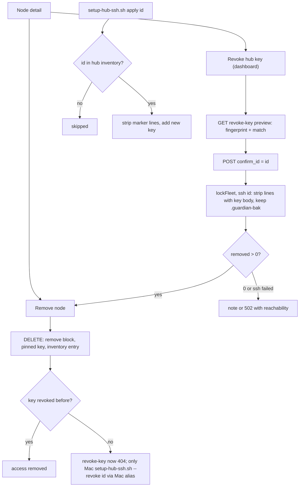
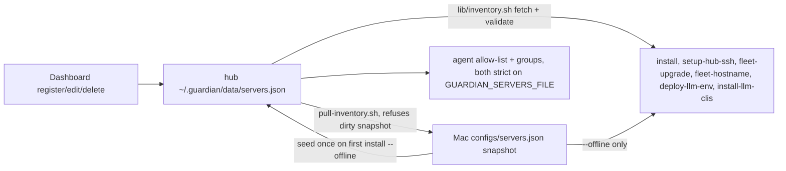
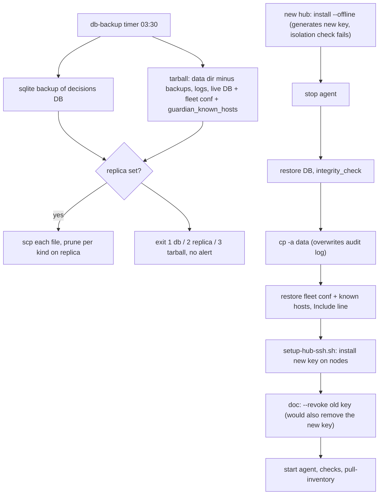

# Phase 4 - Server / fleet management re-review (ops analyst)

English | [한국어](phase4-ops.ko.md)

> Point-in-time record from 2026-10-12; the code has changed since.

Range: `52fbfe2..66cf41e` (31 commits). This is a read-only review with no host contact, and every file:line refers to `66cf41e`.
Earlier reports: `../phase1/ops.md` and `../phase3/ops.md`.

## Summary table

| id | sev | p1 | p3 | p4 | change since phase 3 |
|---|---|---|---|---|---|
| OPS-1 | High | OPEN | RESOLVED | **RESOLVED** | Still holds, and the installer is now hub-only (D3). |
| OPS-2 | High | OPEN | RESOLVED | **RESOLVED** | No change. |
| OPS-3 | High | OPEN | OPEN | **RESOLVED** | D3: the installer refuses non-hub hosts and the README describes a single hub. |
| OPS-4 | Med | OPEN | PARTIAL | **RESOLVED** | A manual hub-side hardening procedure is documented, and installer, README and drop-in agree. |
| OPS-5 | High | OPEN | OPEN | **RESOLVED** | D4: Mac scripts read the hub inventory, and pull-inventory refuses a dirty snapshot. |
| OPS-6 | High | OPEN | OPEN | **PARTIAL** | D5 adds dashboard revoke-key and setup-hub-ssh skips deleted ids. Delete still never revokes (OPS-P4-1). |
| OPS-7 | Med | OPEN | OPEN | **PARTIAL** | Side effects are now limited to the hub inventory. The UI hint still needs a Mac ssh alias. |
| OPS-8 | Med | OPEN | PARTIAL | **PARTIAL** | No change. |
| OPS-9 | Med | OPEN | OPEN | **OPEN** | No change. |
| OPS-10 | Med | OPEN | OPEN | **PARTIAL** | D6 adds an exec audit log. There is still no gate, and the log is weak (OPS-P4-3). |
| OPS-11 | Med | OPEN | PARTIAL | **RESOLVED** | Python is now strict too (fixes OPS-N2). |
| OPS-12 | Med | OPEN | OPEN | **OPEN** | No change. |
| OPS-13 | Med | OPEN | PARTIAL | **PARTIAL** | All scripts now share one inventory source. Filters, the macOS node and the Linux-only probe are unchanged. |
| OPS-14 | Med | OPEN | PARTIAL | **PARTIAL** | The UI now shows reachability. The legacy status fields and hub-only thresholds remain. |
| OPS-15 | Med | OPEN | OPEN | **PARTIAL** | D7 adds a data tarball, fleet files and a restore doc. There is still no failure alert, and the doc has gaps (OPS-P4-4). |
| OPS-16 | Low | OPEN | RESOLVED | **RESOLVED** | No change. |
| OPS-17 | Low | OPEN | RESOLVED | **RESOLVED** | No change. |
| OPS-18 | Low | OPEN | OPEN | **OPEN** | `import-credentials.sh` is unchanged. Impact is lower now that the Mac copy is only a snapshot. |
| OPS-19 | Low | OPEN | RESOLVED | **RESOLVED** | No change. New drift is filed under OPS-P4-4. |
| OPS-20 | Low | OPEN | RESOLVED | **RESOLVED** | No change. |
| OPS-21 | Low | OPEN | RESOLVED | **RESOLVED** | The lock now also covers revoke-key. |
| OPS-22 | Low | OPEN | RESOLVED | **RESOLVED** | A REVERTED hardening is now a warning and no longer fails the install (deliberate). |
| OPS-23 | Low | OPEN | OPEN | **OPEN** | The Tier-1 default now comes from the hub inventory, but it still targets every Tier-1 host. |
| OPS-24 | Low | OPEN | OPEN | **OPEN** | Still no rotation procedure. The restore doc implies one ad hoc (OPS-P4-4). |
| OPS-N1 | Low | - | OPEN | **OPEN** | `hostKeyOverride` is unchanged. |
| OPS-N2 | Med | - | OPEN | **RESOLVED** | `group_manager.servers_file()` returns the configured path as is. |
| OPS-N3 | Low | - | OPEN | **OPEN** | The `agent.env` merge rule is unchanged. |
| OPS-N4 | Low | - | OPEN | **RESOLVED** | The README no longer claims a pytest fallback. |

**Counts (28 findings): RESOLVED 14, PARTIAL 7, OPEN 7, REGRESSED 0.**

New findings in this round:

| id | sev | one line |
|---|---|---|
| OPS-P4-1 | **Medium** | Removing a node before revoking its key loses the dashboard revoke path, and the Remove dialog does not point to Revoke. |
| OPS-P4-2 | Low | The three revocation paths match differently (key body vs marker comment). Revoke on the hub entry is not guarded, and revoke-key is not audited. |
| OPS-P4-3 | **Medium** | The exec audit log can be rewritten by the processes it audits. It has no retention bound, a restore overwrites it, coverage is partial, and the actor is only an IP. |
| OPS-P4-4 | **Medium** | The restore doc does not match the tooling. Following its "revoke the old key" step after `setup-hub-ssh.sh` removes the new key too. The first-install key generation and the expected install failure are not mentioned. Two smaller drifts. |

---

## 1. Status with evidence

Phase-3 evidence that has not changed is not repeated.

- **OPS-1 RESOLVED.** The role comes from the fetched inventory (`scripts/install-agent-service.sh:112-114`). Non-hub hosts exit 2, `--no-ui` exits 2, and `--with-ui` is ignored (header `:1-50`).
- **OPS-2 RESOLVED.** The `owned` merge is unchanged.
- **OPS-3 RESOLVED (c4dc12d).** The installer header describes a single agent on the hub and refuses any other host (`install-agent-service.sh:1-50`, role check after `:114`). README now says the agent goes on the hub only and nodes run none (`README.md:9-10`, `:121-135`, `:150`). Left over: 23 inventory entries still carry `"guardian_role": "agent"` (`configs/servers.json`), and registration still defaults to `agent` (`apps/agent/nodes_handler.go` registerNode). This is only a misleading label now.
- **OPS-4 RESOLVED (doc level).** The installer touches only the hub's sshd. Nodes follow a documented hub-side manual procedure (`docs/operations/2026-10-05-fleet-sshd-hardening.md`, "새 노드와 대시보드로 등록한 노드" bullet; `README.md:131-134`). There is still no automation, by decision.
- **OPS-5 RESOLVED (d0bb95e).** `scripts/lib/inventory.sh:58-96` fetches and validates the hub copy, with `--offline` as the only snapshot path. It is used by install (`install-agent-service.sh:112`), setup-hub-ssh (`:57`), fleet-upgrade (`:42`), fleet-hostname (`:37`), deploy-llm-env (`:54`) and install-llm-clis (`:41`). `pull-inventory.sh` refuses a dirty `configs/servers.json` (diff `+65-74`). Role, allowed hosts and backup replica are read from `INVENTORY_FILE` (`install-agent-service.sh:114`, `:185`, `:403`). Remaining Mac dependency: the hub alias defaults to the snapshot's hub entry (`lib/inventory.sh:32-37`).
- **OPS-6 PARTIAL (d539560, d0bb95e).**
  - `GET/POST /api/nodes/{id}/revoke-key` removes the key line over the fleet key under the fleet lock and keeps a backup (`apps/agent/revoke_key.go:27-40`, `:109-160`).
  - `setup-hub-ssh.sh` apply skips explicit ids that are not in the hub inventory, and `hub_fleet` now builds from the hub copy, so a stale Mac copy can no longer re-add a node (`scripts/setup-hub-ssh.sh` block after `:57`).
  - `deleteNode` still never revokes. Ordering problem: OPS-P4-1.
- **OPS-7 PARTIAL.** `hub_fleet apply` still rewrites blocks for every 100.64 host in the inventory, but that inventory is now the hub's own. The UI hint `scripts/setup-hub-ssh.sh <id>` is still shown (`apps/web-desktop/src/pages/nodes/NodeForms.tsx:473`) and still reaches the node through the Mac's own ssh alias. The installer's refusal message gives the same advice (`install-agent-service.sh`, non-hub branch).
- **OPS-8 PARTIAL.** `hostKeyOverride` is unchanged (`apps/agent/servers_handler.go:66-92`).
- **OPS-9 OPEN.** README still documents the bypass (`README.md:157`). The hub is in the default 100.64 list.
- **OPS-10 PARTIAL (d539560).** `/api/exec`, `/api/fleet/exec`, `/api/exec/remote` and the stream append to `<data>/audit/exec.jsonl`, readable through `GET /api/audit` (`apps/agent/main.go:121-123`, `:171-177`, `:220-222`; `servers_handler.go:533-545`; `apps/agent/audit.go:61-113`, `:161-180`). There is still no approval gate: `GUARDIAN_UI_ACTIONS=off` now blocks every decision route but not the exec routes (`apps/agent/debate_handler.go:77-82`). The log's weaknesses are in OPS-P4-3.
- **OPS-11 RESOLVED (0c47852).** `cli/llm-agent/group_manager.py:71-76` returns the configured path even when it is missing, so loading fails and names the path, the same rule as Go (`servers_handler.go:181-196`).
- **OPS-12 OPEN.** `resolveTargetHost` still matches hostname (`servers_handler.go:42`); `selectServers` does not.
- **OPS-13 PARTIAL.** Every script now reads one source (above). The selection filters still differ: all ids (`fleet-upgrade.sh:42-45`), 100.64 only (fleet-hostname, setup-hub-ssh), Tier-1 (deploy-llm-env, install-llm-clis), explicit only (fleet-reboot). macOS `edge-mini` and the `free -m` probe are unchanged (`servers_handler.go:336`).
- **OPS-14 PARTIAL.** The UI now shows the reachability class (b961266). The three legacy `status` vocabularies and the hub-only thresholds remain.
- **OPS-15 PARTIAL (d19e2b9).** Each run now also writes `guardian_data-*.tar.gz`: the data dir, `guardian_fleet.conf` and `guardian_known_hosts`, with an allowlist for the fleet files. It replicates and prunes per kind, with exit codes 1/2/3 (`cli/llm-agent/db_backup.py:1-30`, `:42`, `:70-131`). A restore procedure and drill exist (`docs/operations/backup-restore.md`). There is still no failure alert, which the doc acknowledges (`backup-restore.md:141`). Live jev SQLite files are copied raw (`backup-restore.md:22`). Doc defects are in OPS-P4-4.
- **OPS-16, 17, 19, 20 RESOLVED.** No regressions found.
- **OPS-18 OPEN.** `scripts/import-credentials.sh` is unchanged. Impact is now Low, because the Mac copy is a snapshot (`README.md:137-145`).
- **OPS-21 RESOLVED.** Revoke-key also takes `lockFleet` (`revoke_key.go:135-140`).
- **OPS-22 RESOLVED.** A REVERTED hardening is now a warning (`install-agent-service.sh` hardening `case`, 48231af). Hardening-only failures say no rollback is needed (end of the script). The REVERTED change is a deliberate policy change, not a regression.
- **OPS-23 OPEN.** The default is still every Tier-1 host (`scripts/deploy-llm-env.sh:54-60`).
- **OPS-24 OPEN.** There is no `--rotate`.
- **OPS-N1 OPEN.** No change in `servers_handler.go:66-114`.
- **OPS-N2 RESOLVED.** See OPS-11.
- **OPS-N3 OPEN.** The merge regex and owned list are unchanged.
- **OPS-N4 RESOLVED.** `README.md:174`, `:192` now state that there is no fallback command.

---

## 2. New contradictions (OPS-P4-n)

### OPS-P4-1 (Medium) - Delete before revoke loses the dashboard revoke path
- **Evidence:**
  - The revoke dialog says revoke first, then remove (`apps/web-desktop/src/pages/nodes/RevokeKeyDialog.tsx:22-23`).
  - The Remove dialog still only says the key "stays in its authorized_keys until you remove it there". It does not link to Revoke and does not warn (`RemoveNodeDialog.tsx:45`).
  - `DELETE /api/nodes/{id}` does not check whether the key was revoked (`nodes_handler.go` `deleteNode`).
  - Once the node is deleted, revoke-key returns 404, because `findNode` looks the node up in the inventory (`revoke_key.go:71-82`, `:126-129`).
  - The only remaining path is `setup-hub-ssh.sh --revoke <id>` from the Mac (`README.md:147`). It needs a Mac ssh alias, which dashboard-registered nodes on non-Tailscale addresses usually lack (`setup-hub-ssh.sh` REMOTE_AUTH at `:317`, run through the Mac's ssh).
- **Impact:** in the natural order (Remove first), the hub's root-capable fleet key stays on the machine, and there is no supported way to remove it.
- **Fix:** SAFE-FIX. In the Remove dialog, offer "Revoke key first" and require ticking "keep the key" to skip it. Alternatively, have `DELETE` accept `revoke_key: true` and run the revoke script before removing the block. DESIGN: keep the fleet block until the revoke succeeds.

### OPS-P4-2 (Low) - Three revocation mechanisms with different rules
- **Evidence:**
  - The dashboard removes lines containing the current key body (`revoke_key.go:27-40`, `:44-61`).
  - `setup-hub-ssh.sh --revoke` removes lines carrying the `guardian-hub-fleet` comment (`scripts/setup-hub-ssh.sh:317`).
  - After a key change, the dashboard misses old-key lines. The script removes any line with the marker comment, including the current key.
  - Revoke-key accepts the hub's own entry. Delete refuses the hub (`nodes_handler.go:866`), but `findNode` does not (`revoke_key.go:71-82`). Revoking the hub's own key quietly cuts hub-to-hub ssh: that happens to close the OPS-9 bypass, but nothing guards or documents it.
  - Revoke-key edits a remote `authorized_keys` but is not written to the exec audit log (no `recordExec` in `revoke_key.go`).
- **Fix:** SAFE-FIX. Match on body OR marker in both paths, refuse or explicitly label the hub entry, and audit revoke-key with route `/api/nodes/{id}/revoke-key`.

### OPS-P4-3 (Medium) - The audit log is not reliable as an audit trail
- **Evidence:**
  - The log lives at `<GUARDIAN_DATA_DIR>/audit/exec.jsonl`, mode 0600, owned by `ubuntu` (`apps/agent/audit.go:37-46`, `:100-112`). Every audited command (`/api/exec` runs `sh -c` as `ubuntu`, `metrics.go:444-455`), and every LLM CLI in the agent tree, can truncate or rewrite it. No hash chain or off-host copy exists between daily backups.
  - **Retention:** appends with no size cap or rotation (`audit.go:92-113`). Reads are capped at 1000 entries (`:17-21`).
  - **Restore:** `cp -a x/data/.` overwrites the live log with the backup's copy, which loses entries written since the backup (`backup-restore.md:81`).
  - **Coverage:** not logged are rejected requests (unknown target, 400, which return before `recordExec`), revoke-key, node register/update/delete, and `server_remediation` local runs (`mcp_client.py`, `bash -c` in-process).
  - **Actor:** only `dashboard@<ip>` (`debate_handler.go:923-933`). The CLI on the hub calling `/api/fleet/exec` is recorded as `dashboard@127.0.0.1`.
  - **Content:** full command text up to 4096 runes, including any inline secrets, is replicated off-hub in the data tarball (`db_backup.py` includes everything except `*.log`).
- **Impact:** OPS-10 relies on this log, but anyone with exec can erase it. It can grow without limit, and a restore silently rewinds it.
- **Fix:** DESIGN. Write through a separate sink, for example `systemd-cat` to journald or a root-owned append-only file through a tiny setuid-free socket service, or replicate each line to the backup replica. SAFE-FIX: size-based rotation (`exec.jsonl.1..N`); make the restore doc append instead of overwrite (`cp -a` excluding `audit/`, then `cat >>`); add `recordExec` to revoke-key and node writes and to 400 rejections; add a `client` field (`User-Agent`/CLI marker).

### OPS-P4-4 (Medium) - Restore doc vs tooling
- **Evidence:**
  - (a) The key step says that if the hub was rebuilt, create a new key from the Mac with `setup-hub-ssh.sh` and "revoke the old key with `setup-hub-ssh.sh --revoke`" (`docs/operations/backup-restore.md:95-100`). Apply already strips every `guardian-hub-fleet` line before adding the new one (`setup-hub-ssh.sh:317`). The new key carries the same marker (`deploy/hub/protect-fleet-key.sh:34`, `:40`), so running `--revoke` afterwards removes the new key and locks the hub out of the whole fleet.
  - (b) On a fresh hub, step 0's `install-agent-service.sh site-a-arm1 --offline` already generates a new key (`protect-fleet-key.sh:28-37`). Its isolation check then reports fleet SSH ❌ and the install exits 1 (`install-agent-service.sh` isolation and `FAILURES` block). The doc does not say this is expected before step 4.
  - (c) The doc says the replica comes from `configs/servers.json` (`backup-restore.md:15`), but install reads it from the hub inventory, or the snapshot only with `--offline` (`install-agent-service.sh:403`).
  - (d) On a new hub, `~/.ssh/config` may not exist, so `grep -q ... || sed -i '1i ...' ~/.ssh/config` fails (`backup-restore.md:92`).
  - (e) Migrated (accept-new) nodes keep their host keys in `~/.ssh/known_hosts`, which is not backed up (`db_backup.py:42`). A rebuilt hub silently trusts them again on first use. The doc says nothing about this.
- **Fix:** SAFE-FIX.
  - (a) Delete the `--revoke` advice, because apply already replaces the marker lines.
  - (b) Note the expected isolation failure and the order "install --offline -> restore -> setup-hub-ssh -> re-run install".
  - (c) Fix the sentence about where the replica comes from.
  - (d) Use `touch ~/.ssh/config` first.
  - (e) Add `known_hosts` to `FLEET_FILES`, or note the re-TOFU.

Checked and consistent:
- **Hub-inventory fetch vs first install:** the fetch fails with an explicit "first install: use --offline" message (`lib/inventory.sh:64-70`). The seed then writes the snapshot only if the hub file is missing (`install-agent-service.sh`, inventory step).
- **Moving the hub to a new id:** this also needs `--offline`, because the role is checked against the old hub's inventory. That is acceptable but undocumented (folded into OPS-P4-4 b).

---

## 3. Updated diagrams

### P2/P3 - Removing a node and revoking its key (changed)

### P4 - Inventory lifecycle (changed)

### P8 - Backup and restore (changed)

