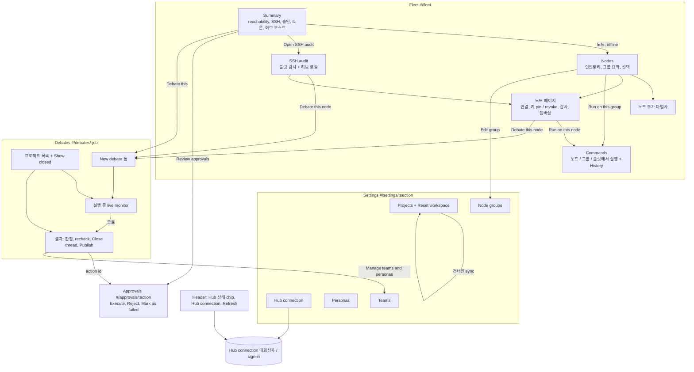

# UI 재검토, phase 4 (66cf41e의 apps/web-desktop, 읽기 전용)

[English](phase4-ui.md) | 한국어

> 2026-10-12 시점의 기록이며, 이후 코드가 바뀌었다.

방법: 현재 소스와 52fbfe2 이후의 UI commit 13개를 읽었다. vitest를 포함해 아무것도 실행하지 않았다. 경로는 접두사가 없으면 `apps/web-desktop/src/` 기준 상대 경로이다.

## 요약 표

| Id | Sev | Phase 3 | Now | 근거와 판단 |
|---|---|---|---|---|
| UI-1 | High | PARTIAL | RESOLVED | 허브 publications를 가져오고, publish된 스레드는 "Already published as branch X"와 함께 Publish를 비활성화한다(`pages/debate/ResultView.tsx:266-302`, `canPublish` `:274`; `api.ts:866`). |
| UI-2 | High | OPEN | RESOLVED | Execute와 Publish는 화면 이동에도 유지되는 앱 수준 store에서 실행되며(`state/operationsStore.tsx:1-80`), Approvals / Debates에 Running 배지가 붙는다(`App.tsx` ConnectedShell). |
| UI-3 | High | OPEN | PARTIAL | 그룹과 플릿 실행은 이제 해석된 서버와 명령을 나열하고 빈 목록을 막는다(`pages/RunPage.tsx:93-98,224-243`); 단일 노드는 여전히 확인 없이 실행되고(`RunPage.tsx:71-77`) 확인은 가장 가벼운 tone이며 typed confirm이 아니다. |
| UI-4 | Med | PARTIAL | PARTIAL | Close, Publish, 플릿 Run은 `tone="primary"`를 쓴다(`ResultView.tsx:179,314`, `RunPage.tsx:226`); 저위험 Execute는 여전히 빨간색이고(`ActionDialog.tsx:359`), Remove-from-group은 여전히 기본 danger이며, Sync/Clone에는 확인이 없다. UI-N4 참고. |
| UI-5 | Med | PARTIAL | PARTIAL | Approvals 기본 필터와 Overview 프로젝트 메모는 그대로이다(`pages/debate/ActionsPanel.tsx:94-95`); nav 배지는 여전히 선택된 프로젝트만 대상이고 전체 프로젝트 보기는 없다. |
| UI-6 | Med | PARTIAL | RESOLVED | Agents와 Debate는 한 페이지이다: Show closed가 있는 하나의 프로젝트 목록, 실행 중에는 live monitor이고 이후에는 결과인 하나의 상세 화면(`pages/DebatesPage.tsx:109-219`, `DebateDetail` `:37-101`). Overview는 여전히 최근 토론 다섯 개를 나열한다(중복이 아니라 요약). |
| UI-7 | Med | PARTIAL | RESOLVED | 이름이 일치한다: Fleet / Debates / Approvals / Settings, Execute, Hub connection, "Hub (local)", "Hub online"(`router.ts:15-20`, `RunPage.tsx:104`, `App.tsx:187`). 남은 하나는 UI-N5에서 추적한다. |
| UI-8 | Med | RESOLVED | RESOLVED | 네 목적지가 tab bar에 들어간다; More 탭은 사라졌고 `#/more`는 Fleet으로 redirect한다(`router.ts:18-25,41`). |
| UI-9 | Med | PARTIAL | PARTIAL | 그룹은 여전히 Nodes(선택), 노드 페이지, Settings에서 만들어진다; 호스트 키는 여전히 Pin, Edit node, 마법사가 쓴다. DESIGN 항목, UI-P4-2 참고. |
| UI-10 | Med | PARTIAL | PARTIAL | 좁은 화면에서 짧은 uptime을 가진 간결한 한 줄 행(`pages/NodesPage.tsx:74-140`); 허브 호스트는 여전히 Summary와 Nodes에 있다(`NodesPage.tsx:491`); 선택 bar는 여전히 그룹 조치만 제공한다(`:373`). |
| UI-11 | Med | OPEN | OPEN | 제목 "Needs attention"과 자동 플릿 SSH 감사는 변경 없다(`pages/OverviewPage.tsx:306,287`); Summary가 이제 첫 화면이므로 앱을 열 때마다 감사가 시작된다(UI-P4-7). |
| UI-12 | Med | RESOLVED | RESOLVED | SSH 감사의 "Debate this node"는 유지된다; 감사는 Fleet "SSH audit" 탭이다(`router.ts:30`). |
| UI-13 | Low-Med | RESOLVED | RESOLVED | Sign-in required chip 유지(`App.tsx:185`); 모든 poller가 이제 로그아웃 상태에서 멈춘다(`api.ts:172-209`, commits ae12eaa, ca4ea2c). |
| UI-14 | Low | PARTIAL | PARTIAL | "Debate Console", "Assistant" 테스트 제목, `executeFleet`은 사라졌다(grep); 디자인 시스템의 ActionCard, CommandPalette, NodeRow, Sparkline은 여전히 쓰이지 않는다. |
| UI-15 | Low | PARTIAL | PARTIAL | Overview, Debates 목록, `agents/RunList.tsx`의 작업 행은 여전히 작업 chip만 보여 준다; 판정은 상세 화면에만 나타난다(`RunDetail.tsx`, `ResultView.tsx`). |
| UI-16 | Low | RESOLVED | RESOLVED | Task가 먼저, Advanced는 접힘(`pages/debate/StartForm.tsx:157-175`); 폼 자체도 페이지에서 접을 수 있다(`DebatesPage.tsx:166-178`). |
| UI-N1 | Med | OPEN | RESOLVED | `failMessage(e, kind, ref)`가 Execute / publish 안내의 범위를 정한다; recheck와 close는 자체 kind를 쓴다(`lib/debate.ts:343-360`; `ResultView.tsx:131,159`; `ActionDialog.tsx:205`). |
| UI-N2 | Med | OPEN | PARTIAL | reachability 분류는 타입이 있고 Nodes, Summary, 노드 페이지에 chip으로 표시된다(`lib/reachability.ts:13-45`, `NodesPage.tsx:65-67`, `NodeDetailPage.tsx:157`); SSH audit 탭은 여전히 `status`/"unreachable"만 보여 준다(`pages/ssh/FleetSshAudit.tsx:55,174`). |
| UI-N3 | Low | OPEN | OPEN | 팀 기본값이 참조 코드를 보내는데도 Advanced는 여전히 닫힌 채로 시작한다(`StartForm.tsx:57,79-84,157`). |
| UI-N4 | Low | OPEN | OPEN | tone: Close, Publish, 플릿 Run은 primary; Remove-from-group, 저위험 Execute, Reject, Mark as failed는 danger. 규칙이 없다. |
| UI-N5 | Low | OPEN | PARTIAL | "Run a command", "Local agent node", "Debate Console"은 사라졌다; "Hub online" 옆에 `Agent checking…`이 남아 있다(`App.tsx:184`). |
| UI-N6 | Low | OPEN | OPEN | Approvals 기본값은 여전히 `waiting`에서 파생된다(`ActionsPanel.tsx:95`); 중복 키 경고가 여전히 렌더링된다(`NodeRegisterPage.tsx:263-264`); 손으로 옮긴 폼 규칙이 남아 있다(`lib/nodeForm.ts:4`). |

집계: RESOLVED 9, PARTIAL 9, OPEN 4, REGRESSED 0 (22개 항목).
새 발견 사항: UI-P4-1 (Medium), UI-P4-2 (Medium), UI-P4-3 ~ UI-P4-8 (Low).

## 바뀐 점 (확인됨)

- **네 목적지.** `ROUTES`에는 `fleet, debates, approvals, settings`가 있다(`router.ts:15-20`). Fleet 탭은 Summary / Nodes / SSH audit / Commands이며 URL에 유지된다(`router.ts:25-45`, `pages/FleetPage.tsx:18-40`); 노드 페이지와 마법사는 Nodes 탭을 유지한다(`FleetPage.tsx:32-35`).
- **레거시 hash.** `ALIASES`는 overview, assistant, more, nodes, security, ssh, run, batch, terminal, agents, debate를 매핑한다; `#/agents?run=ID`는 `#/debates/ID`가 된다(`router.ts:34-45,66-82`). 읽기만으로 확인했다.
- **Debates.** 프로젝트 전환기, Settings 링크, "New debate" 토글이 있는 상단 카드; 폼은 마운트되었지만 숨겨져 있어 초안이 유지된다(`DebatesPage.tsx:148-178`); 다른 페이지에서 미리 채우면 폼이 열린다(`:175`).
- **새 운영자 흐름.** Revoke hub key(노드 id 입력, 미리보기; `pages/nodes/RevokeKeyDialog.tsx:83-95`), 감사 log 기반 Command History(`pages/run/CommandHistory.tsx`), Reset workspace(`pages/debate/WorkspaceResetDialog.tsx`, 건너뛴 sync에서 제공 `ProjectsSection.tsx:39-66`), RUNNING 조치에 대한 Mark as failed(`ActionDialog.tsx:303-319,369-377`, `api.ts:793`), "Thread closed" 배지(`ActionDialog.tsx:243`).

## 새 발견 사항

### UI-P4-1 (Medium) 좁은 화면의 Debates: 선택한 토론이 목록 전체 아래에 놓인다
근거: 목록과 상세는 줄바꿈되는 두 flex column이다(`DebatesPage.tsx:180-199`, basis 300과 440). 약 760 px 아래에서는 목록이 먼저 오도록 쌓이므로, 행을 누른 뒤 결과나 live monitor가 모든 토론 행 아래에 있고, 그 위에 프로젝트 카드와 New debate 토글이 있다. phase 3의 Agents 페이지도 같은 구조였지만, Debates는 이제 주요 작업 페이지이며 결과, Publish, Close thread가 있는 곳이기도 하다.
수정: DESIGN 또는 SAFE-FIX. 좁은 폭에서는 목록과 상세 중 하나만 보여 준다: `#/debates`에 목록, "Back to debates" 링크가 있는 `#/debates/:id`에 상세; 기본 "newest debate" 자동 선택(`:141`)은 넓은 화면에서만 적용된다.

### UI-P4-2 (Medium) 노드 그룹이 Settings에서 설정되지만 Fleet에서 쓰인다
근거: Settings에는 다섯 segment가 있으며 Hub connection, 세 가지 토론 설정, Node groups가 섞여 있다(`pages/SettingsPage.tsx:14-20`); Fleet에는 Groups 탭이 없다. 그룹 요약은 Nodes의 `?group=`으로만 접근할 수 있고, "Manage groups" 링크는 Nodes의 footer 줄이다(`NodesPage.tsx:406` 부근). phase 1 UI-9가 같은 분리를 지적했다; 네 목적지 배치에서는 운영자의 사고 경로(Fleet, 그 다음 그룹)가 대신 Settings로 이어진다.
수정: DESIGN. Node groups를 Fleet 탭("Groups")으로 옮기고 Settings에는 connection, projects, personas, teams를 남긴다. Nodes 탭에 select 대신 Groups 필터 chip 행을 추가한다.

### UI-P4-3 (Low) 끝난 토론 pane이 긴 한 column이고 활동 기록이 숨겨져 있다
근거: `DebateDetail`은 작업이 끝나면 pane 전체를 live monitor에서 결과로 바꾼다(`DebatesPage.tsx:73-98`); lane, 결과, timeline은 열 때만 fetch하는 접힌 "Agent activity" disclosure 뒤에 있다(`:93-95`). 결과 자체는 판정, 결정, 점검, judgment, 컨텍스트, jev 이유, recheck, 조치, Publish를 쌓고, 그 다음 라운드별 전체 transcript를 둔다(`ResultView.tsx` `:340` 아래). 올바르지만 이제 페이지 폭의 약 60퍼센트인 pane에는 길다.
수정: SAFE-FIX. transcript를 자체 접힌 disclosure에 넣고 Result, Actions, Publish를 그 위에 둔다.

### UI-P4-4 (Low) 배지가 서로를 가린다
근거: `ConnectedShell`에서 Approvals 항목은 대기 개수를 받은 뒤 `execRunning` spread가 이를 "Running"으로 덮어쓴다(`App.tsx` items map). Execute가 실행되는 동안 대기 중인 승인 개수가 사라지고, Fleet의 "Running" 배지는 Commands를 가리키지만 Fleet 항목 전체에 붙어 있으며 Commands 탭에는 대응하는 표시가 없다.
수정: SAFE-FIX. 둘 다 보여 주고("3 · Running") Commands 탭에 점을 둔다.

### UI-P4-5 (Low) Debates의 중복 fetch와 polling
근거: 페이지는 자체 목록을 5 s마다 polling하고(`DebatesPage.tsx:118`), 토론 store도 함께 다시 로드되는 `recent` 목록을 갖고 있으며(`:130-135,207-209`), 여기에 watcher poll과 `RunDetail` 상세 및 이벤트 polling이 더해진다.
수정: SAFE-FIX. 목록을 store에서 읽어(또는 store를 페이지에서 채워) 하나의 요청이 Overview와 Debates를 모두 처리하게 한다.

### UI-P4-6 (Low) 플릿 전체 shell 확인이 차분한 파란 버튼이다
근거: 그룹과 플릿 Run은 확인 라벨 "Run on fleet"과 함께 `tone="primary"`를 쓴다(`RunPage.tsx:226`); Publish와 Close thread도 같은 tone을 쓴다. 대상 목록은 실질적인 개선이지만, 심각도 신호는 되돌릴 수 있는 단계와 같다.
수정: UI-N4 규칙의 일부: 둘 이상의 호스트를 바꾸거나 삭제하는 모든 단계에 danger.

### UI-P4-7 (Low) 첫 화면이 이제 가장 많은 일을 한다
근거: `DEFAULT_ROUTE`는 `fleet`이고(`router.ts:22`), 그 Summary 탭은 열 때와 Refresh할 때마다 플릿 SSH 감사를 실행하며(`OverviewPage.tsx:287`) 진단과 metrics polling을 시작한다. 비용은 전과 같지만, 이제 앱 시작 시와 `#/` 방문 시마다 발생한다.
수정: DESIGN, UI-11과 연결: 캐시된 결과를 보여 주며 요청 시 감사하거나, SSH audit 탭을 열 때까지 미룬다.

### UI-P4-8 (Low) SSH audit 탭이 reachability 분류를 쓰지 않는다
근거: `FleetSSHNode.reachability`는 타입이 있지만(`types.ts:216`) `FleetSshAudit.tsx`는 `status`와 unreachable 개수만 보여 주므로(`:55,174`), 감사 페이지에서 호스트 키 변경이 "unreachable"로 읽힌다.
수정: SAFE-FIX. 노드 행과 caption에 `reachabilityInfo`를 재사용한다.

### 점검했고 발견 사항 없음
- Settings와 Fleet의 segmented control(5개와 4개 segment)은 360 px 폭에서 측정하지 않았다; 한 번 수동으로 볼 만하다.
- Mark as failed는 이 세션에서 실행하지 않은 모든 RUNNING 조치에 제공되지만(`ActionDialog.tsx:310`), 허브가 아직 실행 중이면 거부하고 대화상자가 그렇게 알린다(`:372`). 수용 가능하다.

## 갱신된 지도

phase 3 이후 바뀐 절차 경로:
- P2 Commands: Fleet, Commands 탭(`FleetPage.tsx:37`); 그룹 또는 플릿 실행은 대상 목록이 있는 확인을 연다(`RunPage.tsx:224-243`); 아래에 History(`CommandHistory.tsx`).
- P3 노드 키: Fleet, Nodes, 노드, "Pin host key" / "Revoke hub key"(`NodeDetailPage.tsx`, `RevokeKeyDialog.tsx`).
- P4 SSH 감사: Fleet, SSH audit 탭.
- P6 토론: Debates, "New debate"(`DebatesPage.tsx:153-160`); 오른쪽 pane(live monitor)에서 따라간다.
- P7 승인: Approvals, 행, Execute(확인), Reject, 또는 죽은 RUNNING 조치에 대한 Mark as failed.
- P10 Publish: Debates, 선택, Actions 카드, Publish(plan 후 확인), 결과는 operations store에 유지된다(`ResultView.tsx:262-335`).
- P12 에이전트 monitor: 별도 페이지 없음; 실행 중인 토론의 상세가 monitor이고, 끝난 토론에는 "Agent activity"가 있다(`DebatesPage.tsx:93`).
- P13 허브: header "Hub connection" 또는 Settings, Hub connection.

현재 내비게이션의 SVG: [ui-nav-current.svg](../../images/procedure-review/ui-nav-current.svg) (xmllint로 검증).
