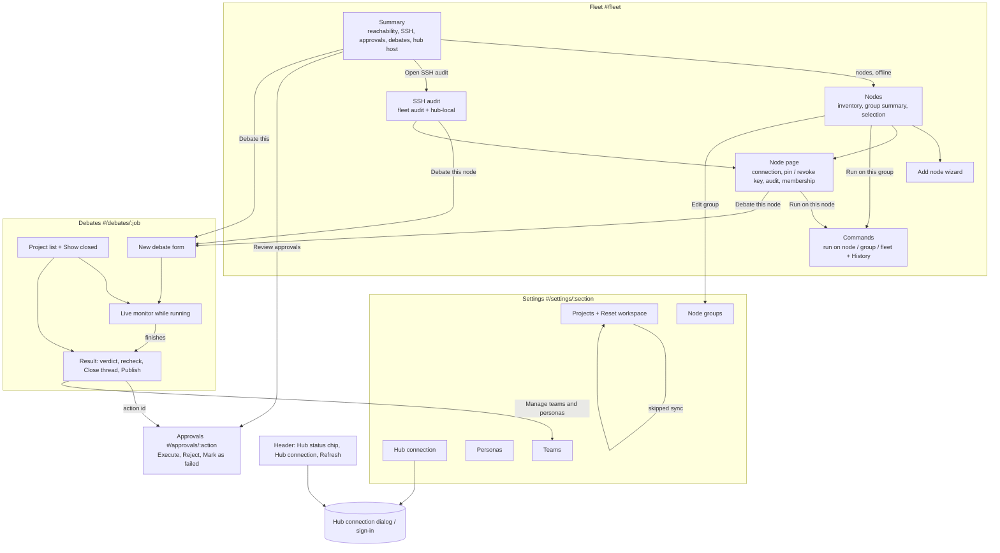

# UI re-review, phase 4 (apps/web-desktop at 66cf41e, read-only)

English | [한국어](phase4-ui.ko.md)

> Point-in-time record from 2026-10-12; the code has changed since.

Method: read the current sources and the 13 UI commits since 52fbfe2. Nothing was run, vitest included. Paths are relative to `apps/web-desktop/src/` unless prefixed.

## Summary table

| Id | Sev | Phase 3 | Now | Evidence and reasoning |
|---|---|---|---|---|
| UI-1 | High | PARTIAL | RESOLVED | Hub publications are fetched and a published thread disables Publish with "Already published as branch X" (`pages/debate/ResultView.tsx:266-302`, `canPublish` `:274`; `api.ts:866`). |
| UI-2 | High | OPEN | RESOLVED | Execute and Publish run in an app-level store that survives navigation (`state/operationsStore.tsx:1-80`), with a Running badge on Approvals / Debates (`App.tsx` ConnectedShell). |
| UI-3 | High | OPEN | PARTIAL | Group and fleet runs now list the resolved servers and the command and block an empty list (`pages/RunPage.tsx:93-98,224-243`); a single node still runs with no confirm (`RunPage.tsx:71-77`) and the confirm is the lightest tone, not typed. |
| UI-4 | Med | PARTIAL | PARTIAL | Close, Publish and fleet Run use `tone="primary"` (`ResultView.tsx:179,314`, `RunPage.tsx:226`); low-risk Execute is still red (`ActionDialog.tsx:359`), Remove-from-group still default danger, Sync/Clone has no confirm. See UI-N4. |
| UI-5 | Med | PARTIAL | PARTIAL | Approvals default filter and the Overview project note stay (`pages/debate/ActionsPanel.tsx:94-95`); the nav badge is still selected-project only and there is no all-projects view. |
| UI-6 | Med | PARTIAL | RESOLVED | Agents and Debate are one page: one project list with Show closed, one detail that is the live monitor while running and the result afterwards (`pages/DebatesPage.tsx:109-219`, `DebateDetail` `:37-101`). Overview still lists five recent debates (a summary, not a duplicate). |
| UI-7 | Med | PARTIAL | RESOLVED | Names agree: Fleet / Debates / Approvals / Settings, Execute, Hub connection, "Hub (local)", "Hub online" (`router.ts:15-20`, `RunPage.tsx:104`, `App.tsx:187`). One leftover is tracked in UI-N5. |
| UI-8 | Med | RESOLVED | RESOLVED | Four destinations fit the tab bar; the More tab is gone and `#/more` redirects to Fleet (`router.ts:18-25,41`). |
| UI-9 | Med | PARTIAL | PARTIAL | Groups are still created on Nodes (selection), the node page and Settings; host key is still written by Pin, Edit node and the wizard. DESIGN item, see UI-P4-2. |
| UI-10 | Med | PARTIAL | PARTIAL | Compact one-line rows with short uptime on narrow screens (`pages/NodesPage.tsx:74-140`); hub host still on Summary and on Nodes (`NodesPage.tsx:491`); the selection bar still offers only group actions (`:373`). |
| UI-11 | Med | OPEN | OPEN | Title "Needs attention" and the automatic fleet SSH audit unchanged (`pages/OverviewPage.tsx:306,287`); Summary is now the landing page, so the audit starts on every app open (UI-P4-7). |
| UI-12 | Med | RESOLVED | RESOLVED | "Debate this node" on SSH audit stays; the audit is the Fleet "SSH audit" tab (`router.ts:30`). |
| UI-13 | Low-Med | RESOLVED | RESOLVED | Sign-in required chip kept (`App.tsx:185`); all pollers now pause while signed out (`api.ts:172-209`, commits ae12eaa, ca4ea2c). |
| UI-14 | Low | PARTIAL | PARTIAL | "Debate Console", "Assistant" test title and `executeFleet` are gone (grep); design-system ActionCard, CommandPalette, NodeRow, Sparkline remain unused. |
| UI-15 | Low | PARTIAL | PARTIAL | Job rows in Overview, the Debates list and `agents/RunList.tsx` still show only the job chip; the verdict appears only in the detail (`RunDetail.tsx`, `ResultView.tsx`). |
| UI-16 | Low | RESOLVED | RESOLVED | Task first, Advanced collapsed (`pages/debate/StartForm.tsx:157-175`); the form is itself collapsible on the page (`DebatesPage.tsx:166-178`). |
| UI-N1 | Med | OPEN | RESOLVED | `failMessage(e, kind, ref)` scopes the Execute / publish hints; recheck and close use their own kinds (`lib/debate.ts:343-360`; `ResultView.tsx:131,159`; `ActionDialog.tsx:205`). |
| UI-N2 | Med | OPEN | PARTIAL | Reachability classes are typed and shown as chips on Nodes, Summary and node page (`lib/reachability.ts:13-45`, `NodesPage.tsx:65-67`, `NodeDetailPage.tsx:157`); the SSH audit tab still shows `status`/"unreachable" only (`pages/ssh/FleetSshAudit.tsx:55,174`). |
| UI-N3 | Low | OPEN | OPEN | Advanced still starts closed while a team default sends reference code (`StartForm.tsx:57,79-84,157`). |
| UI-N4 | Low | OPEN | OPEN | Tones: primary for Close, Publish, fleet Run; danger for Remove-from-group, low-risk Execute, Reject, Mark as failed. No rule. |
| UI-N5 | Low | OPEN | PARTIAL | "Run a command", "Local agent node", "Debate Console" are gone; `Agent checking…` remains next to "Hub online" (`App.tsx:184`). |
| UI-N6 | Low | OPEN | OPEN | Approvals default still derives from `waiting` (`ActionsPanel.tsx:95`); duplicate key warning still rendered (`NodeRegisterPage.tsx:263-264`); hand-copied form rules remain (`lib/nodeForm.ts:4`). |

Counts: RESOLVED 9, PARTIAL 9, OPEN 4, REGRESSED 0 (22 items).
New findings: UI-P4-1 (Medium), UI-P4-2 (Medium), UI-P4-3 to UI-P4-8 (Low).

## What changed (verified)

- **Four destinations.** `ROUTES` has `fleet, debates, approvals, settings` (`router.ts:15-20`). Fleet tabs are Summary / Nodes / SSH audit / Commands, kept in the URL (`router.ts:25-45`, `pages/FleetPage.tsx:18-40`); the node page and wizard keep the Nodes tab (`FleetPage.tsx:32-35`).
- **Legacy hashes.** `ALIASES` maps overview, assistant, more, nodes, security, ssh, run, batch, terminal, agents, debate; `#/agents?run=ID` becomes `#/debates/ID` (`router.ts:34-45,66-82`). Checked by reading only.
- **Debates.** Top card with project switcher, link to Settings, "New debate" toggle; form mounted but hidden so a draft survives (`DebatesPage.tsx:148-178`); prefill from other pages opens it (`:175`).
- **New operator flows.** Revoke hub key (typed node id, preview; `pages/nodes/RevokeKeyDialog.tsx:83-95`), Command History from the audit log (`pages/run/CommandHistory.tsx`), Reset workspace (`pages/debate/WorkspaceResetDialog.tsx`, offered from a skipped sync `ProjectsSection.tsx:39-66`), Mark as failed for a RUNNING action (`ActionDialog.tsx:303-319,369-377`, `api.ts:793`), "Thread closed" badge (`ActionDialog.tsx:243`).

## New findings

### UI-P4-1 (Medium) Debates on narrow screens: the selected debate sits below the whole list
Evidence: the list and detail are two wrapped flex columns (`DebatesPage.tsx:180-199`, bases 300 and 440). Under about 760 px they stack with the list first, so after tapping a row the result or live monitor is below every debate row, and the project card plus the New debate toggle are above that. The Phase 3 Agents page had the same structure, but Debates is now the main working page and is also where the result, Publish and Close thread live.
Fix: DESIGN or SAFE-FIX. On narrow widths show list or detail, not both: the list at `#/debates`, the detail at `#/debates/:id` with a "Back to debates" link; the default "newest debate" auto-selection (`:141`) would then apply only on wide screens.

### UI-P4-2 (Medium) Node groups are configured under Settings but used under Fleet
Evidence: Settings has five segments, mixing Hub connection, three debate configurations and Node groups (`pages/SettingsPage.tsx:14-20`); Fleet has no Groups tab. Group summary is reachable only through `?group=` on Nodes, and the "Manage groups" link is a footer line on Nodes (`NodesPage.tsx:406` area). Phase 1 UI-9 pointed at the same split; the four-destination layout makes the operator's mental path (Fleet, then groups) lead to Settings instead.
Fix: DESIGN. Move Node groups to a Fleet tab ("Groups") and leave Settings with connection, projects, personas, teams. Add a Groups filter chip row to the Nodes tab instead of a select.

### UI-P4-3 (Low) The finished-debate pane is one long column and the activity record is hidden
Evidence: `DebateDetail` swaps the whole pane from the live monitor to the result when the job ends (`DebatesPage.tsx:73-98`); the lanes, outcome and timeline then sit behind a collapsed "Agent activity" disclosure that fetches only when opened (`:93-95`). The result itself stacks verdict, decision, checks, judgment, context, jev reasons, recheck, actions and Publish, then the full transcript by round (`ResultView.tsx` below `:340`). It is correct but long for a pane that is now about 60 percent of the page width.
Fix: SAFE-FIX. Put the transcript in its own collapsed disclosure and keep Result, Actions and Publish above it.

### UI-P4-4 (Low) Badges hide each other
Evidence: in `ConnectedShell` the Approvals item gets the waiting count, then the `execRunning` spread overwrites it with "Running" (`App.tsx` items map). While an Execute runs the pending-approvals count disappears, and the Fleet "Running" badge refers to Commands but is on the whole Fleet item with no matching marker on the Commands tab.
Fix: SAFE-FIX. Show both ("3 · Running") and put a dot on the Commands tab.

### UI-P4-5 (Low) Duplicate fetching and polling on Debates
Evidence: the page polls its own list every 5 s (`DebatesPage.tsx:118`) while the debate store also holds a `recent` list that is reloaded alongside (`:130-135,207-209`), plus the watcher poll and `RunDetail` detail and event polling.
Fix: SAFE-FIX. Read the list from the store (or the store from the page) so one request serves Overview and Debates.

### UI-P4-6 (Low) Fleet-wide shell confirm is a calm blue button
Evidence: group and fleet Run use `tone="primary"` (`RunPage.tsx:226`) with the confirm label "Run on fleet"; Publish and Close thread use the same tone. The target list is a real gain, but the severity cue is the same as for a reversible step.
Fix: part of the UI-N4 rule: danger for any step that changes more than one host or deletes.

### UI-P4-7 (Low) The landing page now does the most work
Evidence: `DEFAULT_ROUTE` is `fleet` (`router.ts:22`), whose Summary tab runs the fleet SSH audit on open and on every Refresh (`OverviewPage.tsx:287`) and starts the diagnosis and metrics polling. Same cost as before, but now at app start and on every `#/` visit.
Fix: DESIGN, tied to UI-11: audit on demand with the cached result shown, or defer until the SSH audit tab is opened.

### UI-P4-8 (Low) SSH audit tab does not use the reachability class
Evidence: `FleetSSHNode.reachability` is typed (`types.ts:216`) but `FleetSshAudit.tsx` shows `status` and unreachable counts only (`:55,174`), so a host-key change on the audit page reads as "unreachable".
Fix: SAFE-FIX. Reuse `reachabilityInfo` for the node rows and caption.

### Checked, no finding
- The Settings and Fleet segmented controls (5 and 4 segments) were not measured on a 360 px width; worth one manual look.
- Mark as failed is offered for any RUNNING action not run from this session (`ActionDialog.tsx:310`), but the hub refuses while it still runs it, and the dialog says so (`:372`). Acceptable.

## Updated map

Procedure paths changed since phase 3:
- P2 Commands: Fleet, Commands tab (`FleetPage.tsx:37`); group or fleet run opens the listed-target confirm (`RunPage.tsx:224-243`); History below (`CommandHistory.tsx`).
- P3 Node keys: Fleet, Nodes, node, "Pin host key" / "Revoke hub key" (`NodeDetailPage.tsx`, `RevokeKeyDialog.tsx`).
- P4 SSH audit: Fleet, SSH audit tab.
- P6 Debate: Debates, "New debate" (`DebatesPage.tsx:153-160`); follow in the right pane (live monitor).
- P7 Approvals: Approvals, row, Execute (confirm), Reject, or Mark as failed for a dead RUNNING action.
- P10 Publish: Debates, select, Actions card, Publish (plan then confirm), result kept in the operations store (`ResultView.tsx:262-335`).
- P12 Agents monitor: no separate page; the running debate's detail is the monitor, finished debates have "Agent activity" (`DebatesPage.tsx:93`).
- P13 Hub: header "Hub connection" or Settings, Hub connection.

SVG of the current navigation: [ui-nav-current.svg](../../images/procedure-review/ui-nav-current.svg) (validated with xmllint).
