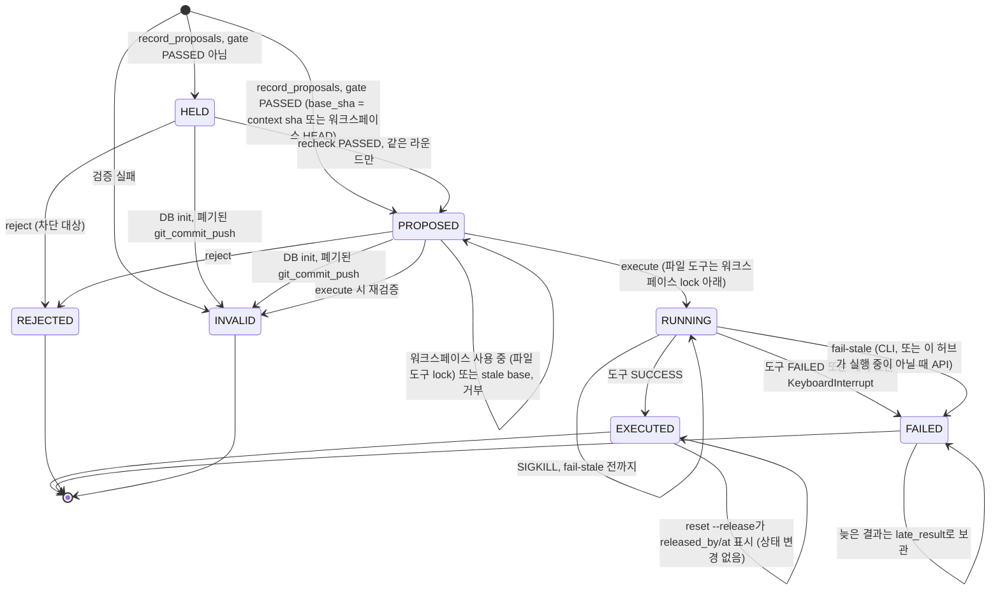
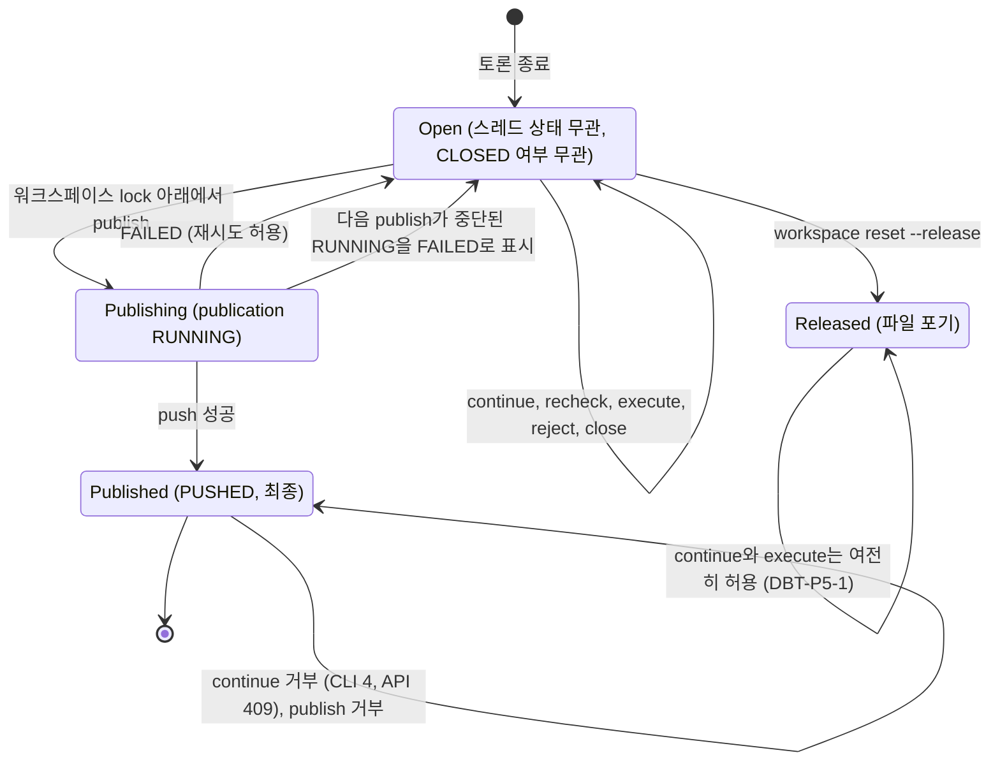
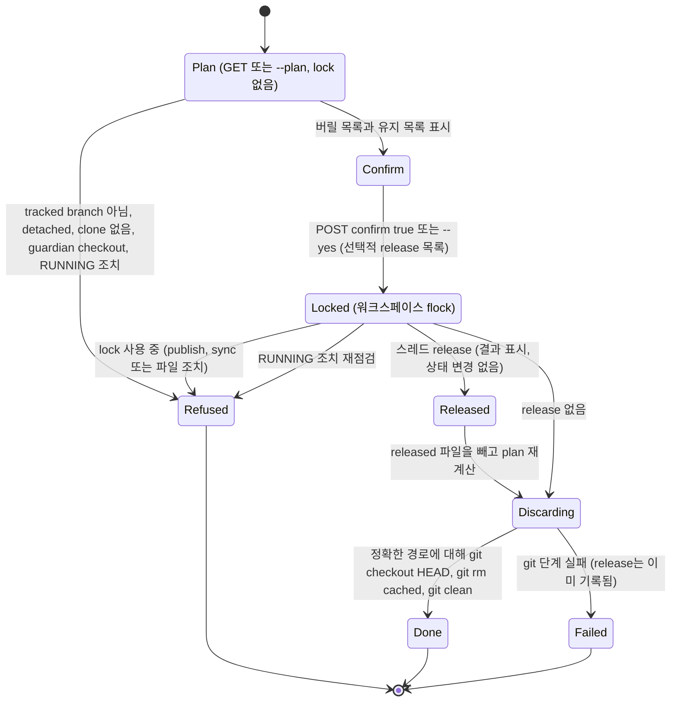

# Phase 5 - 토론 / 결정 / 조치 재검토

[English](phase5-debate.md) | 한국어

> 2026-10-12 시점의 기록이며, 이후 코드가 바뀌었다.

`b82310c`(= `7783afa` + 문서만 바꾼 commit 하나)의 working tree를 phase 4(`66cf41e`)와 비교해 읽기 전용으로 검토했다.
관련 commit: `e7851b5`/`1aed5f2`(publish된 스레드는 최종), `c59b88d`(reset 대 파일 조치), `549dbd5`/`2090769`
(`--release`), `2eed2fc`(git_commit_push 잔여물, 하나의 thread-id 패턴, plan timeout), `b7bb5cc`/`634ff09`
(HEAD에서 얻는 base_sha), `87615a4`(TS `changesWorkspace`). 줄 번호는 `b82310c` 기준이다.

## 요약

| id | sev | P3 | P4 | **P5** | P4 이후 변경 |
|---|---|---|---|---|---|
| DBT-1 | High | PARTIAL | RESOLVED | **RESOLVED** | - |
| DBT-2 | High | OPEN | RESOLVED | **RESOLVED** | 잔여물 정리됨(P4-4 참고) |
| DBT-3 | High | PARTIAL | PARTIAL | **PARTIAL** | 변경 없음 |
| DBT-4 | High | RESOLVED | RESOLVED | **RESOLVED** | - |
| DBT-5 | Medium | PARTIAL | PARTIAL | **PARTIAL** | `thread_published` overlay 추가; verdict/Close/Recheck는 여전히 snapshot |
| DBT-6 | Medium | RESOLVED | RESOLVED | **RESOLVED** | - |
| DBT-7 | Medium | OPEN | RESOLVED | **RESOLVED** | - |
| DBT-8 | Medium | RESOLVED | RESOLVED | **RESOLVED** | - |
| DBT-9 | Medium | PARTIAL | PARTIAL | **PARTIAL** | 변경 없음 |
| DBT-10 | Medium | OPEN | PARTIAL | **RESOLVED** | D11이 토론 시작 시 강제됨(CLI 4, POST 409) |
| DBT-11 | Medium | PARTIAL | PARTIAL | **PARTIAL** | 변경 없음 |
| DBT-12 | Medium | RESOLVED | RESOLVED | **RESOLVED** | - |
| DBT-13 | Medium | RESOLVED | RESOLVED | **RESOLVED** | - |
| DBT-14 | Medium | RESOLVED | RESOLVED | **RESOLVED** | - |
| DBT-15 | Low | OPEN | RESOLVED | **RESOLVED** | - |
| DBT-16 | Low | RESOLVED | RESOLVED | **RESOLVED** | - |
| DBT-17 | Low | PARTIAL | PARTIAL | **PARTIAL** | 변경 없음(문서 3줄) |
| DBT-18 | Low | PARTIAL | PARTIAL | **PARTIAL** | 변경 없음 |
| DBT-19 | Low | RESOLVED | RESOLVED | **RESOLVED** | - |
| DBT-N1 | Medium | new | RESOLVED | **RESOLVED** | - |
| DBT-N2 | Medium | new | PARTIAL | **RESOLVED** | `--release`로 reset이 버려진 유지 파일을 버릴 수 있음 |
| DBT-N3 | Low | new | OPEN | **OPEN** | 변경 없음 |
| DBT-N4 | Low | new | OPEN | **OPEN** | 변경 없음 |
| DBT-N5 | Low | new | OPEN | **OPEN** | 변경 없음 |
| DBT-N6 | Low | new | RESOLVED | **RESOLVED** | - |
| DBT-N7 | Low | new | OPEN | **OPEN** | 변경 없음 |
| DBT-N8 | Low | new | OPEN | **OPEN** | 변경 없음 |
| DBT-P4-1 | Medium | - | new | **RESOLVED** | publish된 스레드는 시작 시 거부, Continue 숨김 |
| DBT-P4-2 | Medium | - | new | **RESOLVED** | 파일 조치가 워크스페이스 lock을 잡음; reset은 RUNNING을 거부 |
| DBT-P4-3 | Low | - | new | **RESOLVED** | `--release` |
| DBT-P4-4 | Low | - | new | **RESOLVED** | DB-init이 행을 정리, 팀이 폐기된 이름을 받아들임, TS 수정 |
| DBT-P4-5 | Low | - | new | **RESOLVED** | 하나의 `THREAD_ID_PATTERN` |
| DBT-P4-6 | Low | - | new | **RESOLVED** | `planTimeout`, 주석 고쳐 씀 |

집계(발견 사항 33개): **RESOLVED 22 · PARTIAL 6 · OPEN 5 · REGRESSED 0**.
- RESOLVED (22): DBT-1, 2, 4, 6, 7, 8, 10, 12, 13, 14, 15, 16, 19; N1, N2, N6; P4-1..P4-6.
- PARTIAL (6): DBT-3, 5, 9, 11, 17, 18.
- OPEN (5): N3, N4, N5, N7, N8.

phase 4 이후 새 항목: **DBT-P5-1 Medium**, **DBT-P5-2 Medium**, DBT-P5-3..P5-7 Low.

---

## 1. 근거와 함께 본 상태

- **DBT-1, 4, 6, 7, 8, 12, 13, 14, 15, 16, 19, N1, N6 - RESOLVED**, phase 4 이후 변경 없음(근거는 phase 4 보고서).
- **DBT-2 RESOLVED.** 폐기됨; DB init이 이제 저장된 PROPOSED/HELD `git_commit_push` 행을 INVALID로 정리한다(`cli/llm-agent/db_manager.py:223-228`); 아직 이를 나열한 팀은 경고를 받고 판정자는 이를 보지 않는다(`cli/llm-agent/team_manager.py:209-210, 233-236`); TS는 더 이상 이를 나열하지 않는다(`87615a4`).
- **DBT-3 PARTIAL.** 변경 없음: superseded HELD가 남아 있다(N3); CLI recheck는 여전히 APPROVED를 PENDING_JEV로 강등할 수 있다(`cli/llm-agent/action_ops.py` `recheck_thread`).
- **DBT-5 PARTIAL.** 새 `thread_published` overlay와 Published chip(`apps/agent/debate_handler.go` listDebates overlay; `apps/web-desktop/src/pages/debate/ResultView.tsx:411-426`, `JobResult.tsx:72`). Close/Recheck는 여전히 snapshot 기반이고(`ResultView.tsx:408`, `gateNeedsRecheck`), UI 어디에도 released 표시가 없다(DBT-P5-1).
- **DBT-9 PARTIAL.** 변경 없음(CLI `--debate --thread`는 실행 중인 허브 작업과 대조되지 않는다).
- **DBT-10 RESOLVED.** CLI는 publish된 T에 대한 `--debate --thread T`를 어떤 에이전트도 실행하기 전에 exit 4로 거부한다(`cli/llm-agent/guardian.py:586-594`, `action_ops.py:452-461`); 허브는 캐시된 published 집합으로 409를 응답하며(`debate_handler.go:557, 632-656`), 최선의 노력이고 CLI가 backstop이다; publish된 스레드에서는 Continue가 대체되었다(`ResultView.tsx:411-415`).
- **DBT-11 PARTIAL.** 변경 없음(sync git 실패 -> exit 2 / 400).
- **DBT-17 PARTIAL.** 변경 없음: `docs/design/debate-teams-api.md:33`(`run_tests` "low"), `:64`(POST body 필드), `:134`(typed confirm only `server_remediation`).
- **DBT-18 PARTIAL.** 변경 없음(`apps/web-desktop/src/pages/agents/RunDetail.tsx:29`).
- **DBT-N2 RESOLVED.** `--release THREAD`(그리고 POST의 `"release": [...]`)는 스레드의 유지된 EXECUTED 파일 조치에 `released_by/at`을 표시하므로, 같은 reset이 그 파일을 버린다(`cli/llm-agent/workspace_ops.py:65-82, 127-145, 175-198`; `debate_handler.go` workspaceReset). dirty 워크스페이스는 이제 항상 정리할 수 있다.
- **DBT-N3 OPEN.** superseded HELD는 여전히 고립된다; RecheckPanel은 여전히 이전 결과에서 제공된다(`ResultView.tsx` `gateNeedsRecheck(fd)`).
- **DBT-N4 OPEN.** ResultView는 여전히 스레드 전체의 live 조치를 "Actions from this debate"로 나열한다.
- **DBT-N5 OPEN.** `execute_code_action` 설명은 여전히 `tests.default` 요구 사항을 빠뜨린다(`cli/llm-agent/mcp_client.py:31-35`).
- **DBT-N7 OPEN.** `publishPlan`은 여전히 `r.URL.Query()`를 쓴다(`debate_handler.go:1162`).
- **DBT-N8 OPEN.** publish 복구는 여전히 스레드 범위이다(`cli/llm-agent/publish_ops.py:283`).
- **DBT-P4-1 RESOLVED.** DBT-10 참고.
- **DBT-P4-2 RESOLVED.** `run_action`은 파일 도구에 대해 RUNNING -> EXECUTED/FAILED 구간 동안 워크스페이스 flock을 잡는다(`action_ops.py:255-275`); reset은 프로젝트의 조치 중 하나라도 RUNNING이면 lock 전과 lock 아래에서 거부한다(`workspace_ops.py:148-153, 192-194`).
- **DBT-P4-3 RESOLVED.** `--release`(N2 참고).
- **DBT-P4-4 RESOLVED.** DBT-2 참고.
- **DBT-P4-5 RESOLVED.** `THREAD_ID_PATTERN`이 Go `threadPattern`을 그대로 따르며(`action_ops.py:381`), `publications_json`이 이를 쓴다(`workspace_ops.py`).
- **DBT-P4-6 RESOLVED.** 두 plan 모두 `planTimeout`(`debate_handler.go` 상수와 plan handler); 주석 수정됨(`publish_ops.py:283`).

---

## 2. 현재의 상태 기계

### 2.1 조치 상태

### 2.2 스레드와 publication 수명 주기

스레드 상태 자체는 phase 4 이후 변경 없다(토론 종료 상태, recheck, CLOSED = 숨김 전용). 새로 생긴 것은 파생된
두 개의 종결 플래그이다: published(PUSHED 행)와 released(EXECUTED 파일 조치의 released_at).

### 2.3 워크스페이스 reset

---

## 3. phase 4 이후 새로 생긴 모순

### DBT-P5-1 (Medium) - "Released"는 publish에 대해서는 최종이지만 continue나 execute에 대해서는 아니다
- 근거: release는 스레드의 EXECUTED 파일 조치만 표시하고(`workspace_ops.py:127-145`), publish는 released 조치가 있는 스레드를 모두 거부하므로(`publish_ops.py:240-244`), 그 스레드는 "can never be published"이다(`--release` help, `guardian.py:729-731`; `debate-teams-api.md:248-249`). 그러나 시작 시점의 최종성 점검은 PUSHED publication만 본다(`action_ops.py:452-461`, `guardian.py:586-594`, Go `publishedRefusal` `debate_handler.go:632-656`). released 스레드의 PROPOSED/HELD 조치는 손대지 않은 채 실행 가능하게 남고, UI에는 released 표시가 없다(`thread_published`만 있음, `ResultView.tsx:411-426`).
- 영향: released 스레드에 대해 DBT-P4-1의 막다른 길이 다시 생긴다. 운영자는 released 스레드를 이어가거나 남은 조치를 실행할 수 있다; 새 파일은 이후 reset에서 유지되지만(release되지 않은 새 EXECUTED 조치이므로, `workspace_ops.py:65-82`) 스레드는 결코 publish할 수 없다. 두 번째 `--release`까지 워크스페이스는 다시 dirty가 된다.
- 수정: SAFE-FIX - `published_refusal`과 허브 overlay(`thread_released`)에서 released를 published처럼 취급하고, release 시점에 스레드의 PROPOSED/HELD 조치를 REJECT한다(또는 released 스레드에 대해 파일 도구의 `run_action`을 거부한다).

### DBT-P5-2 (Medium) - stale-base 점검과 대화형 confirm이 워크스페이스 lock 전에 일어난다
- 근거: `run_action`은 `stale_reason`을 점검하고(`action_ops.py:243`), 재검증한 다음, `confirm(action)`을 호출하고(`:251`), 그 뒤에야 파일 도구에 대해 워크스페이스 lock을 잡는다(`:255-257`). 일반 CLI에서 `confirm`은 입력된 `yes`를 기간 제한 없이 기다린다(`guardian.py` `handle_action_commands` confirm).
- 영향: stale 점검과 lock 사이에 프로젝트 sync(또는 publish의 checkout 과정, 또는 reset)가 완료될 수 있다; 그러면 조치는 `base_sha`에 대해 제안되었는데도 이동한 HEAD 위에 쓴다. 결과는 EXECUTED이지만 publish할 수 없고("workspace moved"), `base_sha` 내용을 기준으로 계획된 `apply_patch`가 다른 코드에 적용된다. 허브 경로(`confirm`이 즉시 반환)는 구간이 작고, CLI 경로는 넓다.
- 수정: SAFE-FIX - 파일 도구는 lock을 먼저 잡는다(또는 lock을 얻은 뒤 RUNNING 전이 전에 `stale_reason`과 `mcp.validate`를 반복한다).

### DBT-P5-3 (Low) - 겹치는 writer: 유지된 경로가 released 스레드의 내용을 담을 수 있다
- 근거: `_owners`는 release되지 않은 조치에 대해서만 계산된다(`workspace_ops.py:65-91`). 스레드 B(유지)가 `f`를 쓴 뒤 스레드 A(released)가 `f`를 썼다면, reset은 B를 위해 `f`를 유지하지만 파일에는 A의 내용이 있다.
- 영향: B의 publish가 거부된다("files changed after the last action wrote them"); reset은 이를 결코 고치지 못한다.
- 수정: SAFE-FIX - 모든 EXECUTED 파일 조치에 대해 owner를 계산하고 마지막 writer가 released인 경로를 버린다(복원한다); 또는 그런 경로를 남기게 될 release를 거부한다.

### DBT-P5-4 (Low) - release 한도가 Go와 Python에서 다르다
- 근거: Go `maxReleaseThreads = 20`(`debate_handler.go:58`), Python `MAX_RELEASE = 50`(`workspace_ops.py:21`).
- 수정: SAFE-FIX - 문서화된 한도 하나.

### DBT-P5-5 (Low) - git_commit_push 마이그레이션이 DB를 열 때마다 실행된다
- 근거: UPDATE가 `_init_db`에 있어 `DecisionDBManager()`마다 실행되는데(`db_manager.py:223-228`), 이는 읽기 전용 list/plan GET을 포함한 모든 CLI 호출이다. 반면 다른 곳의 일회성 마이그레이션은 `guardian_meta` marker를 쓴다(`db_manager.py:172-179`, `seed_node_groups`).
- 영향: 모든 읽기 경로에서 쓰기 트랜잭션이 발생한다; 지금은 무해하지만 marker 패턴과 일관되지 않다.
- 수정: SAFE-FIX - `guardian_meta` 키로 보호한다.

### DBT-P5-6 (Low) - 파일이 아닌 도구는 워크스페이스 lock 밖에서 실행된다
- 근거: FILE_TOOLS만 lock을 잡는다(`action_ops.py:255-257`); `run_tests`는 lock 없이 최대 600 s 동안 워크스페이스 코드를 실행하며, reset은 RUNNING 조치가 있으면 거부하지만(`workspace_ops.py:148-153`) publish와 sync는 RUNNING 조치를 점검하지 않는다.
- 영향: `run_tests` 조치가 같은 tree를 실행하는 동안 publish가 gate를 실행하고 commit할 수 있다; `run_tests`가 만든 build 산출물 때문에 동시에 진행되는 publish가 추가 경로로 거부될 수 있다.
- 수정: SAFE-FIX - `run_tests`도 lock을 잡게 하거나, RUNNING 조치가 있는 동안 publish/sync가 거부하게 한다(reset처럼).

### DBT-P5-7 (Low) - 잘못 commit된 빈 module
- 근거: `cli/llm-agent/orkspace_ops.py`(0 bytes)가 `2eed2fc`에서 추가되었다.
- 수정: SAFE-FIX - 삭제한다.

---

## 4. Lock 순서 점검

워크스페이스 수준의 모든 작업은 하나의 non-blocking flock(`project_registry.workspace_lock`)을 쓴다: publish(`publish_ops.py` `_publish_lock`), sync(`project_registry.py` `sync`), reset(`workspace_ops.py:192`), 파일 도구 실행(`action_ops.py:255-275`). 각각은 프로세스당 최대 한 번 이를 얻고 결코 기다리지 않으므로 deadlock은 없다; 경합은 exit 4 / 409로 드러난다. 남은 순서 공백은 lock 전에 하는 점검(DBT-P5-2)과 lock 밖의 파일이 아닌 도구(DBT-P5-6)이다. publish plan과 reset plan은 설계상 lock을 잡지 않으며, 실제 작업이 lock 아래에서 다시 점검한다.
