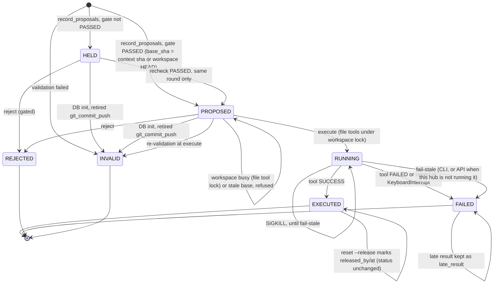
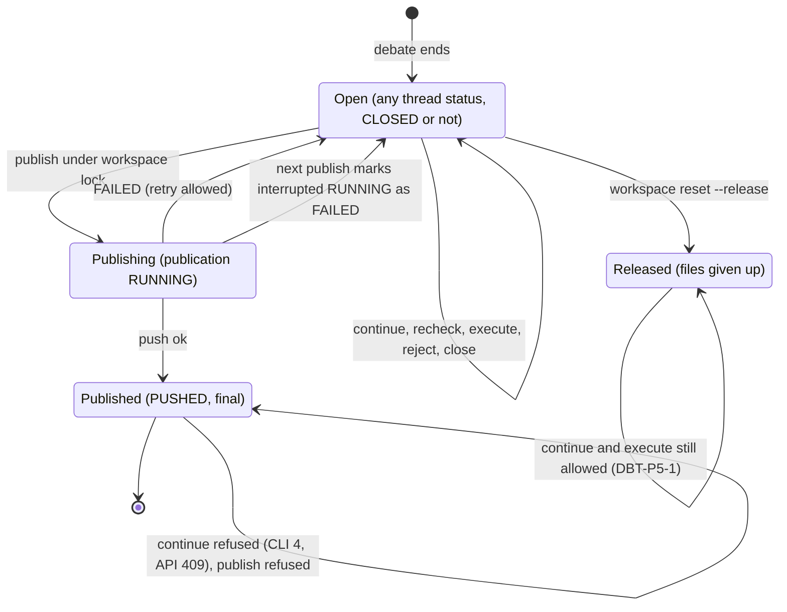
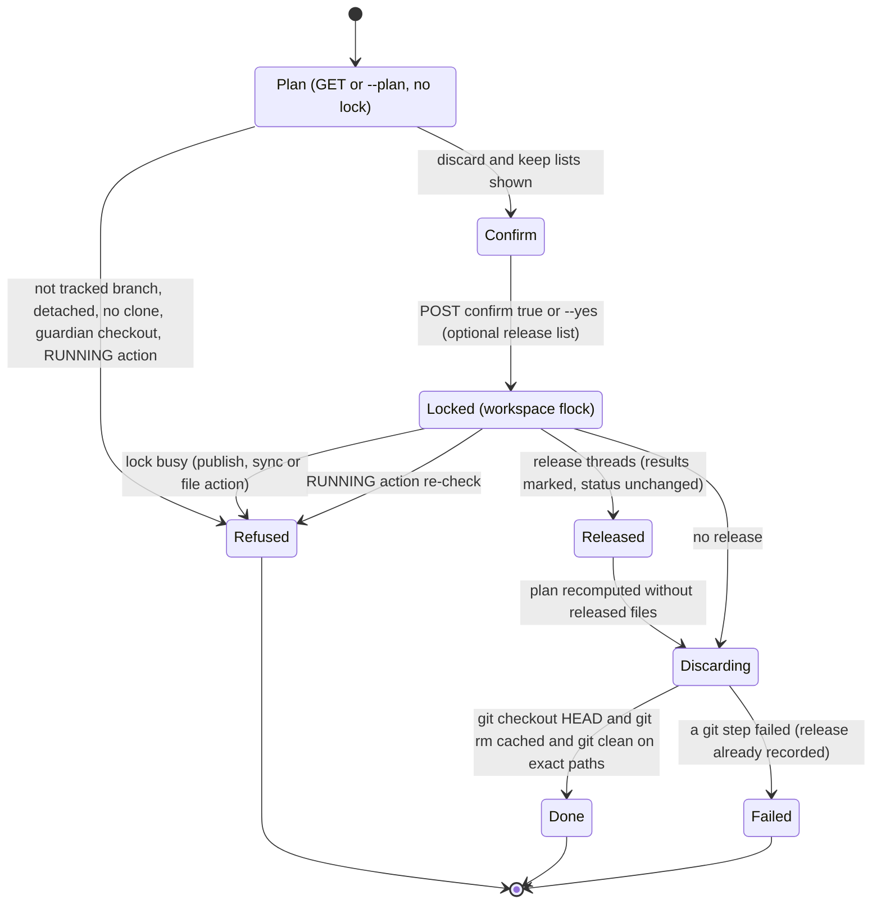

# Phase 5 - Debate / Decision / Action re-review

English | [한국어](phase5-debate.ko.md)

> Point-in-time record from 2026-10-12; the code has changed since.

Reviewed the working tree at `b82310c` (= `7783afa` + one docs-only commit) against phase 4 (`66cf41e`), read-only.
Relevant commits: `e7851b5`/`1aed5f2` (published threads final), `c59b88d` (reset vs file actions), `549dbd5`/`2090769`
(`--release`), `2eed2fc` (git_commit_push leftovers, one thread-id pattern, plan timeout), `b7bb5cc`/`634ff09`
(base_sha from HEAD), `87615a4` (TS `changesWorkspace`). Line numbers are at `b82310c`.

## Summary

| id | sev | P3 | P4 | **P5** | change since P4 |
|---|---|---|---|---|---|
| DBT-1 | High | PARTIAL | RESOLVED | **RESOLVED** | - |
| DBT-2 | High | OPEN | RESOLVED | **RESOLVED** | leftovers settled (see P4-4) |
| DBT-3 | High | PARTIAL | PARTIAL | **PARTIAL** | unchanged |
| DBT-4 | High | RESOLVED | RESOLVED | **RESOLVED** | - |
| DBT-5 | Medium | PARTIAL | PARTIAL | **PARTIAL** | `thread_published` overlay added; verdict/Close/Recheck still snapshot |
| DBT-6 | Medium | RESOLVED | RESOLVED | **RESOLVED** | - |
| DBT-7 | Medium | OPEN | RESOLVED | **RESOLVED** | - |
| DBT-8 | Medium | RESOLVED | RESOLVED | **RESOLVED** | - |
| DBT-9 | Medium | PARTIAL | PARTIAL | **PARTIAL** | unchanged |
| DBT-10 | Medium | OPEN | PARTIAL | **RESOLVED** | D11 enforced at debate start (CLI 4, POST 409) |
| DBT-11 | Medium | PARTIAL | PARTIAL | **PARTIAL** | unchanged |
| DBT-12 | Medium | RESOLVED | RESOLVED | **RESOLVED** | - |
| DBT-13 | Medium | RESOLVED | RESOLVED | **RESOLVED** | - |
| DBT-14 | Medium | RESOLVED | RESOLVED | **RESOLVED** | - |
| DBT-15 | Low | OPEN | RESOLVED | **RESOLVED** | - |
| DBT-16 | Low | RESOLVED | RESOLVED | **RESOLVED** | - |
| DBT-17 | Low | PARTIAL | PARTIAL | **PARTIAL** | unchanged (3 doc lines) |
| DBT-18 | Low | PARTIAL | PARTIAL | **PARTIAL** | unchanged |
| DBT-19 | Low | RESOLVED | RESOLVED | **RESOLVED** | - |
| DBT-N1 | Medium | new | RESOLVED | **RESOLVED** | - |
| DBT-N2 | Medium | new | PARTIAL | **RESOLVED** | `--release` lets reset discard abandoned kept files |
| DBT-N3 | Low | new | OPEN | **OPEN** | unchanged |
| DBT-N4 | Low | new | OPEN | **OPEN** | unchanged |
| DBT-N5 | Low | new | OPEN | **OPEN** | unchanged |
| DBT-N6 | Low | new | RESOLVED | **RESOLVED** | - |
| DBT-N7 | Low | new | OPEN | **OPEN** | unchanged |
| DBT-N8 | Low | new | OPEN | **OPEN** | unchanged |
| DBT-P4-1 | Medium | - | new | **RESOLVED** | published threads refused at start, Continue hidden |
| DBT-P4-2 | Medium | - | new | **RESOLVED** | file actions hold the workspace lock; reset refuses RUNNING |
| DBT-P4-3 | Low | - | new | **RESOLVED** | `--release` |
| DBT-P4-4 | Low | - | new | **RESOLVED** | DB-init settles rows, teams accept retired name, TS fixed |
| DBT-P4-5 | Low | - | new | **RESOLVED** | one `THREAD_ID_PATTERN` |
| DBT-P4-6 | Low | - | new | **RESOLVED** | `planTimeout`, comment reworded |

Counts (33 findings): **RESOLVED 22 · PARTIAL 6 · OPEN 5 · REGRESSED 0**.
- RESOLVED (22): DBT-1, 2, 4, 6, 7, 8, 10, 12, 13, 14, 15, 16, 19; N1, N2, N6; P4-1..P4-6.
- PARTIAL (6): DBT-3, 5, 9, 11, 17, 18.
- OPEN (5): N3, N4, N5, N7, N8.

New since phase 4: **DBT-P5-1 Medium**, **DBT-P5-2 Medium**, DBT-P5-3..P5-7 Low.

---

## 1. Status with evidence

- **DBT-1, 4, 6, 7, 8, 12, 13, 14, 15, 16, 19, N1, N6 - RESOLVED**, unchanged since phase 4 (evidence in phase-4 report).
- **DBT-2 RESOLVED.** Retired; DB init now settles stored PROPOSED/HELD `git_commit_push` rows as INVALID (`cli/llm-agent/db_manager.py:223-228`); teams that still list it get a warning and the judge never sees it (`cli/llm-agent/team_manager.py:209-210, 233-236`); TS no longer lists it (`87615a4`).
- **DBT-3 PARTIAL.** Unchanged: superseded HELD remain (N3); CLI recheck can still demote APPROVED to PENDING_JEV (`cli/llm-agent/action_ops.py` `recheck_thread`).
- **DBT-5 PARTIAL.** New `thread_published` overlay and Published chip (`apps/agent/debate_handler.go` listDebates overlay; `apps/web-desktop/src/pages/debate/ResultView.tsx:411-426`, `JobResult.tsx:72`). Still snapshot-based Close/Recheck (`ResultView.tsx:408`, `gateNeedsRecheck`), and no released marker anywhere in the UI (DBT-P5-1).
- **DBT-9 PARTIAL.** Unchanged (CLI `--debate --thread` not checked against running hub jobs).
- **DBT-10 RESOLVED.** CLI refuses `--debate --thread T` for a published T with exit 4 before any agent runs (`cli/llm-agent/guardian.py:586-594`, `action_ops.py:452-461`); hub answers 409 using the cached published set (`debate_handler.go:557, 632-656`), best effort with the CLI as backstop; Continue replaced for published threads (`ResultView.tsx:411-415`).
- **DBT-11 PARTIAL.** Unchanged (sync git failure -> exit 2 / 400).
- **DBT-17 PARTIAL.** Unchanged: `docs/design/debate-teams-api.md:33` (`run_tests` "low"), `:64` (POST body fields), `:134` (typed confirm only `server_remediation`).
- **DBT-18 PARTIAL.** Unchanged (`apps/web-desktop/src/pages/agents/RunDetail.tsx:29`).
- **DBT-N2 RESOLVED.** `--release THREAD` (and `"release": [...]` in POST) marks a thread's kept EXECUTED file actions `released_by/at`, so the same reset discards their files (`cli/llm-agent/workspace_ops.py:65-82, 127-145, 175-198`; `debate_handler.go` workspaceReset). A dirty workspace can now always be cleaned.
- **DBT-N3 OPEN.** Superseded HELD still stranded; RecheckPanel still offered from the old result (`ResultView.tsx` `gateNeedsRecheck(fd)`).
- **DBT-N4 OPEN.** ResultView still lists thread-wide live actions as "Actions from this debate".
- **DBT-N5 OPEN.** `execute_code_action` description still omits the `tests.default` requirement (`cli/llm-agent/mcp_client.py:31-35`).
- **DBT-N7 OPEN.** `publishPlan` still uses `r.URL.Query()` (`debate_handler.go:1162`).
- **DBT-N8 OPEN.** Publish recovery still thread-scoped (`cli/llm-agent/publish_ops.py:283`).
- **DBT-P4-1 RESOLVED.** See DBT-10.
- **DBT-P4-2 RESOLVED.** `run_action` holds the workspace flock for file tools around RUNNING -> EXECUTED/FAILED (`action_ops.py:255-275`); reset refuses while any action of the project is RUNNING, before and under the lock (`workspace_ops.py:148-153, 192-194`).
- **DBT-P4-3 RESOLVED.** `--release` (see N2).
- **DBT-P4-4 RESOLVED.** See DBT-2.
- **DBT-P4-5 RESOLVED.** `THREAD_ID_PATTERN` mirrors Go `threadPattern` (`action_ops.py:381`), used by `publications_json` (`workspace_ops.py`).
- **DBT-P4-6 RESOLVED.** `planTimeout` for both plans (`debate_handler.go` constants and plan handlers); comment fixed (`publish_ops.py:283`).

---

## 2. State machines now

### 2.1 Action status

### 2.2 Thread and publication lifecycle

Thread status itself is unchanged since phase 4 (debate end statuses, recheck, CLOSED = hide only). New are the two
derived, terminal flags: published (a PUSHED row) and released (released_at on its EXECUTED file actions).

### 2.3 Workspace reset

---

## 3. New contradictions since phase 4

### DBT-P5-1 (Medium) - "Released" is final for publish but not for continue or execute
- Evidence: release marks only the thread's EXECUTED file actions (`workspace_ops.py:127-145`), and publish refuses any thread with a released action (`publish_ops.py:240-244`), so the thread "can never be published" (`--release` help, `guardian.py:729-731`; `debate-teams-api.md:248-249`). But the start-time finality check looks only at PUSHED publications (`action_ops.py:452-461`, `guardian.py:586-594`, Go `publishedRefusal` `debate_handler.go:632-656`). PROPOSED/HELD actions of a released thread are untouched and remain executable, and the UI has no released marker (only `thread_published`, `ResultView.tsx:411-426`).
- Impact: this is the DBT-P4-1 dead end again for released threads. An operator can continue a released thread or execute its remaining actions; the new files are kept by later resets (they are new, unreleased EXECUTED actions, `workspace_ops.py:65-82`) but the thread can never publish. The workspace is dirty again until a second `--release`.
- Fix: SAFE-FIX - treat released like published in `published_refusal` and in the hub overlay (`thread_released`), and at release time REJECT the thread's PROPOSED/HELD actions (or refuse `run_action` of file tools for released threads).

### DBT-P5-2 (Medium) - Stale-base check and interactive confirm happen before the workspace lock
- Evidence: `run_action` checks `stale_reason` (`action_ops.py:243`), re-validates, then calls `confirm(action)` (`:251`), and only then takes the workspace lock for file tools (`:255-257`). In the plain CLI `confirm` waits for a typed `yes` (`guardian.py` `handle_action_commands` confirm) for any length of time.
- Impact: a project sync (or a publish's checkout dance, or a reset) can complete between the stale check and the lock; the action then writes onto a moved HEAD although it was proposed for `base_sha`. The result is EXECUTED but unpublishable ("workspace moved"), and an `apply_patch` planned against `base_sha` content is applied to different code. The hub path (`confirm` returns at once) has a small window; the CLI path is wide.
- Fix: SAFE-FIX - take the lock first for file tools (or repeat `stale_reason` and `mcp.validate` after acquiring it, before the RUNNING transition).

### DBT-P5-3 (Low) - Overlapping writers: a kept path may hold a released thread's content
- Evidence: `_owners` is computed only over unreleased actions (`workspace_ops.py:65-91`). If thread A (released) wrote `f` after thread B (kept) wrote it, reset keeps `f` for B but the file holds A's content.
- Impact: B's publish refuses ("files changed after the last action wrote them"); reset will never fix it.
- Fix: SAFE-FIX - compute owners over all EXECUTED file actions and discard (restore) a path whose latest writer was released; or refuse a release that would leave such a path.

### DBT-P5-4 (Low) - Release limits differ between Go and Python
- Evidence: Go `maxReleaseThreads = 20` (`debate_handler.go:58`), Python `MAX_RELEASE = 50` (`workspace_ops.py:21`).
- Fix: SAFE-FIX - one documented limit.

### DBT-P5-5 (Low) - The git_commit_push migration runs on every DB open
- Evidence: the UPDATE sits in `_init_db` and runs on every `DecisionDBManager()` (`db_manager.py:223-228`), i.e. on every CLI call including read-only list/plan GETs, while one-time migrations elsewhere use `guardian_meta` markers (`db_manager.py:172-179`, `seed_node_groups`).
- Impact: a write transaction on every read path; harmless today but inconsistent with the marker pattern.
- Fix: SAFE-FIX - guard it with a `guardian_meta` key.

### DBT-P5-6 (Low) - Non-file tools run outside the workspace lock
- Evidence: only FILE_TOOLS take the lock (`action_ops.py:255-257`); `run_tests` executes workspace code for up to 600 s without it, while reset refuses any RUNNING action (`workspace_ops.py:148-153`) but publish and sync do not check RUNNING actions.
- Impact: a publish can run its gate and commit while a `run_tests` action executes the same tree; build artefacts created by `run_tests` can make a concurrent publish refuse on extra paths.
- Fix: SAFE-FIX - take the lock for `run_tests` too, or have publish/sync refuse while RUNNING actions exist (as reset does).

### DBT-P5-7 (Low) - Stray empty module committed
- Evidence: `cli/llm-agent/orkspace_ops.py` (0 bytes) was added in `2eed2fc`.
- Fix: SAFE-FIX - delete it.

---

## 4. Lock ordering check

All workspace-level operations use one non-blocking flock (`project_registry.workspace_lock`): publish (`publish_ops.py` `_publish_lock`), sync (`project_registry.py` `sync`), reset (`workspace_ops.py:192`), and file-tool execution (`action_ops.py:255-275`). Each acquires it at most once per process and never waits, so there is no deadlock; contention surfaces as exit 4 / 409. The remaining ordering gaps are checks made before the lock (DBT-P5-2) and non-file tools outside it (DBT-P5-6). The publish plan and reset plan take no lock by design and are re-checked under the lock by the real operation.
