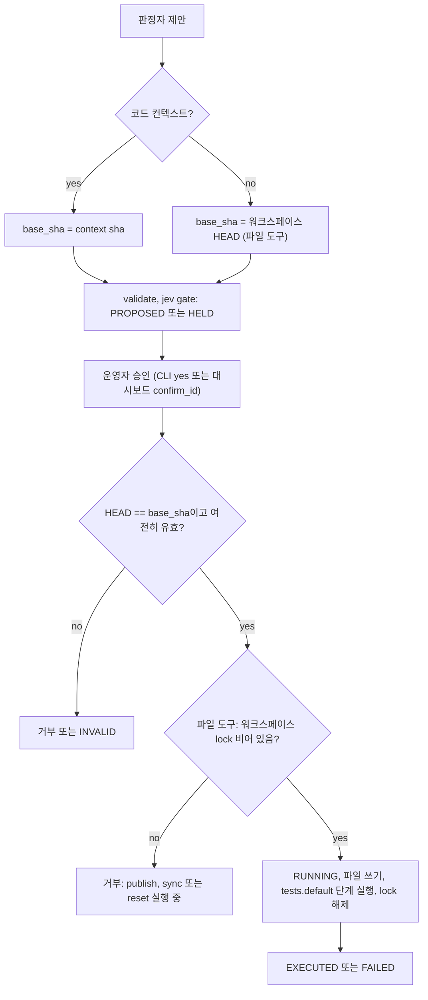
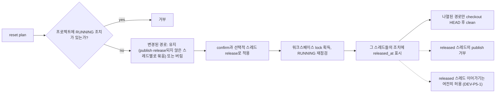
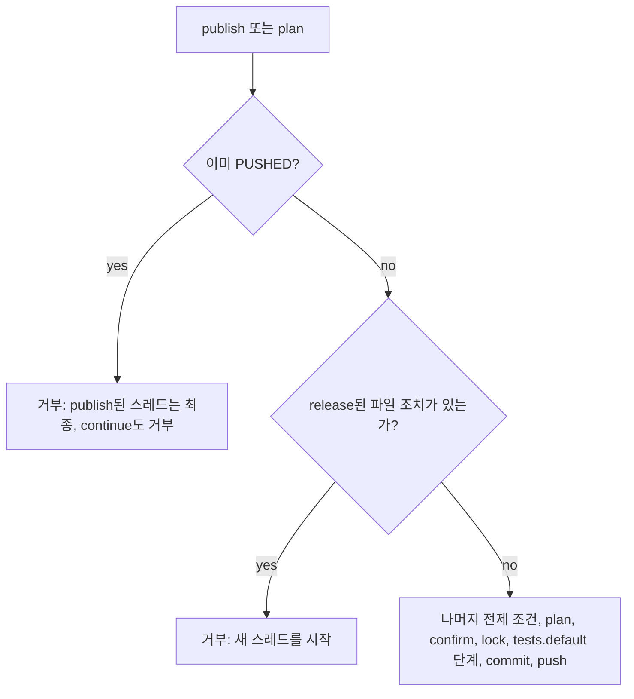

# Phase 5 - 개발 workflow 재검토 (66cf41e..b82310c)

[English](phase5-dev.md) | 한국어

> 2026-10-12 시점의 기록이며, 이후 코드가 바뀌었다.

Mac checkout을 읽기 전용으로 검토했다. HEAD는 `b82310c`로, 요청에서 지정한 `7783afa` 뒤에 문서만 바꾼 commit이
하나 있다; phase 4 이후 commit은 27개이다. 허브는 살펴보지 않았다. 아래 집계는 코드와 대조해 확인했다.
경로는 repo 기준 상대 경로이다; `install` = `scripts/install-agent-service.sh`이고, 리뷰 문서
`docs/analysis/2026-10-12-procedure-review.md`는 "리뷰 문서"라고 부른다.

## 요약 표

| id | severity | phase-4 -> phase-5 |
|---|---|---|
| DEV-1 인벤토리에서 정한 허브 모드 | high | RESOLVED -> RESOLVED |
| DEV-2 agent.env 운영자 설정 유지 | high | RESOLVED -> RESOLVED |
| DEV-3 git_commit_push 폐기 | high | RESOLVED -> RESOLVED |
| DEV-4 publish된 코드가 web/shell CI를 우회 | medium | PARTIAL -> PARTIAL |
| DEV-5 deploy/sync 시 untracked 파일 | medium | RESOLVED -> RESOLVED |
| DEV-6 publish 이후 sync 루프 | medium | RESOLVED -> RESOLVED |
| DEV-7 버전 정렬 / 배포 gate | medium | PARTIAL -> PARTIAL |
| DEV-8 대시보드 publish plan | medium | RESOLVED -> RESOLVED |
| DEV-9 base_sha 없는 조치 | medium | OPEN -> **RESOLVED** |
| DEV-10 pytest fallback 없음 | medium | RESOLVED -> RESOLVED |
| DEV-11 허브 최초 설치 bootstrap | medium | PARTIAL -> PARTIAL |
| DEV-12 README push 모델 | medium | RESOLVED -> RESOLVED |
| DEV-13 CI 취소 규칙 | low | RESOLVED -> RESOLVED |
| DEV-14 README CI 표 | low | REGRESSED -> **RESOLVED** |
| DEV-15 Go toolchain / arch 차이 | low | OPEN -> **RESOLVED** |
| DEV-16 lockfile 변경 시 npm ci | low | RESOLVED -> RESOLVED |
| DEV-17 두 개의 워크스페이스 updater | low | PARTIAL -> PARTIAL |
| DEV-18 판정자가 프로젝트 테스트를 봄 | low | RESOLVED -> RESOLVED |
| DEV-19 publish exit code | low | RESOLVED -> RESOLVED |
| DEV-20 publish 제목이 항상 `fix:` | low | OPEN -> OPEN (수용됨, D14) |
| DEV-21 오래된 문서 | low | PARTIAL -> PARTIAL |
| DEV-N1 README pytest fallback | low | RESOLVED -> RESOLVED |
| DEV-N2 hardening revert | low | RESOLVED -> RESOLVED |
| DEV-N3 대시보드 노드에 pull-inventory 필요 | low | RESOLVED -> RESOLVED |
| DEV-N4 installer 워크스페이스 갱신이 lock을 건너뜀 | low | OPEN -> OPEN |
| DEV-P4-1 reset이 publish할 수 없는 파일을 유지 | medium | new -> **RESOLVED** |
| DEV-P4-2 `--offline`이 두 가지로 설명됨 | low | new -> **RESOLVED** |
| DEV-P4-3 리뷰 문서 행이 §8과 모순 | low | new -> **RESOLVED** |
| DEV-P5-1 released 스레드를 여전히 이어갈 수 있고, 그 새 작업은 결코 publish할 수 없다 | medium | new |
| DEV-P5-2 "CI before deploy" 규칙이 리뷰 문서에만 있다 | low | new |
| DEV-P5-3 잘못 들어간 빈 `cli/llm-agent/orkspace_ops.py` | low | new |

집계(이어진 항목 28개): RESOLVED 21, PARTIAL 5, OPEN 2, REGRESSED 0. 새 항목: 3개(medium 1, low 2).

---

## 발견 사항별 상태

- **DEV-1, 2, 3, 5, 6, 8, 10, 12, 13, 16, 18, 19, N1, N2, N3: RESOLVED, 변경 없음.** phase 4의 근거가
  여전히 유효하다. installer의 소유 키에 이제 `GUARDIAN_HUB_SUDO`가 포함되며(`install:205`), on과 off 두 경우
  모두에 대해 쓰인다(`install:349-354`). on drop-in도 이를 설정한다(`hub-sudo.conf`). DB는 저장된
  `git_commit_push` PROPOSED/HELD 행을 INVALID로 정리한다(`cli/llm-agent/db_manager.py`, 폐기 도구 마이그레이션).
- **DEV-4 PARTIAL.** 변경 없음. gate는 unittest, `go vet`, `go test -race`를 다룬다. web, shell, config
  점검은 여전히 Mac에서만, 또는 merge 이후 GitHub CI에서만 실행된다.
- **DEV-7 PARTIAL.** 코드 변경 없음. P12(installer가 CI 통과를 점검)는 결정되지 않은 채로(0.58) 작업 규칙으로
  남았다(리뷰 문서 `:565`); DEV-P5-2 참고. dirty이거나 push되지 않은 tree는 여전히 경고일 뿐이다(`install:142-147`).
- **DEV-9 RESOLVED(변경됨).** 코드 컨텍스트가 없는 파일 제안은 워크스페이스 HEAD를 `base_sha`로 기록하므로
  (`cli/llm-agent/action_ops.py:56-62`), publish 가능하고 stale 점검 대상이 된다.
  `docs/design/publish-thread.md:47-48`에 문서화되어 있다.
- **DEV-11 PARTIAL.** 변경 없음. 허브 최초 설치를 위한 `~/server-guardian`의 `git clone`이 여전히 문서화되지
  않았다(README나 `docs/operations`에 `git clone` 일치 없음). installer는 여전히 이를 필요로 한다(`install:130`).
- **DEV-14 RESOLVED(변경됨).** `README.md:246`이 `scripts/lib/*.sh`를 나열한다.
- **DEV-15 RESOLVED(변경됨).** `apps/agent/go.mod:5`에 `toolchain go1.26.8`이 있다. installer는 여기서
  `HUB_GO_VERSION`을 도출하고(`install:67-74`), CI는 arm64와 amd64를 모두 build한다(`scripts/ci.sh:69-71`).
- **DEV-17 PARTIAL.** 변경 없음: bash updater(`install:261-275`)와 `--project-sync all`(`install:281`).
- **DEV-20 OPEN(D14로 수용됨).** `fix:` 제목(`cli/llm-agent/publish_ops.py:86`).
- **DEV-21 PARTIAL.** 변경 없음:
  - `agent.md:232,240-241`은 여전히 대시보드를 `:5173`에 둔다.
  - `agent.md:283`은 여전히 판정자가 코드 변경을 "executing"한다고 한다.
  - `docs/design/debate-patch-tool.md:67`(`.go` 행)은 여전히 허브에 Go가 없다고 한다.
- **DEV-N4 OPEN.** installer의 bash 워크스페이스 갱신(`install:255-275`)은 여전히 lock을 잡지 않는다. 이제는
  파일 조치가 실행 중에 잡는 lock도 무시하지만(`action_ops.py:257-276`), 배포는 tree가 clean일 때만 fast-forward할
  수 있고 조치 중간에는 tree가 dirty이므로 위험은 낮게 유지된다.
- **DEV-P4-1 RESOLVED(변경됨).**
  - reset plan은 유지 파일을 스레드별로 묶는다(`cli/llm-agent/workspace_ops.py:61-80`).
  - `--release`는 스레드의 조치에 `released_at`을 표시하며, 그 뒤 reset은 더 이상 이를 유지하지 않는다(`:74`, `:127-145`).
  - publish는 released 스레드를 거부한다(`publish_ops.py:240-244`).
  - reset은 조치가 RUNNING인 동안 거부하고, lock 아래에서 다시 점검한다(`workspace_ops.py:148-153`, apply 경로).
- **DEV-P4-2 RESOLVED(변경됨).** `README.md:145`와 `install` header 18-20행에 하나의 문구("first install,
  or when the hub cannot be reached; the hub's own copy is never overwritten").
- **DEV-P4-3 RESOLVED(변경됨).** 리뷰 문서의 상태 행이 이제 §8과 일치한다: DEV-3 resolved(`:123`),
  DEV-4 partial(`:124`).

### 리뷰 문서 대 코드

- phase 4 집계의 Development 행(`:520`: 12 resolved, 5 partial, 3 open, 1 regressed)은 나의 phase 4 보고서와
  일치한다.
- 점검한 §7.6 주장은 코드와 일치한다: O6(`action_ops.py:56-62`), O7(`go.mod:5`, `ci.sh:69`), P2
  (`action_ops.py:257-276`, `workspace_ops.py:148-153`), P3(`publish_ops.py:240-244`), P11(폐기 도구
  마이그레이션, `action_ops.py`의 `THREAD_ID_PATTERN`).
- 빈틈 하나: §7.6 P1은 publish된 스레드를 이어갈 수 없다고 하지만, released 스레드에 대해서는 같은 말을 하지 않는다
  (DEV-P5-1).

---

## 새 발견 사항

### DEV-P5-1 (medium) released 스레드를 여전히 이어갈 수 있고, 그 새 작업은 결코 publish할 수 없다
- 근거:
  - 스레드 이어가기는 publish된 스레드에 대해서만 거부된다(`cli/llm-agent/guardian.py:590`,
    `action_ops.published_refusal` 사용).
  - publish는 released 파일 조치가 있는 스레드를 모두 거부한다(`publish_ops.py:240-244`: "start a new thread").
  - reset은 그 같은 스레드의 새 unreleased 조치를 유지한다(`workspace_ops.py:74`는 자신이 `released_at`을 가진
    조치만 건너뛴다).
  - 대시보드는 publish된 스레드에 대해서만 Continue를 숨긴다(`1aed5f2`).
- 이유:
  - 운영자는 released 스레드를 이어가 새 파일 조치를 승인하고 실행할 수 있다. 그 파일은 이후 모든 reset에서
    유지되며 배포 fast-forward와 다른 스레드의 publish를 막는다.
  - 스레드는 이를 결코 publish할 수 없다; 유일한 안내는 publish 시점에 온다. 이는 P1이 publish된 스레드에 대해
    고친 것과 같은 상황이며(DBT-P4-1), 이제 release를 통해 도달한다.
- 수정: SAFE-FIX - released를 published처럼 취급한다: released 스레드에 대한 `--debate --thread T`를 거부하고(409)
  Continue를 숨긴다. 또는 release가 조치뿐 아니라 스레드 자체를 표시하게 할 수 있다.

### DEV-P5-2 (low) "CI before deploy" 규칙이 리뷰 문서에만 있다
- 근거: P12는 채택되지 않았다. 대안은 작업 규칙 "pass `scripts/ci.sh` before deploying"이다(리뷰 문서
  `:565`). README의 배포 섹션(`README.md:121-147`)과 installer header(`install:1-50`)는 이를 명시하지 않고,
  installer는 이를 점검하지 않는다.
- 수정: SAFE-FIX - `README.md` §4에 한 줄을 추가한다("run `scripts/ci.sh` and push before
  `install-agent-service.sh`"), 또는 tree가 push된 commit에 있지 않을 때 이를 알림으로 출력한다.

### DEV-P5-3 (low) 잘못 들어간 빈 파일이 추적된다
- 근거: `cli/llm-agent/orkspace_ops.py`(0 bytes, `workspace_ops.py`의 오타)가 `2eed2fc`에서 추가되었다.
  `git ls-files`가 이를 나열한다.
- 수정: SAFE-FIX - `git rm cli/llm-agent/orkspace_ops.py`.

---

## 갱신된 절차 다이어그램

### PROC-7 판정자 조치 실행 (변경: HEAD base, 워크스페이스 lock)

### PROC-11 워크스페이스 reset (변경: release, running guard)

### PROC-9 Publish 전제 조건 (변경: 최종 스레드와 released 스레드)

PROC-4(허브 배포)는 두 가지 세부 사항만 바뀌었다:
- Go 버전이 이제 `go.mod`에서 온다;
- `GUARDIAN_HUB_SUDO`가 `agent.env`에 쓰인다.

그 외에는 phase 4의 sequence diagram이 현재와 같다.
