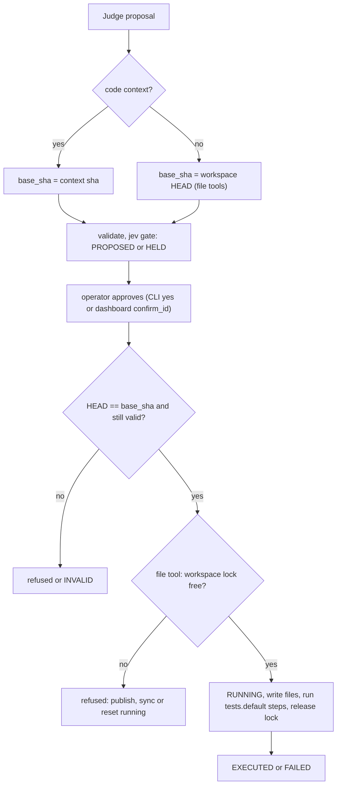
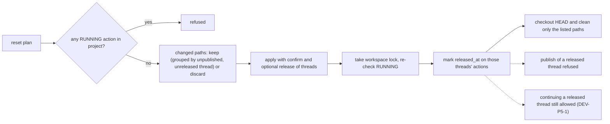
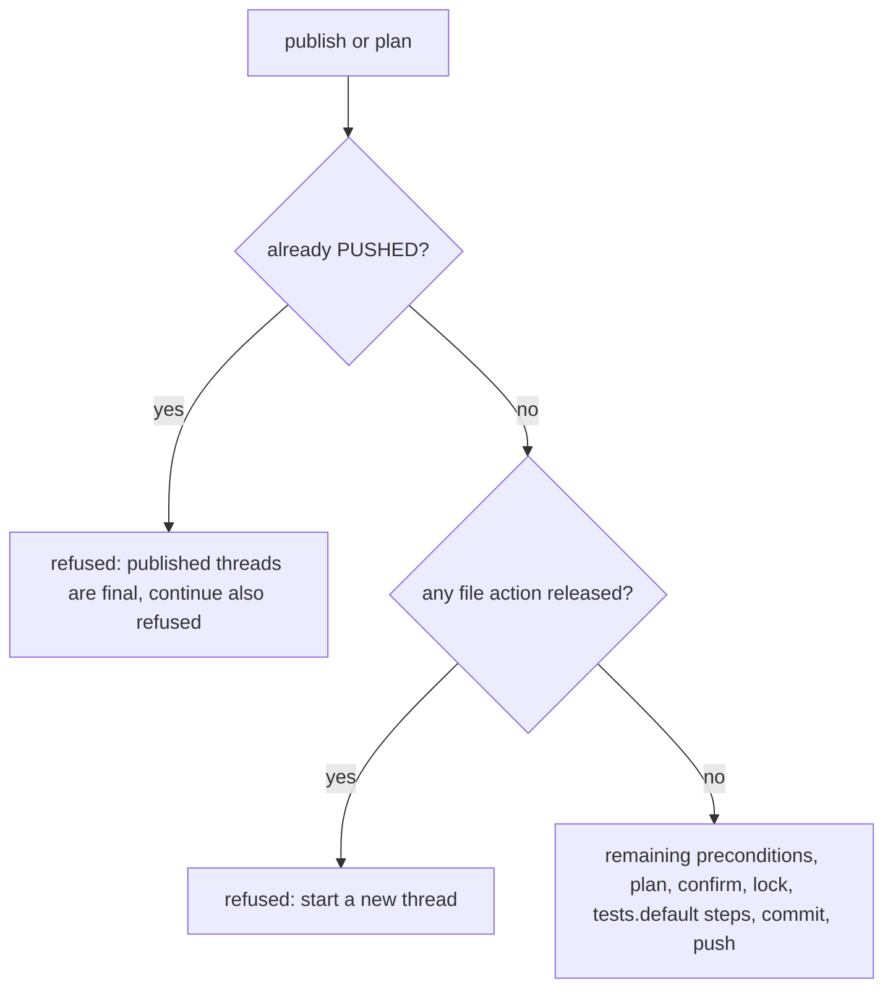

# Phase 5 - Development workflow re-review (66cf41e..b82310c)

English | [한국어](phase5-dev.ko.md)

> Point-in-time record from 2026-10-12; the code has changed since.

Read-only review of the Mac checkout. HEAD is `b82310c`, one docs-only commit after the `7783afa` named in the
request; there are 27 commits since phase 4. The hub was not inspected. The counts below are verified against the
code. Paths are repo-relative; `install` = `scripts/install-agent-service.sh`, and the review document
`docs/analysis/2026-10-12-procedure-review.md` is called "the review doc".

## Summary table

| id | severity | phase-4 -> phase-5 |
|---|---|---|
| DEV-1 hub mode from the inventory | high | RESOLVED -> RESOLVED |
| DEV-2 agent.env operator settings kept | high | RESOLVED -> RESOLVED |
| DEV-3 git_commit_push retired | high | RESOLVED -> RESOLVED |
| DEV-4 published code bypasses web/shell CI | medium | PARTIAL -> PARTIAL |
| DEV-5 untracked files on deploy/sync | medium | RESOLVED -> RESOLVED |
| DEV-6 post-publish sync loop | medium | RESOLVED -> RESOLVED |
| DEV-7 version alignment / deploy gate | medium | PARTIAL -> PARTIAL |
| DEV-8 dashboard publish plan | medium | RESOLVED -> RESOLVED |
| DEV-9 actions without base_sha | medium | OPEN -> **RESOLVED** |
| DEV-10 no pytest fallback | medium | RESOLVED -> RESOLVED |
| DEV-11 hub first-install bootstrap | medium | PARTIAL -> PARTIAL |
| DEV-12 README push model | medium | RESOLVED -> RESOLVED |
| DEV-13 CI cancel rule | low | RESOLVED -> RESOLVED |
| DEV-14 README CI table | low | REGRESSED -> **RESOLVED** |
| DEV-15 Go toolchain / arch drift | low | OPEN -> **RESOLVED** |
| DEV-16 npm ci on lockfile change | low | RESOLVED -> RESOLVED |
| DEV-17 two workspace updaters | low | PARTIAL -> PARTIAL |
| DEV-18 judge sees project tests | low | RESOLVED -> RESOLVED |
| DEV-19 publish exit codes | low | RESOLVED -> RESOLVED |
| DEV-20 publish subject always `fix:` | low | OPEN -> OPEN (accepted, D14) |
| DEV-21 stale docs | low | PARTIAL -> PARTIAL |
| DEV-N1 README pytest fallback | low | RESOLVED -> RESOLVED |
| DEV-N2 hardening revert | low | RESOLVED -> RESOLVED |
| DEV-N3 dashboard nodes need pull-inventory | low | RESOLVED -> RESOLVED |
| DEV-N4 installer workspace update skips lock | low | OPEN -> OPEN |
| DEV-P4-1 reset keeps unpublishable files | medium | new -> **RESOLVED** |
| DEV-P4-2 `--offline` described two ways | low | new -> **RESOLVED** |
| DEV-P4-3 review doc rows contradict §8 | low | new -> **RESOLVED** |
| DEV-P5-1 a released thread can still be continued, and its new work can never be published | medium | new |
| DEV-P5-2 the "CI before deploy" rule lives only in the review doc | low | new |
| DEV-P5-3 stray empty `cli/llm-agent/orkspace_ops.py` | low | new |

Counts (28 carried over): RESOLVED 21, PARTIAL 5, OPEN 2, REGRESSED 0. New: 3 (1 medium, 2 low).

---

## Per-finding status

- **DEV-1, 2, 3, 5, 6, 8, 10, 12, 13, 16, 18, 19, N1, N2, N3: RESOLVED, unchanged.** The evidence from phase 4
  still holds. The installer's owned keys now include `GUARDIAN_HUB_SUDO` (`install:205`), and it is written for
  both the on and off cases (`install:349-354`). The on drop-in also sets it (`hub-sudo.conf`). The DB settles
  stored `git_commit_push` PROPOSED/HELD rows as INVALID (`cli/llm-agent/db_manager.py`, retired-tool migration).
- **DEV-4 PARTIAL.** Unchanged. The gate covers unittest, `go vet` and `go test -race`. Web, shell and config
  checks still run only on the Mac or in GitHub CI after the merge.
- **DEV-7 PARTIAL.** Unchanged in code. P12 (installer checks that CI passed) was left undecided (0.58) and kept as a
  working rule (review doc `:565`); see DEV-P5-2. A dirty or unpushed tree is still only a warning (`install:142-147`).
- **DEV-9 RESOLVED (changed).** File proposals without a code context record the workspace HEAD as `base_sha`
  (`cli/llm-agent/action_ops.py:56-62`), so they are publishable and stale-checked. Documented in
  `docs/design/publish-thread.md:47-48`.
- **DEV-11 PARTIAL.** Unchanged. There is still no documented `git clone` of `~/server-guardian` for a first
  hub install (no match for `git clone` in README or `docs/operations`). The installer still needs it (`install:130`).
- **DEV-14 RESOLVED (changed).** `README.md:246` lists `scripts/lib/*.sh`.
- **DEV-15 RESOLVED (changed).** `apps/agent/go.mod:5` has `toolchain go1.26.8`. The installer derives
  `HUB_GO_VERSION` from it (`install:67-74`), and CI builds both arm64 and amd64 (`scripts/ci.sh:69-71`).
- **DEV-17 PARTIAL.** Unchanged: the bash updater (`install:261-275`) and `--project-sync all` (`install:281`).
- **DEV-20 OPEN (accepted by D14).** `fix:` subject (`cli/llm-agent/publish_ops.py:86`).
- **DEV-21 PARTIAL.** Unchanged:
  - `agent.md:232,240-241` still put the dashboard on `:5173`.
  - `agent.md:283` still has the judge "executing" code changes.
  - `docs/design/debate-patch-tool.md:67` (the `.go` row) still says the hub has no Go.
- **DEV-N4 OPEN.** The installer's bash workspace update (`install:255-275`) still takes no lock. It now also
  ignores the lock that file actions hold while they run (`action_ops.py:257-276`), so a deploy can fast-forward
  only when the tree is clean; mid-action the tree is dirty, so the risk stays low.
- **DEV-P4-1 RESOLVED (changed).**
  - The reset plan groups kept files by thread (`cli/llm-agent/workspace_ops.py:61-80`).
  - `--release` marks a thread's actions `released_at`, after which reset no longer keeps them (`:74`, `:127-145`).
  - Publish refuses released threads (`publish_ops.py:240-244`).
  - Reset refuses while actions are RUNNING, and re-checks under the lock (`workspace_ops.py:148-153`, apply path).
- **DEV-P4-2 RESOLVED (changed).** One wording in `README.md:145` and `install` header lines 18-20 ("first install,
  or when the hub cannot be reached; the hub's own copy is never overwritten").
- **DEV-P4-3 RESOLVED (changed).** The review doc's status rows now agree with §8: DEV-3 resolved (`:123`),
  DEV-4 partial (`:124`).

### Review document vs code

- The Development row of the phase-4 tally (`:520`: 12 resolved, 5 partial, 3 open, 1 regressed) matches my
  phase-4 report.
- The §7.6 claims I checked match the code: O6 (`action_ops.py:56-62`), O7 (`go.mod:5`, `ci.sh:69`), P2
  (`action_ops.py:257-276`, `workspace_ops.py:148-153`), P3 (`publish_ops.py:240-244`) and P11 (retired-tool
  migration, `THREAD_ID_PATTERN` in `action_ops.py`).
- One gap: §7.6 P1 says published threads cannot be continued, but nothing says the same of released threads
  (DEV-P5-1).

---

## New findings

### DEV-P5-1 (medium) A released thread can still be continued, and its new work can never be published
- Evidence:
  - Continuing a thread is refused only for published threads (`cli/llm-agent/guardian.py:590`, using
    `action_ops.published_refusal`).
  - Publish refuses any thread with a released file action (`publish_ops.py:240-244`: "start a new thread").
  - Reset keeps the new, unreleased actions of that same thread (`workspace_ops.py:74` skips only actions that
    themselves carry `released_at`).
  - The dashboard hides Continue only for published threads (`1aed5f2`).
- Why:
  - An operator can continue a released thread and approve and execute new file actions. Those files are then kept
    by every reset and block deploy fast-forwards and other threads' publishes.
  - The thread can never publish them; the only notice comes at publish time. This is the same situation P1 fixed
    for published threads (DBT-P4-1), now reached through release.
- Fix: SAFE-FIX - treat released like published: refuse `--debate --thread T` for a released thread (409) and hide
  Continue for it. Alternatively, release could mark the thread itself, not just its actions.

### DEV-P5-2 (low) The "CI before deploy" rule exists only in the review doc
- Evidence: P12 was not adopted. The fallback is the working rule "pass `scripts/ci.sh` before deploying" (review doc
  `:565`). README's deploy section (`README.md:121-147`) and the installer header (`install:1-50`) do not state it,
  and the installer does not check it.
- Fix: SAFE-FIX - add one line to `README.md` §4 ("run `scripts/ci.sh` and push before
  `install-agent-service.sh`"), or print it as a reminder when the tree is not at a pushed commit.

### DEV-P5-3 (low) A stray empty file is tracked
- Evidence: `cli/llm-agent/orkspace_ops.py` (0 bytes, a typo of `workspace_ops.py`) was added in `2eed2fc`.
  `git ls-files` lists it.
- Fix: SAFE-FIX - `git rm cli/llm-agent/orkspace_ops.py`.

---

## Updated procedure diagrams

### PROC-7 Judge action execution (changed: HEAD base, workspace lock)

### PROC-11 Workspace reset (changed: release, running guard)

### PROC-9 Publish preconditions (changed: final and released threads)

PROC-4 (hub deploy) changed only in two details:
- the Go version now comes from `go.mod`;
- `GUARDIAN_HUB_SUDO` is written to `agent.env`.

The phase-4 sequence diagram is otherwise current.
