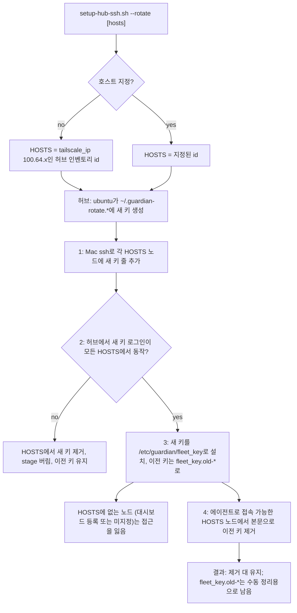
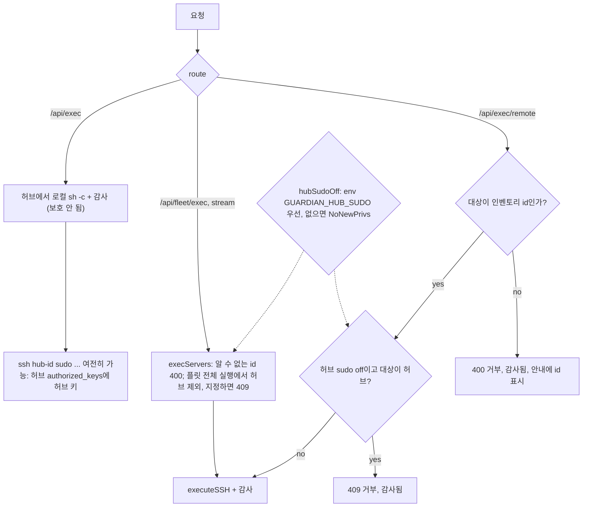
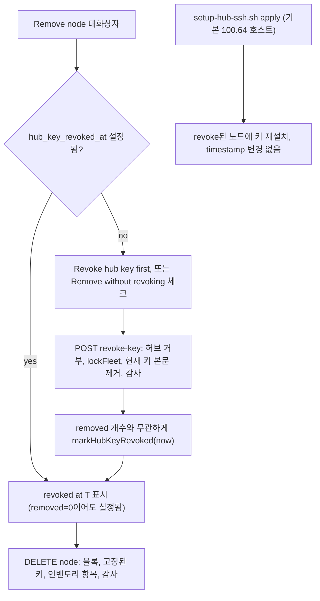

# Phase 5 - 서버 / 플릿 관리 재검토 (ops 분석가)

[English](phase5-ops.md) | 한국어

> 2026-10-12 시점의 기록이며, 이후 코드가 바뀌었다.

범위: `66cf41e..7783afa`. working tree는 `b82310c`이며, 그 위에 문서만 바꾼 commit 하나가 더 있다. 호스트에 접속하지 않은 읽기 전용 검토였고, 모든 file:line은 working tree 기준이다.
이전 보고서: `../phase1/ops.md`, `../phase3/ops.md`, `../phase4/ops.md`.

## 요약 표

약어: R = RESOLVED, P = PARTIAL, O = OPEN.

| id | sev | p3 | p4 | p5 | phase 4 이후 변경 |
|---|---|---|---|---|---|
| OPS-1 | High | R | R | **RESOLVED** | 변경 없음. |
| OPS-2 | High | R | R | **RESOLVED** | `GUARDIAN_HUB_SUDO`가 이제 소유 키이다. |
| OPS-3 | High | O | R | **RESOLVED** | 변경 없음. |
| OPS-4 | Med | P | R | **RESOLVED** | 변경 없음. |
| OPS-5 | High | O | R | **RESOLVED** | 변경 없음. |
| OPS-6 | High | O | P | **RESOLVED** | Remove 대화상자가 이제 먼저 키를 revoke하라고 요구한다. 남은 문제는 OPS-P5-3에 있다. |
| OPS-7 | Med | O | P | **PARTIAL** | UI 안내 `setup-hub-ssh.sh <id>`는 변경 없다. |
| OPS-8 | Med | P | P | **PARTIAL** | 변경 없음. |
| OPS-9 | Med | O | O | **PARTIAL** | 허브 sudo가 off일 때 플릿 route에 이제 허브 guard가 있다. `/api/exec`를 통한 우회는 남아 있다(OPS-P5-2). |
| OPS-10 | Med | O | P | **PARTIAL** | 감사 log의 커버리지와 행위자 필드가 나아졌다. exec route에는 여전히 gate가 없다. |
| OPS-11 | Med | P | R | **RESOLVED** | 변경 없음. |
| OPS-12 | Med | O | O | **RESOLVED** | `/api/exec/remote`는 이제 id만 받는다. |
| OPS-13 | Med | P | P | **PARTIAL** | 변경 없음: `free -m` probe, macOS 노드. |
| OPS-14 | Med | P | P | **PARTIAL** | 변경 없음. |
| OPS-15 | Med | O | P | **PARTIAL** | 여전히 자동 실패 알림이 없다. |
| OPS-16 | Low | R | R | **RESOLVED** | 변경 없음. |
| OPS-17 | Low | R | R | **RESOLVED** | 변경 없음. |
| OPS-18 | Low | O | O | **RESOLVED** | `import-credentials.sh`가 이제 snapshot 점검을 실행하고 Include 파일을 쓴다. |
| OPS-19 | Low | R | R | **RESOLVED** | 새 drift는 OPS-P5-2에 기록했다(`README.md:157`). |
| OPS-20 | Low | R | R | **RESOLVED** | 변경 없음. |
| OPS-21 | Low | R | R | **RESOLVED** | 변경 없음. |
| OPS-22 | Low | R | R | **RESOLVED** | 변경 없음. |
| OPS-23 | Low | O | O | **RESOLVED** | LLM env와 CLI 스크립트의 기본 대상이 이제 허브뿐이다. |
| OPS-24 | Low | O | O | **RESOLVED** | `--rotate`가 추가되었다. 그 결함은 OPS-P5-1과 OPS-P5-4에 있다. |
| OPS-N1 | Low | O | O | **OPEN** | `hostKeyOverride`는 변경 없다. |
| OPS-N2 | Med | O | R | **RESOLVED** | 변경 없음. |
| OPS-N3 | Low | O | O | **OPEN** | merge regex는 변경 없다. |
| OPS-N4 | Low | O | R | **RESOLVED** | 변경 없음. |
| OPS-P4-1 | Med | - | O | **RESOLVED** | Remove가 "Revoke hub key first"를 제공하고, 이를 건너뛰려면 명시적으로 체크해야 한다. |
| OPS-P4-2 | Low | - | O | **RESOLVED** | 두 경로가 이제 키 본문으로 매칭하고, 허브 자기 revoke는 거부되며, revoke는 감사된다. |
| OPS-P4-3 | Med | - | O | **PARTIAL** | rotation, 커버리지, 행위자 종류, 문서화된 "not tamper-proof" 상태가 추가되었다. log는 여전히 그것이 감사하는 프로세스가 쓸 수 있다. |
| OPS-P4-4 | Med | - | O | **RESOLVED** | 복원 문서가 고쳐졌다: 설치 순서, 감사 제외, `touch ~/.ssh/config`, TOFU 메모, `--revoke` 문구. |

**집계(발견 사항 32개): RESOLVED 22, PARTIAL 8, OPEN 2, REGRESSED 0.**

이번 라운드의 새 발견 사항:

| id | sev | 한 줄 요약 |
|---|---|---|
| OPS-P5-1 | **High** | `--rotate`는 플릿 전체에 대해 허브 키를 바꾸지만 새 키를 선택된 호스트(기본값: 100.64 호스트만)에만 추가하고 검증한다. 대시보드로 등록한 노드와 명시적 목록에서 빠진 호스트는 접근을 잃는다. |
| OPS-P5-2 | **Medium** | 허브 guard는 에이전트의 플릿 route만 다룬다. 허브는 여전히 자신의 `authorized_keys`에 플릿 키를 갖고 있으므로, `/api/exec`나 에이전트 tree의 어떤 프로세스든 `ssh <hub> sudo …`를 할 수 있다. env 값 `on`이 NoNewPrivs 관측을 덮어쓴다. README는 여전히 이전 상태를 설명한다. |
| OPS-P5-3 | **Medium** | `hub_key_revoked_at`은 아무것도 제거되지 않았을 때도 설정되고 결코 지워지지 않는다. `setup-hub-ssh.sh` apply는 revoke된 노드에 키를 다시 설치하므로, 키가 있는데도 대시보드가 "revoked"를 보여 줄 수 있다. |
| OPS-P5-4 | **Medium** | `--rotate`는 새 private key를 `ubuntu`로 `~/.guardian-rotate.*`에 두는데, 에이전트 tree가 이를 읽을 수 있다. 이전 private key는 `/etc/guardian/fleet_key.old-*`에 영원히 남는다. 둘 다 플릿 키 보호 설계와 모순된다. |
| OPS-P5-5 | Low | id 전용 exec 대상이 되면서, 이름이나 hostname을 쓰는 판정자의 `server_remediation` 제안이 검토를 통과하고 승인 후에야 실패한다. |
| OPS-P5-6 | Low | 감사 행위자 `token@127.0.0.1`이 허브 CLI, 판정자 조치, API client를 하나로 뭉친다. 정리 사항: 빈 `cli/llm-agent/orkspace_ops.py`가 추적된다. |

---

## 1. 상태 근거 (phase 4 이후 변경분만)

- **OPS-6 / OPS-P4-1 RESOLVED (a0f92ef, cecabc5).**
  - 키가 아직 revoke되지 않은 허브 아닌 노드에 대해 Remove 대화상자는 "Revoke hub key first"를 보여 주고, 제거가 동작하려면 "Remove without revoking the hub key"를 체크해야 한다(`apps/web-desktop/src/pages/nodes/RemoveNodeDialog.tsx:16`, `:31-33`, `:55-73`).
  - revoke가 성공하면 `hub_key_revoked_at`을 기록한다(`apps/agent/revoke_key.go:90-113`, `:202-208`; 필드는 `apps/agent/servers_handler.go:178-180`).
  - `DELETE` 자체는 여전히 revoke 여부를 점검하지 않지만, 이제 UI가 이를 막으므로 수용 가능하다.
  - 주의 사항은 OPS-P5-3에 있다.
- **OPS-P4-2 RESOLVED (cddfb2b, cecabc5).**
  - `setup-hub-ssh.sh --revoke`는 정확한 키 본문이나 fingerprint로 줄을 제거하며, 이전 키에는 `--key`를 쓴다(header, `REMOTE_AUTH` `remove|count`). 대시보드는 `grep -F`로 `type body`를 매칭한다(`revoke_key.go:27-40`).
  - 허브 자기 revoke는 미리보기와 POST에서 거부된다(`revoke_key.go:83-86`, `:124-128`, POST의 `findNode` 이후).
  - revoke는 감사된다(`handleRevokeKey`의 `beginAudit`).
  - 남은 부분: 대시보드는 현재 키만 revoke할 수 있다(OPS-P5-3).
- **OPS-9 PARTIAL (cecabc5, 6ab1ec6).**
  - 허브 sudo가 off이면 `execServers`는 명시적 허브 대상을 409로 거부하고 플릿 전체 실행에서 허브를 뺀다. 이는 `/api/fleet/exec`, stream, `/api/exec/remote`에 적용된다(`apps/agent/hub_guard.go:56-86`; `apps/agent/main.go` exec/remote 허브 점검; `servers_handler.go` stream).
  - 다루지 않는 부분: OPS-P5-2 참고.
- **OPS-10 PARTIAL.** 거부된 요청과 노드 쓰기가 이제 감사된다(`main.go` `recordRejected` 호출; `nodes_handler.go` `beginAudit`). `GUARDIAN_UI_ACTIONS=off`는 여전히 exec route를 막지 않는다.
- **OPS-12 RESOLVED (cecabc5).** `resolveTargetHost`는 id만 받고, 이름이나 hostname을 받으면 id를 안내한다(`servers_handler.go:34-59`). 플릿 route는 id나 이름을 매칭한다(`servers_handler.go:607`). 인벤토리 이름은 id와 같으므로 남은 차이는 표면적이다. 설계 문서는 이제 id 전용 대상을 설명한다(18476d9).
- **OPS-15 PARTIAL.** `OnFailure` unit이 없고(`deploy/` 아래 일치 없음), `docs/operations/backup-restore.md:162`는 여전히 자동 알림이 없다고 한다.
- **OPS-18 RESOLVED (24897f8).** `import-credentials.sh`는 `~/.ssh/guardian_admin.conf`를 쓰고, Include 줄을 한 번 추가하며, 변경 시 백업하고, `inventory_install_snapshot`을 통해 인벤토리 snapshot을 설치한다. 이 함수는 `pull-inventory.sh`와 같은 검증, diff, dirty tree 거부, 확인을 제공한다(`scripts/import-credentials.sh` 3/4단계; `scripts/lib/inventory.sh`, `inventory_install_snapshot`).
- **OPS-23 RESOLVED (b7cea9c).** 기본 대상은 허브뿐이다(`scripts/deploy-llm-env.sh:55-58`; `scripts/install-llm-clis.sh:40-43`).
- **OPS-24 RESOLVED (cddfb2b).** `setup-hub-ssh.sh --rotate [--dry-run]`이 있다(`scripts/setup-hub-ssh.sh:439-510`). 그 결함은 별도 발견 사항이다: OPS-P5-1과 OPS-P5-4.
- **OPS-P4-3 PARTIAL.**
  - 크기 rotation: 10 MiB, `.1`..`.5` 유지(`apps/agent/audit.go:19-23`, rotate 함수, `appendAudit` 크기 점검).
  - reader가 rotate된 파일들에 걸쳐 읽는다.
  - 행위자는 `session@` 또는 `token@`이다(`auditActor`).
  - log는 tamper-proof가 아닌 운영 log로 문서화되었다(`audit.go` header 주석).
  - 복원 절차는 더 이상 이를 덮어쓰지 않는다(`backup-restore.md`, 3단계).
  - 여전히 에이전트 tree의 모든 프로세스가 쓸 수 있다. 로컬 `server_remediation` 실행(`mcp_client.py:320-327`, 프로세스 내 `bash -c`)은 감사되지 않는다.
- **OPS-P4-4 RESOLVED (cddfb2b).** phase 4의 (a)~(e)가 모두 `docs/operations/backup-restore.md`에서 고쳐졌다: 키 단계 문구, 예상되는 exit 1을 포함한 install -> restore -> setup-hub-ssh -> reinstall 순서, replica 출처, `touch ~/.ssh/config`, TOFU 메모.
- **변경 없음:**
  - OPS-7: `NodeForms.tsx:473`.
  - OPS-8과 OPS-N1: `servers_handler.go` `hostKeyOverride`.
  - OPS-13: `servers_handler.go:351`.
  - OPS-14.
  - OPS-N3: `scripts/install-agent-service.sh:205-206` regex.

---

## 2. 새 모순 (OPS-P5-n)

### OPS-P5-1 (High) - `--rotate`는 모두의 키를 바꾸지만 선택된 호스트만 점검한다
- **근거:**
  - 명시적 호스트가 없으면 `HOSTS`는 `tailscale_ip`가 `100.64.`로 시작하는 모든 인벤토리 항목이다(`scripts/setup-hub-ssh.sh:87-90`).
  - 대시보드 등록은 `tailscale_ip`를 저장하지 않는다. 설정 가능한 metadata 키가 아니고(`apps/agent/nodes_validate.go:115`), 새 항목은 id, name, metadata, arch만 갖는다(`docs/design/node-registration.md` "New entries have id, name, the metadata and arch").
  - rotate 단계는 `HOSTS`에 대해서만 새 키를 추가하고, 검증하고, 이전 키를 제거한다(`setup-hub-ssh.sh:466-510`). 그 다음 3단계가 허브 전체의 `/etc/guardian/fleet_key`를 교체한다(`:488-497`).
  - 따라서 대시보드로 등록한 모든 노드는 이전 키만 유지하고, 3단계가 성공하는 순간 허브 접근을 잃는다. 이들을 다루는 점검, rollback, 메시지가 없고, `--dry-run`은 `HOSTS`만 나열한다.
  - 명시적 호스트를 주면 이름이 지정되지 않은 모든 호스트에 같은 일이 일어난다. header는 "Prefer running it for the whole fleet"라고만 한다.
  - 추가와 제거 단계도 Mac 자신의 ssh(`auth_run` -> `ssh_to`)로 노드에 접속하는데, 대시보드 노드는 보통 이로 접속할 수 없다.
- **영향:** 일상적인 키 교체가 플릿 일부에서 허브를 조용히 끊는다. 복구에는 영향받은 각 노드에 대한 대역 외 접근이 필요하다.
- **수정:**
  - SAFE-FIX: 명시적 호스트가 있는 `--rotate`를 거부하거나 `--all`을 요구한다. 대상 집합을 100.64 필터가 아니라 플릿 블록이 있는(또는 `hub_key_revoked_at`이 없는) 모든 허브 인벤토리 id로 계산한다. `--dry-run`이 집합 밖의 인벤토리 id를 나열하게 하고, 그런 id가 남아 있는 동안 실제 실행을 중단한다.
  - DESIGN: 노드별 추가, 검증, 제거를 허브에서 현재 플릿 키로 수행하여(`revoke-key`처럼), Mac alias 없이 대시보드 노드도 다루게 한다.

### OPS-P5-2 (Medium) - 허브 guard가 막으려는 우회 경로보다 좁다
- **근거:**
  - guard는 에이전트의 명령 route 안에서만 적용된다(`hub_guard.go:56-86`).
  - 허브 자신의 `authorized_keys`는 여전히 플릿 키를 갖고 있다: 허브는 기본 `setup-hub-ssh.sh` 목록의 100.64 호스트이며(`:87-90`), 에이전트 tree는 ssh-agent socket을 통해 키를 쓸 수 있다(`deploy/systemd/guardian-fleet-agent.service`).
  - 따라서 허브 sudo가 off여도 다음 중 어느 것이든 sandbox 밖에서 허브의 일반 sudo를 얻는다: `POST /api/exec {"command":"ssh site-a-arm1 sudo id"}`(로컬 `sh -c`, `metrics.go:444-455`, 보호되지 않음), 로컬 `server_remediation` 실행, 또는 LLM CLI.
  - `README.md:157`은 여전히 guard를 언급하지 않고 우회 경로를 설명한다. `docs/design/node-registration.md:405-410`은 guard가 이를 막은 것처럼 설명한다.
  - `hubSudoOff()`는 `GUARDIAN_HUB_SUDO`가 관측된 `NoNewPrivs`를 덮어쓰게 한다(`hub_guard.go:28-41`). installer는 항상 그 키를 쓰고(`install-agent-service.sh:205`, `:349-354`), drop-in도 `on`을 설정한다(`deploy/systemd/server-guardian-agent.service.d/hub-sudo.conf`). 따라서 drop-in을 손으로 제거하면 sandbox가 실제로 켜져 있는데도 `agent.env`는 `on`으로 남고, guard가 스스로 꺼진다.
- **수정:**
  - DESIGN: 허브 sudo가 off이면 허브 자신에 플릿 키를 허가하지 않는다(`setup-hub-ssh.sh` apply와 rotate에서 허브를 건너뛰고, 허브에서 revoke한다). 모든 경로를 막는 유일한 변경이다.
  - SAFE-FIX: 둘 중 하나의 신호라도 off라고 하면(`NoNewPrivs: 1` 또는 env `off`) 허브를 보호 대상으로 취급하고, `README.md:157`을 갱신한다.

### OPS-P5-3 (Medium) - `hub_key_revoked_at`이 일어나지 않았거나 더 이상 유효하지 않은 revoke를 주장할 수 있다
- **근거:**
  - `markHubKeyRevoked`는 `removed == 0`을 포함한 모든 성공한 revoke에서 실행되는데, 응답은 "nothing was changed"라고 한다(`revoke_key.go:202-214`).
  - 대시보드 revoke는 현재 키만 매칭한다(`hubKeyMatch`). 부분적인 `--rotate` 이후 이전 키를 유지한 호스트는 `removed=0`을 보고하고 revoked로 표시된다.
  - 이 필드는 UI만 읽는다(`NodeDetailPage.tsx:101`, `RemoveNodeDialog.tsx:32`). `setup-hub-ssh.sh` apply와 rotate는 이를 무시하며, 그 기본 목록에는 인벤토리에 아직 있는 revoke된 노드가 포함된다(`:87-90`). 이들은 timestamp를 지우지 않고 키를 다시 설치한다.
  - `setup-hub-ssh.sh --revoke`는 timestamp를 설정하지 않는다.
- **영향:** Remove 대화상자는 "The hub key was revoked … at …"을 보여 주고(`RemoveNodeDialog.tsx`, `revokedAt` 분기) 키를 갖고 있을 수 있는 노드에 대해 revoke-first gate를 건너뛴다.
- **수정:** SAFE-FIX. `removed > 0`일 때만 필드를 설정하거나, `removed=0`을 구분해 기록한다. 키가 추가될 때마다 이를 지운다: `setup-hub-ssh.sh`가 `--force` 없이는 필드가 설정된 id를 건너뛰게 하거나, `apply`/`add` 이후 허브에서 이를 지운다. 대시보드 revoke가 이전 키도 받게 한다(`--key`에 해당).

### OPS-P5-4 (Medium) - `--rotate`가 "ubuntu can never read the fleet key" 불변식을 깬다
- **근거:**
  - 새 private key는 `ubuntu`가 `~/.guardian-rotate.XXXXXX/key`에 mode 0700으로 생성하고(`setup-hub-ssh.sh:456`), 1-3단계 동안 그곳에 유지된다.
  - 에이전트 unit은 `/etc/guardian`과 특정 `~/.ssh` 경로만 숨긴다(`deploy/systemd/server-guardian-agent.service:38`). staging dir은 LLM CLI와 `/api/exec`를 포함한 에이전트 tree의 모든 프로세스가 읽을 수 있다.
  - `discard_stage`가 실패하면 키가 디스크에 남는다; 스크립트는 경고만 출력한다.
  - 이전 키는 `/etc/guardian/fleet_key.old-<time>`로 복사되고 결코 제거되지 않는다. 4단계가 실패한 모든 호스트에서는 여전히 허가되어 있다.
  - 이는 키가 root 전용이고 `ubuntu`에게는 결코 디스크에 없다고 하는 `deploy/hub/protect-fleet-key.sh:1-16`과 `guardian-fleet-agent.service:4-7`과 모순된다. `--no-hub-sudo`에서는 그 보장이 실제여야 한다.
- **수정:** SAFE-FIX.
  - `sudo -n ssh-keygen`으로 root가 직접 `/etc/guardian/fleet_key.new`에 키를 생성한다.
  - 새 키는 `sudo -n ssh -i /etc/guardian/fleet_key.new …`로, 또는 두 번째 임시 ssh-agent socket을 통해 테스트한다.
  - 4단계가 실패 0을 보고하면 `fleet_key.old-*`를 제거하고, 남은 것은 결과 줄에 나열한다.

### OPS-P5-5 (Low) - 판정자가 remediation을 제안할 때 id 전용 대상이 점검되지 않는다
- **근거:** `server_remediation`의 제안 시점 검증은 `command`가 비어 있지 않은지만 점검한다(`cli/llm-agent/mcp_client.py:208-210`). 실행은 `target_host`를 그대로 `/api/exec/remote`로 넘긴다(`:320-325`). 그 route는 이제 이름과 hostname을 400으로, 허브 sudo가 off일 때 허브를 409로 거부한다.
- **영향:** CLI 자신의 `--target`이 여전히 받아들이고 해석하는(`guardian.py` `resolve_cli_target`) hostname을 판정자가 쓰면, jev 검토와 사람의 승인을 통과한 뒤 실행 시점에 실패하는 제안이 나온다.
- **수정:** SAFE-FIX. `validate()`에서 `target_host`를 인벤토리와 대조해 해석한다: 이름이나 hostname은 id로 바꾸고, 허브 sudo가 off이면 허브를 거부한다. 도구 설명에도 "inventory id"라고 적는다.

### OPS-P5-6 (Low) - 감사 행위자의 세분성, 그리고 잘못 들어간 파일
- **근거:** `auditActor`는 `token@`과 `session@`에 IP를 더한 것만 구분한다(`audit.go`, `auditActor`). 허브 CLI, 판정자 `server_remediation`(Bearer token으로 `agent_client.py`를 통해), 그 밖의 모든 token client가 `token@127.0.0.1`로 기록된다.
- **정리 사항:** `cli/llm-agent/orkspace_ops.py`는 추적되는 빈 파일이다(0 bytes, 이 범위에서 추가됨; `workspace_ops.py`의 오타).
- **수정:** SAFE-FIX. `agent_client.py`가 감사에 기록되는 `X-Guardian-Client: cli|judge|…` header를 보내게 한다. 잘못 들어간 파일을 삭제한다.

---

## 3. 갱신된 다이어그램

### 키 교체 (신규)

### 허브 guard가 있는 명령 라우팅 (변경)

### 노드 제거와 키 revoke (변경)

