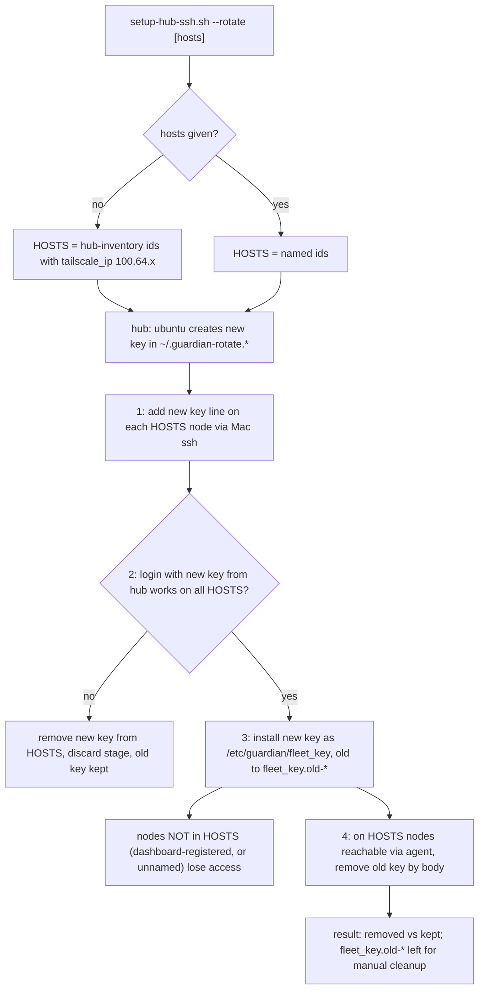
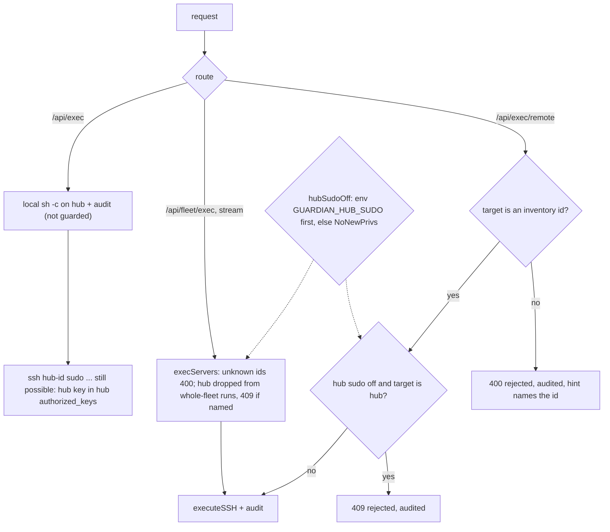
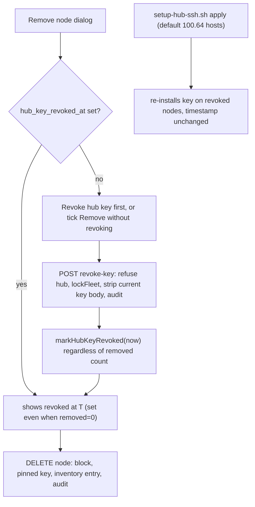

# Phase 5 - Server / fleet management re-review (ops analyst)

English | [한국어](phase5-ops.ko.md)

> Point-in-time record from 2026-10-12; the code has changed since.

Range: `66cf41e..7783afa`. The working tree is at `b82310c`, which adds one docs-only commit on top. The review was read-only with no host contact, and every file:line refers to the working tree.
Earlier reports: `../phase1/ops.md`, `../phase3/ops.md`, `../phase4/ops.md`.

## Summary table

Abbreviations: R = RESOLVED, P = PARTIAL, O = OPEN.

| id | sev | p3 | p4 | p5 | change since phase 4 |
|---|---|---|---|---|---|
| OPS-1 | High | R | R | **RESOLVED** | No change. |
| OPS-2 | High | R | R | **RESOLVED** | `GUARDIAN_HUB_SUDO` is now an owned key. |
| OPS-3 | High | O | R | **RESOLVED** | No change. |
| OPS-4 | Med | P | R | **RESOLVED** | No change. |
| OPS-5 | High | O | R | **RESOLVED** | No change. |
| OPS-6 | High | O | P | **RESOLVED** | The Remove dialog now asks for the key to be revoked first. Remaining issues are in OPS-P5-3. |
| OPS-7 | Med | O | P | **PARTIAL** | The UI hint `setup-hub-ssh.sh <id>` is unchanged. |
| OPS-8 | Med | P | P | **PARTIAL** | No change. |
| OPS-9 | Med | O | O | **PARTIAL** | The fleet routes now have a hub guard when hub sudo is off. The bypass through `/api/exec` remains (OPS-P5-2). |
| OPS-10 | Med | O | P | **PARTIAL** | The audit log has better coverage and actor field. There is still no gate on the exec routes. |
| OPS-11 | Med | P | R | **RESOLVED** | No change. |
| OPS-12 | Med | O | O | **RESOLVED** | `/api/exec/remote` now accepts only ids. |
| OPS-13 | Med | P | P | **PARTIAL** | No change: `free -m` probe, macOS node. |
| OPS-14 | Med | P | P | **PARTIAL** | No change. |
| OPS-15 | Med | O | P | **PARTIAL** | Still no automatic failure alert. |
| OPS-16 | Low | R | R | **RESOLVED** | No change. |
| OPS-17 | Low | R | R | **RESOLVED** | No change. |
| OPS-18 | Low | O | O | **RESOLVED** | `import-credentials.sh` now runs the snapshot checks and writes an Include file. |
| OPS-19 | Low | R | R | **RESOLVED** | New drift is listed under OPS-P5-2 (`README.md:157`). |
| OPS-20 | Low | R | R | **RESOLVED** | No change. |
| OPS-21 | Low | R | R | **RESOLVED** | No change. |
| OPS-22 | Low | R | R | **RESOLVED** | No change. |
| OPS-23 | Low | O | O | **RESOLVED** | The LLM env and CLI scripts now default to the hub only. |
| OPS-24 | Low | O | O | **RESOLVED** | `--rotate` added. Its defects are in OPS-P5-1 and OPS-P5-4. |
| OPS-N1 | Low | O | O | **OPEN** | `hostKeyOverride` is unchanged. |
| OPS-N2 | Med | O | R | **RESOLVED** | No change. |
| OPS-N3 | Low | O | O | **OPEN** | The merge regex is unchanged. |
| OPS-N4 | Low | O | R | **RESOLVED** | No change. |
| OPS-P4-1 | Med | - | O | **RESOLVED** | Remove offers "Revoke hub key first", and skipping it needs an explicit tick. |
| OPS-P4-2 | Low | - | O | **RESOLVED** | Both paths now match the key body, hub self-revoke is refused, and revoke is audited. |
| OPS-P4-3 | Med | - | O | **PARTIAL** | Rotation, coverage, actor kind and a documented "not tamper-proof" status were added. The log is still writable by the processes it audits. |
| OPS-P4-4 | Med | - | O | **RESOLVED** | The restore doc is fixed: install order, audit excluded, `touch ~/.ssh/config`, TOFU note, `--revoke` wording. |

**Counts (32 findings): RESOLVED 22, PARTIAL 8, OPEN 2, REGRESSED 0.**

New findings in this round:

| id | sev | one line |
|---|---|---|
| OPS-P5-1 | **High** | `--rotate` swaps the hub key for the whole fleet but adds and verifies the new key only on the selected hosts (default: 100.64 hosts only). Dashboard-registered nodes, and any host left out of an explicit list, lose access. |
| OPS-P5-2 | **Medium** | The hub guard covers only the agent's fleet routes. The hub still holds the fleet key in its own `authorized_keys`, so `/api/exec` or any agent-tree process can `ssh <hub> sudo …`. An env value of `on` overrides the NoNewPrivs observation. The README still describes the old state. |
| OPS-P5-3 | **Medium** | `hub_key_revoked_at` is set even when nothing was removed and is never cleared. `setup-hub-ssh.sh` apply re-installs the key on revoked nodes, so the dashboard can show "revoked" while the key is present. |
| OPS-P5-4 | **Medium** | `--rotate` stages the new private key as `ubuntu` in `~/.guardian-rotate.*`, readable by the agent tree. Old private keys stay in `/etc/guardian/fleet_key.old-*` forever. Both contradict the fleet-key protection design. |
| OPS-P5-5 | Low | With id-only exec targets, a judge's `server_remediation` proposal that uses a name or hostname passes review and fails only after approval. |
| OPS-P5-6 | Low | The audit actor `token@127.0.0.1` lumps together the hub CLI, judge actions and API clients. Hygiene: an empty `cli/llm-agent/orkspace_ops.py` is tracked. |

---

## 1. Status evidence (changes since phase 4 only)

- **OPS-6 / OPS-P4-1 RESOLVED (a0f92ef, cecabc5).**
  - For a non-hub node whose key is not yet revoked, the Remove dialog shows "Revoke hub key first" and requires ticking "Remove without revoking the hub key" before removal works (`apps/web-desktop/src/pages/nodes/RemoveNodeDialog.tsx:16`, `:31-33`, `:55-73`).
  - A successful revoke records `hub_key_revoked_at` (`apps/agent/revoke_key.go:90-113`, `:202-208`; field at `apps/agent/servers_handler.go:178-180`).
  - `DELETE` itself still does not check revocation, which is acceptable now that the UI gates it.
  - Caveats are in OPS-P5-3.
- **OPS-P4-2 RESOLVED (cddfb2b, cecabc5).**
  - `setup-hub-ssh.sh --revoke` removes lines by exact key body or fingerprint, with `--key` for an old key (header, `REMOTE_AUTH` `remove|count`). The dashboard matches `type body` with `grep -F` (`revoke_key.go:27-40`).
  - Hub self-revoke is refused in preview and POST (`revoke_key.go:83-86`, `:124-128`, and after `findNode` in POST).
  - Revoke is audited (`beginAudit` in `handleRevokeKey`).
  - Remaining: the dashboard can revoke only the current key (OPS-P5-3).
- **OPS-9 PARTIAL (cecabc5, 6ab1ec6).**
  - `execServers` refuses an explicit hub target with 409 and drops the hub from whole-fleet runs when hub sudo is off. This applies to `/api/fleet/exec`, the stream and `/api/exec/remote` (`apps/agent/hub_guard.go:56-86`; `apps/agent/main.go` exec/remote hub check; `servers_handler.go` stream).
  - Not covered: see OPS-P5-2.
- **OPS-10 PARTIAL.** Rejected requests and node writes are now audited (`main.go` `recordRejected` calls; `nodes_handler.go` `beginAudit`). `GUARDIAN_UI_ACTIONS=off` still does not block the exec routes.
- **OPS-12 RESOLVED (cecabc5).** `resolveTargetHost` accepts only the id and hints at the id when given a name or hostname (`servers_handler.go:34-59`). The fleet routes match id or name (`servers_handler.go:607`). Inventory names equal ids, so the remaining difference is cosmetic. The design doc now describes id-only targets (18476d9).
- **OPS-15 PARTIAL.** No `OnFailure` unit exists (no match under `deploy/`), and `docs/operations/backup-restore.md:162` still says there is no automatic alert.
- **OPS-18 RESOLVED (24897f8).** `import-credentials.sh` writes `~/.ssh/guardian_admin.conf`, adds the Include line once, backs up on change, and installs the inventory snapshot through `inventory_install_snapshot`. That function gives the same validation, diff, dirty-tree refusal and confirmation as `pull-inventory.sh` (`scripts/import-credentials.sh` step 3/4; `scripts/lib/inventory.sh`, `inventory_install_snapshot`).
- **OPS-23 RESOLVED (b7cea9c).** The default target is the hub only (`scripts/deploy-llm-env.sh:55-58`; `scripts/install-llm-clis.sh:40-43`).
- **OPS-24 RESOLVED (cddfb2b).** `setup-hub-ssh.sh --rotate [--dry-run]` exists (`scripts/setup-hub-ssh.sh:439-510`). Its defects are separate findings: OPS-P5-1 and OPS-P5-4.
- **OPS-P4-3 PARTIAL.**
  - Size rotation: 10 MiB, keeping `.1`..`.5` (`apps/agent/audit.go:19-23`, rotate function, `appendAudit` size check).
  - The reader spans the rotated files.
  - Actor is `session@` or `token@` (`auditActor`).
  - The log is documented as an operational log that is not tamper-proof (`audit.go` header comment).
  - The restore procedure no longer overwrites it (`backup-restore.md`, step 3).
  - Still writable by every agent-tree process. Local `server_remediation` runs (`mcp_client.py:320-327`, `bash -c` in process) are not audited.
- **OPS-P4-4 RESOLVED (cddfb2b).** All of (a) to (e) from phase 4 are fixed in `docs/operations/backup-restore.md`: the key-step wording, the install -> restore -> setup-hub-ssh -> reinstall order with the expected exit 1, the replica source, `touch ~/.ssh/config`, and the TOFU note.
- **Unchanged:**
  - OPS-7: `NodeForms.tsx:473`.
  - OPS-8 and OPS-N1: `servers_handler.go` `hostKeyOverride`.
  - OPS-13: `servers_handler.go:351`.
  - OPS-14.
  - OPS-N3: `scripts/install-agent-service.sh:205-206` regex.

---

## 2. New contradictions (OPS-P5-n)

### OPS-P5-1 (High) - `--rotate` changes the key for everyone but checks only the selected hosts
- **Evidence:**
  - Without explicit hosts, `HOSTS` is every inventory entry whose `tailscale_ip` starts with `100.64.` (`scripts/setup-hub-ssh.sh:87-90`).
  - Dashboard registration stores no `tailscale_ip`. It is not a settable metadata key (`apps/agent/nodes_validate.go:115`), and new entries have id, name, metadata and arch only (`docs/design/node-registration.md` "New entries have id, name, the metadata and arch").
  - The rotate steps add the new key, verify it and remove the old key only for `HOSTS` (`setup-hub-ssh.sh:466-510`). Step 3 then replaces `/etc/guardian/fleet_key` for the whole hub (`:488-497`).
  - Every dashboard-registered node therefore keeps only the old key and loses hub access the moment step 3 succeeds. No check, rollback or message covers them, and `--dry-run` lists only `HOSTS`.
  - With explicit hosts, the same happens to every host not named. The header only says "Prefer running it for the whole fleet".
  - The add and remove steps also reach nodes through the Mac's own ssh (`auth_run` -> `ssh_to`), which dashboard nodes usually cannot be reached by.
- **Impact:** a routine key rotation silently cuts the hub off from part of the fleet. Recovery needs out-of-band access to each affected node.
- **Fix:**
  - SAFE-FIX: refuse `--rotate` with explicit hosts, or require `--all`. Compute the target set as every hub-inventory id with a fleet block (or with no `hub_key_revoked_at`), not the 100.64 filter. Make `--dry-run` list inventory ids outside the set and abort the real run while any remain.
  - DESIGN: do the per-node add, verify and remove from the hub over the current fleet key (as `revoke-key` does), so dashboard nodes are covered without Mac aliases.

### OPS-P5-2 (Medium) - The hub guard is narrower than the bypass it is meant to close
- **Evidence:**
  - The guard is applied only inside the agent's command routes (`hub_guard.go:56-86`).
  - The hub's own `authorized_keys` still carries the fleet key: the hub is a 100.64 host in the default `setup-hub-ssh.sh` list (`:87-90`), and the agent tree can use the key through the ssh-agent socket (`deploy/systemd/guardian-fleet-agent.service`).
  - So, with hub sudo off, any of these gets ordinary sudo on the hub outside the sandbox: `POST /api/exec {"command":"ssh site-a-arm1 sudo id"}` (local `sh -c`, `metrics.go:444-455`, not guarded), a local `server_remediation` run, or an LLM CLI.
  - `README.md:157` still states the bypass without mentioning the guard. `docs/design/node-registration.md:405-410` describes the guard as if it closed it.
  - `hubSudoOff()` lets `GUARDIAN_HUB_SUDO` override the observed `NoNewPrivs` (`hub_guard.go:28-41`). The installer always writes that key (`install-agent-service.sh:205`, `:349-354`), and the drop-in also sets `on` (`deploy/systemd/server-guardian-agent.service.d/hub-sudo.conf`). A hand-removed drop-in therefore leaves `agent.env` at `on` while the sandbox is actually on, and the guard switches itself off.
- **Fix:**
  - DESIGN: when hub sudo is off, do not authorise the fleet key on the hub itself (skip the hub in `setup-hub-ssh.sh` apply and rotate, and revoke it there). That is the only change that closes every path.
  - SAFE-FIX: treat the hub as guarded when either signal says off (`NoNewPrivs: 1` or env `off`), and update `README.md:157`.

### OPS-P5-3 (Medium) - `hub_key_revoked_at` can claim a revocation that did not happen or no longer holds
- **Evidence:**
  - `markHubKeyRevoked` runs on every successful revoke, including `removed == 0`, while the response says "nothing was changed" (`revoke_key.go:202-214`).
  - The dashboard revoke matches only the current key (`hubKeyMatch`). After a partial `--rotate`, a host that kept the old key reports `removed=0` and is marked revoked.
  - Only the UI reads the field (`NodeDetailPage.tsx:101`, `RemoveNodeDialog.tsx:32`). `setup-hub-ssh.sh` apply and rotate ignore it, and their default list includes revoked nodes still in the inventory (`:87-90`). They re-install the key without clearing the timestamp.
  - `setup-hub-ssh.sh --revoke` never sets the timestamp.
- **Impact:** the Remove dialog shows "The hub key was revoked … at …" (`RemoveNodeDialog.tsx`, `revokedAt` branch) and skips the revoke-first gate for a node that may hold the key.
- **Fix:** SAFE-FIX. Set the field only when `removed > 0`, or record `removed=0` distinctly. Clear it whenever a key is added: have `setup-hub-ssh.sh` skip ids with the field set unless `--force`, or clear it on the hub after an `apply`/`add`. Let the dashboard revoke also take an old key (`--key`-equivalent).

### OPS-P5-4 (Medium) - `--rotate` breaks the "ubuntu can never read the fleet key" invariant
- **Evidence:**
  - The new private key is generated by `ubuntu` in `~/.guardian-rotate.XXXXXX/key`, mode 0700 (`setup-hub-ssh.sh:456`), and kept there through steps 1-3.
  - The agent unit hides `/etc/guardian` and specific `~/.ssh` paths only (`deploy/systemd/server-guardian-agent.service:38`). The staging dir is readable by every agent-tree process, including LLM CLIs and `/api/exec`.
  - If `discard_stage` fails, the key stays on disk; the script only prints a warning.
  - The old key is copied to `/etc/guardian/fleet_key.old-<time>` and never removed. It is still authorised on any host where step 4 failed.
  - This contradicts `deploy/hub/protect-fleet-key.sh:1-16` and `guardian-fleet-agent.service:4-7`, which say the key is root-only and never on disk for `ubuntu`. With `--no-hub-sudo` that guarantee is meant to be real.
- **Fix:** SAFE-FIX.
  - Generate the key as root directly into `/etc/guardian/fleet_key.new` with `sudo -n ssh-keygen`.
  - Test the new key with `sudo -n ssh -i /etc/guardian/fleet_key.new …`, or through a second temporary ssh-agent socket.
  - Remove `fleet_key.old-*` once step 4 reports zero failures, and list any that remain in the result line.

### OPS-P5-5 (Low) - id-only targets are not checked when a judge proposes a remediation
- **Evidence:** proposal-time validation of `server_remediation` checks only that `command` is non-empty (`cli/llm-agent/mcp_client.py:208-210`). Execution forwards `target_host` unchanged to `/api/exec/remote` (`:320-325`). That route now rejects names and hostnames with 400, and the hub with 409 when hub sudo is off.
- **Impact:** a judge that uses a hostname, which the CLI's own `--target` still accepts and resolves (`guardian.py` `resolve_cli_target`), gets a proposal that passes jev review and human approval and then fails at run time.
- **Fix:** SAFE-FIX. In `validate()`, resolve `target_host` against the inventory: rewrite a name or hostname to its id, and refuse the hub when hub sudo is off. Also say "inventory id" in the tool description.

### OPS-P5-6 (Low) - Audit actor granularity, and a stray file
- **Evidence:** `auditActor` distinguishes only `token@` from `session@` plus the IP (`audit.go`, `auditActor`). The hub CLI, judge `server_remediation` (through `agent_client.py` with the Bearer token) and any other token client all log as `token@127.0.0.1`.
- **Hygiene:** `cli/llm-agent/orkspace_ops.py` is an empty tracked file (0 bytes, added in this range; a typo of `workspace_ops.py`).
- **Fix:** SAFE-FIX. Have `agent_client.py` send an `X-Guardian-Client: cli|judge|…` header that the audit records. Delete the stray file.

---

## 3. Updated diagrams

### Key rotation (new)

### Command routing with the hub guard (changed)

### Removing a node and revoking its key (changed)

