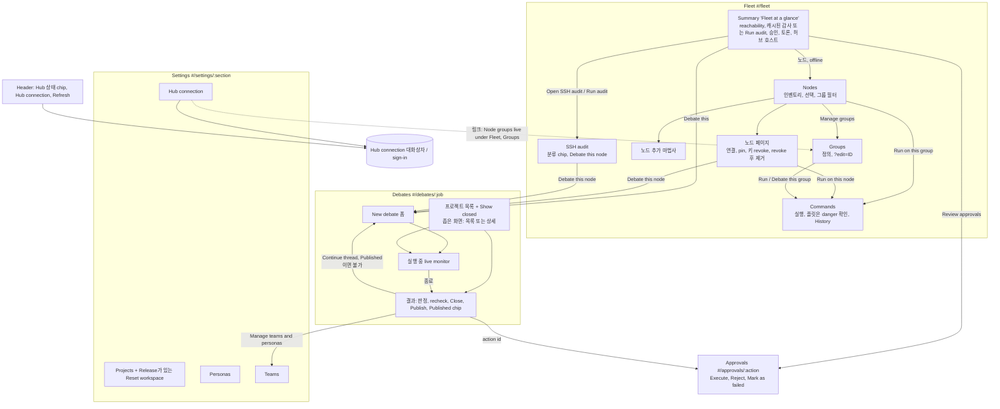

# UI 재검토, phase 5 (7783afa의 apps/web-desktop, 읽기 전용)

[English](phase5-ui.md) | 한국어

> 2026-10-12 시점의 기록이며, 이후 코드가 바뀌었다.

방법: 현재 소스와 `git diff 66cf41e..HEAD -- apps/web-desktop/src`(UI commit 8개)를 읽었다. `HEAD`는 b82310c이다; 7783afa 이후 문서만 추가하므로 대시보드는 동일하다. vitest를 포함해 아무것도 실행하지 않았다. 경로는 접두사가 없으면 `apps/web-desktop/src/` 기준 상대 경로이다.

## 요약 표

| Id | Sev | Phase 4 | Now | 근거와 판단 |
|---|---|---|---|---|
| UI-1 | High | RESOLVED | RESOLVED | 변경 없음; 이제 "Published" chip도 있다(`pages/debate/ResultView.tsx:426`, `JobResult.tsx:72`). |
| UI-2 | High | RESOLVED | RESOLVED | 변경 없음(`state/operationsStore.tsx`). |
| UI-3 | High | PARTIAL | PARTIAL | 플릿 전체 Run 확인이 이제 danger이다(`pages/RunPage.tsx:226`); 단일 노드는 여전히 확인 없이 실행된다. |
| UI-4 | Med | PARTIAL | PARTIAL | 플릿 실행은 danger, Close / Publish는 primary; 저위험 Execute는 여전히 빨간색이고(`pages/debate/ActionDialog.tsx:359`), Sync/Clone은 여전히 확인이 없다. |
| UI-5 | Med | PARTIAL | PARTIAL | 변경 없음: 배지와 Overview는 선택된 프로젝트만 대상이다. |
| UI-6 | Med | RESOLVED | RESOLVED | store의 하나의 목록, Debates가 열려 있는 동안에만 polling(`pages/DebatesPage.tsx:120-123`). |
| UI-7 | Med | RESOLVED | RESOLVED | 변경 없음. |
| UI-8 | Med | RESOLVED | RESOLVED | 변경 없음(탭 4개); Fleet에는 이제 내부 탭이 5개 있다, UI-P5-3 참고. |
| UI-9 | Med | PARTIAL | PARTIAL | 그룹 정의는 Fleet Groups 한 곳에 있다(`pages/FleetPage.tsx:20-43`); 멤버십은 여전히 Nodes, 노드 페이지, Groups에서 수정된다; 호스트 키는 여전히 진입점이 셋이다. |
| UI-10 | Med | PARTIAL | PARTIAL | 변경 없음: 허브 호스트가 Summary와 Nodes에 있고, 선택은 그룹 조치만 제공한다. |
| UI-11 | Med | OPEN | PARTIAL | 제목이 "Fleet at a glance"이고 Summary는 더 이상 SSH 감사를 시작하지 않는다(`pages/OverviewPage.tsx:296-298,321`, `lib/auditCache.ts`); 노드 페이지와 그룹 요약은 여전히 열 때 감사하고, 카드는 심각도순으로 정렬되지 않는다. |
| UI-12 | Med | RESOLVED | RESOLVED | 변경 없음. |
| UI-13 | Low-Med | RESOLVED | RESOLVED | 변경 없음. |
| UI-14 | Low | PARTIAL | PARTIAL | 쓰이지 않는 디자인 시스템 부품이 남아 있다. |
| UI-15 | Low | PARTIAL | PARTIAL | 목록 행은 여전히 작업 chip만 보여 준다(새로움: Published chip은 상세에만). |
| UI-16 | Low | RESOLVED | RESOLVED | 변경 없음. |
| UI-N1 | Med | RESOLVED | RESOLVED | 변경 없음. |
| UI-N2 | Med | PARTIAL | RESOLVED | SSH audit 행이 분류 chip을 보여 주고 caption이 실패를 분류별로 나눈다(`pages/ssh/FleetSshAudit.tsx:89,127-140`). |
| UI-N3 | Low | OPEN | OPEN | 팀 기본값이 참조 코드를 보내는데도 Advanced는 여전히 닫힌 채로 시작한다(`pages/debate/StartForm.tsx:79-84`). |
| UI-N4 | Low | OPEN | OPEN | 플릿 danger 대 그룹 primary(`RunPage.tsx:226`), Remove-from-group danger, 저위험 Execute danger: 여전히 규칙이 없다. |
| UI-N5 | Low | PARTIAL | PARTIAL | `Agent checking…`이 남아 있다(`App.tsx:189`). |
| UI-N6 | Low | OPEN | OPEN | 중복 키 경고, 손으로 옮긴 폼 규칙, 필터 전환은 변경 없다. |
| UI-P4-1 | Med | new | RESOLVED | 좁은 화면은 "Back to list"와 함께 목록 또는 상세를 보여 준다(`DebatesPage.tsx:137-150,190,208`); 단, UI-P5-1 참고. |
| UI-P4-2 | Med | new | RESOLVED | Fleet "Groups" 탭, `#/settings/groups`는 redirect, Settings는 링크를 유지한다(`router.ts:26-32,89`, `FleetPage.tsx:43`, `pages/SettingsPage.tsx`). |
| UI-P4-3 | Low | new | OPEN | transcript는 여전히 결과 뒤에 인라인으로 렌더링된다(`ResultView.tsx:490`). |
| UI-P4-4 | Low | new | RESOLVED | "3 · Running"이 둘 다 유지한다(`App.tsx:103-107,134`). |
| UI-P4-5 | Low | new | RESOLVED | Debates는 store의 `recent`를 읽고, 열려 있는 동안에만 자체 5 s poll을 더한다(`DebatesPage.tsx:120-123`). |
| UI-P4-6 | Low | new | PARTIAL | 플릿 전체는 danger; 그룹(여러 호스트)은 여전히 primary이다(`RunPage.tsx:226`). |
| UI-P4-7 | Low | new | RESOLVED | Summary는 최근 5분 이내의 감사를 보여 주거나 "Run audit" 버튼을 보여 준다(`OverviewPage.tsx:150-151,296-298`). |
| UI-P4-8 | Low | new | RESOLVED | UI-N2 참고. |

집계: RESOLVED 16, PARTIAL 10, OPEN 4, REGRESSED 0 (30개 항목).
새 발견 사항: UI-P5-1 (Medium), UI-P5-2 ~ UI-P5-5 (Low).

## 바뀐 점 (확인됨)

- **publish된 스레드.** 목록 overlay `thread_published`(`apps/agent/debate_handler.go:154-156`)가 "Published" chip을 보여 주고 "Continue this thread"를 "Published; start a new thread for follow-up work"로 바꾼다(`ResultView.tsx:411-426`, `JobResult.tsx:72`); 상세는 목록 행에서 플래그를 합친다(`DebatesPage.tsx:81`).
- **노드 제거.** 먼저 revoke: "Revoke hub key first" 버튼, 또는 "Remove without revoking the hub key" 체크; 둘 중 하나가 될 때까지 id 입력 확인은 비활성 상태로 남는다(`pages/nodes/RemoveNodeDialog.tsx:31-33,59-70,94`); 노드 페이지는 "Hub key: revoked <time>"을 보여 준다(`NodeDetailPage.tsx:101`).
- **워크스페이스 reset.** 유지 파일이 스레드별로 묶이며, 각각 실행된 변경을 버리고 publish를 막는 "Release <thread>" 체크가 있다(`pages/debate/WorkspaceResetDialog.tsx:25-35,44-51,122`; `api.ts` `resetWorkspace(id, release)`).
- **내비게이션.** Fleet 탭: Summary, Nodes, SSH audit, Commands, Groups(`router.ts:26-32`); 그룹 링크와 `?edit=`는 `#/fleet/groups`로 간다(`GroupSummary.tsx`, `NodeGroupsSection.tsx`); Settings에는 Hub connection, Projects, Personas, Teams와 "Node groups live under Fleet, Groups" 줄이 있다.
- **History.** 거부된 요청은 warn chip과 상세 문구를 받는다(`pages/run/CommandHistory.tsx`, `lib/audit.ts`); `git_commit_push`는 더 이상 워크스페이스를 바꾸는 도구가 아니며(`lib/debate.ts:329`), `cli/llm-agent/mcp_client.py:97`의 폐기된 도구와 일치한다.

## 새 발견 사항

### UI-P5-1 (Medium) "Continue this thread"가 좁은 화면에서 눈에 보이는 일을 하지 않는다
근거: 좁은 화면에서 토론을 선택하면 접힌 New debate 폼을 포함한 상단 블록 전체가 숨겨진다(`DebatesPage.tsx:154`, `hidden={!showList}`). "Continue this thread"는 `continueRequest`만 설정한다; 폼 effect가 스레드를 설정하고, Advanced를 열고, 페이지의 폼을 펼치지만(`pages/debate/StartForm.tsx:71-77`) 화면 이동은 하지 않는다(`navigate`는 Start 이후에만 쓰인다, `StartForm.tsx:121`). 따라서 폼은 숨겨진 container 안에서 채워진다. "Reopen with a new debate"도 마찬가지이다. 운영자는 "Back to list"를 누를 때까지 아무 변화도 보지 못한다.
문제인 이유: 주요 후속 조치 중 하나가 모바일에서 조용히 실패한다.
수정: SAFE-FIX. `setContinueRequest` 이후 좁은 화면에서는 `#/debates`로 이동하거나(그러면 스레드가 채워진 폼이 보인다), 폼을 `showList` wrapper 밖에 렌더링하고 그곳으로 스크롤한다.

### UI-P5-2 (Low) URL로 연 토론에서 Published 플래그가 빠질 수 있다
근거: `thread_published`는 목록 항목에만 overlay된다(`debate_handler.go:154-156`; `types.ts`의 "List responses" 메모). 상세는 이를 `listJob`에서 가져오고(`DebatesPage.tsx:81`), 목록은 "Show closed"가 켜져 있지 않으면 선택된 프로젝트의 열린 스레드이다. 다른 프로젝트의 토론이나 닫힌 스레드로의 deep link에는 목록 행이 없으므로, chip이 빠지고 허브가 거부하는데도 "Continue this thread"가 제공된다.
수정: SAFE-FIX. 상세 endpoint가 플래그를 담게 하거나, Continue 버튼을 유지하되 허브의 거부를 명확히 보여 준다(시작 오류는 이미 허브 문구를 보여 준다).

### UI-P5-3 (Low) 좁은 화면의 Fleet 탭 다섯 개
근거: `FLEET_TABS`는 하나의 `SegmentedControl`에 다섯 항목을 갖는다(`router.ts:26-32`, `FleetPage.tsx`가 이를 한 행으로 렌더링한다). 360 px에서 측정하지 않았다; "SSH audit"와 "Commands" 같은 라벨은 길다.
수정: 한 번 손으로 점검한다; 넘치면 control이 가로로 스크롤되게 하거나 480 px 아래에서 select로 바꾼다.

### UI-P5-4 (Low) 노드 제거가 revoke 후 한 번 더 왕복해야 한다
근거: "Revoke hub key first"는 Remove 대화상자를 닫고 revoke 대화상자를 연다(`NodeDetailPage.tsx`, `onRevokeFirst`; `RemoveNodeDialog.tsx:62-68`). revoke가 성공한 뒤 운영자는 Remove node를 다시 누르고 id를 다시 입력해야 한다. "Remove without revoking" 체크는 버튼 옆에 있으므로, 안전한 경로(revoke)가 안전하지 않은 경로(체크)보다 한 탭 더 길다.
수정: SAFE-FIX. revoke가 성공하면 Remove 대화상자를 자동으로 다시 열거나, revoke를 Remove 대화상자 안에서 실행한다.

### UI-P5-5 (Low) Release가 일반 확인 안의 파괴적인 체크이다
근거: 각 스레드 그룹에는 실행된 변경을 버리고 스레드를 영구히 publish할 수 없게 만드는 빨간 "Release <thread>" checkbox가 있으며(`WorkspaceResetDialog.tsx:122`), 대화상자의 단일 danger 버튼으로 확인된다. 최종 버튼에 무엇이 release될지 다시 적혀 있지 않다.
수정: SAFE-FIX. 확인 라벨에 개수를 넣는다("Reset and release 2 threads").

### 점검했고 발견 사항 없음
- 배지: `badgeOf`가 개수와 Running을 함께 유지하며, 승인이 대기 중이면 tone은 crit이다(`App.tsx:103-107`).
- Summary: 캐시된 감사를 경과 시간과 함께 보여 준다; Refresh는 캐시를 다시 읽지만 감사를 시작하지 않으며, 이는 새 의도와 일치한다.
- 레거시 hash: `#/settings/groups?edit=ID`는 query를 유지한 채 Fleet Groups로 매핑된다(`router.ts:89`).

## 갱신된 지도

phase 4 이후 바뀐 절차 경로:
- P5 노드 그룹: Fleet, Groups 탭(생성, 수정, 삭제); Nodes에서의 선택으로도 여전히 만들 수 있다(`NodesPage.tsx`); Settings는 링크만 둔다.
- P3 노드 제거: 노드 페이지, Remove node, "Revoke hub key first"(revoke 대화상자), Remove 다시 열기, id 입력.
- P10 Publish: push 이후 스레드는 "Published"를 보여 주고 이어갈 수 없다(`ResultView.tsx:411`).
- P4 플릿 SSH 감사: Summary는 "Run audit"를 제공하거나 5분 캐시를 보여 준다; SSH audit 탭은 이전처럼 열 때 실행한다.

현재 내비게이션의 SVG: [ui-nav-current.svg](../../images/procedure-review/ui-nav-current.svg) (repo 사본에서 시작; xmllint로 검증; 레거시 hash 문구는 상자 안에 들어가도록 세 줄로 나눔, Approvals 배지는 "3 · Running"에 맞게 넓힘, Settings 상자에 Groups 링크 메모, 제목 commit 갱신).
