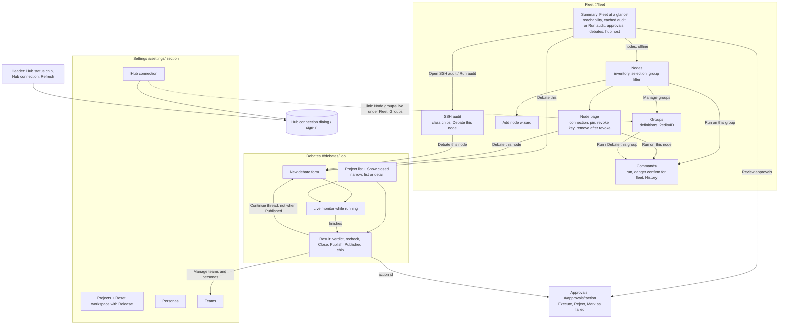

# UI re-review, phase 5 (apps/web-desktop at 7783afa, read-only)

English | [한국어](phase5-ui.ko.md)

> Point-in-time record from 2026-10-12; the code has changed since.

Method: read the current sources and `git diff 66cf41e..HEAD -- apps/web-desktop/src` (8 UI commits). `HEAD` is b82310c; it only adds docs after 7783afa, so the dashboard is identical. Nothing was run, vitest included. Paths are relative to `apps/web-desktop/src/` unless prefixed.

## Summary table

| Id | Sev | Phase 4 | Now | Evidence and reasoning |
|---|---|---|---|---|
| UI-1 | High | RESOLVED | RESOLVED | Unchanged; now also a "Published" chip (`pages/debate/ResultView.tsx:426`, `JobResult.tsx:72`). |
| UI-2 | High | RESOLVED | RESOLVED | Unchanged (`state/operationsStore.tsx`). |
| UI-3 | High | PARTIAL | PARTIAL | Fleet-wide Run confirm is now danger (`pages/RunPage.tsx:226`); a single node still runs with no confirm. |
| UI-4 | Med | PARTIAL | PARTIAL | Fleet run danger, Close / Publish primary; low-risk Execute still red (`pages/debate/ActionDialog.tsx:359`), Sync/Clone still unconfirmed. |
| UI-5 | Med | PARTIAL | PARTIAL | No change: badge and Overview are selected-project only. |
| UI-6 | Med | RESOLVED | RESOLVED | One list from the store, polled only while Debates is open (`pages/DebatesPage.tsx:120-123`). |
| UI-7 | Med | RESOLVED | RESOLVED | Unchanged. |
| UI-8 | Med | RESOLVED | RESOLVED | Unchanged (4 tabs); Fleet now has 5 inner tabs, see UI-P5-3. |
| UI-9 | Med | PARTIAL | PARTIAL | Group definitions have one home, Fleet Groups (`pages/FleetPage.tsx:20-43`); membership is still edited on Nodes, the node page and Groups; host key still three entry points. |
| UI-10 | Med | PARTIAL | PARTIAL | No change: hub host on Summary and Nodes, selection offers only group actions. |
| UI-11 | Med | OPEN | PARTIAL | Title is "Fleet at a glance" and the Summary no longer starts an SSH audit (`pages/OverviewPage.tsx:296-298,321`, `lib/auditCache.ts`); node page and group summary still audit on open, cards are not sorted by severity. |
| UI-12 | Med | RESOLVED | RESOLVED | Unchanged. |
| UI-13 | Low-Med | RESOLVED | RESOLVED | Unchanged. |
| UI-14 | Low | PARTIAL | PARTIAL | Unused design-system parts remain. |
| UI-15 | Low | PARTIAL | PARTIAL | List rows still show the job chip only (new: Published chip on the detail only). |
| UI-16 | Low | RESOLVED | RESOLVED | Unchanged. |
| UI-N1 | Med | RESOLVED | RESOLVED | Unchanged. |
| UI-N2 | Med | PARTIAL | RESOLVED | SSH audit rows show the class chip and the caption splits failures by class (`pages/ssh/FleetSshAudit.tsx:89,127-140`). |
| UI-N3 | Low | OPEN | OPEN | Advanced still starts closed while a team default sends reference code (`pages/debate/StartForm.tsx:79-84`). |
| UI-N4 | Low | OPEN | OPEN | Fleet danger vs group primary (`RunPage.tsx:226`), Remove-from-group danger, Execute low risk danger: still no rule. |
| UI-N5 | Low | PARTIAL | PARTIAL | `Agent checking…` remains (`App.tsx:189`). |
| UI-N6 | Low | OPEN | OPEN | Duplicate key warning, hand-copied form rules, filter flip unchanged. |
| UI-P4-1 | Med | new | RESOLVED | Narrow screens show list or detail with "Back to list" (`DebatesPage.tsx:137-150,190,208`); but see UI-P5-1. |
| UI-P4-2 | Med | new | RESOLVED | Fleet "Groups" tab, `#/settings/groups` redirects, Settings keeps a link (`router.ts:26-32,89`, `FleetPage.tsx:43`, `pages/SettingsPage.tsx`). |
| UI-P4-3 | Low | new | OPEN | Transcript still renders inline after the result (`ResultView.tsx:490`). |
| UI-P4-4 | Low | new | RESOLVED | "3 · Running" keeps both (`App.tsx:103-107,134`). |
| UI-P4-5 | Low | new | RESOLVED | Debates reads the store's `recent` and only adds its own 5 s poll while open (`DebatesPage.tsx:120-123`). |
| UI-P4-6 | Low | new | PARTIAL | Fleet-wide is danger; a group (several hosts) is still primary (`RunPage.tsx:226`). |
| UI-P4-7 | Low | new | RESOLVED | Summary shows the audit from the last 5 minutes or a "Run audit" button (`OverviewPage.tsx:150-151,296-298`). |
| UI-P4-8 | Low | new | RESOLVED | See UI-N2. |

Counts: RESOLVED 16, PARTIAL 10, OPEN 4, REGRESSED 0 (30 items).
New findings: UI-P5-1 (Medium), UI-P5-2 to UI-P5-5 (Low).

## What changed (verified)

- **Published threads.** The list overlay `thread_published` (`apps/agent/debate_handler.go:154-156`) shows a "Published" chip and replaces "Continue this thread" with "Published; start a new thread for follow-up work" (`ResultView.tsx:411-426`, `JobResult.tsx:72`); the detail merges the flag from the list row (`DebatesPage.tsx:81`).
- **Remove node.** Revoke first: a "Revoke hub key first" button, or the tick "Remove without revoking the hub key"; the typed-id confirm stays disabled until one of them is done (`pages/nodes/RemoveNodeDialog.tsx:31-33,59-70,94`); the node page shows "Hub key: revoked <time>" (`NodeDetailPage.tsx:101`).
- **Reset workspace.** Kept files grouped by thread, each with a "Release <thread>" tick that discards its executed changes and blocks publishing (`pages/debate/WorkspaceResetDialog.tsx:25-35,44-51,122`; `api.ts` `resetWorkspace(id, release)`).
- **Navigation.** Fleet tabs: Summary, Nodes, SSH audit, Commands, Groups (`router.ts:26-32`); group links and `?edit=` go to `#/fleet/groups` (`GroupSummary.tsx`, `NodeGroupsSection.tsx`); Settings has Hub connection, Projects, Personas, Teams and the line "Node groups live under Fleet, Groups".
- **History.** Rejected requests get a warn chip and the detail text (`pages/run/CommandHistory.tsx`, `lib/audit.ts`); `git_commit_push` is no longer a workspace-changing tool (`lib/debate.ts:329`), matching the retired tool in `cli/llm-agent/mcp_client.py:97`.

## New findings

### UI-P5-1 (Medium) "Continue this thread" does nothing visible on narrow screens
Evidence: on narrow screens a selected debate hides the whole top block, including the collapsed New debate form (`DebatesPage.tsx:154`, `hidden={!showList}`). "Continue this thread" only sets `continueRequest`; the form effect sets the thread, opens Advanced and expands the page's form (`pages/debate/StartForm.tsx:71-77`) but never navigates (`navigate` is used only after Start, `StartForm.tsx:121`). The form is therefore filled in a hidden container. The same happens with "Reopen with a new debate". The operator sees no change until they tap "Back to list".
Why it hurts: one of the main follow-up actions silently fails on mobile.
Fix: SAFE-FIX. After `setContinueRequest`, navigate to `#/debates` on narrow screens (the form then shows with the thread filled), or render the form outside the `showList` wrapper and scroll to it.

### UI-P5-2 (Low) Published flag can be missing on a debate opened by URL
Evidence: `thread_published` is overlaid only on list entries (`debate_handler.go:154-156`; `types.ts` notes "List responses"). The detail takes it from `listJob` (`DebatesPage.tsx:81`), and the list is the selected project's open threads unless "Show closed" is on. A deep link to a debate of another project or a closed thread has no list row, so the chip is missing and "Continue this thread" is offered although the hub refuses it.
Fix: SAFE-FIX. Have the detail endpoint carry the flag, or keep the Continue button but show the hub's refusal clearly (the start error already shows the hub text).

### UI-P5-3 (Low) Five Fleet tabs on a narrow screen
Evidence: `FLEET_TABS` has five entries in one `SegmentedControl` (`router.ts:26-32`, `FleetPage.tsx` renders them as one row). Not measured at 360 px; labels like "SSH audit" and "Commands" are long.
Fix: check once by hand; if it overflows, let the control scroll horizontally or drop to a select under 480 px.

### UI-P5-4 (Low) Remove node needs a round trip after revoking
Evidence: "Revoke hub key first" closes the Remove dialog and opens the revoke dialog (`NodeDetailPage.tsx`, `onRevokeFirst`; `RemoveNodeDialog.tsx:62-68`). After a successful revoke the operator must press Remove node again and retype the id. The tick "Remove without revoking" is next to the button, so the safe path (revoke) is one tab longer than the unsafe one (tick).
Fix: SAFE-FIX. Reopen the Remove dialog automatically after a successful revoke, or run the revoke inside the Remove dialog.

### UI-P5-5 (Low) Release is a destructive tick inside a plain confirm
Evidence: each thread group has a red "Release <thread>" checkbox that discards its executed changes and makes the thread permanently unpublishable (`WorkspaceResetDialog.tsx:122`), confirmed by the dialog's single danger button. There is no restatement of what will be released on the final button.
Fix: SAFE-FIX. Put the count in the confirm label ("Reset and release 2 threads").

### Checked, no finding
- Badges: `badgeOf` keeps the count and Running together, tone crit while approvals wait (`App.tsx:103-107`).
- Summary: the cached audit is shown with its age; Refresh re-reads the cache but does not start an audit, which matches the new intent.
- Legacy hashes: `#/settings/groups?edit=ID` maps to Fleet Groups with the query kept (`router.ts:89`).

## Updated map

Procedure paths changed since phase 4:
- P5 Node groups: Fleet, Groups tab (create, edit, delete); selection on Nodes still creates one (`NodesPage.tsx`); Settings only links.
- P3 Remove node: node page, Remove node, "Revoke hub key first" (revoke dialog), reopen Remove, type id.
- P10 Publish: after a push the thread shows "Published" and cannot be continued (`ResultView.tsx:411`).
- P4 Fleet SSH audit: Summary offers "Run audit" or shows the 5-minute cache; the SSH audit tab runs it on open as before.

SVG of the current navigation: [ui-nav-current.svg](../../images/procedure-review/ui-nav-current.svg) (started from the repo copy; validated with xmllint; legacy-hash text split into three lines so it stays inside its box, Approvals badge widened for "3 · Running", Settings box notes the Groups link, title commit updated).
