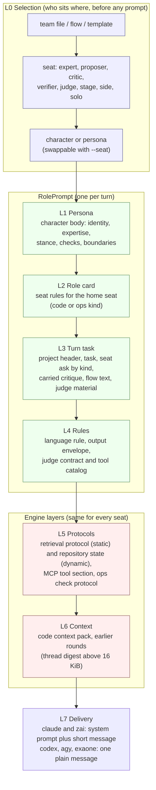
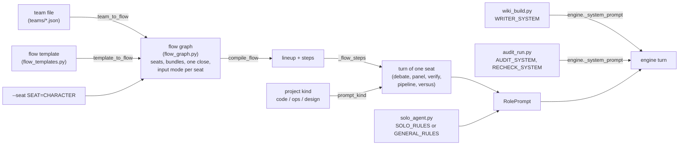
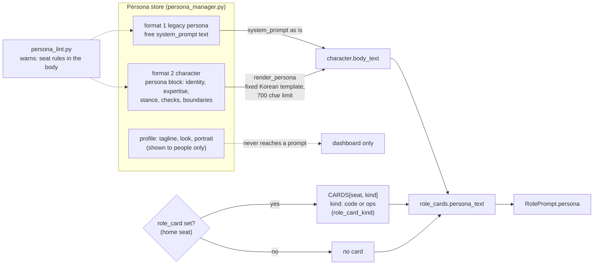
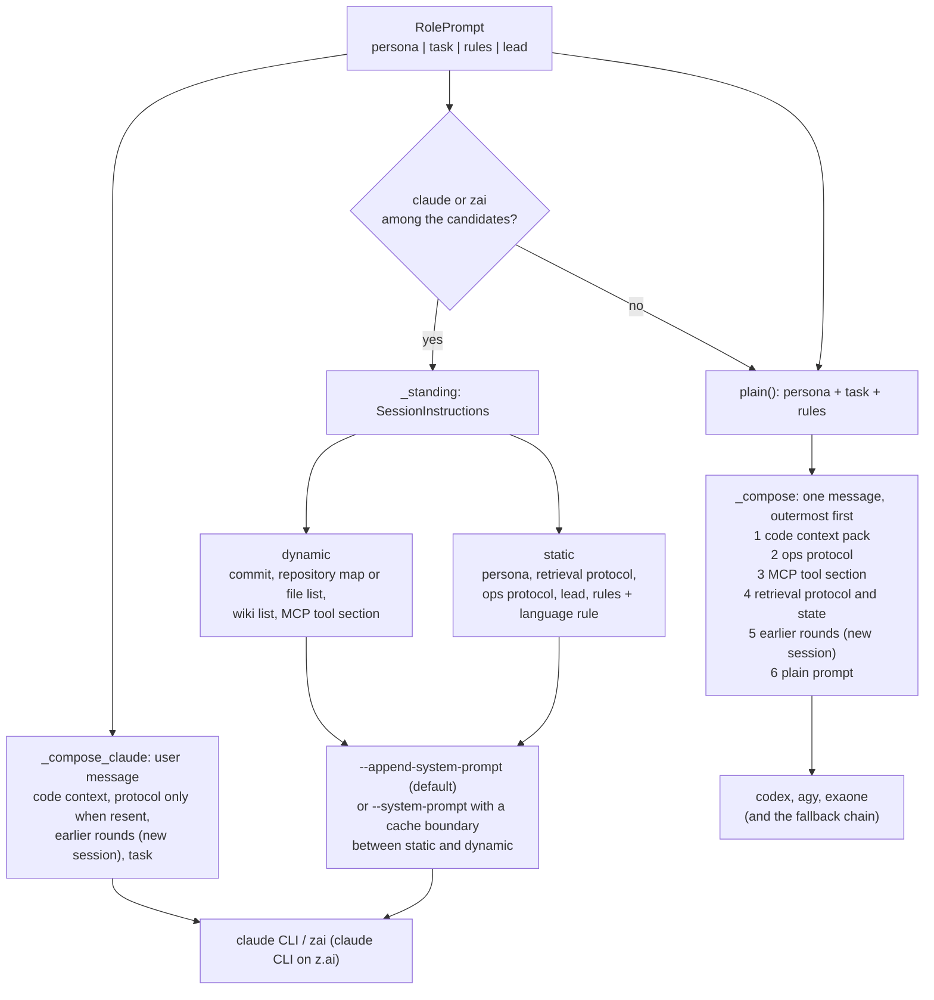

# 에이전트 프롬프트 계층 (참고 문서)

[English](agent-prompt-layers.md) | 한국어

상태: 2026-11-10 기준 코드(`RETRIEVAL_PROMPT_VERSION` `2026-11-01.p28`)를 설명하는 문서이며, 제안이 아닙니다.
에이전트가 받는 프롬프트가 어떤 계층으로 나뉘는지, 각 계층을 누가 소유하는지, 그 계층이 LLM CLI마다 어떻게
전달되는지를 설명합니다. 계층이 바뀌면 이 문서도 고칩니다.

다이어그램(각각 별도 파일로도 둡니다):
[계층 쌓임](agent-prompt-layers-stack.mmd), [선택](agent-prompt-layers-selection.mmd),
[페르소나](agent-prompt-layers-persona.mmd), [전달](agent-prompt-layers-delivery.mmd).

## 1. 요약

에이전트의 프롬프트는 템플릿 하나가 아닙니다. 차례마다 여덟 계층으로 조립됩니다. 선택(L0)이 자리에 누가 앉을지를
정하고, 네 계층(L1-L4)이 그 역할의 `RolePrompt`를 이루며, 두 계층(L5-L6)은 엔진이 모든 자리에 똑같이 붙이고,
마지막 계층(L7)이 결과를 공급자에게 어떤 형태로 보낼지 정합니다.

| 계층 | 내용 | 코드 위치 | 바꾸는 주체 | 고정 장치 |
|---|---|---|---|---|
| L0 선택 | 팀·흐름·템플릿, 자리, 캐릭터 | `team_manager.py`, `flow_graph.py`, `flow_templates.py` | 운영자(대시보드, 파일) | `test_flow_golden.py` |
| L1 페르소나 | 정체, 전문 분야, 관점, 먼저 확인할 것, 맡지 않는 일 | `character.py` (`body_text`, `render_persona`) | 운영자, "AI로 제안" | `persona_lint.py`(경고) |
| L2 역할 카드 | 페르소나 본래 자리의 자리 규칙 | `role_cards.py` (`CARDS`, `persona_text`) | 개발자 | `test_seat_golden.py`, 프롬프트 버전 |
| L3 차례 과제 | 프로젝트 머리말, 과제, 자리별 요청, 넘겨받은 비평, 흐름 문구, 판정 자료 | `debate_engine.py` (`EXPERT_ASK`, `CRITIC_ASK`, `_carried_in`, `_flow_steps`) | 개발자, 과제는 사용자 | 프롬프트 버전, 흐름 골든 |
| L4 규칙 | 언어 규칙, 출력 봉투, 판정자 계약, 도구 목록 | `debate_engine.py` (`answer_language_rule`, `ENVELOPE_RULE`, 판정 규칙) | 개발자 | 프롬프트 버전 |
| L5 프로토콜 | 검색 프로토콜과 저장소 상태, MCP 도구, ops 점검 프로토콜 | `debate_engine.py` (`_retrieval_split`, `_mcp_text`), `ops_checks.protocol_text` | 개발자 | 프롬프트 버전 |
| L6 맥락 | 코드 맥락 묶음, 이전 라운드(요약) | `code_context`, `thread_digest.py` | 엔진(실행마다) | `INDEX_VERSION`/`MAP_VERSION` |
| L7 전달 | 시스템 프롬프트+메시지(claude, zai) 또는 메시지 하나(codex, agy, exaone) | `debate_engine._ask_turn`, `_standing`, `_compose`, `_compose_claude`, `llm_runner.py` | 개발자 | 러너 테스트 |



중심 타입은 `RolePrompt`(`debate_engine.py`)입니다. 필드가 넷인 불변 dataclass입니다.

- `persona`: L1과 L2, 상시 지시.
- `task`: L3, 이번 차례에 묻는 것.
- `rules`: L4, 상시 지시.
- `lead`: 시스템 프롬프트에만 들어가는 한 줄로, 시스템 프롬프트가 차례 메시지를 가리키게 합니다(판정자에게 있음).

`plain()`은 `persona + "\n\n" + task + rules`를 돌려줍니다. 시스템 프롬프트 분리 이전과 똑같은 글이며, 시스템
프롬프트가 없는 공급자가 받는 단 하나의 메시지입니다.

## 2. L0 선택: 팀이나 흐름에서 자리로



- 팀 파일은 자리마다 페르소나와 공급자 목록을 적습니다. 흐름(`flow_graph.py`, `docs/design/flow-graph.md`)은 맡은
  일과 함께 캐릭터를 자리에 앉힙니다. `team_to_flow`와 `template_to_flow`가 옛 형태를 바꾸고, `compile_flow`가 흐름을
  T2 lineup과 steps로 바꾸므로, 세 형태 모두 같은 엔진 경로로 들어갑니다. 흐름 골든(`golden/flows.json`, 37개
  사례)이 팀과 그 흐름의 프롬프트가 똑같음을 보장합니다.
- 자리는 `expert`, `proposer`, `critic`, `verifier`, `judge`, `stage`, `side`, `solo`입니다(`character.SEATS`). 시작할
  때 `--seat SEAT=CHARACTER`(또는 시작 양식)로 흐름은 그대로 두고 한 자리의 캐릭터만 바꿀 수 있습니다.
- 프로젝트 종류가 L3의 자리 문구를 고릅니다. `prompt_kind(project)`는 코드면 `None`, 아니면 `"ops"`나 `"design"`입니다.
- 선택 계층은 글을 더하지 않습니다. 어떤 페르소나, 카드, 자리 문구를 쓸지만 정합니다.

## 3. L1 페르소나와 L2 역할 카드



L1은 에이전트가 **누구인지**, L2는 **이 자리가 어떻게 일하는지**를 말합니다. 이 분리는
`docs/design/agent-characters.md`(C0-C2)에서 왔습니다. 그 전에는 페르소나마다 자리 규칙을 따로 들고 있어서 같은
규칙이 여러 번, 서로 다른 말로 적혀 있었습니다.

- **형식 2 캐릭터**(`character.py`): `identity`, `expertise`, `stance`, `checks`, 선택 항목 `boundaries`로 된
  `persona` 블록입니다. 필드마다 한도(`PERSONA_LIMITS`)가 있습니다. `render_persona`가 고정된 한국어 틀 하나로 씁니다.
  `당신은 {identity}입니다.` / `전문 분야: …` / `관점: …` / `먼저 확인할 것:`과 확인 항목 한 줄씩 /
  `맡지 않는 일:`과 항목 한 줄씩. 렌더링한 글은 `RENDER_LIMIT`(700자) 안에 들어가야 합니다.
- **형식 1 페르소나**(이전 형식): 자유 형식 `system_prompt`를 그대로 씁니다. 대시보드에 "legacy" 표시가 붙습니다.
- **profile**(`tagline`, `look`, 초상화)은 사람에게만 보이고 프롬프트에는 절대 들어가지 않습니다.
- **역할 카드**(`role_cards.py`): `CARDS[(seat, kind)]`에 `expert`, `critic`, `judge`의 짧은 한국어 자리 규칙이 코드용
  (`kind` `None`)과 ops용(`"ops"`)으로 있습니다. ops 카드에는 운영자가 승인한 일반 규칙이 들어 있습니다. 먼저 살펴보기,
  모호성 규칙, `[차단]`/`[권고]` 이의, 판정 등급, 만들어낸 금지 사항 없음, 확인 안 된 숫자로 조치하지 않기입니다.
  - 페르소나는 `role_card`(본래 자리)와 `role_card_kind`(`"ops"`)로 카드를 켭니다.
  - 카드는 팀이 준 자리가 아니라 페르소나의 본래 자리를 따릅니다. 팀이 카드를 켠 페르소나를 다른 자리에 앉히면
    `validate_lineup`이 경고합니다.
- `persona_text(persona)`가 본문과 카드를 잇습니다. 형식 2는 `"\n"`, 형식 1은 `" "`로 잇습니다.
- `persona_lint.py`(경고만)는 본문에 남은 자리 규칙("move") 같은 문제를 표시합니다. `scripts/ci.sh python`과
  페르소나 저장 때 돕니다.

## 4. L3 차례 과제

과제 계층은 차례마다 바뀌며, 엔진이 흐름 상태로부터 만듭니다.

- **머리말**: `Project: {id} | Thread ID: {thread}`와 `Task: {task_for_agents}`. `task_for_agents`는 스레드 과제에
  후속 지시를 더한 것입니다. ops 프로젝트는 해석된 대상(`ops_targets.prompt_text`)이, 디자인 프로젝트는 산출물
  규칙(`design_prompt_text`)이 붙습니다.
- **넘겨받는 것**(`_carried_in`): 앞 라운드의 비평과, 기각되었다면 판정자가 고치라고 한 이유(최대
  `MAX_JUDGE_REASONS` 12000자).
- **종류별 자리 요청**: `EXPERT_ASK[kind]`(예: 코드는 "Formulate a complete architectural proposal…")와
  `CRITIC_ASK[kind]`(제안 하나, 제안 여럿, 그리고 페르소나의 초점을 따르라는 초점 문장).
- **흐름 문구**(`docs/design/team-flows.md`, `flow-graph.md`):
  - 블라인드 초안과 패널: "Other members answer the same task on their own…"
  - 통합: 돌아가며 바뀌는 중립 라벨 아래의 초안(`draft_labels`, `drafts_intro`)과 "Write one consolidated proposal…"
  - 파이프라인: "You are stage i of N…"(`_stage_turn`)
  - 검증: `VERIFY_TASK`(실패한 항목만 보고)
  - 대결: `versus_order`
- **판정 자료**: 과제, 마감 자료(`_close_material`: 제안, 비평, 투표, 요약 또는 구조화된 보기), 그리고
  "Decide if consensus is reached (APPROVED / REJECTED)."

## 5. L4 규칙

규칙은 상시 지시입니다. 한 자리의 차례 사이에서는 바뀌지 않습니다.

- **언어 규칙**: `answer_language_rule(detect_language(task))`가 과제의 문자로 분명하면 한국어·일본어·중국어를
  지정하고, 아니면 "사용자 원래 과제의 언어로 쓰라"는 일반 규칙을 씁니다. 판정자가 없는 실행(위키, 감사, solo)은
  판정 용어를 뺀 `debate=False` 변형을 씁니다.
- **출력 봉투**(p27): 흐름이 요약할 때 `ENVELOPE_RULE`이 `## Conclusion`, `## Claims`, `## Evidence`,
  `## Open issues`, 선택 항목 `## Recommendation` 제목을 요구합니다. 그래서 요약자나 구조화 입력을 과제를 몰라도
  정의할 수 있습니다.
- **판정자 계약**: 팀이 허용한 도구 목록, decision·rationale·constraints·checks 작성법, `JUDGE_JSON_EXAMPLE`, ops 조치·
  계획·배치 규칙, 디자인 쓰기 규칙, `JUDGE_VERDICT_RULE`(마지막 줄은 정확히 `VERDICT: APPROVED` 또는
  `VERDICT: REJECTED`), 요구 사항 규칙, 다이어그램 힌트. 무엇이 들어가는지는 프로젝트 종류와 팀이 허용한 도구에
  따라 다릅니다.
- **재요청 알림**: 답의 형식이 틀리면 엔진이 짧게 다시 정리해서 묻습니다. 판정자는 `judge_format_reminder`, 투표는
  `batch_votes.VOTE_FORMAT`, 깨진 action 블록은 `action_repair_message`입니다.

## 6. L5 프로토콜과 L6 맥락

이 계층은 한 실행의 모든 자리에 똑같습니다. 엔진이 붙이며, 페르소나나 팀이 바꿀 수 없습니다.

- **검색**(`_retrieval_split`)은 고정 부분과 변하는 부분으로 나뉩니다.
  - 고정: `=== Repository retrieval protocol (read-only) ===`, ```repo 블록으로 코드를 요청하는 법, 인용 규칙, findings
    형식(`FINDINGS_PROMPT` 또는 `FINDINGS_PROMPT_MCP`).
  - 변함: `=== Repository state ===`, 커밋, 저장소 지도 안내나 파일 목록(`MAX_TREE_LINES`),
    `GUARDIAN_CODE_WIKI=1`일 때 위키 목록.
- **MCP 도구 절**(`_mcp_text`): 멤버가 `repo_mcp.py`로 코드를 읽을 때. 모델 워커에서는 스냅숏 도구 다섯 개입니다.
- **ops 프로토콜**(`ops_checks.protocol_text`): ops 프로젝트에서 읽기 전용 ```ops 점검을 돌리는 법, 프로비저닝이
  켜져 있으면 패키지 도구까지.
- **코드 맥락 묶음**(`_context_text`): 코드 색인에서 과제에 맞게 고른 파일. 세션이 새것이거나 맥락이 바뀌었을 때
  보냅니다.
- **이전 라운드**: 새 세션에만. 16 KiB(`thread_digest.DEFAULT_MIN_BYTES`)를 넘으면 요약합니다
  (`GUARDIAN_THREAD_DIGEST=off`로 끕니다).

## 7. L7 전달: 원본 하나, 형태 둘



공급자는 호출할 때야 정해지므로(대체 사슬), 각 차례(`_ask_turn`)는 같은 `RolePrompt`에서 두 형태를 다 만듭니다.

- **claude와 zai**(zai는 z.ai에 붙은 claude CLI)는 시스템 프롬프트를 받습니다. `_standing`이
  `SessionInstructions(static, dynamic)`을 만듭니다.
  - static: 페르소나, 검색 프로토콜, ops 프로토콜, `lead`, 규칙(언어 규칙이 없으면 더함).
  - dynamic: 저장소 상태와 MCP 절.

  `llm_runner.py`는 이를 `--append-system-prompt`(기본)로 넘깁니다. `GUARDIAN_CLAUDE_SYSTEM_PROMPT=custom`이면
  `--system-prompt`를 쓰고, 이를 지원하는 claude 버전에서는 static과 dynamic 사이에 `SYSTEM_PROMPT_BOUNDARY`를 넣어
  고정 앞부분이 실행 사이에 캐시되게 합니다. 앞에는 `SYSTEM_REMINDER_NOTE`가 붙습니다. 메시지(`_compose_claude`)에는
  코드 맥락, 새 세션의 이전 라운드, 과제만 들어갑니다. 프로토콜은 프로토콜이나 커밋이 바뀌기 전에 기록된 세션에만
  다시 보냅니다.
- **codex, agy, exaone**은 여기서 시스템 프롬프트가 없습니다. `_compose`가 `plain()`을 감싸며, 다이어그램의 목록이
  메시지 맨 위부터의 최종 순서입니다. 이어지는 세션은 `plain()`만 받고, 맥락이 바뀌었으면 프로토콜과 코드 맥락이
  함께 갑니다.
- `agent_started` 이벤트에 `prompt_bytes`(평문 형태의 첫 차례 전체), `system_bytes`(claude가 시스템 프롬프트로 받는
  상시 부분), `history_bytes`가 남습니다.
- 시스템 프롬프트는 프로세스 목록(argv)에 보이므로, 어떤 계층에도 비밀이 들어가면 안 됩니다.

## 8. 다른 프롬프트 계열

모든 에이전트가 토론 자리는 아닙니다. 아래 실행은 엔진의 L5-L7을 다시 쓰고 L1-L4는 자기 것을 둡니다.

| 실행 | 역할 글(L1) | 규칙(L4) | 버전 |
|---|---|---|---|
| Solo 에이전트(`solo_agent.py`) | 고른 페르소나를 `persona_text`로 | `SOLO_RULES`, 프로젝트가 없으면 `GENERAL_RULES`; 언어 규칙 `debate=False` | `SOLO_PROMPT_VERSION` 4 |
| 코드 위키 작성자(`wiki_build.py`) | `WRITER_SYSTEM`을 `engine._system_prompt`로 | 작성 규칙; 언어 규칙 `debate=False` | `WIKI_PROMPT_VERSION` |
| 저장소 감사(`audit_run.py`) | `AUDIT_SYSTEM`, 재확인 때 `RECHECK_SYSTEM` | 샤드 프롬프트, 정밀도 규칙 | `AUDIT_PROMPT_VERSION` 4 |
| 요약자(흐름의 마감) | `SUMMARISER_ROLE` | `SUMMARISER_TASK`(p28: 아무것도 읽지 않고 인용을 그대로 옮김) | 프롬프트 버전 |
| 페르소나 제안(`persona_suggest.py`) | 없음; 예시를 `persona_text`로 보여 줌 | 고정 형식 출력 | `SUGGEST_PROMPT_VERSION` 1 |
| jev 판정(`jev_verdict.py`) | LLM CLI 프롬프트가 아님: jev에 보내는 질문 묶음 | — | 질문 묶음 2 |

## 9. 왜 이렇게 생겼나

- **상시와 차례의 분리.** 페르소나, 프로토콜, 규칙은 한 세션 안에서 바뀌지 않습니다. 그래서 claude는 이를 시스템
  프롬프트로 한 번 받고, 이후 차례에는 과제만 보냅니다. 메시지가 짧아지고 고정 앞부분을 캐시할 수 있습니다.
- **두 형태의 원본은 하나.** `plain()`이 분리 이전의 글을 그대로 재현하므로, 분리를 도입할 때 codex, agy, exaone의
  프롬프트는 바이트 단위로 같았고, claude에서 codex로 대체되어도 같은 내용이 갑니다.
- **정체와 절차의 분리.** 캐릭터는 에이전트가 누구인지 말하고, 엔진의 역할 카드는 자리가 어떻게 일하는지 말합니다.
  그래서 캐릭터를 여러 흐름에 앉힐 수 있고, 자리 규칙은 한곳에서 고칩니다.
- **사람용 필드는 밖에.** profile, tagline, 초상화는 모델에 닿지 않으므로, 이를 고쳐도 토론이 바뀌지 않습니다.
- **테스트와 버전으로 고정.** `golden/seat_prompts.txt`와 `golden/flows.json`이 정확한 프롬프트를 담고, 프롬프트를
  바꿀 때마다 `RETRIEVAL_PROMPT_VERSION`을 올립니다(p24 역할 카드, p25 ops 카드, p26 캐릭터, p27 봉투, p28 요약자).

## 10. 계층을 바꿀 때

| 바꾸는 것 | 함께 할 일 |
|---|---|
| 페르소나나 캐릭터(L1) | 코드 변경 없음; 저장할 때 린트 경고를 읽습니다 |
| 역할 카드(L2) | `RETRIEVAL_PROMPT_VERSION`을 올리고 `golden/seat_prompts.txt`를 다시 만들어 검토 |
| 자리 요청, 흐름 문구, 판정 규칙(L3, L4) | `RETRIEVAL_PROMPT_VERSION`을 올리고 `test_flow_golden.py`, `test_seat_golden.py` 실행 |
| 검색이나 MCP 프로토콜(L5) | `RETRIEVAL_PROMPT_VERSION`을 올림; 이전에 기록된 세션은 프로토콜을 다시 받음 |
| 색인이나 지도 형식(L6) | `INDEX_VERSION`이나 `MAP_VERSION`을 올림 |
| 위키 작성자, 감사, solo 프롬프트 | `WIKI_PROMPT_VERSION`, `AUDIT_PROMPT_VERSION`, `SOLO_PROMPT_VERSION`을 올림 |
| 전달(L7) | `test_llm_runner.py`의 러너 테스트; 실제 실행에서 `system_bytes`와 `prompt_bytes` 확인 |

## 11. 관찰

- 시스템 프롬프트가 없는 공급자는 새 세션마다 L5와 코드 맥락을 통째로 다시 받습니다. 2026-11-10 exaone 시험에서
  이런 첫 차례 메시지는 50-70 KB였고, 요청 하나가 600초 읽기 시간 제한을 넘긴 이유 중 하나입니다
  (`docs/design/exaone-provider.ko.md`).
- 캐릭터 틀과 역할 카드는 한국어이고, 엔진의 자리 요청·프로토콜·규칙은 영어입니다. 언어 규칙은 지시의 언어가 아니라
  답의 언어를 정합니다.
- L5와 L6은 팀마다 설정할 수 없습니다. 예를 들어 저장소 지도는 프로세스 전체 단위로만 켜고 끕니다
  (`GUARDIAN_REPO_MAP=0`이면 평범한 파일 목록으로 돌아갑니다).
