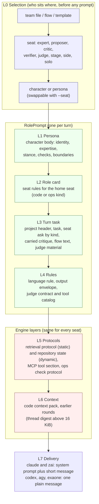
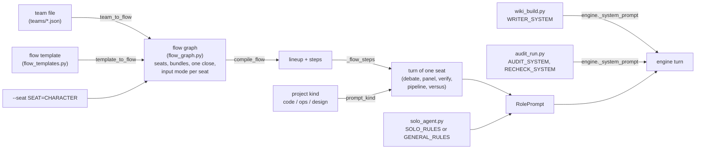
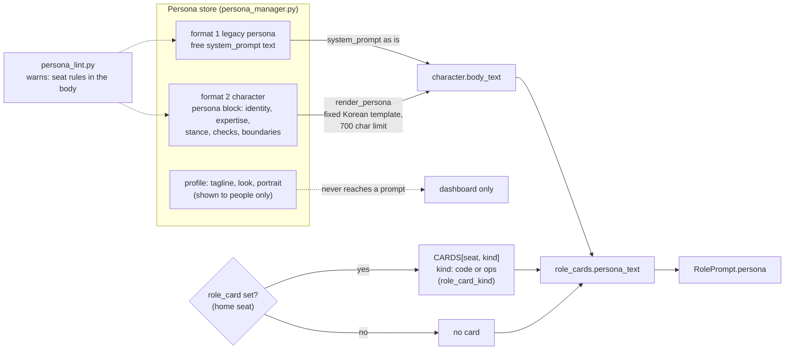
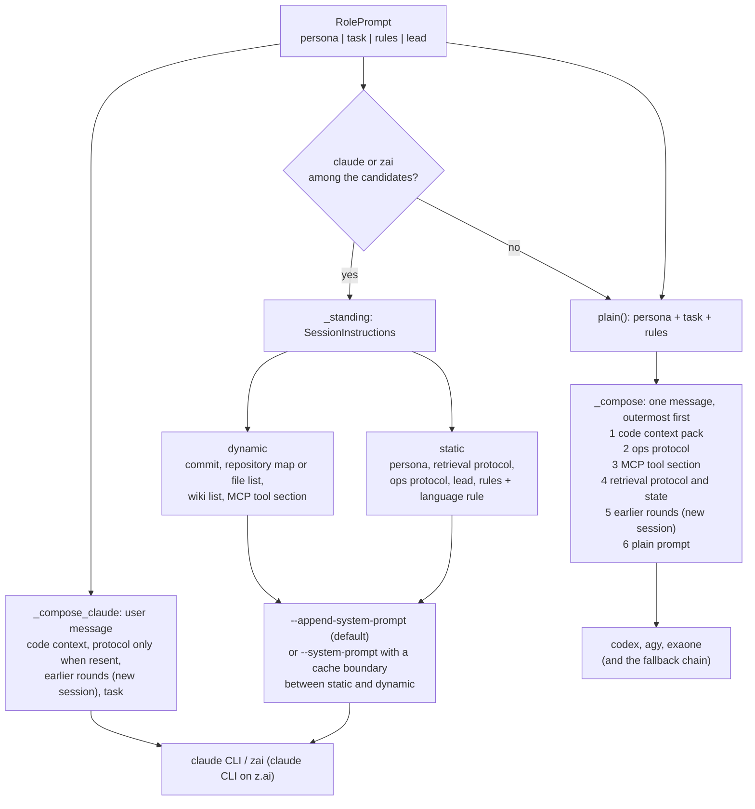

# Agent prompt layers (reference)

English | [한국어](agent-prompt-layers.ko.md)

Status: a description of the code as it is on 2026-11-10 (`RETRIEVAL_PROMPT_VERSION` `2026-11-01.p28`), not a
proposal. It explains how the prompt an agent receives is divided into layers, who owns each layer, and how the layers
reach the different LLM CLIs. Update it when a layer moves.

Diagrams (each also kept as its own file):
[stack](agent-prompt-layers-stack.mmd), [selection](agent-prompt-layers-selection.mmd),
[persona](agent-prompt-layers-persona.mmd), [delivery](agent-prompt-layers-delivery.mmd).

## 1. Summary

An agent's prompt is not one template. It is built per turn from eight layers. Selection (L0) decides who sits in a
seat. Four layers make up the role's own `RolePrompt` (L1-L4). Two layers the engine adds for every seat alike (L5-L6).
The last layer decides how the result reaches a provider (L7).

| Layer | Content | Where in the code | Who changes it | Pinned by |
|---|---|---|---|---|
| L0 Selection | team, flow or template; seat; character | `team_manager.py`, `flow_graph.py`, `flow_templates.py` | operator (dashboard, files) | `test_flow_golden.py` |
| L1 Persona | identity, expertise, stance, checks, boundaries | `character.py` (`body_text`, `render_persona`) | operator, "Suggest with AI" | `persona_lint.py` (warnings) |
| L2 Role card | seat rules for the persona's home seat | `role_cards.py` (`CARDS`, `persona_text`) | developers | `test_seat_golden.py`, prompt version |
| L3 Turn task | project header, task, seat ask, carried critique, flow text, judge material | `debate_engine.py` (`EXPERT_ASK`, `CRITIC_ASK`, `_carried_in`, `_flow_steps`) | developers; the task comes from the user | prompt version, flow golden |
| L4 Rules | language rule, output envelope, judge contract, tool catalog | `debate_engine.py` (`answer_language_rule`, `ENVELOPE_RULE`, judge rules) | developers | prompt version |
| L5 Protocols | retrieval protocol and repository state, MCP tools, ops check protocol | `debate_engine.py` (`_retrieval_split`, `_mcp_text`), `ops_checks.protocol_text` | developers | prompt version |
| L6 Context | code context pack, earlier rounds (digest) | `code_context`, `thread_digest.py` | engine, per run | `INDEX_VERSION`/`MAP_VERSION` |
| L7 Delivery | system prompt plus message (claude, zai) or one message (codex, agy, exaone) | `debate_engine._ask_turn`, `_standing`, `_compose`, `_compose_claude`; `llm_runner.py` | developers | runner tests |



The central type is `RolePrompt` (`debate_engine.py`), a frozen dataclass with four fields:

- `persona`: L1 and L2, standing.
- `task`: L3, what this turn asks.
- `rules`: L4, standing.
- `lead`: one line for a system prompt only, pointing it at the turn's message (the judge has one).

`plain()` returns `persona + "\n\n" + task + rules`. That is exactly the text the prompt had before the system-prompt
split, and it is the single message every provider without a system prompt gets.

## 2. L0 Selection: from team or flow to a seat



- A team file names a persona and a provider list per seat. A flow (`flow_graph.py`, `docs/design/flow-graph.md`)
  seats characters with a job. `team_to_flow` and `template_to_flow` convert the older forms, and `compile_flow`
  turns a flow into the T2 lineup and steps, so all three end in the same engine path. The flow golden
  (`golden/flows.json`, 37 cases) proves that a team and its flow produce identical prompts.
- The seats are `expert`, `proposer`, `critic`, `verifier`, `judge`, `stage`, `side` and `solo` (`character.SEATS`).
  At start, `--seat SEAT=CHARACTER` (or the start form) swaps the character of one seat without touching the flow.
- The project's kind picks the seat texts of L3: `prompt_kind(project)` is `None` for code, `"ops"` or `"design"`.
- Selection adds no text of its own. It only decides which persona, card and seat text are used.

## 3. L1 Persona and L2 role card



L1 says **who** the agent is; L2 says **how this seat works**. The split comes from `docs/design/agent-characters.md`
(C0-C2). Before it, every persona carried its own seat rules, so the same rule was written many times in different
words.

- **Format 2 character** (`character.py`): a `persona` block with `identity`, `expertise`, `stance`, `checks` and,
  optionally, `boundaries`. Each field has a limit (`PERSONA_LIMITS`). `render_persona` writes the block with one fixed
  Korean template:
  `당신은 {identity}입니다.` / `전문 분야: …` / `관점: …` / `먼저 확인할 것:` with one line per check /
  `맡지 않는 일:` with one line per boundary. The rendered text has to fit `RENDER_LIMIT` (700 characters).
- **Format 1 persona** (legacy): its free `system_prompt` text is used as it is. The dashboard marks it "legacy".
- **profile** (`tagline`, `look`, portrait) is for people only and never enters a prompt.
- **Role card** (`role_cards.py`): `CARDS[(seat, kind)]` holds short Korean seat rules for `expert`, `critic` and
  `judge`, in a code variant (`kind` `None`) and an ops variant (`"ops"`). The ops cards carry the generic rules the
  operator approved: look first, the ambiguity rule, `[차단]`/`[권고]` objections, judge grading, no invented
  prohibitions, and no action on unconfirmed numbers.
  - A persona opts in with `role_card` (its home seat) and `role_card_kind` (`"ops"`).
  - The card follows the persona's home seat, not the seat a team gives it. `validate_lineup` warns when a team seats
    an opted-in persona elsewhere.
- `persona_text(persona)` joins body and card: with `"\n"` for a format 2 character, with `" "` for format 1.
- `persona_lint.py` (warning only) flags seat rules left in a body ("move") and other smells. It runs in
  `scripts/ci.sh python` and when a persona is saved.

## 4. L3 Turn task

The task layer changes every turn and is built by the engine from the flow state:

- **Header**: `Project: {id} | Thread ID: {thread}` and `Task: {task_for_agents}`. `task_for_agents` is the thread
  task plus any follow-up. For ops projects it also carries the resolved targets (`ops_targets.prompt_text`); for
  design projects, the artifact rules (`design_prompt_text`).
- **Carried in** (`_carried_in`): the previous round's critique and, after a rejection, the judge's reasons for the
  change, up to `MAX_JUDGE_REASONS` (12000 characters).
- **Seat ask by kind**: `EXPERT_ASK[kind]` (for example "Formulate a complete architectural proposal…" for code) and
  `CRITIC_ASK[kind]` (single proposal, several proposals, and a focus line that defers to the persona's own focus).
- **Flow text** (`docs/design/team-flows.md`, `flow-graph.md`):
  - blind drafts and panel: "Other members answer the same task on their own…";
  - consolidation: the drafts under rotated neutral labels (`draft_labels`, `drafts_intro`), then "Write one
    consolidated proposal…";
  - pipeline: "You are stage i of N…" (`_stage_turn`);
  - verify: `VERIFY_TASK` (report only failed items);
  - versus: `versus_order`.
- **Judge material**: the task, the close material (`_close_material`: proposal, critique, votes, summary or
  structured view) and "Decide if consensus is reached (APPROVED / REJECTED)."

## 5. L4 Rules

Rules are standing text: they do not change between turns of one seat.

- **Language rule**: `answer_language_rule(detect_language(task))` names Korean, Japanese or Chinese when the task's
  script makes it clear, else the generic rule "write in the language of the user's original task". Runs without a
  judge (wiki, audit, solo) use the `debate=False` variant, which drops the decision words.
- **Output envelope** (p27): when the flow condenses, `ENVELOPE_RULE` asks for `## Conclusion`, `## Claims`,
  `## Evidence`, `## Open issues` and optionally `## Recommendation`. A summariser or a structured input can then be
  defined without knowing the task.
- **Judge contract**: the tool catalog the team allows; how to write the decision, rationale, constraints and checks;
  `JUDGE_JSON_EXAMPLE`; ops action, plan and batch rules; design write rules; `JUDGE_VERDICT_RULE` (the last line is
  exactly `VERDICT: APPROVED` or `VERDICT: REJECTED`); the requirement rule; and the diagram hint. What is included
  depends on the project kind and on the tools the team allows.
- **Re-ask reminders**: when an answer is malformed, the engine asks again with a compact restatement:
  `judge_format_reminder` for the judge, `batch_votes.VOTE_FORMAT` for a vote, and `action_repair_message` for broken
  action blocks.

## 6. L5 Protocols and L6 Context

These layers are the same for every seat of a run. The engine adds them; no persona or team can change them.

- **Retrieval** (`_retrieval_split`) is split into a static part and a dynamic part:
  - static: `=== Repository retrieval protocol (read-only) ===`, how to ask for code with ```repo blocks, citation
    rules, and the findings format (`FINDINGS_PROMPT` or `FINDINGS_PROMPT_MCP`);
  - dynamic: `=== Repository state ===`, the commit, the repository map guide or a file list (`MAX_TREE_LINES`), and
    the wiki list when `GUARDIAN_CODE_WIKI=1`.
- **MCP tool section** (`_mcp_text`): when a member reads code through `repo_mcp.py`. On a model worker it is the
  five snapshot tools.
- **Ops protocol** (`ops_checks.protocol_text`): for ops projects, how to run read-only ```ops checks, plus the
  package tools when provisioning is on.
- **Code context pack** (`_context_text`): files chosen for the task from the code index, sent when a session is new
  or when the context changed.
- **Earlier rounds**: only for a new session. Above 16 KiB (`thread_digest.DEFAULT_MIN_BYTES`) the earlier rounds are
  condensed (`GUARDIAN_THREAD_DIGEST=off` turns this off).

## 7. L7 Delivery: one source, two forms



Each turn (`_ask_turn`) builds both forms from the same `RolePrompt`, because the provider is chosen only at call
time (fallback chain):

- **claude and zai** (zai runs the claude CLI against z.ai) take a system prompt. `_standing` builds
  `SessionInstructions(static, dynamic)`:
  - static: persona, retrieval protocol, ops protocol, `lead`, and rules (the language rule is added when missing);
  - dynamic: repository state and the MCP section.

  `llm_runner.py` passes them with `--append-system-prompt` (default). With `GUARDIAN_CLAUDE_SYSTEM_PROMPT=custom` it
  uses `--system-prompt` instead and, on a claude version that supports it, puts `SYSTEM_PROMPT_BOUNDARY` between
  static and dynamic, so the static prefix can be cached across runs. A `SYSTEM_REMINDER_NOTE` is prefixed. The
  message (`_compose_claude`) then carries only the code context, the earlier rounds of a new session and the task. The
  protocol is resent only to a session recorded before the protocol or commit changed.
- **codex, agy and exaone** have no system prompt here. `_compose` wraps `plain()`; the list in the diagram is the
  final order from the top of the message. A resumed session gets only `plain()`, plus the protocols and the code context when the context changed.
- The `agent_started` event records `prompt_bytes` (the whole first turn in the plain form), `system_bytes` (the
  standing part claude gets as a system prompt) and `history_bytes`.
- The system prompt is visible in the process list (argv), so no secret may ever enter any layer.

## 8. Other prompt families

Not every agent is a debate seat. These runs reuse the engine's L5-L7 and set their own L1-L4:

| Run | Role text (L1) | Rules (L4) | Version |
|---|---|---|---|
| Solo agent (`solo_agent.py`) | the chosen persona through `persona_text` | `SOLO_RULES`, or `GENERAL_RULES` without a project; language rule `debate=False` | `SOLO_PROMPT_VERSION` 4 |
| Code wiki writer (`wiki_build.py`) | `WRITER_SYSTEM` as `engine._system_prompt` | writer rules; language rule `debate=False` | `WIKI_PROMPT_VERSION` |
| Repository audit (`audit_run.py`) | `AUDIT_SYSTEM`, then `RECHECK_SYSTEM` for the re-check | shard prompt, precision rules | `AUDIT_PROMPT_VERSION` 4 |
| Summariser (flow close) | `SUMMARISER_ROLE` | `SUMMARISER_TASK` (p28: reads nothing, copies citations verbatim) | prompt version |
| Persona suggestion (`persona_suggest.py`) | none; examples shown through `persona_text` | fixed-form output | `SUGGEST_PROMPT_VERSION` 1 |
| jev verdict (`jev_verdict.py`) | not an LLM CLI prompt: a question set posted to jev | — | question set 2 |

## 9. Why it is shaped this way

- **Standing vs per-turn.** Persona, protocols and rules do not change inside a session, so claude receives them once
  as a system prompt and every later turn sends only the task. That keeps messages short and lets the static prefix
  be cached.
- **One source for both forms.** `plain()` reproduces the text from before the split, so codex, agy and exaone kept
  byte-identical prompts when the split was introduced, and a fallback from claude to codex sends the same content.
- **Identity apart from procedure.** A character says who the agent is; the engine's role cards say how a seat
  works. A character can then sit in different flows, and a seat rule is fixed in one place.
- **People-only fields stay out.** Profile, tagline and portrait never reach a model, so editing them cannot change a
  debate.
- **Pinned by tests and versions.** `golden/seat_prompts.txt` and `golden/flows.json` hold the exact prompts; every
  prompt change bumps `RETRIEVAL_PROMPT_VERSION` (p24 role cards, p25 ops cards, p26 characters, p27 envelope,
  p28 summariser).

## 10. Changing a layer

| You change | Also do |
|---|---|
| a persona or character (L1) | nothing in code; read the lint warnings on save |
| a role card (L2) | bump `RETRIEVAL_PROMPT_VERSION`, regenerate and review `golden/seat_prompts.txt` |
| seat asks, flow text or judge rules (L3, L4) | bump `RETRIEVAL_PROMPT_VERSION`, run `test_flow_golden.py` and `test_seat_golden.py` |
| retrieval or MCP protocol (L5) | bump `RETRIEVAL_PROMPT_VERSION`; sessions recorded earlier get the protocol resent |
| index or map format (L6) | bump `INDEX_VERSION` or `MAP_VERSION` |
| wiki writer, audit or solo prompts | bump `WIKI_PROMPT_VERSION`, `AUDIT_PROMPT_VERSION` or `SOLO_PROMPT_VERSION` |
| delivery (L7) | runner tests in `test_llm_runner.py`; check `system_bytes` and `prompt_bytes` on a real run |

## 11. Observations

- Providers without a system prompt receive L5 and the code context again on every new session, and in full. On the
  exaone trial of 2026-11-10 these first-turn messages were 50-70 KB, which is part of why one request outlasted the
  600 s read timeout (`docs/design/exaone-provider.md`).
- The character template and the role cards are Korean, while the engine's seat asks, protocols and rules are
  English. The language rule decides the language of the answer, not the language of the instructions.
- Layers L5 and L6 cannot be configured per team. The repository map, for example, is switched only for the whole
  process (`GUARDIAN_REPO_MAP=0` restores the plain file list).
