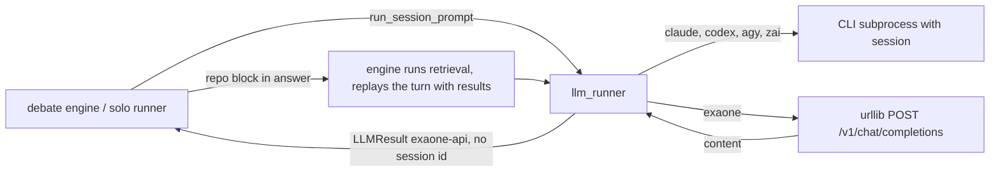

# 토론 엔진의 EXAONE API 공급자 (설계)

[English](exaone-provider.md) | 한국어

상태: 2026-11-09 제안. 모든 결정은 같은 날 운영자가 정했다. codex 전송은 키로 확인한 결과 불가능해서 아래의 표준 라이브러리 HTTP 설계를 그대로 쓴다. 2026-11-09 구현, 2026-11-10 `32bfd82`로 배포했고 키는 허브와 Tier-1 여섯 대에 두었다.
`EXAONE_API_KEY`가 없으면 공급자는 준비 상태가 되지 않으므로, 만들어도 키를 두기 전까지는 아무것도 바뀌지 않는다.
발단: 운영자가 LG AI연구원의 EXAONE 모델을 공식 EXAONE API로 토론과 단독 에이전트에 쓰고 싶어 한다.

## 결정

운영자, 2026-11-09:

1. **엔드포인트.** 제3자 호스트가 아니라 공식 EXAONE API(`docs.exaone.ai`, "agent start" 안내)를 쓴다.
2. **대체 사슬.** `exaone`은 팀이 직접 고를 때만이 아니라 자동 대체 사슬에도 들어간다. 2026-11-11 `opencode-exaone.ko.md`가 고쳤다: 기본 사슬의 이 자리는 `opencode`(opencode를 통한 EXAONE)가 차지하고, `exaone`은 이름으로 고를 때만 쓴다.

3. **추론 강도** 기본 `high`(B). `EXAONE_REASONING_EFFORT`로 바꿀 수 있다.
4. **키**는 허브와 Tier-1 worker 호스트 여섯 대에 둔다(C). zai와 같다.
5. **Quick ask 일반 모드**에서 `exaone`을 허용한다(D). `GENERAL_EXCLUDED`에 넣지 않는다.
6. **전송 방식.** 운영자는 처음에 codex CLI(A)를 골랐고, 이어서 "확인 뒤 결정"을 골랐다. 2026-11-09 확인에서
   Responses API가 없었으므로 전송 방식은 **표준 라이브러리 HTTP 공급자**다("설계" 절).

## codex를 통한 전송 (결정 6, 불가로 판정)

운영자가 고른 것: zai가 claude 실행 파일을 쓰듯 **codex 실행 파일**을 별도 신원으로 돌린다. 자체 `CODEX_HOME`,
`-c`로 지정하는 사용자 정의 모델 공급자(`model_providers.exaone.base_url`, `env_key = "EXAONE_API_KEY"`,
`model_provider = "exaone"`, `-m k-exaone_v2.5`), codex와 같은 세션 플래그(`exec`, `resume`, 읽기 전용 샌드박스,
repo MCP). 그러면 HTTP 설계에 없는 세션과 MCP 저장소 도구를 EXAONE도 쓸 수 있다.

2026-11-09에 확인한 것:

- codex는 0.122 무렵부터 `wire_api = "chat"`을 거부한다(Chat Completions는 2025년 12월 폐기 예고, 2026년 2월 제거).
  로컬 codex 0.166.0으로 확인: "`wire_api = "chat"` is no longer supported ... set `wire_api = "responses"`". 허브는
  0.160.0, Tier-1 호스트는 0.163.0이라 모두 거부한다.
- EXAONE 문서는 `POST /v1/chat/completions`만 적는다. 문서에도 변경 기록(항목 하나, 2026-11-09: API로 모델 무료
  제공)에도 Responses API는 없다.
- 키가 없으면 지어낸 경로까지 모든 경로가 라우팅 전에 401을 준다.
- **키로 확인 (2026-11-09, 요청 간격 3초).** `POST /v1/chat/completions`는 200(`content` "\n\nPONG",
  `reasoning_content`는 따로). `POST /v1/responses`는 일반 요청과 codex가 보내는 스트리밍 모양 모두
  `404 {"detail":"Not Found"}`였고, 지어낸 `/v1/no-such-endpoint`와 같은 답이다. EXAONE은 Responses API를 제공하지
  않으므로 codex는 EXAONE에 닿을 수 없다.

운영자가 고를 길:

- **(a) 확인 뒤 결정 (권장, 선택됨).** 키를 두면 `/v1/responses`에 요청 하나로 판가름 난다. EXAONE이 Responses
  API를 제공하면 결정 6대로 만든다. 아니면 (b)로 간다. 확인 결과 없었다.
- **(b) 표준 라이브러리 HTTP 공급자**(아래 "설계"). EXAONE이 문서로 밝힌 것만으로 동작한다.
- **(c) codex 앞에 둘 로컬 Responses→Chat 변환기.** 권장하지 않는다. Responses 스트리밍 이벤트 형식과 도구 호출을
  재현해야 하고, codex 릴리스마다 맞춰야 할 면이 넓다.

결과: (b). 나중에 EXAONE이 Responses API를 더하면 codex 경로를 다시 볼 수 있고, (b)는 그것을 막지 않는다.

## API가 제공하는 것 (2026-11-09에 읽음)

출처는 끝에 있다. *문서에 없음*은 찾아봤지만 없었다는 뜻이다.

| 항목 | 값 |
| --- | --- |
| 기본 URL | `https://api.exaone.ai/v1`, OpenAI 호환 `POST /chat/completions` |
| 인증 | `Authorization: Bearer $EXAONE_API_KEY` (`EXAONE_API_KEY`라는 이름은 안내 문서의 것) |
| 모델 | `k-exaone_v2.5` (K-EXAONE 2.5). 컨텍스트 524 288 토큰, 입력과 `max_tokens`의 합이 넘으면 400 |
| 추론 | 항상 켜짐. `reasoning_effort` `low` / `high` / `max` (기본 `max`, 코딩에는 `high` 권장). `max_tokens`에 추론이 포함됨 |
| 샘플링 | `temperature` 1.0, `top_p` 0.95 권장 |
| 에이전트 | 여러 턴 에이전트에는 `chat_template_kwargs.preserve_thinking: true` 권장 |
| 응답 | 답은 `choices[0].message.content`(줄바꿈으로 시작할 수 있음), 추론은 `message.reasoning_content`, `usage.reasoning_tokens` |
| 도구 | OpenAI 형식 `tools` / `tool_calls` 지원 |
| 한도 | 넘으면 429, `retry-after` / `retry-after-ms` 동반(없을 수 있음). 헤더 `x-{second,minute,day}-rate-limit[-remaining]`, `x-request-id`. 등급별 실제 수치: *문서에 없음*. **2026-11-09 운영자 키로 측정: 초당 요청 1회**(`RateLimitError,second limit(1)`, `retry-after: 1`, `retry-after-ms` 약 600). 한도는 라우팅 전에 적용되어 404 경로도 센다. 분·일 한도는 보지 못했다. |
| 가격, 키 발급 | 읽은 페이지에 *문서에 없음* |
| Anthropic 호환 엔드포인트 | 없음. 그래서 zai 방식(`claude` 실행 파일을 다른 기본 URL로)은 쓸 수 없다 |
| 공식 CLI 연동 | Hermes(`transport: chat_completions`), OpenCode(OpenAI 호환 사용자 정의 공급자, 모델 `exaone/k-exaone_v2.5`) |

FriendliAI도 EXAONE 모델을 제공했지만, 지금 K-EXAONE은 서버리스 등급에 없고(무료 기간은 2026-01-28에 끝남)
EXAONE 4.0은 전용 엔드포인트에만 있다. 결정 1로 이 내용은 참고로만 남는다.

## 설계

`exaone`은 별도 공급자이며, **`llm_runner.py`가 `urllib`로 EXAONE API를 HTTP로 직접 부른다**(표준 라이브러리라
엔진은 의존성 없이 유지된다). 실행 파일을 설치하지 않는다. 상태가 없다. 턴 하나가 요청 하나다.



다이어그램은 [exaone-provider-flow.mmd](exaone-provider-flow.mmd)에도 따로 둔다.

| 부분 | 규칙 |
| --- | --- |
| 순서 | 2026-11-11까지 `claude, codex, agy, zai, exaone, opencode, ollama, llm` (결정 2). `opencode-exaone.ko.md` 이후 기본 순서는 `claude, codex, agy, zai, opencode, ollama, llm`이고, `exaone`은 그 밖의 알려진 provider다. 팀은 구성원별로 고를 수도 있다: `"providers": ["exaone"]`. |
| 준비 | `EXAONE_API_KEY`가 있으면 준비. 실행 파일 확인은 없다. `installed_providers` / `available_providers`도 그때만 목록에 넣는다. |
| 자격 증명 | `env_policy`: `EXAONE_*`는 `exaone`에만 간다. 키는 호출 시점에 공급자 환경에서 읽고, 설정된 기본 URL로 가는 `Authorization` 헤더에만 실린다. 로그, 이벤트, 오류 메시지에 절대 나오지 않는다. 키가 없으면 호출이 실패한다(`RuntimeError`). |
| 설정 | `EXAONE_BASE_URL`(기본 `https://api.exaone.ai/v1`), `EXAONE_MODEL`(기본 `k-exaone_v2.5`), `EXAONE_REASONING_EFFORT`(기본 `high`, 결정 3), `EXAONE_MAX_TOKENS`(기본 65536, 추론도 여기에 포함, "답" 참고), `EXAONE_TIMEOUT`(초, 기본: 러너의 턴 타임아웃. 스트리밍에서는 전체 기한), `EXAONE_STREAM`(2026-11-10부터 스트리밍이 기본. `0`/`false`/`no`/`off`면 진단용으로 끔, "스트리밍" 절), `EXAONE_IDLE_TIMEOUT`(스트리밍 중 바이트가 오지 않는 초, 기본 120). `EXAONE_BASE_URL`은 `https://`여야 한다. |
| 요청 | 상태 없는 공급자가 모두 받는 합친 프롬프트(`_build_prompt(prompt, context, system)`)를 `user` 메시지 하나로 보낸다. 그래서 러너의 인터페이스는 바뀌지 않는다. `temperature` 1.0, `top_p` 0.95, `reasoning_effort`, `max_tokens`, 기본은 `stream: true`와 `Accept: text/event-stream`(`EXAONE_STREAM`으로 끄면 `stream: false`, JSON 답 하나). `tools`는 없다. 코드 읽기는 ```repo 블록으로 한다(아래). |
| 답 | `message.content`를 앞뒤 공백을 지워 쓴다. `reasoning_content`는 버린다(다른 에이전트에게 보이지 않고 저장하지 않음). 내용이 비면 실패로 보고 대체 사슬이 이어진다. `finish_reason: "length"`는 따로 실패로 남긴다("reasoning used max_tokens"). 그래야 예산이 작은 것이 이벤트에서 보이고 모델 문제로 오해되지 않는다(zai의 답 없는 생각과 같은 함정, `llm_runner.py` 앞부분). `preserve_thinking`은 보내지 않는다. 요청이 늘 메시지 하나라 지킬 이전 생각이 없다. |
| 세션 | 없다. `run_session_prompt`는 `opencode`처럼 다룬다. 세션 id가 없으므로 엔진의 기존 재생(`advance()`, "=== Earlier in this turn ===")이 코드 읽기 결과를 붙여 턴을 다시 보낸다. ```repo 블록 프로토콜은 그대로 동작하고, 읽기 전용 MCP 서버는 쓰지 않는다. 결과 표시는 `exaone-api`, 실패는 `exaone:`. |
| 간격 | 키는 초당 요청 1회만 허용한다(측정). 프로세스 전체에 걸린 잠금이 요청 **시작**을 1.1초 이상 띄운다. 그래서 토론 하나의 병렬 단계(`GUARDIAN_MAX_PARALLEL_AGENTS`, 기본 4)는 부딪히지 않고 1초씩 줄을 선다. 몇 분 걸리는 요청이 잠금을 쥐고 있지는 않는다. 다른 프로세스(두 번째 토론, 같은 키를 쓰는 worker 호스트)와는 맞추지 않고 429 규칙이 처리한다. |
| 429와 5xx | `retry-after-ms` / `retry-after`가 30초 이하면 턴당 최대 5번까지(약간의 흔들림을 더해) 따르고, 그다음은 실패. 헤더가 없거나 30초를 넘으면(분·일 한도) 바로 실패. 실패하면 턴 타임아웃까지 기다리지 않고 대체 사슬로 넘어간다(2026-10-29에 고친 zai 429의 교훈). |
| 그 밖의 오류 | 400(예: 컨텍스트 초과), 401, 403: 바로 실패. 메시지에는 상태 코드와 `x-request-id`만 넣고 키는 넣지 않는다. |
| 크기 보호 | 컨텍스트 창은 크지만(512 Ki 토큰) 재생되는 턴은 커진다. 프롬프트가 바이트 상한(기본 1.5 MiB, `EXAONE_MAX_PROMPT_BYTES`. 토큰당 바이트가 일정하지 않고 같은 창에서 `max_tokens`를 떼어 두므로 잠정값)을 넘으면 보내기 전에 실패해서 다음 공급자가 턴을 받는다. 상한 아래인데 창을 넘는 프롬프트는 400을 받고 똑같이 바로 실패한다. |
| 감사 | `audit_run.AUDIT_PROVIDERS`는 `["claude"]` 그대로다. |
| worker | worker는 `llm_runner.py`와 `env_policy.py`를 싣고 가므로, 키가 있는 worker는 새 파일 없이 `exaone` 턴을 돌릴 수 있다(결정 C). |

코드(2026-11-09에 `zai`가 연결된 곳을 모두 확인함):

- `llm_runner.py`: `DEFAULT_PROVIDER_ORDER`(팀 검증, `flow_graph.py`, worker 요청 검사가 모두 정확히 이 목록을
  받으므로, 여기에 들어가면 `exaone`을 쓰는 팀이 유효해진다), `_installed`의 준비 판정, `_invoke_exaone`, 오류 변환.
  `SESSION_PROVIDERS`에는 넣지 않는다. 러너는 `~/.guardian/llm.env`를 직접 읽고(`load_llm_env`), Go 에이전트는 자기
  환경 전체를 CLI에 넘기므로(`debate_handler.go`) 키 때문에 Go를 바꿀 일은 없다.
- `env_policy.py`: `"exaone": ("EXAONE_",)`.
- `scripts/lib/llm-check.sh`: `exaone` PONG 줄(키가 없으면 건너뜀). `worker_probe.py`가 PONG 줄을 읽으므로, 키가 있는
  worker 호스트는 다시 탐침하면 `clis`에 `exaone`이 나온다.
- `scripts/deploy-llm-env.sh`: 주석만(파일 전체를 복사하므로 새 키도 다른 키처럼 간다).
- `solo_agent.py`의 `GENERAL_EXCLUDED`와 대시보드 쪽 사본 `apps/web-desktop/src/lib/solo.ts`의
  `GENERAL_EXCLUDED_PROVIDERS`, `solo_handler.go`의 주석(결정 D).
- 대시보드: 공급자 선택기는 허브의 `catalog.providers` / `catalog.installed`를 읽는다. 고정 대체 목록(`solo.ts`의
  `SOLO_PROVIDERS`, `PersonaEditor.tsx`의 `PROVIDERS`)은 지금도 zai를 빼고 있고 exaone도 빠진다(바꾸자고 하지 않음).
- `debate_engine.py`: 없음. claude/zai용 상시 지시는 해당하지 않고, 재생 경로를 그대로 쓴다.
- 공개 사본: `zai-agent.sh`와 zai 설계(2026-10-29에 운영자 전용이라 제외)와 달리 이 공급자는 범용이므로 이 문서와
  코드는 공개한다.

테스트: `cli/llm-agent/test_exaone_provider.py`,
로컬 `http.server` 가짜 서버로 요청 모양, 헤더, 오류와 이벤트에 키가 없음, `reasoning_content` 버림, `retry-after`가
있는 429와 없는 429(짧으면 재시도, 길거나 반복되면 실패), 병렬 호출 간격(시작이 1.1초 이상 떨어지고, 느린 호출이 다음
시작을 막지 않음), 400/401, 빈 내용, 크기 보호, 키 없을 때의 준비 판정, 환경 격리(`EXAONE_*`는 다른 공급자에
가지 않고, 다른 키는 `exaone`에 오지 않음)를 확인한다.

## 열린 결정

없다. A-D는 2026-11-09에 운영자에게 물었고 결정 3-6으로 답을 받았다. B는 `high`, C는 허브와 Tier-1 호스트 여섯 대,
D는 허용, A는 codex CLI였으나 확인 결과 HTTP 공급자로 갔다.

## 위험

- **한도를 모르는 채 자동 사슬.** 결정 2 때문에 claude/codex/agy/zai 턴이 실패하면 아무도 고르지 않았는데 EXAONE
  사용량이 쓰일 수 있다. 등급별 가격은 문서에 없다(변경 기록에 따르면 2026-11-09부터 API는 무료). 429에서 빨리
  실패하므로 비용이 작다. 어느 공급자가 답했는지는 `llm_runner` 이벤트에 남는다.
- **초당 요청 1회.** 키 하나를 허브와 worker 여섯 대가 함께 쓴다(결정 C). 토론 여러 개가 동시에 돌거나 토론과 Quick
  ask가 겹치면 429를 만난다. 짧은 429는 재시도하므로 비용은 실패가 아니라 턴당 몇 초다. 이벤트에 429 실패가 보이면
  worker에 따로 키를 준다.
- **데이터가 제3자로 나감.** 토론 프롬프트에는 저장소 코드가 들어간다. 사슬의 모든 공급자가 마찬가지이며,
  `is_secret`이 비밀 파일을 모든 공급자의 프롬프트에서 뺀다.
- **도구 루프 없음.** 세션이 없어 코드 읽기 한 번마다 턴 전체를 다시 보낸다. 정확성이 아니라 토큰 비용 문제이고,
  크기 보호가 상한을 둔다.
- **모델 변경.** `k-exaone_v2.5`는 이름이 정해진 모델이다. API가 이를 내리면 400/404로 실패하고 사슬이 넘어간다.
  `EXAONE_MODEL`로 코드 수정 없이 바꿀 수 있다.

## 운영

- 운영자가 EXAONE 콘솔에서 API 키를 받아 로컬 `~/.config/server-guardian/llm.env`(권한 600)에
  `EXAONE_API_KEY=...` 줄을 **덧붙인다**. 파일을 통째로 다시 쓰지 않는다. 그다음 `scripts/deploy-llm-env.sh <hub> <Tier-1 여섯 대>`
  (호스트는 이름으로 지정해야 하고, 결정 C에 따라 일곱 대 모두 지정한다). 변수 이름은 정확히 `EXAONE_API_KEY`여야
  한다. 2026-11-09에 처음 넣은 줄은 `EXAONE_API_KE`였다. 키는 출력하지 않고 git에 넣지
  않는다.
- `scripts/lib/llm-check.sh`가 `exaone` PONG 줄을 출력한다(작은 요청 하나, `reasoning_effort` `low`). 키가 없는
  호스트는 건너뛴다.
- 만든 뒤 첫 사용: 단독 실행 한 번(Quick ask, 공급자 `exaone`)과 허브 샌드박스(`~/guardian-eval`)의 시험 토론
  한 번. 둘 다 운영자 승인 뒤에만 한다.

## 스트리밍 (2026-11-10 검토, 결정 시험 통과, 2026-11-10 구현, 2026-11-10 배포, 시험 APPROVED, 2026-11-10부터 기본, `f093b62`로 배포)

이유: 두 번의 시험 모두 600초 근처에서 요청이 끊겨 exaone 비평가를 잃었다("구현 메모"의 마지막 두 항목). 스트리밍
(`stream: true`)은 그 한도가 바이트 사이의 대기 시간을 셀 때만 도움이 된다. 요청 전체 시간에 걸린 한도라면 그대로다.

시험 요청 결과(허브에서 작은 요청 하나, 강도 `low`, 2026-11-10, 기록은
`~/guardian-eval/exaone-stream-probe/tiny.log`):

- 응답은 chunked `text/event-stream`이다. 빈 줄로 나뉜 `data: {...}` 줄들이 오고, 끝에 `data: [DONE]`이 온다.
- 조각은 Chat Completions 모양을 따른다. 첫 조각에 `delta.role`, 이어서 `delta.reasoning_content` 조각들,
  `delta.content` 조각들, 빈 delta와 `finish_reason`(그리고 `matched_stop`)이 든 조각, 마지막으로
  `choices: []`와 `usage.reasoning_tokens`가 든 사용량 조각이 온다. 사용량 조각은 `stream_options` 없이도 온다.
- 추론이 토큰 단위로 흘러온다(첫 바이트 0.35초, 가장 긴 간격 0.4초). 따라서 강도 high의 긴 차례도 내내 바이트를
  보낸다.
- 응답은 Google Cloud 부하 분산기를 거친다(`via: 1.1 google`, `GCLB` 쿠키). 이 분산기의 백엔드 서비스 제한 시간은
  스트리밍 여부와 상관없이 요청 전체 시간을 센다(Google의 request-distribution 문서). 600초 실패는 그 제한이 아니었다.
  JSON 본문과 `x-request-id`가 붙은 500으로 왔으므로, 분산기 뒤에 있는 EXAONE 서비스가 직접 쓴 응답이다. 따라서
  분산기의 한도는 600초보다 길다. 모르는 것: 서비스 자체의 600초 한도가 대기 시간 기준인지(스트리밍이 도움이 됨)
  전체 시간 기준인지(도움이 안 됨). `{"detail":"Not Found"}` 404는 Python(FastAPI) 게이트웨이를 가리키고, 600초는
  흔한 Python HTTP 클라이언트의 기본 제한 시간이며 이들은 이를 읽기 한 번마다 센다. 단서일 뿐 확인된 사실은 아니다.

결정 시험(2026-11-10 실행, 기록은 `~/guardian-eval/exaone-stream-probe/big.log`): 두 번째 시험에서 QA 비평가가 다시
보낸 프롬프트를 저장된 첫 프롬프트와, 같은 커밋의 작업 공간에서 다시 읽은 1단계 결과 일곱 개로 재구성했다(138 KB. 엔진의
사본은 줄 번호와 머리말이 붙어 약 146 KB였다. 비평가 자신의 첫 응답은 저장되지 않아 그 자리에 검색 요청을 적어 넣었다).
이를 강도 `high`, `stream: true`로 보냈다. 결과: 상태 200, 첫 바이트 1.8초, 줄 사이 가장 긴 간격 1.8초, 그리고
**1029.8초** 뒤에 `finish_reason: "stop"`, 사용량 조각, `[DONE]`이 왔고 오류는 없었다. 사용량: 프롬프트 38,364 토큰,
완성 20,730 토큰, 그중 추론 20,564(답은 166 토큰). 따라서 EXAONE의 600초 한도는 전체 시간이 아니라 대기 시간을 세며,
스트리밍이 이를 없앤다. 스트리밍이 없으면 답이 다 끝나야 첫 바이트가 오므로, 추론이 600초를 넘는 요청은 아무것도
보내기 전에 끊긴다.

설계, 2026-11-10 구현(시험이 통과할 때까지 `EXAONE_STREAM=1`로 켜는 선택 기능, 지금 경로는 남김. 설계와 다른 점은
"구현 메모"의 마지막 항목):

- 본문을 줄 단위로 읽는다. `delta.content`를 이어 붙이고, `delta.reasoning_content`는 지금처럼 버린다(살아 있다는
  신호로는 센다). 마지막 `finish_reason`을 기억하고, `length`는 지금처럼 "EXAONE_MAX_TOKENS를 올려라" 실패로 남긴다.
- 소켓 제한 시간은 대기 시간 제한(`EXAONE_IDLE_TIMEOUT`, 기본 120초)이 되고, 별도의 전체 기한(`EXAONE_TIMEOUT`,
  없으면 차례 제한 시간)을 줄 사이마다 확인한다. 그래야 한 차례가 작업의 1시간 제한까지 늘어지지 않는다.
- `[DONE]` 없이, 또는 `finish_reason` 없이 끝나거나 `error` 객체가 든 스트림은 차례를 실패시킨다. 부분 글은 절대
  돌려주지 않는다. 잘린 비평이 완성된 비평처럼 읽히기 때문이다.
- 본문이 시작되기 전의 HTTP 오류만 재시도한다(기존 429/5xx 규칙). 스트림 도중의 실패는 대체 사슬로 넘긴다. 속도
  조절은 그대로다.
- 시험: `_FakeExaone`이 chunked SSE를 보내게 하고, 이어 붙인 내용, 버린 추론, `length`, 오류 조각, `[DONE]` 누락,
  대기 시간 제한, 전체 기한을 각각 시험한다.
- 공급자 자체와 마찬가지로 z.ai 에이전트가 만들고 claude나 codex가 검토한다.

대책의 한계: 시험 요청 하나만으로 17분이 걸렸고, 토큰의 99 %를 추론에 썼다. 세 번 읽는 비평가는 그런 요청이 세 번
필요해 작업의 1시간 제한에 가깝거나 넘는다. 스트리밍은 600초 한도를 없앨 뿐이다. 토론 자리에 강도 `low`를 쓰거나
exaone 차례의 읽기량을 줄이는 일이 여전히 필요할 가능성이 높다. 2026-11-10 `a36e0b9`로 배포하고
허브의 `llm.env`에 `EXAONE_STREAM=1`을 합쳤다. 그 뒤 시험이 통과했다("구현 메모"의 마지막 항목). 이 파일은 함께
쓰므로 운영의 exaone 대체 차례도 스트리밍한다. 여유는 여전히 적다. 가장 긴 요청이 `EXAONE_TIMEOUT=1200`에 대해
1129초였다. 차례를 묶는 것은 `max_tokens`가 아니라 전체 기한이며, opencode 경로에서는 같은 1200초가 이미 차례
하나를 끊었다(2026-11-19 분석, "구현 메모"의 마지막 항목). 남은 선택(운영자): 먼저 요청마다 시간과 토큰 사용량을
기록(값싸다, 코드. 2026-11-19 이벤트 `provider_usage`로 구현, 2026-11-19 `b3c09d2`로 배포), 더 큰 `EXAONE_TIMEOUT`과 `OPENCODE_TIMEOUT`, 또는 토론 자리에 강도 `low`.
2026-11-19 측정 재시험("구현 메모"의 마지막 항목)은 여유가 이미 넘쳤음을 보인다. exaone 요청 10개 중 2개가 1200초에 걸렸다.
2026-11-19 강도 low 시험(같은 항목)은 기한 안에 넉넉히 들었지만(가장 긴 요청 597초, 1414초에 APPROVED) 비평 하나를
잃었다. 한 번의 실행으로 보아 토론 자리에 강도 `low`는 권하지 않는다.

2026-11-10부터 기본(시험 뒤 운영자 결정): exaone은 언제나 스트리밍으로 처리한다. 켜려고 `EXAONE_STREAM`을 둘 필요가
없다. `EXAONE_STREAM=0`(또는 `false`/`no`/`off`)이면 진단용으로 끄고, 그 JSON 요청은 예전과 바이트 단위로 같다.
워커 호스트는 `llm_runner.py`를 따로 가지고 있으므로(`deploy/worker/files.txt`) `install-worker.sh`를 다시 실행한
뒤에야 기본으로 스트리밍한다.

## 출처 (2026-11-09에 읽음)

- https://docs.exaone.ai/ko/docs/agent-start
- https://docs.exaone.ai/ko/docs/k-exaone-2.5
- https://docs.exaone.ai/ko/docs/rate-limits
- https://docs.exaone.ai/ko/docs/authentication
- https://docs.exaone.ai/ko/docs/changelog
- https://github.com/openai/codex/discussions/7782 (`wire_api = "chat"` 제거)
- https://friendli.ai/docs/guides/tutorials/getting-started-with-exaone-4.0
- https://friendli.ai/models?products=SERVERLESS
- https://docs.exaone.ai/ko/docs/error-codes (2026-11-10에 읽음. 500은 "내부 문제", 시간 한도는 문서에 없음)
- https://docs.cloud.google.com/load-balancing/docs/https/request-distribution (2026-11-10에 읽음. 백엔드 서비스 제한 시간)

## 구현 메모

2026-11-09 z.ai 에이전트(`scripts/zai-agent.sh`)가 만들고 claude가 검토했다. 2026-11-10 `32bfd82`로 배포했다.

- `llm_runner.py`: 공급자 `exaone`을 `DEFAULT_PROVIDER_ORDER`의 `zai` 다음에 둔다. `EXAONE_API_KEY`가 있으면 준비된
  것으로 본다(실행 파일 검색 없음). `_invoke_exaone`은 `_exaone_config`, `_exaone_send`, `_exaone_answer`로 나눴다.
  모듈 수준 `_exaone_pace()`가 요청 시작 간격을 1.1초로 벌리고, 요청을 보내기 전에 잠금을 푼다. 라벨 `exaone-api`는
  두 실행 루프에서만 `_label`로 붙인다. `interactive_resume_command`는 opencode처럼 exaone을 거부한다.
- `env_policy.py`: `EXAONE_` 접두사. `solo_agent.py`, `solo.ts`: 주석만 바꿨다(일반 모드는 exaone을 허용).
- 테스트: `test_exaone_provider.py`, 로컬 `ThreadingHTTPServer`를 상대로 21개. 공급자는 모듈 플래그
  `_EXAONE_ALLOW_LOOPBACK_HTTP`가 켜졌을 때만 루프백 `http://`를 받으며, 환경 변수로는 켤 수 없다.
- 설계와 달라진 점: (1) `llm-check.sh`의 PONG 줄은 키를 표준 입력으로 curl에 넘긴다(`-H @-`). 그래서 인자 목록에
  키가 보이지 않는다. (2) `HTTPError`는 본문을 읽은 뒤 닫아서 소켓을 바로 돌려준다.
- 확인: `scripts/ci.sh python shell` 전체 통과(테스트 2344개). 운영자 키로 Mac에서 실제 PONG 호출 한 번 통과.
- 키 배포(2026-11-10): `scripts/deploy-llm-env.sh`를 쓰지 않았다. 이 스크립트는 호스트 파일을 Mac의 파일로 바꾸므로
  호스트의 `ZAI_*_MODEL` 핀이 사라지고 `OPENROUTER_API_KEY`가 퍼졌을 것이다. 허브와 Tier-1 여섯 대의
  `~/.guardian/llm.env`에 `EXAONE_` 줄만 ssh 표준 입력으로 합쳤다(백업 `llm.env.bak-exaone`, 권한 600). 이어서 일곱 대
  모두에 `deploy-llm-env.sh --check-only`를 돌려 claude, codex, agy, zai, exaone이 PONG으로 답했다.
- 허브 배포 2026-11-10 `32bfd82`(릴리스 `32bfd82-20261110011344`). `GET /api/teams`의 `catalog.installed`에 `exaone`이
  있다.
- solo 실행 2026-11-10(`solo_20261110_015412_6846dc`, `POST /api/solo` 일반 모드, provider `exaone`): 19.9초 만에
  답했다. 라벨 `exaone-api`, 실패 없음, degraded 아님, 세 가지로 정리한 한국어 답이 맞았다.
- 시험 토론 2026-11-10, 허브 샌드박스(`~/guardian-eval/run-exaone-trial.sh`, 데이터 디렉터리 `data-exaone`, 스레드
  `thread_20261110_022002_d7938b`. 2026-10-31 C1 시험과 같은 과제, 같은 커밋 `6e0fb08`. 팀 `exaone-trial`: 리드와 판정은
  claude, 보안·QA 비평가는 exaone, codex 없음): 24분 뒤 1라운드에서 **UNVERIFIED**. QA 비평가는 `exaone-api`로 답했다
  (검색 3단계, 20.8분, 14.7 KB, 인용 17줄 확인, 불일치 0). 리드가 찾은 실제 결함 둘을 확인하고, 과장된 둘을 바로잡고,
  자기 결함 둘을 더했다. 보안 비평가는 한 번 읽은 뒤 두 번째 요청이 600초 읽기 시간 초과에 걸렸다
  (`GUARDIAN_LLM_TIMEOUT`. `EXAONE_TIMEOUT`이 없으면 exaone도 이 값을 쓴다). 그 자리를 내장 대체 응답이 채웠으므로,
  판정자가 C1 시험과 같은 결함 둘을 승인했는데도 라운드는 UNVERIFIED다. 429와 재시도는 없었다. 요청당 시간은 턴이
  길어질수록 늘었다(QA 비평가의 네 요청이 약 18초, 3분, 7.5분, 9.5분). 50-70 KB 프롬프트에서 high 강도와 `max_tokens`
  65536이면 시간 초과보다 오래 생각할 수 있다. 남은 일: 토론 자리에 대해 `EXAONE_TIMEOUT`을 올리거나 강도나
  `max_tokens`를 낮추고(운영자 결정), 시험을 다시 돌린다.
- 시간 초과 2026-11-10(운영자가 두 처방 가운데 고름. 다른 하나는 강도 `low`): 허브와 Tier-1 여섯 대의
  `~/.guardian/llm.env`에 `EXAONE_TIMEOUT=1200` 한 줄을 병합했다(`EXAONE_TIMEOUT` 줄만 바꾸고 키는 그대로, 백업
  `llm.env.bak-exaone-timeout`). 러너가 턴마다 파일을 읽으므로 재시작은 없다. 허브에서 `_exaone_config()`는 이제 1200초를
  돌려주고, 다른 provider는 `GUARDIAN_LLM_TIMEOUT` 600초를 그대로 쓴다. 강도는 `high`, `max_tokens`는 65536 그대로다.
  토론 작업 전체는 여전히 에이전트의 작업 시간 제한(기본 1시간) 안에 있다.
- `EXAONE_TIMEOUT=1200`으로 시험 재실행 2026-11-10(같은 스크립트, 첫 실행은 `runs-exaone-1-timeout600`으로 보관.
  스레드 `thread_20261110_051146_407b77`): 1714초 뒤 1라운드에서 **UNVERIFIED**, 첫 실행보다 나쁘다. 리드(claude)는
  109초에 답했다. exaone 비평가 둘은 한두 번 읽은 뒤, 요청을 보내고 600.2초와 600.45초 뒤에 `HTTP 500`("The service is
  currently experiencing a temporary issue")을 받았다(QA 비평가: 98 KB를 한 번 읽은 뒤 프롬프트 약 146 KB, 보안 비평가:
  64 KB와 81 KB를 읽은 뒤 약 194 KB). 두 자리 모두 내장 대체 응답이 채웠으므로, 판정자의 글은 리드의 결함 둘을
  승인했지만 엔진이 라운드를 UNVERIFIED로 표시했다. 첫 실행의 600초 클라이언트 시간 초과까지 합치면 600초에서 세 번
  실패했고, 첫 실행에서 성공한 가장 긴 요청은 약 9.5분이었다. 한도는 EXAONE 쪽에 있다(600초 근처에서 게이트웨이가
  끊고 500으로 답함). 따라서 `EXAONE_TIMEOUT`을 600초 위로 올려도 소용이 없다. `Retry-After` 없는 500은 설계대로
  재시도하지 않는다. 요청이 커지는 이유는 exaone에 세션이 없어서, 검색 단계마다 지금까지 읽은 것을 모두 담아 프롬프트를
  다시 보내기 때문이다(`docs/design/agent-prompt-layers.ko.md`, L5-L7). 남은 일(운영자 결정): 토론 자리에 강도 `low`,
  스트리밍(`stream: true`. 끊는 기준이 첫 바이트까지의 시간일 때만 도움이 되며 확인 안 됨), 또는 exaone 차례의 검색량
  축소. 그 뒤 시험을 다시 돌린다.
- 스트리밍 결정 시험 2026-11-10("스트리밍" 절): 재구성한 138 KB QA 비평가 프롬프트를 강도 `high`로 스트리밍한 요청
  하나가 1029.8초 뒤 `finish_reason: "stop"`과 `[DONE]`으로 끝났고, 가장 긴 간격은 1.8초였다. 600초 한도는 대기 시간을
  세므로 스트리밍으로 피할 수 있다.
- 스트리밍 구현 2026-11-10("스트리밍" 절). `EXAONE_STREAM`이 없으면 꺼져 있고, 배포하지 않았다. z.ai 에이전트가 두 번에
  걸쳐 만들고(두 번째에 검토 지적을 고침) claude가 검토했다. z.ai 샌드박스는 python을 돌리지 못해 시험은 그 밖에서
  돌렸다. `_exaone_send`는 읽기 함수를 받는다. JSON 읽기 함수는 스트리밍 아닌 경로를 바이트 단위로 그대로 두고, 스트림
  읽기 함수는 같은 try 안에서 돌므로 본문 전의 오류만 재시도한다. 전체 기한은 매 시도 전과 재시도 대기 전에도 확인하고,
  메시지에 그 출처(`EXAONE_TIMEOUT` 또는 "turn timeout")를 적는다. 오류 글은 키를 먼저 바꾼 뒤 200자로 자른다. 빈
  `finish_reason`은 끝으로 치지 않는다. 시험은 실제 chunked HTTP/1.1 가짜 서버를 쓴다. 알고 받아들인 한계: 응답 헤더를
  기다리는 시간에도 대기 시간 제한이 걸려 "request failed: timed out"으로 실패한다. chunk 도중에 끊긴 본문
  (`IncompleteRead`)은 재시도 없이 "request failed"로 실패한다. 여러 줄 SSE 이벤트(`data:` 줄 여러 개)는 형식 오류로
  안전하게 실패한다. 아주 긴 한 줄 안에서는 기한을 확인하지 않는다.
- 스트리밍 배포 2026-11-10 `a36e0b9`. 허브의 `llm.env`에 `EXAONE_STREAM=1`을 한 줄로 합쳤다(백업
  `llm.env.bak-exaone-stream`). 같은 날 시험 재실행(같은 스크립트와 팀, 스레드 `thread_20261110_093329_bb6b43`):
  3900초 뒤 1라운드에서 **APPROVED**, jev 게이트 PASSED, 행동 셋 제안, 대체 없음. 두 비평가 모두 `exaone-api`로
  답했다. 보안은 1844초(3단계, 인용 10개 중 미확인 0, 증거 16건 중 불일치 0), QA는 3686초(검색 4단계, 인용 9개 중
  미확인 0, 증거 11건 중 불일치 0). 여러 요청이 오류 없이 예전 600초 한도를 넘겼다. 이벤트 사이 간격이 625초,
  869초, 975초, 1129초였고, 마지막은 1200초 기한보다 71초 짧았다. jev 판정(그림자)은 `uncertain`(p 0.68), LLM
  판정자는 승인했다. 실행은 65분 걸렸다. 허브는 `GUARDIAN_DEBATE_TIMEOUT=7200`이라 운영 작업에는 들어가지만, 기본값
  1시간에는 들어가지 않는다.
- 스트리밍을 기본으로 바꿈 2026-11-10, 운영자 결정("exaone은 스트리밍으로 처리해야 한다"). z.ai 에이전트가 만들고
  claude가 검토했다. `_exaone_stream_flag`는 이제 `0`/`false`/`no`/`off`(대소문자 무시, 공백 제거)일 때만 끈다. 없거나
  비었거나 다른 값이면 스트리밍한다. 테스트: JSON 답을 읽는 클래스(요청 모양, 답, 재시도, 간격, 크기 초과 막기)는
  `EXAONE_STREAM=0`을 명시한다. 새 테스트는 패치 안에서 변수를 지워, 개발자 셸이 무엇을 내보내든 기본값을 확인한다
  (셸을 `0`과 `1`로 두고 둘 다 통과). 2026-11-10 `f093b62`로 배포(릴리스
  `f093b62-20261110114645`, 돌던 토론 없음). 허브 릴리스에서 변수가 없으면 켜짐, `0`이면 꺼짐, `1`이면 켜짐을 확인했다.
  허브의 `EXAONE_STREAM=1` 줄은 남겨 두며 해가 없다. 같은 날 Tier-1 워커 여섯 대를
  `install-worker.sh --rev f093b62`로 다시 설치했다(그때까지 2026-10-31의 `68f441e`, 공급자보다 오래된 판). 여섯 대 모두
  허브 경로 확인 ping을 통과했고, 공급자 목록에 `exaone`이 생겼으며, 설치된 `llm_runner.py`는 변수가 없을 때
  스트리밍한다(어느 호스트의 `llm.env`에도 그 변수가 없다). exaone 자리에 `host`를 둔 팀이 아직 없어, 워커가 exaone
  차례를 맡은 적은 없다.
- 마감 여유 분석 2026-11-19(읽기만, 설정은 바꾸지 않음). 자료: `~/guardian-eval/runs-exaone`(APPROVED 시험)과
  `runs-opencode-mcp`의 비평자 이벤트, 2026-11-10 스트리밍 탐침 기록. 요청 하나의 시간은 비평자 이벤트 사이의
  간격(시작 또는 읽기 제공에서 다음 읽기 요청, `pseudo_tool_call`, 끝까지)이라 1.1초 간격과 본문 전 재시도를 포함한다.
  선 위에서 잰 값이 아니다.
  - 시험의 스트리밍 요청 열두 개는 모두 성공했다. QA 비평자 32, 9, 869, 625, 251, 437, 333, 1129초, 보안 비평자
    222, 313, 333, 975초. 넷이 600초를 넘었다. 가장 긴 둘은 각 비평자의 마지막 답이었고 가장 큰 프롬프트가 아니었다
    (QA: 약 72 KB에서 869초, 약 100 KB에서 333초). 시간은 프롬프트 크기가 아니라 모델이 얼마나 오래 추론하는지를 따른다.
  - 처리 속도, 홀로 돈 요청 하나에서 낸 추정: 탐침의 138 KB 프롬프트(프롬프트 토큰 38,364)가 첫 바이트 1.8초 뒤
    1028초 동안 완성 토큰 20,730개를 냈고 그중 20,564개가 추론이었다. 초당 약 20토큰. 시험에서는 비평자 둘이 간격
    아래 동시에 돌았으므로 속도가 다를 수 있다. 이 속도면 1200초에 완성 토큰 약 24,000개(1129초는 약 22,500개)가
    들어가고 `max_tokens` 65536에는 약 3,300초가 든다. 묶는 한도는 기한이다. `max_tokens`를 낮추면 기한 실패가
    `length` 실패로 바뀔 뿐이고, 그것도 차례를 똑같이 실패시킨다.
  - 실제 초과가 이미 한 번 있었다, opencode 경로에서: 2026-11-12 MCP 재시험에서 보안 비평자의 호출이 13단계, 자리 시간
    2376초 뒤 "timed out after 1200s (OPENCODE_TIMEOUT)"로 멈췄고 자리는 내장 답을 받았다. `OPENCODE_TIMEOUT`(기본
    1200)은 opencode 실행 하나 전체를 묶고 그 안에 모델 요청과 MCP 호출이 여럿 들 수 있다. 그래서 같은 숫자라도 요청
    하나를 묶는 `EXAONE_TIMEOUT`보다 빡빡하다.
  - 초과의 대가: 스트림을 버리고(부분 글은 돌려주지 않는다) 본문 안에서는 재시도하지 않는다. 자리는 공급자 사슬의 다음으로
    넘어가고, exaone만 둔 자리는 내장 답으로 끝나 그 라운드는 UNVERIFIED가 된다. `4b79b52` 이후 실패한 인용 재질문은 첫
    답을 지킨다. 읽기 단계나 첫 답에서 초과하면 여전히 자리의 일을 모두 잃는다(시험의 QA 비평자는 약 61분). 멈춘
    스트림은 이미 `EXAONE_IDLE_TIMEOUT`(120초)이 끊는다. 전체 기한은 계속 보내는 스트림만 묶는다.
  - 노출: 허브의 어떤 팀이나 흐름도 `exaone`을 자리에 두지 않았고(2026-11-19 확인) 2026-11-10 이후 운영 토론이 쓴 적도
    없다. 2026-11-11부터 `DEFAULT_PROVIDER_ORDER`에서 exaone 자리를 `opencode`가 차지하므로, 운영의 대체 차례는 opencode의
    1200초로 K-EXAONE에 닿는다. 다음에 exaone 자리를 둔 팀(opencode 재시험이 통과할 때까지의 권고)은 `EXAONE_TIMEOUT`을
    바로 만난다. 허브와 Tier-1 여섯 대는 `EXAONE_TIMEOUT=1200`을 두었고, 허브에는 `OPENCODE_TIMEOUT`과 강도 설정이 없다.
  - 선택지, 아무것도 적용하지 않음(모두 운영자 승인 필요):
    1. 측정: 스트리밍 요청마다 걸린 시간과 마지막 `usage` 조각(완성, 추론 토큰)을 이벤트에 남겨, 여유를 간격에서 짐작하지
       않고 읽는다. z.ai 에이전트에 맡길 작은 변경.
    2. 두 전체 기한을 올림, 예: `EXAONE_TIMEOUT=2400`과 `OPENCODE_TIMEOUT=2400`(추정 속도로 약 48,000토큰). 호스트마다
       한 줄 병합, 코드 없음, 차례마다 읽음. 대가는 작업으로 옮겨간다. QA 비평자가 이미 허브의
       `GUARDIAN_DEBATE_TIMEOUT=7200` 가운데 3686초를 썼으므로, 긴 요청이 여럿인 자리는 이번엔 작업 한도를 만난다.
    3. 강도 `low`(`EXAONE_REASONING_EFFORT`, `OPENCODE_EXAONE_EFFORT`): 추론 토큰이 줄지만 품질은 재지 않았다. 설정이
       호스트 단위라 단독 실행에도 걸린다. 시험이 필요하다.
    4. exaone 차례의 읽기량 축소: 위 시간은 프롬프트 크기를 따르지 않으므로 이득이 의심스럽다.
  - 권고: 지금 1, exaone 자리를 둔 팀이나 opencode 재시험 전에 두 경로 모두 2를 2400초로, 3은 `low`에서도 비평이
    버틴다는 시험 뒤에만.
- 선택지 1을 2026-11-19 구현(같은 날 운영자 선택), 2026-11-19 `b3c09d2`로 배포: 이벤트 `provider_usage`(계약은
  `debate-agent-retrieval.ko.md`). `LLMResult.stats`가 성공한 exaone 또는 opencode 차례 하나의 수치를 담는다. 한 토론의
  병렬 에이전트가 러너 하나를 함께 쓰므로 러너는 이를 `threading.local()`에 두고, `run_session_prompt`에서 제공자마다
  비우며, 엔진은 그 차례의 `provider_failed` 줄 뒤에 이벤트를 낸다. usage 조각은 요청하지 않고 읽는다(요청 본문은 그대로,
  여전히 `stream_options` 없음). JSON 경로는 응답 본문의 `usage`를 읽는다. z.ai 에이전트가 만들고(문서 전에 시간이 다
  됨) claude가 검토했다. 고친 것 하나: 일반 호출 경로가 호출을 실행하기 전에 수치를 복사해 exaone 결과에 아무것도
  없었다. 선택지 1의 글과 다른 점: `first_byte_s`는 성공한 시도의 시작부터 재므로 속도 조절 대기(최대 약 1.1초)를
  포함한다. opencode는 걸린 시간과 기한만 받는다(실행마다 이벤트 하나, 토큰 없음). 워커 차례에는 수치가 없다
  (`remote_agents.py`는 그대로). 설정은 바꾸지 않았다.
- 사용량 시험 2026-11-19(운영자 선택 "exaone 직접 측정"): 2026-11-10 시험(팀 `exaone-trial`, exaone 비평자 둘, claude
  전문가와 판정자, 작업 공간 `6e0fb08`, `TeamManager.save` 검토)을 허브 샌드박스에서 `b3c09d2`로 다시 돌렸다
  (`~/guardian-eval/runs-exaone-usage/`, 별도 데이터 디렉터리). 강도 high(`EXAONE_REASONING_EFFORT` 없음),
  `EXAONE_TIMEOUT=1200`, 스트리밍 켬. 3664초 뒤 UNVERIFIED.
  - 성공한 요청(`provider_usage`): QA 비평자 15.8, 11.6, 38.1, 305.3초, 보안 비평자 309.9, 934.9, 352.0, 510.2초. 긴
    요청은 완성 토큰의 95-99 %를 추론에 썼다(예: 934.9초는 완성 17,575, 추론 17,472, 프롬프트 28,076토큰). 처리량은
    초당 완성 토큰 19-26개, 따라서 1200초에 약 22,000-28,000토큰이 들어간다. `first_byte_s` 0.5-2.1초: 속도 조절과
    대기열은 문제가 아니다.
  - 요청 둘이 1200초 기한에 걸렸다. QA 비평자의 인용 재질문(`reask_failed`, 3395바이트 첫 답은 지켜짐, `4b79b52`가
    동작)과 보안 비평자의 다섯 번째 읽기 단계(자리가 3307초 뒤 내장 답으로 떨어져 라운드가 UNVERIFIED). 2026-11-10
    실행은 가장 긴 요청 1129초로 통과했으니, 1200초는 얇은 여유가 아니라 high 강도 차례가 대략 두 번에 한 번 넘는
    한계다.
  - 걸린 시간은 프롬프트 크기를 따르지 않는다(91 KB는 935초, 105 KB는 510초). 추론 길이가 정한다.
  - 빈틈: 실패한 요청은 `provider_failed`만 남기므로, 기한에 걸린 요청의 시간은 이벤트가 아니라 오류 글에서 읽는다.
  - 선택지 해석: 두 전체 기한만 올리면 실패가 작업 한도로 옮겨간다(보안 자리는 이미
    `GUARDIAN_DEBATE_TIMEOUT=7200` 중 3307초를 썼고, 2400초 요청 하나가 더 오면 넘는다). 강도 `low`는 기한을 채우는
    추론 토큰을 직접 줄이지만 비평 품질에 대한 영향은 재지 않았다. 제안한 다음 단계: 같은 시험을 샌드박스에서만
    `EXAONE_REASONING_EFFORT=low`로. 허브에서는 아무것도 바꾸지 않았다.
- 강도 low 시험 2026-11-19(운영자 선택 "low로 시험"): 같은 시험을 시험 스크립트가 `EXAONE_REASONING_EFFORT=low`를
  export한 채로 돌렸다(허브 `llm.env`에는 강도 키가 없어 export가 적용된다). 허브 샌드박스
  (`~/guardian-eval/runs-exaone-low/`, 별도 데이터 디렉터리), 릴리스 `293c446`. 결과는 1414초 뒤 라운드 1에서
  APPROVED(high는 3664초 뒤 UNVERIFIED), `provider_failed`와 대체 없음.
  - 요청: 보안 비평자 112.9, 10.3, 200.0, 194.6초, QA 비평자 596.8, 106.8, 7.8, 35.1, 8.6, 373.4, 27.0초. 가장 긴 것이
    597초로 기한의 절반. 추론 비율은 요청마다 크게 달랐다(한 요청은 완성 2255토큰 중 54, 다른 요청은 8886 중 8582).
    `low`는 대부분의 차례를 줄이지만 추론에 상한을 두지는 않는다.
  - 품질: 보안 비평자는 온전한 비평을 썼다(9376바이트, 인용 모두 확인). 전문가 제안의 결함 B1-B3을 확인했고, 패치
    위험 하나를 잘못 제기했다(문자열이 아닌 `created`도 `TeamValidationError`로 바뀌어 잡힌다). 판정자는 이를
    받아들이지 않았다. QA 비평자는 비평을 잃었다. 첫 답(596.8초, 근거 6개 확인)이 인용 재질문을 받았고, 재질문에는
    읽기 요청으로 답했으며, repo 블록 4개 중 3개가 잘못된 JSON(`Expecting ',' delimiter`)이었다. 최종 출력은 611바이트짜리
    `{"requests": [...]}`뿐이었고 엔진은 그것을 답으로 지켰다. 판정자는 전문가의 근거와 보안 비평으로 승인했다(보안
    비평자가 한 정정을 QA 비평자의 것으로 적었다).
  - 읽은 양: 두 비평자가 받은 읽기는 9건(잘못된 블록 3건은 별도)으로, high 실행의 34-37건보다 훨씬 적다. 원래 high 실행
    (2026-11-10)은 11-12 KB 비평 둘, 인용 모두 확인이었고, 그 QA 비평자는 고정된 `.tmp` 이름도 짚었다. low 비평자는
    아무도 짚지 않았다.
  - 찾은 엔진 빈틈(모든 공급자): 인용 재질문의 답이 읽기 요청뿐이거나 발견 사항이 없으면 좋은 첫 답을 대신한다.
    `4b79b52`는 재질문이 대체로 떨어질 때만 첫 답을 지킨다. `03d2f9c`(2026-11-20 `5d8bb94`로 배포)에서 답이 없는 재질문 응답(공백, 잘린 것을
    포함한 맨 읽기 요청, 엔진 자리표시 문구)에 대해 고쳤다. 첫 답과 첫 인용 검사가 남고 `reask_failed`에
    `reason: "no_answer"`가 붙는다. 더 짧은 진짜 답은 여전히 첫 답을 대신한다. 재질문이 근거 없는 주장을 빼라고 하기 때문이다.
  - 해석: 실행 한 번씩으로 보면 `low`는 기한 문제를 없애지만 비평자의 읽기를 크게 줄이고 형식 오류로 비평 하나를
    망가뜨렸다. 토론 자리에는 권하지 않는다. 허브에서는 아무것도 바꾸지 않았다. 앞 항목의 기한 선택지는 그대로다.
