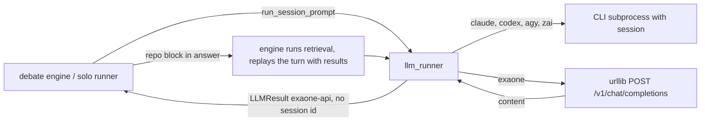

# EXAONE API provider for the debate engine (design)

English | [한국어](exaone-provider.ko.md)

Status: proposed 2026-11-09; all decisions made by the operator the same day; the codex transport was ruled out by a check with the key, so the stdlib HTTP design below stands; built 2026-11-09, deployed 2026-11-10 as `32bfd82` with the key on the hub and the six Tier-1 hosts.
Without `EXAONE_API_KEY` the provider is never ready, so building it changes nothing until a key is placed.
Origin: the operator wants LG AI Research's EXAONE models as debate and solo agents, through the official EXAONE API.

## Decisions

Made by the operator, 2026-11-09:

1. **Endpoint.** The official EXAONE API (`docs.exaone.ai`, "agent start" guide), not a third-party host.
2. **Fallback chain.** `exaone` joins the automatic fallback chain, not only explicit team picks. Revised 2026-11-11 by `opencode-exaone.md`: `opencode` (EXAONE through opencode) takes this place in the default chain; `exaone` stays selectable by name.

3. **Reasoning effort** `high` by default (B), changeable with `EXAONE_REASONING_EFFORT`.
4. **Key** on the hub and on the six Tier-1 worker hosts (C), like zai.
5. **Quick ask general mode** allows `exaone` (D): not in `GENERAL_EXCLUDED`.
6. **Transport.** The operator first chose the codex CLI (A), then the path "check, then decide": the check of
   2026-11-09 found no Responses API, so the transport is the **stdlib HTTP provider** (section "Design").

## Transport through codex (decision 6, ruled out)

What the operator chose: run the **codex binary** under a separate identity, the way zai runs the claude binary: its
own `CODEX_HOME`, a custom model provider set with `-c` overrides (`model_providers.exaone.base_url`, `env_key =
"EXAONE_API_KEY"`, `model_provider = "exaone"`, `-m k-exaone_v2.5`), the same session flags as codex (`exec`, `resume`,
read-only sandbox, repo MCP). That would give EXAONE sessions and the MCP repo tools, which the HTTP design lacks.

What was found on 2026-11-09:

- codex refuses `wire_api = "chat"` since about 0.122 (Chat Completions deprecated December 2025, removed February
  2026). Checked locally with codex 0.166.0: "`wire_api = "chat"` is no longer supported ... set `wire_api =
  "responses"`". The hub runs 0.160.0 and the Tier-1 hosts 0.163.0, so all of them refuse it.
- EXAONE documents only `POST /v1/chat/completions`. Neither the docs nor the changelog (one entry, 2026-11-09: the
  models are free through the API) mention the Responses API.
- Without a key every path, including a made-up one, answers 401 before routing.
- **Check with the key (2026-11-09, requests three seconds apart).** `POST /v1/chat/completions` answered 200
  (`content` "\n\nPONG", `reasoning_content` separate). `POST /v1/responses`, plain and streamed in the shape codex
  sends, answered `404 {"detail":"Not Found"}`, the same answer as the made-up `/v1/no-such-endpoint`. EXAONE does not
  serve the Responses API, so codex cannot reach it.

Ways forward, for the operator:

- **(a) Check, then decide (recommended, chosen).** Once the key is placed, one request to `/v1/responses` settles it.
  If EXAONE serves the Responses API, build decision 6 as written. If not, fall back to (b). The check found none.
- **(b) The stdlib HTTP provider** (section "Design" below), which works with what EXAONE documents.
- **(c) A local Responses-to-Chat translator** in front of codex. Not recommended: it has to reproduce the Responses
  streaming event format and tool calls, a large surface to keep in step with codex releases.

Outcome: (b). If EXAONE adds the Responses API later, the codex path can be reconsidered; nothing in (b) blocks it.

## What the API offers (read 2026-11-09)

Sources are listed at the end. Items marked *not documented* were looked for and not found.

| Item | Value |
| --- | --- |
| Base URL | `https://api.exaone.ai/v1`, OpenAI-compatible `POST /chat/completions` |
| Auth | `Authorization: Bearer $EXAONE_API_KEY` (the name `EXAONE_API_KEY` is the guide's own) |
| Model | `k-exaone_v2.5` (K-EXAONE 2.5); context 524 288 tokens; input plus `max_tokens` above that is a 400 |
| Reasoning | always on; `reasoning_effort` `low` / `high` / `max` (default `max`, `high` suggested for coding); `max_tokens` counts reasoning |
| Sampling | `temperature` 1.0 and `top_p` 0.95 recommended |
| Agents | `chat_template_kwargs.preserve_thinking: true` recommended for multi-turn agent use |
| Response | answer in `choices[0].message.content` (may start with a newline), reasoning in `message.reasoning_content`, `usage.reasoning_tokens` |
| Tools | OpenAI-style `tools` / `tool_calls` supported |
| Limits | 429 over the limit, with `retry-after` / `retry-after-ms` (may be absent); headers `x-{second,minute,day}-rate-limit[-remaining]`, `x-request-id`. Actual numbers per tier: *not documented*. **Measured 2026-11-09 for the operator's key: one request per second** (`RateLimitError,second limit(1)`, `retry-after: 1`, `retry-after-ms` about 600); the limit applies before routing, so even a 404 path counts. Minute and day limits not seen. |
| Price, key issuance | *not documented* in the pages read |
| Anthropic-compatible endpoint | none, so the zai pattern (the `claude` binary against another base URL) does not apply |
| Official CLI integrations | Hermes (`transport: chat_completions`), OpenCode (custom OpenAI-compatible provider, model `exaone/k-exaone_v2.5`) |

FriendliAI also served EXAONE models, but K-EXAONE is not on its serverless tier today (the free window ended
2026-01-28) and EXAONE 4.0 is on dedicated endpoints only. Decision 1 makes this background only.

## Design

`exaone` is a provider of its own that calls the EXAONE API **over HTTP from `llm_runner.py`** with `urllib`
(standard library, so the engine stays dependency-free). No binary is installed. It is stateless: each turn is one
request.



The diagram is also kept as [exaone-provider-flow.mmd](exaone-provider-flow.mmd).

| Piece | Rule |
| --- | --- |
| Order | `claude, codex, agy, zai, exaone, opencode, ollama, llm` (decision 2) until 2026-11-11; since `opencode-exaone.md` the default order is `claude, codex, agy, zai, opencode, ollama, llm` and `exaone` is a known provider outside it. Teams can pick it per member: `"providers": ["exaone"]`. |
| Ready | `EXAONE_API_KEY` is set. No binary check. `installed_providers` / `available_providers` list it only then. |
| Credentials | `env_policy`: `EXAONE_*` reaches only `exaone`. The key is read from the provider env at call time and sent only in the `Authorization` header to the configured base URL; it is never logged, put in an event, or echoed in an error. A missing key fails the call (`RuntimeError`). |
| Settings | `EXAONE_BASE_URL` (default `https://api.exaone.ai/v1`), `EXAONE_MODEL` (default `k-exaone_v2.5`), `EXAONE_REASONING_EFFORT` (default `high`, decision 3), `EXAONE_MAX_TOKENS` (default 65536; it counts reasoning too, see "Answer"), `EXAONE_TIMEOUT` (seconds, default: the runner's turn timeout; with streaming the total deadline), `EXAONE_STREAM` (streaming is on by default since 2026-11-10; `0`/`false`/`no`/`off` turns it off for diagnosis, section "Streaming"), `EXAONE_IDLE_TIMEOUT` (seconds without a byte while streaming, default 120). `EXAONE_BASE_URL` must be `https://`. |
| Request | One `user` message holding the combined prompt every stateless provider gets (`_build_prompt(prompt, context, system)`), so the runner's interface does not change. `temperature` 1.0, `top_p` 0.95, `reasoning_effort`, `max_tokens`, `stream: true` with `Accept: text/event-stream` by default (`stream: false`, one JSON answer, when `EXAONE_STREAM` turns it off). No `tools`: retrieval goes through ```repo blocks (below). |
| Answer | `message.content`, stripped. `reasoning_content` is dropped (not shown to other agents, not stored). Empty content is a failure, so the fallback continues. `finish_reason: "length"` is its own failure ("reasoning used max_tokens"), so a too-small budget is visible in the events and not mistaken for a model fault (the same trap as zai's thinking without an answer, `llm_runner.py` near the top). `preserve_thinking` is not sent: every request is a single message, so there is no earlier thinking to keep. |
| Sessions | None. `run_session_prompt` treats it like `opencode`: no session id, so the engine's existing replay (`advance()`, "=== Earlier in this turn ===") resends the turn with the retrieval results. The ```repo block protocol works unchanged; the read-only MCP server is not used. Results are labelled `exaone-api`, failures `exaone:`. |
| Pacing | The key allows one request per second (measured). A process-wide lock spaces request **starts** at least 1.1 s apart, so the parallel phases of one debate (`GUARDIAN_MAX_PARALLEL_AGENTS`, default 4) queue for a second instead of colliding. A request that runs for minutes does not hold the lock. Other processes (a second debate, a worker host with the same key) are not coordinated; the 429 rule covers them. |
| 429 and 5xx | Honour `retry-after-ms` / `retry-after` when it is at most 30 s, up to 5 times per turn (with a little jitter), then fail; without the header, or above 30 s (a minute or day limit), fail at once. A failure moves the fallback chain on instead of waiting out the turn timeout (lesson from zai's 429s, fixed 2026-10-29). |
| Other errors | 400 (for example context overflow), 401, 403: fail at once, message names the status and `x-request-id`, never the key. |
| Size guard | The context window is large (512 Ki tokens) but replayed turns grow. Above a byte cap (default 1.5 MiB of prompt, `EXAONE_MAX_PROMPT_BYTES`; provisional, since bytes per token vary and `max_tokens` is reserved from the same window) the call fails before sending, so the next provider gets the turn. A prompt under the cap that still overflows gets a 400 and fails just as fast. |
| Audit | `audit_run.AUDIT_PROVIDERS` stays `["claude"]`. |
| Workers | Workers ship `llm_runner.py` and `env_policy.py`, so a worker with the key can run `exaone` turns with no new file (decision C). |

Code (every place `zai` is wired was checked on 2026-11-09):

- `llm_runner.py`: `DEFAULT_PROVIDER_ORDER` (team validation, `flow_graph.py` and the worker payload check all accept
  exactly that list, so a team naming `exaone` is valid once it is in it), readiness in `_installed`, `_invoke_exaone`,
  error mapping. It is not in `SESSION_PROVIDERS`. The runner reads `~/.guardian/llm.env` itself (`load_llm_env`), and
  the Go agent passes its whole environment to the CLI (`debate_handler.go`), so the key needs no Go change.
- `env_policy.py`: `"exaone": ("EXAONE_",)`.
- `scripts/lib/llm-check.sh`: an `exaone` PONG line (skipped without a key); `worker_probe.py` reads the PONG lines, so
  a worker host with the key lists `exaone` in its `clis` after a re-probe.
- `scripts/deploy-llm-env.sh`: comment only (it copies the whole file, so the new key travels like the others).
- `solo_agent.py` `GENERAL_EXCLUDED` and its dashboard mirror `apps/web-desktop/src/lib/solo.ts`
  `GENERAL_EXCLUDED_PROVIDERS`, plus the comment in `solo_handler.go` (decision D).
- Dashboard: the provider pickers read `catalog.providers` / `catalog.installed` from the hub; the fixed fallbacks
  (`SOLO_PROVIDERS` in `solo.ts`, `PROVIDERS` in `PersonaEditor.tsx`) leave out zai today and would leave out exaone too
  (no change proposed).
- `debate_engine.py`: nothing; the standing instructions for claude/zai do not apply, and the replay path is reused.
- Public export: unlike `zai-agent.sh` and the zai design (excluded 2026-10-29 as operator-specific), the provider is
  general-purpose, so this document and the code are published.

Tests:
`cli/llm-agent/test_exaone_provider.py` with a local `http.server` fake: request shape, header, no key in errors or
events, `reasoning_content` dropped, 429 with and without `retry-after` (short retried, long or repeated fails), pacing
of parallel calls (starts at least 1.1 s apart, a slow call does not block the next start), 400/401, empty content, size guard,
readiness without a key, env isolation (`EXAONE_*` never reaches other providers, other keys never reach `exaone`).

## Open decisions

None. A-D were put to the operator on 2026-11-09 and answered as decisions 3-6: B `high`, C hub plus the six Tier-1
hosts, D allowed, A the codex CLI, which the check ruled out in favour of the HTTP provider.

## Risks

- **Automatic chain with an unknown quota.** Decision 2 means a failing claude/codex/agy/zai turn can spend EXAONE
  quota without anyone choosing it. The price per tier is not documented (the API is free since 2026-11-09 per the
  changelog). The fast 429 failure keeps the cost low; the `llm_runner` events show which provider answered.
- **One request per second.** One key is shared by the hub and six workers (decision C). Several debates at once, or
  a debate plus Quick ask, will meet 429s; short ones are retried, so the cost is seconds per turn, not failures. If
  429 failures show up in the events, give the workers keys of their own.
- **Data leaves for a third party.** Debate prompts contain repository code. The same is true of every provider in the
  chain; `is_secret` keeps secret files out of prompts for all of them.
- **No tool loop.** Without sessions every retrieval round resends the whole turn. That costs tokens, not correctness;
  the size guard bounds it.
- **Model drift.** `k-exaone_v2.5` is a named model; when the API retires it the provider fails with a 400/404 and the
  chain moves on. `EXAONE_MODEL` changes it without a code change.

## Operations

- The operator obtains an API key from the EXAONE console and adds `EXAONE_API_KEY=...` to the local
  `~/.config/server-guardian/llm.env` (mode 600) by **merging** the line in, never rewriting the file. Then
  `scripts/deploy-llm-env.sh <hub> <six Tier-1 hosts>` (hosts must be named; decision C names all seven). The variable
  must be spelled `EXAONE_API_KEY` exactly; the first line placed on 2026-11-09 read `EXAONE_API_KE`.
  The key is never printed or put in git.
- `scripts/lib/llm-check.sh` prints an `exaone` PONG line (one tiny request, `reasoning_effort` `low`), skipped when
  the host has no key.
- First use after the build: one solo run (Quick ask, provider `exaone`) and one trial debate on the hub sandbox
  (`~/guardian-eval`), both only with the operator's OK.

## Streaming (reviewed 2026-11-10, deciding test passed, built 2026-11-10, deployed 2026-11-10, trial APPROVED, default since 2026-11-10, deployed as `f093b62`)

Why: both trials lost their exaone critics to a cut near 600 s (see the last two notes in "구현 메모"). Streaming
(`stream: true`) helps only if that cut counts idle time between bytes; a limit on the whole request stays.

What the probe showed (one small request from the hub, effort `low`, 2026-11-10, log in
`~/guardian-eval/exaone-stream-probe/tiny.log`):

- The answer is `text/event-stream`, chunked: `data: {...}` lines separated by blank lines, then `data: [DONE]`.
- Chunks follow the Chat Completions shape: the first carries `delta.role`, then `delta.reasoning_content` pieces, then
  `delta.content` pieces, then a chunk with an empty delta and `finish_reason` (plus `matched_stop`), then a usage
  chunk with `choices: []` and `usage.reasoning_tokens`, sent without `stream_options`.
- Reasoning streams token by token (first byte 0.35 s, longest gap 0.4 s), so a long high-effort turn keeps sending
  bytes the whole time.
- The answer passes a Google Cloud load balancer (`via: 1.1 google`, `GCLB` cookie). Its backend service timeout counts
  the whole request, streamed or not (Google's request-distribution page). The 600 s failures were not that timeout:
  they came back as 500 with a JSON body and an `x-request-id`, written by EXAONE's own service behind the balancer,
  so the balancer's limit is above 600 s. Unknown: whether the service's own 600 s cut is idle time (streaming helps)
  or total time (it does not). The `{"detail":"Not Found"}` 404 points to a Python (FastAPI) gateway; 600 s is the
  default timeout of common Python HTTP clients, which count it per read. A hint, not a finding.

The deciding test (run 2026-11-10, log `~/guardian-eval/exaone-stream-probe/big.log`): the QA critic's replayed
prompt from the second trial, rebuilt from its saved first prompt plus the seven step-1 results read again from the
workspace at the same commit (138 KB; the engine's copy was about 146 KB with its line numbers and headers; the critic's
own first reply is not stored, so its retrieval request is written out in its place), sent at effort `high` with
`stream: true`. Result: status 200, first byte after 1.8 s, longest gap between lines 1.8 s, then `finish_reason:
"stop"`, the usage chunk and `[DONE]` after **1029.8 s**, no error. Usage: 38,364 prompt tokens and 20,730 completion
tokens, 20,564 of them reasoning (166 tokens of answer). So EXAONE's 600 s cut counts idle time, not total time, and
streaming removes it: without streaming the first byte comes only when the whole answer is done, so a request whose
reasoning runs past 600 s is cut before it sends anything.

Design, built 2026-11-10 (opt-in `EXAONE_STREAM=1` until a trial passes; the current path stays; deviations in the
last note of "구현 메모"):

- Read the body line by line; join `delta.content`; drop `delta.reasoning_content` as today (it still counts as a
  sign of life); keep the last `finish_reason`; `length` keeps its "raise EXAONE_MAX_TOKENS" failure.
- The socket timeout becomes an idle timeout (`EXAONE_IDLE_TIMEOUT`, default 120 s), and a separate total deadline
  (`EXAONE_TIMEOUT`, else the turn timeout) is checked between lines, so a turn cannot run to the job's one hour.
- A stream that ends without `[DONE]` or without a `finish_reason`, or that carries an `error` object, fails the turn.
  Partial text is never returned: a cut-off critique would read as a whole one.
- Only HTTP errors before the body starts are retried (the existing 429/5xx rule); a failure inside the stream moves
  the fallback chain on. Pacing is unchanged.
- Tests: `_FakeExaone` serves chunked SSE; cases for joined content, dropped reasoning, `length`, an error chunk, a
  missing `[DONE]`, the idle timeout and the total deadline.
- Built by a z.ai agent and reviewed by claude or codex, like the provider itself.

Limit of the remedy: the test request alone took 17 min and spent 99 % of its tokens on reasoning. A critic that reads
three times needs three such requests, near or past the one-hour job timeout. Streaming removes the 600 s cut, nothing
more; pairing it with effort `low` for debate seats or a smaller read budget per exaone turn is likely still needed.
Deployed 2026-11-10 as `a36e0b9` with `EXAONE_STREAM=1` merged into the hub's `llm.env`; the trial then passed (last
note in "구현 메모"). Since the file is shared, exaone fallback turns in production stream too. The margin stays thin:
the longest request ran 1129 s against `EXAONE_TIMEOUT=1200`. The total deadline, not `max_tokens`, is what limits a turn,
and the same 1200 s on the opencode path has already cut one turn (analysis of 2026-11-19, last note in "구현 메모").
Open (operator's choice): record each request's time and token usage first (cheap, code; built 2026-11-19 as event
`provider_usage`, deployed 2026-11-19 as `b3c09d2`), a larger `EXAONE_TIMEOUT` and
`OPENCODE_TIMEOUT`, or effort `low` for debate seats. The measured re-run of 2026-11-19 (last note in "구현 메모")
shows the margin is already exceeded: 2 of 10 exaone requests hit 1200 s.
The low-effort trial of 2026-11-19 (same note) stayed far inside the deadline (longest request 597 s, APPROVED in
1414 s) but lost a critique: effort `low` is not recommended for debate seats on one run.

Default since 2026-11-10 (operator's decision after the trial): exaone is always handled with streaming. `EXAONE_STREAM`
is no longer needed to turn it on; `EXAONE_STREAM=0` (or `false`/`no`/`off`) turns it off for diagnosis, and that JSON
request stays byte for byte as before. Worker hosts carry their own copy of `llm_runner.py` (`deploy/worker/files.txt`),
so they stream by default only after `install-worker.sh` runs again.

## Sources (read 2026-11-09)

- https://docs.exaone.ai/ko/docs/agent-start
- https://docs.exaone.ai/ko/docs/k-exaone-2.5
- https://docs.exaone.ai/ko/docs/rate-limits
- https://docs.exaone.ai/ko/docs/authentication
- https://docs.exaone.ai/ko/docs/changelog
- https://github.com/openai/codex/discussions/7782 (`wire_api = "chat"` removed)
- https://friendli.ai/docs/guides/tutorials/getting-started-with-exaone-4.0
- https://friendli.ai/models?products=SERVERLESS
- https://docs.exaone.ai/ko/docs/error-codes (read 2026-11-10; 500 is "internal", no duration limit documented)
- https://docs.cloud.google.com/load-balancing/docs/https/request-distribution (read 2026-11-10; backend service timeout)

## 구현 메모

Built 2026-11-09 by a z.ai agent (`scripts/zai-agent.sh`), reviewed by claude; deployed 2026-11-10 as `32bfd82`.

- `llm_runner.py`: provider `exaone` after `zai` in `DEFAULT_PROVIDER_ORDER`; ready when `EXAONE_API_KEY` is set (no
  binary lookup); `_invoke_exaone` split into `_exaone_config`, `_exaone_send` and `_exaone_answer`; module-level
  `_exaone_pace()` spaces request starts 1.1 s apart and releases its lock before the request; label `exaone-api` via
  `_label` in the two run loops only. `interactive_resume_command` refuses exaone like opencode.
- `env_policy.py`: `EXAONE_` prefix. `solo_agent.py`, `solo.ts`: comments only (general mode allows exaone).
- Tests: `test_exaone_provider.py`, 21 cases against a local `ThreadingHTTPServer`; the provider accepts loopback
  `http://` only while the module flag `_EXAONE_ALLOW_LOOPBACK_HTTP` is set, which no environment variable can do.
- Deviations from the design: (1) the `llm-check.sh` PONG line hands the key to curl on stdin (`-H @-`), so it never
  shows in an argument list; (2) an `HTTPError` is closed after its body is read, which frees the socket at once.
- Checked: full `scripts/ci.sh python shell` passed (2344 tests); one real PONG call from the Mac with the operator's
  key passed.
- Key deploy (2026-11-10): not with `scripts/deploy-llm-env.sh`, which replaces the host file with the Mac's and would
  have dropped the hosts' `ZAI_*_MODEL` pins (and spread `OPENROUTER_API_KEY`). Only the `EXAONE_` line was merged into
  `~/.guardian/llm.env` of the hub and the six Tier-1 hosts over ssh stdin (backup `llm.env.bak-exaone`, mode 600);
  then `deploy-llm-env.sh --check-only` on all seven: claude, codex, agy, zai and exaone answer PONG.
- Hub deploy 2026-11-10 as `32bfd82` (release `32bfd82-20261110011344`); `GET /api/teams` lists `exaone` in
  `catalog.installed`.
- Solo run 2026-11-10 (`solo_20261110_015412_6846dc`, general mode through `POST /api/solo`, provider `exaone`):
  answered in 19.9 s, label `exaone-api`, no failures, not degraded, a correct three-point Korean answer.
- Trial debate 2026-11-10 on the hub sandbox (`~/guardian-eval/run-exaone-trial.sh`, data dir `data-exaone`, thread
  `thread_20261110_022002_d7938b`; same task and commit `6e0fb08` as the C1 trial of 2026-10-31; team `exaone-trial`:
  lead and judge on claude, the security and QA critics on exaone, no codex): **UNVERIFIED** in round 1 after 24 min.
  The QA critic answered through `exaone-api` (three retrieval steps, 20.8 min, 14.7 KB; 17 cited lines checked,
  0 mismatched). It confirmed the lead's two real defects, corrected two overstated ones and added two of its own. The
  security critic read once, then its second request hit the 600 s read timeout (`GUARDIAN_LLM_TIMEOUT`, which exaone
  uses when `EXAONE_TIMEOUT` is unset). The built-in fallback took its seat, so the round is UNVERIFIED although the
  judge approved the same two defects as the C1 trial. No 429, no retry. The time per request grew with the turn
  (about 18 s, 3 min, 7.5 min, 9.5 min for the QA critic's four requests): high effort with `max_tokens` 65536 can think
  for longer than the timeout on a 50-70 KB prompt. Open: raise `EXAONE_TIMEOUT`, lower the effort or `max_tokens` for
  debate seats (operator's decision), then run the trial again.
- Timeout 2026-11-10 (operator's choice of the two remedies; the other was effort `low`): `EXAONE_TIMEOUT=1200` merged
  as one line into `~/.guardian/llm.env` on the hub and the six Tier-1 hosts (only `EXAONE_TIMEOUT` lines replaced, the
  key kept; backup `llm.env.bak-exaone-timeout`), no restart since the runner reads the file per turn. On the hub
  `_exaone_config()` now returns 1200 s while the other providers keep `GUARDIAN_LLM_TIMEOUT` 600 s; effort stays
  `high`, `max_tokens` 65536. A debate job is still bounded by the agent's job timeout (default 1 h).
- Trial re-run 2026-11-10 with `EXAONE_TIMEOUT=1200` (same script, first run kept as `runs-exaone-1-timeout600`;
  thread `thread_20261110_051146_407b77`): **UNVERIFIED** in round 1 after 1714 s, worse than the first run. The lead
  (claude) answered in 109 s. Both exaone critics read once or twice and then got `HTTP 500` ("The service is currently
  experiencing a temporary issue") 600.2 s and 600.45 s after the request was sent (QA critic: prompt about 146 KB
  after one 98 KB read; security critic: about 194 KB after reads of 64 KB and 81 KB). Both seats fell back to the
  built-in answer, so the engine marked the round UNVERIFIED although the judge's text approved the lead's two defects.
  With the first run's 600 s client timeout this makes three failures at 600 s, and the first run's longest successful
  request took about 9.5 min: the limit is on EXAONE's side (a gateway cut near 600 s answered as 500), so
  `EXAONE_TIMEOUT` above 600 s does not help. A 500 without `Retry-After` is not retried by design. Requests grow
  because exaone has no session: each retrieval step resends the prompt with everything read so far
  (`docs/design/agent-prompt-layers.md`, L5-L7). Open (operator's decision): effort `low` for debate seats, streaming
  (`stream: true`; helps only if the cut is on time to first byte, unverified), or a smaller retrieval budget per
  exaone turn; then run the trial again.
- Streaming deciding test 2026-11-10 (section "Streaming"): one streamed request at effort `high` on the rebuilt 138 KB
  QA critic prompt finished after 1029.8 s with `finish_reason: "stop"` and `[DONE]`, longest gap 1.8 s. The 600 s cut
  counts idle time, so streaming avoids it.
- Streaming built 2026-11-10 (section "Streaming"), off unless `EXAONE_STREAM` is set, not deployed. Built by a z.ai
  agent in two runs (the second fixed the review's findings), reviewed by claude; z.ai's sandbox could not run python, so
  the tests ran outside it. `_exaone_send` takes a reader: the JSON reader keeps the non-streaming path byte-identical,
  the stream reader runs inside the same try, so only errors before the body are retried. The total deadline is also
  checked before each attempt and before a retry sleep, and its message names its source (`EXAONE_TIMEOUT` or
  "turn timeout"). The key is replaced before error texts are cut to 200 characters. An empty `finish_reason` does not
  count as a finish. Tests use a real chunked HTTP/1.1 fake. Known limits, accepted: the wait for the response headers
  uses the idle timeout and fails as "request failed: timed out"; a body cut mid-chunk (`IncompleteRead`) fails as
  "request failed" without a retry; a multi-line SSE event (several `data:` lines) fails closed as malformed; the
  deadline is not checked inside one very long line.
- Streaming deployed 2026-11-10 as `a36e0b9`; `EXAONE_STREAM=1` merged as one line into the hub's `llm.env` (backup
  `llm.env.bak-exaone-stream`). Trial re-run the same day (same script and team, thread
  `thread_20261110_093329_bb6b43`): **APPROVED** in round 1 after 3900 s, jev gate PASSED, three actions proposed, no
  fallback. Both critics answered through `exaone-api`: security in 1844 s (3 steps, 10 citations, none unverified, 16
  evidence items, none mismatched), QA in 3686 s (4 retrieval steps, 9 citations, none unverified, 11 evidence items, none
  mismatched). Several requests passed the old 600 s cut without an error: 625 s, 869 s, 975 s and 1129 s between
  events, the last one 71 s under the 1200 s deadline. The jev verdict (shadow) was `uncertain` (p 0.68), the LLM judge
  approved. The run took 65 min; the hub sets `GUARDIAN_DEBATE_TIMEOUT=7200`, so it fits a production job, but not the
  one-hour default.
- Streaming made the default 2026-11-10 by the operator's decision ("exaone must be handled with streaming"). Built by a
  z.ai agent, reviewed by claude: `_exaone_stream_flag` now returns off only for `0`/`false`/`no`/`off` (case-insensitive,
  stripped); unset, empty and any other value stream. Tests: the JSON-answer classes (request shape, answer, retry,
  pacing, the oversize guard) set `EXAONE_STREAM=0` explicitly; a new test removes the variable inside the patch so the
  default is checked whatever the developer's shell exports (passed with the shell set to `0` and to `1`). Deployed
  2026-11-10 as `f093b62` (release `f093b62-20261110114645`, no debate running); on the hub release the flag reads on
  with the variable unset, off for `0`, on for `1`. The hub's `EXAONE_STREAM=1` line stays and is harmless. The six Tier-1
  workers were reinstalled the same day with `install-worker.sh --rev f093b62` (they had run `68f441e` of 2026-10-31,
  older than the provider): all six passed the hub-path acceptance ping, now list `exaone` among their providers, and
  their installed `llm_runner.py` streams with the variable unset (none of their `llm.env` files sets it). No team has a
  `host` with an exaone seat yet, so no worker has served an exaone turn.
- Deadline margin, analysis 2026-11-19 (read only, no setting changed). Sources: the critics' events in
  `~/guardian-eval/runs-exaone` (the APPROVED trial) and `runs-opencode-mcp`, and the streaming probe log of 2026-11-10.
  A request's time is the gap between a critic's events (start or served read, to the next read request,
  `pseudo_tool_call` or finish), so it includes the 1.1 s pacing and any retry before the body: not a wire measurement.
  - The trial's twelve streamed requests all succeeded: QA critic 32, 9, 869, 625, 251, 437, 333 and 1129 s, security
    critic 222, 313, 333 and 975 s. Four passed 600 s. The two longest were each critic's final answer, not its largest
    prompt (QA: 869 s at about 72 KB, 333 s at about 100 KB): the time follows how long the model reasons, not the
    prompt size.
  - Throughput, an estimate from one request run alone: the probe's 138 KB prompt (38,364 prompt tokens) gave 20,730
    completion tokens, 20,564 of them reasoning, in 1028 s after a 1.8 s first byte, about 20 tokens/s. In the trial two
    critics ran at once under pacing, so their rate may differ. At that rate 1200 s holds about 24,000 completion tokens
    (1129 s about 22,500) and `max_tokens` 65536 would need about 3,300 s: the deadline is the binding limit. Lowering
    `max_tokens` would only turn a deadline failure into a `length` failure, which fails the turn the same way.
  - One real hit already, on the opencode path: in the MCP re-trial of 2026-11-12 the security critic's call stopped with
    "timed out after 1200s (OPENCODE_TIMEOUT)" after 13 steps and 2376 s of the seat, and the seat took the built-in
    answer. `OPENCODE_TIMEOUT` (default 1200) bounds one whole opencode run, which may hold several model requests and
    MCP calls, so at the same number it is tighter than `EXAONE_TIMEOUT`, which bounds one request.
  - Cost of a hit: the stream is dropped (partial text is never returned) and nothing inside the body is retried; the
    seat moves down its provider chain, and a seat that lists only exaone ends on the built-in answer, which makes the
    round UNVERIFIED. Since `4b79b52` a citation re-ask that fails keeps the first answer; a hit on a read step or on the
    first answer still loses the whole seat's work (about 61 min for the trial's QA critic). A stalled stream is already
    cut by `EXAONE_IDLE_TIMEOUT` (120 s); the total deadline only bounds a stream that keeps sending.
  - Exposure: no hub team or flow seats `exaone` (checked 2026-11-19) and no production debate has used it since
    2026-11-10. Since 2026-11-11 `opencode` holds exaone's place in `DEFAULT_PROVIDER_ORDER`, so a production fallback
    turn reaches K-EXAONE through opencode's 1200 s. The next team with an exaone seat (the standing advice until an
    opencode re-trial passes) meets `EXAONE_TIMEOUT` directly. The hub and the six Tier-1 hosts set `EXAONE_TIMEOUT=1200`;
    the hub sets no `OPENCODE_TIMEOUT` and no effort.
  - Options, none applied (each needs the operator's OK):
    1. Measure: log each streamed request's elapsed time and the final `usage` chunk (completion and reasoning tokens)
       in an event, so the margin is read instead of inferred from gaps. A small change for a z.ai agent.
    2. Raise both totals, for example `EXAONE_TIMEOUT=2400` and `OPENCODE_TIMEOUT=2400` (about 48,000 tokens at the
       estimated rate): one merged line per host, no code, read per turn. The cost moves to the job: the QA critic
       already used 3686 s of the hub's `GUARDIAN_DEBATE_TIMEOUT=7200`, so a seat with several long requests then meets
       the job bound instead.
    3. Effort `low` (`EXAONE_REASONING_EFFORT`, `OPENCODE_EXAONE_EFFORT`): fewer reasoning tokens, quality not measured.
       The setting is per host, so it also covers solo runs; it needs a trial.
    4. A smaller read budget per exaone turn: the times above do not follow prompt size, so the gain is doubtful.
  - Recommended: 1 now; 2 at 2400 s for both paths before a team seats exaone or the opencode re-trial runs; 3 only
    after a trial shows the critiques hold at `low`.
- Option 1 built 2026-11-19 (operator's choice of the same day), deployed 2026-11-19 as `b3c09d2`: event `provider_usage` (contract in
  `debate-agent-retrieval.md`). `LLMResult.stats` carries one successful exaone or opencode turn's numbers; the
  runner keeps them in a `threading.local()` because the parallel agents of one debate share one runner, resets them
  for each provider in `run_session_prompt`, and the engine emits the event after the turn's `provider_failed` lines.
  The usage chunk is read without asking for it (the request body is unchanged, still no `stream_options`); the JSON
  path reads `usage` from the payload. Built by a z.ai agent (it ran out of time before the docs), reviewed by claude:
  one fix, the generic invoker path copied the stats before the call ran, so exaone results carried none. Deviations
  from option 1 as written: `first_byte_s` counts from the start of the successful attempt and so includes the pacing
  wait (at most about 1.1 s); opencode gets elapsed time and its deadline only (one event per run, no tokens); worker
  turns carry no stats (`remote_agents.py` is unchanged). No setting changed.
- Usage trial 2026-11-19 (operator's choice "measure exaone directly"): the 2026-11-10 trial (team `exaone-trial`, two
  exaone critics, claude expert and judge, workspace at `6e0fb08`, `TeamManager.save` review) re-run on `b3c09d2` in the
  hub sandbox (`~/guardian-eval/runs-exaone-usage/`, own data dir), effort high (no `EXAONE_REASONING_EFFORT`),
  `EXAONE_TIMEOUT=1200`, stream on. Result UNVERIFIED after 3664 s.
  - Successful requests (`provider_usage`): QA critic 15.8, 11.6, 38.1, 305.3 s; security critic 309.9, 934.9, 352.0,
    510.2 s. The long ones spent 95-99 % of their completion tokens on reasoning (for example 934.9 s: 17,575 completion,
    17,472 reasoning, prompt 28,076 tokens). Throughput 19-26 completion tokens per second, so 1200 s holds about
    22,000-28,000 tokens. `first_byte_s` 0.5-2.1 s: pacing and queueing do not matter.
  - Two requests hit the 1200 s deadline: the QA critic's citation re-ask (`reask_failed`, the first answer of 3395 bytes
    kept, `4b79b52` working) and the security critic's fifth read step (the seat fell back to the built-in answer after
    3307 s, which made the round UNVERIFIED). The 2026-11-10 run passed with a longest request of 1129 s, so 1200 s is not
    a thin margin but a limit that a high-effort turn crosses in about one run in two.
  - Elapsed time does not follow the prompt size (91 KB took 935 s, 105 KB 510 s); the reasoning length decides it.
  - Gap: a request that fails records only `provider_failed`, so a timed-out request's elapsed time is read from the
    error text, not from an event.
  - Reading of the options: raising both totals alone moves the failure to the job bound (the security seat already used
    3307 s of `GUARDIAN_DEBATE_TIMEOUT=7200`; one more 2400 s request would pass it). Effort `low` attacks the reasoning
    tokens that fill the deadline, but its effect on the critiques is not measured. Next step proposed: the same trial
    with `EXAONE_REASONING_EFFORT=low` in the sandbox only. Nothing changed on the hub.
- Low-effort trial 2026-11-19 (operator's choice "try low"): the same trial with `EXAONE_REASONING_EFFORT=low` exported
  by the trial script (the hub `llm.env` has no effort key, so the export takes effect), hub sandbox
  (`~/guardian-eval/runs-exaone-low/`, own data dir), release `293c446`. Result APPROVED in round 1 after 1414 s (high:
  UNVERIFIED after 3664 s), no `provider_failed`, no fallback.
  - Requests: security critic 112.9, 10.3, 200.0, 194.6 s; QA critic 596.8, 106.8, 7.8, 35.1, 8.6, 373.4, 27.0 s. Longest
    597 s, half the deadline. The reasoning share swings with the request: 54 of 2255 completion tokens in one, 8582 of
    8886 in another, so `low` shortens most turns but does not cap reasoning.
  - Quality: the security critic wrote a full critique (9376 bytes, citations all verified): it confirmed the three
    defects B1-B3 of the expert's proposal and raised one patch hazard that was wrong (a non-string `created` is turned
    into `TeamValidationError` and caught), which the judge rejected. The QA critic lost its critique: its first answer
    (596.8 s, 6 evidence items verified) got a citation re-ask, the re-ask answered with read requests, 3 of its 4 repo
    blocks were invalid JSON (`Expecting ',' delimiter`), and its final output was a bare `{"requests": [...]}` of 611
    bytes, which the engine kept as the answer. The judge still approved on the expert's evidence and the security
    critique (it credited the QA critic with a correction that the security critic made).
  - Reading volume: the two critics got 9 reads served (3 more blocks were invalid) against 34-37 in the high runs; the original high run
    (2026-11-10) had two critiques of 11-12 KB, both with all citations verified, and its QA critic also named the fixed
    `.tmp` name, which no low critic did.
  - Engine gap found (every provider): a citation re-ask whose answer is only a retrieval request, or carries no
    findings, replaces a good first answer. `4b79b52` keeps the first answer only when the re-ask falls back. Fixed in
    `03d2f9c` (deployed 2026-11-20 as `5d8bb94`) for a re-ask reply that holds no answer (whitespace, a bare request, also cut off, an engine
    placeholder): the first answer and its first citation check stay, `reask_failed` carries `reason: "no_answer"`. A
    shorter real answer still replaces the first one, because the re-ask tells the agent to drop unbacked claims.
  - Reading: on one run each, `low` removes the deadline problem but halves the critics' reading and broke one critique
    through format errors; it is not recommended for debate seats. Nothing changed on the hub. The deadline options of
    the previous note stand.
