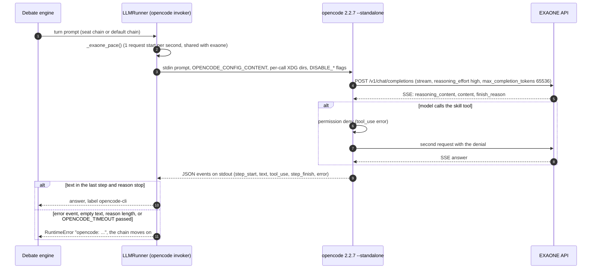

# opencode를 통한 EXAONE (설계)

[English](opencode-exaone.md) | 한국어

상태: 2026-11-11 제안. 같은 날 운영자가 아래 결정을 내렸다. 2026-11-11 구현하고 허브에 `44f2054`로 배포했다
(첫 실제 호출 통과). 2026-11-11 Tier-1 워커 여섯 대에도 설치했다(워커를 `44f2054`로 다시 설치, 워커 실행 한 번
통과). 2026-11-11 시험 토론은 1라운드에서 APPROVED(1519초)였다. 그러나 opencode 비평가 둘 중 하나는 코드를
읽지 못했다. opencode 아래의 K-EXAONE은 ```repo 블록을 쓰지 않고 네이티브 `repo` 도구를 부르려 한다(구현 메모
참조). 수정은 2026-11-11 구현해 허브에 `a86fc63`로 배포했다. `code_tools: "mcp"`인 opencode 구성원은 읽기
전용 `repo_mcp.py` MCP 서버로 코드를 읽는다(허브 실제 호출 통과). 2026-11-12 재시험은 UNVERIFIED였다. MCP
경로는 동작했다(지난번에 아무것도 읽지 못한 비평가가 MCP로 6단계를 읽었고, 근거 10/10 확인). 그러나 opencode 비평가
둘 다 답이 판정자에게 가지 못했다. 하나는 EXAONE 자체의 429("too many concurrent requests")를 받았고 opencode 경로는
재시도하지 않는다. 다른 하나는 인용 재질문이 1200초에서 시간 초과되면서 좋은 첫 답을 잃었다(모든 공급자에 해당하는
엔진 결함, 구현 메모 참조). 두 문제 모두 2026-11-14 고쳐 허브에 `4b79b52`로 배포했다. 내장 대체로 끝난 재질문은
첫 답을 지키고(이벤트 `reask_failed`), opencode 공급자는 같은 마감 안에서 EXAONE의 429를 재시도한다. 재시험은 아직
하지 않았다. 재시험이 통과할 때까지 토론 자리에는 계속 `exaone`을 쓴다. Tier-1 워커 여섯 대는
2026-11-17 상주 에이전트용(worker protocol 3)으로 `5d34ce8`에 다시 설치해서 `a86fc63`의 MCP 경로와 `4b79b52`의
수정이 들어 있다. 위의 토론 자리 규칙은 그대로다.
배경: 운영자는 K-EXAONE을 opencode CLI로 쓰고 싶어 한다. 방식은 EXAONE "agent start" 안내서
(`docs.exaone.ai/ko/docs/agent-start`)를 따르고, `exaone-provider.ko.md`의 HTTP 공급자와 나란히 둔다.
이 문서는 `exaone-provider.ko.md`의 결정 2(exaone을 자동 대체 사슬에 넣음)를 고친다.

## 결정

2026-11-11 운영자 결정:

1. **HTTP 공급자 옆에 둔다.** stdlib HTTP 공급자 `exaone`은 그대로 남기고, opencode를 그 옆에 더한다.
2. **작업 순서.** Mac에서 먼저 확인한다. 그다음 허브에 설치하고 Guardian에 연결한다.
3. **opencode 계열.** EXAONE 안내서가 다루는 v2 계열 `@opencode/cli` **2.2.7**을 쓴다. 설정 스키마와
   `--standalone`도 그 안내서를 따른다. Homebrew의 `opencode-ai` 1.x 계열은 쓰지 않는다.
4. **대체 사슬.** 운영자의 답은 "open code로 대체"였다. 이를 다음과 같이 읽는다.
   - 기본 사슬에서 `opencode`가 `exaone`의 자리를 차지하고, `exaone`은 기본 사슬에서 빠진다.
   - `exaone`은 알려진 공급자로 남는다. 자리, 팀 구성원, 빠른 질문에서 이름으로 고르면 계속 쓸 수 있다.

   짧은 답을 해석한 것이므로, 운영자가 바로잡을 수 있도록 여기에 적어 둔다.

## 측정한 것 (Mac, 2026-11-11)

로컬의 가짜 OpenAI 호환 서버로 측정했다. 서버는 `stream` SSE로 다음 모드를 흉내 냈다: 정상, 429,
`retry-after`가 붙은 429, 500, 멈춤, `length`, 도구 호출. 실제 EXAONE API로도 한 번 호출했다.

| 주제 | 결과 |
|---|---|
| 실제 API | 안내서의 v2 설정에 아래 조정을 더하자 약 2초 만에 `PONG`이 돌아왔다. |
| 요청 | `stream: true`와 `stream_options.include_usage`가 붙는다. `reasoning_effort`, `temperature`, `top_p`는 모델의 `body`에서 온다. `max_completion_tokens`는 `limit.output`에서 온다(기본 32000). `body`에 `max_tokens`를 넣으면 서로 충돌하는 필드가 하나 더 생긴다. 그래서 출력 한도는 `limit.output`에만 둔다. 실제 API는 `max_completion_tokens`를 받아들였다. |
| 도구 | `permission: {"*": "deny"}`를 주면 제공되는 도구가 `skill` 하나로 줄고, 시스템 프롬프트도 약 1.8 KB로 준다. `skill`은 없앨 수 없다. `skills: []`, `"none"`, `disableBundledSkills`, `skill: deny`를 모두 시도했지만 남았다. 모델이 `skill`을 부르면 opencode가 거부하고(`Permission denied: skill`, 실행 안 함) 두 번째 요청을 보낸다. 답은 마지막 단계에 있다. |
| 재시도 | 429, `retry-after`가 붙은 429, 500 모두 10번 재시도한다(요청 11번, 82-84초). 그 뒤 `error` 이벤트를 내고 종료 코드 1로 끝난다. 1.x는 5번 재시도한다. |
| 멈춤 | 스트림이 보내기를 멈추면 두 계열 모두 끝없이 기다린다. 호출하는 쪽에 자체 마감 시간이 필요하다. |
| 이벤트 | `--format json`은 한 줄에 JSON 객체 하나를 찍는다. 종류는 다음과 같다. `step_start`. `text`(`part.text`, 앞에 빈 줄이 붙을 수 있음). `tool_use`(`part.state.status`, `error`). `step_finish`(`part.reason`, `part.tokens`). `retry`. `error`(`error.type`, `message`, `status`, `response.body`). |
| 세션 데이터 | `XDG_*` 디렉터리를 격리하자 그곳에 아무것도 쓰이지 않았다. Mac에서는 세션 저장소를 찾지 못했다. 허브에서 확인할 것. |
| 바이너리 | npm이 플랫폼별 네이티브 바이너리를 선택 의존성으로 설치한다(`@opencode/cli-linux-arm64`, `bin/opencode`). 실행할 때 node 버전은 상관없다. |

안내서 설정과 일부러 다르게 한 점:

- `reasoning_effort`는 안내서의 `medium`이 아니라 **high**로 둔다. `exaone-provider.ko.md` 결정 3에 따른
  운영자의 선택이다.
- 출력 한도는 `body`의 `max_tokens`가 아니라 `limit.output: 65536`에 둔다. 위에서 본 충돌 때문이다.
- `capabilities.tools: false`와 `permission: {"*": "deny"}`를 준다. HTTP 공급자와 마찬가지로 에이전트는 ```repo
  블록으로 코드를 읽는다. opencode는 도구를 실행하면 안 된다.
- 키 변수는 `EXAONE_API_KEY`가 아니라 `OPENCODE_EXAONE_API_KEY`다. `env_policy.PROVIDER_PREFIXES`가 opencode
  공급자에게는 `OPENCODE_*` 변수만 넘기기 때문이다. 값은 같은 키다.

## 설계



다이어그램은 [opencode-exaone-flow.mmd](opencode-exaone-flow.mmd)에도 따로 둔다.

### 공급자 목록

`llm_runner.py`의 목록을 하나에서 둘로 나눈다.

| 목록 | 내용 | 쓰는 곳 |
|---|---|---|
| `KNOWN_PROVIDERS` | `claude, codex, agy, zai, exaone, opencode, ollama, llm` | 공급자 검증(`team_manager`, `flow_graph`, `worker`), 편집기 카탈로그(`config_ops`), `installed_providers` |
| `DEFAULT_PROVIDER_ORDER` | `claude, codex, agy, zai, opencode, ollama, llm` | 자리도 `GUARDIAN_LLM_PROVIDERS`도 공급자를 정하지 않았을 때의 사슬 |

`GUARDIAN_LLM_PROVIDERS`는 여전히 기본 순서보다 우선한다. `["exaone"]`처럼 명시한 선택도 계속 동작한다.

### opencode 호출기

`opencode` 공급자는 이제 범용 `opencode run <prompt>`가 아니다. "opencode를 통한 EXAONE"이 된다.
2026-11-11에 읽기만 하여 확인했다.
- 허브와 Tier-1 여섯 호스트 어디에도 `opencode` 바이너리가 없다.
- 허브 데이터 디렉터리의 팀, 흐름, 캐릭터, 프로젝트 파일 중 `opencode`를 적은 것이 없다.
- 저장소의 `configs/`와 golden 파일에도 없다.

따라서 예전 의미에 기대는 팀은 없다.

- **바이너리.** `OPENCODE_BIN`으로 정한다(기본은 검색 경로의 `opencode`). Mac의 PATH에는 Homebrew
  `opencode-ai` 1.x가 있고, 이것은 `--standalone`을 모른다. 그래서 준비 조건을 볼 때 `<bin> --version`도 실행해서
  주 버전이 2인지 확인한다(v2 바이너리는 `opencode v2.2.7`, Homebrew 1.x는 `1.19.5`만 출력한다). 이 확인은 바이너리 경로와 수정 시각마다 한 번만 한다. 1.x 바이너리면 공급자는 준비되지
  않는다.
- **준비 조건.** 그 바이너리가 버전 확인을 통과하고, `OPENCODE_EXAONE_API_KEY`도 설정되어 있어야 한다. 키가 없으면
  공급자는 준비되지 않는다. 그래서 키를 두기 전에는 빌드해도 아무것도 바뀌지 않는다.
- **명령.** `opencode run --standalone --format json --title guardian -m exaone/k-exaone_v2.5`. 프롬프트는
  **stdin**으로 넘긴다. 턴은 수백 KB에 이르므로 argv에는 프롬프트를 넣지 않는다.
- **설정.** Python에서 만들어 `OPENCODE_CONFIG_CONTENT`로 넘긴다. 호스트에 파일을 두지 않으므로 워커에도
  따로 둘 것이 없다. 내용은 안내서의 v2 설정에 위의 차이를 반영한 것이다.
  - 공급자 `exaone`, 패키지 `@opencode/ai/providers/openai-compatible`.
  - `baseURL` `https://api.exaone.ai/v1`, `apiKey` `{env:OPENCODE_EXAONE_API_KEY}`.
  - 모델 `k-exaone_v2.5`:
    - `capabilities {tools: false, input/output text, temperature: true, reasoning: {supported: true}}`
    - `compatibility.reasoningField: "reasoning_content"`
    - `body {reasoning_effort, temperature 1.0, top_p 0.95}`
    - `limit {context 524288, output 65536}`
  - `permission {"*": "deny"}`.

  노력 수준은 `OPENCODE_EXAONE_EFFORT`(기본 `high`), 모델 id는 `OPENCODE_EXAONE_MODEL`(기본 `k-exaone_v2.5`)을
  따른다. 운영자가 정한 EXAONE 설정은 그대로다.
  - 출력 한도 65536은 HTTP 공급자의 `EXAONE_DEFAULT_MAX_TOKENS`와 같다.
  - 노력 수준 기본값은 `EXAONE_DEFAULT_EFFORT`와 같다.
- **Guardian 전용 설정.** `OPENCODE_BIN`, `OPENCODE_TIMEOUT`, `OPENCODE_EXAONE_EFFORT`, `OPENCODE_EXAONE_MODEL`은
  러너가 읽는다. opencode에 넘기는 환경에서는 지운다.
- **환경.** `provider_env("opencode")` 위에 다음을 더한다.
  - `XDG_CONFIG_HOME`, `XDG_DATA_HOME`, `XDG_STATE_HOME`은 호출의 임시 디렉터리 안에 둔다. 턴이 끝나면
    세션이나 프롬프트 사본이 남지 않는다.
  - `XDG_CACHE_HOME`은 `~/.cache/guardian-opencode`에 계속 둔다(패키지 캐시).
  - 다음 변수들을 `1`로 둔다: `OPENCODE_DISABLE_PROJECT_CONFIG`, `OPENCODE_DISABLE_CLAUDE_CODE`,
    `OPENCODE_DISABLE_CLAUDE_CODE_SKILLS`, `OPENCODE_DISABLE_AUTOUPDATE`, `OPENCODE_DISABLE_MODELS_FETCH`,
    `OPENCODE_DISABLE_FREE_MODELS`.
  - 작업 디렉터리는 임시 디렉터리다. 저장소는 절대 작업 디렉터리가 되지 않는다.
- **무료 모델로 넘어가지 않는다.** 호출기는 Guardian 설정과 `-m`을 항상 함께 넘긴다. 둘 중 하나라도 빠진 채로
  opencode를 실행하지 않는다.
- **간격 조절.** 프로세스를 시작하기 전에 `_exaone_pace()`를 부른다. 그러면 한 프로세스 안에서 opencode 턴과
  HTTP `exaone` 턴이 키의 초당 요청 한 번 간격을 함께 지킨다. `skill` 호출이 거부된 뒤의 두 번째 요청은 opencode가
  보내므로 간격 조절을 거치지 않는다. 이 경우는 429 재시도가 메운다.
- **마감 시간.** `OPENCODE_TIMEOUT`초이고, 기본값은 **1200**이다.
  - 기본값을 1200으로 둔 이유: HTTP 공급자에는 1200초가 필요했다(가장 긴 high 노력 요청이 1129초). 이제 기본
    사슬에서 그 자리를 opencode가 맡는다.
  - 러너가 프로세스 전체에 적용한다. opencode는 멈춘 스트림을 끝없이 기다리기 때문이다.
  - opencode는 자기 프로세스 그룹으로 시작한다(`start_new_session=True`). 시간이 지나면 러너는 직접 자식만이 아니라
    그 그룹 전체를 죽이고, 턴은 시간 초과로 실패한다.
  - 측정한 것은 멈춘 스트림뿐이다. 오래 걸리지만 계속 흐르는 스트림(1000초 넘게)을 opencode로 받는 경우는 시험하지
    않았다.
- **결과.** **마지막** 단계의 `text` 조각들을 이어 붙이고 앞뒤 공백을 지운 것이다. 다음 경우 턴은 실패한다
  (RuntimeError `opencode: ...`, 사슬은 다음으로 넘어감).
  - `error` 이벤트가 나온 경우
  - 종료 코드가 0이 아닌 경우
  - 텍스트가 비어 있는 경우
  - `step_finish.reason == "length"`인 경우. 이때는 따로 메시지를 내서, 잘린 답을 완성된 답으로 받지 않게 한다.
- **오류 기록.** 오류 종류, 메시지, HTTP 상태, `x-request-id`(있을 때)만 남긴다. 헤더, 키, 요청 본문은 절대
  남기지 않는다.
- **집계.** 턴마다 `tool_use` 이벤트 수를 함께 기록한다. 0이 아니면 `skill` 호출이 거부되어 요청이 한 번 더
  나갔다는 뜻이다.
- **세션.** `exaone`과 같이 세션이 없다.
  - `run_session_prompt`는 엔진의 재생을 쓴다.
  - 결과 표시는 `opencode-cli`다.
  - `interactive_resume_command`는 전처럼 opencode를 거부한다.

### 허브 설치

- 허브에서 `npm install --prefix ~/.local/lib/opencode-2.2.7 @opencode/cli@2.2.7`을 실행한다. 그다음
  `~/.local/bin/opencode`가 `.../node_modules/@opencode/cli-linux-arm64/bin/opencode`를 가리키도록 심볼릭 링크를
  만든다. 러너의 PATH에서 `~/.local/bin`이 맨 앞이다.
  - 버전은 고정한다. 올릴 때는 일부러 따로 진행하고, 이벤트 형식을 다시 확인한다.
- 허브가 읽는 `~/.guardian/llm.env`에(허브의 `~/.config/server-guardian/llm.env`는 비어 있다) `OPENCODE_EXAONE_API_KEY`를 한 줄로 합친다. 값은 `EXAONE_API_KEY`와
  같다. 파일을 통째로 덮어쓰지 않는다. `OPENCODE_TIMEOUT`은 기본값 1200초와 다르게 할 때만 둔다.
- Tier-1 워커 호스트는 이 단계에 들어가지 **않는다**. 먼저 운영자에게 묻는다. 그때 다음 결과도 함께 알린다.
  - 워커는 자리의 기본 사슬을 자기에게 설치된 코드로 실행한다.
  - 다음에 워커를 다시 설치하면 그 사슬에서 `exaone`이 빠진다. 워커에는 opencode도 없다.
  - 그러면 워커에서 돌고 자체 `providers`가 없는 자리는, 워커에도 opencode를 설치하기 전까지 EXAONE을 쓰지 못한다.
  - 다만 아직 워커 `host`를 가진 운영 팀은 없다.
  - 운영자가 2026-11-11 워커 설치를 승인했다. 결과는 구현 메모에 적었다.
- 패키지의 npm `postinstall`이 실제 XDG 디렉터리로 `opencode --version`을 실행한다. 그래서 설치할 때마다
  `~/.config/opencode`와 `~/.local/share/opencode`가 남는다. 설치 직후 둘 다 지운다.

## 위험

- **조회 규약(시험에서 확인).** opencode의 에이전트 틀 안에서 K-EXAONE은 저장소를 읽으려고 엔진이 읽는
  ```repo 텍스트 블록 대신 네이티브 도구(`repo`)를 부르려 한다. 모든 도구가 거부되어 있으므로 호출은 거절된다.
  그 자리는 제안문의 인용만 보고 검토한다. 인용 검사가 이를 잡아내지만("never shown"), 그 자리의 기여는 작다.
- **`skill` 도구.** 없앨 수 없다. 모델이 부르면 한 턴의 요청이 두 배가 된다. 키는 초당 요청 한 번이므로 429를
  받을 수 있다(opencode가 재시도함). 운영 중에 `tool_use` 수를 지켜본다.
- **재시도가 시간을 숨긴다.** API가 실패하면 사슬이 넘어가기 전에 opencode 안에서 82-84초가 지나간다.
- **빠르게 바뀌는 v2 계열.** 2.x는 릴리스마다 설정 키와 이벤트 모양을 바꾼다. 다음 두 가지가 조용한 변경이 답으로
  통과하지 못하게 막는다.
  - 버전 고정
  - 호출기의 엄격한 해석: 모르는 이벤트 모양은 무시하고, 답이 없으면 실패로 처리한다.
- **전송 둘, 키 하나.** 기본 사슬은 이제 opencode를 쓰고, 명시한 선택은 HTTP 공급자를 쓸 수 있다. 둘 다 같은
  키와 같은 속도 제한을 쓴다. 간격 조절은 한 프로세스 안에서만 공유된다.
- **결정 4의 해석.** 운영자의 뜻이 다르다면(예: opencode를 덧붙이기만 하거나, HTTP 공급자를 없애기) 두 목록만
  바꾸면 된다.

## 출처

- EXAONE 안내서 "agent start"(`docs.exaone.ai/ko/docs/agent-start`)의 opencode 절(v2 설정).
- npm의 `@opencode/cli` 2.2.7과 그 버전의 `opencode run --help`.
- 2026-11-11 Mac에서 한 측정(가짜 SSE 서버와 실제 호출 한 번). 측정 스크립트는 저장소 밖에 두었다.

## 구현 메모

2026-11-11 z.ai 에이전트가 작성된 계약서대로 구현하고 claude가 검토했다. 검토에서 두 가지를 고쳤다.

- **버전 출력.** 계약서는 `--version`이 `2.x`만 출력한다고 가정했다. 실제 v2 바이너리는 `opencode v2.2.7`을
  출력해서 첫 구현은 opencode를 한 번도 준비됨으로 보지 않았다. `_opencode_major`가 두 모양(`opencode v2.2.7`,
  `1.19.5`)을 모두 읽고, 테스트의 가짜 바이너리도 실제 모양을 출력한다.
- **버전 확인이 상태를 남겼다.** `opencode --version`도 `$XDG_DATA_HOME/opencode/log/opencode.log`에
  "cli starting" 줄을 덧붙인다(인자만, 프롬프트 없음). 이제 버전 확인도 호출과 같이 버리는 XDG 디렉터리에서
  실행한다(`_opencode_scratch_env`). 확인이나 호출 뒤에 `~/.local/share` 아래 opencode 파일이 생기지 않는다.
- **목록.** `KNOWN_PROVIDERS`(`team_manager`, `flow_graph`, `worker`의 검증, `config_ops` 카탈로그,
  `installed_providers`)와 `exaone`을 뺀 `DEFAULT_PROVIDER_ORDER`. opencode를 일반 무상태 CLI로 쓰던
  `test_llm_runner` 테스트 두 개는 `ollama`로 옮겼다.
- **길이.** opencode는 잘린 답을 스스로 두 번 이어 쓴 뒤 오류 이벤트 `output-limit`으로 끝낸다. 그래서 잘린 답은
  오류 규칙으로 실패한다. 종료 코드 0으로 끝나는 경우를 위해 `reason length` 검사는 남겨 둔다.
- **Mac 확인(2026-11-11).** 실제 v2 바이너리와 가짜 SSE 서버로 확인했다. 답 `PONG`(0.6초), 거부된 skill 호출(두
  번째 단계의 답, 거부 호출 1건 로그), `output-limit` 오류, 500(opencode 자체 재시도, 90초,
  `error provider.internal: fake 500 (status 500)`), 정체(`timed out after 20s`, 프로세스 그룹 종료, opencode
  프로세스와 스크래치 디렉터리가 남지 않음), `run_session_prompt` 라벨 `opencode-cli`, 세션 없음. 단위 테스트는
  `test_opencode_provider.py`(가짜 실행 파일, 네트워크 없음).
- **허브 설치(2026-11-11).** `npm install --prefix ~/.local/lib/opencode-2.2.7 @opencode/cli@2.2.7`(485 MB,
  node 18.19.1, npm 9.2.0). `~/.local/bin/opencode`는 `cli-linux-arm64` 바이너리를 가리키고, `--version`은
  `opencode v2.2.7`을 출력한다. `~/.guardian/llm.env`에 `OPENCODE_EXAONE_API_KEY` 한 줄을 덧붙였다. 값은
  `EXAONE_API_KEY` 줄의 값이다(출력하지 않음, 모드 600 유지, 중복 키 없음). 실행 중인 토론이 없을 때 `44f2054`(릴리스
  `44f2054-20261110161119`)로 배포했다.
- **첫 실제 호출(2026-11-11).** `POST /api/solo`로 provider `opencode`의 일반 Quick ask를 한 번 보냈다. 9.9초에
  끝났고 라벨은 `opencode-cli`, 실패 없음, 두 문장의 올바른 답이었다. 버전 확인과 호출 뒤 `~/.local/share/opencode`나
  `~/.config/opencode`에 새 파일이 없었고 `guardian_opencode_*` 디렉터리도 남지 않았다. 캐시
  `~/.cache/guardian-opencode`는 12 KB다. (거기 있던 opencode 파일은 1분 전 설치가 만든 것뿐이었다. 패키지의 npm
  `postinstall`이 실제 XDG 디렉터리로 `opencode --version`을 실행한다. Tier-1 설치에서 드러났다. 로그의 인자
  `--version` "cli starting" 줄이 심볼릭 링크보다 먼저다. 지웠다.)
- **Tier-1 워커(2026-11-11, 운영자 승인).** aarch64 워커 여섯 대(node 18~22) 각각에 같은 npm 설치와 심볼릭 링크를
  했고, `--version`은 `opencode v2.2.7`을 출력했다. `postinstall`이 남긴 디렉터리는 지웠다. `~/.guardian/llm.env`에
  `EXAONE_API_KEY` 줄의 값으로 `OPENCODE_EXAONE_API_KEY` 한 줄을 덧붙였다(출력하지 않음, 모드 600, 중복 없음).
  실행 중인 토론이 없을 때 `scripts/install-worker.sh <host> --rev 44f2054`로 워커를 `f093b62`에서 `44f2054`로 다시
  설치했다. 한 대를 먼저 하고 나머지 다섯 대를 이어서 했다. 여섯 대 모두 버전 `ef9af9457945`, 공급자
  `claude,codex,agy,zai,exaone,opencode`, 슬롯 2개 중 2개 비어 있음을 보고한다. 한 워커에 직접 보낸 `run` 요청
  (프로토콜 2, `providers: ["opencode"]`)은 5초에 `PONG`으로 답했고 라벨은 `opencode-cli`, 실패 없음이었다.
  opencode 상태나 `guardian_opencode_*` 디렉터리는 남지 않았다.
- **시험 토론(2026-11-11, 운영자 승인).** 허브 샌드박스 `~/guardian-eval/data-opencode`, 스크립트
  `run-opencode-trial.sh`. exaone 시험을 복사했다(같은 과제, 커밋 `6e0fb08`, 리드와 판정자는 claude). 비평가 둘은
  `providers: ["opencode"]`로 두어 대체가 실패를 가리지 못하게 했다. 스레드 `thread_20261110_232511_8f636c`:
  1라운드 APPROVED, 1519초, jev 게이트 PASSED, jev 판정 소스 `uncertain`(섀도). 두 비평가 모두 `opencode-cli`로
  돌았고 대체도 오류도 없었다. `~/.config/opencode`와 `~/.local/share/opencode`에는 아무것도 남지 않았다. 판정자는
  이전 시험들과 같은 실제 결함 둘을 승인했다(검증한 뒤 덮어쓰는 `modified`, 검증하지 않는 저장된 `created`).
  - **발견: 조회 퇴보.** 보안 비평가는 637초 동안 조회를 한 번도 하지 않았다. 답에는 `repo` 도구를 부르다가
    "No tool named repo"를 받았다고 적혀 있다. 그래서 코드를 보지 못하고 제안문의 인용만으로 검토했다. 인용
    검사에서 6줄이 보인 적 없음으로 나왔다. QA 비평가는 1336초 동안 2단계를 조회했고 인용은 모두 검증됐다. 다만
    "툴 제약으로 더 이상의 저장소 조회는 불가능"하다며 마무리했다. 2026-11-10 HTTP `exaone` 시험(같은 과제와
    구성)에서는 두 비평가가 3단계와 7단계를 조회했고 인용은 모두 검증됐다.
  - **원인(추정).** opencode가 자기 에이전트 프롬프트와 도구 목록을 모델 앞에 둔다. 그래서 K-EXAONE은 저장소를
    부를 도구로 여긴다. Guardian은 모든 도구를 거부하므로(`{"*": "deny"}`) 호출은 거절된다. `_opencode_parse`가
    거절 횟수를 세지만 `logger.info`로만 남겨서 이번 실행에는 몇 번이었는지 기록되지 않았다.
  - **열린 문제(운영자가 고른다).** 선택지:
    - opencode가 읽기 전용 `repo_mcp.py`를 MCP 서버로 쓰게 하고 그 도구만 허용한다.
    - opencode 프롬프트에서 ```repo 블록을 쓰고 도구는 부르지 말라고 지시한다.
    - 거절 횟수를 `agent_finished`에 기록하고, 호출이 거절된 채 아무것도 읽지 못한 턴을 다시 묻는다.

    이 중 하나가 들어가기 전까지 토론 자리에는 `exaone`(HTTP)을 쓴다. opencode는 기본 사슬에 남는다. 거기서는
    claude, codex, agy, zai 다음에야 닿는다.

- **opencode용 repo_mcp(2026-11-11, `a86fc63`).** 운영자가 첫 번째 선택지를 골랐다. z.ai 에이전트가 만들고
  (샌드박스에서 Python을 실행할 수 없어 시험은 모두 claude가 돌렸다) claude가 검토했다.
  - **선택 참여.** 엔진은 `code_tools: "mcp"`인 구성원에게만, 프로젝트에 저장소가 있고 `GUARDIAN_REPO_MCP=1`일
    때(허브 `agent.env`에 설정됨) 서버를 붙인다. claude, codex와 같은 조건이다. 기본 제공 팀과 시험 팀은
    `code_tools`를 쓰지 않는다. 그래서 이 값이 없는 자리, 또는 opencode로 대체된 자리에는 위의 퇴보가 그대로 있다.
  - **설정.** `_opencode_config(..., repo_mcp=spec)`는 `mcp.repo`(`type: local`, `enabled: true`,
    `codemode: false`, `timeout: 60000`)를 더하고, `capabilities.tools: true`와 권한
    `{"*": "deny", "repo_repo_*": "allow"}`를 `repo_mcp.opencode_tool_names()`에 맞춰 둔다(opencode는 도구 이름을
    `<서버>_<도구>`로 붙이므로 `repo_repo_read`). `codemode`는 false여야 한다. true면 opencode가 도구를 드러내지 않고
    MCP 호출을 자기 `execute` 해석기로 돌린다. 기본 `timeout`은 5초여서 큰 저장소의 첫 `repo_map`에는 짧다. 색인이
    있으면 도구 열 개(claude가 허용하는 목록과 같고 `repo_wiki`도 들어 있다), `no_index`면 다섯 개를
    허용한다. spec이 없으면 설정은 바뀌지 않는다.
  - **환경 누출.** opencode는 MCP 자식에게 자기 환경 전체를 넘긴다. `OPENCODE_EXAONE_API_KEY`와
    `OPENCODE_CONFIG_CONTENT`도 들어간다. 그래서 서버 명령은 `/usr/bin/env -i`로 시작하고 `PATH`, `HOME`, `LANG`,
    `LC_ALL`만(설정된 것만) 넘긴다. claude MCP의 `server_env`와 같은 허용 목록이다.
  - **엔진.** `run_session_prompt`에 opencode 분기(상태 없음, 임시 디렉터리, 세션 id 없음)가 생겨 spec을 넘긴다.
    조회 단계는 claude처럼 repo_mcp 호출 로그로 센다. `_opencode_parse`는 처리된 호출(`state.status ==
    "completed"`)과 거절된 호출을 나눠 둘 다 로그에 남긴다. MCP 프롬프트 절은 접두사 없는 도구 이름을 나열하고,
    세션에서는 접두사가 붙어 보일 수 있다고 적는다(`mcp__repo__repo_read`, `repo_repo_read`). 프롬프트 `p29`.
  - **허브 확인(2026-11-11).** 토론이 없을 때 `a86fc63`(릴리스 `a86fc63-20261111003749`)로 배포했다.
    `~/guardian-eval` 아래 샌드박스(별도 `GUARDIAN_DATA_DIR`와 캐시)에서 파일 하나짜리 저장소로 공급자 `opencode`와
    repo_mcp spec을 넣어 `run_session_prompt`를 한 번 불렀다. 5.5초에 인용을 붙인 올바른 답, 라벨 `opencode-cli`,
    실패 없음. 호출 로그에는 `read` 하나가 있었다. MCP 자식의 환경에는 `HOME`, `LANG`, `PATH`만 있었다.
    `~/.config/opencode`와 `~/.local/share/opencode`에는 남은 것이 없었다. 샌드박스는 지웠다.
  - **하지 않은 일.** Tier-1 워커 여섯 대는 아직 `44f2054`다. 저장소 스냅샷을 쓰는 원격 opencode 턴에는 워커를
    `a86fc63`로 다시 설치해야 한다(운영자 승인). 재시험은 다음 항목에 있다.
- **repo_mcp로 재시험(2026-11-12, UNVERIFIED).** 운영자 승인. 허브 샌드박스 `~/guardian-eval`(별도 데이터 디렉터리
  `data-opencode-mcp`, 스크립트 `run-opencode-mcp-trial.sh`), 첫 시험과 같은 과제와 작업 공간 커밋(`6e0fb08`에서
  `TeamManager.save` / `validate_team_meta` 리뷰), 팀 `opencode-mcp-trial`: 리드와 판정자는 claude, 보안·QA
  비평가는 `opencode`에 `code_tools: "mcp"`, `max_rounds` 2. 스레드 `thread_20261112_023855_cbd32c`, 2598초,
  1라운드 UNVERIFIED(두 비평가 모두 내장 엔진으로 대체).
  - **MCP는 동작한다.** 첫 시험에서 코드를 읽지 못한 보안 비평가가 첫 답 전에 repo_mcp를 6번 불렀다
    (`team_manager.py`, `config_ops.py` `read`, `outline` 둘, `refs` 둘; 이벤트는 모두 `via: mcp`). 그 답의 근거는
    10개 중 10개 확인. 확인되지 않은 인용은 읽기 전에 인용한 `scripts/ci.sh` 하나였다. 여섯 단계의 시각이 같은
    것은 호출 로그에서 이벤트를 다시 만들기 때문이라, 단계별 시간은 읽을 수 없다. 답은 턴 시작 후 약 1177초에
    나왔고 전체 마감은 1200초(`OPENCODE_TIMEOUT`)다. HTTP exaone 시험의 1129/1200보다 여유가 더 적다.
  - **QA 비평가: EXAONE의 429.** 턴 시작 89초에 opencode가 `provider.rate-limit: service is busy, too many
    concurrent requests(1024) (status 429)`로 실패했다. Guardian의 초당 1요청 간격이 아니라 서비스 자체의 한도다.
    HTTP `exaone` 공급자는 `retry-after`가 30초 이하인 429/5xx를 재시도한다(`EXAONE_MAX_RETRY_AFTER`). `opencode`
    공급자는 재시도가 없어 구성원이 바로 대체되었다(opencode 내부에서 재시도했는지는 보이지 않는다).
  - **보안 비평가: 잃어버린 첫 답.** 확인되지 않은 인용 때문에 엔진의 한 번짜리 인용 재질문이 돌았다. opencode에서는
    상태 없는 새 호출이라 모든 것을 다시 읽었고(7단계 더, 그중 둘은 `team_manager.py` 전체를 다시 읽기, 모두 합쳐
    13단계 203 KB) 1200초 마감에 걸렸다. 엔진은 내장 대체(`built-in-expert`, 291바이트)를 돌려주고 첫 답을 버렸다.
    `debate_engine.py`에서 `if result.provider == BUILTIN_PROVIDER: break`가 `before_ask` 복원과 `format_base`
    병합보다 앞에 있어서, 실패한 재질문(인용이든 판정자 형식이든)은 고치려던 답까지 잃는다. 모든 공급자에 해당하는
    엔진 결함이며, 턴이 긴 공급자가 가장 쉽게 걸릴 뿐이다. HTTP exaone 비평가의 3단계, 7단계와 비교할 때는 13이
    아니라 6단계로 센다.
  - **판정자.** 비평이 없자 claude 판정자가 직접 코드를 읽고(2단계) 알려진 결함 둘(검증 후 덮어쓰는 `modified`,
    검사하지 않는 저장된 `created`)을 승인했다. 답한 비평가가 없으므로 판정이 UNVERIFIED로 남는 것은 맞다.
  - **실행 후.** `~/.config/opencode`와 `~/.local/share/opencode`에는 남은 것이 없었다.
  - **다음 일(만들지 않음).** 엔진: 재질문이 내장 대체를 돌려주면 첫 답을 지킨다(확인되지 않은 인용 표시는 유지).
    `format_base` 병합도 같게. opencode 공급자: HTTP 공급자처럼 EXAONE의 429를 재시도. 그 다음 이 시험을 다시
    돌린다. 그때까지 토론 자리는 `exaone`, 워커는 `44f2054`에 둔다. 2026-11-14 구현, 다음 항목.
- **재질문 대체와 429 재시도(2026-11-14, `4b79b52`로 배포).** z.ai 에이전트가 구현하고 claude가 검토했다.
  - **엔진.** 네 가지 재질문(코드 인용, ops 인용, 판정자 형식, 판정자 조치 수리)은 되돌려 보내는 답을 그 `LLMResult`와
    함께 저장한다. 재질문의 답이나 그 뒤의 조회 후속 호출이 내장 대체로 돌아오면, 루프는 내장 대체 break 자리에서 그
    답과 결과를 되살린다. 그래서 항목, `agent_finished`(`fallback: false`), 라운드의 `unverified` 판단이 실제 공급자를
    본다. `unverified`는 다시 계산하지 않는다. 질문 전에 그 답으로 검사가 이미 돌았으므로 확인되지 않은 인용은 항목에
    그대로 남는다. `failures` 목록은 실패한 호출을 그대로 기록한다. 새 이벤트 `reask_failed`(`kind`, `kept`, `provider`).
  - **판정자에 대한 차이.** 판정자 답은 `judge_missing_parts`가 빠진 것을 찾지 못할 때만 되살린다. verdict나 json이
    없는 판정자 답을 실제 공급자 이름으로 되살리면, 지금은 정직하게 UNVERIFIED인 라운드가 REJECTED로 읽힌다. 형식
    재질문의 원본은 정의상 빠진 부분이 있으므로, 대체로 끝난 형식 재질문은 지금처럼 내장 결과를 유지한다(`kept: false`).
    완전한 판정자 답에 대한 인용·수리 재질문은 되살린다.
  - **opencode.** `_opencode_rate_limited`는 JSON 출력의 마지막 error 이벤트를 본다. `error.type ==
    "provider.rate-limit"`이거나 `error.status`가 429(숫자 또는 숫자 문자열)이면 참이고, 메시지 문구는 보지 않는다.
    이 실패만 최대 `OPENCODE_MAX_RETRIES`(2)번 재시도하며, 쉬는 시간은 `OPENCODE_RETRY_BACKOFF` 30초, 60초에 최대
    5초 지터를 더한다. 마감(`OPENCODE_TIMEOUT`) 하나가 모든 시도를 덮는다. 시도마다 남은 시간만 받고, 마감을 넘길
    휴식은 하지 않고 원래 오류로 실패한다. 시도마다 별도 임시 XDG 디렉터리와 별도 속도 제한 슬롯을 쓴다. 5xx는 opencode가
    안에서 이미 재시도하므로 여기서는 재시도하지 않는다.
  - **테스트.** `test_retrieval_loop.py`(스크립트의 `LLMResult` 하나로 한 호출만 내장 대체가 되게 함. 전문가 인용,
    판정자 형식, 판정자 인용, 코드를 요청한 재질문), `test_opencode_provider.py`(`RateLimitDetectionTests`,
    `RetryTests`). seat·flow 골든은 그대로이고 프롬프트 버전은 올리지 않았다.
  - **남은 일.** 재시험(운영자 승인, 공유 할당량)과, 통과하면 워커를 `4b79b52`로 다시 설치.
- **워커 재설치, 2026-11-17.** 상주 에이전트의 worker protocol 3 때문에 Tier-1 워커 여섯 대를 재시험보다 먼저
  `5d34ce8`로 다시 설치했다(`resident-agents.ko.md` 구현 메모 "배포와 worker 재설치, 2026-11-17"). 이 리비전에는
  `a86fc63`과 `4b79b52`가 들어 있어 원격 opencode 멤버도 이제 repo_mcp 경로와 429 재시도를 쓴다. 여섯 대 모두
  `opencode`를 내보인다. 재시험은 아직 하지 않았고, 통과할 때까지 토론 자리는 계속 `exaone`이다.
