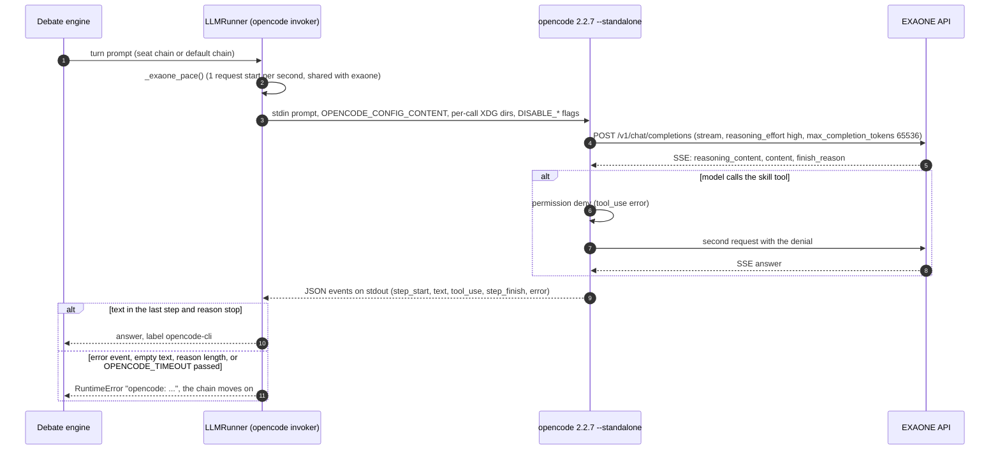

# EXAONE through opencode (design)

English | [한국어](opencode-exaone.ko.md)

Status: proposed 2026-11-11; decisions by the operator the same day (below); built and deployed to the hub 2026-11-11
as `44f2054` (first real call passed); installed on the six Tier-1 workers 2026-11-11 (workers reinstalled at
`44f2054`, one worker run passed); trial debate 2026-11-11 APPROVED in round 1 (1519 s), but one of the two opencode
critics read no code: K-EXAONE under opencode reaches for a native `repo` tool instead of writing ```repo blocks
(see 구현 메모). Fix built and deployed to the hub 2026-11-11 as `a86fc63`: opencode members with
`code_tools: "mcp"` read code through the read-only `repo_mcp.py` MCP server (real hub call passed). Re-trial
2026-11-12 UNVERIFIED: the MCP path works (the critic that read nothing before took 6 MCP steps, evidence 10/10
verified), but neither opencode critic's answer reached the judge: one got EXAONE's own 429 ("too many concurrent
requests") and the opencode path does not retry, the other lost a good first answer when its citation re-ask timed out
at 1200 s (an engine defect for every provider, see 구현 메모). Both fixed and deployed to the hub 2026-11-14 as
`4b79b52`: a re-ask that falls back keeps the first answer (event `reask_failed`), and the opencode provider retries
EXAONE's 429 within the same deadline; not yet re-tried. `exaone` stays the provider for debate seats until a re-trial
passes. The six Tier-1 workers were reinstalled at `5d34ce8` on 2026-11-17 for resident agents (worker protocol
3), so they now carry the `a86fc63` MCP path and the `4b79b52` fixes; the seat rule above is unchanged.
Origin: the operator wants K-EXAONE used through the opencode CLI, as the EXAONE "agent start" guide
(`docs.exaone.ai/ko/docs/agent-start`) describes, next to the HTTP provider of `exaone-provider.md`.
Revises decision 2 of `exaone-provider.md` (exaone in the automatic fallback chain).

## Decisions

Made by the operator, 2026-11-11:

1. **Next to the HTTP provider.** The stdlib HTTP provider `exaone` stays; opencode is added beside it.
2. **Order of work.** Check on the Mac first, then install on the hub and wire it into Guardian.
3. **opencode line.** `@opencode/cli` **2.2.7**, the v2 line the EXAONE guide documents (its config schema and
   `--standalone`), not the Homebrew `opencode-ai` 1.x line.
4. **Fallback chain.** The operator answered "replace with opencode". Read as: in the default chain, `opencode` takes
   the place of `exaone`, and `exaone` leaves the default chain. `exaone` stays a known provider that a seat, a team
   member or Quick ask can still pick by name. This is an interpretation of a short answer; it is recorded here so the
   operator can correct it.

## What was measured (Mac, 2026-11-11)

Against a local fake OpenAI-compatible server (`stream` SSE, modes ok, 429, 429 with `retry-after`, 500, stall,
`length`, tool call) and once against the real EXAONE API.

| Topic | Finding |
|---|---|
| Real API | The guide's v2 config answered `PONG` in about 2 s with the adjustments below. |
| Request | `stream: true`, `stream_options.include_usage`, `reasoning_effort`, `temperature`, `top_p` from the model `body`; `max_completion_tokens` from `limit.output` (default 32000). A `max_tokens` in `body` adds a second, conflicting field, so the output limit goes in `limit.output` only. The real API accepted `max_completion_tokens`. |
| Tools | `permission: {"*": "deny"}` cuts the offered tools to one (`skill`) and the system prompt to about 1.8 KB. `skill` cannot be removed (`skills: []`, `"none"`, `disableBundledSkills`, `skill: deny` all leave it). When the model calls it, opencode refuses (`Permission denied: skill`, not executed) and sends a second request; the answer is in the last step. |
| Retries | 429, 429 with `retry-after`, and 500: 10 retries (11 requests, 82-84 s), then exit 1 with an `error` event. (1.x: 5 retries.) |
| Stall | A stream that stops sending waits forever in both lines. The caller needs its own deadline. |
| Events | `--format json` prints one JSON object per line: `step_start`, `text` (`part.text`, may start with blank lines), `tool_use` (`part.state.status`, `error`), `step_finish` (`part.reason`, `part.tokens`), `retry`, `error` (`error.type`, `message`, `status`, `response.body`). |
| Session data | With isolated `XDG_*` dirs nothing was written there and no session store was found on the Mac. To be checked on the hub. |
| Binary | npm installs a native binary per platform as an optional dependency (`@opencode/cli-linux-arm64`, `bin/opencode`); node's version does not matter at run time. |

Deviations from the guide's config, all deliberate:

- `reasoning_effort` **high**, not the guide's `medium` (decision 3 of `exaone-provider.md`, the operator's choice).
- Output limit in `limit.output: 65536`, not `max_tokens` in `body` (the conflict above).
- `capabilities.tools: false` and `permission: {"*": "deny"}`: agents read code through ```repo blocks, as with the
  HTTP provider; opencode must not run tools.
- Key variable `OPENCODE_EXAONE_API_KEY`, not `EXAONE_API_KEY`: `env_policy.PROVIDER_PREFIXES` gives the opencode
  provider only `OPENCODE_*` variables. It holds the same key value.

## Design



The diagram is also kept as [opencode-exaone-flow.mmd](opencode-exaone-flow.mmd).

### Provider lists

`llm_runner.py` gets two lists instead of one:

| List | Content | Used by |
|---|---|---|
| `KNOWN_PROVIDERS` | `claude, codex, agy, zai, exaone, opencode, ollama, llm` | provider validation (`team_manager`, `flow_graph`, `worker`), the editor catalog (`config_ops`), `installed_providers` |
| `DEFAULT_PROVIDER_ORDER` | `claude, codex, agy, zai, opencode, ollama, llm` | the chain when neither a seat nor `GUARDIAN_LLM_PROVIDERS` names one |

`GUARDIAN_LLM_PROVIDERS` still overrides the default order. An explicit `["exaone"]` keeps working.

### The opencode invoker

The `opencode` provider stops being a generic `opencode run <prompt>` and becomes "EXAONE through opencode".
Checked 2026-11-11 (read only): no `opencode` binary on the hub or the six Tier-1 hosts, and no team, flow, character
or project file under the hub's data dir names `opencode`; the repository's `configs/` and golden files do not either.
No running team depends on the old meaning.

- **Binary:** `OPENCODE_BIN` (default `opencode` from the search path). The Mac has Homebrew `opencode-ai` 1.x on its
  PATH, which does not know `--standalone`, so readiness also runs `<bin> --version` once per binary path and
  modification time and requires major version 2 (the v2 binary prints `opencode v2.2.7`, Homebrew 1.x a bare
  `1.19.5`). A 1.x binary leaves the provider not ready.
- **Ready** only when that binary passes the version check **and** `OPENCODE_EXAONE_API_KEY` is set. Without the key
  the provider is never ready, so the build changes nothing until a key is placed.
- **Command:** `opencode run --standalone --format json --title guardian -m exaone/k-exaone_v2.5`, the prompt on
  **stdin** (no prompt in argv; turns reach hundreds of KB).
- **Config** built in Python and passed as `OPENCODE_CONFIG_CONTENT` (no file on the host, so workers need nothing
  extra). It is the guide's v2 config with the deviations above: provider `exaone`, package
  `@opencode/ai/providers/openai-compatible`, `baseURL` `https://api.exaone.ai/v1`, `apiKey`
  `{env:OPENCODE_EXAONE_API_KEY}`, model `k-exaone_v2.5` with `capabilities {tools: false, input/output text,
  temperature: true, reasoning: {supported: true}}`, `compatibility.reasoningField: "reasoning_content"`, `body
  {reasoning_effort, temperature 1.0, top_p 0.95}`, `limit {context 524288, output 65536}`, `permission {"*": "deny"}`.
  Effort follows `OPENCODE_EXAONE_EFFORT` (default `high`), model id `OPENCODE_EXAONE_MODEL` (default
  `k-exaone_v2.5`). The output limit 65536 equals the HTTP provider's `EXAONE_DEFAULT_MAX_TOKENS`, and the effort
  default equals `EXAONE_DEFAULT_EFFORT`, so neither of the operator's EXAONE choices changes.
- **Guardian-only settings** (`OPENCODE_BIN`, `OPENCODE_TIMEOUT`, `OPENCODE_EXAONE_EFFORT`, `OPENCODE_EXAONE_MODEL`)
  are read by the runner and removed from the environment passed to opencode.
- **Environment** (on top of `provider_env("opencode")`): `XDG_CONFIG_HOME`, `XDG_DATA_HOME` and `XDG_STATE_HOME` in
  the call's scratch directory, so no session or prompt copy outlives the turn; `XDG_CACHE_HOME` persistent under
  `~/.cache/guardian-opencode` (package cache); `OPENCODE_DISABLE_PROJECT_CONFIG`, `OPENCODE_DISABLE_CLAUDE_CODE`,
  `OPENCODE_DISABLE_CLAUDE_CODE_SKILLS`, `OPENCODE_DISABLE_AUTOUPDATE`, `OPENCODE_DISABLE_MODELS_FETCH`,
  `OPENCODE_DISABLE_FREE_MODELS` set to `1`. The working directory is the scratch directory, never the repository.
- **No free-model fallback:** the invoker always passes both the Guardian config and `-m`; it never runs opencode
  without them.
- **Pacing:** `_exaone_pace()` before the process starts, so opencode turns and HTTP `exaone` turns share the key's
  one-request-per-second spacing inside one process. The second request after a refused `skill` call is not paced
  (opencode sends it); the 429 retries cover it.
- **Deadline:** `OPENCODE_TIMEOUT` seconds, default **1200** (the HTTP provider needed 1200 s: its longest
  high-effort request took 1129 s, and opencode now holds its place in the default chain). The runner enforces it on
  the whole process, because opencode waits forever on a stalled stream. opencode is started in its own process group
  (`start_new_session=True`); on expiry the runner kills the group, not only the direct child, and the turn fails as
  a timeout. Only a stalled stream was measured; a long but active stream (over 1000 s) through opencode is untested.
- **Result:** the `text` parts of the **last** step, joined and stripped. The turn fails (RuntimeError `opencode: ...`,
  the chain moves on) on an `error` event, a non-zero exit, empty text, or `step_finish.reason == "length"` (its own
  message, so a cut answer is never taken as complete).
- **Errors** keep only the error type, message, HTTP status and an `x-request-id` if present: never headers, never the
  key, never the request body.
- **Accounting:** the number of `tool_use` events is logged with the turn (a non-zero count means a refused `skill`
  call and an extra request).
- **Sessions:** none, like `exaone`: `run_session_prompt` uses the engine's replay; results are labelled
  `opencode-cli`; `interactive_resume_command` refuses opencode as before.

### Hub install

- `npm install --prefix ~/.local/lib/opencode-2.2.7 @opencode/cli@2.2.7` on the hub, then a symlink
  `~/.local/bin/opencode` to `.../node_modules/@opencode/cli-linux-arm64/bin/opencode` (`~/.local/bin` is first on the
  runner's PATH). Version pinned; upgrades are a deliberate step with a re-check of the event format.
- `OPENCODE_EXAONE_API_KEY` (same value as `EXAONE_API_KEY`) merged line by line into the hub's
  `~/.guardian/llm.env` (the file the hub reads; `~/.config/server-guardian/llm.env` there is empty). Never overwrite the file. `OPENCODE_TIMEOUT` is needed only to differ from the
  1200 s default.
- Tier-1 worker hosts are **not** part of this step; ask the operator first. Consequence to put to the operator: a
  worker runs a seat's default chain from its own installed code. After the next worker reinstall that chain has no
  `exaone`, and the workers have no opencode, so a worker-hosted seat without its own `providers` loses EXAONE until
  opencode is installed there too. (No production team has a worker `host` yet.) The operator approved the worker
  install on 2026-11-11; it is recorded in the implementation notes.
- The package's npm `postinstall` runs `opencode --version` with the real XDG dirs, so every install leaves
  `~/.config/opencode` and `~/.local/share/opencode` behind. Remove both right after the install.

## Risks

- **Retrieval protocol (seen in the trial).** Under opencode's agent harness K-EXAONE tries native tool calls (`repo`)
  for the repository instead of the ```repo text blocks the engine reads. Every tool is denied, so the call is refused
  and the seat reviews from the proposal's quotes alone. The citation check catches it (lines "never shown"), but the
  seat adds little.
- **The `skill` tool.** It cannot be removed. A call doubles the requests of a turn on a one-request-per-second key
  and may draw a 429 (retried by opencode). Watch the `tool_use` count in production.
- **Retries hide time.** A failing API costs 82-84 s inside opencode before the chain moves on.
- **Fast-moving v2 line.** 2.x changes config keys and event shapes between releases; the pin and the invoker's strict
  parsing (unknown event shapes are ignored, a missing answer fails) keep a silent change from passing as an answer.
- **Two transports, one key.** The default chain now uses opencode, explicit picks may use the HTTP provider; both
  draw on the same key and rate limit. Pacing is shared only inside one process.
- **Interpretation of decision 4.** If the operator meant something else (for example opencode in addition, or the
  HTTP provider removed), only the two lists change.

## Sources

- EXAONE guide "agent start" (`docs.exaone.ai/ko/docs/agent-start`), opencode section (v2 config).
- `@opencode/cli` 2.2.7 on npm; `opencode run --help` of that version.
- Probes of 2026-11-11 on the Mac (fake SSE server and one real call); scripts kept outside the repository.

## 구현 메모

Built 2026-11-11 by a z.ai agent from a written contract, reviewed by claude; two fixes were made in review.

- **Version output.** The contract assumed `--version` prints a bare `2.x`; the real v2 binary prints
  `opencode v2.2.7`, so the first build never reported opencode as ready. `_opencode_major` reads both shapes
  (`opencode v2.2.7`, `1.19.5`); the test fake now prints the real shape.
- **The version probe wrote state.** Even `opencode --version` appends a "cli starting" line to
  `$XDG_DATA_HOME/opencode/log/opencode.log` (args only, no prompt). The probe now runs with throwaway XDG dirs like
  a turn (`_opencode_scratch_env`), so no opencode file appears under `~/.local/share` after a probe or a turn.
- **Lists.** `KNOWN_PROVIDERS` (validation in `team_manager`, `flow_graph`, `worker`; the `config_ops` catalog;
  `installed_providers`) and `DEFAULT_PROVIDER_ORDER` without `exaone`. Two `test_llm_runner` tests that used
  opencode as a plain stateless CLI moved to `ollama`.
- **Length.** opencode continues a cut answer twice itself, then ends with the error event `output-limit`, so a cut
  answer fails through the error rule; the `reason length` check stays for a run that exits 0.
- **Checked on the Mac (2026-11-11)** with the real v2 binary against a fake SSE server: answer `PONG` (0.6 s), a
  refused skill call (answer from the second step, one refused call logged), `output-limit` error, 500 (opencode's own
  retries, 90 s, `error provider.internal: fake 500 (status 500)`), stall (`timed out after 20s`, process group killed,
  no opencode process or scratch dir left), `run_session_prompt` label `opencode-cli` with no session. Unit tests:
  `test_opencode_provider.py` (fake executable, no network).
- **Hub install (2026-11-11).** `npm install --prefix ~/.local/lib/opencode-2.2.7 @opencode/cli@2.2.7` (485 MB,
  node 18.19.1, npm 9.2.0), `~/.local/bin/opencode` links to the `cli-linux-arm64` binary, `--version` prints
  `opencode v2.2.7`. One `OPENCODE_EXAONE_API_KEY` line was appended to `~/.guardian/llm.env` with the value of the
  `EXAONE_API_KEY` line (never printed; mode 600 kept; no duplicate key). Deployed as `44f2054` (release
  `44f2054-20261110161119`) with no debate running.
- **First real call (2026-11-11).** A general Quick ask through `POST /api/solo` with provider `opencode`: completed in
  9.9 s, label `opencode-cli`, no failures, a correct two-sentence answer. After the probe and the call nothing new was
  under `~/.local/share/opencode` or `~/.config/opencode` and no `guardian_opencode_*` dir was left; the cache
  `~/.cache/guardian-opencode` holds 12 KB. (The only opencode files there came from the install a minute earlier:
  the package's npm `postinstall` runs `opencode --version` with the real XDG dirs. The Tier-1 install showed this:
  the log's "cli starting" line with args `--version` is older than the symlink. They were removed.)
- **Tier-1 workers (2026-11-11, operator's OK).** On each of the six aarch64 workers (node 18 to 22): the same npm
  install and symlink, `--version` prints `opencode v2.2.7`, the `postinstall` leftovers removed, one
  `OPENCODE_EXAONE_API_KEY` line appended to `~/.guardian/llm.env` from the `EXAONE_API_KEY` line (never printed, mode
  600, no duplicate). With no debate running, the workers were reinstalled from `f093b62` to `44f2054` with
  `scripts/install-worker.sh <host> --rev 44f2054`, one host first, then the other five. All six report version
  `ef9af9457945`, providers `claude,codex,agy,zai,exaone,opencode`, 2 of 2 slots free. One direct `run` request
  (protocol 2, `providers: ["opencode"]`) to one worker answered `PONG` in 5 s with label `opencode-cli`, no failures,
  and left no opencode state or `guardian_opencode_*` dir.
- **Trial debate (2026-11-11, operator's OK).** Hub sandbox `~/guardian-eval/data-opencode`, script
  `run-opencode-trial.sh`: a copy of the exaone trial (same task, commit `6e0fb08`, lead and judge on claude) with both
  Critics on `providers: ["opencode"]`, so no fallback could hide a failure. Thread `thread_20261110_232511_8f636c`:
  APPROVED in round 1 in 1519 s, jev gate PASSED, jev verdict source `uncertain` (shadow). Both Critics ran on
  `opencode-cli` with no fallback and no error, and nothing was left in `~/.config/opencode` or
  `~/.local/share/opencode`. The Judge approved the two known real defects (validated-then-overwritten `modified`,
  unchecked stored `created`), the same as earlier trials.
  - **Finding: retrieval regression.** The security Critic ran 637 s with 0 retrieval steps. Its answer says it
    tried a `repo` tool and got "No tool named repo", so it never saw the code and reviewed only the proposal's
    quotes. Its citation check listed 6 lines as never shown. The QA Critic ran 1336 s with 2 steps, all citations
    verified, but closed with "no more lookups possible because of tool limits". In the HTTP `exaone` trial of
    2026-11-10 (same task and lineup), the two Critics took 3 and 7 steps and every citation was verified.
  - **Cause (likely).** opencode puts its own agent prompt and tool list in front of the model, so K-EXAONE treats
    the repository as a tool to call. Guardian denies every tool (`{"*": "deny"}`), so the call is refused.
    `_opencode_parse` counts those refusals, but only at `logger.info`, so this run did not record how many there
    were.
  - **Open (operator's choice).** Options:
    - Let opencode reach the read-only `repo_mcp.py` as an MCP server, allowing only its tools.
    - Tell the model in the opencode prompt to write ```repo blocks and never call tools.
    - Record the refused-call count on `agent_finished` and re-ask a turn that refused a call and read nothing.

    Until one of these is in place, use `exaone` (HTTP) for debate seats. opencode stays in the default chain, where
    it is reached only after claude, codex, agy and zai.

- **repo_mcp for opencode (2026-11-11, `a86fc63`).** The operator chose the first option. Built by a z.ai agent
  (its sandbox could not run Python, so claude ran every test), reviewed by claude.
  - **Opt-in.** The engine attaches the server only to a member with `code_tools: "mcp"`, when the project has a
    repository and `GUARDIAN_REPO_MCP=1` (set in the hub `agent.env`), the same gate as claude and codex. No builtin
    team and not the trial team set `code_tools`, so a seat without it, or a seat that falls back to opencode, still
    has the regression above.
  - **Config.** `_opencode_config(..., repo_mcp=spec)` adds `mcp.repo` (`type: local`, `enabled: true`,
    `codemode: false`, `timeout: 60000`), sets `capabilities.tools: true` and the permission
    `{"*": "deny", "repo_repo_*": "allow"}` over `repo_mcp.opencode_tool_names()` (opencode names a tool
    `<server>_<tool>`, so `repo_repo_read`). `codemode` must be false: when true, opencode routes MCP calls through
    its `execute` interpreter instead of exposing the tools. The default `timeout` is 5 s, too short for a first
    `repo_map` on a large repository. Ten tools are allowed with the index (the same list claude allows, `repo_wiki`
    included), five with `no_index`. Without a spec the config is unchanged.
  - **Environment leak.** opencode passes its whole environment to an MCP child, including
    `OPENCODE_EXAONE_API_KEY` and `OPENCODE_CONFIG_CONTENT`. The server command therefore starts with
    `/usr/bin/env -i` and passes only `PATH`, `HOME`, `LANG` and `LC_ALL` (each only when set), the same whitelist as
    claude's MCP `server_env`.
  - **Engine.** `run_session_prompt` has an opencode branch (stateless, scratch dir, no session id) that passes the
    spec. Retrieval steps are counted from the repo_mcp call log, as for claude. `_opencode_parse` now separates
    served calls (`state.status == "completed"`) from refused ones and logs both. The MCP prompt section lists the plain
    tool names and says the session may show them with a prefix (`mcp__repo__repo_read`, `repo_repo_read`); prompt
    `p29`.
  - **Checked on the hub (2026-11-11).** Deployed as `a86fc63` (release `a86fc63-20261111003749`) with no debate
    running. One `run_session_prompt` call with provider `opencode` and a repo_mcp spec in a sandbox under
    `~/guardian-eval` (own `GUARDIAN_DATA_DIR` and cache) on a one-file repository: answered correctly with a citation
    in 5.5 s, label `opencode-cli`, no failure; the call log holds one `read`; the MCP child's environment held only
    `HOME`, `LANG` and `PATH`; nothing was left under `~/.config/opencode` or `~/.local/share/opencode`. The sandbox
    was removed.
  - **Not done.** The six Tier-1 workers still run `44f2054`; a remote opencode turn with a repository snapshot needs
    them reinstalled at `a86fc63` (operator's OK). The re-trial is the next bullet.
- **Re-trial with repo_mcp (2026-11-12, UNVERIFIED).** Operator's OK. Hub sandbox `~/guardian-eval` (own data dir
  `data-opencode-mcp`, script `run-opencode-mcp-trial.sh`), same task and workspace commit as the first trial (review
  of `TeamManager.save` / `validate_team_meta` at `6e0fb08`), team `opencode-mcp-trial`: lead and judge on claude, the
  security and QA critics on `opencode` with `code_tools: "mcp"`, `max_rounds` 2. Thread
  `thread_20261112_023855_cbd32c`, 2598 s, UNVERIFIED in round 1 (both critics fell back to the builtin engine).
  - **MCP works.** The security critic, which read no code in the first trial, made 6 repo_mcp calls before its first
    answer (`read` of `team_manager.py` and `config_ops.py`, two `outline`, two `refs`; all events `via: mcp`). That
    answer's findings checked 10 of 10 verified; one citation was unverified, `scripts/ci.sh`, cited before it was
    read. The six steps carry one timestamp because the events are replayed from the call log, so step timing cannot
    be read from them. The answer came about 1177 s into the turn against the 1200 s total deadline
    (`OPENCODE_TIMEOUT`), a thinner margin than the HTTP exaone trial's 1129/1200.
  - **QA critic: EXAONE's 429.** 89 s into the turn opencode failed with `provider.rate-limit: service is busy, too
    many concurrent requests(1024) (status 429)`. That is the service's own limit, not Guardian's 1 req/s pacing.
    The HTTP `exaone` provider retries a 429/5xx whose `retry-after` is at most 30 s (`EXAONE_MAX_RETRY_AFTER`); the
    `opencode` provider has no retry, so the member fell back at once (whether opencode retried inside is not
    visible).
  - **Security critic: a lost first answer.** The unverified citation triggered the engine's one-time citation re-ask.
    For opencode that is a fresh stateless call, so it read everything again (7 more steps, two of them full reads of
    `team_manager.py` again, 13 steps and 203 KB in all) and hit the 1200 s deadline. The engine then returned the
    builtin fallback (`built-in-expert`, 291 bytes) and dropped the first answer: in `debate_engine.py` the
    `if result.provider == BUILTIN_PROVIDER: break` comes before the restore of `before_ask` and the `format_base`
    merge, so a re-ask (citation or judge format) that fails loses the answer it was meant to improve. This is an
    engine defect for every provider; long-turn providers are just the most exposed. Count 6 steps, not 13, when
    comparing with the HTTP exaone critics' 3 and 7.
  - **Judge.** With no critique, the claude judge read the code itself (2 steps) and approved both known defects (the
    validated-then-overwritten `modified`, the unchecked stored `created`); the verdict stays UNVERIFIED because no
    critic answered, which is correct.
  - **After the run.** Nothing under `~/.config/opencode` or `~/.local/share/opencode`.
  - **Next (not built).** Engine: when a re-ask returns the builtin fallback, keep the first answer (its unverified
    citations still flagged), and the same for the `format_base` merge. opencode provider: retry EXAONE's 429 like
    the HTTP provider. Then re-run this trial. Until then debate seats use `exaone`, and the workers stay at
    `44f2054`. Built 2026-11-14, next bullet.
- **Re-ask fallback and 429 retry (2026-11-14, deployed as `4b79b52`).** Built by a z.ai agent, reviewed by claude.
  - **Engine.** Each of the four re-asks (code citation, ops citation, judge format, judge action repair) saves the
    answer it sends back with its `LLMResult`. When the reply to the re-ask, or a retrieval follow-up after it, comes
    back from the builtin fallback, the loop restores that answer and result at the builtin break, so the entry,
    `agent_finished` (`fallback: false`) and the round's `unverified` flag see the real provider. `unverified` is not
    recomputed: the check ran on that answer before the ask, so its unverified citations stay on the entry. The
    `failures` list keeps the failed call. New event `reask_failed` (`kind`, `kept`, `provider`).
  - **Deviation for the judge.** A judge answer is restored only when `judge_missing_parts` finds nothing missing.
    A judge answer without its verdict or json, restored under a real provider label, would read as REJECTED where
    today the round is honestly UNVERIFIED. A format re-ask's base lacks parts by definition, so a format re-ask that
    falls back keeps today's builtin outcome (`kept: false`); citation and repair re-asks of a complete judge answer
    are restored.
  - **opencode.** `_opencode_rate_limited` reads the last error event of the JSON output: `error.type ==
    "provider.rate-limit"` or `error.status` 429 (number or numeric string), never the message text. Only that
    failure is retried, at most `OPENCODE_MAX_RETRIES` (2) times, pauses `OPENCODE_RETRY_BACKOFF` 30 s and 60 s plus
    up to 5 s jitter. One deadline (`OPENCODE_TIMEOUT`) covers all attempts: each attempt gets the time that is left,
    and a pause that would pass the deadline fails with the original error. Every attempt has its own scratch XDG
    dirs and its own pacing slot. 5xx is not retried here, since opencode already retries inside.
  - **Tests.** `test_retrieval_loop.py` (a scripted `LLMResult` makes one call builtin; expert citation, judge
    format, judge citation, re-ask that asks for code) and `test_opencode_provider.py` (`RateLimitDetectionTests`,
    `RetryTests`); seat and flow goldens unchanged, no prompt version bump.
  - **Not done.** The re-trial (operator's OK, shared quota) and, if it passes, the workers reinstalled at
    `4b79b52`.
- **Workers reinstalled, 2026-11-17.** The six Tier-1 workers were reinstalled at `5d34ce8` for the resident agents'
  worker protocol 3 (`resident-agents.md`, 구현 메모 "Deploy and worker reinstall, 2026-11-17"), ahead of the
  re-trial. That revision contains `a86fc63` and `4b79b52`, so a remote opencode member now gets the repo_mcp path and
  the 429 retry; all six list `opencode`. The re-trial is still not run, and debate seats still use `exaone` until it
  passes.
